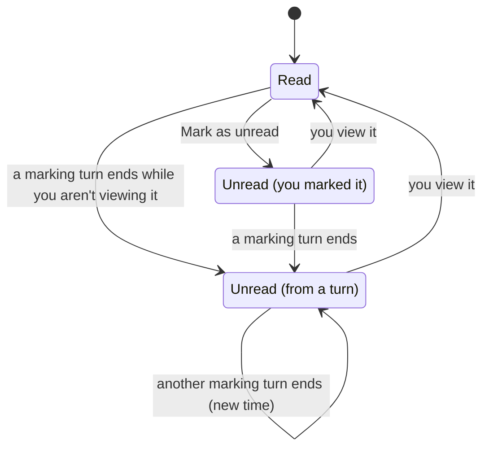
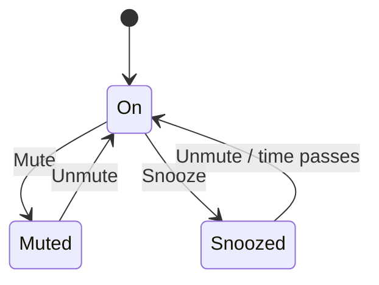
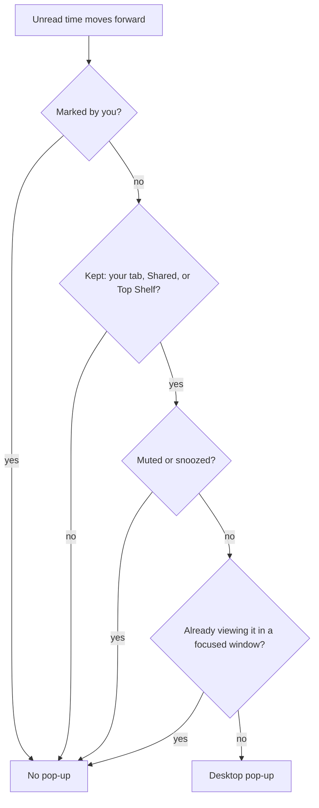

# Tab attention: Unread vs. notifications

Sources:

- **Unread marks (server):** `internal/rocketclaw/backend/store_dao.go`. Turns mark sessions unread in the turn-finish SQL, `ViewSession` clears the mark, and `MarkUnread` sets it by hand. Remote OpenCode sessions are marked in `internal/rocketclaw/backend/opencode.go` (`marks`).
- **Notifications and attention (browser):** `internal/rocketclaw/web/src/ui.tsx`: `TabNotifications`, `followed`, `useNextAttention`, `BoardNotifications`, `TabItem`, `muteOf`.

## The key point

Unread and notifications are **two separate systems with different rules**. They overlap only partly:

- **Unread is decided on the server.** The rule is about *who sent the turn*. Whether you have the tab open, or muted it, doesn't matter.
- **Notifications are decided in the browser.** The rule is about *whether you keep the session somewhere* (your tab, Shared, or Top Shelf) and *whether you muted it*.
- **Mute only affects notifications.** It never touches Unread.

That's why the menu item "Mute notifications" doesn't do what people expect.

## The pieces of state (each one is per person, per session)

| State | Values | Where it's stored | What changes it |
|---|---|---|---|
| **Unread mark** | read · unread (from a turn) · unread (you marked it) | server, `web_tabs.unread_at` and `marked_unread` | turn ends, viewing it, Mark as unread |
| **Silence** | on · muted · snoozed until a time | server, mutes list | Mute, Snooze, Unmute, the snooze time passing |
| **Kept** | yes if your tab, Shared (any space), or Top Shelf holds it | server, tabs | open/close, Add/Remove Shared or Top Shelf |
| **Session activity** | idle · running · needs you (asking) | session | the agent, not you |

**Followed** = Kept **and** Silence is on. Pop-ups, the title count and Cmd/Ctrl+Alt+A only consider followed sessions.

## Diagram 1: the Unread mark

If you marked it unread on the tab you're looking at, the mark stays until you go to another session and come back.

A **marking turn** is either of these:

- a turn **you** started or steered from the Web, or
- **any** turn in a session that's in **some** space's Shared group. This marks every Web person.

These turns **never mark you**: a turn someone else sent, a cron run, a Slack mention, or anything else that didn't come from you in the Web, unless the session is in Shared.

"Viewing it" means the session's tab is active in a focused window. Turns that end within 10 seconds of you viewing it don't mark you either.

Mute, Snooze and Close don't change the mark at all. A closed session stays unread on the server and shows up bold again when you reopen it.

## Diagram 2: notifications (Mute / Snooze)

## Diagram 3: when a desktop notification pops

The only thing that can trigger a pop-up is **a turn ending**. A session that starts asking you a question never pops one.

## What you actually see

| Situation | Tab bold | Amber "needs you" | Desktop pop-up | Title "(N)" | Cmd/Ctrl+Alt+A |
|---|---|---|---|---|---|
| Your turn ended, followed | yes | – | **yes** | – | yes |
| Your turn ended, **muted/snoozed** | **yes** | – | no | – | no |
| Your turn ended, tab closed and not kept anywhere | (no tab; still unread on the server) | – | no | – | no |
| Someone else's / a cron's turn ended in a tab you keep (not Shared) | **no** | – | **no** | – | no |
| Any turn ended in a Shared session, any space | yes | – | yes (unless muted) | – | yes |
| You marked it unread | yes | – | never | – | yes (unless muted) |
| Session needs you, followed | – | yes | **no** | yes | yes (comes first) |
| Session needs you, **muted** | – | **yes** | no | no | no |
| Dashboard in your current space, lane set to notify | – | – | yes, **even when the session is muted** | – | – |

## Where the two systems disagree

1. **Mute only half-mutes.** It stops pop-ups, the title count and Cmd/Ctrl+Alt+A. The tab still turns bold, and still shows the amber "needs you" badge.
2. **Keeping a tab doesn't subscribe you.** Unread only comes from turns you sent (or from Shared). If a teammate or a cron moves a session you keep open, it never goes bold and never pops. "Mute" is still offered on that tab, even though there's nothing to mute.
3. **The most urgent state never pops.** "Needs you" shows up in the title count and Cmd/Ctrl+Alt+A, but never as a desktop notification. Only a finished turn pops one.
4. **Shared is everything or nothing.** Every turn in every Shared session, in every space, marks every Web person. For anyone who can see that space, it pops too, because Shared tabs in all spaces count as kept.
5. **Dashboard notifications ignore Mute.** They're a third path, with their own rules.
6. **Mark as unread never calls you back.** It never pops, and once the session is muted, Cmd/Ctrl+Alt+A skips it too.
7. **Three ways to go quiet:** Mute, Snooze, and closing every copy of the tab. Each one silences something different. Muted and snoozed are even stored as the same thing; muted is a snooze with no end time, which is why a snoozed session's menu says "Unmute".

## What was decided

The redesign that replaces all of this is in `docs/specs/2026-11-09-tab-attention-design.md`.
