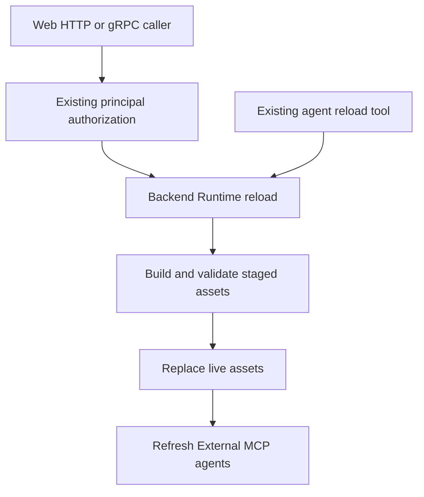

# Web Runtime Reload - Plan

## Goal Capsule

- Objective: Authorized Web users can reload runtime assets directly.
- Means: Share the existing backend reload operation (KTD1).
- Authority: Product requirements below and repository standards govern implementation.
- Execution: One scoped feature change, verified locally and through CI.
- Stop conditions: A conflicting authorization contract or failing required gate prevents shipping.
- Completion owner: The implementing agent verifies and ships the change.

---
## Product Contract

### Summary

Add Reload to the Web RPC without introducing a second reload implementation.

### Problem Frame

Runtime assets can already be reloaded through an agent tool, but the Web protocol does not expose that operation directly.

### Requirements

**Web access**
- R1. Expose Reload to users authorized by the existing Web principal policy.
- R2. Reject unauthorized callers before invoking backend reload.

**Runtime behavior**
- R3. Preserve serialized validation-before-swap, agent reload behavior, and External MCP refresh.
- R4. Reload runtime assets directly, without an agent turn, process restart, or configuration reread.

### Scope Boundaries

No UI button, restart endpoint, new authorization policy, speculative APIs, or alternate reload engine.

---
## Planning Contract

### Key Technical Decisions

- KTD1. Move the current operation from `backend/app.go` onto `backend.Runtime`, with its existing lock and validation flow. Both callers use that method; a forwarding wrapper would leave ownership split. (session-settled: user-directed — chosen over a separate Web reload implementation: both surfaces must reuse the same operation.)
- KTD2. Replace the touched reload and MCP-refresh behavior callbacks with small method interfaces and an explicit inert refresh implementation, following repository dependency rules.
- KTD3. Follow existing unary registration and HTTP JSON conversion in `frontend/rpc/transport.go` and `frontend/rpc/http.go`.

### Assumptions

- Reload accepts a reason string, matching the agent operation, and returns its existing completion message.
- Backend reload failures use the existing Web RPC error transport, with no new recovery policy.

### High-Level Technical Design

### Risks

Authorization must run before the shared operation. Validation failure must leave live assets unchanged. MCP refresh errors occur after replacement, as in the existing operation.

---
## Implementation Units

### U1. Share backend reload and expose Web access

- Goal: Implement R1-R4 through KTD1-KTD3.
- Dependencies: None.
- Files: `internal/rocketclaw/backend/{app.go,runtime.go,bridge.go,app_test.go,bridge_test.go,session_tools_test.go}`, `internal/rocketclaw/frontend/backend.go`, `internal/rocketclaw/frontend/rpc/{transport.go,http.go,server.go,http_test.go}`, `internal/rocketclaw/web/proto/web.proto`, `cmd/rocketclaw/{assemble.go,assemble_test.go}`, `.mockery.yml`, and their generated protocol/mock assets.
- Approach: Move shared ownership first, update method dependencies, then add the unary protocol and transport handler.
- Execution note: Verify the recovered implementation against current source and fill only missing behavior or checks. Previous verification does not establish these gates.
- Current-source check: The runtime reload still lives in `backend/app.go`; the Web service and unary registration lack Reload. Move that operation and its mutex to Runtime, supply the Runtime itself to the agent tool's method interface, and replace the refresh function pointer with an interface implemented by the existing MCP agent index. Keep the same validator and receipt. Do not copy historical tests: use the current socket test fixture and registered service.
- Patterns: `principal`, existing unary handlers, `ReplaceRuntimeAssetsAfterValidation`, and mockery v3 configuration.
- Test scenarios:
  - An authorized HTTP caller supplies a reason and receives the shared completion message through registered gRPC.
  - Missing or invalid principal metadata fails without invoking reload.
  - Backend failure reaches the caller as a failed RPC rather than a successful receipt.
  - Agent and direct runtime callers both invoke the shared operation.
  - Invalid staged assets preserve live definitions; successful replacement refreshes External MCP agents.
  - Concurrent callers remain serialized through MCP refresh; refresh failure after a successful swap reports failure without claiming rollback.
- Verification: Targeted behavioral tests and the complete required verification contract pass.

---
## Verification Contract

| Gate | Scope |
|---|---|
| `gofmt` on touched Go files | U1 |
| `go doc` and `gopls` touched-file checks | U1 |
| `go test ./...` | Entire repository |
| `make lint` | Entire repository |
| `make test` | Coverage and source budgets unchanged |
| `bun install --frozen-lockfile` | Existing Web dependencies |
| `make -C internal/rocketclaw/web lint` and `test` | Web protocol and bundled schema |
| `make -C internal/rocketclaw web-assets` | Rebuild tracked assets before browser checks |
| Browser checks | New endpoint and unchanged Web startup |

---
## Definition of Done

R1-R4 are proven, generated artifacts match their sources, required checks pass, and no abandoned implementation remains.
README impact is reviewed; update only documentation that already describes this protocol surface.
