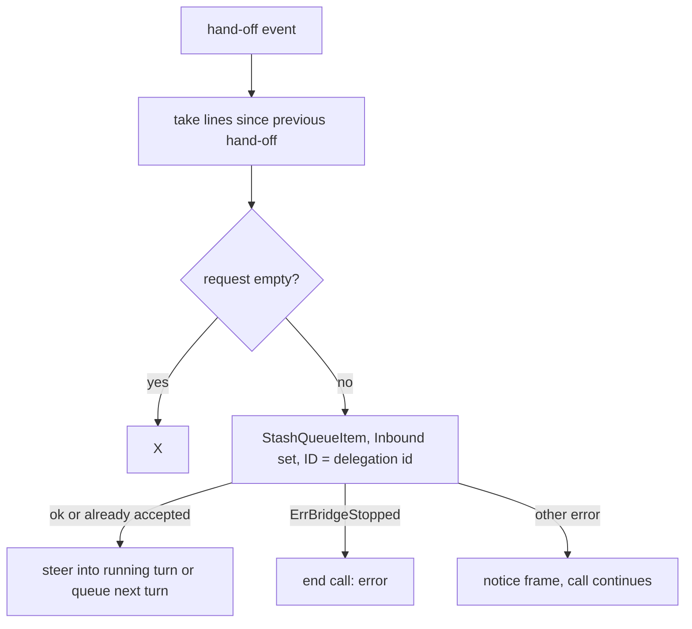
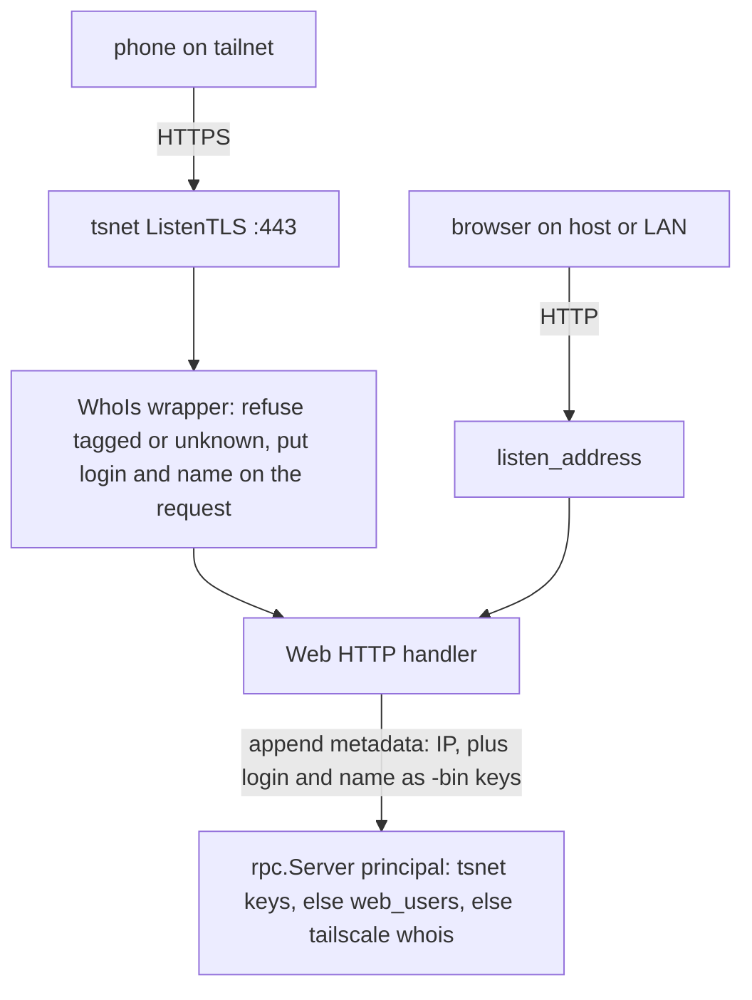
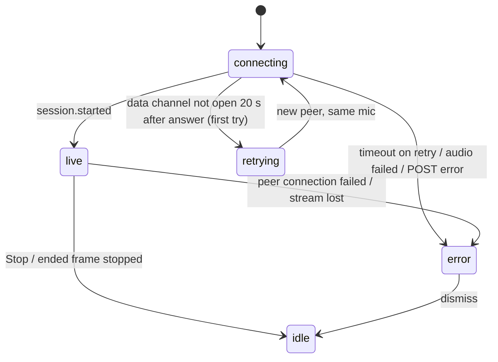
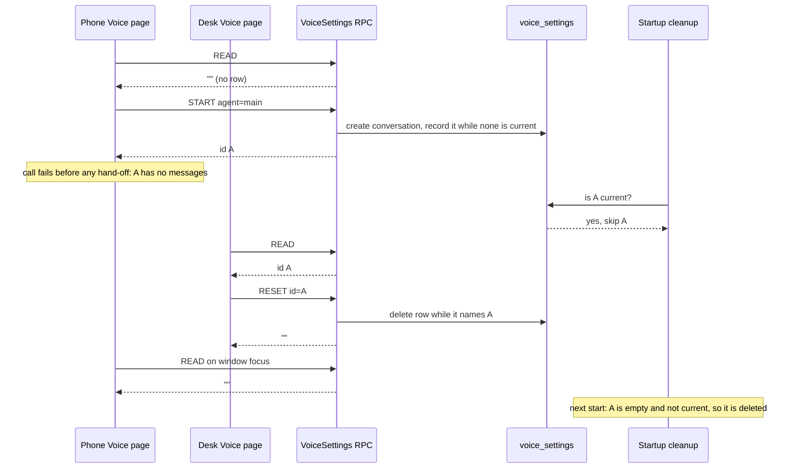

# Web Voice Mode Review Fixes - Plan

## Goal Capsule

- **Objective:** a voice call on the Web behaves like a Codex voice session, with no lost or reordered requests and no forgeable phone sign-in.
  - The person's requests reach the agent complete and in the order spoken.
  - A dropped connection to OpenAI does not leave a billed session running unseen.
  - Phones sign in over HTTPS as their own Tailscale user.
  - The Voice page keeps working after a failed call and a restart, on every device the person uses.
  - Each person has their own voice conversation and voice settings, the same on every device and never shared with another person.
  - Each person has at most one live voice call at a time, while many people can be in calls at once.
- **Means:** apply the review fixes in KTD2-KTD11, copying Codex wherever Codex has the behavior (KTD1), with phone access through an embedded tsnet node (KTD9). The server keeps each person's current voice conversation and voice settings (KTD12-KTD15).
- **Authority:**
  - This plan wins over `docs/plans/2026-10-10-1146-feat-web-voice-mode-plan.md` where they differ. That plan's unlisted requirements still hold.
  - R-IDs win on behavior and KTDs on mechanism; units override neither.
  - `AGENTS.md` governs code style, tests and verification.
- **Stop conditions:** stop and report if any of these happens:
  - U1-U11: Go source CLOC would enter its hazard zone (above 23,000 of 23,500).
  - U12-U17: Go source CLOC would pass 23,470, which is 23,220 plus the 250 lines the owner allotted. U16 raises the budget from 23,500 to 23,750 (KTD16).
  - TS CLOC would pass 7,250 of 7,500.
  - The `tailscale.com` dependency cannot be vendored, or its newer gorilla/websocket breaks the existing RocketCode websocket tests.
  - A requirement needs a database migration other than U12's `voice_settings` table.
- **Execution profile:** Deep. Order:
  1. Deletions first, because CLOC headroom is about 570 lines: U1, U2, U6.
  2. Then U3, U5 and U9.
  3. Then U4, U10 and U11.
  4. Then U7 and U8.
  5. Then U16, U12, U13, U17, U14 and U15.
- **Finishing:** U1-U11 go into the PR's voice commit, with the tab-test commit first. U12-U17 ship later as one PR on `main`.

---

## Product Contract

### Summary

The voice call loop drops its RocketClaw-specific behaviors in favor of Codex's:
- hand-offs are admitted in order without waiting for the turn;
- nothing is sent while the agent works, except question notices;
- questions are answered in the app;
- the Codex sideband reconnects after a drop.

The browser stops on audio failure and retries once when audio never connects.

Phones reach RocketClaw through an embedded Tailscale node with HTTPS and connection-based identity. The `tailscale serve` header sign-in is removed.

The server keeps each person's current voice conversation and voice settings, instead of the browser. Startup cleanup leaves that conversation alone. Every device the person uses sees the same conversation until Reset, and the same agent, voice and transcript choice. Two people never share any of it, even in one browser.

### Problem Frame

A three-model review of PR #275 (`xai/grok-4.7`, `openai/gpt-6.1-sol`, `openai/gpt-6-astra`) found defects in failure paths and ordering:
- A stuck sideband write freezes the call. As in Codex, this plan accepts that case (KTD4, Risks).
- A dead Codex sideband leaves the session billing.
- The voice model's filler can cut the person's last words from a request.
- Two quick hand-offs can reach the agent in either order.
- The `tailscale serve` header sign-in can be forged by any local process or OS user.
- Smaller defects affect replies, questions, progress and the browser.

The owner reviewed each fix on 2026-10-11 and set one rule: where Codex has a voice behavior, RocketClaw does what Codex does.

On 2026-10-13 the Voice page stopped working in production, and so did typing in that conversation: every call and every message failed with "conversation is not recorded".
- The page kept its conversation ID in browser storage, and the server did not know which conversation was the Voice page's.
- A call that ends before any hand-off leaves the conversation without messages.
- At every start, RocketClaw deletes conversations without messages, whatever their age (`shouldPruneThreadConversation` in `internal/rocketclaw/backend/store.go`).
- The page kept using the deleted ID; only Reset recovered it.

### Requirements

R-IDs follow `docs/plans/2026-10-10-1146-feat-web-voice-mode-plan.md`. Requirements not listed here are unchanged.

Product Contract preservation: changed: R2, R4 — the current voice conversation moves from browser storage to the server, so it survives restarts and is the same on all of a person's devices (owner-directed, 2026-10-13). Changed: R20 — the one-live-call limit moves from each conversation to each person (owner-directed, 2026-10-13). R25-R27 are new; R26 and R27 replace the per-browser, per-provider voice choice and the per-browser transcript toggle.

**Voice conversation and settings**

- R2. The Voice page uses one current voice conversation per person. The server keeps it across restarts and devices, and the page reuses it until Reset.
- R4. Reset ends this page's live call and forgets the person's current voice conversation on every device. The next Start creates a fresh conversation with the picked agent. Reset does not delete the old conversation: it stays in the session list and search until ordinary cleanup applies, so an empty one is removed at the next start (R25). A turn already running there keeps running.
- R25. Startup cleanup never deletes a person's current voice conversation. Once Reset forgets it, ordinary cleanup applies.
- R26. Each person's voice settings are kept by the server and are the same on every device: the agent for their next new voice conversation, their voice, and whether the Voice page shows the transcript. Two people never share settings, even in one browser.
- R20. Each person has at most one live voice call, across all conversations and devices. Starting a new call ends that person's older call as moved to another device; other people's calls, even on the same conversation, are never affected.
- R27. Each person has one voice. A call uses it when the conversation agent's provider offers it, and that provider's default voice otherwise; the Voice page and the composer's voice button both follow this.

**Requests**

- R9. Each hand-off is stored as Codex shapes it: a request plus the `user:`/`assistant:` lines said since the previous hand-off.
  - On the API-key route a hand-off carries no text, so those lines are the request.
  - The lines are taken the moment the hand-off arrives; words transcribed later belong to the next hand-off.
  - A hand-off with nothing to send is ignored.
  - Talk after a call's last hand-off is not stored.
- R22. Hand-offs reach the conversation in the order they arrive, and a re-delivered hand-off is never admitted twice.

**Replies and questions**

- R10. While the agent works, the voice model receives nothing about the work, except the R12 question notices.
  - When a turn this call handed off finishes, its final reply is spoken once, as written.
  - A reply over about 990 tokens (more than 3,960 bytes) is not spoken; it stays on screen.
- R11. Turns this call did not hand off send nothing to the voice model, except the R12 question notices.
- R12. When the agent asks a question, the voice model says "I need your input. Please respond in the app." with the question and its options, once per question. Spoken words never answer a question.
- R14. Replies and the seed are sent as written; R10's size rule decides whether a reply is spoken. The seed keeps its count and size caps.
- R19. OpenAI receives only microphone audio, the seed, R10 final replies and R12 question notices: no tool names, arguments or results, no reasoning, developer messages or attachments.

**Lifetime and failures**

- R16. A call ends when:
  - the person stops it;
  - the page's request to RocketClaw ends;
  - the page closes or stays hidden for 30 s;
  - the browser's audio connection fails;
  - OpenAI ends the session;
  - the connection to OpenAI is lost and cannot be restored.

  There are no idle or no-speech timers.
- R18. Failures show a clear message: missing or rejected credential, unsupported route, no microphone, no secure page, audio failure, lost connection to OpenAI, a hand-off the agent could not accept, OpenAI ending the session. The only automatic retries are those in R23 and KTD4.
- R23. An audio connection that does not come up is retried once, with a visible note.

**Access**

- R21. A phone reaches RocketClaw over HTTPS on the tailnet and is signed in by its own Tailscale identity. Tagged devices are refused, and no request header can choose the user.
- R24. A voice call's API key never travels in plain text to a non-local host, and no voice credential follows a redirect to another origin.

### Key Decisions

- **Where Codex has a voice behavior, RocketClaw does what Codex does.** (session-settled: user-directed — chosen over RocketClaw-specific fixes for each review finding: one reference behavior instead of thirteen local designs.) Governs R9-R12, R14, R16, R18, R22, R23.
- **The person hears only the final reply, as written.** (session-settled: user-directed — chosen over tool-name progress and over Codex's server-mode text streaming: the Codex app sends nothing while the agent works.) Governs R10, R11, R14, R19.
- **Questions are answered in the app.** (session-settled: user-directed — chosen over keeping voice answers and fixing their failure and ordering defects: Codex does not answer questions by voice.) Governs R12.
- **No idle or no-speech timers.** (session-settled: user-directed — chosen over keeping both timers and fixing their races: Codex has neither.) Governs R16.
- **Phones use an embedded tsnet node.** (session-settled: user-directed — chosen over `tailscale serve` identity headers, which any local process can forge, and over an owner-only Unix socket, which the macOS Tailscale system extension cannot reach: "connect: operation not permitted".) Governs R21.
- **API key transport follows Codex redirects plus a plain-HTTP refusal.** (session-settled: user-directed — chosen over exactly Codex, which allows plain HTTP, and over never following redirects.) Governs R24.
- **The server owns each person's current voice conversation.** (session-settled: user-directed — chosen over keeping the ID in browser storage with either an age check on empty-conversation cleanup or a Voice page that recovers from a deleted ID: one place owns both the pointer and its protection from cleanup, so they cannot drift apart.) Governs R2, R4, R25.
- **Voice settings belong to the person, not the device.** (session-settled: user-directed — chosen over keeping the voice choice and transcript toggle in browser storage: RocketClaw is multi-user, so two people sharing a browser must not share settings, and one person must find the same settings on every device.) Governs R26.
- **One voice per person.** (session-settled: user-directed — chosen over one remembered voice per provider for each person.) Governs R27.
- **One live call per person; the newest wins.** (session-settled: user-directed — chosen over refusing a second start until the first call hangs up, and over one live call per conversation, which would let one person's call end another's.) Governs R20.

### Scope Boundaries

- No change to the Voice page layout, the composer toggle placement, or the seed limits.
- No voice answers to questions and no progress, by decision.
- No storing of talk after a call's last hand-off, matching the Codex app.
- No change to startup cleanup of other conversations without messages.
- No carry-over of voice state saved in browser storage. After the upgrade, the first Start creates a new current conversation, and each person starts with the provider's default voice and the transcript hidden until they choose; older conversations stay in the session list.

#### Deferred to Follow-Up Work

- A pending-question card on the Voice page. The page's link to the conversation covers it.
- Showing long replies on the Voice page, which today has no transcript.
- The same plain-HTTP refusal for the model client in `internal/rocketclaw/backend/model_resolver.go`, which also accepts a remote `http://` base URL today.
- A `Host` allowlist on the `listen_address` listener against DNS rebinding, a risk that predates this plan.
- Chat tabs that point at an empty conversation deleted at startup. Startup cleanup could delete an empty conversation only after the 30-day retention, which needs a creation time on `managed_conversations`.

---

## Planning Contract

### Key Technical Decisions

- KTD1. **Codex parity is the reference implementation.** (session-settled: user-directed — chosen over RocketClaw-specific fixes: see the Codex Key Decision.) Each KTD below cites the Codex source it copies, under `~/Projects/codex/codex-rs/`. Governs R9-R12, R14, R16, R18, R22, R23.
- KTD2. **Hand-off text is taken at once from the active transcript.** (session-settled: user-directed — chosen over waiting for the person's words, and over always waiting 2 s: Codex `codex-api/src/endpoint/realtime_websocket/methods.rs` `update_active_transcript`, `core/src/realtime_conversation.rs` `realtime_text_from_handoff_request`.)
  - A Codex hand-off's text is the request and the lines are context.
  - A public hand-off's lines are the request.
  - An empty request is ignored, as Codex returns no text to route.
  - Each part is capped at 4 KB.
  - Delete the pending hand-off, the quiet window and the timestamp split.
  - Governs R9.
- KTD3. **Ordered admission through `StashQueueItem`, without waiting for the turn.** (session-settled: user-directed — chosen over per-hand-off goroutines calling blocking `RunTurn`: Codex `core/src/realtime_conversation.rs` `RealtimeHandoffAdmission`, `core/src/session/turn_input.rs` `StartOrSteer`.)
  - The call loop admits each hand-off itself, in arrival order, with the full voice inbound in `ThreadQueueItem.Inbound`.
  - `item.ID` equals the inbound's `web_message_id`, and both are the delegation ID. `admitWeb` then drops a re-delivered hand-off as already accepted. The loop records hand-off IDs for reply matching but leaves duplicate detection to `admitWeb`.
  - The Web path of `Runtime.StashQueueItem` must use `item.Inbound` when set. Today it rebuilds the inbound and drops `media=Voice`, which would let spoken `$workflow` text run as a workflow.
  - Admission runs with `context.WithoutCancel`, so a Stop never leaves a stored row without its enqueue (R17).
  - `protocol.ErrBridgeStopped` ends the call as `error`.
  - Any other refusal sends a `notice` frame and the call continues, as Codex shows the error and continues.
  - Delete the hand-off errgroup and the handler's final wait.
  - Governs R22, R18.
- KTD4. **Sideband reconnect on the Codex route only.** (session-settled: user-directed, "exactly what Codex does" — chosen over ending the call on a write failure and a fresh-sideband hang-up: Codex `core/src/realtime_conversation/sideband.rs` and `connect_sideband`.)
  - **Backoff:** after a drop, the loop waits 200 ms, doubling to 5 s, reset after 30 s connected.
  - **Dial retries:** each reconnect dials up to 5 times (one try plus 4 retries), waiting 200 ms × 2^(n−1) with jitter between tries, as Codex `connect_sideband`. A 404 or 410 ends the call as `closed` at once. Exhausting the retries ends it as `lost`.
  - **Readers:** each connection has its own reader in the call's errgroup, with its own events channel. The reader keeps `close(events)` as its only end signal and `done` as its only stop signal.
  - **On a read or write error:** the loop closes the connection, then drains that connection's events until the channel closes. It records what was heard but writes nothing. Then it backs off. So at most one reader is alive, and no event read before the drop is lost.
  - **Unsent messages:** after a failed write, further sends queue in one `unsent` list, which is flushed first after reconnecting. The failed message and the rest of its reply go out once each.
  - **During backoff:** the loop selects only on the call context and the backoff timer. The forwarder stays blocked on its send; snapshots are whole, so `update` catches up afterwards.
  - **Final events:** `session.closed`, and anything after the call began ending, is final and never triggers a reconnect.
  - **Ending with no live connection:** `end` skips the `session.close` write and its wait.
    - The public HTTP hang-up still runs for every ending without a confirmed `session.closed`, including `lost`.
    - A Codex call stopped during backoff relies on the browser closing its audio, as in Codex.
  - **Public route:** a lost sideband ends the call as `lost`, because Codex reconnects only its own frameless route. No write deadline, as in Codex.
  - Conflict call-out: the owner's answer approved "do exactly what Codex does", while the proposal text said the API-key route would behave the same. Codex does not reconnect that route, so this plan follows Codex. Public re-attach was never probed.
  - Governs R16, R18.
- KTD5. **Replies come from the transcript; nothing streams.** (session-settled: user-directed — chosen over progress forwarding: Codex `tui/src/chatwidget/realtime.rs` final-answer path, `MAX_SPEAKABLE_FINAL_TOKENS` 990 with `approx_token_count` of bytes/4.)
  - The forwarder reads `Changes` and history. A finished turn whose user entries include one of this call's hand-off IDs has its final reply spoken once, unless it is over 3,960 bytes.
  - The first snapshot never marks such a turn as already reported. That fixes a reply finishing before the forwarder's first look.
  - Typing supersedes voice, as Codex `invalidate_realtime_voice_input` does. Once a user entry without one of this call's hand-off IDs follows a hand-off, no reply is spoken for that earlier hand-off unless a later hand-off joins the same turn.
  - Delete the progress throttle, the tool and partial-text extraction, the code and table replacement, and the three-chunk cut.
  - Governs R10, R11, R14, R19.
- KTD6. **Question notices replace voice answers.** (session-settled: user-directed — chosen over fixing voice answers: Codex `core/src/session/turn.rs` `realtime_text_for_event`.)
  - Each pending question gets one spoken notice with its options, addressed to the latest hand-off, or session-wide before any hand-off.
  - Delete `AnswerQuestion` routing and the answerable bookkeeping. The voice instructions send the person to the app.
  - Governs R12.
- KTD7. **No server timers.** (session-settled: user-directed — chosen over fixing the timer races: Codex has none.) Delete the no-media and idle timers, `busy`, and the `idle` and `no_media` end reasons. Governs R16.
- KTD8. **Browser audio failure and one retry.** (session-settled: user-approved — chosen over leaving failure to the server's idle timer: Codex `tui/src/chatwidget/realtime.rs` `on_realtime_webrtc_connected`, `on_realtime_error`, `startup_abort`.)
  - A failed peer connection stops the call with "Voice call failed: audio connection lost."
  - If the data channel is not open 20 s after the answer, as Codex's start-transport limit, the call is torn down and started once more with "Voice connection timed out. Retrying once." The retry keeps the microphone stream.
  - Stop and a lost link close the audio and end the request. The browser sends nothing on the data channel.
  - Leaving the Voice page cancels a start still in progress; a conversation already created stays.
  - One keep-awake owner: the Voice page is open or a call is running.
  - Governs R16, R18, R23.
- KTD9. **tsnet listener with connection identity.** (session-settled: user-directed — chosen over `tailscale serve` headers and an owner-only Unix socket: see the tsnet Key Decision.)
  - **State:** when `web.tsnet` is configured, `cmd/rocketclaw` runs a `tailscale.com/tsnet` node. Its state lives outside the workspace, under `os.UserConfigDir()/rocketclaw/tsnet-<hostname>` (0700). RocketClaw resets the runtime dir at every start and reload, and the workspace is reachable by agent file tools.
  - **Credentials:** at the start of `runServe`, before the backend starts, `cmd/rocketclaw` reads `TS_AUTHKEY` and removes `TS_AUTHKEY`, `TS_AUTH_KEY`, `TS_CLIENT_SECRET`, `TS_CLIENT_ID` and `TS_ID_TOKEN` from its own environment. The process assembler carries the key to `startWebRPC` for the server's `AuthKey`. Cron and External MCP start before the Web listener, and agent shells inherit the process environment.
  - **Startup:**
    1. `Start` runs synchronously in `startWebRPC`, so its errors are startup errors.
    2. A serving goroutine runs `Up` with a context the stop function cancels, then `ListenTLS(":443")`, then serves the same Web handler.
    3. The goroutine logs its error when it happens.
  - **Stop order:** cancel `Up`, close the HTTP server, close the node, then wait. tsnet forbids `Close` before or during `Start`.
  - **Logs:**
    - Backend logs are discarded.
    - The login link goes only to the operator log, never to Sentry.
    - Tailscale's log upload is turned off.
  - **Identity:**
    - A wrapping handler calls `LocalClient().WhoIs` on the connection's remote address and refuses tagged or unknown callers.
    - It puts the login and display name on the request context.
    - `NewHTTPHandler` appends them, with the IP principal, as `-bin` metadata keys instead of replacing outgoing metadata. Names may be non-ASCII, and gRPC requires ASCII values for other keys.
    - When those keys are present, `principal` and `listConfig` use them and never consult `web_users` or `tailscale whois`.
  - **Plain listener:** the `listen_address` listener keeps today's rules (`web_users`, then `tailscale whois`) and never reads `Tailscale-User-*` headers.
  - **Never used:** `RunWebClient`, `ListenFunnel` and `Loopback`.
  - Delete `servedUser`, the forwarded metadata, their tests and docs.
  - Governs R21.
- KTD10. **API-key transport rule.** (session-settled: user-directed — see the API key Key Decision.)
  - **Plain HTTP:** the public route refuses an `http`/`ws` base URL unless its host is a literal loopback IP or exactly `localhost`.
  - **Redirects:** the voice HTTP client compares every redirect hop with the first request and drops `Authorization` and `Chatgpt-Account-Id` when scheme, host or port differ. Go keeps `Authorization` across port and scheme changes, and never drops the account header.
  - **Accepted leak:** a cross-origin 307 still resends the create body, which holds the instructions and the seed, as Codex's client does.
  - Conflict call-out: the agreed rationale was "as the model client does". In the vendored openai-go v3.76.0, `option.WithUnsafeAllowHTTP()` checks nothing, and the model client accepts remote `http://`. Voice needs its own check; the model client is deferred, and its stale comment is fixed.
  - Governs R24.
- KTD11. **Links use the tsnet name once known.**
  - After `ListenTLS` succeeds, the serving goroutine records `https://<MagicDNS name>` once, in a non-JSON runtime field under `web.tsnet`, through the config's `Do`. The name comes from `CertDomains`.
  - `WebURL` reads config through `Clone`. When the field is set, it uses that origin and skips `tailscale ip`. Otherwise it keeps the `http://<tailscale ip>:<port>` link.
  - This keeps startup order, needs no new backend setter, and survives a node renamed `rocketclaw-1`.
  - It does keep runtime state in config, a small smell this plan accepts.
  - Links posted before the node is up keep the IP form.
  - Governs R21.
- KTD12. **One row of voice settings per person in a `voice_settings` table.** (session-settled: user-directed — instantiates the server-owned voice conversation and per-person settings Key Decisions; governs R2, R4, R25, R26, R27.)
  - A new migration, the next free number (`034` when planned), creates the table:
    - `username`, the primary key;
    - `conversation_id`, the current voice conversation, nullable, referencing `managed_conversations` with `ON DELETE SET NULL`;
    - `agent`, the agent for the next new voice conversation, empty for the default;
    - `voice`, the person's voice, empty for the provider default;
    - `transcript`, whether the Voice page shows the transcript, false by default.
  - The key is the `username` that `Server.principal` returns. `createSession` stores the same value as `CreatedBy`, and the Voice page keyed its browser storage by it.
  - `ON DELETE SET NULL` means the row never points at a deleted conversation, whatever path deletes it, and the person's other settings survive.
  - Chosen over a column on `managed_conversations`: one row holds exactly one current conversation per person, plus settings that exist before any conversation does.
- KTD13. **One `VoiceSettings` RPC with four actions.** (Governs R2, R4, R26, R27.)
  - The request carries an action enum (`READ`, `START`, `RESET`, `UPDATE`), a conversation ID, and the setting fields. The response carries the caller's whole row: current conversation ID (empty when none), agent, voice and transcript.
  - `READ` returns the caller's settings; a person with no row gets the defaults.
  - `START` returns the current conversation. With none, it checks the requested agent against the caller's choices as `createSession` does, creates the conversation through `backend.CreateConversation`, records it and the agent only while no conversation is current, and returns the ID that won.
    - Two devices starting at once both get the winner. The loser's conversation is empty and not current, so the next startup cleanup removes it. No lock is needed.
  - `RESET` clears `conversation_id` only while it still names the given ID, then returns the current row. A device showing an older conversation cannot forget a newer one another device started.
  - `UPDATE` stores the agent, voice or transcript value it is given. It checks an agent against the caller's choices and a voice against the voices the routes offer (`publicVoice.voices` and `codexVoice.voices`), and refuses anything else with `InvalidArgument`.
  - The storage methods live on `*backend.SessionService`, which `rpc.Server` already holds as `sessions`. `frontend.Backend` and its mocks do not change.
  - Chosen over a voice flag on `CreateSession` plus fields on `Identity`: same behavior, one handler, one place to read.
- KTD14. **Startup cleanup skips current voice conversations.** (Governs R25.)
  - `shouldPruneThreadConversation` already starts by skipping shadow children. That check also skips a conversation named in `voice_settings.conversation_id`.
  - It is one more condition in an existing query, with no new Go function.
- KTD15. **The browser reads voice settings from the server.** (Governs R2, R4, R26, R27.)
  - The Voice page and the composer's voice button share one `READ` query. The shared query client's defaults (no stale time, refetch on window focus) let another device's changes show up when the page is visible again.
  - Start always calls `START`, which returns the current ID or creates one, then starts the call on the returned ID and shows it. A page still showing an ID that another device reset therefore never calls on it. Reset calls `RESET` with the shown ID.
  - While this page's call is active, the page keeps the call's conversation ID, and a refetched ID applies only after the call ends. `VoiceCall` hangs up whenever its ID changes, so only this page's own Reset may change the ID during a call.
  - The agent picker, the voice picker and the transcript button call `UPDATE`. Picking an agent while a conversation exists also keeps sending `$agent` to that conversation, as today.
  - A call sends the person's voice when the agent's provider offers it, and that provider's default otherwise (R27), as `voiceChoice` does today with a browser-stored value.
  - Delete the browser-storage code for the voice conversation (`voice:<username>`), the voice choice (`voice:choice:<provider>`, `rememberVoice`) and the transcript toggle (`voice:transcript`).
  - A live call on another device keeps running on its conversation after a Reset here, until it ends.
- KTD16. **Raise the rocketclaw Go source budget by 250 lines.** (session-settled: user-directed — chosen over fitting U12-U15 and U17 into the 280 lines left under 23,500: per-person settings need more server code.)
  - `GO_SOURCE_CLOC_BUDGET` in `internal/rocketclaw/Makefile` goes from 23,500 to 23,750; the 500-line hazard zone is unchanged.
  - Conflict call-out: root `AGENTS.md` says "Never edit `SOURCE_CLOC_BUDGET` in `Makefile`". The owner explicitly directed this increase on 2026-10-13, and it applies to this budget only.
- KTD17. **Live calls are keyed by person.** (session-settled: user-directed — instantiates the one-live-call-per-person Key Decision; governs R20.)
  - `Server.voiceCalls` is keyed by the caller's `username` from `principal`, the same key as `voice_settings`, instead of the conversation ID. `voice` keeps the username that it drops today.
  - Starting a call cancels the caller's existing entry with the `replaced` cause, and an exiting call removes the entry only while it is still its own, as today.
  - Two people's calls on one conversation run side by side. Each speaks only replies to its own hand-offs (KTD5), and each announces pending questions (KTD6).

### High-Level Technical Design

Sideband lifecycle in the call loop (KTD4):

```mermaid
stateDiagram-v2
  [*] --> connected: create + dial
  connected --> connected: event / write ok
  connected --> ending: Stop / replaced / session.closed / expired
  connected --> ended_lost: read or write error (public route)
  connected --> draining: read or write error (Codex route)
  draining --> reconnecting: old reader closed; backoff 200 ms..5 s
  reconnecting --> connected: dial ok (up to 5 tries), flush unsent
  reconnecting --> ended_closed: dial 404 / 410
  reconnecting --> ended_lost: 5 dial tries failed
  reconnecting --> ending: Stop / replaced
  ending --> [*]
  ended_closed --> [*]
  ended_lost --> [*]
```

Hand-off admission (KTD2, KTD3):

Listeners and identity (KTD9):

Browser call start (KTD8):

Current voice conversation across devices and restarts (KTD12-KTD15):

### Assumptions

These are planning choices, not owner-confirmed decisions.
- Delegation IDs are unique across calls in a conversation: the probe saw random `item_...` IDs. A reused ID with the same text is dropped silently; with different text it gets a refusal notice.
- The reply size rule uses bytes / 4, rounded up, as Codex's `approx_token_count` does.
- The tsnet node's hostname defaults to `rocketclaw` when `web.tsnet.hostname` is empty.
- `web.tsnet.tags` is optional and empty by default. The docs recommend a tag, such as `tag:rocketclaw`, with a tailnet rule that admits only named users and allows nothing outbound. An untagged node acts as its owner on the tailnet.
- Tailscale's log upload is off for the node; troubleshooting falls back to the operator log.
- Adding `tailscale.com` moves gorilla/websocket to the version tailscale requires. The RocketCode websocket tests are the check.
- The tsnet TLS listener may give phones HTTP/2. Nothing relies on it; the existing connection budget holds on HTTP/1.1.
- The current voice conversation and the voice settings are per sign-in name. A person reaching RocketClaw both as a Tailscale login and as a `web_users` name gets two sets, as they already get two identities.

### System-Wide Impact

- **Two sign-in paths:**
  - tsnet callers are identified by their connection, tagged devices are refused, and the tailnet rules decide who can reach the node.
  - `listen_address` callers keep `web_users` and `tailscale whois`.
  - Tailscale logins and `web_users` names are separate namespaces, so one person may appear under two names.
- **Local processes remain the owner:** this plan removes header forgery. An agent shell can still reach `127.0.0.1` or the tsnet name through the host's own Tailscale node and act as the owner, as before.
- **Cross-site requests:** there are no cookies. `CrossOriginProtection` compares exact origins, so other `*.ts.net` sites are refused. Each origin keeps its own browser storage, but the Voice page's current conversation lives on the server, so it is the same on every origin where the person signs in under the same name (KTD12; see Assumptions).
- **Voice conversation lifetime:** a person's current voice conversation is kept even with no messages, so the database holds at most one such conversation per person. Reset hands it back to ordinary cleanup (R25).
- **Settings follow the person:** choosing a voice, agent or transcript view on one device changes it on all of that person's devices, and never for anyone else (R26).
- **Schema:** U12 adds the first migration since `033_agent_shadows.sql`. An older binary refuses to start against a database that has run it.
- **Voice text trust:** the Codex route's request text is the voice model's wording, and background audio can become a message with the owner's authority. Keeping question answers out of voice (R12) and keeping `$` text inert are the safeguards.
- **Queued hand-offs outlive the call:** a hand-off admitted before a restart runs after it, with `media=Voice`, through the existing queue worker.
- **Links:** Slack footers and `rocketclaw_start_new_thread` links switch to the tsnet HTTPS name once it is known (KTD11), which reveals the tailnet name.
- **Dependency:** `tailscale.com` adds a userspace network stack (about 19 MB vendored, about 20 MB binary) and moves gorilla/websocket, which the voice sideband and RocketCode both use.

### Risks

| Risk | Mitigation |
|---|---|
| CLOC headroom of about 570 Go lines | U2 deletes first; tsnet code stays in `cmd/rocketclaw` and one wrapper |
| Public route re-attach and delegation timing never probed live | Public ends on a drop (KTD4); live API-key check before merge |
| A half-open sideband write holds the loop | Accepted, as in Codex; TCP fails the write eventually; Stop ends the call from the browser |
| tsnet node key and certificate key readable by same-user processes | State outside the workspace (KTD9); a tagged node with a narrow tailnet rule limits what a copied identity can reach |
| Login link claimed by the wrong tailnet | Link only in the operator log; docs say to confirm the node appears in your own tailnet; a pre-approved tagged key is recommended |
| tsnet node login expires after 180 days | A tagged node has no expiry; docs name it |
| Turning on tailnet HTTPS publishes machine names in certificate logs | Docs name it |
| Go CLOC is already in the hazard zone (23,220 of 23,500) | KTD16 raises the budget by 250 lines; KTD13 and KTD14 reuse `SessionService`, the existing cleanup query and the existing RPC plumbing; stop past 23,470 |
| Rolling back to a release without U12's migration fails at startup with "unknown migration" | Roll forward instead; `docs/solutions/runtime-errors/deployment-binary-missing-live-migrations.md` |
| Another branch takes the same migration number | Use the next free number when U12 lands, and check the live ledger before deploying |
| Two devices start at once and one conversation is left orphaned | It is empty and not current, so the next startup cleanup removes it (KTD13) |

### Sources & Research

- Codex: `core/src/realtime_conversation/sideband.rs`; `codex-api/src/endpoint/realtime_websocket/methods.rs`; `core/src/realtime_conversation.rs`; `core/src/session/turn_input.rs`; `core/src/session/turn.rs`; `tui/src/chatwidget/realtime.rs`; `tui/src/app_server_session/realtime.rs`; `utils/string/src/truncate.rs`; `login/src/auth/default_client.rs`.
- tsnet: pkg.go.dev `tailscale.com/tsnet` v1.104.1 (`Server`, `Up`, `ListenTLS`, `LocalClient().WhoIs`, `CertDomains`).
- Repo:
  - `internal/rocketclaw/backend/conversations.go` (`RunTurn`, `StashQueueItem`)
  - `internal/rocketclaw/backend/revert.go` (`admitWeb`, `reconcileWebDB`)
  - `internal/rocketclaw/backend/bridge.go` (`enqueue`, `submitEnqueuedItem`, `inboundWorkflow`)
  - `internal/rocketclaw/backend/thread_bridges.go` (`WebURL`)
  - `cmd/rocketclaw/web.go` (`startWebRPC`)
  - `internal/rocketclaw/frontend/rpc/{voice.go,voice_wire.go,http.go,server.go}`
  - `internal/rocketclaw/backend/store.go` (`PruneStateBefore`, `shouldPruneThreadConversation`)
  - `internal/rocketclaw/backend/app.go` (cleanup at every start, 30-day `stateRetention`)
  - `internal/rocketclaw/backend/store_dao.go` (`Thread`, `createConversation`)
  - `internal/rocketclaw/backend/migrations/033_agent_shadows.sql` (cascade pattern)
  - `internal/rocketclaw/frontend/rpc/server.go` (`createSession`, `principal`)
  - `internal/rocketclaw/web/src/ui.tsx` (`VoicePage`, `VoiceCall`, the composer's voice button)
  - `internal/rocketclaw/web/src/voice.ts` (`voiceChoice`, `rememberVoice`)
  - `internal/rocketclaw/frontend/rpc/voice_public.go` and `voice_codex.go` (`voices`)
- Learnings: `docs/solutions/architecture-patterns/web-keep-alive-views-connection-budget.md`; `docs/solutions/logic-errors/saved-queue-never-started-after-restart.md`; `docs/solutions/best-practices/dupword-fix-rewrites-repeated-test-strings.md`; `docs/solutions/runtime-errors/deployment-binary-missing-live-migrations.md`.

---

## Implementation Units

### U1. Voice inbounds survive the queue admission path

- **Goal:** `StashQueueItem` keeps a stored voice inbound intact on the Web path.
- **Requirements:** R22; KTD3
- **Dependencies:** none
- **Files:**
  - `internal/rocketclaw/backend/conversations.go`
  - `internal/rocketclaw/backend/revert_test.go` (existing `StashQueueItem` Web tests)
- **Approach:** on the Web-eligible path, use `item.Inbound` when set, keeping `request.queueItemID = item.ID`. The rebuild stays for items without `Inbound`.
- **Patterns to follow:** `submitEnqueuedItem` and `promoteQueueItem` already honor `Inbound`.
- **Test scenarios:**
  - A Web steer item with `Inbound` carrying `media=Voice` and text `$workflow deploy` is admitted as a plain-text steer with a `media=Voice` provenance header, and no workflow starts.
  - The same item stashed twice with the same ID and text is admitted once.
  - An item without `Inbound` behaves as before.
  - Spoken `$<allowed skill> do it` text in a voice item triggers no direct skill.
  - A voice item stored before a restart runs afterwards with its `media=Voice` header intact.
- **Verification:** backend tests pass; existing queue tests stay green.

### U2. Call loop follows Codex: requests, replies, questions, no timers

- **Goal:** remove the RocketClaw-specific call-loop behaviors and apply KTD2, KTD5, KTD6, KTD7.
- **Requirements:** R9, R10, R11, R12, R14, R16, R19
- **Dependencies:** none
- **Files:**
  - `internal/rocketclaw/frontend/rpc/voice.go`
  - `internal/rocketclaw/frontend/rpc/voice_wire.go`
  - `internal/rocketclaw/frontend/rpc/voice_test.go`
  - `internal/rocketclaw/frontend/rpc/voice_loop_test.go`
  - `internal/rocketclaw/frontend/rpc/voice_wire_test.go`
- **Approach:**
  1. Delete:
     - the quiet window, the pending hand-off and the timestamp split;
     - the progress throttle with tool and partial extraction;
     - `voiceSpeakable`, the three-chunk cut and its note;
     - `AnswerQuestion` routing and `answerable`;
     - the no-media and idle timers, `busy`, and the `idle`/`no_media` reasons;
     - the impossible `json.Marshal` branch in `create`;
     - the unused error-event message field.
  2. Build the request per KTD2.
  3. Send question notices per KTD6.
  4. Speak final replies per KTD5, including the first-snapshot exception and the 3,960-byte limit.
  5. Update the voice instructions for questions.
  6. Compress tests while editing:
     - one harness per test file where Postgres allows;
     - `h.call` returns the peer;
     - one table for loop endings;
     - one table for wire failures.
- **Patterns to follow:** existing `voiceHarness`, `startVoiceLoop`, synctest pipe sideband.
- **Test scenarios:**
  - On the public route, the voice model's filler arrives before the person's last words: the stored request holds the lines said so far, and the late words go to the next hand-off.
  - A Codex hand-off stores its text as the request and the transcript lines as context.
  - A public hand-off with no lines since the previous one is ignored and stores nothing.
  - A hand-off whose turn finishes before the forwarder's first snapshot still has its reply spoken once.
  - A reply over 3,960 bytes is not spoken; a reply at 3,960 bytes is.
  - Nothing reaches the fake sideband while the agent works. A tool-result canary never appears in any append or the seed.
  - A typed turn during the call sends nothing.
  - A hand-off followed by a typed steer into the same turn: the finished reply is not spoken.
  - A new call's seed carries a code block as written.
  - A pending question gets one spoken notice with options. The next hand-off becomes a normal message and the question stays pending.
  - A question pending before the call starts gets a session-wide notice.
  - A call with no speech for minutes is not ended by any timer.
- **Verification:** voice tests pass; the voice production line count drops.

### U3. Ordered admission and the notice frame

- **Goal:** admit hand-offs in order without waiting for turns, and report refusals mid-call.
- **Requirements:** R18, R22; KTD3
- **Dependencies:** U1, U2
- **Files:**
  - `internal/rocketclaw/web/proto/web.proto`
  - `internal/rocketclaw/frontend/rpc/web.pb.go` (generated)
  - `internal/rocketclaw/frontend/rpc/protocol.gen.go` (generated)
  - `internal/rocketclaw/frontend/rpc/voice.go`
  - `internal/rocketclaw/frontend/rpc/voice_test.go`
  - `internal/rocketclaw/frontend/rpc/voice_loop_test.go`
- **Approach:**
  1. Add a `notice` message to `VoiceEvent`.
  2. The call loop calls `StashQueueItem` per KTD3; on a refusal it writes the notice to the stream.
  3. Delete the hand-off errgroup and final wait.
  4. The loop tests switch from `RunTurnFunc` to `StashQueueItemFunc`.
- **Test scenarios:**
  - Two back-to-back hand-offs appear in the conversation in arrival order.
  - A re-delivered hand-off ID creates one user message.
  - Two hand-offs folded into one running turn have its reply spoken once.
  - `StashQueueItem` returning an error sends a notice and the call continues.
  - `ErrBridgeStopped` ends the call with `error`.
  - Stop while admission runs still leaves the turn running to completion.
- **Verification:** the protocol hash changes; voice tests pass.

### U4. Codex-style sideband reconnect

- **Goal:** keep a Codex call alive across sideband drops, and end any call honestly when the connection is gone.
- **Requirements:** R16, R18; KTD4
- **Dependencies:** U2, U3, U9
- **Files:**
  - `internal/rocketclaw/frontend/rpc/voice.go`
  - `internal/rocketclaw/frontend/rpc/voice_wire.go`
  - `internal/rocketclaw/frontend/rpc/voice_loop_test.go`
  - `internal/rocketclaw/web/src/types.ts`
- **Approach:** implement KTD4 inside the existing call loop.
  - Start each connection's reader in the call's errgroup, per KTD4.
  - `send` returns or queues on a write failure instead of ignoring it.
  - Add the `lost` end reason.
  - Keep the existing hang-up after a failed first dial at call creation (a fresh sideband on the Codex route, HTTP on the public route), and the public HTTP hang-up in `end`.
- **Execution note:** write the drop-and-resend synctest first.
- **Test scenarios:**
  - On the Codex route, the sideband drops mid-reply. The loop reconnects, re-sends the failed chunk, then the remaining chunks, once each.
  - Reconnect answered 404 ends the call as `closed`.
  - Reconnect refused with 500 five times ends the call as `lost`; a 500 followed by success reconnects.
  - A `delegation.created` read just before the drop is still admitted.
  - A public call ending as `lost` still gets its HTTP hang-up.
  - `session.closed` followed by a socket drop ends the call as `closed` with no reconnect.
  - Stop during the backoff sleep ends the call as `stopped` without dialing.
  - On the public route, a drop ends the call as `lost` with no reconnect.
  - Backoff doubles from 200 ms to 5 s and resets after 30 s connected.
- **Verification:** loop tests pass under synctest; no goroutine outlives the call.

### U5. API-key transport rule

- **Goal:** keep the API key off plain HTTP and cross-origin redirects.
- **Requirements:** R24; KTD10
- **Dependencies:** none
- **Files:**
  - `internal/rocketclaw/frontend/rpc/voice_wire.go`
  - `internal/rocketclaw/frontend/rpc/voice_wire_test.go`
- **Approach:**
  - `newVoiceDialect` refuses a non-loopback `http`/`ws` base URL, reported as a credential-route failure.
  - The voice requests use a client whose redirect check drops the two credential headers when scheme, host or port differs from the first request.
- **Test scenarios:**
  - `http://127.0.0.1:N` and `http://localhost:N` base URLs are accepted.
  - `http://example.com`, `http://localhost.example.com` and `http://127.0.0.1.nip.io` are refused before any request.
  - A redirect chain A to B to C carries no credential past A.
  - A redirect to the same host on another port arrives with no `Authorization` or `Chatgpt-Account-Id`.
  - A same-origin redirect keeps them.
  - An https-to-http redirect on the same host drops them.
- **Verification:** wire tests pass.

### U6. Remove the `tailscale serve` header sign-in

- **Goal:** no request header can choose the user.
- **Requirements:** R21; KTD9
- **Dependencies:** none
- **Files:**
  - `internal/rocketclaw/frontend/rpc/http.go`
  - `internal/rocketclaw/frontend/rpc/server.go`
  - `internal/rocketclaw/frontend/rpc/http_test.go`
  - `internal/rocketclaw/frontend/rpc/server_test.go`
  - `internal/rocketclaw/frontend/rpc/transport.go` (comment)
- **Approach:**
  - Delete `servedUser`, the forwarded and `Tailscale-User-*` metadata, and their tests.
  - `NewHTTPHandler` appends the IP principal to outgoing metadata instead of replacing it, ready for U10.
  - This unit lands with U2's deletions.
- **Test scenarios:**
  - A loopback request carrying `X-Forwarded-For` and `Tailscale-User-Login` is identified by `web_users` for `127.0.0.1` only.
  - Without a mapping, such a request is refused.
- **Verification:** rpc tests pass; no reference to `servedUser` or the forwarded keys remains.

### U9. Vendor `tailscale.com` as a gate

- **Goal:** prove the dependency and its module bumps are safe before identity and serving code depend on them.
- **Requirements:** R21
- **Dependencies:** none
- **Files:** `go.mod`, `go.sum`, `vendor/`, `cmd/rocketclaw/web.go`
- **Approach:**
  - Add `tailscale.com` together with its first production import: the tsnet node lifecycle in `startWebRPC` (`Start`, background `Up`, `Close`), with no listener yet. The repo's `vendor` target runs `go mod tidy`, which drops a module nothing imports, so the gate needs a real import.
  - Review every bumped shared module (gorilla/websocket, grpc, x/net, x/crypto).
- **Execution note:** this is a dependency gate; prove it with the existing suites, not new tests.
- **Test expectation:** none -- the existing voice wire, voice loop and RocketCode websocket tests must pass unchanged on the bumped modules, and `cmd/rocketclaw` must build with the tsnet import.
- **Verification:** `make lint` and `make test` pass; a failure here triggers the stop condition.

### U10. tsnet listener and connection identity

- **Goal:** phones reach RocketClaw over tailnet HTTPS and sign in by their Tailscale identity.
- **Requirements:** R21; KTD9
- **Dependencies:** U6, U9
- **Files:**
  - `internal/rocketclaw/config/config.go`
  - `internal/rocketclaw/config/config_test.go`
  - `cmd/rocketclaw/serve.go`
  - `cmd/rocketclaw/assemble.go`
  - `cmd/rocketclaw/web.go`
  - `cmd/rocketclaw/web_test.go`
  - `internal/rocketclaw/frontend/rpc/http.go`
  - `internal/rocketclaw/frontend/rpc/server.go`
  - `internal/rocketclaw/frontend/rpc/http_test.go`
  - `internal/rocketclaw/frontend/rpc/server_test.go`
  - `.mockery.yml` and the generated WhoIs mock
- **Approach:**
  1. Add `web.tsnet` with optional `hostname` and `tags`; zero means off.
  2. Add the WhoIs wrapper with a small interface that `*local.Client` satisfies.
  3. `NewHTTPHandler` carries the wrapper's identity into `-bin` metadata.
  4. `principal` and `listConfig` use it first.
  5. `runServe` captures and removes the `TS_*` variables first. `startWebRPC` follows the KTD9 startup, logging and stop rules with the carried key.
- **Patterns to follow:** the existing `httpServer.Serve` errgroup member; mockery v3 config for interface mocks.
- **Test scenarios:**
  - **End to end** (wrapper, handler, bufconn, `rpc.Server`): a WhoIs user with a non-ASCII display name is signed in as that login with the name intact. `web_users` maps the same IP to someone else, and a failing `tailscale` stub sits on PATH.
  - The wrapper with a tagged node, an empty login, or a WhoIs error returns 401 and never reaches the handler.
  - `listConfig` reports the tsnet login for a tsnet request.
  - Config with `web.tsnet` set validates; without it, no node starts.
  - The five `TS_*` variables are already absent from the process environment when the backend starts, so a shell launched by an immediately due cron job does not inherit them.
- **Verification:**
  - Tests pass.
  - **Manual:** a start with `web.tsnet` set prints the login link only to the log. A restart and a config reload keep the same node name and login.

### U11. Links use the tsnet name

- **Goal:** links RocketClaw hands out open over HTTPS once the node is up.
- **Requirements:** R21; KTD11
- **Dependencies:** U10
- **Files:**
  - `internal/rocketclaw/config/config.go`
  - `internal/rocketclaw/backend/thread_bridges.go`
  - `internal/rocketclaw/backend/thread_bridges_test.go`
  - `cmd/rocketclaw/web.go`
- **Approach:** the runtime origin field and its single write, per KTD11; `WebURL` prefers it.
- **Test scenarios:**
  - With the origin field set, `WebURL` returns `https://<name>/s/<id>` without calling `tailscale`.
  - Without it, `WebURL` returns the existing Tailscale-IP link.
- **Verification:** backend tests pass.

### U7. Browser: audio failure, retry, notices, Reset, keep-awake

- **Goal:** the browser matches Codex on audio failure and start-up, and shows notices.
- **Requirements:** R16, R18, R23; KTD8
- **Dependencies:** U3, U4 (notice frame, `lost` reason)
- **Files:**
  - `internal/rocketclaw/web/src/voice.ts`
  - `internal/rocketclaw/web/src/types.ts`
  - `internal/rocketclaw/web/src/ui.tsx`
  - `internal/rocketclaw/web/src/voice.test.ts`
  - `internal/rocketclaw/web/src/voice-page.browser.test.ts`
  - the committed web bundle
- **Approach:**
  1. `startVoice` handles peer `failed`. A failure abort keeps its message, unlike a person's Stop.
  2. Add the 20 s data-channel limit with one retry that reuses the microphone.
  3. Remove the data-channel `session.close`.
  4. Add a `notice` field to the voice view, cleared at start and end, shown on the Voice page and next to the composer toggle.
  5. Map the new end reasons and drop `idle`/`no_media`.
  6. The Voice page cancels a pending start on unmount.
  7. Reset carries the selected agent.
  8. One keep-awake owner in the always-mounted app shell, driven by a boolean selector.
- **Test scenarios:**
  - The peer connection fails while live: the microphone is released and "Voice call failed: audio connection lost." shows.
  - The data channel does not open within 20 s: the call retries once with the note, and a second timeout shows an error.
  - Stop sends nothing on the data channel and ends idle with no error.
  - A `notice` frame shows during the call and clears when the call ends.
  - `lost` shows "Lost the connection to OpenAI."
  - Leaving the Voice page while `CreateSession` is slow starts no call and never opens the microphone.
  - Reset on a conversation using a non-main agent creates the next conversation with that agent.
  - The keep-awake lock is held while the Voice page is open or a call runs, and released otherwise.
  - The page test receives an incoming audio track on the browser peer.
- **Verification:** bun tests and browser tests pass; the bundle is rebuilt.

### U8. Documentation

- **Goal:** owners can set up phone access with tsnet and know what voice does now.
- **Requirements:** R10, R12, R16, R21, R24
- **Dependencies:** U2-U7, U10, U11
- **Files:**
  - `README.md`
  - `cmd/rocketclaw/CHEATSHEET.md`
  - `internal/rocketclaw/web/README.md`
  - `internal/rocketclaw/frontend/rpc/README.md`
  - `CONCEPTS.md`
  - `internal/rocketclaw/backend/model_resolver.go` (stale comment)
- **Approach:**
  1. Replace the `tailscale serve` setup with the tsnet setup. Cover:
     - the setting and first login;
     - confirming the node joined your own tailnet;
     - a recommended tag and tailnet rule;
     - node key expiry;
     - certificate-log visibility;
     - that `listen_address` keeps its IP rules.
  2. Update voice behavior: final reply only, questions in the app, no timers, reconnect.
  3. Fix the stale plain-HTTP comment.
- **Test expectation:** none — documentation and one comment.
- **Verification:** no doc mentions `tailscale serve` sign-in, voice answers, progress, or idle timers.

### U16. Raise the rocketclaw Go source budget

- **Goal:** U12-U15 and U17 have the 250 lines of Go source the owner allotted.
- **Requirements:** R26; KTD16
- **Dependencies:** none
- **Files:** `internal/rocketclaw/Makefile`
- **Approach:** change `GO_SOURCE_CLOC_BUDGET` from 23500 to 23750; leave the hazard zone and the check itself unchanged.
- **Test expectation:** none -- a budget constant; `make test` runs the check.
- **Verification:** `make check-cloc-budget` in `internal/rocketclaw` reports the 23,750 limit.

### U12. Store voice settings and keep the current conversation through cleanup

- **Goal:** the database holds each person's voice settings, and startup cleanup leaves their current voice conversation alone.
- **Requirements:** R2, R4, R25, R26; KTD12, KTD14
- **Dependencies:** U16
- **Files:**
  - `internal/rocketclaw/backend/migrations/034_voice_settings.sql` (next free number)
  - `internal/rocketclaw/backend/store_dao.go`
  - `internal/rocketclaw/backend/store.go`
  - `internal/rocketclaw/backend/store_test.go`
- **Approach:**
  1. Add the KTD12 migration.
  2. Add `SessionService` methods for KTD13's storage steps: read a person's row, record a new current conversation and agent only while none is current and return the winner, clear the conversation while it names a given ID, and store a setting.
  3. Add the KTD14 condition to the ownership check in `shouldPruneThreadConversation`.
- **Execution note:** start with a failing test for the 2026-10-13 failure: an empty current voice conversation survives `PruneStateBefore`.
- **Patterns to follow:** `033_agent_shadows.sql` for foreign keys to `managed_conversations`; the shadow-child skip in `shouldPruneThreadConversation` and its tests in `shadows_test.go`; `queryScalar` and `execRows` for single statements.
- **Test scenarios:**
  - An empty conversation that is a person's current voice conversation survives `PruneStateBefore`; an empty conversation that is nobody's is still deleted in the same run.
  - After the conversation is cleared from the row, the next `PruneStateBefore` deletes that empty conversation.
  - Reading a person with no row returns the defaults: no conversation, empty agent and voice, transcript off.
  - Recording a conversation twice for one person keeps the first and returns it both times.
  - Clearing with an ID that is no longer current leaves the row; clearing with the current ID empties `conversation_id` and keeps agent, voice and transcript.
  - Deleting the conversation empties `conversation_id` through `ON DELETE SET NULL` and keeps the other settings.
  - Storing a voice, agent or transcript value for one person leaves every other person's row unchanged.
- **Verification:** backend tests pass, and migrations apply on a fresh schema and on one already at `033`.

### U13. `VoiceSettings` RPC

- **Goal:** the browser reads and changes the person's voice conversation and settings through the server.
- **Requirements:** R2, R4, R26, R27; KTD13
- **Dependencies:** U12
- **Files:**
  - `internal/rocketclaw/web/proto/web.proto`
  - `internal/rocketclaw/frontend/rpc/web.pb.go` (generated)
  - `internal/rocketclaw/frontend/rpc/protocol.gen.go` (generated)
  - `internal/rocketclaw/frontend/rpc/transport.go`
  - `internal/rocketclaw/frontend/rpc/http.go`
  - `internal/rocketclaw/frontend/rpc/server.go`
  - `internal/rocketclaw/frontend/rpc/http_test.go`
  - `internal/rocketclaw/frontend/rpc/voice_test.go`
- **Approach:**
  1. Add the request, response and action enum to `web.proto`. Register the unary method next to `CreateSession` in both method lists: the gRPC one in `transport.go` and the browser route one in `http.go`.
  2. `httpInput` accepts an enum field only as `STEER`, `QUEUE` or `STASH`. Make it accept any value name of that field's own enum, so `action` passes and an unknown `delivery` is still refused.
  3. The handler resolves `principal`, then runs the KTD13 action.
  4. `START` and `UPDATE` reuse `createSession`'s agent-choice check rather than copying it.
- **Patterns to follow:** `createSession` for principal, agent validation and `backend.CreateConversation`; the `fmt.Errorf("web …: %w", status.Error(...))` error style.
- **Test scenarios:**
  - `READ` for a person with no row returns no conversation and the default settings.
  - `START` with no current conversation creates one with the picked agent and `CreatedBy` set to the caller, stores that agent, and `READ` then returns both.
  - A second `START` from another device of the same person returns the same ID and creates nothing.
  - `START` with an agent outside the caller's choices returns `InvalidArgument` and creates neither a conversation nor a row.
  - `RESET` with the current ID makes the next `READ` show no conversation and keeps the agent, voice and transcript; the next `START` creates a different conversation, and the old one is still listed.
  - `RESET` with an older ID, after another `START`, leaves the newer conversation current and returns it.
  - `UPDATE` with a voice, then `READ` from another device of the same person, returns that voice; `UPDATE` with transcript on does the same for the transcript.
  - `UPDATE` with a voice no route offers, or an agent outside the caller's choices, returns `InvalidArgument` and changes nothing.
  - Two people get different conversations, and one person's `UPDATE` never changes the other's settings.
  - The 2026-10-13 failure end to end: `START`, a call that admits no hand-off, `PruneStateBefore`, then a `Voice` call and a `Prompt` on the same ID both succeed.
  - A caller with no identity gets the same `Unauthenticated` error as other RPCs.
  - Through `NewHTTPHandler`, `POST /api/VoiceSettings` with `action: "START"` reaches the handler, and a `Prompt` with an unknown `delivery` is still refused with 400.
- **Verification:** the protocol hash changes; rpc tests pass.

### U14. Voice page and composer use the server's settings

- **Goal:** no voice state lives in the browser; the Voice page and the composer follow the person's server-side settings.
- **Requirements:** R2, R4, R26, R27; KTD15
- **Dependencies:** U13
- **Files:**
  - `internal/rocketclaw/web/src/api.ts`
  - `internal/rocketclaw/web/src/types.ts`
  - `internal/rocketclaw/web/src/voice.ts`
  - `internal/rocketclaw/web/src/ui.tsx`
  - `internal/rocketclaw/web/src/voice.test.ts`
  - `internal/rocketclaw/web/src/voice-page.browser.test.ts`
  - the committed web bundle
- **Approach:**
  1. Add a `voiceSettings` query for `READ`, and mutations for `START`, `RESET` and `UPDATE`.
  2. `VoiceCall` takes its conversation ID from the query, except during its own live call (KTD15). Start and Reset use the mutations and update the query's data with the returned row.
  3. The agent picker, voice picker and transcript button call `UPDATE`; the composer's voice button reads the voice from the same query.
  4. `voiceChoice` takes the person's voice from the query instead of browser storage, keeping its provider-default fallback (R27). Delete `rememberVoice`, `voiceKey`, the `storageKey` prop and the `voice:transcript` reads and writes.
- **Patterns to follow:** the `queries` and `mutations` objects in `api.ts`; the existing stubbed `/api/*` routes in `voice-page.browser.test.ts`.
- **Test scenarios:**
  - With a current conversation on the server, the page shows its agent; Start sends `START`, gets that ID back, creates nothing, and calls on it.
  - With none, Start sends `START` with the picked agent, then calls on the returned ID.
  - A page still showing an ID that another device reset calls on the ID `START` returns, not the shown one.
  - A refetch that returns a different or empty ID during a live call leaves the call running; the new ID shows once the call ends.
  - A call that ended with an error keeps its error on screen, but a refetch shows the server's current ID.
  - Start stays off until the person's settings load, so it cannot create a conversation with defaults that overwrite them.
  - An `UPDATE` the server refuses puts the old value back and shows the error.
  - `START` that finds a current conversation returns it, though another device resets it a moment later.
  - Reset sends `RESET` with the shown ID; the next Start sends `START`.
  - A `RESET` that returns another device's newer ID shows that conversation.
  - Picking a voice sends `UPDATE`; after a reload, the page and the composer's voice button both use that voice.
  - A person whose voice the agent's provider does not offer gets that provider's default voice on the Voice page and on the composer's button.
  - The transcript button sends `UPDATE`, and a reload keeps the transcript shown; a long reply still turns the transcript on and stores it.
  - Two people signed in one after the other in the same browser each see only their own conversation, agent, voice and transcript setting.
  - The page never reads or writes `voice:<username>`, `voice:choice:<provider>` or `voice:transcript` in browser storage.
  - Leaving the page while `START` is pending starts no call and never opens the microphone.
- **Verification:** bun tests and browser tests pass; the bundle is rebuilt.

### U17. One live call per person

- **Goal:** a person's new call ends their older one anywhere, and never ends anyone else's.
- **Requirements:** R20; KTD17
- **Dependencies:** none
- **Files:**
  - `internal/rocketclaw/frontend/rpc/voice.go`
  - `internal/rocketclaw/frontend/rpc/server.go` (the `voiceCalls` comment)
  - `internal/rocketclaw/frontend/rpc/voice_test.go`
- **Approach:** key the existing call map by username per KTD17; no new state.
- **Patterns to follow:** the existing replace-and-remove logic around `voiceCalls` in `voice.go`, and its test in `voice_test.go`.
- **Test scenarios:**
  - One person starts a call on conversation A, then another on conversation B: the first stream gets an `ended` frame with reason replaced, and the second stays live.
  - One person starts two calls on the same conversation: the first ends as replaced, as before.
  - Two people start calls on the same conversation: both stay live, and each gets only replies to its own hand-offs.
  - Two people start calls on different conversations: both stay live.
  - After a person's call ends, their next call starts with nothing to replace.
- **Verification:** rpc voice tests pass.

### U15. Documentation for per-person voice conversation and settings

- **Goal:** docs say the Voice page's conversation and voice settings follow the person, not the browser.
- **Requirements:** R2, R4, R20, R25, R26, R27
- **Dependencies:** U12-U14, U17
- **Files:**
  - `README.md`
  - `internal/rocketclaw/web/README.md`
  - `internal/rocketclaw/frontend/rpc/README.md`
  - `CONCEPTS.md`
- **Approach:**
  1. Replace the three "remembered in this browser" statements in the web README's Voice section (conversation, voice choice, transcript) with the R2, R4, R26 and R27 behavior, including Reset on every device and one voice per person.
  2. Replace the "one live call per conversation" statements in `README.md`, the web README and the Voice Session entry in `CONCEPTS.md` with R20: one live call per person.
  3. Add the `VoiceSettings` RPC to the transport section.
  4. Add a "Voice Settings" entry under Web Voice in `CONCEPTS.md`, covering the current voice conversation and its exemption from startup cleanup.
- **Test expectation:** none — documentation only.
- **Verification:** no doc says the Voice page's conversation, voice or transcript choice is per browser, per origin or per device.

---

## Verification Contract

| Gate | Command | Applies to |
|---|---|---|
| Format | `gofmt` on touched Go files | U1-U6, U9-U13, U17 |
| Go tests | `go test ./...` from the repo root | U1-U6, U9-U13, U17 |
| Lint | `make lint` from the repo root | all code units |
| Full test | `make test` from the repo root (coverage minimum 85.5%, Go and TS CLOC budgets) | all code units |
| Web | `make test` in `internal/rocketclaw/web` | U7, U14 |
| Proto | `go generate ./frontend/rpc` from `internal/rocketclaw` with `protoc-gen-go` v1.36.12 | U3, U13 |
| Review | the same three-model review on the final diff | all |
| Live | API-key route call; phone call over the tsnet address with the reply heard | before merge |
| Live restart | Start a voice call and end it before any hand-off, restart RocketClaw, then call again from the phone and from the desk on the same conversation, with the desk signed in under the phone's Tailscale login | U12-U14, after deploy |
| Live multi-user | A second person opens the Voice page on their own device and gets their own conversation, voice and transcript setting; the first person's are unchanged. Both call at once and neither call ends. The first person then starts a call on the desk, which ends their phone call. | U12-U14, U17, after deploy |

---

## Definition of Done

- R2, R4, R9-R12, R14, R16 and R18-R27 hold, each covered by a named test scenario or a live check.
- All Verification Contract gates pass except the live checks, which the PR states as pending until done.
- Go CLOC stays at or below 23,000 for U1-U11 and at or below 23,470 after U12-U17, under the 23,750 budget; TS stays at or below 7,250.
- No web code reads or writes a voice conversation ID, voice choice or transcript setting in browser storage.
- No defensive guards and no nil-as-disabled injected dependencies.
- No new exported symbols beyond the WhoIs wrapper constructor, the `web.tsnet` config fields including the runtime origin field, the generated `VoiceSettings` types, and the `SessionService` voice-settings methods that `rpc.Server` calls.
- Removed behavior leaves no code, tests or docs behind:
  - timers;
  - progress;
  - voice answers;
  - speakable shaping;
  - `servedUser`;
  - forwarded metadata.
- No secrets, SDP, transcripts or upstream bodies in logs or Sentry.
- U1-U11 are squashed into the voice commit, with the tab-test commit first. U12-U17 land as one commit on `main`, after any commits that fix problems carried over from `main`.
