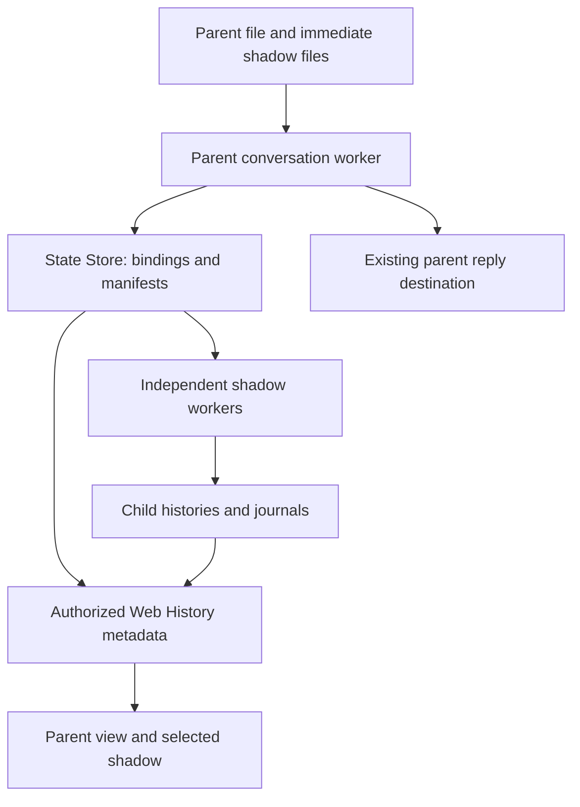
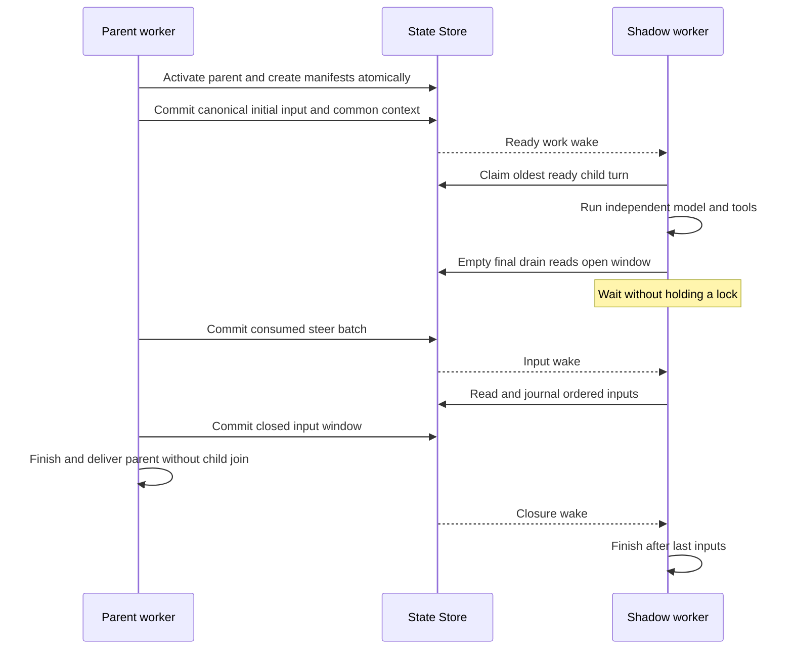
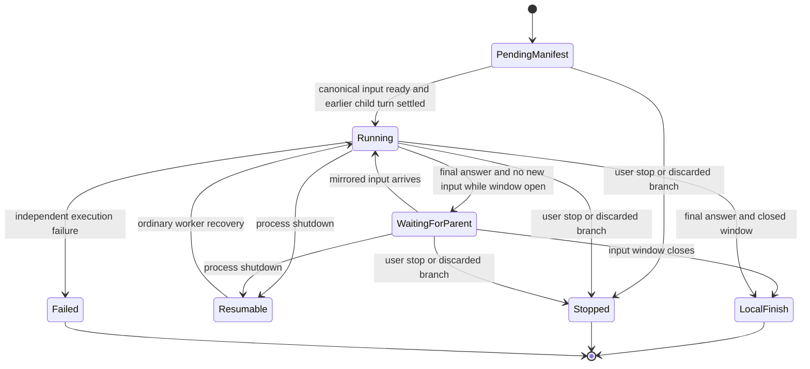
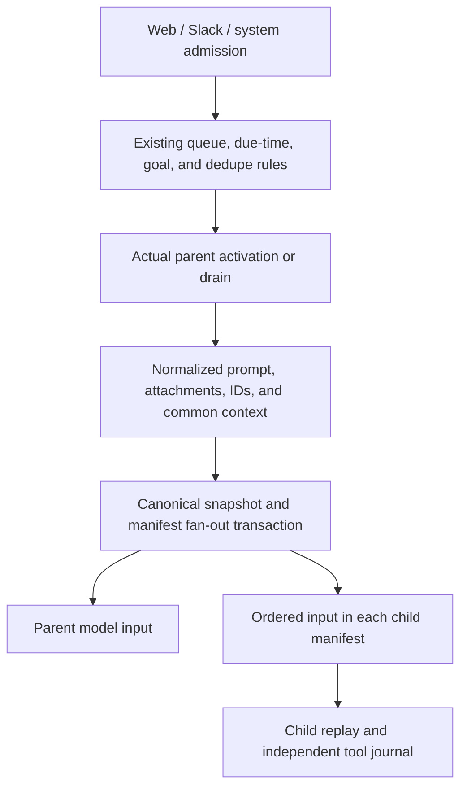
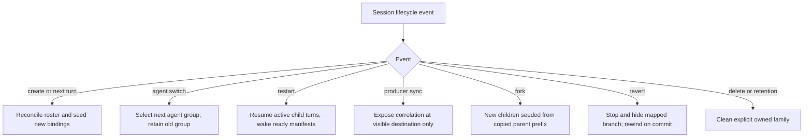
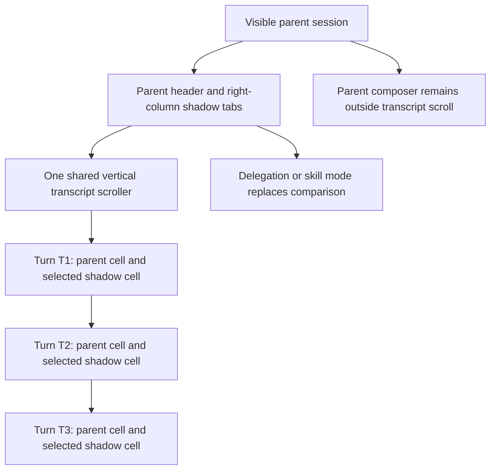

# Agent Shadows and Web Comparison - Plan

## Goal Capsule

- **Objective:** People can compare how alternative agents respond to the same conversation, turn by turn, beside the main conversation in Web.
- **Means:** Persistent shadow sessions, consumed-input mirroring, and a tabbed, vertically aligned comparison column (R1–R3, KTD1–KTD5).
- **Authority:** Product behavior belongs to the R-IDs; implementation choices belong to the KTD-IDs. Units and acceptance examples cannot override either. Repository instructions and later explicit user decisions take precedence.
- **Execution profile:** Cross-cutting Go/backend/protocol/Web feature. Implement U1–U8 in dependency order, with real-store and real-browser proof at the boundaries.
- **Stop conditions:** Stop if identical-input delivery, routing isolation, session-per-shadow, or aligned comparison cannot be preserved. Report a code-size or coverage conflict rather than raising a budget or excluding first-party code.
- **Completion owner:** The implementer owns integration, verification, and removal of abandoned attempts. Planning does not authorize implementation, deployment, commits, or a pull request; a later execution request controls shipping.

---

## Product Contract

### Summary

Discover an agent's shadows from Markdown files below its matching directory. Give each shadow its own durable session and run it alongside the parent on the same consumed inputs. Web shows the selected shadow in the right sidebar, with one tab per shadow and corresponding turns aligned vertically.

### Problem Frame

Comparing agent definitions by running separate chats makes inputs and turn boundaries drift. The current right panel displays delegations or skills, but cannot compare independent agent sessions against the main conversation.

### Key Decisions

- **File paths declare membership.** No additional shadow list in configuration. Governs R1. (session-settled: user-directed — chosen over a narrower opt-in setting: the requested directory mechanism is a requirement.)
- **Each shadow is a session, not another response inside the parent.** Governs R2–R3. (session-settled: user-directed — chosen over a stateless duplicate call: independent session-per-shadow execution is required.)
- **Comparison belongs in the Web right sidebar.** Governs R9–R11. (session-settled: user-directed — chosen over backend-only delivery: aligned, tabbed comparison is part of the feature.)

### Requirements

**Definitions and sessions**

- R1. `agents/some-important-agent.md` owns the immediate Markdown children of `agents/some-important-agent/`, including `name-of-shadow-agent.md`; multiple children are supported.
- R2. Creating a parent session creates one durable session for each configured shadow, and every subsequent parent turn has one correlated turn in each applicable shadow session.
- R3. Shadows retain independent histories, model/tool execution, attribution, failure state, and turn ordering; a slow or failed shadow must not hold the parent's model execution or final delivery.
- R4. A shadow never spawns another set of shadows, and remains a comparison child rather than a separately writable human chat.

**Inputs and execution**

- R5. Each shadow receives the parent's ordered consumed input stream: initial prompt, Web steers, moved-work notices, and parent Background Job Completion Notes, including their model-visible attachments, role, header, direct-skill request, and trusted provenance.
- R6. Queued, held, removed, duplicate, or scheduled input is mirrored only when the parent consumes it, with the same outer-turn assignment and relative order.
- R7. Shadows execute real tools under their own definitions and existing authorization rules; they have no implicit dry-run sandbox or permission inheritance from the parent.
- R8. Shadow transcript output, attachment delivery, consumed-input cards, and errors stay in the shadow session; they cannot complete the parent's caller or reach its Slack, cron, External MCP, or producer-sync destination.

**Web comparison**

- R9. The parent session exposes its shadows in the right sidebar, with one keyboard-accessible tab per shadow and readable agent/model attribution.
- R10. Corresponding outer turns start at the same vertical position, despite unequal output heights, streaming updates, attachment loading, collapsed tools, width changes, or tab changes.
- R11. Every parent turn has an explicit comparison row, including pending, running, completed-silent, failed, stopped, unavailable-before-attachment, and inactive-agent-segment cases; completion order and repeated prompt text never determine pairing.
- R12. Comparison is read-only, authorized through the visible parent, and adds no per-shadow live browser stream.

**Lifecycle**

- R13. Restart resumes unfinished parent and shadow work without remirroring an input or rerunning a completed journaled tool effect, and starts saved shadow work without a new incoming message.
- R14. Reload, agent switches, producer sync, fork, revert/redo, history deletion, and retention preserve explicit ownership and valid comparison boundaries.
- R15. Sessions with no shadows keep their current execution, routing, queue behavior, and Web layout.

### Actors

- A1. A human uses Web to work on a parent and inspect comparisons; allowlisted Slack mentions can start parent work.
- A2. The parent agent or workflow consumes admitted work and owns the external reply.
- A3. Each shadow executes its correlated work with an independent history and tool journal.
- A4. Cron, External MCP, goal continuation, and Background Jobs produce non-human parent inputs through existing backend entrypoints.

### Acceptance Examples

- AE1. **Covers R1–R3, R9.** A new `some-important-agent` session with two valid child files has two persistent child sessions and two tabs. Turn T produces independent outputs in both, even when one child fails.
- AE2. **Covers R5–R6, R13.** Parent T consumes an image prompt, steer S1, Completion Note N, then steer S2. Every shadow receives that sequence in T, including the same image data and note text. A removed queue item is absent. Restart adds no duplicate inputs.
- AE3. **Covers R3, R5.** A shadow reaches a no-tool answer before the parent consumes S1. The shadow waits at its final-input boundary, consumes S1 in T, and can answer again. The parent delivers without waiting for that answer.
- AE4. **Covers R8, R11.** A private cron or External MCP producer runs T and syncs it into a visible destination. The destination shows T's comparison once; shadow output neither syncs into the main transcript nor posts a report or completes the MCP response.
- AE5. **Covers R10–R12.** In three turns, the parent is taller in the first and the selected shadow is taller in the second. Both third-turn headers share the same vertical position. Changing tabs and loading an image preserve pairing and the scroll anchor.
- AE6. **Covers R13–R14.** Restart occurs after mirroring but before a shadow starts. Recovery runs that shadow once, using its saved inputs, although the parent has finished and cleared its Step Journal.

### Scope Boundaries

This covers definitions, backend execution, all outer-turn producers, durable relationships, history/protocol, and Web comparison. It is not an output-only sidebar feature.

**Outside this change:** scoring/ranking, choosing a winning response, promoting a shadow, provider-output equality, isolated filesystem clones, general connection multiplexing, and automatic migration of historical turns into new executions.

**Deferred to follow-up work:** interactive shadow-specific questions, autonomous shadow goals/schedules/background wakes, and a user-managed evaluation sandbox. Their current treatment is explicit in KTD7, not an unfinished prerequisite.

---

## Assumptions

These choices resolve unspecified behavior for autonomous planning; they are not user-approved decisions. The owning KTD states each rule in full.

| Topic | Chosen assumption | Owner |
|---|---|---|
| Meaning of identical inputs | Same consumed prompt payloads and common per-turn context, not the entire evolving model conversation | KTD3 |
| Tool effects | Real execution in the same workspace and external services, with each shadow's own permissions | KTD7 |
| Human interaction and autonomous work | No shadow question UI or independent root-turn producers | KTD7 |
| Existing sessions and newly added shadows | Start at attachment, using a history seed rather than replaying old work | KTD2, KTD8 |
| Reload and agent switching | Reconcile future-turn membership; keep historical bindings | KTD8 |
| Workflow requests | Run the same workflow with the shadow as its base agent; preserve explicit worker overrides | KTD6 |
| Fork | New shadow comparisons begin on the fork's future work, seeded from its copied parent prefix | KTD8 |
| Revert inside an outer turn | Hide/rewind the whole corresponding shadow turn rather than invent partial-response correspondence | KTD8 |

---

## Planning Contract

### Key Technical Decisions

- KTD1. **Reuse ordinary conversation workers and journals.** Shadows are managed backend conversations with an explicit persisted parent relationship, not Delegation Histories, private producers, a second runner, or an in-process array of duplicate model calls. Each uses its own worker, `active_turns`, session entries, and conversation-scoped Step Journal. Membership comes from R1, while the explicit relationship enforces R4. Reuse `Bridge.activateInbound`, `headTurn`, and startup discovery in `internal/rocketclaw/backend/bridge.go`, `store_dao.go`, and `thread_bridges.go`.

- KTD2. **Persist relationships and pending comparisons independently of parent journal cleanup.** Add two small relations: shadow-session bindings and shadow-turn manifests. A binding identifies parent conversation, parent agent, full shadow agent name, and unique child conversation. Enforce one binding per parent/parent-agent/shadow-agent tuple and one owner per child. A manifest identifies that binding, parent source conversation and turn, child turn, activation order, ordered serialized `rocketcode.PromptInput` values, common context entries/environment, and input-closed state. Enforce uniqueness per binding/parent-source/parent-turn. Existing active-turn and history state supply execution/terminal state; reuse the terminal enum for manifests cancelled before a child row exists, not a parallel runtime status machine. `PromptInput` already excludes its response channel from JSON in `internal/rocketcode/attachments.go`. Release duplicated payloads only after the parent window is closed and the child has durably saved them; retain unconsumed inputs for failed/stopped comparisons without restarting the failed execution. Keep correlation after completion. Parent active-turn rows and turn steps are not suitable foreign-key owners because `closeTurn` and `finishTurn` remove them.

- KTD3. **Capture the parent's input at the consumption boundary, not connector admission.** Persist the actual prepared initial `PromptInput` before its model call, after `wakePrompt`, attachment normalization, goal framing, and direct-skill detection. Capture subsequent inputs in `drainSteers` in the order it offers them. Mirror text, role, header, attachments, skill arguments, and input IDs verbatim; replace only the child journal turn ID and response channel at execution. Common goal-state and External MCP metadata developer entries/environment are captured once with the initial input rather than queried from the child. Source metadata and environment values remain common except the owning session ID, which points to the child. The parent's generated prompt frame, including its `additionalInstructions`, wins; a shadow's own system prompt/model/permissions still vary, but its `additionalInstructions` must not reframe the mirrored input. Independent history after attachment, system prompts, tool results, permission-review decisions, compaction, and answers returned by parent tool calls are not shared inputs.

  Seed a newly attached child from the parent's retained effective history prefix once, copying referenced attachment/retained-result ownership through the existing fork patterns without executing copied work. The comparison omits seed entries with no manifest. If a parent terminates before preparing model input, preserve its admitted request and reason as a terminal-only comparison; do not invent a prepared payload or run the raw request as a different prompt. Attachment fallback takes that path. A prepared input remains runnable by healthy children even if the parent later fails. Workflow input uses KTD6's invocation snapshot rather than pretending the workflow calls `runTurn`.

- KTD4. **Commit input fan-out before either side can consume it.** Parent activation creates all applicable manifests in its queue/schedule/wake-claim transaction. Preparing the initial input fills those manifests and records the parent's canonical snapshot in its existing turn journal in one transaction; only then do workers run it. A drain records its canonical batch in that journal and updates every applicable manifest atomically with Completion Note claims, before advancing `steersRead`, `notesOffered`, or clearing moved-work notices. Accepted-but-not-consumed steers remain on the parent's existing journal/queue path. Give generated notices stable IDs in the canonical capture. On resume, use saved canonical input, context, environment, and batch order; do not rebuild committed framing from new definitions, goal state, or transient notices. Re-offer committed batches through KTD5's replay-aware drain, then admit newly consumed input. Restore durable closure before opening admission; restart must not reopen a closed turn.

  A capture/closure write failure returns an error and leaves the parent resumable, without accepting a final answer, cleaning its journal, or completing external delivery. Do not translate that failure into a terminal model error. Failed shadow model execution never fails this transaction or the parent. Commit terminal closure with `finishTurn` before its journal cleanup, covering paths that do not reach a final drain; delivery-only recovery also verifies closure. Wake child workers only after commit, through their ordinary worker scheduling. Each child starts its oldest ready manifest only after its previous correlated turn has settled, even if later parent turns already finished. Claim that head and create its child active-turn/history anchor under the child history lock in one transaction. Do not pre-create several running child rows or compute their history anchors before they become the child head.

- KTD5. **Hold a fast shadow at the existing final-answer drain.** In the tool-loop phase, a child drains all currently available mirrored inputs. In the final-answer phase, a drain with no unseen input blocks until the manifest has more inputs or the parent's durable input window is closed. Supply the drain with the loop's already-applied input identities, including replayed ones, so a duplicate-only batch cannot be filtered into an empty result that ends an open turn. Keep these identities in the existing turn checkpoint, outside compactable replay content, and save them with the step that applies the input. Both ordinary and context-overflow compaction preserve them. Current replay input-ID scanning alone is insufficient: context-overflow recovery replaces `record.ReplayInput` with a compacted prefix. Do not add a separately advanced cursor that can outrun journaling. After closure, drain every unseen input before returning empty.

  The wait blocks in the child's existing loop, with no parent join, polling timer, extra waiting goroutine, or lock held across the wait. Use a child-bridge wake channel under the existing bridge mutex, registered before rereading durable state to avoid a lost wake; notifications only prompt a reread. The existing daemon run lock provides one execution owner. Shutdown cancels the wait and keeps it resumable. Persist closure at the parent's last empty final-answer drain and under KTD4 on every terminal path, including attachment fallback, preparation failure, obsolete goal continuation, workflow completion, and user stop. Parent failure closes the window but does not force a healthy shadow to fail. User stop stops the correlated active child work and marks not-yet-started manifests stopped. Replace the touched callback-based `SteerDrain` contract with an error-returning interface and explicit inert implementation so persistence/wait failures cannot masquerade as a successful empty drain. `looper.appendSteers` must propagate that error before accepting a final answer. This extends the existing late-input mechanism instead of reopening completed shadow turns.

- KTD6. **Cover workflows and private producers at their actual owners.** Mirror each outer turn exactly once at `activateInbound`'s execution owner, including cron/External MCP private conversations that occupy a destination worker. History sync is projection, not another input, and must not trigger fan-out. For shadowed workflow turns, persist the validated source text, source path/name, and invocation arguments with KTD4's canonical capture before either workflow runs; lag/reload cannot give a child a different workflow for that invocation. Recompile the saved source through the existing workflow compiler on recovery. Do not JSON-serialize `workflow.Definition`: its executable Starlark program is private and would be lost. Add only the source-preserving load path needed by the backend; unshadowed workflow execution keeps its current path. Run `workflow.Run` with a shadow-specific `workflowAgentRunner` base agent. Existing worker instructions/model/schema/tool restrictions still override that base as they do for the parent (`internal/rocketclaw/backend/raw_run.go`); a workflow with fully specified workers may show no meaningful shadow-agent variation. Do not flatten workflows into ordinary chat prompts or mirror internal workflow-worker calls as new outer turns. The current workflow path does not consume Web steers; waiting Web input stays later work on both sides. Expose a producer's comparison bindings in its visible destination using the sync source and parent turn identity, without changing the child's owner or allowing shadow history/effects into `SyncConversation`.

- KTD7. **Separate real tool authority from output routing.** Shadows use their own permissions, provider, guardrail, recursion, shell, and the normal automatic permission reviewer; they receive no extra grants or human approval borrowed from the parent. File writes, shell commands, and permitted MCP effects are real and may race or duplicate parent effects. Reuse the same workspace and credentials; output isolation is not an external-effect sandbox. Remove the shadow lineage's host tools for asking a human, starting a new thread, scheduling/resetting scheduled work, updating a goal, reload, and restart. Supply existing `InertBackgroundJobs` throughout its root/delegated/workflow execution; moving a shadow call to background is unavailable. Read-only session tools, ordinary synchronous task/skill execution, and shadow-local tags/attachment collection remain available under normal permissions. Omitted tools fail through the existing unavailable-tool behavior, without a new rejection protocol. This keeps shadow turns driven only by the parent stream and avoids shadow-local Completion Notes changing R5's stream. A copied parent note is prompt data, never a claim on the parent's Background Job. Strip connector delivery/sync/control state when constructing child requests, using fresh protocol messages rather than copying mutexes, response channels, or completion objects. Persist the shadow's normal history/terminal output locally and acknowledge it locally without entering connector delivery; never set a child's `SyncDestination` to its parent.

- KTD8. **Make lifecycle boundaries visible, not implicit.** New sessions attach children at creation; existing sessions attach at their next parent activation, without replaying earlier work. Reconcile configured immediate children before each new outer-turn activation: new names get a new binding/history seed; removed names stop receiving new turns but retain readable history; re-added names reuse the binding. Agent switches select the next turn's parent-agent binding group and never rewrite an active turn's roster. A switch back resumes that group's child histories. The manifest fixes the roster and input payload for an active turn; definition/model reload follows the existing runtime reload rules, and a missing definition fails the existing child manifest visibly instead of erasing it. Fork creates new child sessions seeded from the fork's copied parent prefix, without cloning source shadow executions or running jobs. Stage-revert stops/hides mapped child turns at and after the owning parent-turn cutoff; a cutoff inside a turn includes that whole child turn. Redo restores stored comparison history but never restarts previously stopped tool effects. Commit-revert rewinds each affected child to the beginning of its earliest removed correlated turn, preserves its earlier independent history, and cancels future manifests for the discarded branch. Old manifest IDs must not match new turns after editing/resending. Parent deletion/retention traverses explicit bindings and cleans child histories, delegations, attachments, journals, manifests, and managed rows as one owned family. History-only deletion clears comparison history/work but keeps session bindings for future turns. Pending manifests protect both parent and historyless child from retention. Do not infer ownership from a slash in a conversation ID.

- KTD9. **Expose comparison through typed history metadata and existing authorization.** Extend History with bindings and a turn-correlation inventory, including manifests that have no transcript entries yet. Each item identifies binding, parent source conversation/turn, child conversation/turn, order, and presentation state. Reuse existing transcript/terminal enums where they fit and define a small typed presentation enum only for missing states such as waiting or pre-attachment. Preserve additive protobuf numbering and regenerate protocol artifacts through the repository generator. Parent history revisions must change when comparison metadata changes, even when main messages do not. Child histories/entries/attachments/delegations resolve authorization through their visible parent destination and are never included in ordinary sidebar/search enumeration. Reject direct child writes at backend public mutation boundaries as well as hiding UI controls. Read-only session tools may discover bindings through the existing session-read output, not a new shadow command surface. Child transcript changes notify the parent-visible conversation, so Web keeps its single existing `/stream` connection; tab activation makes bounded History reads using cached revisions.

- KTD10. **Let CSS grid align turns in one shared scroller.** Comparison mode renders one row per durable parent source/turn, containing the parent transcript and selected-shadow transcript. Each row's intrinsic height is the taller cell, with both cells top-aligned; no independent scrolling or measured padding is needed. Preserve the existing parent origin card, pagination anchor, message selection, jump links, autoscroll, and fixed composer around this shared body. Display non-shadowed seed/legacy or other-agent turns with an unavailable cell rather than shifting later rows. Keep steers inside their owning outer-turn cell; `transcriptTurns` currently flushes on every user message and needs identity-aware grouping for correlated rows. Opening a delegation or skill replaces comparison, as existing right-panel modes replace each other; returning restores the selected shadow and parent turn anchor. A `shadow` URL parameter identifies a validated binding, not an arbitrary conversation. On narrow screens reuse the Sheet presentation and preserve turn navigation, with exact side-by-side alignment applying when both columns are visible. ResizeObserver-based padding and synchronized scroll panes were rejected because native shared rows satisfy R10 without observer feedback loops or a second scroll owner. The MDN ResizeObserver guidance supports avoiding observation of layout that the observer itself changes.

### High-Level Technical Design

The diagrams describe ownership, protocol sequencing, state, input flow, lifecycle decisions, and Web layout. KTDs own the details.

**Component ownership (KTD1–KTD2, KTD6–KTD9):**

**Turn protocol (KTD4–KTD5):**

**Child execution and wait state (KTD4–KTD5):**

**Input stages (KTD3–KTD4):**

**Lifecycle dispatch (KTD8):**

**Web region layout (KTD9–KTD10):**

### Entrypoint Coverage

| Entry or branch | Existing boundary | Shadow treatment |
|---|---|---|
| New Web prompt, enqueue, held-row promotion | `Runtime.RunTurn`, Web admission, `activateInbound` | KTD3–KTD4 after actual activation, never at stash |
| Web steer and late steer | `drainSteers`, input-window fallback to queue | Same canonical batch in the assigned outer turn; late queued input becomes the next mapped turn |
| Slack authorized mention | Mention admission and Thread Queue | Mirror the consumed mention once; report-thread replies remain ignored |
| Scheduled message / one-off or recurring cron | Due-time claim and private producer activation | Same input/due ordering; no second child fan-out at sync |
| Goal kickoff / continuation | Goal request and `finishGoalTurn` | Mirror each consumed parent turn with common goal framing; no child goal accounting or extra continuation |
| Background wake / Completion Note / moved work | `claimWakeNotes`, `wakePrompt`, `drainSteers` | Copy resulting prompt data; parent retains all claim ownership |
| External MCP, including queued prompts | `cmd/rocketclaw/mcp.go`, private/managed pairing | Mirror private execution; project comparisons to the authorized visible destination |
| Saved workflow and nested workflow tool | `runWorkflow`, `workflowAgentRunner`, dynamic workflow tool | Mirror outer workflow invocation; nested calls remain that side's independent execution |
| Unsupported attachment / preparation failure / silent result | `handleInbound` fallback and terminal paths | Persist mapped input/outcome and close the window; do not strand a pending child |
| Fork, switch, revert/redo, history clear | Existing lifecycle handlers | KTD8; control operations are not synthetic model inputs |

### Alternatives Considered

1. **Stateless parallel model calls:** loses independent histories, replay, and slow-child ordering; violates R2–R3.
2. **Delegation or private-producer children:** their ownership and sync/delivery behavior do not match R4/R8. Explicit bindings reuse workers without misusing those concepts.
3. **Replay a whole parent turn only after it finishes:** simplifies late input, but delays shadow execution instead of running it alongside the parent. KTD5 uses the existing final drain and preserves live execution.
4. **Two scroll panes with measured padding:** requires measurement and scroll synchronization that a shared grid does not need (KTD10).

No consequential mechanism needs development in competing prototypes: the first two fail requirements, the third changes live execution semantics, and the fourth has strictly more coordination for the same layout contract.

### Implementation Constraints

- Keep feature-local decisions in the existing backend, RocketCode, protocol, and Web boundaries. No separate shadow service, execution engine, generic event framework, or new dependency.
- Apply the repository's Go standards to touched constructors, interfaces, error paths, and tests. Use explicit inert behavior dependencies, no stored contexts, no callback injection, and no new atomics. Never hold a mutex across shadow waits, provider/tool/connector waits, or global worker-manager SQL. Preserve the inherited per-bridge admission/consumption critical section around atomic persistence: moving its SQL outside the mutex without moving all admission ownership leaves a closure/commit gap and can lose steers or Completion Note wakes. A general admission-lock redesign is outside this feature; parent execution never joins shadow output.
- Use Go 1.26.2+ standard-library idioms and `go doc`/gopls during implementation. Use synctest for in-process coordination tests; real database/network tests need their existing completion signals, not fake-time sleeps around I/O.
- Keep filesystem access and filesystem-test fixtures behind `*os.Root`. All implementation scratch/build/test temporary paths belong under the repository's `.tmp/`.
- Changes to this full feature necessarily cross backend, protocol/RPC, RocketCode, and Web; each unit stays on one coherent boundary rather than combining unrelated cleanup.
- Source budgets and coverage are hard gates, not knobs to raise. Do not hide first-party code under generated, ignored, vendor, or test-only paths.

### Deferred Implementation Details

Exact private helper names, SQL/index spelling, and component extraction are implementation choices. Preserve the constraints, transaction ownership, and existing abstractions above. The next migration number must be checked again when implementation begins.

---

## Implementation Units

### U1. Discover shadow definitions without changing ordinary agent selection

**Goal:** Make R1's files available as full agent definitions and expose their parent membership.

**Requirements:** R1, R4, R7, R15; KTD1, KTD7.

**Dependencies:** None.

**Files:** `internal/rocketcode/agents.go`, `internal/rocketcode/agents_test.go`, `internal/rocketclaw/backend/bridge.go`, `internal/rocketclaw/backend/bridge_test.go`, `internal/rocketclaw/frontend/rpc/server.go`, `internal/rocketclaw/frontend/rpc/server_test.go`.

**Approach:**
1. Extend discovery to each top-level parent's matching immediate directory. Keep names path-derived (`some-important-agent/name-of-shadow-agent`) and preserve existing frontmatter/model resolution and load-error reporting.
2. Derive membership from paths, not a new frontmatter field. Ignore unrelated/deeper directories for automatic membership and report invalid immediate definitions through the existing loader result.
3. Preserve ordinary top-level agents in human agent choices and ordinary discovery output; nested shadow names are not separately selectable chats. Load valid shadows for their bound workers without inferring session ownership from the name.

**Patterns to follow:** `loadAgent`, `LoadAgents`, workspace-root definition loading, existing RPC agent-choice policy.

**Test scenarios:**
- One parent and two immediate children load distinct full names, prompts, models, permissions, and sorted membership; ordinary agents remain unchanged.
- A directory with no matching parent, a non-Markdown file, and a deeper child do not become automatic shadows.
- One malformed child reports its exact path while valid siblings and the parent remain loadable; no silent omission from operator-visible load errors.
- Human selection cannot choose a nested shadow definition as a primary session agent.

**Verification:** Loader and RPC choice tests prove path membership and preserve existing agent behavior. Filesystem fixtures use the same rooted abstraction as production.

### U2. Persist session bindings, manifests, and child history seeds

**Goal:** Establish durable ownership and one comparison per applicable parent turn.

**Requirements:** R2–R4, R11, R13–R15; KTD1–KTD4, KTD8.

**Dependencies:** U1.

**Files:** `internal/rocketclaw/backend/migrations/033_agent_shadows.sql` (new, number provisional), `internal/rocketclaw/backend/store_dao.go`, `internal/rocketclaw/backend/conversations.go`, `internal/rocketclaw/backend/fork.go`, `internal/rocketclaw/backend/shadows.go` (new feature-local storage/coordination), `internal/rocketclaw/backend/shadows_test.go` (new), `internal/rocketclaw/backend/store_test.go`.

**Approach:**
1. Add KTD2's unique ownership/correlation relations and indexes for child pending order, parent lookups, and cleanup. Use existing migrations, history locks, and typed domain payloads.
2. Attach bindings in all parent creation paths, including implicit Slack/producer creation and fork. Reconcile legacy sessions at activation under the parent history lock; skip fan-out for bound children.
3. Seed newly attached children from the locked parent prefix using the attachment, delegation-history, and retained-result ownership parts of `fork.go`. Never copy live jobs, pending requests, or producer routing.
4. Create manifests with parent activation claims, but create the child active-turn/history anchor only when its manifest reaches the child head.

**Execution note:** Start with real-store tests for concurrent attachment and activation rollback; mocked writes do not establish the ownership boundary.

**Patterns to follow:** `createConversation`, `startTurnDB`, `ForkConversation` ownership copying, `lockSessionHistory`.

**Test scenarios:**
- Creating one parent twice yields exactly one child per shadow; two parent sessions get different children.
- Concurrent reconciliations cannot create duplicate bindings or manifests, and child creation cannot recurse.
- A failed activation transaction restores queue/schedule/note ownership and leaves no partially admitted child work.
- A new shadow attached to an existing conversation starts from the retained prefix, has working copied attachment access, and performs no historical tool calls.
- Two waiting parent turns create ordered manifests but only one child active turn; T2's history anchor includes the finished T1 child output.

**Verification:** PostgreSQL tests prove uniqueness, atomic admission, correct seed ownership, and pending state that survives parent journal removal.

### U3. Mirror canonical consumed input and coordinate the final boundary

**Goal:** Deliver equal input streams despite steers, late notes, different speeds, and restart.

**Requirements:** R3, R5–R6, R13, R15; AE2–AE3, AE6; KTD3–KTD5.

**Dependencies:** U2.

**Files:** `internal/rocketclaw/backend/bridge.go`, `internal/rocketclaw/backend/conversations.go`, `internal/rocketclaw/backend/store_dao.go`, `internal/rocketclaw/backend/shadows.go`, `internal/rocketclaw/backend/shadows_test.go`, `internal/rocketclaw/backend/bridge_test.go`, `internal/rocketclaw/backend/active_turn_test.go`, `internal/rocketcode/checkpoint.go`, `internal/rocketcode/looper.go`, `internal/rocketcode/looper_test.go`, touched `SteerDrain` construction sites and generated mockery-v3 test mocks.

**Approach:**
1. Move initial canonical capture to the shared prepared-input point and persist KTD3's common context. Reuse `PromptInput` serialization and input-ID deduplication rather than defining a parallel input DTO.
2. Make the parent drain persist its offered batch before advancing consumed state. Pass real drain implementations or an explicit inert value under KTD5's interface contract, and update every caller.
3. Let each child read its manifest stream and wait directly at the final drain. Publish wakes after commit and close the input window on all terminal paths.
4. Preserve the parent's accepted-steer journal/requeue behavior and its independent finish/delivery path.

**Execution note:** Use a deterministic fake-provider turn that reaches a final answer before the parent consumes a steer, then prove the steer stays in the same child turn.

**Patterns to follow:** `wakePrompt`, `normalizeInboundAttachments`, `buildPrompt`, `drainSteers`, `looper.appendSteers`, `openTurn`, `finishTurn`.

**Test scenarios:**
- Covers AE2. Compare exact provider-facing prompt inputs for whitespace, source/principal header, attachment warnings, image URLs/data, direct-skill arguments, and ordered initial/steer/note inputs.
- Covers AE3. A fast child waits without extra model calls; a later steer resumes it in T while parent completion does not wait for its response.
- A slow child consumes all accumulated inputs in order before its next eligible step; repeated prompt text remains distinct by input identity.
- A held/removed/duplicate row is never mirrored; a late steer queued after closure becomes T2, not an extra input in T1.
- A failed capture write does not advance parent or child consumed state; retry offers the canonical batch once.
- Crash after canonical capture but before loop journaling, then change goal state/definitions: resumed parent and child still receive the saved payload/context and generated notices in the same order.
- Covers AE6. Restart after fan-out but before child consumption preserves the input stream after parent journal cleanup; restart after child journaling does not inject it twice.
- Closure between wait registration and state read cannot strand a child; shutdown during the wait leaves resumable work rather than a false successful final.
- A resumed child with only duplicate mirrored inputs and an open parent window still waits; closure plus unseen final inputs consumes them before completion.
- Force ordinary and context-overflow compaction after S1, crash/restart, then deliver S2: neither side re-injects S1 or loses S2, even when S1 no longer appears in replay content.
- Parent fallback, preparation error, obsolete goal continuation, and stop all close the stream; an unprepared turn has a terminal-only comparison, not a fabricated model prompt. No-shadow parents retain existing drain behavior.
- Failed closure persistence leaves the parent resumable and undelivered with journals intact; restart after closure but before parent delivery releases the child without reopening admission.

**Verification:** Exact input assertions and coordination tests separately prove order, framing, wait lifecycle, and parent independence.

### U4. Run and isolate shadows across every execution source

**Goal:** Use independent workers while preserving parent delivery and tool authority.

**Requirements:** R3, R7–R8, R13, R15; AE1, AE4; KTD1, KTD6–KTD7.

**Dependencies:** U3.

**Files:** `internal/rocketclaw/backend/bridge.go`, `internal/rocketclaw/backend/thread_bridges.go`, `internal/rocketclaw/backend/raw_run.go`, `internal/rocketclaw/backend/dynamic_workflow_tool.go`, `internal/rocketclaw/backend/background_tools.go`, `internal/rocketclaw/backend/shadows.go`, `internal/rocketclaw/backend/shadows_test.go`, `internal/rocketclaw/backend/raw_run_test.go`, `internal/rocketclaw/backend/runtime_test.go`, `internal/rocketclaw/workflow/definition.go`, `internal/rocketclaw/workflow/definition_test.go`, `cmd/rocketclaw/mcp_test.go`, `cmd/rocketclaw/cron_test.go`.

**Approach:**
1. Schedule bound child work through ordinary workers and head-of-manifest claiming. Use fresh protocol requests, the child's explicit attribution, and local completion instead of connector delivery.
2. Apply KTD7 tool construction throughout root, task, guardrail/review, and workflow lineage. Preserve ordinary parent tools and permission-review behavior.
3. Execute workflow manifests through the existing workflow runner with the shadow base agent. Project bindings at producer sync without projecting shadow histories or side effects.
4. Audit the entrypoint table against actual callers; fix the common owner boundary once rather than adding connector-specific mirroring.

**Patterns to follow:** `runTurn`, `rocketcodeConfig`, `finish`/`deliver`, `prepareWorkflow`, `workflowAgentRunner.Run`, producer sync and cron-root binding.

**Test scenarios:**
- Covers AE1. Parent and two children use different model/system prompts and independent journal namespaces; a provider failure in one child leaves parent and sibling successful.
- A permitted shadow file/tool effect runs for real; a denied effect remains denied under that child's rules even when the parent permits it.
- A child's question/scheduling/goal/background/reload/restart/thread-creation capabilities are unavailable, including inside delegated and dynamic workflow work; parent availability is unchanged.
- Covers AE4. Web, Slack mention, cron, External MCP, scheduled work, goal continuation, and background wake each produce one manifest per shadow and only the parent's normal outbound reply/caller completion.
- A silent parent cron result and a nonempty shadow result create no extra cron root; child attachments remain downloadable only in comparison history.
- A workflow keeps its captured source/name/arguments/schema and explicit worker overrides while selecting the shadow base, even after a lagging child reloads or restarts with the source file changed/deleted; no internal worker turn is remirrored.
- Completion Notes in a child prompt never claim, consume, or wake the parent's job rows.

**Verification:** Check input equality, local persistence, connector silence, and caller completion separately; observing one cannot establish the others.

### U5. Preserve recovery, mutation, and retention boundaries

**Goal:** Make R13–R14 reliable for pending and already running comparisons.

**Requirements:** R11, R13–R15; AE6; KTD2, KTD4–KTD5, KTD8.

**Dependencies:** U4.

**Files:** `internal/rocketclaw/backend/app.go`, `internal/rocketclaw/backend/thread_bridges.go`, `internal/rocketclaw/backend/store.go`, `internal/rocketclaw/backend/revert.go`, `internal/rocketclaw/backend/fork.go`, `internal/rocketclaw/backend/shadows.go`, `internal/rocketclaw/backend/shadows_test.go`, `internal/rocketclaw/backend/app_test.go`, `internal/rocketclaw/backend/revert_test.go`, `internal/rocketclaw/backend/fork_test.go`.

**Approach:**
1. Start active child turns and then ready manifest workers during ordinary startup; include pending manifests in prune protections before discovery.
2. Reconcile new/removed shadow definitions and parent-agent groups under KTD8 while retaining each active manifest's roster.
3. Extend history mutation and owned-family cleanup using explicit binding queries, with deterministic history-lock order across parent and children.
4. Keep closure/cancel state durable before interrupting live child work so restart cannot resurrect a discarded branch.

**Patterns to follow:** `StartActiveTurns`, persisted-queue startup, `switchConversationAgent`, staged/committed revert, history deletion, existing prune ownership queries.

**Test scenarios:**
- Covers AE6. Ready historyless children start after restart without another prompt; a second restart does not replay completed work or tools.
- Restart during a parent-open child wait resumes the wait and later consumes the parent's recovered input; completed parent closure releases a recovered child.
- Reload adds/removes/re-adds files while T runs: T's roster is unchanged, T2 follows the new membership, and old comparisons remain readable.
- Switching A to B then back to A uses the correct binding histories without retagging T or causing duplicate children.
- Fork copies the parent's selected prefix/attachments, seeds fresh children, and neither clones source running work nor reruns source effects.
- Revert at a mid-turn steer boundary hides/stops the entire mapped child turn; redo restores stored rows without repeating effects; commit-revert followed by resend has new correlation IDs.
- Parent deletion/retention removes the owned children and blobs; pending child work prevents historyless family pruning; unrelated slash-containing session IDs survive.
- History-only deletion removes old comparison rows/work but future parent input still reaches existing bindings.

**Verification:** Real-store restart and history-mutation tests demonstrate valid ownership at every cut. Existing queue/revert/fork tests remain green.

### U6. Publish authorized, live comparison metadata

**Goal:** Give Web enough durable information to pair turns and show pending state without new live connections.

**Requirements:** R9, R11–R12, R14–R15; KTD6, KTD8–KTD9.

**Dependencies:** U5.

**Files:** `internal/rocketclaw/protocol/conversation.go`, `internal/rocketclaw/protocol/change.go`, `internal/rocketclaw/backend/history.go`, `internal/rocketclaw/backend/transcript.go`, `internal/rocketclaw/backend/transcript_test.go`, `internal/rocketclaw/backend/session_tools.go`, `internal/rocketclaw/backend/session_tools_test.go`, `internal/rocketclaw/backend/conversations.go`, `internal/rocketclaw/backend/store.go`, `internal/rocketclaw/backend/revert.go`, `internal/rocketclaw/backend/fork.go`, `internal/rocketclaw/frontend/rpc/server.go`, `internal/rocketclaw/frontend/rpc/attachments.go`, `internal/rocketclaw/frontend/rpc/server_test.go`, `internal/rocketclaw/frontend/rpc/turns_test.go`, `internal/rocketclaw/web/proto/web.proto`, generated RPC protocol files, `internal/rocketclaw/web/src/types.ts`, `internal/rocketclaw/web/src/api.ts`, `internal/rocketclaw/web/src/api.test.ts`.

**Approach:**
1. Extend typed History metadata per KTD9 inside `ObserveHistory`'s existing repeatable-read snapshot, preserving messages and delta/reset/pagination behavior. Map producer-backed rows with their original source/turn tuple.
2. Update revision inventory and database change notification paths for binding/manifest/child-history changes, including changes without main transcript content.
3. Route authorized reads through the parent relationship; apply read-only restrictions to child mutation endpoints and backend methods. Reuse entry/download authorization for descendant delegations and child attachment IDs.
4. Exclude children from ordinary list/search output and expose their relationship in existing read-only session output.

**Patterns to follow:** `SessionService.Changes`, transcript revision inventories, `visibleConversation`, History projection, protobuf generation, existing transport fixtures.

**Test scenarios:**
- A manifest with no history returns a waiting row with a stable parent tuple; a child-only terminal change alters the parent's revision without adding parent messages.
- Repeated prompt text, source sync, pagination, and a missing child result preserve pairing by IDs rather than array position.
- An unauthorized parent's child history/entry/attachment/delegation reads are denied; an authorized parent permits those reads without exposing an independently writable chat.
- Direct prompt, fork, revert, goal, queue, upload, agent-switch, and background mutations on a child cannot create off-contract work.
- Shadow transcript changes wake the parent's existing change listener; unrelated parent listeners do not receive them.
- Existing no-shadow History and list/search results remain compatible, and regenerated protocol hashes match.

**Verification:** Go RPC tests and Web transport tests establish authorization, metadata-only invalidation, revision correctness, and source-aware correlation.

### U7. Render tabbed, vertically aligned Web comparison

**Goal:** Show live parent/shadow differences without row drift or stream growth.

**Requirements:** R9–R12, R15; AE5; KTD9–KTD10.

**Dependencies:** U6.

**Files:** `internal/rocketclaw/web/src/ui.tsx`, `internal/rocketclaw/web/src/transcript.test.ts`, `internal/rocketclaw/web/src/shadows.browser.test.ts` (new), `internal/rocketclaw/web/src/shadows-transport.test.ts` (new if the existing transport fixture cannot cover it), `internal/rocketclaw/web/src/delegations.browser.test.ts`, `internal/rocketclaw/web/src/tabs.browser.test.ts`, `internal/rocketclaw/web/src/long-chat.browser.test.ts`, `internal/rocketclaw/frontend/rpc/live_test.go`, `internal/rocketclaw/web/Makefile` only if its explicit Go-backed browser-test selector needs the new fixture.

**Approach:**
1. Add right-panel shadow navigation beside the existing skill/delegation modes. Validate the URL binding against the parent and implement accessible tab selection with agent/model/state labels.
2. Build parent-owned comparison rows using the manifest inventory and existing transcript rendering. Group correlated user steers by outer-turn identity without breaking tool/result grouping or legacy rows.
3. Use KTD10's common grid/scroller and reuse existing message actions, selection, anchors, and width controls. Show read-only shadow content with no composer or mutation actions.
4. Fetch only the selected child's required History pages. Invalidate them from the parent stream, catch up on tab activation, and cancel stale requests on selection/navigation changes.

**Execution note:** Prove layout with real DOM bounds, not static rendered markup or an assertion that both outputs appear.

**Patterns to follow:** `panelHref`, `TranscriptLog`, `TranscriptTurn`, `useTranscriptPosition`, `useSessionStream`, `ResizableAside`, `DetailPanel`, existing browser fixtures.

**Test scenarios:**
- Covers AE5. Three paired turns with alternately tall parent/shadow outputs have corresponding header top positions within one CSS pixel, before and after streaming, image load, tool collapse, and resize.
- Multiple steers in T remain in its comparison row, while queued T2 has its own row; repeated prompt strings and out-of-order child completion do not shift pairing.
- Waiting, running, completed-silent, failed, stopped, pre-attachment, and inactive-agent-segment cells stay present and readable.
- Keyboard tab navigation, focus, tab/tabpanel association, long labels, and narrow-screen Sheet behavior work without shadow mutation controls.
- Switch shadows while scrolled in T2, prepend earlier history, open/close a skill or delegation, and navigate browser back: preserve the parent turn anchor and correct selected binding.
- With three shadows and several ordinary session tabs, the active page still holds at most its one parent `/stream`; inactive shadows have no streams or polling loops, and RPCs remain usable.
- A delayed History response from a former shadow/parent cannot replace the newly selected comparison; a failed child History read displays an error and remains retryable.
- No-shadow sessions preserve their prior single-column layout, composer behavior, and delegation/skill navigation.

**Verification:** Real-browser geometry, navigation, and connection assertions plus transport tests establish the complete R9–R12 contract.

### U8. Verify the vertical slice and document safe operation

**Goal:** Establish end-to-end evidence and explain the feature's execution consequences.

**Requirements:** R1–R15; AE1–AE6; KTD1–KTD10.

**Dependencies:** U7.

**Files:** `README.md`, `internal/rocketclaw/web/README.md`, `CONCEPTS.md`, existing/new test files named by U1–U7, `docs/verification/agent-shadow-comparison.md` (new implementation verification record).

**Approach:**
1. Exercise the full entrypoint matrix with the real backend/provider fixtures and Web comparison, including crash/restart and producer sync.
2. Document R1's layout, independent histories, identical-input limits, tool/permission policy, real duplicate side effects, inactive tabs, lifecycle cuts, and Web read-only comparison.
3. Run the Verification Contract, inspect the final touched diff for repository-standard violations, and remove abandoned coordination/layout attempts.

**Test scenarios:**
- Covers AE1–AE6. One fixture family proves two shadow definitions, exact attachment/steer/note input, independent failures, parent-only delivery, durable restart, and browser alignment together.
- Exercise a workspace without shadows and compare prior queue, prompt framing, terminal delivery, and Web navigation behavior.
- With an explicitly permitted file effect, confirm parent and shadow can both change real workspace state; document that result without claiming isolation from external effects.

**Verification:** All gates pass without suppressed lint, reduced coverage, raised budgets, or metric exclusions. The verification record names actual results and any limits, not planning-time claims.

---

## Verification Contract

The planning run does not execute these checks. They are required during implementation, using repository-local `.tmp/` for temporary files and suitable existing PostgreSQL/provider/browser fixtures.

| Gate | Scope | Required evidence |
|---|---|---|
| `gofmt` | Every touched Go file | Formatting changes inspected in the final diff |
| `go test ./...` | Repository root and affected Go module roots, respecting the workspace | All applicable packages tested, not skipped because the root excludes a nested module |
| `make lint` | Repository root | Existing Go lint gates pass; inspect any autofixes |
| `make test` | Repository root | All component suites and metric gates pass |
| `make lint` and `make test` | `internal/rocketclaw/web` | Type checking, React/lint checks, unit/transport/browser tests, and Web size budget pass |
| PostgreSQL integration and restart cases | U2–U6, U8 | Real transactions, input ownership, recovery, mutation cuts, and no duplicate journaled effects |
| Real browser comparison | U7–U8 | One-pixel turn alignment, tabs/focus/navigation, page prepend, errors, and one live parent stream |
| `make check-cloc-budget` | Repository root | All existing source budgets pass without changing their values |

Observed component gates include RocketClaw coverage at least **85.5%**, RocketClaw Go source strictly below **23500** lines, and Web source strictly below **7500** lines. RocketCode and other root gates remain authoritative at implementation time. Record current headroom before adding production code; capacity was not measured by running build/test/metric targets during planning.

Provider/input fixtures must assert exact ordered input payloads. Tool effects must be checked separately from session transcript delivery. Use generated mockery-v3 mocks where behavior interfaces need mocks, and existing real-state/provider fixtures at persistence boundaries. In-process wait tests may use `testing/synctest`; database and browser I/O retain their existing real completion mechanisms.

No behavioral skill file is changed, so a skill-evaluation harness is not required. No `release:validate` target was found in the inspected repository manifests; repository lint/test/build/browser/metric gates above apply. A missing fixture dependency or failed required gate is a blocker, not permission to report the feature working.

---

## Definition of Done

- U1–U8 satisfy their verification outcomes, and every R-ID is demonstrated by its unit scenarios and the vertical slice.
- File-path membership, one session per shadow, exact consumed-input ordering, independent execution, parent-only routing, restart recovery, and tabbed vertical alignment remain intact after the final diff review.
- No parent terminal path strands a child with an open input window, and no completed/cleared parent journal can erase pending shadow input.
- No child mutation, connector delivery, producer projection, or autonomous wake can escape KTD7/KTD9's boundaries.
- The Verification Contract passes at the actual implementation revision, including coverage and source budgets.
- README guidance covers the real-effects warning and the meaning of identical inputs. No-shadow behavior remains unchanged.
- Experimental runners, observers, extra channels/goroutines, obsolete helpers, unused fields, and abandoned tests are removed. Generated output contains only generator-owned artifacts.
- The final report identifies verification results and README impact; shipping follows later explicit authority, not this planning request.

---

## Appendix

### System-Wide Impact and Risks

| Concern | Practical consequence | Treatment |
|---|---|---|
| Duplicate real tool effects | Shadows can change the same files or repeat an external write | KTD7; operator README warning, explicit permission tests, no dry-run claims |
| Multiplying model/tool cost | N shadows add N independent executions and may lag many turns | Ordinary worker lifecycle and KTD4 ordering; start rollout with few explicitly permitted shadows |
| Database write fan-out | Input durability costs grow with shadow count; image payloads amplify storage | Reuse current payload limits/storage, keep manifests feature-local, avoid unbounded extra runtime queues; evaluate storage size in U8 |
| Lost wake or missing closure | A fast child can wait forever or miss a late input | KTD5 race tests and all-terminal-path closure audit |
| Canonical replay versus journal replay | Recomputed framing or duplicate-only drains can change input or finish an open turn | KTD4 saved snapshots and KTD5 replay-aware drains; U3 crash and duplicate-only tests |
| Parent journal cleanup | A lagging child can lose input after parent completion | KTD2 manifests outlive that cleanup; AE6 real-store recovery |
| Producer ownership | Sync can mirror the same turn twice or leak child output/effects | KTD6 source/turn correlation and AE4 routing assertions |
| Human principal / data exposure | A child may be mistaken for a public chat or bypass parent authorization | KTD9 parent-derived reads, hidden enumeration, backend mutation enforcement |
| History mutation | Replayed effects or stale comparison IDs can survive a discarded branch | KTD8 whole-outer-turn cut, durable stop state, redo/resend tests |
| Browser connection limits | Extra child streams can exhaust HTTP/1 connections | KTD9 single parent stream; U7 connection test |
| Source budget | Full backend plus Web work may exceed available headroom | Check current budgets before implementation; reduce unnecessary machinery or report conflict, never weaken a gate |

Deploy schema/backend/Web changes together through the existing migration and protocol-hash mechanisms. An additive schema migration creates no historical shadow executions. Start with permission-limited shadow definitions and inspect live comparison/recovery on a non-critical parent before enabling side-effectful definitions. Removing shadow files stops future fan-out but does not cancel already admitted manifests; stop their parent work explicitly when needed. Older binaries reject unknown migration ledger entries, even when the added tables are retained. Use a forward repair on the upgraded schema, with shadow files removed and admitted work settled if execution must be paused. Do not claim binary-swap rollback is available or delete migration records/comparison data to force it.

### Sources and Research

- `internal/rocketcode/agents.go`: top-level discovery, relative-path names, frontmatter/model/permission loading; grounds U1.
- `internal/rocketcode/attachments.go`, `internal/rocketcode/looper.go`: serializable `PromptInput`, replay input IDs, journal resume, and final-answer drain; grounds KTD2–KTD5.
- `internal/rocketclaw/backend/bridge.go`, `conversations.go`, `thread_bridges.go`, `store_dao.go`: consumption, normalized prompt framing, producer ownership, queues, goals, delivery, and active-turn cleanup; grounds KTD1–KTD7.
- `internal/rocketclaw/backend/raw_run.go`, `dynamic_workflow_tool.go`, `internal/rocketclaw/workflow/engine.go`: workflow base-agent overrides and journaled worker calls; grounds KTD6.
- `internal/rocketclaw/backend/fork.go`, `revert.go`, `store.go`: effective history, copied attachment/retained-result ownership, staged cuts, and retention; grounds KTD3/KTD8.
- `cmd/rocketclaw/mcp.go`, `cmd/rocketclaw/cron.go`: actual private-producer assembly, not just runtime facades; grounds the entrypoint matrix.
- `internal/rocketclaw/backend/transcript.go`, `internal/rocketclaw/frontend/rpc/server.go`, `internal/rocketclaw/web/proto/web.proto`, `internal/rocketclaw/web/src/ui.tsx`: committed changes, authorization, history identity, transcript grouping, and right-panel/scroller behavior; grounds KTD9–KTD10.
- `docs/solutions/logic-errors/saved-queue-never-started-after-restart.md`: discovery must wake saved work and retention must keep historyless owners. Use the current code, not its older line-number examples.
- `docs/solutions/architecture-patterns/web-keep-alive-views-connection-budget.md`: single live browser stream and remount/scroll/context hazards for multiple views; shapes KTD9 and U7.
- [MDN ResizeObserver](https://developer.mozilla.org/en-US/docs/Web/API/ResizeObserver): resize callbacks can create feedback loops when they mutate observed layout; supports the native shared-row choice in KTD10.
- [OWASP LLM06:2025 Excessive Agency](https://genai.owasp.org/llmrisk/llm062025-excessive-agency/): prompt instructions are not authorization controls; shapes KTD7's explicit real-effects and host-tool boundaries.
- Repository `AGENTS.md`, `CONCEPTS.md`, and component/root Makefiles: domain vocabulary, rooted filesystem access, Go standards, `.tmp/` policy, and verification budgets.
