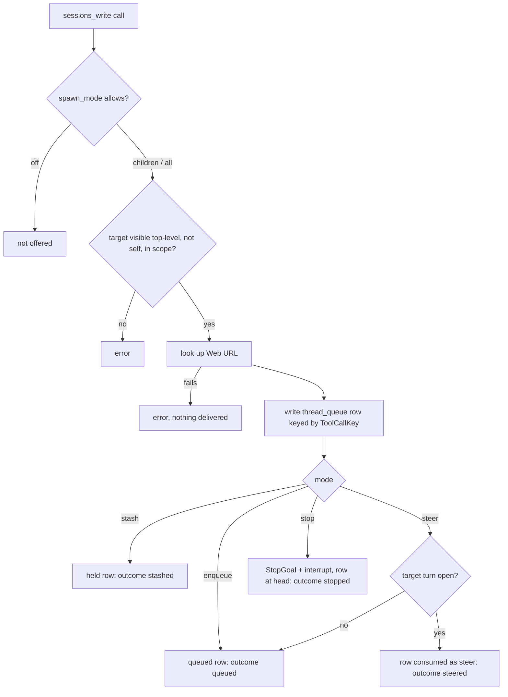

# Agent Session Control - Plan

## Goal Capsule

- **Objective:** Operators can let an agent start, message, steer, queue into, stash into, and stop other RocketClaw sessions and its own subagents the way a person does from Web, see in Web every message an agent sends and which session sent it, and never lose an agent's queued work to a restart.
- **Means:** One `rocketclaw_sessions_*` tool family enabled per tool by exact name (REV4), agent writes delivered through the existing Thread Queue without waiting, steering opened to any sender, and subagents that run as sessions on the same agent loop as top-level agents, so a `task` `continue` is the same operation as a session write (KTD5, KTD6, KTD12, REV5).
- **Authority:** Product Contract Key Decisions and Requirements, then `AGENTS.md`, then this plan's KTDs, then existing code patterns. The R wins on product behavior; the KTD wins on mechanism.
- **Stop conditions:** Stop and ask when the `internal/rocketclaw` source CLOC would exceed its failure threshold after the KTD17 offsets, when a session-settled decision proves infeasible, or when a fix needs `sync/atomic`, a linter suppression, an edited CLOC budget, or a Windows path.
- **Execution profile:** Deep. Go (RocketCode, RocketClaw backend, Web RPC), one PostgreSQL migration, a small Web UI change, docs and skeleton templates.
- **Who finishes:** `ce-work` implements and verifies every unit. Shipping happens only when the human partner asks.

---

## Review Revisions (2026-10-14)

PR review settled four changes after U1–U8 shipped. Each one supersedes the earlier text it names; superseded lines below are marked. All four are session-settled: user-directed.

- **REV1. Steer always joins, never twice.** A steer to a busy subagent joins its running turn even when the parent waits on that subagent in the foreground. A restart never delivers it twice: a steer claimed by a turn that will resume is re-offered to that resumed turn (deduplicated by its ID) and never also started as a separate follow-up. Supersedes the "attached run takes no steer" exception in KTD13 and U6. Covers R21, R23.
- **REV2. A continue's named type wins (OpenCode precedent).** When `task` continues an existing subagent and names `subagent_type`: an unknown type is refused; the caller needs the same `task` permission for that type as for starting one; that type's delegation guardrail reviews the prompt and its response guardrail the answer; and the subagent switches to that type, so the prompt and everything after it run as that type (for a busy subagent, from its next step; if the runtime cannot switch mid-turn without new machinery, stop and ask). The idle-path refusal to continue under another agent is removed. Precedent: OpenCode `packages/core/src/tool/plugin/subagent.ts` switches the child on continuation. Covers R20, R21.
- **REV3. One way to stop.** `rocketclaw_sessions_stop` is removed. `rocketclaw_sessions_write` takes an optional `prompt` only for `mode: stop` on an existing session: without a prompt it stops the target's turn and goal and posts `Stopped by session <id> (agent <name>)` into the target's transcript. That line does not start a turn; the person sees it in Web and the model reads it the next time the session runs. With a prompt, `stop` behaves as R15. Every other mode, and creation, still require a prompt. Supersedes R6 and the stop half of KTD9. Covers R15, R17.
- **REV4. Every `rocketclaw` tool is enabled by exact name.** `permission.rocketclaw.session.spawn_mode` is removed (an agent file still using it fails to load, pointing at `rocketclaw_sessions_write`). Inside the `rocketclaw` bucket only exact tool names count: a wildcard pattern (`"*"`, `rocketclaw_sessions_*`) or the scalar form (`rocketclaw: allow`) fails to load, asking for each tool by name. `rocketclaw_sessions_write` takes `deny` (default; same as absent), `children` (top-level sessions this session created, no review), `auto` / `auto(name)` (any top-level session, every write reviewed, own children included), or `allow` (any top-level session, no review). "Any top-level session" still excludes the caller's own session, Delegation Histories, and Private Producer Conversations (R7). `rocketclaw_get_tags` stays implied by `rocketclaw_set_tag`; `code_mode_approve`, `load_agents_md`, and `allow_background` keep today's behavior. The generated `main` agent gets `rocketclaw_sessions_write: allow`. Supersedes R8–R11's permission shape, KTD1, and the `spawn_mode` Key Decisions. Covers R8–R11.

Later user decisions refine three of them (session-settled: user-directed):

- **REV3a. The stop line follows the stopped turn.** A stop without a prompt posts its `Stopped by session <id> (agent <name>)` line only after the stopped turn has saved: the line is parked durably and posted when no turn is running there, exactly once.
- **REV2a. A steer switches a busy subagent mid-turn.** A steer naming a different type switches a busy subagent from its next model step: the new type's prompt, tools, permissions, guardrails, and model. The step in progress keeps the old type. The switch survives a restart, and the answer is reviewed by the guardrail of the type the turn ended as.
- **REV1a. An attached wait holds its subagent.** An attached (foreground) wait on a subagent is written to the database before the work starts. After any restart, graceful or crash, the subagent is held for the resuming call, so no prompt, steer, follow-up, or wake is delivered twice or out of order. The hold is released when the owning turn or job ends or, at recovery, when the owner can no longer replay the call. *(Mechanism superseded by REV5; the no-duplicate guarantee stands.)*

A later user directive replaces the subagent mechanisms (session-settled: user-directed):

- **REV5. One agent loop for top-level agents and subagents.** A subagent is a session like any other. It differs only in data: it has a parent, and it is not listed in the sidebar or in message search. Subagents run on the same machinery as top-level sessions:
  - the same turn runner;
  - the same history load, provider conversion, and save;
  - the same Thread Queue for steer, enqueue, and stop;
  - the same crash recovery and settlement.

  `task` `continue` and `rocketclaw_sessions_write` are one operation on a session ID. The subagent-only machinery is deleted, not kept alongside. This covers the subagent run and continue paths, the subagent-only history interface, and the Background Job rows used as follow-ups and attached waits. Behavior stays as R20–R23 and REV1–REV4 state it, including these guarantees:
  - per-type permissions and guardrails;
  - type switching, mid-turn for a steer;
  - foreground waits and background wakes;
  - after any restart, no prompt, steer, follow-up, or wake is delivered twice or out of order, and a replayed finished subagent call returns its saved answer without a new model call;
  - every turn's entries are saved exactly once;
  - Web shows subagent transcripts.

  This folds in the earlier shared-history step. That step converts saved history from another provider in RocketCode wherever a turn reads it, and uses one looper constructor and one prompt runner. REV5 supersedes:
  - the mechanisms of KTD13–KTD16;
  - U6's approach and U7;
  - REV1a's attached-wait rows.

  Covers R20–R23.

  **How REV5 landed:**
  - **Session row:** a subagent is a `managed_conversations` row whose ID is the parent's ID plus the `task` call key, with `parent_conversation_id` set. Its bridge (`ensureThreadBridge`) publishes nothing to Slack or Web output, and the sidebar and search skip rows that have a parent.
  - **Interface:** RocketCode's `ChildSessions` is `AppendChildEntry`, `WriteSubagent`, and `AwaitSubagent`, implemented by the bridge.
  - **`task`:** `task` (start or continue) delivers through `writeSession`, the same operation `rocketclaw_sessions_write` uses, keyed by the parent's tool call, so a replay delivers nothing. A foreground call then waits in `awaitSubagent`, which reads the finished turn and builds the answer exactly as a top-level turn builds its final answer. After a restart, a background `task` job waits again through the same path.
  - **Acting for the root:** a subagent acts for its root session in user-facing effects. `subagentLineage` resolves the root, its visible destination, its running turn, and that turn's inbound message. Tags, `rocketclaw_sessions_write` ownership and creator, `rocketclaw_sessions_current_id`, and attached files all use the root. A subagent is not offered `rocketclaw_schedule_message` or `rocketclaw_reset_scheduled_messages` (session-settled: user-directed — chosen over scheduling into the root session, where a helper pacing itself flooded the person's chat, and over scheduling into the helper's own session): it says it cannot wait instead. A subagent under a shadow run inherits the shadow's tool and environment limits.
  - **Background refusals:** a subagent is refused `rocketclaw_restart` and `rocketclaw_attach_files_to_response`, with the existing refusal message, when it or any subagent above it in its parent chain runs in the background (that link's `task` job is detached, `backgroundRegistry.detached`). A chain of foreground subagents keeps both tools.
  - **Deleted:** `Runtime.ContinueSubagent`, `subagent`, `childHistory`, `ChildEntries`, `DrainNotes`, the continue-outcome types, the attached-wait and queued-follow-up machinery, the `subagent_wake` job kind, the `queued` job status, and the `background_jobs` columns `child_key` and `subagent_type`.
  - **Stopping a parent stops the subagent it waits on** (OpenCode precedent, `packages/core/src/tool/plugin/subagent.ts`). When a parent's turn is stopped while its foreground `task` call waits, the subagent's current turn is stopped too, and so on down a chain of foreground subagents. The parent's prompt still queued in the subagent's queue is not withdrawn but held: it does not run, survives a restart, and shows in the subagent's queue in Web. The next write to that subagent (a `task` continue, `rocketclaw_sessions_write`, or a person in Web) releases it to run just before the new message, and its answer stays in the subagent's transcript. Only that request is held; other requests in the subagent's queue keep moving, and a request a person stashed is not released by an agent's write. The parent gets no note for this stop, so a parent someone just stopped does not start running again. A restart is not a stop: the parent's call replays and waits again. Background `task` jobs are not affected by stopping the parent.
  - **Upgrading leftover subagent jobs:** migration `038` creates the session row, linked to its parent, for every subagent that owned background jobs before the upgrade, so their notes wake that subagent and the rows age out with their top-level session like any other subagent's. A nested subagent's parent is its nearest enclosing conversation. The same migration hides from each subagent's history every saved entry whose turn ID does not end in `/task`, which is exactly what its model read before the upgrade. On a copy of a production database (34,043 entries) the migration took about 80 s, almost all of it rewriting the 12,576 hidden entries.
  - **Manual step:** a database that already ran an earlier `036_agent_session_control` needs the one-time SQL recorded in the PR description. It deletes leftover queued follow-ups and attached waits. A database that already ran `037_agent_session_control` (the same SQL) needs only its ledger row renamed, `UPDATE pg_migrations SET id = '038_agent_session_control.sql' WHERE id = '037_agent_session_control.sql'`; startup then applies `037_sync_destination_live_turns`.

Execution constraints: migration `038_agent_session_control.sql` belongs to this PR (renumbered from `035`, `036`, then `037`, after `main` took those numbers) and may be rewritten; do not add a `039`. A database that already ran an earlier `036_agent_session_control` needs the manual upgrade step recorded with REV5. Source CLOC must stay under the 23,750 failure line, and REV5 must shrink both packages.

---

## Product Contract

### Summary

Agents get a `rocketclaw_sessions_*` tool family: list, get, current ID, URL, write, and stop. `rocketclaw_sessions_write` replaces `rocketclaw_start_new_thread`: without a session ID it creates a session, and with one it delivers a message as stop, steer, enqueue, or stash, always returning the session's Web URL. A new `permission.rocketclaw.session.spawn_mode` (`off`, `children`, `all`) decides whether an agent may write to or stop sessions, and which ones. Steering stops caring who sent the message or who started the turn. For agents allowed to run background work, `task`'s `continue` becomes `{session_id, mode}` so a busy subagent can be stopped, steered, or queued instead of refused.

### Problem Frame

A person in Web can steer a running turn, queue a message, stash one to release later, or stop a turn. An agent can only start a new session (`rocketclaw_start_new_thread`) and has no way to follow up on it. Its session tools carry inconsistent names (`rocketclaw_list_sessions`, `rocketclaw_get_session`, `rocketclaw_current_session_id`).

Steering is also narrower than its name suggests. `internal/rocketclaw/backend/bridge.go` admits a steer only when the message came from a person and the running turn was started by a person. That rule began as an unexamined assumption in `docs/plans/2026-08-24-1324-feat-slack-steer-or-enqueue-plan.md` ("Steer inject is human-only. No new agent tools this cut.") and hardened when Slack, cron, and MCP were composed onto one backend. A session an agent created cannot be steered during its first turn, even from Web.

Inside a conversation, `task` refuses to continue a subagent that is still running (`internal/rocketclaw/backend/background.go`). The parent must wait for the Completion Note before it can say anything more. OpenCode steers a busy child and Codex either steers or queues; RocketClaw only refuses.

### Requirements

**Session tool family**

- R1. `rocketclaw_list_sessions`, `rocketclaw_get_session`, and `rocketclaw_current_session_id` become `rocketclaw_sessions_list`, `rocketclaw_sessions_get`, and `rocketclaw_sessions_current_id`, with unchanged behavior and permissions; the old names stop existing.
- R2. `rocketclaw_sessions_get_url(session_id)` returns the Web URL of a top-level session and errors for any other ID.
- R3. `rocketclaw_sessions_write` with an empty `session_id` creates a top-level Web session from a title, a prompt, and an optional agent, under the same agent limits `rocketclaw_start_new_thread` applies today.
- R4. `rocketclaw_sessions_write` with a `session_id` delivers the prompt to that session in the requested mode (`stop`, `steer`, `enqueue`, or `stash`) and returns without waiting for the session's turn.
- R5. Every `rocketclaw_sessions_write` result names the session ID, its clickable Web URL, and what actually happened to the message.
- R6. `rocketclaw_sessions_stop(session_id)` stops the session's current turn and goal, as Web `$stop` does, without waiting. *(Superseded by REV3.)*
- R7. Write and stop only target top-level sessions: Web-visible conversations, never Delegation Histories or Private Producer Conversations, and never the caller's own session.

**Permission**

- R8. `permission.rocketclaw.session.spawn_mode` accepts `off`, `children`, or `all`, defaults to `off`, and is the only setting that offers or restricts `rocketclaw_sessions_write` and `rocketclaw_sessions_stop`. *(Superseded by REV4.)*
- R9. Under `children`, an agent may write to or stop only sessions created by its own top-level session, including sessions its subagents created, and not sessions those created in turn. *(Scope kept as `children`; shape superseded by REV4.)*
- R10. Under `all`, an agent may write to or stop any top-level session. *(Scope kept as `allow`/`auto`; shape superseded by REV4.)*
- R11. Generated `main` agents ship with `spawn_mode: all`, and `rocketclaw_start_new_thread` is removed without an alias. *(Superseded by REV4: `main` gets `rocketclaw_sessions_write: allow`.)*

**Delivery into sessions**

- R12. A steer joins the target's running turn whenever that turn still accepts input, whoever sent the steer and whoever started the turn; otherwise it becomes the next turn.
- R13. An enqueued message waits in the target's Thread Queue and runs after the work ahead of it.
- R14. A stashed message waits in the target's Thread Queue until a person pops it in Web.
- R15. A `stop` write stops the target's current turn and goal, then runs the message as the target's next turn, ahead of anything already queued.
- R16. Agent-written queued and stashed messages appear in the Web queue with their sender and can be popped, promoted, reordered, or deleted like any other item.
- R17. The receiving agent is told who sent each agent-written message and what happened to it.
- R18. Agent-written messages are never treated as a person's input: no `ask_user_question`, no `$skill` or `$workflow` parsing, no human principal, including after a person promotes them.
- R19. An agent write never commits a revert a person has staged and is never lost because of one.

**Subagent follow-ups**

- R20. For agents with `permission.rocketclaw.allow_background: allow`, `task`'s `continue` is an object with `session_id` (a subagent continue ID) and `mode` (`stop`, `steer`, or `enqueue`); an empty `session_id` starts a new subagent. Other agents keep today's `task` schema byte for byte.
- R21. Continuing a running subagent steers its current turn, queues a turn after it, or stops it and runs the prompt, according to `mode`; continuing an idle subagent runs its next turn in every mode.
- R22. A queued subagent follow-up survives a RocketClaw restart and runs after the subagent's current turn.
- R23. A resumed tool call never delivers the same write, steer, follow-up, or stop twice.

**Documentation**

- R24. The cheatsheet, READMEs, `CONCEPTS.md`, the skeleton `main` agent, and the agent-authoring skill describe the new tools, the permission, the changed steering, and the removed names.

### Key Decisions

- **Steer is steer; enqueue is enqueue.** No check on who sent a steer or who started the turn it joins. (session-settled: user-directed — chosen over a sender-must-have-started-the-turn rule and over a separate "agent" provenance label gating steers: the person-only rule was never a deliberate decision, and simpler semantics win.) Governs R12, R13.
- **`spawn_mode` is the only gate for write and stop.** (session-settled: user-approved — chosen over also honoring per-tool `auto`/`deny` rules for review: matches the requested permission shape.) Governs R8, R10. *(Superseded by REV4.)*
- **Queued subagent follow-ups are durable.** (session-settled: user-approved — chosen over an in-memory wait: an in-memory wait silently loses queued work on restart.) Governs R22.
- **`rocketclaw_current_session_id` stays, renamed.** (session-settled: user-directed — chosen over dropping it: agents cannot learn their own session ID otherwise.) Governs R1.
- **Clean break for old names.** No aliases for `rocketclaw_start_new_thread` or the old read-tool names, and no migration of agent files. (session-settled: user-approved — chosen over compatibility aliases: AGENTS.md forbids compatibility shims.) Governs R1, R11.
- **`children` counts direct creations only.** Sessions created by the top-level session or its subagents count; grandchildren do not. (session-settled: user-approved — chosen over transitive lineage: one stored link, one comparison.) Governs R9.
- **Generated `main` agents get `all`.** (session-settled: user-approved — chosen over `children`: keeps their current freedom to start and follow sessions.) Governs R11. *(Superseded by REV4.)*
- **Write and stop follow the same scope; reads keep today's permissions.** (session-settled: user-approved — chosen over gating get_url or reads by `spawn_mode`.) Governs R2, R6, R8. *(Superseded by REV3 and REV4.)*

### Acceptance Examples

- AE1. **Covers R12, R17.**
  - **Given:** session B is in the tool loop of a turn a person started in Web.
  - **When:** session A calls `rocketclaw_sessions_write(B, steer, "also check 2025")`.
  - **Then:** B sees the text at its next step under a `[System …]` header naming A's session and agent, and A's result says `steered`.
- AE2. **Covers R12, R5.**
  - **Given:** session A created B a moment ago and B is still in the tool loop of its first turn.
  - **When:** A steers B.
  - **Then:** the steer joins that first turn; today it would have become the next turn.
- AE3. **Covers R12, R5.**
  - **Given:** B is idle, or already writing its final answer.
  - **When:** A steers B.
  - **Then:** the text runs as B's next turn and A's result says `queued`, not `steered`.
- AE4. **Covers R14, R16, R18.**
  - **Given:** A stashes a message into B.
  - **When:** a person opens B in Web.
  - **Then:** the item shows A as its sender, waits until popped, and runs without `ask_user_question` once popped or promoted.
- AE5. **Covers R15, R6.**
  - **Given:** B runs a turn with an active goal and two items already queued.
  - **When:** A writes `stop` with a prompt.
  - **Then:** B's turn and goal stop, B's Background Jobs keep running, the prompt runs before the two queued items, and its header says A stopped the previous turn.
- AE6. **Covers R9.**
  - **Given:** A's subagent created C, and C created D.
  - **When:** A, under `children`, writes to C, then to D.
  - **Then:** the write to C succeeds and the write to D is refused.
- AE7. **Covers R21, R22.**
  - **Given:** a background subagent X is running.
  - **When:** its parent calls `task` with `continue {session_id: X, mode: enqueue}` and `background: true`, and RocketClaw restarts before X finishes.
  - **Then:** X resumes, and the queued follow-up runs after X's turn ends; the parent receives X's note, then the follow-up's note.

### Scope Boundaries

- Agents cannot list, pop, promote, reorder, or delete another session's queue items, answer its pending questions, list or stop its Background Jobs, start a `$goal` or `$workflow` in it, switch its agent, fork, revert, rename, pin, or tag it.
- No hop limit, rate cap, or loop detection between sessions; sender headers make loops visible.
- Existing-session writes do not re-check the target session's agent against the caller's Slack-channel allowlist or cron agent lock (see Risks).
- Subagent wake turns and resumed subagent turns do not get `rocketclaw_sessions_write` or `rocketclaw_sessions_stop`, as `rocketclaw_start_new_thread` is absent there today. *(Stop tool removed by REV3.)*
- No lint for dead `rocketclaw_*` permission subjects left behind by the rename.

#### Deferred to Follow-Up Work

- Agent tools to inspect and edit another session's Thread Queue.
- Optional per-tool review (`auto`) for write and stop if `spawn_mode` proves too coarse. *(Done by REV4.)*

---

## Planning Contract

### Key Technical Decisions

- KTD1. **`spawn_mode` is a parse-time special case plus a synthetic exact-only bucket.** `internal/rocketcode/permission.go` accepts the `session` mapping under the `rocketclaw` bucket, validates `spawn_mode` as `off|children|all`, and rejects other values at load, following the `allow_background` precedent. `readRocketCodeDefinitionsIn` in `internal/rocketclaw/backend/bridge.go` turns the mode into a synthetic bucket (as `rocketclaw_tags` does for tag tools) that allows `rocketclaw_sessions_write` and `rocketclaw_sessions_stop` when the mode is not `off`. Wildcard `rocketclaw` rules never reach that bucket. Tools re-read the mode at call time from `rocketcode.ToolCallAgent(ctx)`, so each subagent uses its own setting. Instantiates the `spawn_mode` Key Decision (session-settled: user-approved — chosen over also honoring per-tool `auto`/`deny` rules: matches the requested permission shape). Covers R8. *(Superseded by REV4.)*
- KTD2. **One insert-only creator column.** Migration `033` adds `managed_conversations.spawned_by TEXT NOT NULL DEFAULT ''`, written once at creation and never by `UpsertThread`'s conflict update. Forks write `''`. The creator is `cmp.Or(msg.SyncDestination, owning conversation ID)`, the rule tag tools already use, so one-off cron and External MCP runs count as their visible chat. A scheduled cron run records its private producer ID, so its creations are not reachable under `children`; accepted. Covers R9.
- KTD3. **"Top-level session" is the Web-visible predicate.** A target qualifies when it has a `managed_conversations` row and is not a Private Producer Conversation, the predicate `visibleChatsSQL` (`internal/rocketclaw/backend/message_search.go`) already encodes. Never a `/` heuristic (`docs/solutions/logic-errors/slash-in-conversation-id-is-not-a-delegation-history.md`). Covers R2, R7.
- KTD4. **Self-targeting is three checks.** A target is the caller when it equals the owning conversation ID, equals the turn's `SyncDestination`, or is reserved for the caller as a producer (`turnGates[...].reservedFor`). Write and stop reject all three, which is why both are built per turn. Covers R7.
- KTD5. **Steer openness ignores `Human`.** Drop the `Human` condition from the steer admission in `Bridge.enqueue` and `storeStopped`, from the restart path in `slipSteer`, and from the turn-start `inputOpen` assignment. A turn accepts input when it is not a hidden run (`hiddenRun`), not a `$workflow` turn, and no history mutation is underway; this replaces `msg.Human && msg.SyncDestination == ""`. `promoteQueueItem` stops setting `Human = true`. Instantiates the "steer is steer" Key Decision (session-settled: user-directed — chosen over a sender-must-have-started-the-turn rule and over an agent-label gate: the person-only rule was never deliberate). Covers R12, R18.
- KTD6. **Agent writes go through one non-waiting delivery helper on `threadBridgeManager`.** It writes a `thread_queue` row first, with an ID derived from `ToolCallKey` so `reconcileWebDB` drops replays. It never calls `admitWeb`, so a staged revert is never committed and the row survives it. It decides `steered` or `queued` under the target bridge's lock, then returns. A steer that misses an open turn takes the same path a Web steer that misses takes today. The tools stay non-resumable, so Code Mode replay reports an interrupted call instead of re-running it. `Runtime.RunTurn` is never used, because it waits for the target's turn and would deadlock mutual or self writes. Covers R4, R5, R13, R14, R19, R23.
- KTD7. **Sender facts ride on the inbound; wording is chosen when the prompt is built.** Agent-written inbounds carry sender session, sender agent, and action metadata, and stay `Human = false` with system origin. `provenanceHeader` renders them in today's `[System …]` grammar: "steer from", "message from", or "stopped your previous turn". The same inbound can end as a steer or a next turn, so the builder picks the verb. Covers R17, R18.
- KTD8. **The Web queue also shows agent-written rows.** The non-human filter in `threadBridgeManager.queueItems` keeps hiding shutdown-stored system prompts and admits rows carrying sender metadata. The queue row shows the sender instead of a person's principal. Covers R16.
- KTD9. **Stop is `StopGoal` plus `InterruptConversation`, then the prompt at the head.** No wait. Background Jobs keep running, as with `$stop` (`docs/plans/2026-10-06-1243-feat-background-execute-and-task-plan.md` decision 51). The result reports whether a turn was running. The prompt runs before every earlier item, including queued items whose requests were already handed to the bridge's request channel during the stopped turn; those must yield too, for example by draining them back to waiting under the bridge lock as `StageRevert` does. `rocketclaw_sessions_stop` is the same without a prompt. Covers R6, R15. *(Stop-without-prompt superseded by REV3.)*
- KTD10. **No `StartNewThread` callback.** Delete `Config.StartNewThread`, `startNewThreadTool`, and `protocol.StartNewThreadRequest`/`StartNewThreadResult`. The per-turn tool calls the manager directly, which also satisfies AGENTS.md's ban on func-callback injection. Creation keeps "URL first, fail before side effects", and existing-session writes look up the URL before delivering too. Covers R3, R5, R11.
- KTD11. **The rename is a clean break.** Old names leave Go, prompts (including the Web handoff document in `internal/rocketclaw/frontend/rpc/session_commands.go`), tests, docs, and skeleton files. `rocketclaw_sessions_current_id` keeps its old behavior. Instantiates the clean-break and current-ID Key Decisions. Covers R1.
- KTD12. **`continue` becomes a nested strict object.** In `internal/rocketcode/background.go`, the allowed `task` schema gets `continue: {session_id, mode}` with `additionalProperties: false`, both fields required, and `mode` as an enum. An empty `session_id` starts a new subagent and ignores `mode`. Result `continue ID:` lines are unchanged. The denied schema stays byte-identical (`TestBackgroundSchemasFollowPermission`). Covers R20.
- KTD13. **Subagent steer reuses the Completion Note drain.** The registry keeps a per-run "input open" flag under `r.mu`. A steer for an open run is journaled per `subagentKey` and returned by `backgroundTurn.DrainNotes` with a `[System …]` header from the parent, deduplicated by `ToolCallKey`. A steer that misses the window becomes a KTD15 queued row at the tail, and the result says which happened. A running `subagent_wake` is a running turn like any other ("steer is steer"); the result tells the parent that the wake's output stays in the subagent's history. Covers R21, R23. *(Attached-run exception superseded by REV1; mechanism superseded by REV5.)*
- KTD14. **Subagent stop cancels only the current run.** It first inserts the prompt as a KTD15 queued row ahead of any existing queued rows for that subagent, then cancels the run with a dedicated reason naming the follow-up job, so KTD15's start-next runs the prompt first. The subagent's own Background Jobs survive, matching `$stop`. A stopped foreground sibling `task` call fails with that reason. Covers R21. *(Mechanism superseded by REV5.)*
- KTD15. **Durable queued follow-ups are `queued` Background Job rows.** Migration `033` also widens the `background_jobs.status` check with `queued` and adds `background_jobs.input TEXT NOT NULL DEFAULT ''` for the follow-up prompt, which recovery cannot rebuild otherwise. The partial unique index covers only `running`, so a queued row never conflicts. The registry starts the oldest queued row for a `subagentKey` whenever any in-memory run for that key leaves the registry (attached, detached, or `subagent_wake`), and during recovery when no running row exists for it. Web lists queued jobs and can stop them. A foreground enqueue's row is marked as having a waiting caller: it finishes without a Completion Note, and the waiting call, or its KTD16 replay, reads the result from the row. Instantiates the durable-follow-up Key Decision (session-settled: user-approved — chosen over an in-memory wait: a restart would silently drop it). Covers R22. *(Mechanism superseded by REV5: follow-ups wait in the subagent session's Thread Queue; the durability decision stands.)*
- KTD16. **The continue decision is a journal step.** `task` is resumable, so a resumed call re-runs its body. The first run saves its outcome under `ToolCallKey + "/continue"`, and a resumed run replays that outcome instead of steering, queueing, or stopping again. Covers R23. *(Mechanism superseded by REV5.)*
- KTD17. **Line budget is a requirement.** `internal/rocketclaw` measures 22,796 of 23,500 (hazard from 23,000); `internal/rocketcode` measures 10,772 of 12,500. Deleting `startNewThreadTool`, its callback, and its protocol types recovers roughly 70 lines. Each unit measures `make cloc` after landing. Crossing the hazard line is a warning to report; crossing the failure line is a stop condition. The budget is never edited.

### High-Level Technical Design

Agent write to an existing session:

Steer openness before and after KTD5:

| Turn started by | Steer sent by | Today | After |
| --- | --- | --- | --- |
| Person (Web) | Person | joins | joins |
| Person | Agent | next turn | joins |
| Agent-created session's first prompt | Agent or person | next turn | joins |
| Scheduled message, goal continuation, Completion Note wake | Anyone | next turn | joins |
| Hidden producer run (`hiddenRun`) | Anyone | next turn | next turn |
| `$workflow` turn | Anyone | next turn | next turn |
| Any turn past its final answer, or idle | Anyone | next turn | next turn |

Subagent follow-up via `task` `continue`:

| Target | `steer` | `enqueue` | `stop` |
| --- | --- | --- | --- |
| Idle | runs next turn | runs next turn | runs next turn |
| Running, input open | joins at next step; one note for the running job | `queued` row, runs after; notes in order | running job stopped with its own note; prompt runs as a new job |
| Running, past final drain | `queued` row, runs after | `queued` row, runs after | as above |

### Assumptions

- A system-origin prompt delivered into a `slack-thread:` conversation posts its reply to Slack the way Web input does; U5 verifies this with a test rather than assuming it.
- Writing to a session whose turn waits on `ask_user_question` reports `steered` and waits until the person answers; a `stop` cancels the pending question.

### Sequencing

U1 and U2 first (permission and storage), then U3 (rename, URL, target rules), then U4 (steer gates and headers), then U5 (write and stop). U7 (queued follow-up storage and start-next) needs only U2; U6 (`task` continue modes) needs U4 and U7. U8 (docs) lands last.

---

## Implementation Units

### U1. `spawn_mode` permission

- **Goal:** Agents can declare `permission.rocketclaw.session.spawn_mode`, and only that exact key offers write and stop.
- **Requirements:** R8, R10, R11
- **Dependencies:** none
- **Files:**
  - `internal/rocketcode/permission.go`
  - `internal/rocketcode/permission_test.go`
  - `internal/rocketclaw/backend/bridge.go`
  - `internal/rocketclaw/backend/session_tools.go`
  - `internal/rocketclaw/backend/definitions_test.go`
- **Approach:** Per KTD1.
  1. Teach `parsePermissionRules` the `session` mapping and its value check.
  2. Read the mode from frontmatter and add the synthetic bucket in `readRocketCodeDefinitionsIn`.
  3. Add a call-time helper that returns the calling agent's mode.
- **Patterns to follow:** `allow_background` parsing, the `rocketclaw_tags` synthetic bucket, `agentTagGroups`, `TestLoadRocketCodeDefinitionsKeepsBackgroundExact`.
- **Test scenarios:**
  - `rocketclaw: {session: {spawn_mode: children}}` loads, and write and stop are offered.
  - Missing key and `spawn_mode: off`: neither tool is offered.
  - `spawn_mode: sometimes` fails agent load with an error naming the value.
  - `rocketclaw: allow`, `rocketclaw: {"*": allow}`, and `rocketclaw_sessions_*: allow` offer neither tool.
  - A subagent type with `all` under a main agent with `off`: only the subagent is offered the tools.
  - An existing `rocketclaw_set_tag` tag-group rule still parses beside the `session` mapping.
- **Verification:** Permission and definitions tests pass. No wildcard rule reaches write or stop.

### U2. Creator column

- **Goal:** Each session created by `rocketclaw_sessions_write` durably records which top-level session created it.
- **Requirements:** R9
- **Dependencies:** none
- **Files:**
  - `internal/rocketclaw/backend/migrations/038_agent_session_control.sql`
  - `internal/rocketclaw/backend/store.go`
  - `internal/rocketclaw/backend/store_dao.go`
  - `internal/rocketclaw/backend/thread_bridges.go`
  - `internal/rocketclaw/backend/fork.go`
  - `internal/rocketclaw/backend/store_schema_test.go`
  - `internal/rocketclaw/backend/active_turn_test.go`
- **Approach:** Per KTD2 and KTD15 (one migration).
  1. Add `spawned_by`, widen the `background_jobs.status` check with `queued`, and add `background_jobs.input` in migration `033`.
  2. Thread `spawned_by` through `ThreadState` and the creation path (`ensureStartedThread`); keep it out of the `UpsertThread` conflict update.
  3. Forks write `''`.
- **Patterns to follow:** `017_conversation_forked_from.sql` and how `forked_from` reaches `ThreadState`.
- **Execution note:** Several schema tests roll back a fixed number of migrations (`store_schema_test.go`, `active_turn_test.go`); update their counts and comments. Check the number against the live migration ledger per `docs/solutions/runtime-errors/deployment-binary-missing-live-migrations.md`.
- **Test scenarios:**
  - A created session stores the creator; reading it back returns it.
  - Upserting the same conversation later (agent switch, rename) keeps `spawned_by`.
  - A fork of a created session has an empty `spawned_by`.
  - A `queued` `background_jobs` row inserts beside a `running` row for the same subagent without a unique-index conflict, and round-trips its `input`.
  - The migration applies up and down cleanly in the schema tests.
- **Verification:** Schema tests pass with updated rollback counts.

### U3. Rename, URL tool, and target rules

- **Goal:** The read tools carry their new names, agents can fetch a session's URL, and one helper decides whether a session is a valid write/stop target.
- **Requirements:** R1, R2, R7, R9, R10
- **Dependencies:** U1, U2
- **Files:**
  - `internal/rocketclaw/backend/session_tools.go`
  - `internal/rocketclaw/backend/session_tools_test.go`
  - `internal/rocketclaw/backend/bridge.go`
  - `internal/rocketclaw/backend/bridge_test.go`
  - `internal/rocketclaw/backend/definitions_test.go`
  - `internal/rocketclaw/backend/runtime_test.go`
  - `internal/rocketclaw/backend/session_search_test.go`
  - `internal/rocketclaw/backend/thread_bridges.go`
  - `internal/rocketclaw/frontend/rpc/session_commands.go`
  - `internal/rocketclaw/frontend/rpc/server_test.go`
  - `internal/rocketcode/permission_test.go`
- **Approach:**
  1. Rename the three constants and every description and prompt string that names them (KTD11).
  2. Add `rocketclaw_sessions_get_url` gated like `rocketclaw_sessions_get` and validated by the visible predicate (KTD3), reusing `threadBridgeManager.WebURL`.
  3. Add the target-resolution helper: visible top-level (KTD3), not self (KTD4), and in scope for the caller's mode (KTD1, KTD2).
- **Patterns to follow:** `currentSessionIDTool`, `stopBackgroundJobTool`, `visibleChatsSQL`, `recordedBridge`.
- **Test scenarios:**
  - Starlark calls to each new read name succeed under the same grants the old names needed; old names are `undefined`.
  - `get_url` on a Web chat returns the tsnet URL when the tsnet origin is set, and the Tailscale fallback otherwise.
  - `get_url` on a Delegation History ID, a `cron:` producer, and an External MCP private ID returns an error.
  - Target helper under `all`: accepts `web:`, `web:cron:`, and `slack-thread:` chats; refuses Delegation History, `cron:`, `one-off-cron:`, External MCP private IDs, and IDs containing `/` that are not recorded.
  - Target helper under `children`: accepts a session created by the caller's subagent; refuses a grandchild, a person-created session, a forked child, and the caller's creator.
  - Self-targeting is refused for the caller's own ID, from a subagent, from a one-off cron run targeting its `SyncDestination`, and from an External MCP private turn targeting its managed chat.
  - The Web handoff document names `rocketclaw_sessions_get`.
- **Verification:** A repo grep finds no old read-tool names outside `docs/plans/`.

### U4. Open steering and sender headers

- **Goal:** Steers join any open turn regardless of who sent them or started the turn, and receiving agents see who sent agent-written input.
- **Requirements:** R12, R17, R18
- **Dependencies:** none
- **Files:**
  - `internal/rocketclaw/backend/bridge.go`
  - `internal/rocketclaw/backend/thread_bridges.go`
  - `internal/rocketclaw/backend/bridge_test.go`
  - `internal/rocketclaw/backend/thread_bridges_test.go`
  - `internal/rocketclaw/protocol/types.go`
- **Approach:** Per KTD5 and KTD7.
  1. Replace the four `Human` steer conditions (admission in `enqueue`, `storeStopped`, `slipSteer`'s head-turn check, and the turn-start `inputOpen` assignment) with the openness rule.
  2. Remove `Human = true` from `promoteQueueItem`.
  3. Add sender metadata keys to `protocol` and render them in `provenanceHeader`.
  4. Update the `InboundKindSteer` comment in `protocol/types.go`.
- **Execution note:** Message flow. Verify queue order, prompt framing, and delivery separately (AGENTS.md).
- **Test scenarios:**
  - A non-human steer joins a running turn a person started.
  - A person's Web steer joins a goal-continuation turn, a Completion Note wake turn, a scheduled-message turn, and an agent-created session's first turn.
  - A steer into a scheduled cron producer turn (`RequireOutputDecision`), a hidden producer turn, and a `$workflow` turn becomes the next turn and runs once.
  - A steer submitted during shutdown into a non-human turn is journaled by `slipSteer` and injected once after restart.
  - Promoting an agent-written queue item in a `web:cron:` chat keeps it non-human: no principal header, no `ask_user_question`, no `$skill` parsing.
  - A prompt carrying sender metadata renders a `[System …]` header naming the sender session and agent, with "steer from" when it joined a turn and "message from" when it started one.
- **Verification:** Bridge tests that assumed person-only steering are updated to the new rule; no test asserts the old refusal.

### U5. `rocketclaw_sessions_write` and `rocketclaw_sessions_stop`

- **Goal:** Agents create sessions and deliver stop, steer, enqueue, or stash into existing ones without waiting, and every result carries the URL and the real outcome.
- **Requirements:** R3, R4, R5, R6, R7, R11, R13, R14, R15, R16, R19, R23
- **Dependencies:** U1, U2, U3, U4
- **Files:**
  - `internal/rocketclaw/backend/session_tools.go`
  - `internal/rocketclaw/backend/session_tools_test.go`
  - `internal/rocketclaw/backend/bridge.go`
  - `internal/rocketclaw/backend/bridge_test.go`
  - `internal/rocketclaw/backend/thread_bridges.go`
  - `internal/rocketclaw/backend/thread_bridges_test.go`
  - `internal/rocketclaw/backend/conversations.go`
  - `internal/rocketclaw/backend/revert.go`
  - `internal/rocketclaw/backend/app.go`
  - `internal/rocketclaw/backend/app_test.go`
  - `internal/rocketclaw/backend/active_turn_test.go`
  - `internal/rocketclaw/backend/web_question_test.go`
  - `internal/rocketclaw/backend/mcp_tools_test.go`
  - `internal/rocketclaw/backend/runtime_test.go`
  - `internal/rocketclaw/protocol/types.go`
  - `internal/rocketclaw/frontend/rpc/server.go`
  - `internal/rocketclaw/web/src/ui.tsx`
- **Approach:**
  1. Delete `startNewThreadTool`, `Config.StartNewThread`, its wiring in `app.go`, and the protocol request/result types (KTD10); replace test callbacks with direct manager use.
  2. Fold creation into the write tool: same agent allowlist and cron lock, URL first, `spawned_by` set (KTD2).
  3. Add the delivery helper on `threadBridgeManager` (KTD6) and the stop path (KTD9); return an outcome of `created`, `steered`, `queued`, `stashed`, or `stopped`, with `session_id`, `url`, queue item ID, and for stop whether a turn was running.
  4. Relax the Web queue filter for agent-written rows and show the sender in the queue row (KTD8).
  5. Build both tools per turn where `rocketclaw_start_new_thread` was built, offered by the U1 bucket.
- **Patterns to follow:** today's `threadBridgeManager.StartNewThread`, `stashQueueItem`, `InterruptConversation` with `StopGoal` as Slack's `InterruptThread` does, `reconcileWebDB` deduplication.
- **Test scenarios:**
  - Create: returns `created`, the session ID, and a URL; the first prompt runs with system origin and the sender header; the creator is recorded.
  - Create from a Slack-channel turn with an agent outside the channel allowlist is refused; a cron run can only create sessions with its own agent.
  - Create when the URL lookup fails: error, and no session row exists.
  - Covers AE1. Steer into an open running turn returns `steered` and the header names the sender.
  - Covers AE3. Steer into an idle target and into a target past its final answer returns `queued`; one queue row exists, it is visible in Web, and it runs once.
  - Enqueue behind a running turn, an active goal, and a due scheduled message runs in `PickLaterWork` order.
  - Covers AE4. Stash shows in the Web queue with the sender, runs only after a Web pop, and stays non-human.
  - Covers AE5. Stop on a running target with a goal and queued items: turn and goal stop, Background Jobs keep running, the prompt runs first, the header says the previous turn was stopped.
  - Stop when both queued items were enqueued while the stopped turn was running: the prompt still runs before them.
  - Stop on an idle target reports that no turn was running.
  - `rocketclaw_sessions_stop` stops the turn and goal without queueing anything.
  - Mutual writes: A steers B while B steers A, and A stops B while B stops A; no call blocks and nothing deadlocks.
  - A staged revert on the target: enqueue and steer are kept, the revert is not committed, and the item runs after the revert is cancelled or committed.
  - A history mutation underway on the target returns a retryable "history is busy" error.
  - Resume: a write cut off by a crash is reported as interrupted and not re-run; a replay with the same `ToolCallKey` adds no second row.
  - Write into a `slack-thread:` chat: the reply posts where a Web input's reply would.
  - Starlark reports `undefined: rocketclaw_start_new_thread`.
- **Verification:** Every scenario passes; `make cloc` for `internal/rocketclaw` stays below the failure threshold.

### U6. `task` continue modes

*(Approach superseded by REV5. The test scenarios still state required behavior.)*

- **Goal:** A parent can steer, stop, or queue behind a running subagent instead of being refused.
- **Requirements:** R20, R21, R22, R23
- **Dependencies:** U4, U7
- **Files:**
  - `internal/rocketcode/background.go`
  - `internal/rocketcode/tasks.go`
  - `internal/rocketcode/looper.go`
  - `internal/rocketcode/background_test.go`
  - `internal/rocketcode/tasks_test.go`
  - `internal/rocketcode/main_test.go`
  - `internal/rocketclaw/backend/background.go`
  - `internal/rocketclaw/backend/background_test.go`
  - `internal/rocketclaw/backend/runtime_test.go`
  - `internal/rocketclaw/backend/bridge_test.go`
- **Approach:**
  1. Change the allowed schema and `taskParams` to the `continue` object (KTD12); keep the denied schema untouched.
  2. Replace the busy rejection in `backgroundTurn.Run` with mode handling: steer (KTD13), stop (KTD14), enqueue (KTD15, storage from U7).
  3. Journal the continue decision (KTD16).
- **Patterns to follow:** `appendSteers` ID deduplication, `Bridge.saveSteersLocked`, `backgroundRegistry.stop`, `wakeSubagent`.
- **Test scenarios:**
  - The allowed schema lists `continue` as an object with required `session_id` and `mode` and an enum on `mode`; the denied schema equals `todayTaskParameters`.
  - `{"session_id": "", "mode": "enqueue"}` starts a new subagent.
  - Steer into a detached running job joins at the next step with a parent header; the parent gets one note from that job.
  - Steer that arrives after the subagent's final drain becomes a queued follow-up that runs after it, and the result says so.
  - Steer into a running `subagent_wake` joins it; the result says the wake's output stays in the subagent's history.
  - Stop on a detached running job: its note carries the dedicated reason, the prompt runs, and the subagent's own Background Jobs keep running.
  - Stop on a running subagent that already has a queued follow-up: the stop prompt runs first, the earlier follow-up after it, and the order survives a restart.
  - Stop on an attached sibling `task` call fails that call with the dedicated reason.
  - Covers AE7. Background enqueue behind a running subagent survives a restart and runs after it; notes arrive in that order.
  - Foreground enqueue blocks the caller until its queued job finishes and returns that result once, inline, with no Completion Note, with and without a restart in between.
  - Enqueue behind an attached sibling `task` call starts as soon as that call's run ends.
  - Idle subagent: each mode runs the next turn as today's continue does.
  - Not a direct child or another conversation: today's errors. Another agent type no longer errors: the named type wins and switches the subagent (REV2, REV2a); an unknown type is refused.
  - Resume: a continue whose steer was consumed before a restart replays its saved outcome and starts no second turn.
- **Verification:** RocketCode and backend background tests pass; `TestTaskContinueRejections` keeps only the non-busy cases.

### U7. Durable queued follow-ups

*(Approach superseded by REV5. The test scenarios still state required behavior.)*

- **Goal:** A queued subagent follow-up waits as a `queued` Background Job, survives restarts, and runs after the subagent's current turn.
- **Requirements:** R22, R23
- **Dependencies:** U2
- **Files:**
  - `internal/rocketclaw/backend/background.go`
  - `internal/rocketclaw/backend/background_test.go`
  - `internal/rocketclaw/backend/store_dao.go`
  - `internal/rocketclaw/backend/conversations.go`
  - `internal/rocketclaw/frontend/rpc/server.go`
  - `internal/rocketclaw/web/src/ui.tsx`
- **Approach:** Per KTD15.
  1. Add registry support to insert a `queued` row with its prompt, at the tail or ahead of existing queued rows, and with or without a waiting caller.
  2. When any in-memory run for a `subagentKey` leaves the registry, start the oldest queued row for it.
  3. Recovery starts a queued row once no running row exists for its `subagentKey`.
  4. Web lists queued jobs and stop handles them.
- **Patterns to follow:** `recoverJobs`, `backgroundRegistry.stop`, the Web Background Jobs panel.
- **Test scenarios:**
  - A queued row behind a detached run starts when that run ends, and its Completion Note follows the run's note.
  - A queued row inserted ahead of existing queued rows starts first.
  - A queued row with a waiting caller finishes without a Completion Note.
  - After a restart with a queued row and no running row, recovery starts the queued row.
  - Two queued follow-ups run in insertion order.
  - Stopping a queued job from Web removes it without running it and posts a stopped note.
  - A queued job whose conversation is deleted is removed with it.
- **Verification:** Background tests pass, and the Web panel shows queued jobs.

### U8. Documentation and skeleton

- **Goal:** Operators and agents learn the new tools, the permission, the changed steering, and the removals.
- **Requirements:** R24, R11
- **Dependencies:** U1 to U7
- **Files:**
  - `cmd/rocketclaw/CHEATSHEET.md`
  - `README.md`
  - `CONCEPTS.md`
  - `internal/rocketclaw/skel/agents/main.md`
  - `internal/rocketclaw/skel/.rocketclaw/skills/main-create-or-update-agent/SKILL.md`
  - `internal/rocketclaw/web/README.md`
  - `internal/rocketclaw/frontend/rpc/README.md`
- **Approach:**
  1. Cheatsheet: add the six session tools to the RocketClaw Tools table, the `spawn_mode` key, the steer rule, the `task` `continue` object, and queued jobs; delete the `rocketclaw_start_new_thread` row.
  2. Skeleton `main`: replace `rocketclaw_start_new_thread: "allow"` with `session: {spawn_mode: all}` and point its prompt at `rocketclaw_sessions_write`.
  3. `CONCEPTS.md`: update Background Job (queued state) and Thread Queue (agent-written items).
  4. Release notes in the README: old names gone, `spawn_mode` defaults to `off`, renamed read tools no longer match old exact deny rules, explicit denies do not override `spawn_mode`, agents under `all` can post into Slack threads RocketClaw manages.
- **Test scenarios:** Test expectation: none -- documentation and template text; the skeleton agent is covered by U1's definitions tests loading it.
- **Verification:** A repo grep finds no `rocketclaw_start_new_thread`, `rocketclaw_list_sessions`, `rocketclaw_get_session`, or `rocketclaw_current_session_id` outside `docs/plans/`.

---

## System-Wide Impact

- **Web behavior changes for people too.** A person's steer now joins goal continuations, Completion Note wakes, scheduled-message turns, and the first turn of an agent-created session.
- **Slack.** Under `all`, agents can start turns in managed Slack threads, and those replies post to Slack. No Slack input steers; Report Threads stay read-only.
- **Existing workspaces.** Deployed `agents/main.md` files keep a dead `rocketclaw_start_new_thread: allow` rule and prompt text naming the removed tool; agents lose session creation until `spawn_mode` is set.
- **Prompt context.** Every agent-written message carries a sender header, which adds a line to receiving prompts.

## Risks

| Risk | Mitigation |
| --- | --- |
| A cron, External MCP, or Slack-mention turn with `all` can steer or stop any top-level session, whatever agent that session runs. | Accepted with `spawn_mode` as the sole gate. Documented; `all` is opt-in except for the generated `main`. |
| A↔B loops and long create chains. | Sender headers make them visible; no hop limit (Scope Boundaries). |
| The rename silently widens reads where `"*": allow` was paired with an old exact deny. | Release note (U8). |
| `internal/rocketclaw` has about 204 lines before the CLOC hazard zone and 704 before failure. | KTD17 offsets and per-unit measurement; stop when the failure line would be crossed. |
| Tests that build bridges without `b.threads` break when new tools touch the manager at construction. | Resolve the manager at call time, as `listSessionsTool` should. |

## Sources

- Research dossiers for this plan: repo patterns, learnings, agent-native assessment, and flow analysis (kept under `.tmp/plan-research/`, not committed).
- `docs/plans/2026-10-06-1243-feat-background-execute-and-task-plan.md` (Background Jobs, `continue`, `$stop` decision 51, notes stay system origin).
- `docs/plans/2026-10-06-1123-feat-web-start-new-thread-plan.md` (creation limits, URL-first ordering).
- `docs/plans/2026-10-04-2254-feat-durable-conversation-work-plan.md` (one durable queue per conversation, journaled steers).
- `docs/plans/2026-08-24-1324-feat-slack-steer-or-enqueue-plan.md` (origin of the person-only steer assumption).
- `docs/solutions/logic-errors/saved-queue-never-started-after-restart.md` (reuse the Thread Queue, not a side path).
- OpenCode `packages/core/src/tool/plugin/subagent.ts` and Codex `codex-rs/core/src/agent/control.rs` (both steer busy children).

---

## Verification Contract

| Gate | Command | Applies to |
| --- | --- | --- |
| Format | `gofmt -l` on touched Go files reports nothing | U1-U7 |
| Unit and integration tests | `go test ./...` | U1-U7 |
| Repo lint | `make lint` | U1-U7 |
| Repo tests | `make test` | U1-U7 |
| Line budgets | `make cloc` and `make check-cloc-budget` | every unit |
| Web | `bun test`, `bun run lint`, `bun run build` in `internal/rocketclaw/web` | U5, U7 |
| Rename completeness | repo grep for the four removed names outside `docs/plans/` returns nothing | U3, U5, U8 |

`make lint` and `make test` apply fixes; re-run the Go standards pass on the touched diff afterwards (AGENTS.md).

## Definition of Done

- Every R1-R24 is met and every listed test scenario exists and passes.
- All Verification Contract gates pass, with no CLOC budget edited and no linter suppressed.
- No defensive guards, func callbacks, or `nil`-as-disabled dependencies were added (AGENTS.md).
- Abandoned-attempt code is removed from the diff.
- Final response states README impact (U8 updates `README.md`).
