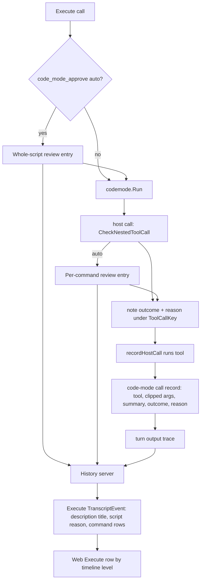

# Code Mode Block Visibility - Plan

---

## Goal Capsule

- **Objective:** A person reading a RocketClaw web chat can tell, for every Code Mode block, what the agent ran, roughly what came back, and why the automatic approver allowed or denied it. Chats stay about as light and fast to open as today; any added data is small and bounded.
- **Means:** Fix how saved approver reasons are read (KTD1). Keep a small record of each command inside a script, with a one-line output summary and no output payload (KTD2, KTD3). Redraw the Execute row around those records and the timeline level (KTD8, KTD9).
- **Authority:** User decisions recorded in this plan's Key Decisions and labeled KTDs win over agent-inferred KTDs. `AGENTS.md` rules win over this plan's mechanism choices.
- **Stop conditions:**
  - Stop and ask if implementing the plan requires storing any command output beyond the KTD3 summary.
  - Stop and ask if the rocketclaw Go CLOC budget would be exceeded.
- **Execution profile:** Go (`internal/rocketcode`, `internal/rocketclaw/frontend/rpc`) plus the React web app (`internal/rocketclaw/web`). The work ends as local changes that pass the Verification Contract; shipping is a separate step.

---

## Product Contract

### Summary

Every Code Mode block is titled with the model's own one-line description of it and shows the approver's whole-script reason when there is one. Each command the script ran appears as a readable row with a one-line output summary and, when the approver checked it, the approver's reason. Starlark source is shown according to the timeline level. Approver reasons start loading again for all chats, including existing ones.

### Problem Frame

On wallace, chat `AHWNE3GO6MMDBJ3V7OGHZDRH2S` ran 104 Execute calls; 89 of them went through permission review, and every review saved a reason. The page shows none of them.

- **Reasons never load.** `SessionEntry.PermissionReviewRationale` in `internal/rocketcode/permission_review.go` only accepts a reason backed by a text-progress record in the review's output trace. Only the Responses WebSocket path (`internal/rocketcode/responses_websocket.go`) writes those records. Wallace reaches its models over HTTPS, so none of its 203 saved guardian reviews since 2026-10-08 has one.
- **Titles mislead.** `toolTitle` in `internal/rocketclaw/web/src/ui.tsx` names a block after the first `bash`/`read`/`glob`/`grep` call it finds in the script. A script running four commands is titled after one of them, and many scripts end up titled `python3 - <<'PY'`. Execute calls from agents allowed to run Background Jobs already carry a model-written `description` (for example "Validate PR diff and agent permissions"), and the page ignores it.
- **Bodies are raw JSON.** The expanded row shows the escaped `{"code": "..."}` argument and the raw result.
- **Commands inside scripts are not kept.** Commit `c0c187fc266d` (2026-10-13) stopped saving them because their full outputs were stored. One 67 MB MP3 `read` made a chat take about 45 seconds to open. Migration `032_drop_script_calls.sql` deleted the stored copies. `cmd/rocketclaw/CHEATSHEET.md` still claims each call made inside a script is saved and shown.

### Requirements

**Approver reasons**

- R1. Every approver-reviewed call shows its saved reason, whichever model transport the approver used, in new and existing chats.
- R2. A Code Mode block shows the whole-script approver reason (`permission.rocketclaw.code_mode_approve`) when one exists, without showing the script source.

**Commands inside a script**

- R3. In chats recorded after this change, every command a script ran appears as its own row under the block, in the order the commands started. A row appears as soon as its command starts, marked running, and updates when it finishes. For a script that moves to the background, the list covers the commands it ran before its turn ended; the block says it moved to the background, and the final result arrives in the existing Completion Note.
- R4. A command row shows the command in readable form: real line breaks, and shell highlighting for `bash` commands.
- R5. A command row shows a one-line summary of the command's output, as defined by KTD3.
- R6. A command the approver checked shows its outcome and the approver's reason. Commands allowed or denied by a static rule show no reason.
- R7. A denied command shows that it was denied, with the denial message as its summary.
- R8. In chats recorded before this change, a block lists the commands the approver checked, with exact command text and reason and no output summary.

**Block display**

- R9. A Code Mode block's title is the model's `description` of the block when one exists.
- R10. Starlark source is shown in full with Python highlighting at the Everything level, behind a "Show script" toggle at Detailed, and hidden at Compact. Messages and Quiet keep hiding the whole block, except blocks those levels already show because they failed, ran in the background, or carry attachments; those show the toggle.

**Storage and load**

- R11. No command output is stored beyond the KTD3 summary, in the database or anywhere else.
- R12. Opening a chat stays about as fast as it is now. The added per-command data is bounded per call and per script (KTD4, KTD5).

### Key Decisions

- **Output is summarized, never stored.** A command row carries only a one-line output summary. Governs R5, R11. (session-settled: user-directed — chosen over keeping full output in the attachment store and over a 50 KB clipped copy in the database: heavy payloads must not be stored.)
- **Every command is listed; reasons appear only where the approver ran.** Governs R3, R6. (session-settled: user-directed — chosen over listing only reviewed commands: static allow/deny rules have no reason to show.)
- **Starlark visibility follows the timeline level.** Full at Everything, toggle at Detailed, hidden below. Governs R10. (session-settled: user-directed — chosen over always hiding or always showing the script.)
- **Existing chats get reviewed commands only.** Inner commands of old chats were deleted by migration 032 and cannot be recovered. Governs R8. (session-settled: user-approved — accepted when the gap was shown.)
- **Background scripts follow OpenCode.** A block that moves to the background lists what ran before its turn ended and says it moved; the result comes in the Completion Note. Governs R3. (session-settled: user-directed — chosen over storing later commands with the Background Job: OpenCode never lets a script outlive its call, and its background shell rows defer the result to a later notification, `packages/core/src/tool/plugin/shell.ts` in OpenCode.)
- **Rows appear when a command starts.** Governs R3. (session-settled: user-directed — chosen over adding rows only when commands finish: matches OpenCode's `progressHooks` in `packages/core/src/codemode/tool.ts`, which shows what a long script is waiting on.)
- **Existing chats show no explanatory note.** Their reviewed-only rows appear without a note saying the list is partial. Governs R8. (session-settled: user-directed — chosen over a one-line 'older chat' note.)

### Success Criteria

- On wallace, chat `AHWNE3GO6MMDBJ3V7OGHZDRH2S` shows an approver reason for each of its 89 reviewed blocks, and each block lists its reviewed commands with readable text.
- A new script that reads a large binary file adds a row reading like `65536 KiB of binary output`, and the History response grows by well under a kilobyte for that command.

### Scope Boundaries

- Approval behavior is unchanged: which calls are reviewed, which reviewer runs, and how outcomes are decided.
- The script's final result keeps its current place in the block; only its presentation is in scope.
- Top-level (non-Execute) reviewed calls keep today's rationale footer, now fed by the fixed reader.
- Not built: a per-script count of commands dropped past the KTD5 cap. The web says the list may be cut when it reaches the cap; a script that hits it would justify a counter.
- Not built: lazy loading of review records. History already reads every review record of the loaded turns; making that cheaper is separate work unless KTD7's measurement shows a real regression.

---

## Planning Contract

### Key Technical Decisions

- KTD1. **Read a review's reason from its saved final answer.** `PermissionReviewRationale` gives way to one reader that takes the review entry's last assistant message not in the commentary phase and decodes it as the decision. That is the message `reviewPermission` itself decides from (its `last` variable). The output-trace dependency is dropped, so HTTP and WebSocket reviews read alike. The reader scans raw replay items from the end with a minimal struct, so it never runs a full SDK replay decode. That keeps the allocation property commit `3266565ae8ef` protected.
- KTD2. **Inner-command records live in the turn's output trace as their own record type.** Each record carries:
  - the Execute call it belongs to;
  - its host-call key;
  - the tool name;
  - the clipped arguments (KTD4);
  - the output summary (KTD3);
  - the call status: `running`, `ok`, `error` (the call failed, or `bash` exited non-zero), or `denied` (a static rule or the approver denied it);
  - the approver outcome and reason, when the approver ran.

  A whole-script review (`code_mode_approve`) adds one more record at gate time, holding its outcome and reason under the Execute call.

  The type name differs from `function_call`/`function_call_output`. Migration 032's cleanup and the replay readers therefore never confuse these records with model items, and they never enter model input. Records and review notes are written through the call's own `toolCallContext.observations`, never `looper.observations`, which belongs to whichever turn is current. They save like other trace writes, so running turns show them live. A command's record is appended with status `running` when it starts and replaced in place when it finishes, keyed by the host-call key, as OpenCode's `progressHooks` does. A resumed script that replays a journaled step therefore updates its existing record instead of adding another. Once the turn's observations close (`observeLocked` ignores later writes), records stop changing. A Background Job script's later commands are not recorded, and a command still running at that moment keeps status `running`.
- KTD3. **Output summary rule.**
  - Text output is valid UTF-8 with no NUL byte; its summary is its last non-empty line, cut at a rune boundary to 200 bytes.
  - Any other output is summarized as `<N> KiB of binary output`, where N is the size rounded up.
  - A failed or denied call summarizes the last non-empty line of its error.
  - When that last line is the `read` tool's closing `</content>` tag, the line before it is used, for example `(End of file - total 42 lines)`. The user approved this refinement after seeing that every `read` would otherwise summarize as `</content>`.

  The summary is computed in `recordHostCall` from the string the script receives. (session-settled: user-directed — chosen over storing output: only the last line or the size is kept.)
- KTD4. **Arguments are clipped to 4 KiB at a rune boundary, with a visible truncation marker.** The model writes these arguments, so most are small. A file `write` or `edit` can carry a lot of text. (session-settled: user-approved — proposed with the size tradeoff shown; the user confirmed.)
- KTD5. **At most 200 command records per Execute call.** `saveTraceLocked` rewrites the whole turn trace on every save, so a loop of thousands of calls would multiply the write volume as the trace grows. The cap bounds a script to about 800 KiB of records and 400 trace saves, two per command (start and finish). The web flags a block that reached the cap as possibly incomplete. Ponytail: there is no count of dropped commands; adding one means an overflow record per Execute call.
- KTD6. **Per-command reasons are recorded when the gate decides, not matched afterwards.** `CheckNestedToolCall` already runs under the host call's `ToolCallKey`, which includes `codemode.CallKey`. It notes the review outcome and reason under that key on the turn's observations, under the existing `turnObservations` mutex. `recordHostCall` copies them into the record. Matching review records to commands later would have to compare clipped arguments, which fails exactly for the large commands. The MCP path shares the key: `newMCPToolBuiltin` in `internal/rocketcode/codemode/codemode.go` passes one context, already carrying the call key, to both `decide` (`CheckNestedPermission`) and `call` (`mcpCall`).
- KTD7. **Whole-script reasons and existing-chat commands come from review records, parsed in `internal/rocketcode`.** A review entry's first user message ends with the planned-action JSON between `Planned action JSON:` and `>>> APPROVAL REQUEST END`, written by `permissionReviewPrompt`. The parser lives next to that builder, so the format has one owner. It returns the reviewed tool name, permission, subjects, raw arguments, outcome, and reason. A whole-script review has tool `execute` and permission `rocketclaw`. An MCP call reviewed inside a script also has tool `execute`, but its permission is `mcp`, and its row is named after its subject (`server.tool`). This puts the code in `internal/rocketcode` (about 1,800 lines of CLOC headroom) rather than `internal/rocketclaw` (about 366 lines, already in its hazard zone). Decoding a review's first item is the expensive part: on this chat the 110 review entries total about 35 MB. New chats never need this parse, because KTD2 records the whole-script reason in the trace. The server parses planned actions only for Execute events in the current response that have no command records and no whole-script record, which means chats recorded before this change. U3 measures History latency on a fixture of that size, for a cold read and for a follow-up poll, before and after.
- KTD8. **Starlark visibility reads the current timeline level.** The Execute row reads `timelineLevel(useTimelineDetail())` from `internal/rocketclaw/web/src/timeline-detail.ts`. Everything shows the script and Detailed shows a toggle. A custom setting that matches no level also shows the toggle, so the script stays reachable, and so does a failed, background, or attachment-carrying block that Messages or Quiet still shows (R10). The highlighter already loads `python` (`internal/rocketclaw/web/src/lib/highlighter.tsx`). (session-settled: user-directed — chosen over a single fixed visibility.)
- KTD9. **The block title is the Execute call's `description`, and every agent's Execute takes one.** Today `backgroundTool` (`internal/rocketcode/background.go`) adds `description` only for agents allowed to run Background Jobs. U6 moves it into Execute's own definition, so every agent's model writes it; the background wrapper keeps adding only `background`. The `toolTitle` heuristic remains the fallback for older calls. (session-settled: user-directed — chosen over keeping descriptions for background-capable agents only: 60 of 61 wallace agents would keep misleading titles.)

### High-Level Technical Design

Data flow for one Execute call:

Command-row sources by chat age:

| Chat recorded | Command rows come from | Output summary | Per-command reason | Whole-script reason |
|---|---|---|---|---|
| After this change | Trace records (KTD2) | Yes (KTD3) | Inline in record (KTD6) | Trace record (KTD2) |
| Before this change | Review records, reviewed commands only (KTD7) | No | From the same review record | Review records (KTD7) |

### Assumptions

- Models fill in an optional `description` field reliably once it is in Execute's schema, as the background-capable `sudo` agent already does on every call in the wallace chat.

### Sources

- `internal/rocketcode/permission_review.go`: `PermissionReviewRationale`, `reviewPermission`, `permissionReviewPrompt`.
- `internal/rocketcode/permission_gate.go`: `CheckNestedToolCall`, `CheckNestedPermission`, `ToolCallKey`.
- `internal/rocketcode/mcp_tools.go`: `recordHostCall`, `codeModeHostToolsFromContext`, `callExecute`'s MCP `recordHostCall` use.
- `internal/rocketcode/public_progress.go`: `turnObservations`, `saveTraceLocked`.
- `internal/rocketclaw/frontend/rpc/server.go`: `reviewRationales`, `transcriptEntry`.
- Commit `c0c187fc266d`: the removed `hostCallTrace` records, `hostCallsByParent`, and `hostCallEvents` (`jj file show -r 'c0c187fc266d-' internal/rocketclaw/frontend/rpc/server.go`) are the projection pattern to reuse, minus the output payload.
- `docs/solutions/runtime-errors/execute-uncapped-results-exceeded-model-context.md`: the head clip and spill rules that keep full output out of model input; this plan does not change them.

---

## Implementation Units

### U1. Read approver decisions from the saved final answer

- **Goal:** One reader in `internal/rocketcode` returns a saved review's reviewed tool, raw arguments, outcome, and reason, for both model transports.
- **Requirements:** R1, R2, R8.
- **Dependencies:** none.
- **Files:**
  - Modify `internal/rocketcode/permission_review.go`.
  - Test `internal/rocketcode/permission_review_test.go`.
- **Approach:**
  1. Replace `PermissionReviewRationale` with a reader that walks `ReplayInput` raw items from the end. It decodes only type, role, phase, and content, and takes the first assistant message not in the commentary phase whose content decodes as an allow or deny decision (KTD1).
  2. Add a planned-action reader that decodes only the first user item. It extracts the JSON between the delimiters `permissionReviewPrompt` writes, returning tool name, permission, subjects, and raw arguments (KTD7). Callers that need only the reason never invoke it.
  3. Delete the trace-based `final` map logic. Keep the existing allocation guard: reading a reason must not run an SDK replay decode.
- **Patterns to follow:** The raw-identity decode in `transcriptEntry` (`internal/rocketclaw/frontend/rpc/server.go`); `permissionReviewPrompt` for the delimiters.
- **Test scenarios:**
  - A review entry with a final-answer message and no output trace returns its reason. This is the HTTP case.
  - A review entry with a WebSocket progress trace still returns the same reason.
  - A commentary-phase decision is ignored and the later final answer wins.
  - A review that made a read-only tool call before answering returns the final answer's reason, not tool output.
  - Content that is not a decision (`outcome: unknown`) returns nothing.
  - The planned-action reader returns tool `bash` and the exact raw arguments for a captured wallace prompt fixture. It returns tool `execute` with permission `rocketclaw` for a whole-script review, and tool `execute` with permission `mcp` and subject `server.tool` for an MCP call reviewed inside a script.
  - The planned-action reader returns nothing for a prompt missing either delimiter.
  - Reading only the reason allocates no more than reading it from an entry without the prompt, within the existing tolerance.
- **Verification:** Unit tests pass. Run against the captured `AHWNE3GO6MMDBJ3V7OGHZDRH2S` review rows, the reader yields 110 reasons and 110 planned actions.

### U2. Record each command a script runs

- **Goal:** New turns store one bounded record per Code Mode host or MCP call, under its Execute call.
- **Requirements:** R3, R5, R6, R7, R11, R12.
- **Dependencies:** none.
- **Files:**
  - Modify `internal/rocketcode/public_progress.go`, `internal/rocketcode/mcp_tools.go`, and `internal/rocketcode/permission_gate.go`.
  - Test `internal/rocketcode/mcp_tools_test.go`, `internal/rocketcode/active_turn_test.go`, and `internal/rocketcode/background_test.go`.
- **Approach:**
  1. Add the record type and a `turnObservations` method that appends it under the existing mutex. It skips a record whose host-call key is already present and stops at the KTD5 cap (KTD2).
  2. In `CheckNestedToolCall`, when the approver ran, note its outcome and reason under `ToolCallKey(ctx)` on the call's observations (KTD6). In the top-level Execute gate in `looper.go`, record a whole-script review's outcome and reason (KTD2).
  3. In `callExecute`'s MCP `decide` closure, when `CheckNestedPermission` returns an error, append a `denied` record with the denial summary and any noted approver outcome and reason. `decide` returns before `mcpCall`, so `recordHostCall` never sees these denials.
  4. In `recordHostCall`, append a `running` record with the clipped arguments (KTD4) before the call runs. After the call finishes or a journaled step replays, replace it with the summary (KTD3) and final status (KTD2).
  5. Leave the journal step (`hostCallStep`) unchanged; it still holds full output only for resume, and turn finish deletes it.
- **Patterns to follow:** The removed `recordHostCall` on `turnObservations` in commit `c0c187fc266d`; `observeLocked` for trace writes.
- **Test scenarios:**
  - A script running `bash` that prints three lines records a row whose summary is the last line.
  - Output ending in blank lines summarizes the last non-empty line.
  - A 300-byte last line is cut to 200 bytes at a rune boundary, with multi-byte characters intact.
  - Output containing a NUL byte, or invalid UTF-8, summarizes as `<N> KiB of binary output` with N rounded up.
  - A host call that returns an error summarizes the error's last line.
  - A command denied by a static rule records status `denied` and the denial message, with no outcome or reason.
  - A `bash` command that exits non-zero records status `error`.
  - An MCP call denied by a static rule, and one denied by the approver, each record status `denied`. The approver-denied one also records `deny` and the reason.
  - An Execute call whose agent sets `code_mode_approve: auto` records one whole-script record with the reviewer's outcome and reason.
  - A command the approver allowed records outcome `allow` and the approver's reason. One the approver denied records `deny`, the reason, and the denial summary.
  - An MCP call the approver reviewed records the approver's reason (KTD6 key check).
  - Arguments over 4 KiB are clipped at a rune boundary with the truncation marker.
  - A text `read` summarizes as `(End of file - total N lines)`, not `</content>`.
  - A resumed turn replaying a journaled step adds no second record.
  - A command's record exists with status `running` while the command is still executing, and holds its summary after it finishes.
  - A Background Job script that keeps making host calls after its turn closed adds no records after closure, and a command running at closure keeps status `running`.
  - The 201st call in one Execute call adds no record. Another Execute call in the same turn still records.
  - Records saved during a cancelled child context still persist, matching `TestTurnObservationsPersistAfterChildCancellation`.
- **Verification:** A record never contains more than the summary from a call's output. Turn traces of the tests contain exactly the expected records.

### U3. Project commands and reasons into History

- **Goal:** The History response carries, on each Execute event, its command rows, its whole-script reason, and per-command reasons, from either source in the command-row sources table under High-Level Technical Design.
- **Requirements:** R1, R2, R3, R6, R8, R12.
- **Dependencies:** U1, U2.
- **Files:**
  - Modify `internal/rocketclaw/web/proto/web.proto`, regenerating `internal/rocketclaw/frontend/rpc/web.pb.go` and the web's generated TS.
  - Modify `internal/rocketclaw/frontend/rpc/server.go`.
  - Test `internal/rocketclaw/frontend/rpc/live_test.go`.
- **Approach:**
  1. Add a small repeated message for command rows on `TranscriptEvent`. Each row holds tool, arguments, summary, status, outcome, and reason. Add a script-reason field on the event.
  2. In `transcriptEntry`, group the turn's KTD2 records by Execute call and attach them to that call's event, including records of a running turn whose Execute call has not reached replay yet.
  3. Rework `reviewRationales` to use U1's reader. Keep its map for non-Execute reviewed calls. For new-format Execute calls, take the script reason from the whole-script trace record. For an Execute event in this response with no records, parse its reviews (KTD7): set the script reason from the whole-script review, and add one row per other reviewed command. Clip those rows' arguments per KTD4 and cap them per KTD5 (R8, R12).
  4. Measure History latency for a fixture of 100 review entries with 300 KB prompts, for a cold read and for a follow-up poll with no changed Execute events, before and after. Record the result in the PR (KTD7).
- **Patterns to follow:** `hostCallsByParent` and `hostCallEvents` from commit `c0c187fc266d`; existing `ReviewRationales` tests in `live_test.go`.
- **Test scenarios:**
  - A finished turn with three recorded commands under one Execute call returns them in order on that call's event, with summaries.
  - A running turn returns its recorded commands before the Execute call has a result.
  - A review saved over HTTP, with no progress trace, appears in `ReviewRationales` for a top-level reviewed call. This is the wallace regression.
  - An Execute call with a whole-script review gets that reason as its script reason. Its per-command reviews do not leak into the script reason.
  - An old-format Execute call with two reviewed commands and no records gets two rows with arguments (exact up to the KTD4 clip), reasons, and empty summaries. A reviewed command whose arguments exceed 4 KiB comes back clipped with the marker.
  - An old-format Execute call with a whole-script review and a reviewed MCP call shows the whole-script reason as its script reason, and the MCP call as a row named `server.tool`.
  - A follow-up poll whose response contains no Execute events parses no planned actions.
  - A new-format Execute call with records does not also get rows from review records, and its review entries' planned actions are not parsed.
  - A delegation whose review record has no parsable planned action is skipped without failing the History call.
- **Verification:** Tests pass. The rocketclaw Go CLOC budget check passes. Latency for the 100-review fixture rises by no more than 20% over the pre-change baseline.

### U4. Redraw the Execute row

- **Goal:** The web shows Code Mode blocks per R2–R10.
- **Requirements:** R2, R3, R4, R5, R6, R7, R8, R9, R10.
- **Dependencies:** U3, U6.
- **Files:**
  - Modify `internal/rocketclaw/web/src/ui.tsx` and `internal/rocketclaw/web/src/types.ts`.
  - Test `internal/rocketclaw/web/src/transcript.test.ts`, `internal/rocketclaw/web/src/delegations.browser.test.ts`, and `internal/rocketclaw/web/src/entry-transport.test.ts`.
- **Approach:**
  1. `toolTitle` uses the Execute call's `description` when present (KTD9). It keeps the existing heuristic as the fallback.
  2. `ToolLine` for Execute renders in this order:
     - the script reason, when present;
     - one compact row per command, showing tool, readable command, summary line, a denied or failed marker from its status, and the approver outcome plus reason when present;
     - a cap notice when the row count equals the KTD5 cap;
     - the script result as text;
     - the script source per KTD8.
  3. Readable command text:
     - `bash` shows its `command` with shell highlighting.
     - `read`, `glob`, and `grep` show their path or pattern.
     - Other tools show pretty-printed arguments with real line breaks.
  4. Non-Execute tool rows keep today's layout and rationale footer.
- **Patterns to follow:** `CodeBlock` with `language` in `internal/rocketclaw/web/src/transcript-text.tsx`; `TraceRow` and `ToolLinks` in `ui.tsx`; `timelineLevel` in `timeline-detail.ts`; OpenCode's `Execute` and `ExecuteCallView` rows in `packages/tui/src/routes/session/index.tsx` (one line per call, error mark, input on expand).
- **Test scenarios:**
  - An Execute event with `description` "Validate PR diff" is titled "Validate PR diff". One without it keeps the heuristic title.
  - A `bash` command row renders a multi-line heredoc with real line breaks inside a shell-highlighted block.
  - A row with outcome `deny` shows a denied marker, the reason, and the summary line.
  - A row with no outcome shows no reason element.
  - A row with status `denied` and no outcome, a static-rule denial, shows the denied marker and summary with no reason element.
  - A row with status `error` shows a failed marker.
  - The script reason renders above the rows, and the Starlark source is not in the DOM at Compact.
  - At Detailed, the script is hidden until "Show script" is pressed, then shows with Python highlighting.
  - At Everything, the script shows without a toggle.
  - At Messages, a successful block stays hidden. A failed block still shows, with the "Show script" toggle.
  - A row with status `running` shows a running indicator and no summary.
  - A block whose call state is `background` says it moved to the background. Its rows still marked `running` read "still running when moved to the background".
  - A block with exactly the cap number of rows shows the cap notice.
  - A non-Execute reviewed tool row still shows its rationale footer (existing `delegations.browser.test.ts` contract).
- **Verification:** Web unit and browser tests pass. The web TS CLOC budget check passes. A screenshot of the wallace chat fixture shows titled blocks with reasons.

### U5. Correct the docs

- **Goal:** User-facing docs describe what the page now shows.
- **Requirements:** R3, R5, R10, R11.
- **Dependencies:** U4.
- **Files:**
  - Modify `internal/rocketclaw/web/README.md`.
  - Modify `cmd/rocketclaw/CHEATSHEET.md`.
  - Rebuild the built assets under `internal/rocketclaw/internal/web/dist/`.
- **Approach:**
  1. Replace the README paragraph saying Execute calls show only the script's result and keep nothing. The new paragraph describes rows, summaries, reasons, and Starlark by level.
  2. Fix the CHEATSHEET `execute` row's claim that each call inside a script is saved and shown like a direct call. Say what is kept instead.
- **Test scenarios:** Test expectation: none -- documentation and generated assets.
- **Verification:** The docs match the shipped behavior, and `dist` matches a fresh web build.

### U6. Give every agent's Execute a description field

- **Goal:** Every Execute call can carry the model's one-line description, whether or not the agent may run Background Jobs.
- **Requirements:** R9.
- **Dependencies:** none.
- **Files:**
  - Modify `internal/rocketcode/mcp_tools.go` (Execute's definition) and `internal/rocketcode/background.go` (stop adding `description` there).
  - Test `internal/rocketcode/mcp_tools_test.go` and `internal/rocketcode/background_test.go`.
- **Approach:**
  1. Add an optional `description` string to Execute's own parameters, reusing the existing `backgroundLabelParam` wording.
  2. `backgroundTool` stops adding `description` for Execute and keeps using it as the Background Job label.
  3. `callExecute` ignores the field; it is display-only (KTD9).
- **Patterns to follow:** The existing `description` property in `backgroundTool`.
- **Test scenarios:**
  - An agent without `allow_background` sees `description` in Execute's schema and not `background`.
  - An agent with `allow_background` sees both, and a Background Job started with a description still uses it as its label.
  - An Execute call with a description runs the same script as one without.
- **Verification:** Tests pass. The `sudo` agent's schema is unchanged apart from where the property is defined.

---

## Risks

| Risk | Mitigation |
|---|---|
| History reads every review record, about 35 MB for the wallace chat, and planned-action parsing adds decode cost. | KTD7 limits parsing to Execute calls that need it. U3 measures against a 20% budget. |
| The rocketclaw Go source is 366 lines from its CLOC limit, and the web is 403 lines from its limit. | Parsing lives in rocketcode (KTD7). U3 and U4 reuse the removed projection pattern instead of new layers. |
| The prompt delimiters change later and old-chat rows silently disappear. | The parser and the prompt builder share one file (KTD7). U1 tests a captured real prompt. |

---

## Verification Contract

| Gate | Command | Applies to |
|---|---|---|
| Format | `gofmt -l` on touched Go files returns nothing | U1–U3, U6 |
| Go tests | `go test ./...` from the repo root | U1–U3, U6 |
| Lint | `make lint` | all |
| Full suite including web build and browser tests | `make test` | all |
| CLOC budgets | `make check-cloc-budget` | all |
| History latency | U3's fixture benchmark, before and after, within 20% | U3 |

---

## Definition of Done

- R1–R12 hold, each covered by a U1–U4 or U6 test scenario.
- The wallace chat `AHWNE3GO6MMDBJ3V7OGHZDRH2S`, rendered from a fixture of its History, shows reasons for its 89 reviewed blocks.
- No new code path stores command output beyond the KTD3 summary.
- Every gate in the Verification Contract passes, with CLOC budgets unchanged.
- Code from abandoned approaches is removed from the diff. No `PermissionReviewRationale` trace-dependency leftovers remain.
- `internal/rocketclaw/web/README.md` and `cmd/rocketclaw/CHEATSHEET.md` describe the new behavior.
