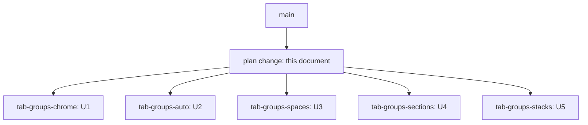

# Web Tab Groups - Plan

## Goal Capsule

- **Objective:** RocketClaw web users can see their open tabs organized into groups, and the user can try five different tab-group designs and pick one.
- **Means:** five sibling changes, each building one group design on the existing tab strip (KTD1, KTD6).
- **Authority:** the user's request, then this plan's Requirements, then KTDs, then unit Approach text. `AGENTS.md` coding, test, CLOC, and verification rules bind every unit.
- **Stop conditions:** stop a variant and report it if it cannot meet R1-R7 without pushing TypeScript source CLOC to 7500 or more. Also stop it if it breaks existing tab behavior and cannot restore it. R5 defines which changes to that behavior are allowed.
- **Execution profile:** U1-U5 are independent. Each runs in its own JJ workspace whose parent is the change that adds this plan.
- **Finishing:** five pull requests against `main`. Each holds the plan change plus one variant. Merging and choosing a winner stay with the user.

---

## Product Contract

### Summary

Add tab groups to the RocketClaw web tab strip, built five different ways so the user can compare them. Every variant keeps today's tab behavior, works in both top and left placement, works by keyboard, and remembers its groups in the browser.

### Problem Frame

The web client shows sessions and pages as editor-style tabs (`useTabs`, `TabStrip`, `TabItem` in `internal/rocketclaw/web/src/ui.tsx`). With many open sessions, the strip becomes one long flat list. The user wants tabs in groups, and showed Chrome's design as the example: a colored, named group header that collapses, with a menu for name, color, new tab in group, close group, ungroup, and delete group. The user is not available to answer questions and asked for five variations to choose from later.

### Requirements

**Every variant**

- R1. The strip shows which tabs belong together. In every variant except V2, the user decides which tabs share a group. V2 groups tabs automatically, which is its thesis (KTD6).
- R2. Groups and membership are kept in browser `localStorage`, scoped to the signed-in owner, and restored after reload. Unreadable group storage resets the groups. It never loses the open tabs.
- R3. Groups work in both tab placements: top and left.
- R4. Groups work by keyboard and screen reader:
  - Collapsible headers report whether they are expanded.
  - Every control has a label. An unnamed group is labelled by its color or position.
  - A grouped tab tells assistive technology which group it is in.
  - Arrow keys still move between tabs, and every group menu can be opened by keyboard and by touch.
- R5. Everything in today's tab feature keeps working: preview tabs, pins, the close commands, middle-click, drag reorder, rename, the running dot, Cmd/Ctrl+[ and ], placement, and storage under `tabs:<owner>`. The existing `tabs.browser.test.ts` suite passes. A variant whose thesis changes a covered behavior may update the affected assertions, but only that variant's KTD6 row may justify the change, and the PR must name each changed assertion.
- R6. The active tab is always visible. Activating a tab inside a hidden or collapsed group reveals it.
- R7. The web README's Tabs section documents the variant's group behavior.

**Comparison**

- R8. Five variants, each built around a different thesis (KTD6) and each reviewable and runnable on its own.

### Scope Boundaries

- Tab groups are browser-only. There is no server storage, no sync across devices, and no agent tool for tabs.
- Session-level tags and the server-side **Pin session** are unrelated and unchanged.
- No saved or closed-group library (Chrome's "saved groups"). So Chrome's separate **Close group** and **Delete group** collapse into one **Close group** that closes the tabs and removes the group.
- Considered and not built: syncing group edits between two windows of the same browser. Today's tabs do not sync either. A shared-window complaint would change this call.

#### Deferred to Follow-Up Work

- Delete the four losing variants once the user picks a winner.

### Success Criteria

- The user can check out any variant bookmark, build it, make groups, reload, and find the groups intact, with tabs on top and on the left.
- Each pull request passes CI.

---

## Planning Contract

### Key Technical Decisions

- KTD1. **Five sibling changes on one plan change.** One change adds this plan. Each variant is a child of it with bookmark `tab-groups-<slug>` and its own PR against `main`. The variants edit the same lines of `ui.tsx` and conflict with each other by design, because only one will merge. (session-settled: user-directed — chosen over a single implementation: the user asked for five variations to choose from later.)
- KTD2. **Extend `useTabs`; do not fork it.** Each variant adds its state to the existing `useTabs` hook and `TabStrip`/`TabItem` rendering. The existing `commands(path)` list feeds the tab context menu and the palette's **Tabs: …** entries. Group commands added there show up in both places with no extra wiring.
- KTD3. **Storage stays readable by every build.** `tabs:<owner>` keeps holding only real locations. Each variant may add one optional membership field to a stored `Tab`: `group`, `space`, `stack`, or `section`. `loadTabs` checks only `path`, `pinned`, and `preview`, so other builds ignore the field. Group metadata (names, colors, collapsed state) goes under a per-variant key, `tab-groups-<slug>:<owner>`, so variants on one origin never misread each other.
  - Every rebuild of a `Tab` must keep the membership field unless the rule here says otherwise. Today `openTab`'s preview replacement, the `pin` command, and `create` all rebuild tabs.
  - Pinning clears the membership field in every variant. Pinned tabs are never grouped. In V3 they show in every space.
- KTD4. **Contiguity by stable sort.** In V1 and V5 a group is a run of adjacent tabs. One stable ordering keeps that true wherever `pinnedFirst` runs today: pinned first, then each group at the position of its first member. Moves follow one rule: a dragged or Shift+Arrow-moved tab takes the membership of the tab it lands on. Dropping onto an ungrouped tab leaves the group. So drag can add to, remove from, and reorder within a group, and nothing snaps back.
- KTD5. **Keyboard model.**
  - Arrow-key movement uses the rendered tab elements, not indexes into `state.tabs`, because hidden tabs are not rendered.
  - Group headers are buttons with `aria-expanded`. Each grouped tab names its group through `aria-description`.
  - Cmd/Ctrl+[ and ] cycle the stored order. The exception is V3, where they cycle the current space.
  - Activating a hidden tab by any route expands its group, or switches to its space in V3 (R6).
- KTD6. **Five theses, one per variant.**

| Variant | Bookmark | Thesis | Defining mechanisms |
|---|---|---|---|
| V1 Chrome groups | `tab-groups-chrome` | Faithful to the user's screenshot | Named, colored groups of adjacent tabs. A colored header chip shows the name and collapses the group on click. The header editor has a name field, nine color swatches, New tab in group, Ungroup, and Close group. The tab menu has Add to new group, Add to an existing group, and Remove from group. On the left, members sit under the header with a colored left rule. On top, members get a colored underline. A tab opened from a grouped active tab joins its group. |
| V2 Auto groups | `tab-groups-auto` | Zero management | Groups come from data, not from the user. Session tabs group under their session's agent, and page tabs group under **Pages**. The stored order is kept sorted by group, so the strip, closing, and bracket cycling all agree. Headers collapse, and only the collapsed set is stored. There are no group commands. Drag reorders within a group. A drop onto another group's tab does nothing. With one agent, the strip shows at most two groups, its sessions and **Pages**. Pinned tabs sit first, outside every group. |
| V3 Spaces | `tab-groups-spaces` | Focus by hiding | Each tab belongs to one named space, and only the current space's tabs show. A space menu button at the start of the strip shows the current space. It lists the spaces and offers New, Rename, and Delete. Switching spaces returns to that space's last active tab. The tab menu offers Move to each other space. Opening a location that is open in another space switches to that space. |
| V4 Sections | `tab-groups-sections` | Position is membership | Named section headers sit in the tab order. A tab belongs to the nearest header above it, so dragging a tab past a header changes its section. The tab menu adds a section starting at that tab. Headers rename in place, collapse, and delete. Deleting one keeps its tabs. Built for left placement; on top, headers are small labels between tabs. |
| V5 Stacks | `tab-groups-stacks` | Compactness | A stack of tabs takes one slot in the strip. The slot shows the stack's active or last-used member with a count badge. The badge opens a menu of the members to switch to, close, or unstack. The tab menu adds Stack with the tab to the left and Unstack. Dropping a tab onto a stack's slot adds it to that stack. Stacks suit a crowded top strip. |

- KTD7. **Sibling variants, not `ce-bakeoff`.** The user asked for runnable variants to try personally, as in the earlier tabs work (`docs/plans/2026-10-07-1521-feat-web-tabs-replace-sidebar-plan.md`). Bake-off produces artifacts and picks a winner. Here each variant is built and verified, and no winner is chosen.
- KTD8. **Colors use the Tailwind palette.** V1 uses nine Chrome-like colors from Tailwind's built-in palette: grey, blue, red, yellow, green, pink, purple, cyan, and orange. Text and background contrast must work in both light and dark themes. No new theme tokens.
- KTD9. **New session moves; it is never duplicated.** A location is open in at most one tab, and New session (`/`) is one location. "New tab in group" (V1) and entering an empty space (V3) move the existing New session tab into that group or space and activate it. If none exists, they open it there.
- KTD10. **Text entry stays out of `Menu`.** Base UI's `Menu` consumes printable keys for type-ahead. A group name field must therefore live in a `Popover` (`@base-ui/react/popover`, already a dependency) or edit inline in the header, never inside `Menu.Popup`.

### Assumptions

- "Tab groups" means the RocketClaw web tab strip, not browser tabs or the Search page's inner search tabs.
- A variant should stay below 7250 TypeScript source CLOC, the start of the hazard zone. A variant that enters the hazard zone (7250-7499) must state its count and reason in its PR, so the user can weigh it. 7500 is a stop (Goal Capsule).
- No headless review of visual design is possible. Each PR explains how to try the variant, and the user judges the look in a browser.

### High-Level Technical Design

Where each variant's state lives:

| Variant | On each stored `Tab` | Under `tab-groups-<slug>:<owner>` | Derived at render |
|---|---|---|---|
| V1 | `group` id | id, name, color, collapsed | header placement, member rule |
| V2 | nothing | collapsed agent names | agent of each session row |
| V3 | `space` id | spaces in order, names, current space, last active per space | visible tabs |
| V4 | `section` id on the first tab of each section | section names, collapsed ids | section of each tab |
| V5 | `stack` id | last-used member per stack | one slot per stack |

### Risks

- **Index-based keyboard code.** `TabStrip`'s arrow handling and Shift+Arrow move index into `state.tabs` and the rendered `[role="tab"]` list as if they matched. Any variant that hides tabs breaks that (KTD5).
- **ARIA in a tablist.** A `tablist` should own only tabs. Headers inside it can trip `react-doctor` or screen readers. Each variant must keep `make lint` clean and check the strip in its browser test.
- **CLOC.** TypeScript source is 7141 of 7500, and the hazard zone starts at 7250. V1 is the most at risk.
- **Committed `dist`.** Every variant must rebuild and commit `internal/rocketclaw/internal/web/dist`.

### Sources

- `internal/rocketclaw/web/src/ui.tsx`: `useTabs`, `loadTabs`, `openTab`, `pinnedFirst`, `TabStrip`, `TabItem`, `TabClose`, the `SessionApp` keyboard handling, `moveQueueId`.
- `internal/rocketclaw/web/src/tabs.browser.test.ts`: the tab contract and its `withPage` fixture.
- `internal/rocketclaw/web/README.md`, section **Tabs**.
- `internal/rocketclaw/web/Makefile`: `TS_CLOC_BUDGET` 7500, hazard zone 250.
- `docs/plans/2026-10-07-1521-feat-web-tabs-replace-sidebar-plan.md`: the earlier five-variant tab plan this one follows.
- User screenshots: the Chrome tab group header and its menu (name, colors, New tab in group, Close group, Ungroup, Delete group).

---

## Implementation Units

Every unit touches the same files:

- `internal/rocketclaw/web/src/ui.tsx`
- `internal/rocketclaw/web/src/tabs.browser.test.ts`
- `internal/rocketclaw/web/README.md`
- `internal/rocketclaw/internal/web/dist/` (rebuilt)

Every unit reuses the same existing patterns:

- `useTabs`'s `commands` list for menu and palette entries.
- `loadTabs`'s try/catch reset for storage.
- `TabStrip`'s `Menu.Root` for menus.
- `tabs.browser.test.ts`'s `withPage` fixture and `menu` helper for tests.

### U1. V1 Chrome groups

- **Goal:** named, colored, collapsible groups of adjacent tabs, matching the user's screenshot.
- **Requirements:** R1-R7. Governed by KTD2-KTD6 and KTD8-KTD10.
- **Dependencies:** none.
- **Approach:**
  1. Add an optional `group` field to `Tab`. Store group metadata (`id`, `name`, `color`, `collapsed`) under `tab-groups-chrome:<owner>`. When saving, drop metadata for groups that have no members.
  2. Replace `pinnedFirst` with the KTD4 ordering. Drag and Shift+Arrow follow KTD4's landing rule.
  3. Tab menu commands:
     - **Add to new group** creates an unnamed group with the next color and opens its editor with the name field focused.
     - **Add to group "<name>"** appears once per other group.
     - **Remove from group** appears on grouped tabs.
  4. Header: a colored chip with the name, or a color dot when unnamed. Clicking it toggles collapse. Right-click, Shift+F10, or a **…** button opens the header editor (KTD10). The editor holds the name field, the color swatches as a radio group, **New tab in group** (KTD9), **Ungroup**, and **Close group**.
  5. A collapsed group renders only its header, plus the active tab if it is a member (R6).
  6. A tab opened from a grouped active tab joins that group. This covers a new tab and a preview replacement. A tab opened from an ungrouped active tab stays ungrouped.
- **Test scenarios:**
  - Add Alpha and Bravo to a new group named "Work" in green. The header shows "Work" before them. After reload, the header, name, color, and membership are the same.
  - Typing "Work" into the name field enters every letter.
  - Collapse "Work" while Charlie is active. Alpha and Bravo are hidden, and the header reports `aria-expanded="false"`. Cmd/Ctrl+] onto Alpha expands the group.
  - With Bravo active inside "Work", opening Delta from the palette places Delta inside "Work".
  - Dragging Charlie onto Alpha puts Charlie in "Work". Dragging Alpha onto Delta, outside the group, removes Alpha from "Work".
  - New tab in group, with New session already open elsewhere, moves that tab into "Work" and activates it.
  - Ungroup keeps all tabs open and removes the header. Close group closes the members and lands on a neighbour tab, following the existing close rules.
  - Pinning a grouped tab removes it from the group and moves it first.
  - With left placement and "Work" collapsed, Arrow Down from the tab above the header skips the hidden members.
  - Malformed `tab-groups-chrome:tester` storage resets the groups while every tab stays open.
- **Verification:** the scenarios pass, the existing tab tests pass, and source CLOC stays below 7500.

### U2. V2 Auto groups by agent

- **Goal:** tabs arrange themselves into collapsible groups by session agent, with no group management.
- **Requirements:** R1-R7. Governed by KTD2, KTD3, KTD5, and KTD6.
- **Dependencies:** none.
- **Approach:**
  1. Give each tab a group key. A session tab's key is its row's `agent`. Page tabs and New session use **Pages**. A session whose row has not loaded yet uses **Sessions**.
  2. Keep the stored order sorted by group, with groups ordered by first appearance and stored order kept within each group. This replaces `pinnedFirst`, and pinned tabs stay first and ungrouped. Closing, Close to the right, and bracket cycling then follow what the strip shows.
  3. Show headers only when there are two or more groups. Clicking a header toggles collapse. The collapsed set is stored under `tab-groups-auto:<owner>`.
  4. Drag and Shift+Arrow move tabs within a group. A drop onto another group's tab does nothing.
  5. Update the existing `tabs.browser.test.ts` order assertions that grouping changes, and name each one in the PR (R5).
- **Test scenarios:**
  - With sessions from agents `main` and `ops` open beside Search, the strip shows headers `main`, `ops`, and `Pages`, each with the right members.
  - Collapsing `ops` hides its tabs and survives reload. Cmd/Ctrl+] onto a hidden `ops` tab expands the group.
  - With only `main` sessions and no pages open, no headers show.
  - Shift+Arrow within a group reorders and persists. Shift+Arrow at the group's edge does nothing.
  - Close to the right closes the tabs to the right in the order the strip shows them.
- **Verification:** the scenarios pass, the existing tab tests pass with only the named order changes, and source CLOC stays below 7500.

### U3. V3 Spaces

- **Goal:** named spaces that each hold their own tabs, with only the current space visible.
- **Requirements:** R1-R7. Governed by KTD2, KTD3, KTD5, KTD6, and KTD9.
- **Dependencies:** none.
- **Approach:**
  1. Add an optional `space` field to `Tab`. Store the spaces (`id`, `name`), the current space, and each space's last active path under `tab-groups-spaces:<owner>`. Tabs with no valid space belong to the first space, **Main**. Pinned tabs have no space and show in every space.
  2. The strip renders only the current space's tabs and the pinned tabs. A space menu button at its start shows the current space name. Its menu lists the spaces, then **New space**, **Rename space**, and **Delete space**.
     - The rename field follows KTD10.
     - Deleting a space moves its tabs to the first space.
     - The last space cannot be deleted.
  3. Switching space navigates to that space's last active tab, or to New session moved into that space when the space is empty (KTD9).
  4. Opening a location that is in no tab adds it to the current space. A preview replacement only replaces a preview tab in the current space. Opening a location that is in another space switches to that space (R6).
  5. The tab menu offers **Move to "<space>"** for each other space. Bracket cycling and Close others, Close to the right, and Close all act only within the current space. Closing a space's last tab lands on New session in that space.
- **Test scenarios:**
  - Create space "Ops" and move Bravo to it. Only Bravo shows in "Ops", and Bravo is gone from "Main".
  - Switching back to "Main" returns to its last active tab. After reload, the current space and memberships are the same.
  - While in "Main", opening Bravo from the palette switches to "Ops".
  - Creating a new space while New session is open in "Main" shows that space with New session in it, and the app stays in the new space.
  - Close all in "Ops" leaves "Main"'s tabs open and keeps the user in "Ops" on New session.
  - Deleting "Ops" moves Bravo back to "Main".
  - A pinned tab shows in both spaces.
- **Verification:** the scenarios pass, the existing tab tests pass, and source CLOC stays below 7500.

### U4. V4 Sections

- **Goal:** named section headers in the tab order. A tab's section is the nearest header above it.
- **Requirements:** R1-R7. Governed by KTD2, KTD3, KTD5, and KTD6.
- **Dependencies:** none.
- **Approach:**
  1. Add an optional `section` field to `Tab`. A tab carrying it starts that section, and its header renders just before it. Section names and the collapsed ids live under `tab-groups-sections:<owner>`. `tabs:<owner>` never holds a fake location.
  2. Headers stay where they are when tabs move:
     - Moving or closing a section's first tab passes its `section` to the next tab, unless that tab starts its own section.
     - A section left with no tabs disappears.
     - Dropping a tab onto a header makes it that section's first tab, and it takes the `section` field.
  3. The tab menu adds **New section here**, which starts a section at that tab and begins renaming it.
  4. Headers render as row labels on the left and as small labels between tabs on top. Clicking a header toggles collapse. A header's **…** button, Shift+F10, or right-click opens its menu with **Rename section** and **Delete section** (R4). Deleting removes only the header.
  5. A collapsed section hides its tabs except the active one (R6).
- **Test scenarios:**
  - Add section "Work" at Bravo. Bravo and the tabs after it fall under "Work". After reload they still do, and `tabs:tester` holds only real locations.
  - Dragging Alpha onto the "Work" header moves Alpha to the top of "Work".
  - Closing Bravo, the first tab of "Work", keeps the "Work" header above the next tab.
  - Collapsing "Work" hides its tabs, and bracket cycling onto one expands it.
  - Deleting "Work" keeps all tabs in order.
  - The header menu opens from its **…** button and with Shift+F10.
- **Verification:** the scenarios pass, the existing tab tests pass, and source CLOC stays below 7500.

### U5. V5 Stacks

- **Goal:** stacks that fold several tabs into one strip slot.
- **Requirements:** R1-R7. Governed by KTD2-KTD6.
- **Dependencies:** none.
- **Approach:**
  1. Add an optional `stack` field to `Tab`. Store each stack's last-used member under `tab-groups-stacks:<owner>`. Keep members adjacent with the KTD4 ordering. New and preview-replacing tabs never join a stack.
  2. Tab menu commands:
     - **Stack with left tab** joins the left neighbour's stack, or makes a stack of the two.
     - **Unstack** removes the tab from its stack.
     - A stack with one member dissolves.
  3. A stack renders as one `tab` element that shows its active member, or else its last-used member. A count badge button labelled "N tabs in stack" opens a menu of the members. Choosing a member activates it, and each member row has close and unstack items.
  4. Clicking the slot activates the member it shows. Closing the slot closes only that member. Dropping a tab onto the slot adds it to the stack (KTD4). Bracket cycling visits every member in stored order.
- **Test scenarios:**
  - Stack Bravo with Alpha. The strip shows one slot with a "2 tabs in stack" badge, and after reload it still does.
  - The badge menu lists Alpha and Bravo. Choosing Alpha activates it in the same slot.
  - Cmd/Ctrl+] from the stack's last member moves to the next tab after the stack.
  - Dragging Charlie onto the stack's slot makes it a three-tab stack.
  - Unstack on one member of a two-member stack restores two plain tabs.
  - With top placement at 375px width, the stack slot keeps a reachable badge and close control.
- **Verification:** the scenarios pass, the existing tab tests pass, and source CLOC stays below 7500.

---

## Verification Contract

Each variant runs, from its workspace:

- `make -C internal/rocketclaw/web lint`, which runs oxlint, `tsc`, and react-doctor.
- `make -C internal/rocketclaw/web test`, which builds the SPA, runs the Bun tests, and checks the TypeScript CLOC budget. Set `ROCKETCLAW_PLAYWRIGHT_MODULE` and `ROCKETCLAW_CHROMIUM` so the browser tests, including `tabs.browser.test.ts`, run instead of skipping.
- A rebuilt and committed `internal/rocketclaw/internal/web/dist`.
- Root `make lint` and `make test`, which `AGENTS.md` requires for Go changes. No unit changes Go, but the root targets embed `dist` and run the Go-owned web transport tests. Run them when the environment allows, and report it when it cannot.

## Definition of Done

- Five bookmarks with an open PR each against `main`: `tab-groups-chrome`, `tab-groups-auto`, `tab-groups-spaces`, `tab-groups-sections`, and `tab-groups-stacks`.
- Each PR description states:
  - its thesis and how it differs from the other four
  - how to try it
  - its CLOC count
  - any existing tab assertion it changed and why (R5)
- Each variant's tests pass, the existing tab tests pass, and CI has a result.
