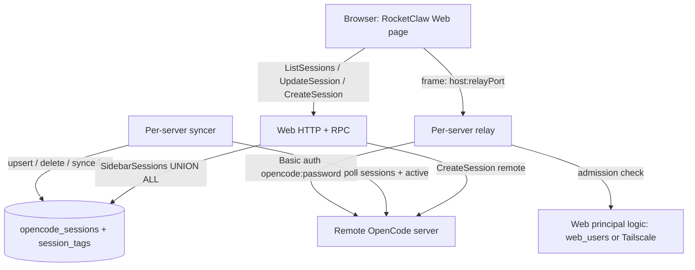
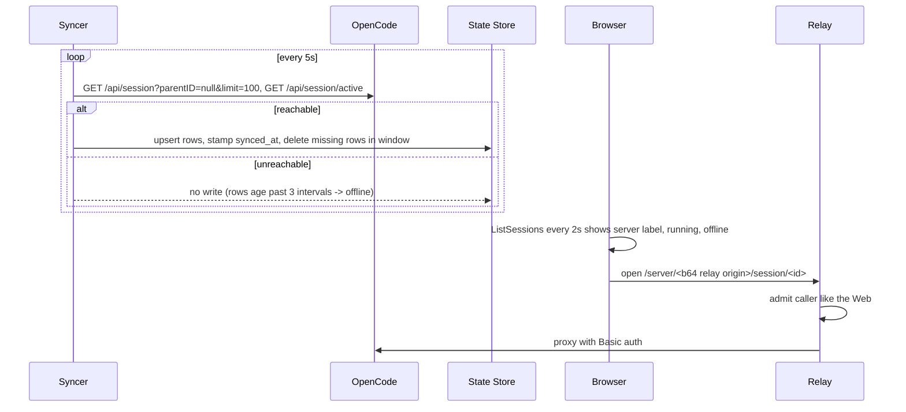

# Remote OpenCode Sessions in the Web - Plan

## Goal Capsule

- **Objective:** A RocketClaw Web user finds, starts, and drives the OpenCode sessions of every configured remote OpenCode server from RocketClaw's own session list, without logging in to any OpenCode server or exposing one to the browser.
- **Means:** Remote sessions are listed natively from a stored copy, and opening one frames OpenCode's own web app through a per-server RocketClaw relay (KTD1, KTD4, KTD6).
- **Authority:** Product Contract Requirements win on behavior; Key Technical Decisions win on mechanism within them; units override neither. Root `AGENTS.md` rules (no subqueries, no nil-as-disabled dependencies, mockery v3, error naming, CLOC budgets) bind every unit.
- **Stop conditions:** Stop and report instead of continuing when the Go or TS source CLOC budget would be exceeded (KTD8), when a relay cannot apply the Web's own admission check (R3), or when OpenCode's API or web app contradicts the probe evidence in Sources.
- **Execution profile:** Go backend + store migration, one proto change, React Web UI; one PR.
- **Finish and ship:** `ce-work` implements and verifies; the `lfg` pipeline reviews, commits, pushes, and opens the PR. Merging stays with the user.

---

## Product Contract

### Summary

Operators list remote OpenCode servers in a new `opencode` section of `rocketclaw.json`. RocketClaw keeps a small copy of each server's root sessions and shows them in the Web session list beside RocketClaw's own chats, with the server's name, live running state, pins, names, tags, and search. Opening one shows OpenCode's own web app for that session in a frame served by a RocketClaw relay that adds the server's password. A "new session" action starts a session on a chosen server and folder.

### Problem Frame

The user runs OpenCode on several machines. Each machine has its own web app and its own login, so there is no single place to see what is running, pick up a session, or start one. RocketClaw's Web is already the user's primary interface and already knows who the user is, so it is the natural single place.

### Requirements

**Configuration**

- R1. Operators declare remote OpenCode servers in `rocketclaw.json` under `opencode`, a map from server name to the server's URL, its password, and a relay port; changes take effect on restart.

**Relay and access**

- R2. Each configured server is reachable through a RocketClaw relay on its own port, on every listener the Web serves (the plain listener and, when configured, the tailnet), and the relay supplies the server's password so the browser never logs in to OpenCode.
- R3. The relay admits exactly the callers the Web admits (`web_users` or a Tailscale user), refuses cross-origin writes, and may be framed only by pages on the same host.

**Session list**

- R4. Remote root sessions appear in the Web session list, mixed by recency with RocketClaw sessions, labeled with their server name and showing running or idle, and refresh without a page reload.
- R5. While a server is unreachable, its last-known sessions stay listed, greyed out and unopenable, until it is reachable again.
- R6. A session deleted on its server leaves the list after the next successful sync when it was among that server's newest 100 root sessions, and within a day otherwise.

**Session actions**

- R7. Pinning, renaming, and tagging work on remote sessions and survive RocketClaw restarts; a rename changes only RocketClaw's name, not the title inside OpenCode.
- R8. People tag any session by hand in the Web: a remote OpenCode session takes any typed tag, with tags already in use suggested; a RocketClaw session takes only tags its agent's tag groups allow, keeping the group rule. Search filters by tag with `tag:<name>`. (session-settled: user-directed — chosen over borrowing agent tag groups for remote sessions: remote OpenCode sessions do not share RocketClaw's agent definitions)
- R9. Session search matches remote sessions by title, RocketClaw name, tags, server name, and folder; RocketClaw never copies remote message text.
- R10. Opening a reachable remote session shows OpenCode's own web app for that session in a frame, through the relay.
- R11. A "new session on <server>" action lets the user pick or type a project folder for that server, creates the session there, and opens it in the frame.

### Key Decisions

- **Native list, OpenCode's web app to open.** Governs R4, R10. (session-settled: user-directed — chosen over rendering OpenCode transcripts in RocketClaw's timeline and over an iframe-only page per server: one list without rebuilding OpenCode's session UI)
- **The browser reaches OpenCode only through RocketClaw.** Governs R2, R3. (session-settled: user-approved — chosen over iframing each server's own URL: OpenCode's login cookie is `SameSite=Lax` and HTTPS pages block `http://` frames, so direct framing fails across sites)
- **First version covers the mixed list, live status, starting sessions, and pin/tag/search; a link to each server's whole OpenCode app is out.** Governs R4, R7, R8, R9, R11. (session-settled: user-directed — chosen over also linking each server's full app: the user picked these four)
- **Search reads session fields only.** Governs R9. (session-settled: user-approved — chosen over indexing remote message text: messages stay on the OpenCode box)
- **Offline servers keep their last-known sessions, greyed out.** Governs R5. (session-settled: user-directed — chosen over hiding them with a warning: the list stays stable while a box is down)

### Scope Boundaries

- Remote transcripts are never rendered in RocketClaw's timeline, and RocketClaw agents, cron, Slack, and External MCP never drive or show remote sessions.
- Only root sessions are listed; OpenCode sub-agent child sessions stay inside OpenCode's own view.
- Deleting or retitling a session on the OpenCode side is done inside the frame, not by RocketClaw.
- Not built: a separate OpenCode login or per-user OpenCode accounts. Anyone the Web admits gets full control of every configured server, including its shell (R3); evidence that operators need per-server allowlists would change this.
- Not built: retries or backoff beyond the fixed sync interval. A failing server simply stays greyed until a poll succeeds (R5); evidence of request storms against a down server would change this.

### Open Questions

- None open. R6's daily removal was user-directed: once a day each server's full root list only removes stored sessions it no longer has, and never adds old ones (chosen over listing all of them: one local server held 3,774 root sessions).

### Deferred to Follow-Up Work

- Listing OpenCode projects that have no synced session as "new session" folder choices (see Assumptions).
- Listing a server's older sessions nobody opened from RocketClaw.

---

## Planning Contract

### Assumptions

These were not confirmed by the user before planning; they are the recommended defaults, recorded for review.

- Tag suggestions for remote sessions come from tags on every listed session, RocketClaw's included, so names stay consistent.
- Each server has an explicit relay port in its config entry (R1).
- "New session" takes a typed folder path and suggests the distinct folders of that server's synced sessions, not OpenCode's full project list (R11). This keeps the change inside the Go and TS CLOC budgets.
- Only the newest 100 root sessions are added; older ones appear once they become recent again.

### Key Technical Decisions

- KTD1. **Remote sessions live in a new `opencode_sessions` table that also holds their `pinned` and `name`; tags reuse `session_tags` keyed by conversation ID.** Startup pruning deletes `managed_conversations` rows without local entries (`internal/rocketclaw/backend/store.go` `shouldPruneThreadConversation`), and message search would treat such rows as unindexed forever (`unindexedChatsSQL` in `internal/rocketclaw/backend/message_search.go`). A separate table keeps both untouched. `SidebarSessions` returns remote rows through a `UNION ALL` branch, so `SidebarChats`, `SearchSessions`, and `listSessions` carry them without new loops (R4, R7, R9).
- KTD2. **Conversation IDs are `opencode:<server>:<sessionID>`, and the `opencode:` prefix is reserved.** IDs stay Latin-1 for the Web's `btoa` session URLs (`internal/rocketclaw/web/src/session-id.ts`). Sidebar, search, and listing decide remoteness from the `opencode_sessions` row or the Session's `server` field (`docs/solutions/logic-errors/slash-in-conversation-id-is-not-a-delegation-history.md`). The prefix itself is used only where no row may exist yet, mirroring the existing `cron:` checks: `Prompt` refuses `opencode:` IDs, and the Web never mounts the transcript or composer for one.
- KTD3. **Sync polls each server every 5 seconds.** One poll is `GET /api/session?parentID=null&limit=100` plus `GET /api/session/active`, then one statement that upserts the fetched rows. It deletes that server's missing rows when the fetch returned fewer than 100 (the whole root set), and otherwise only missing rows newer than the oldest fetched row (R6); rows stamped after the poll began are never deleted, so a session created meanwhile survives. It stamps `synced_at` on every remaining row of that server, so a row is offline exactly when its server failed to answer for three intervals (R5). Rows of servers no longer configured stay stored but are not listed, and return with their pins, names, and tags if the server is configured again. The sync runs only when servers are configured. At start and then daily, each server's full root list (`limit=1000000`) deletes stored rows, and their tags, missing from it; it never adds rows, and a list that fills the limit deletes nothing. Every cutoff uses the state store's clock (`SELECT now()`), because `synced_at` comes from it; a process clock a few milliseconds behind the database skipped rows in testing. OpenCode returns root sessions across all folders, newest `time.updated` first (verified against v2.0.32). Polling was chosen over the `/api/event` SSE stream because the Web already refreshes the list every 2 seconds and SSE parsing costs Go lines the budget does not have (KTD8). It did not qualify for a bake-off: both are cheap to swap later and store the same rows.
- KTD4. **The relay is an `httputil.ReverseProxy` that rewrites to the server URL, sets Basic auth `opencode:<password>`, and flushes immediately.** OpenCode's web app loads assets from root paths (`/_assets/...`), so each relay owns a port and cannot sit under a Web sub-path. It listens on the Web listen address's host at the relay port and, when tsnet is on, on the tailnet node at the same port with TLS from the node, beside the existing `:443` listener in `cmd/rocketclaw/tailnet.go` (R2). A dedicated port also gives the frame its own browser connection pool (`docs/solutions/architecture-patterns/web-keep-alive-views-connection-budget.md`).
- KTD5. **The relay applies the Web's own admission check.** On the plain listener, a handler in `internal/rocketclaw/frontend/rpc` puts the caller's IP into incoming metadata and calls `Server.principal` (`web_users` first, then Tailscale identity), refusing unknown callers. On the tailnet listener, `NewTailnetHandler` alone admits, exactly as it does for the Web there; the relay has no gRPC hop, so it never relies on outgoing metadata. Both refuse any request, WebSocket upgrades included, whose `Origin` is present and is not the relay's own origin, then send the upstream server's origin as `Origin` so OpenCode's own PTY origin check keeps working and keeps meaning something. Every relay response carries `Content-Security-Policy: frame-ancestors` limited to the request's own host on any port (R3). The anti-framing header passes the plan's safeguard test: leaving it out lets any site clickjack a shell-capable app in an admitted browser.
- KTD6. **The Web builds the frame URL itself:** `<page scheme>//<page hostname>:<relay port>/server/<base64url, no padding, of that relay origin>/session/<OpenCode session ID>`. The page hostname keeps the frame same-host for any listener. The relay ports and server names come from `ListSessionsResponse` (KTD7).
- KTD7. **Extend existing RPCs instead of adding new ones.** `Session` gains `server`, `directory`, and `offline`. `ListSessionsResponse` gains `opencode_servers` (a map from server name to relay port) and `agent_tags` (per agent with tag groups, the tags people may set). `UpdateSessionRequest` gains `optional string tag`, toggled with the existing `toggleSessionTag`: alone on a remote session, or against the agent group that holds it on a RocketClaw session. `CreateSessionRequest` gains `opencode_server` and `directory`; when set, the backend posts `/api/session` with that folder as `location.directory`, upserts the row, and returns the new conversation ID.
- KTD8. **CLOC budgets are hard limits.** At planning time Go source sits at 23386 of 23750 and TS at 7139 of 7500 (`make cloc` in `internal/rocketclaw` and `internal/rocketclaw/web`). Target at most about 300 new Go source lines and 250 new TS lines. `SOURCE_CLOC_BUDGET` values are never edited and code is never moved into excluded paths.
- KTD9. **Config changes need a Restart, not a Reload.** `Runtime.Reload` never rereads the config file (`internal/rocketclaw/backend/runtime.go`), so relays and syncers start once with the Web and stop with it.
- KTD10. **The browser learns running state only from `ListSessions`, and the frame is unmounted when its view is hidden**, so no hidden frame holds OpenCode streams open (`docs/solutions/architecture-patterns/web-keep-alive-views-connection-budget.md`).

### High-Level Technical Design

Components and trust boundaries:

Sync and open flow:

### System-Wide Impact

- **Auth boundary:** the relay opens a new network surface whose upstream can run shell commands; R3 and KTD5 make its admission identical to the Web's.
- **State Store:** one new table, no change to existing rows; pruning and message search are untouched (KTD1).
- **Listeners:** one extra TCP port per server on the host, and one per server on the tailnet node.

### Risks & Dependencies

| Risk | Mitigation |
|---|---|
| OpenCode labels much of its v2 API experimental; fields or routes may change on upgrade. | Sync reads only `id`, `parentID`, `title`, `time.updated`, `location.directory`, and the active map; tests pin these shapes. |
| The frame's deep link format is internal to OpenCode's web app. | A broken link still lands in OpenCode's app, where the session is one click away; the format is verified against v2.0.32 (Sources). |
| Go CLOC budget has 364 lines left. | KTD7 reuses RPCs, KTD3 polls instead of parsing SSE, and the Verification Contract runs `make check-cloc-budget` before finishing. |
| Extra tsnet port may need ACL changes on locked-down tailnets. | Documented in the config docs (U1). |

### Sources & Research

- Probe against local OpenCode v2.0.32 (2026-10-17): API Basic auth username `opencode`, password = pairing token; `GET /api/session?parentID=null` returns `{data:[{id,parentID,title,time{updated},location{directory}}], cursor}`; `/api/session/active` returns `{data:{<id>:{type:"running"}}}`; `POST /api/session` accepts `location`; a Go reverse proxy injecting Basic auth served the full web app inside a cross-origin frame and opened `/server/<base64url(relay origin)>/session/<id>` directly.
- OpenCode API reference: `https://opencode.ai/v2/docs/api` and `https://opencode.ai/v2/openapi.json`.
- Web admission: `internal/rocketclaw/frontend/rpc/server.go` `Server.principal`, `tailscaleUsername`; `internal/rocketclaw/frontend/rpc/http.go` `NewHTTPHandler`, `NewTailnetHandler`.
- Sidebar and search: `internal/rocketclaw/backend/store.go` `SidebarSessions`, `UpdateConversationDetails`, `toggleSessionTag`; `internal/rocketclaw/backend/session_search.go` `SidebarChats`, `SearchSessions`.
- Config patterns: `internal/rocketclaw/config/config.go` `MCPServers`, `validateMCPServers`, `Providers`; `internal/rocketclaw/config/locked.go` clone.
- Learnings: `docs/solutions/architecture-patterns/web-keep-alive-views-connection-budget.md`, `docs/solutions/logic-errors/slash-in-conversation-id-is-not-a-delegation-history.md`, `docs/solutions/runtime-errors/deployment-binary-missing-live-migrations.md`.

---

## Implementation Units

### U1. `opencode` config section

- **Goal:** Operators can declare remote OpenCode servers, validated at load.
- **Requirements:** R1.
- **Dependencies:** none.
- **Files:** `internal/rocketclaw/config/config.go`, `internal/rocketclaw/config/locked.go`, `internal/rocketclaw/config/config_test.go`, `internal/rocketclaw/rocketclaw.example.json`, `cmd/rocketclaw/CHEATSHEET.md`.
- **Approach:**
  1. Add `OpenCode map[string]OpenCodeConfig` with JSON key `opencode`; each entry has `url`, `password`, and `port`.
  2. Validate in one function modeled on `validateMCPServers`: names use the MCP server name rule (they become ID segments, KTD2), `url` is http or https, `password` is non-empty, `port` is 1-65535. Port clashes are left to the relay listeners, which fail startup on bind.
  3. Passwords accept `{"aws": {...}}` references through the existing merge path; nothing new is needed there.
  4. Document the section, the relay port, the restart rule (KTD9), and the tailnet ACL note in the example config and `CHEATSHEET.md`.
- **Patterns to follow:** `MCPServerConfig` and `validateMCPServers`; `Providers` cloning in `locked.go`.
- **Test scenarios:**
  - A config with two valid servers loads and both entries round-trip through `Clone`.
  - A server with an `ftp://` URL fails validation naming the server.
  - An empty password fails validation.
  - A config without `opencode` loads with no servers.
- **Verification:** config tests pass; the example config still loads in the existing example-config test.

### U2. `opencode_sessions` store

- **Goal:** Remote session copies, pins, and names persist and flow through the existing sidebar and search.
- **Requirements:** R4, R5, R6, R7, R9; KTD1, KTD2, KTD3.
- **Dependencies:** none.
- **Files:** `internal/rocketclaw/backend/migrations/041_opencode_sessions.sql`, `internal/rocketclaw/backend/store.go`, `internal/rocketclaw/backend/session_search.go`, `internal/rocketclaw/backend/session_tools.go`, `internal/rocketclaw/backend/opencode.go` (new), `internal/rocketclaw/backend/opencode_test.go` (new), `internal/rocketclaw/backend/store_summaries_test.go`.
- **Approach:**
  1. Migration creates `opencode_sessions` with `conversation_id` primary key, `server`, `title`, `directory`, `updated_at`, `running`, `synced_at`, `pinned`, `name`; use the next free number on the deployed version (`docs/solutions/runtime-errors/deployment-binary-missing-live-migrations.md`).
  2. A `SessionService` method replaces one server's snapshot in one transaction per KTD3. It is written with CTEs and no subqueries.
  3. `SidebarSessions` gains a `UNION ALL` branch over `opencode_sessions` joined to `session_tags`, keeping pinned-first then recency order. `SidebarSession` gains `Server`, `Directory`, and `Offline`. Preview is the title; agent is empty.
  4. `UpdateConversationDetails` updates whichever of `managed_conversations` or `opencode_sessions` holds the ID, in one statement composed from CTEs.
  5. `SearchSessions` already searches name, preview, and label; add the server name and folder to the matched text so R9 holds.
  6. Agents' `rocketclaw_list_sessions` tool reads the same session search; it skips remote rows so agents never see or drive them (Scope Boundaries).
- **Patterns to follow:** `SidebarSessions` query shape; `toggleSessionTag`; store tests against the shared Postgres test database.
- **Test scenarios:**
  - Syncing three sessions for `box` lists them with server `box`, mixed by recency with a Web session.
  - A second sync without one of them, where that session is newer than the oldest fetched, removes it (R6).
  - A second sync whose window no longer reaches an older row keeps that row, listed with `Offline` false.
  - With fewer than 100 sessions, a second sync without the oldest session removes it (R6).
  - A session created after a poll began survives that poll.
  - Rows whose `synced_at` is older than three intervals are listed with `Offline` true (R5).
  - A row of a server no longer configured is not listed, and returns pinned when the server is configured again.
  - Pinning and renaming a remote row persist; after the service is reopened (startup pruning runs), pin, name, and a tag are still present (R7).
  - A search for the server name and a search for a folder fragment each find the remote row; a search for text that only appears in remote messages finds nothing (R9).
  - The agent `rocketclaw_list_sessions` tool omits a synced remote row.
- **Verification:** backend store tests pass on the Postgres test database.

### U3. OpenCode sync and session creation

- **Goal:** Each configured server's root sessions are kept in the store, and new remote sessions can be created.
- **Requirements:** R4, R5, R6, R11; KTD3, KTD7.
- **Dependencies:** U1, U2.
- **Files:** `internal/rocketclaw/backend/opencode.go`, `internal/rocketclaw/backend/opencode_test.go`.
- **Approach:**
  1. A small client per server sends Basic auth `opencode:<password>` with a bounded request timeout.
  2. A loop per server polls per KTD3 until its context ends; a failed poll writes nothing.
  3. A create function posts `/api/session` with `location.directory`, upserts the returned session into the store, and returns its conversation ID.
- **Patterns to follow:** context-owned loops started from an errgroup; `httptest.Server` for the upstream in tests (an HTTP fake of the external API, not an interface mock).
- **Execution note:** Use `testing/synctest` for the poll interval instead of real sleeps.
- **Test scenarios:**
  - Against an `httptest` OpenCode returning two root sessions, one active, a poll stores both and marks one running.
  - Every upstream request carries Basic auth `opencode:<password>`.
  - A request without the expected credentials gets 401 from the fake, the poll returns an error, and stored rows are unchanged.
  - Creating a session in `/srv/app` posts `location.directory` `/srv/app` and the returned ID appears in the sidebar.
  - Context cancellation stops the loop.
- **Verification:** backend tests pass; no real network is used.

### U4. Per-server relay with Web admission

- **Goal:** Browsers admitted by the Web reach each server's web app through RocketClaw, and nobody else can.
- **Requirements:** R2, R3, R10; KTD4, KTD5, KTD9.
- **Dependencies:** U1, U3.
- **Files:** `internal/rocketclaw/frontend/rpc/relay.go` (new), `internal/rocketclaw/frontend/rpc/relay_test.go` (new), `internal/rocketclaw/frontend/rpc/server.go`, `cmd/rocketclaw/web.go`, `cmd/rocketclaw/tailnet.go`, `internal/rocketclaw/frontend/rpc/README.md`.
- **Approach:**
  1. In `rpc`, build the relay handler per KTD4 and KTD5, reusing the principal resolution `Server.principal` already performs instead of duplicating `web_users` and Tailscale lookups.
  2. In `startWebRPC`, for each server listen on the Web listen address's host at its port, serve the relay in the existing errgroup, and close it in the existing stop function.
  3. Extend `startTailnet` and `serveTailnet` so the node also listens on each relay port with the node's TLS config, wrapping each relay in `NewTailnetHandler`.
  4. Start one sync loop per server (U3) from the same errgroup, so relays and syncers share the Web's lifecycle.
  5. Document the relay, its admission rule, and the full-control consequence in the rpc README.
- **Patterns to follow:** `startWebRPC` errgroup and close ordering; `serveTailnet` listener setup; `NewHTTPHandler` principal metadata.
- **Test scenarios:**
  - A request from an IP in `web_users` reaches an `httptest` upstream with Basic auth added and gets its body back.
  - A request from an unknown IP is refused with 401 and never reaches the upstream.
  - A request with a foreign `Origin`, including a WebSocket upgrade, is refused and never reaches the upstream; a same-origin request reaches it with `Origin` set to the upstream's origin.
  - A tailnet-admitted request from an IP outside `web_users` reaches the upstream.
  - Responses carry `Content-Security-Policy: frame-ancestors` naming only the request host.
  - A streamed upstream response (SSE) reaches the client before the upstream closes it.
- **Verification:** rpc tests pass; `go vet` and lint pass on `cmd/rocketclaw`.

### U5. RPC surface for remote sessions

- **Goal:** The Web receives remote rows, server ports, and tag choices, and can tag and create remote sessions.
- **Requirements:** R4, R5, R7, R8, R11; KTD6, KTD7.
- **Dependencies:** U2, U3.
- **Files:** `internal/rocketclaw/web/proto/web.proto`, generated proto outputs, `internal/rocketclaw/frontend/rpc/server.go`, `internal/rocketclaw/frontend/rpc/server_test.go`.
- **Approach:**
  1. Add the fields in KTD7.
  2. `listSessions` fills `server`, `directory`, and `offline` per row, and sends `opencode_servers` and `agent_tags` on its completion message.
  3. `UpdateSession` applies `tag` only to remote sessions, refusing unknown tags and RocketClaw sessions.
  4. `CreateSession` with `opencode_server` calls U3's create function and refuses unknown servers.
  5. `Prompt` refuses `opencode:` IDs (KTD2).
- **Patterns to follow:** existing `UpdateSession` validation; proto regeneration through `make generate`.
- **Test scenarios:**
  - `ListSessions` returns a remote row with `server`, `directory`, and `offline`, and its completion message lists configured servers with ports.
  - `UpdateSession` with a configured tag on a remote session stores it; the next `ListSessions` shows it.
  - `UpdateSession` with a tag on a RocketClaw session returns InvalidArgument.
  - `UpdateSession` with a tag outside every group returns InvalidArgument.
  - `CreateSession` with an unconfigured server returns InvalidArgument.
  - `Prompt` on an `opencode:` ID returns InvalidArgument.
- **Verification:** rpc tests pass; regenerated files are committed.

### U6. Web UI for remote sessions

- **Goal:** People see, open, tag, and start remote sessions in the Web.
- **Requirements:** R4, R5, R8, R10, R11; KTD6, KTD10.
- **Dependencies:** U5.
- **Files:** `internal/rocketclaw/web/src/ui.tsx`, `internal/rocketclaw/web/src/types.ts`, `internal/rocketclaw/web/src/session-list.browser.test.ts`.
- **Approach:**
  1. Session rows with `server` show the server name in their meta line, and the word "offline" plus a greyed state when `offline`.
  2. The `/s/<id>` view decides on the session's `server` before mounting the transcript view, so a remote ID never requests History, the queue, or `/stream`; it renders a full-height frame at the KTD6 URL instead, and unmounts it when hidden.
  3. The session menu offers "Add tag…" (a typed tag, suggesting tags in use) and "Remove tag" on remote rows, and the agent's `agent_tags` toggles on RocketClaw rows.
  4. A "New session on <server>" command takes a typed folder path, suggests that server's known folders, opens the created session, and shows a failed create in the palette's existing error line.
  5. Every entry point reaches `/s/<id>`, so that view enforces R5: an offline remote session shows "<server> is offline" instead of the frame, and an `opencode:` ID with no row shows a not-available notice once the list is complete (KTD2).
- **Patterns to follow:** existing row meta rendering and context menu commands in `ui.tsx`; browser tests in `session-list.browser.test.ts`.
- **Test scenarios:**
  - A remote row shows `box` in its meta and opens a frame whose URL is `http://<host>:<port>/server/<base64url origin>/session/<id>`.
  - An offline remote row is greyed and clicking it does not navigate.
  - Opening a remote session sends no History or `/stream` request for its ID.
  - Toggling a tag from the menu sends `UpdateSession` with that tag.
  - Choosing a folder in "New session on box" sends `CreateSession` with that server and folder and navigates to the returned ID.
  - On a server with no synced sessions, typing `/srv/app` sends `CreateSession` with that folder.
  - Opening an offline remote session through its saved tab shows the offline notice and no frame.
- **Verification:** `bun test` and the web build pass.

---

## Verification Contract

| Gate | Command | Applies to |
|---|---|---|
| Format | `gofmt -l` on touched Go files prints nothing | U1-U5 |
| Go tests | `go test ./...` | U1-U5 |
| Web tests | `cd internal/rocketclaw/web && bun test` | U6 |
| Lint | `make lint` | all |
| Full suite and metrics | `make test` | all |
| CLOC budgets | `cd internal/rocketclaw && make check-cloc-budget`; `cd internal/rocketclaw/web && make check-cloc-budget` | all |
| Live smoke | run RocketClaw with one `opencode` entry pointing at a local `opencode serve`, list, open, pin, tag, and create a session from the Web; open the in-frame terminal; repeat over the tailnet listener when tsnet is available | U4, U6 |

## Definition of Done

- Every R-ID is covered by a passing test or the live smoke above.
- Both CLOC budgets pass without edits to budget values.
- No defensive guards, nil-as-disabled dependencies, or one-line wrappers were added; error variables follow `errX` naming.
- Config docs, example config, and the rpc README describe the `opencode` section, relay ports, restart rule, and the full-control consequence.
- Code from abandoned approaches is removed from the diff.
- The final report states whether README impact was considered and whether an update was needed.
