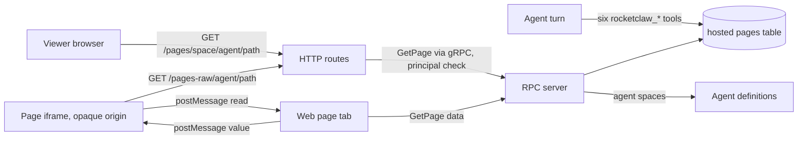
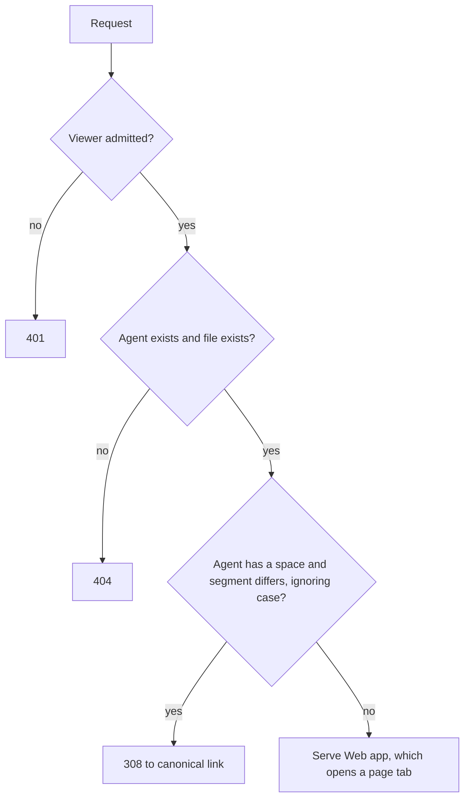
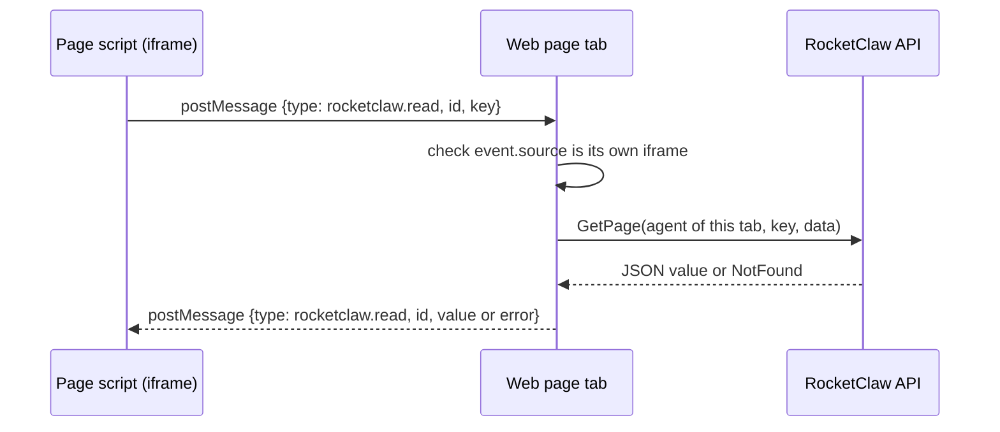

# RocketClaw Hosted Pages - Plan

## Goal Capsule

- **Objective:** RocketClaw agents publish reports, dashboards, and graph pages that teammates open from a shareable RocketClaw Web link, organized by Web space, without running the separate QuickWeb service.
- **Means:** a from-scratch reimplementation of QuickWeb's ideas inside RocketClaw: one Postgres table behind six `rocketclaw_*` tools (KTD1-KTD3), sandboxed page serving behind Web admission (KTD4-KTD8), and page tabs plus a Page Index in the Web interface (KTD10), on top of PR #476's agent `space:` field.
- **Authority:** the user's requests in the brainstorm session, then this Product Contract, then the Planning Contract. `AGENTS.md` binds every change. Removing QuickWeb and migrating its content are not active scope.
- **Open blockers:** none.
- **Stop conditions:** stop and report if Go source CLOC would reach 24,250 or TypeScript source CLOC 8,000, if coverage falls below 85.6% and cannot be restored by tests of the new behavior, or if page isolation (R12) cannot be shown in a real browser.
- **Execution profile:** units U1-U5 in order, in workspace `20261018-merge-quickweb-into-rocketclaw`.
- **Finishing:** one PR against `main`. Merging stays with the user.
- **Budget:** the user raised `GO_SOURCE_CLOC_BUDGET` in `internal/rocketclaw/Makefile` by 500 lines, from 23,750 to 24,250, for this feature. On `main` at v0.1.50 the Go source count is 23,680, so this work has 570 lines of Go production code. The web TypeScript budget has 576 lines left of 8,000.

---

## Product Contract

### Summary

Agents get six tools to store, read, delete, and list their own files and JSON key-value entries in RocketClaw's database. RocketClaw serves those files as pages under a space- and agent-scoped URL that only people the Web already admits can open. Each Web space gets a browsable page index, and a page link opens as a tab in its space. Page scripts can load pinned CDN libraries and read, but never write, their own agent's key-value entries, so graphs render from data the agent stored.

### Problem Frame

QuickWeb exists because RocketClaw had no web interface. Agents used it for reports, dashboards, and HTML pages, and sometimes stored data in its state store so a page could render graphs. It is a second binary with its own SQLite file, its own content directory, and no notion of which agent or space a page belongs to. RocketClaw now has a Web interface with spaces, and PR #476 lets agents declare the space they belong to, so the pages can live where the agents and their users already are.

### Actors

- A1. Agent: a RocketClaw agent, named by its agent file path (`main`, `main/review`), that publishes files and key-value data through tool calls.
- A2. Viewer: a person the RocketClaw Web admits (Tailscale identity or `web_users`), who opens a shared link or browses a space's page index.
- A3. Page: agent-written HTML and JavaScript running in the viewer's browser.

### Key Decisions

- **Pages are reachable only by people the Web already admits.** No public or capability links; matches QuickWeb's trusted-network stance and adds no new security surface. Governs R9. (session-settled: user-approved — chosen over public unguessable links and per-page public/private: public links need a public listener, link secrecy, and revocation.)
- **Browser access to key-value data is read-only.** Agents write; pages only read, which covers reports, dashboards, and graphs. Governs R14. (session-settled: user-approved — chosen over browser read-write like QuickWeb's `PUT /data`: avoids pages overwriting agent data and last-write-wins races.)
- **A page's space does three things: it appears in the URL, it filters the page index, and it picks the tab's space.** Governs R8, R15, R16. (session-settled: user-directed — chosen over using only a subset of those effects: the user selected all three.)
- **Pages follow the agent's current space, and old links redirect.** Pages belong to the agent, not to a space snapshot. Governs R10. (session-settled: user-approved — chosen over breaking old links or freezing each page's original space: keeps shared links working without splitting an agent's pages across spaces.)
- **Anything that does not exist is a 404.** Existence is decided by the server; a viewer's browser-local space list never makes a link fail. Governs R10. (session-settled: user-directed — chosen over failing when the viewer's browser lacks the space: the user stated a missing target is a 404 regardless of reason.)
- **Pages run walled off from RocketClaw but may load pinned outside resources.** Governs R12, R13. (session-settled: user-approved — chosen over self-contained-only pages and unrestricted pages: graphs need chart libraries; agents are told to pin exact versions.)
- **Six tools, not four.** The user's four (`store`, `read`, `kv_store`, `kv_read`) plus `delete` and `list`, so agents can take down stale or mistaken pages and find what they published. Governs R1. (session-settled: user-directed — chosen over exactly four tools and adding only delete.)
- **Files and key-value entries both live in RocketClaw's Postgres database.** One store, one backup, single-step overwrite and delete. Governs R4. (session-settled: user-approved — chosen over putting file bytes in attachment storage: avoids keeping two stores in step and orphaned blobs.)
- **QuickWeb stays for now.** Removal is a later, separate change. (session-settled: user-directed — chosen over deleting it in this work.)
- **A viewer without a matching space gets the page in their current space.** No space is created on their behalf. Governs R15.

### Requirements

**Agent tools**

- R1. Agents have six tools: `rocketclaw_store` writes a file at a path, `rocketclaw_read` returns a file, `rocketclaw_kv_store` writes a key's JSON value, `rocketclaw_kv_read` returns a key's value, `rocketclaw_delete` removes a file or a key, and `rocketclaw_list` lists the agent's own files and keys.
- R2. Every tool acts only on the calling agent's own files and keys; a shadow agent such as `main/review` has its own set, separate from `main`.
- R3. Storing an existing file path or key replaces it entirely; nothing merges.
- R4. Files and key-value entries persist in RocketClaw's Postgres database, and each stored file or value is capped in size.
- R5. `rocketclaw_store` returns the file's shareable URL, built from the same Web base URL that session links use.
- R6. The tools are granted like other `rocketclaw_*` tools, by exact name in an agent's permissions, and the starter `main` agent allows all six.
- R7. The tool descriptions teach agents how to build pages: the URL shape, how a page reads its key-value entries, pinning exact versions of outside libraries, and keeping secrets out of pages and values.

**Serving pages**

- R8. RocketClaw serves an agent's files at a URL that contains the agent's space name, the agent name, and the file path; agents without a space get a stable URL too.
- R9. Only viewers the Web admits can open pages or read key-value entries, on every listener RocketClaw serves.
- R10. A link whose agent or file does not exist returns 404; a link to an existing file under a space name that is not the agent's current space redirects to the current URL.
- R11. A path ending in `/` serves that directory's `index.html`.
- R12. Page scripts cannot use RocketClaw's API as the viewer, including when the page URL is opened directly rather than inside the Web interface.
- R13. Pages may load scripts, styles, and images from outside URLs.
- R14. A page's scripts can read its own agent's key-value entries, and cannot write them or read another agent's.

**Spaces in the Web interface**

- R15. Opening a page link in the Web shows the page as a tab in the viewer's space whose name matches the agent's space, ignoring case; if the viewer has no such space, the tab opens in their current space.
- R16. Each space has a page index listing the HTML pages of agents whose space matches it, plus agents with no space, using PR #476's matching rule; each entry opens per R15.

### Key Flows

- F1. Publish and share a dashboard
  - **Trigger:** An agent with `space: Billing` finishes a report run.
  - **Actors:** A1, A2, A3
  - **Steps:** The agent stores `dashboard/index.html`, which loads a pinned chart library from a CDN; it stores `revenue` as a key-value entry; it shares the URL `rocketclaw_store` returned. A teammate opens the link, which shows a tab in their Billing space; the page fetches `revenue` and draws the graph.
  - **Covered by:** R1, R5, R8, R13, R14, R15
- F2. Browse a space
  - **Trigger:** A viewer opens the page index in their Ops space.
  - **Actors:** A2
  - **Steps:** The index lists HTML pages from agents in Ops and from agents with no space; the viewer picks one and it opens as a tab in Ops.
  - **Covered by:** R16, R15

### Acceptance Examples

- AE1. **Covers R10.** Given agent `reporter` moved from `space: Billing` to `space: Ops`, when a viewer opens the old Billing link to an existing page, they are redirected to the Ops link for the same page.
- AE2. **Covers R10.** Given agent `reporter` has no file `old.html`, when a viewer opens its link under any space name, they get 404.
- AE3. **Covers R15.** Given the agent's space is `Billing` and the viewer's browser has a space named `billing`, when they open the link, the tab opens in `billing`; given they have no such space, it opens in their current space and no space is created.
- AE4. **Covers R12.** Given a page whose script calls a RocketClaw `/api/` method, when a viewer opens the page directly or inside the Web, the call cannot act as the viewer.
- AE5. **Covers R14.** Given a page from agent `reporter`, when its script reads `reporter`'s key `revenue`, it gets the stored JSON; when it tries to write that key or read another agent's key, it is refused.
- AE6. **Covers R16.** Given agent `ops-bot` has `space: Ops` and agent `main` has no space, when a viewer opens the Billing page index, `main`'s pages appear and `ops-bot`'s do not.
- AE7. **Covers R2.** Given agents `main` and `main/review`, when `main/review` lists or reads files, it sees only its own, not `main`'s.

### Scope Boundaries

- Removing `cmd/quickweb` and `internal/quickweb` (later, separate change; it will also touch `README.md` entries).
- Migrating any QuickWeb content or state.
- Browser writes to key-value entries, forms, and other interactive state.
- Public or per-page shareable-outside-the-tailnet links.
- Expiry, quotas beyond the per-file cap, and page version history.
- Agents reading or writing another agent's files or keys.
- Editing pages from the Web interface.
- Server-side space records; spaces stay browser-local as in PR #476.

### Dependencies / Assumptions

- Builds on PR #476 (`agent-cron-spaces`, merged into `main` as v0.1.50), which adds the agent `space:` field and the case-insensitive space matching rule.
- Viewer identity is the existing Web admission: Tailscale identity or `web_users`. There are no cookies or tokens to reuse.
- The existing attachment download path serves files with scripts disabled, so it cannot host pages; page serving is new.

### Sources / Research

- `internal/quickweb/` — current QuickWeb: static serving, `/data` JSON state per page, directory `index.html` normalization, blocked dotfiles.
- `internal/rocketclaw/backend/bridge.go` — per-turn `rocketclaw_*` tool assembly; caller agent and conversation captured at build time.
- `internal/rocketcode/permission.go` — `rocketclaw` permission accepts exact tool names only.
- `internal/rocketclaw/skel/agents/main.md` — starter agent permission block.
- `internal/rocketclaw/frontend/rpc/http.go`, `cmd/rocketclaw/tailnet.go` — HTTP routes and Web admission.
- `internal/rocketclaw/backend/thread_bridges.go` — `WebURL`, the base for shareable links.
- `internal/rocketclaw/backend/migrations/` — Postgres migrations.
- `internal/rocketclaw/web/src/ui.tsx` — browser-local spaces and the PR #476 matching rule.

---

## Planning Contract

**Product Contract preservation:** Product Contract unchanged in meaning. Its four Deferred-to-Planning questions were answered and removed: URL shape by KTD4 and KTD8, the size cap by KTD3, isolation and page-data access by KTD5 and KTD6, and the Page Index and page tabs by KTD10. The Goal Capsule gained the budget note, stop conditions, execution profile, and finishing line; Dependencies now record that PR #476 merged.

### Key Technical Decisions

- KTD1. **One table holds files and page data, keyed by agent, kind, and name.** Kind is a Go enum with two values, file and data; page data is stored as validated JSON bytes with content type `application/json`. One table lets one small DAO serve all six tools within the 570-line Go budget. Governs R1, R3, R4.
- KTD2. **The tools act as `rootAgent`, captured when the bridge builds the turn's tools** (`internal/rocketclaw/backend/bridge.go` around line 2121, as `sessionsWriteTool` does). Subagents act as their top-level agent; shadow sessions run as their own agent, so `main/review` stays separate from `main`. Governs R2.
- KTD3. **Tool input mirrors `rocketclaw_attach_files_to_response`.** A destination `path`, plus exactly one of `content`, `content_base64`, or a workspace `source` file, with optional `content_type`; bytes and MIME come from the existing `outboundAttachment` helper. Destination paths must pass `io/fs.ValidPath` (no leading `/`, no `..`, no empty segments). Each file or value is capped at 10 MiB, QuickWeb's cap. Governs R1, R3, R4.
- KTD4. **Two HTTP routes, both answered through a gRPC page lookup so `Server.principal` admits viewers on the plain and tailnet listeners alike.** `GET /pages/{space}/{agent}/{path...}` checks existence and space, then serves the Web app; `GET /pages-raw/{agent}/{path...}` serves the file bytes. `web.AdmitHTTP` is not used because it only checks IP admission. Both routes invoke `GetPage` with `grpc.MaxCallRecvMsgSize(math.MaxInt32)`, as the existing unary bridge in `http.go` does, because gRPC clients otherwise reject responses over 4 MiB. The space and agent segments are each path-escaped as one segment (`main%2Freview`); Go's `ServeMux` keeps `%2F` inside one segment and `PathValue` unescapes it. Governs R8, R9, R10, R11.
- KTD5. **Isolation comes from an opaque origin, not from a separate host.** Raw responses carry `Content-Security-Policy: sandbox allow-scripts allow-popups allow-forms allow-modals allow-downloads`, `X-Content-Type-Options: nosniff`, and `Cache-Control: no-store`, so even a directly opened page gets an opaque origin. Existing `CrossOriginProtection` rejects its cross-origin `POST /api/*`, and the API sends no CORS headers, so its `GET`s are unreadable. No other CSP directive is set, so outside scripts, styles, and images load. Governs R12, R13.
- KTD6. **Page data reaches pages only by `postMessage` from the Web parent, bound to a per-load token.** The page tab creates a random token for each iframe load and puts it in the iframe URL's fragment (`#rc=<token>`). The page reads it from `location.hash` and posts `{type: "rocketclaw.read", id, key, token}`. The parent answers only messages whose `event.source` is its own iframe and whose token matches, reads that iframe's agent's data through the authenticated API, and replies `{type: "rocketclaw.read", id, value}` or `{type: "rocketclaw.read", id, error}`. The token matters because an iframe keeps its window object across navigations: an outside site the iframe navigates to, by a viewer's click or by a framing ancestor, passes the `event.source` check but never sees the token. Rejected: a fetchable page-data endpoint with CORS, because every opaque-origin frame sends `Origin: null` and identity is by IP, so any website a viewer visits could read it. Rejected: a separate pages origin, because pages would share one origin and could script each other. Governs R14.
- KTD7. **Two RPC methods.** `GetPage` takes agent, path, and a data flag and returns the agent's current space, content type, and body; it backs both HTTP routes and the parent's page-data reads. `ListPages` returns every HTML file of agents that still exist, with each agent's space. Unknown agents and missing names are `NotFound`. A path that is empty or ends in `/` reads `index.html`. Governs R10, R11, R14, R16.
- KTD8. **Space segment rules.** A spaced agent's link matches when the segment equals its space ignoring case; otherwise `/pages/` answers 308 to the canonical link. An agent with no space belongs to every space, so any segment matches, and its canonical segment is `-`. Governs R8, R10, R16.
- KTD9. **Shareable URLs reuse the session-link origin.** Extract a private `webOrigin(ctx)` from `threadBridgeManager.WebURL` in `internal/rocketclaw/backend/thread_bridges.go`; `rocketclaw_store` appends `/pages/<space or ->/<agent>/<path>`, escaping the space and the agent each as one segment and the file path per segment, keeping its `/` separators so relative URLs inside pages resolve. Governs R5.
- KTD10. **Web interface shape.** A `/pages/...` path becomes a tab through the existing `pageTab` prefix pattern in `internal/rocketclaw/web/src/ui.tsx`. For a `/pages/{segment}/...` path, the target space is the viewer's space whose name equals the decoded segment ignoring case, else the current space; when the segment matched a space or is `-`, the segment is rewritten to that space's exact name before looking for an already-open tab, so one page has one tab per space. The rule applies wherever a URL tab gets its space: the `!open` branch of `openTab` and the first-load insertion in `loadTabs`, which otherwise places the URL's tab in the last-used space. Other paths keep current behavior. A Page Index route `/pages` lists pages filtered with `useInSpace` and links each one under the current space's escaped name. Governs R15, R16.
- KTD11. **Tool registration.** Permission `rocketclaw`, exact names, not turn-bound, and not in the default-allowed list at `bridge.go` around line 2716; `internal/rocketclaw/skel/agents/main.md` grants all six. Governs R6.

### High-Level Technical Design

*Directional sketches, not implementation specifications.*

Components and data flow:

`GET /pages/{space}/{agent}/{path...}` decisions:

Page data read:

### Assumptions

- Each file or value is capped at 10 MiB (Deferred-to-planning question resolved).
- An agent with no space uses `-` as its canonical space segment (Deferred-to-planning question resolved).
- Only a trailing `/` resolves to `index.html`; `/tool` is not redirected to `/tool/`.
- Rows of an agent whose file is deleted stay in the table; its pages answer 404 and leave the Page Index, and reappear if the agent returns.
- `rocketclaw_read` returns text content when the bytes are valid UTF-8 and base64 otherwise; `rocketclaw_kv_read` returns the stored JSON.
- Agent pages load their own scripts as classic scripts by relative URL. Module scripts from the page's own files would need CORS from an opaque origin, so the tool descriptions say to use classic scripts or CDN modules.
- The Web page tab's iframe uses the same sandbox tokens as KTD5.

### Risks

- **Coverage dilution:** new proto messages add generated getters to the coverage total. Keep messages minimal and cover the new server code.
- **Opaque-origin quirks:** pages cannot `fetch` their own files or use `localStorage`. The tool descriptions say so, and page data covers the graph use case.
- **Reply target:** the parent replies with target origin `*` because an opaque origin cannot be named. KTD6's per-load token keeps replies from reaching a document the iframe navigated to. A page that navigates within the iframe to another of its agent's pages loses data access until the tab reloads it.

### Sequencing

U1 then U2 and U3 (both need U1), then U4 (needs U3's API), then U5.

---

## Implementation Units

### U1. Page store

- **Goal:** persist files and page data per agent.
- **Requirements:** R2, R3, R4; KTD1.
- **Dependencies:** none.
- **Files:** `internal/rocketclaw/backend/migrations/042_hosted_pages.sql`, `internal/rocketclaw/backend/pages.go`, `internal/rocketclaw/backend/pages_test.go`.
- **Approach:** a table keyed by (agent, kind, name) with content type, body bytes, and update time. `SessionService` methods to put (upsert), get, delete (reporting whether a row existed, via `execRows`), and list (one agent, or all agents for the Page Index). Follow `VoiceSettings` in `internal/rocketclaw/backend/store_dao.go` and the store helpers in `store.go`.
- **Test scenarios:**
  - Put then get returns the same bytes and content type; a second put replaces both.
  - Delete of an existing name reports found and removes it; delete of a missing name reports not found.
  - A file and a data entry with the same name are independent.
  - Listing `main` never returns `main/review` rows, and the reverse (AE7).
  - Listing all agents returns every agent's rows.
- **Verification:** `go test ./internal/rocketclaw/backend -run Page` against `ROCKETCLAW_TEST_DATABASE_URL`.

### U2. Agent tools

- **Goal:** six `rocketclaw_*` tools over the page store.
- **Requirements:** R1-R7; KTD2, KTD3, KTD9, KTD11.
- **Dependencies:** U1.
- **Files:** `internal/rocketclaw/backend/page_tools.go`, `internal/rocketclaw/backend/page_tools_test.go`, `internal/rocketclaw/backend/bridge.go`, `internal/rocketclaw/backend/bridge_test.go` (`TestTurnBoundPlatformTools`), `internal/rocketclaw/backend/thread_bridges.go`, `internal/rocketclaw/skel/agents/main.md`.
- **Approach:** build the tools where the bridge assembles custom tools, capturing `rootAgent`, its space from the loaded agent definitions, the session store, the workspace root, and the thread manager for `webOrigin`. Share one builder across the six tools to keep schemas compact. `rocketclaw_store` returns the shareable URL; `rocketclaw_list` returns JSON of files and keys with sizes and update times. Descriptions carry R7's guidance, the `postMessage` read snippet from KTD6, and KTD5's limits.
- **Test scenarios:**
  - Storing `content` returns the exact URL for an agent with `space: Billing` and for an agent with no space (`-` segment), using a Tsnet origin.
  - Storing `dashboard/index.html` for a Billing agent returns a URL ending in `/pages/Billing/reporter/dashboard/index.html`; an agent with `space: Billing Team` gets `/pages/Billing%20Team/...`; `main/review` gets `/pages/-/main%2Freview/...`.
  - Storing from a workspace `source` file infers the content type from its extension.
  - Paths `../x`, `/abs`, and `a//b` are rejected; a body over 10 MiB is rejected.
  - `rocketclaw_kv_store` rejects invalid JSON; `rocketclaw_kv_read` returns the stored JSON.
  - `rocketclaw_read` returns stored text, and base64 for binary content.
  - `rocketclaw_delete` removes a file and a key; deleting a missing name is an error.
  - Tools built for `main` cannot see files stored by tools built for `main/review` (AE7).
  - None of the six tools is turn-bound.
- **Verification:** `go test ./internal/rocketclaw/backend -run 'Page|TurnBound'`.

### U3. Serving and RPC

- **Goal:** admitted viewers open pages and page data; nobody else does.
- **Requirements:** R8-R14, R16 (server side); KTD4-KTD8.
- **Dependencies:** U1.
- **Files:** `internal/rocketclaw/web/proto/web.proto`, `internal/rocketclaw/frontend/rpc/web.pb.go` and `protocol.gen.go` (regenerated), `internal/rocketclaw/frontend/rpc/transport.go`, `internal/rocketclaw/frontend/rpc/http.go`, `internal/rocketclaw/frontend/rpc/pages.go`, `internal/rocketclaw/frontend/rpc/pages_test.go`, `internal/rocketclaw/internal/web/assets.go`, `internal/rocketclaw/internal/web/assets_test.go`.
- **Approach:** add `GetPage` and `ListPages` to the proto, register them in `transport.go` and the unary list in `http.go`, and implement them in `pages.go` with `s.principal`, `backend.LoadRuntimeDefinitions` for agent existence and space, and the U1 store. Add the two HTTP routes from KTD4, invoking `GetPage` over the existing gRPC connection with the request context that already carries the principal metadata. Add `/pages` and the `/pages/` prefix to the Web app routes in `assets.go`. Regenerate with `go generate ./internal/rocketclaw/frontend/rpc`, with `~/go/bin` on `PATH`.
- **Test scenarios:**
  - An admitted viewer gets a raw file with its content type and KTD5's three headers.
  - A file just over 4 MiB is served whole through `/pages-raw/`.
  - `POST /api/Identity` through `NewHTTPHandler` with `Sec-Fetch-Site: cross-site` and `Origin: null` is refused with 403 (AE4, server half).
  - A raw path ending in `/` returns that directory's `index.html`.
  - An unknown agent and a missing file both return 404 on both routes (AE2).
  - `/pages/billing/reporter/x.html` for an agent now in `Ops` returns 308 to `/pages/Ops/reporter/x.html` (AE1); `/pages/OPS/...` returns the Web app without redirect.
  - An agent with no space is served under any segment.
  - `main%2Freview` reaches the shadow agent's files.
  - A non-admitted address gets 401 on both routes and on both RPCs.
  - `ListPages` returns HTML files only, with agent spaces, and omits data entries and agents that no longer exist.
  - `GetPage` with the data flag returns the stored JSON.
- **Verification:** `go test ./internal/rocketclaw/frontend/rpc ./internal/rocketclaw/internal/web`.

### U4. Web interface

- **Goal:** page tabs in the matching space, the page-data bridge, and the Page Index.
- **Requirements:** R12, R14, R15, R16; KTD6, KTD10.
- **Dependencies:** U3.
- **Files:** `internal/rocketclaw/web/src/ui.tsx`, `internal/rocketclaw/web/src/api.ts`, `internal/rocketclaw/web/src/types.ts`, `internal/rocketclaw/web/src/pages.browser.test.ts`, `internal/rocketclaw/frontend/rpc/pages_test.go` (real-browser isolation test), `internal/rocketclaw/internal/web/dist/` (rebuilt).
- **Approach:** add the page tab view (a sandboxed iframe of the raw URL plus the `postMessage` handler), the `/pages` route and palette entry, `pageTab` titles for `/pages/` paths, the space choice in `openTab`, `GetPage` and `ListPages` client calls, and the Page Index list filtered with `useInSpace`. Follow `RemoteSession`'s sandboxed iframe and the Cron page's space filter. Rebuild with `make -C internal/rocketclaw web-assets` and commit `dist`.
- **Test scenarios:**
  - With spaces Main and `billing`, opening `/pages/Billing/reporter/index.html` adds the tab to `billing` (AE3), both by in-app navigation and as the starting URL of a fresh load; with no matching space it opens in the current space and no space is added.
  - Opening the same page from its shared link and from the Page Index in the same space leaves one tab; a `-` link opened from a second space opens a tab in that second space.
  - A link under a space named `Space 2` (escaped) opens in `Space 2`.
  - The page iframe carries a `sandbox` attribute without `allow-same-origin`.
  - A page script posting a read for `revenue` with the fragment token receives the stubbed value; a message without the token, or from another window, gets no reply.
  - Real-browser isolation (AE4): following the `runWebTest` pattern in `internal/rocketclaw/frontend/rpc/server_test.go`, a Go test serves `NewHTTPHandler` with a real RPC server and drives Chromium to a stored page opened directly and inside its tab. The page's script `POST`s `/api/Identity` and fetches `GET /api/ListSessions`; the POST is refused and the GET body cannot be read.
  - In a space named `Billing`, the Page Index lists pages of `main` (no space) and of a Billing agent, not of an Ops agent (AE6); choosing one opens its tab.
  - No page errors are logged.
- **Verification:** `make -C internal/rocketclaw/web test lint`.

### U5. Documentation

- **Goal:** the six tools appear wherever RocketClaw lists its tools.
- **Requirements:** R6, R7.
- **Dependencies:** U2.
- **Files:** `README.md`, `cmd/rocketclaw/CHEATSHEET.md`, `internal/rocketclaw/skel/.rocketclaw/skills/main-create-or-update-agent/SKILL.md`.
- **Approach:** add the tools beside the existing `rocketclaw_*` entries (README around line 155, CHEATSHEET around lines 207-212, SKILL around line 91), with the grant shape and a one-line description each.
- **Test expectation:** none -- documentation only.
- **Verification:** the entries match the tool names in `page_tools.go`.

---

## Verification Contract

- `gofmt -l` on touched Go files prints nothing.
- `go test ./...` passes with `ROCKETCLAW_TEST_DATABASE_URL` set.
- `make lint` and `make test` pass at the repo root.
- `make -C internal/rocketclaw check-cloc-budget` reports Go source below 24,250.
- `make -C internal/rocketclaw check-coverage` reports at least 85.6%.
- `make -C internal/rocketclaw/web test lint` passes, and TypeScript source stays below 8,000.
- `go generate ./internal/rocketclaw/frontend/rpc` leaves `web.pb.go` and `protocol.gen.go` unchanged after the final edit, with protoc 36.0 and protoc-gen-go v1.36.12.
- `make -C internal/rocketclaw web-assets` leaves `internal/rocketclaw/internal/web/dist/` unchanged after the final edit.

## Definition of Done

- R1-R16 hold, and AE1-AE7 each have a passing test.
- Every Verification Contract command passes.
- No abandoned-attempt code, debug output, or unused helpers remain in the diff.
- No defensive guards, `nil`-as-disabled dependencies, or one-line wrappers were added, per `AGENTS.md`.
- `internal/quickweb` and `cmd/quickweb` are untouched.

### Deferred to Follow-Up Work

- Removing QuickWeb and its `README.md` entries.
