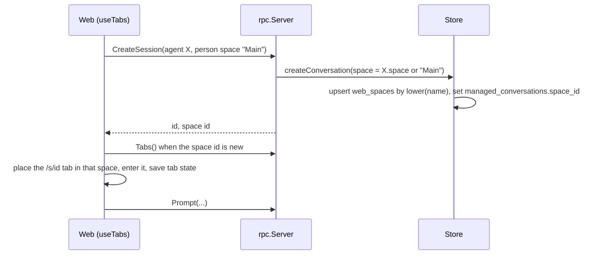
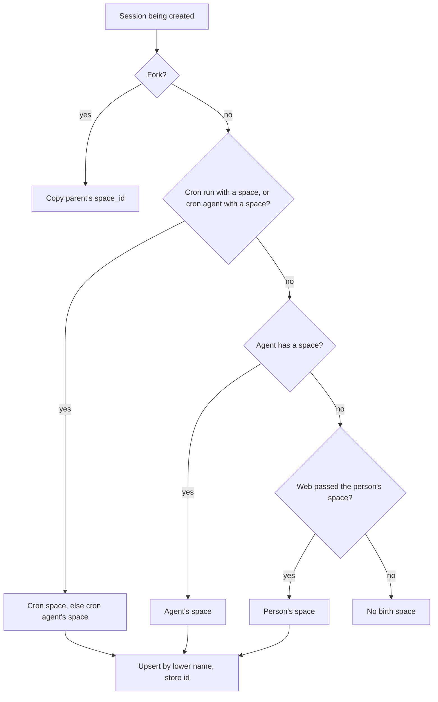
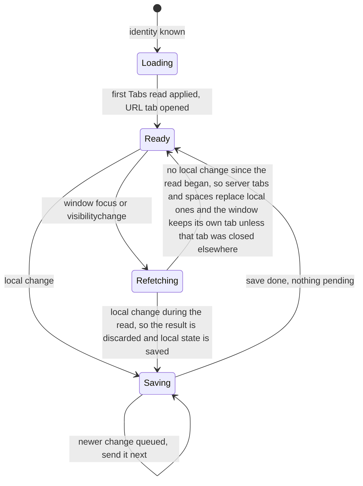

# Server-Stored Spaces, Personal Tabs, and Session Birth Spaces - Plan

## Goal Capsule

- **Objective:** A person who makes a space, or arranges tabs, on one device finds the same spaces and tabs on any other device they use. Everyone shares one list of spaces. A session started with an agent or cron that names a space lands in that space, and that space is created if it doesn't exist yet.
- **Means:** One `Tabs` RPC over two new tables plus a birth-space column on `managed_conversations`. The Web drops `localStorage` for tabs and spaces (KTD1, KTD2, KTD4).
- **Authority:** Product Contract requirements win on behavior. KTDs win on mechanism. Units override neither.
- **Stop conditions:** Stop and report instead of continuing in any of these cases:
  - a unit would push `internal/rocketclaw` Go source or `internal/rocketclaw/web` TS source over its CLOC budget (KTD11)
  - migration `043` collides with a migration already applied on Wallace or added on another branch
  - Wallace's Postgres lacks `gen_random_uuid()` (Postgres 13+)
- **Execution profile:** Go backend and RPC first, then the Web, then docs and the rebuilt committed frontend. One reviewable change per unit.
- **Finishes and ships:** the implementer, through the repo's normal PR flow.

---

## Product Contract

### Summary

Spaces move to the server and are shared by everyone. Each person's tab state moves to the server, keyed by username, and reloads when a window regains focus. Each session records a birth space from its agent, its cron, or the space it was started in. Picking an agent or running a cron whose space is missing creates that space and takes you there. The agent picker narrows to the session's agent's space once a session has begun.

### Problem Frame

Spaces, tabs, and tab groups live only in the browser's `localStorage` (`tabs:<user>` and `tab-groups-chrome-spaces:<user>` in `internal/rocketclaw/web/src/ui.tsx`, `loadTabs`). A space made on a laptop (for example "Alitu") never shows up on a phone, and each device keeps its own unrelated tabs. Agents and crons can already name a space with `space:` frontmatter, but that name only filters lists. It never puts a session anywhere, and an agent whose space nobody has created stays hidden. Spaces read as a personal browser setting when they are meant to be shared places that the agents' work lands in.

### Requirements

**Shared spaces**

- R1. Every Web user sees the same list of spaces, in creation order, on every device. A fresh database starts with one space, "Main".
- R2. Anyone can create, rename, or delete a space. Names are unique ignoring case. The last space cannot be deleted.
- R3. Another person's space changes show up the next time a window regains focus.

**Personal tab state**

- R4. A person's tabs, pins, preview tab, tab groups (name, color, collapsed), current space, last tab per space, and tab placement follow them to every device.
- R5. When a window regains focus it picks up the person's latest saved tabs, groups, and spaces, but keeps showing its own current space and tab. It moves only if that tab was closed elsewhere. The saved current space and active tab are used only on a fresh page load. The latest save wins.
- R6. Tabs whose space no longer exists move to the person's first space and keep their groups.

**Birth space**

- R7. For sessions created from the Web or by a cron run, a session's birth space is its agent's `space:` if set. For a cron run it is the cron's `space:`, else its agent's. Otherwise it is the space the person was in when they started the session in the Web. A fork keeps its parent's birth space.
- R8. When the birth space named by an agent or cron does not exist, the server creates it as it creates the session. This applies to Web sessions, one-off cron runs, and scheduled cron runs.
- R9. Creating a session from the Web places its tab in its birth space and takes the person there. The creation paths are first send, fork, Run cron, Open chat, and handoff's new session.
- R10. URLs stay `/s/<id>`. A session opened without an existing tab opens in its birth space. If it has no birth space, it opens in the current space.
- R11. Moving a session's tab to another space affects only that person. When a session's tab sits outside its birth space, the tab menu offers "Restore to <birth space name>".

**Agent picker**

- R12. A new session's picker lists every agent.
- R13. For an existing session whose current agent has a space, the picker and `$agent` offer only agents with that space, ignoring case. This is still limited by today's Slack-channel and cron limits. If nothing is left, only the current agent is offered. A session whose current agent has no space keeps today's list.

### Key Decisions

- **Spaces are shared by everyone.** (session-settled: user-directed — chosen over per-person spaces synced across devices: agents and crons already name spaces, so the names must mean the same thing to everyone.) Governs R1, R2.
- **Old browser spaces and tabs are not imported.** (session-settled: user-directed — chosen over a one-time automatic upload from `localStorage`: recreating one space by hand is cheaper than one-shot import code.) Governs R4.
- **Devices reload on focus and the latest save wins.** (session-settled: user-directed — chosen over live updates pushed between devices: a streaming connection costs far more code and a browser connection slot.) Governs R3, R5.
- **A focus reload never moves a window off the session it shows, unless that tab was closed elsewhere.** (session-settled: user-directed — chosen over navigating every window to the last-used tab: that pulled side-by-side browser tabs onto one session and hung up live voice calls.) Governs R5.
- **Tab placement syncs with the rest of the tab state.** (session-settled: user-directed — the person picked placement among the settings that follow them.) Governs R4.
- **URLs keep `/s/<id>`, a session's space is per person, and Restore returns it to its birth space.** (session-settled: user-directed — chosen over `/s/<space>/<id>` URLs and moves that apply to everyone.) Governs R10, R11.
- **Agents and crons create their missing spaces, cron runs included.** (session-settled: user-directed — chosen over hiding them until someone makes the space by hand.) Governs R8.
- **A new session lists every agent, and a begun session narrows to its agent's space.** (session-settled: user-directed — chosen over listing only the current space's agents plus agents with a missing space.) Governs R12, R13.

### Scope Boundaries

- Panel widths, saved searches, and command history stay per device in `localStorage`.
- No live push between devices, and no merge of concurrent edits.
- Sessions created before this change, and sessions started outside the Web other than scheduled cron runs, get no birth space. That covers Slack mentions, External MCP, sub-agents, and remote OpenCode sessions.
- Considered, not built: a long-press handler for iOS Safari. Touch reaches the tab menu through the active tab's "…" button, and Android long-press already fires `contextmenu`. Build it if people report needing Restore on inactive tabs on iOS.
- Considered, not built: warning when someone renames or deletes a space an agent names. The agent's next session recreates the name, which is documented. Revisit if spaces flap in practice.
- Considered, not built: server cleanup of tab entries for deleted sessions. This keeps today's client behavior. Revisit if stale tabs pile up.
- Considered, not built: space ownership or permissions. Every Web user may already run every agent.

---

## Planning Contract

### Key Technical Decisions

- KTD1. **One `Tabs` RPC carries the space list and the caller's tab state.** The request may carry a tab state to save, a space to create, a space to rename, or a space to delete. The response always returns the full space list and the caller's saved tab state. One handler means one entry in each method list (`frontend/rpc/transport.go`, `frontend/rpc/http.go`) and one Web query. That fits the Go line budget and the HTTP/1.1 connection budget (`docs/solutions/architecture-patterns/web-keep-alive-views-connection-budget.md`). It follows the `VoiceSettings` pattern in `frontend/rpc/voice.go`.
- KTD2. **Storage is migration `043`:**
  - `web_spaces`: id defaults to `gen_random_uuid()::text`, plus name and created-at. It has a unique index on `lower(name)` and is seeded with id `main`, name "Main".
  - `web_tab_states`: username primary key, state bytes.
  - `managed_conversations.space_id`: references `web_spaces(id)` `ON DELETE SET NULL`.

  Deleting a space clears birth spaces without touching sessions. The Down step removes only these objects, per `docs/solutions/best-practices/postgres-extension-in-migration-with-shared-test-database.md`.
- KTD3. **Tab state is a typed proto message, stored as its marshaled bytes.** `TabState` holds tabs, groups, current space id, last tab per space id, and placement. Conflict note: the database column is opaque because `backend` cannot import `frontend/rpc`, and normalized tables do not fit the Go budget (KTD11). The wire and every reader stay typed. (session-settled: user-directed — chosen over opaque JSON text the server never reads: the server and Web share one typed shape.)
- KTD4. **The birth space is resolved in one place: the shared conversation insert.**
  - `protocol.Conversation` gains a space name.
  - The insert in `stateDAO.createConversation` (`backend/store_dao.go`) upserts the space by `lower(name)` and stores its id, as one CTE statement with no subqueries.
  - An empty name stores no birth space.
  - Callers pass the first non-empty of cron space, agent space, and the person's space name.
  - The Web sends the person's space by id, never by name. `createSession` looks up that space's current name and passes empty if the space is gone. A stale device therefore never recreates a renamed or deleted space (KTD10).
  - `ForkConversation` (`backend/fork.go`) copies the parent's `space_id`.
- KTD5. **The Web learns birth spaces from what it already fetches.** `Session` rows from `ListSessions` carry the birth space id. `CreateSessionResponse`, `ForkSessionResponse`, and `RunCronJobResponse` return it too. The Web refetches `Tabs` after a create whose space id it doesn't know yet, so it can place the tab and enter the space (R9).
- KTD6. **Scheduled crons carry their space on `protocol.CronjobMessage`.** `frontend/cron/manager.go` sets it from the cron's own `space:` when it builds the message, because the manager has no agent definitions. `postCronRoot` (`backend/bridge.go`) passes the cron's space, else its agent's (`cmp.Or(cron space, agents.Items[cron agent].Space)`), to `CreateConversation`. It uses the agent definitions the bridge already loads (`bridge.go`, where `pageTools` reads `agents.Items[rootAgent].Space`). The space follows the cron, not the destination thread's channel agent. Each site applies the job-then-agent rule inline, as `listCronJobs` does. No shared helper.
- KTD7. **The same-space agent limit lives in `listAgents` and the `$agent` check, not in `agentChoices`.** `agentChoices` also feeds fork, cron-source sessions, and `AllowedAgents`, and those must not change. Because the server returns the narrowed list, the Web deletes its new-session space filter.
- KTD8. **Web sync rules:**
  - No save until the first `Tabs` read for this username has been applied.
  - One save in flight at a time; the latest pending state goes next.
  - No save while a read is in flight.
  - A save that fails is not rolled back. Its state stays pending and is sent with the next change, or before the next reload is applied.
  - On a focus refetch the server's tabs, groups, spaces, and last tab per space replace local state. The window keeps its own current space and active tab, if that tab is still open. If it was closed elsewhere, the window moves to the tab closing would have picked (`close` in `useTabs`), and never re-adds it.
  - A reload result is discarded if a save was in flight or pending, or if a local change happened after the read started. The local state is then saved next, because it is the latest change.
  - The saved current space and active tab apply only on a fresh page load without a deep link. A deep link's URL wins.

  This closes the "closed tabs come back" and "stale click overwrites" races. The installed React Query v5 refetches only on `visibilitychange`. `useTabs` therefore also refetches the tabs query on window `focus`, so a window that stayed visible still reloads when someone clicks back into it.
- KTD9. **The Web picks a new space's default name**, the first free "Space N" ignoring case. The unique index rejects a conflicting create or rename with `InvalidArgument`, and the Web keeps the old name. The delete statement refuses to remove the last space inside the same CTE.
- KTD10. **Tabs and birth spaces refer to spaces by id.** Agents, crons, and Hosted Pages keep matching spaces by name, ignoring case. A rename keeps tabs and birth spaces intact. A rename away from an agent's space name detaches that agent until its next session recreates the name (Scope Boundaries).
- KTD11. **Line budget.**
  - Go source has 266 lines of headroom (23,984 of 24,250).
  - Web TS has 453 lines of headroom (7,547 of 8,000).
  - Target at most about 200 net Go lines and 300 net TS lines.
  - Offsets: delete the `localStorage` parse and validate code in `loadTabs`, and the new-session `inSpace` catalog filter.
  - Never edit a budget or move code to dodge one (AGENTS.md).

### High-Level Technical Design

First send with an agent whose space is missing (R7–R9):

Birth space resolution (KTD4, KTD6):

Web tab-state sync (KTD8):

---

## Implementation Units

### U1. Storage for spaces, tab state, and birth spaces

- **Goal:** Persist shared spaces, per-user tab state, and each session's birth space.
- **Requirements:** R1, R2, R4, R7, R8; KTD2, KTD3, KTD4, KTD9, KTD10.
- **Dependencies:** none.
- **Files:**
  - `internal/rocketclaw/backend/migrations/043_web_spaces.sql`
  - `internal/rocketclaw/backend/store_dao.go`
  - `internal/rocketclaw/backend/fork.go`
  - `internal/rocketclaw/backend/store.go` (`SidebarSessions`, `SidebarSession`)
  - `internal/rocketclaw/protocol/conversation.go`
  - `internal/rocketclaw/backend/store_test.go`
  - `internal/rocketclaw/backend/store_schema_test.go`
- **Approach:**
  1. Add the migration (KTD2), seeding "Main".
  2. Add `SessionService` methods: list spaces in creation order; create, rename, and delete a space; read and write a username's tab state bytes. A missing row reads as empty, as `VoiceSettings` does.
  3. Extend the conversation insert to resolve the space name (KTD4).
  4. Copy `space_id` in `ForkConversation`.
  5. Select `space_id` in `SidebarSessions` and the remote union.
  6. Bump the fixed `migrate.Down` counts in `store_schema_test.go` by one.
- **Patterns to follow:** `migrations/034_voice_settings.sql`; `VoiceSettings`/`UpdateVoiceSettings` in `backend/store_dao.go`; `TestVoiceSettings` in `backend/store_test.go`; CTEs instead of subqueries (AGENTS.md).
- **Test scenarios:**
  - A fresh store lists exactly one space, "Main", with id `main`.
  - Creating "Ops" and then "ops" fails on the second create; the list holds one "Ops".
  - Renaming "Ops" to "Operations" keeps its id; renaming it to "main" fails.
  - Deleting the only remaining space fails and leaves it in place.
  - Deleting a space sets `space_id` to NULL on sessions born there.
  - Creating a conversation with space "Banana" creates "Banana" once; a second conversation with "banana" reuses the same id.
  - Creating a conversation with an empty space stores NULL and creates no space.
  - Forking a session born in "Banana" gives the fork the same `space_id`.
  - Tab state written for alice reads back byte-for-byte; bob reads empty.
  - `SidebarSessions` returns the birth space id for a session that has one, and empty for one that doesn't.
  - Migration Down then Up again restores the same schema without touching unrelated tables.
- **Verification:** Store and migration tests pass against real Postgres, and the Down-count tests pass after the bump.

### U2. `Tabs` RPC and proto shapes

- **Goal:** Expose spaces and the caller's tab state over one typed RPC, and carry birth-space ids on session responses.
- **Requirements:** R1–R5, R9, R10; KTD1, KTD3, KTD5.
- **Dependencies:** U1.
- **Files:**
  - `internal/rocketclaw/web/proto/web.proto`
  - `internal/rocketclaw/frontend/rpc/web.pb.go` (generated)
  - `internal/rocketclaw/frontend/rpc/protocol.gen.go` (generated)
  - `internal/rocketclaw/frontend/rpc/tabs.go` (new)
  - `internal/rocketclaw/frontend/rpc/transport.go`
  - `internal/rocketclaw/frontend/rpc/http.go`
  - `internal/rocketclaw/frontend/rpc/server.go` (`listSessions` row space)
  - `internal/rocketclaw/frontend/rpc/tabs_test.go` (new)
- **Approach:**
  1. Add messages `Space`, `Tab`, `TabGroup`, `TabState`, `TabsRequest`, and `TabsResponse`.
  2. Add the birth space id to `Session`, `CreateSessionResponse`, `ForkSessionResponse`, and `RunCronJobResponse`, and the person's space id to `CreateSessionRequest`.
  3. Write the handler. It resolves the username with `principal`, applies at most one change, then returns the space list and the state, marshaling and unmarshaling `TabState` with the proto package.
  4. Map a unique or last-space violation to `codes.InvalidArgument`.
  5. Regenerate with `go generate ./internal/rocketclaw/frontend/rpc`. `make generate` does not run the proto step.
- **Patterns to follow:** `voiceSettings` in `frontend/rpc/voice.go`; the `"settings"` subtest in `frontend/rpc/voice_test.go` (HTTP as alice, direct call as bob through `WebUsers`).
- **Test scenarios:**
  - Alice saves a tab state with two tabs, a group, current space `main`, and placement left; Alice reads it back unchanged.
  - Bob reads an empty state after Alice saves.
  - Alice creates "Ops"; Bob's next read lists Main and Ops in creation order.
  - Creating "OPS" when "Ops" exists returns `InvalidArgument` and leaves the list unchanged.
  - Deleting the last space returns `InvalidArgument`.
  - A `ListSessions` row for a session born in Ops carries Ops's id.
- **Verification:** The RPC tests and the proto SHA checks pass (`server_test.go`, `web/src/entry-transport.test.ts`).

### U3. Birth space on every creation path

- **Goal:** Give Web sessions, cron runs, and forks their birth space, creating it when missing.
- **Requirements:** R7, R8, R9; KTD4, KTD5, KTD6.
- **Dependencies:** U1, U2.
- **Files:**
  - `internal/rocketclaw/frontend/rpc/server.go` (`createSession`, `runCronJob`, `listCronJobs` rule)
  - `internal/rocketclaw/frontend/rpc/session_commands.go` (`forkSession` response)
  - `internal/rocketclaw/protocol/types.go` (`CronjobMessage`)
  - `internal/rocketclaw/frontend/cron/manager.go`
  - `internal/rocketclaw/backend/bridge.go` (`postCronRoot`)
  - `internal/rocketclaw/frontend/rpc/server_test.go`
  - `internal/rocketclaw/frontend/cron/manager_test.go`
  - `internal/rocketclaw/backend/bridge_test.go`
- **Approach:**
  1. `createSession` passes the agent's space, else the current name of the request's person space id (empty if that space is gone). A cron-source (`web:<run>`) session passes its cron's space, else the cron agent's.
  2. Voice START passes the agent's space only, because the voice page has no current space.
  3. `runCronJob` passes the cron's space, else its agent's.
  4. Each response returns the stored birth space id.
  5. The cron manager sets `CronjobMessage.Space` from the cron's own `space:`, and `postCronRoot` applies the agent fallback (KTD6).
- **Patterns to follow:** `cmp.Or(job.Space, agents.Items[job.Agent].Space)` in `listCronJobs`; `Runtime.CreateConversation` in `backend/conversations.go`.
- **Test scenarios:**
  - Covers R7: `createSession` with agent `opsbot` (space "Ops") and person space "Main" returns the id of a newly created "Ops".
  - `createSession` with a spaceless agent and person space "Alitu" returns the id of "Alitu".
  - `createSession` with a spaceless agent and no person space returns an empty space id.
  - `createSession` with a spaceless agent and the id of a space deleted since the Web loaded returns an empty space id and creates no space.
  - `runCronJob` for a cron with `space: Banana`, when "Banana" doesn't exist, creates "Banana" and returns its id.
  - `runCronJob` for a cron without `space:`, whose agent has "Ops", returns Ops's id.
  - A scheduled run of a cron with `space: Banana` records the Slack destination conversation with "Banana" as its birth space.
  - `forkSession` of a session born in "Ops" returns Ops's id.
- **Verification:** Creation-path tests pass. No caller sets a birth space from the conversation ID's text (`CONCEPTS.md`, Delegation History).

### U4. Same-space agent picker

- **Goal:** A new session lists every agent, and a begun session is limited to its agent's space.
- **Requirements:** R12, R13; KTD7.
- **Dependencies:** none.
- **Files:**
  - `internal/rocketclaw/frontend/rpc/server.go` (`listAgents`, the `$agent` check)
  - `internal/rocketclaw/web/src/ui.tsx` (composer agent catalog)
  - `internal/rocketclaw/frontend/rpc/server_test.go`
  - `internal/rocketclaw/web/src/tabs.browser.test.ts`
- **Approach:**
  1. After `agentChoices`, when a conversation's current agent has a space, keep only choices with that space, ignoring case. If nothing remains, keep only the current agent.
  2. Apply this in `listAgents` for a non-empty id, and in the `$agent` path.
  3. In the Web, use the server's list as given and delete the `inSpace` filter for new sessions.
- **Patterns to follow:** the existing Slack-channel narrowing in `agentChoices`.
- **Test scenarios:**
  - `ListAgents` for a session whose agent is `opsbot` (space "Ops") lists only "Ops" agents.
  - `ListAgents` for a session whose agent is spaceless `main` lists every agent.
  - `ListAgents` with an empty id lists every agent.
  - `$agent main` in an `opsbot` session is rejected like any unavailable agent.
  - In a Slack thread whose channel allows only spaceless agents, a session that switched to `opsbot` lists only `opsbot`.
  - Browser: New session in space Ops lists `main` and `opsbot` (replaces "a space offers New session its own and spaceless agents").
- **Verification:** Go and browser picker tests pass. Fork and cron-source session tests are unchanged.

### U5. Web tab state and spaces from the server

- **Goal:** `useTabs` loads and saves through `Tabs`, and space actions become server actions.
- **Requirements:** R1–R6; KTD1, KTD8, KTD9, KTD10.
- **Dependencies:** U2.
- **Files:**
  - `internal/rocketclaw/web/src/ui.tsx` (`useTabs`, `loadTabs`, `SpaceMenu`, `useInSpace`)
  - `internal/rocketclaw/web/src/api.ts`
  - `internal/rocketclaw/web/src/types.ts`
  - `internal/rocketclaw/web/src/tabs.browser.test.ts`
  - `internal/rocketclaw/web/src/pages.browser.test.ts`
- **Approach:**
  1. Add a `tabs` query keyed by username and a `tabs` mutation, following `queries.voiceSettings`.
  2. Build the initial state from the first read, plus the URL tab. Until that read is applied, the strip shows only the URL tab and the space menu is disabled. A failed read is retried by React Query and on the next focus, and nothing is saved until a read succeeds.
  3. Remove the `localStorage` keys `tabs:<user>` and `tab-groups-chrome-spaces:<user>`, and the parse and validate code.
  4. Move `tab-placement` into the tab state.
  5. Follow the KTD8 save and refetch rules.
  6. Add, rename, and delete space through the mutation. Take the returned list as the truth and enter the new space by its returned id. "New space" opens the rename field only after the create reply has been applied and the new space entered, and is disabled while a create is in flight. A quick rename therefore can't hit the old space.
  7. Fall back to the first space for tabs, the current space, and last-tab entries whose space is gone. Keep their groups (R6).
- **Patterns to follow:** `useVoiceSettings` in `ui.tsx` for the query and for space create, rename, and delete (optimistic `setQueryData`, rollback). Tab-state saves follow KTD8 instead and never roll back. Also follow the `/api/*` mock in `voice-page.browser.test.ts`, including the `visibilitychange` refetch trigger.
- **Execution note:** Rewrite the persistence tests in `tabs.browser.test.ts` first, against a mocked `/api/Tabs` that keeps per-user state in memory, then change `useTabs`.
- **Test scenarios:**
  - Covers R4: tabs, a named collapsed group, a second space, and left placement survive a reload served only by the mock server, with `localStorage` cleared between loads.
  - Covers R5: after a second browser context adds a space and a tab, a `visibilitychange` on the first context shows both, while the first context stays on its own space and session.
  - Covers R5: after a second browser context closes the session the first context shows, a `visibilitychange` on the first context moves it to a neighbouring tab, and the closed tab does not come back.
  - Covers R5: a window `focus` event with no `visibilitychange` also brings in the second context's new space.
  - Covers R5: a fresh load of `/` opens the saved current space and its last tab.
  - Closing a tab and then firing `visibilitychange` before the close's save answers leaves the tab closed.
  - Before the first `/api/Tabs` read answers, no save request is sent and the space menu is disabled.
  - With the create reply delayed, choosing New space and typing a name never renames the old space.
  - Typing a group name quickly ends with the full name saved; saves never overlap.
  - Creating a space when "Space 2" exists names it "Space 3".
  - A rename rejected by the server leaves the old name shown.
  - Covers R6: when the mock deletes the person's current space between reads, tabs from that space appear in the first space with their group intact.
  - Delete space is not offered when one space remains.
- **Verification:** The browser tests pass, and nothing under `tabs:` or `tab-groups-chrome-spaces:` is written to `localStorage`.

### U6. Birth-space placement and Restore

- **Goal:** New and opened sessions land in their birth space, and a moved tab can go back.
- **Requirements:** R9, R10, R11; KTD5.
- **Dependencies:** U3, U5.
- **Files:**
  - `internal/rocketclaw/web/src/ui.tsx` (`openTab`, `useTabs.create`, ForkDialog, handoff new session, Run cron, CronChatLink, tab `commands`)
  - `internal/rocketclaw/web/src/types.ts`
  - `internal/rocketclaw/web/src/tabs.browser.test.ts`
  - `internal/rocketclaw/web/src/session-commands.browser.test.ts`
- **Approach:**
  1. `openTab` places a new `/s/<id>` tab in the session's birth space when it is known from `ListSessions` rows or a create response. Otherwise it uses the current space. A tab placed that way moves to its birth space, and the person enters it, when the session's `ListSessions` row arrives later with a different birth space. If the person has moved the tab meanwhile, it stays where they put it. This covers a fresh-load deep link, where `Tabs` usually answers before the streamed row.
  2. Each creation path passes the response's space id so the tab lands there and the person enters it.
  3. The first-send path sends the current space's id in `CreateSession`.
  4. Add "Restore to <name>" next to the existing move-to-space commands, reusing their move. Show it only when the tab's space differs from a birth space that still exists.
- **Patterns to follow:** the `Move to "<space>"` command and its submenu grouping in `useTabs.commands` and `TabStrip`.
- **Test scenarios:**
  - Covers R9: from New session in Main, picking `opsbot` and sending creates the session, and the tab shows in space Ops with Ops current.
  - Covers R9: Run cron for a job with `space: Banana` lands its chat tab in Banana.
  - Covers R10: opening `/s/<id>` with no tab, for a session born in Ops, while in Main, puts the tab in Ops.
  - Covers R10: a fresh load of `/s/<id>` where `/api/Tabs` answers before the session's `ListSessions` row ends with the tab in Ops.
  - Opening a session with no birth space puts it in the current space.
  - Covers R11: moving an Ops-born tab to Main offers "Restore to Ops" in its menu; choosing it moves the tab back and the menu no longer offers it.
  - Forking an Ops-born session from Main opens the fork in Ops.
- **Verification:** The browser tests pass, and the URL stays `/s/<id>` throughout.

### U7. Docs, glossary, and rebuilt frontend

- **Goal:** The docs describe shared spaces, birth spaces, and the new picker rule, and the committed frontend matches the source.
- **Requirements:** R1–R13.
- **Dependencies:** U1–U6.
- **Files:**
  - `internal/rocketclaw/web/README.md` (spaces section and `localStorage` key list)
  - `cmd/rocketclaw/CHEATSHEET.md` (agent `space` row)
  - `internal/rocketclaw/skel/.rocketclaw/skills/main-create-or-update-agent/SKILL.md`
  - `internal/rocketclaw/skel/.rocketclaw/skills/main-update-cron-or-heartbeat/SKILL.md`
  - `CONCEPTS.md` (new "Space" and "Birth Space" entries; Pages Index wording if needed)
  - `internal/rocketclaw/internal/web/dist/`
- **Approach:**
  1. Rewrite the space paragraphs to say spaces are shared and server-stored, and that `space:` creates the space and places sessions there.
  2. Replace the reversed picker sentence.
  3. Add Restore.
  4. Drop the removed `localStorage` keys.
  5. Rebuild the committed frontend with `make -C internal/rocketclaw web-assets`, and regenerate skel copies if `go generate ./skel` produces them.
- **Test expectation:** none — documentation and generated assets. Correctness of the rebuilt dist is proven by the Go browser tests that serve it.
- **Verification:** `rg 'tab-groups-chrome-spaces|offers only agents' -g '!docs/plans/**'` finds nothing, and `dist/index.html` references the newly built asset.

---

## Verification Contract

| Gate | Command | Applies to |
| --- | --- | --- |
| Format | `gofmt -l` on touched Go files prints nothing | U1–U4 |
| Proto regeneration | `go generate ./internal/rocketclaw/frontend/rpc` leaves no diff | U2 |
| Go tests | `go test ./...` (needs `ROCKETCLAW_TEST_DATABASE_URL`, or the Docker Postgres from `internal/rocketclaw/Makefile`, with `--shm-size=1g`) | U1–U4 |
| Lint | `make lint` | all |
| Full tests | `make test` | all |
| Web tests | `make -C internal/rocketclaw/web test` | U4–U6 |
| Line budgets | `make check-cloc-budget` passes without budget edits | all |
| Frontend build | `make -C internal/rocketclaw web-assets`, with the result committed | U7 |

Before deploying, confirm `043` isn't already taken in Wallace's `pg_migrations` table or on an open branch (`docs/solutions/runtime-errors/deployment-binary-missing-live-migrations.md`). Also confirm Wallace's Postgres is version 13 or newer.

## Definition of Done

- R1–R13 hold, each proven by at least one named test scenario above.
- Every gate in the Verification Contract passes, including the line budgets, with no budget or linter edits.
- No code reads or writes `tabs:<user>`, `tab-groups-chrome-spaces:<user>`, or `tab-placement`.
- Touched Go code follows AGENTS.md: `err`-prefixed error variables, no nil-as-disabled dependencies, no subqueries, no new exported symbols except the proto and store methods other packages need.
- Code from abandoned attempts is removed from the diff.
- The README, CHEATSHEET, skel skills, and CONCEPTS.md match the shipped behavior, and the committed `dist` is rebuilt from the final source.

---

## Risks & Dependencies

- **Line budget (highest risk).** Expect the Go and TS totals to be tight. Measure after U1 and U3. If the projected total crosses either budget, stop and report with a proposal for which existing code to delete (KTD11).
- **A window doesn't follow you to your last tab.** A focus reload keeps each window where it is (R5), so a laptop won't jump to the tab last used on the phone. That tab is in the strip, one click away. Never let a window's own tab bring back a tab closed elsewhere.
- **Agent-named spaces reappear.** Renaming or deleting a space an agent names lasts only until that agent's next session (KTD10). This is documented, not prevented.
- **Empty auto-created spaces.** A session created but never sent a message can be pruned at startup and leave its new space behind. That's acceptable: the space stays usable and can be deleted.

## Sources & Research

- Per-user server state precedent: `internal/rocketclaw/backend/migrations/034_voice_settings.sql`, `frontend/rpc/voice.go`, `frontend/rpc/voice_test.go`.
- Current tab and space logic: `internal/rocketclaw/web/src/ui.tsx` (`useTabs`, `openTab`, `loadTabs`, `pageSpace`, `SpaceMenu`, `useInSpace`).
- Session creation paths:
  - `frontend/rpc/server.go`: `createSession`, `runCronJob`, `agentChoices`, `listCronJobs`
  - `frontend/rpc/session_commands.go`
  - `backend/store_dao.go`: `createConversation`
  - `backend/bridge.go`: `postCronRoot`
  - `frontend/cron/manager.go`: `CronjobMessage` construction
- Learnings:
  - `docs/solutions/architecture-patterns/web-keep-alive-views-connection-budget.md`
  - `CONCEPTS.md` (Delegation History)
  - `docs/solutions/best-practices/postgres-extension-in-migration-with-shared-test-database.md`
  - `docs/solutions/runtime-errors/deployment-binary-missing-live-migrations.md`
  - `docs/solutions/best-practices/test-postgres-container-needs-larger-shm.md`
- Prior plans: `docs/plans/2026-10-17-1339-feat-web-tab-groups-plan.md`, `docs/plans/2026-10-17-1930-feat-web-tab-groups-in-spaces-plan.md`.
