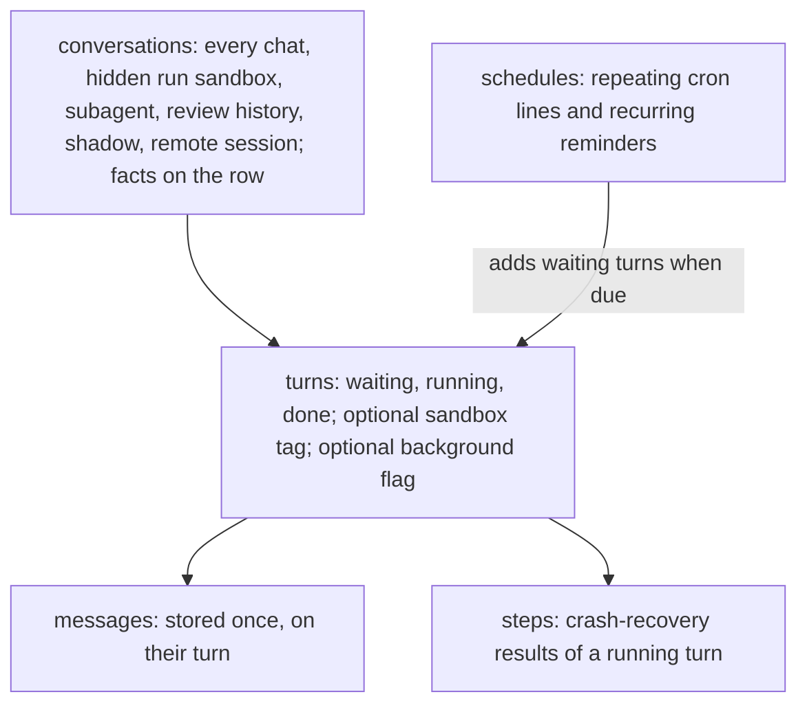
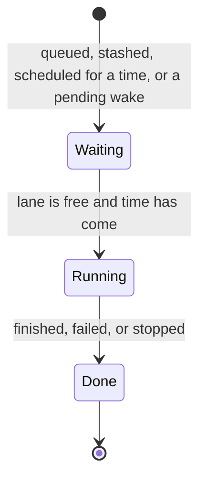
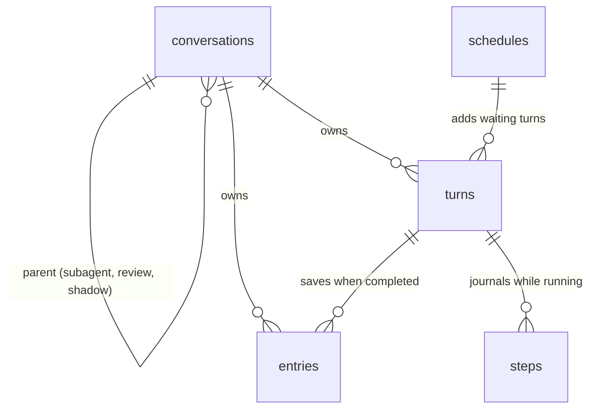
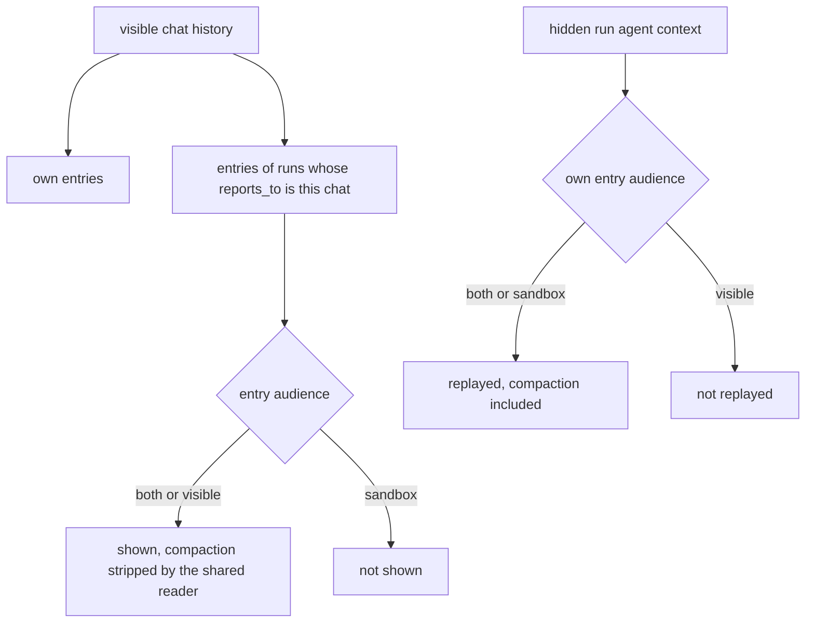
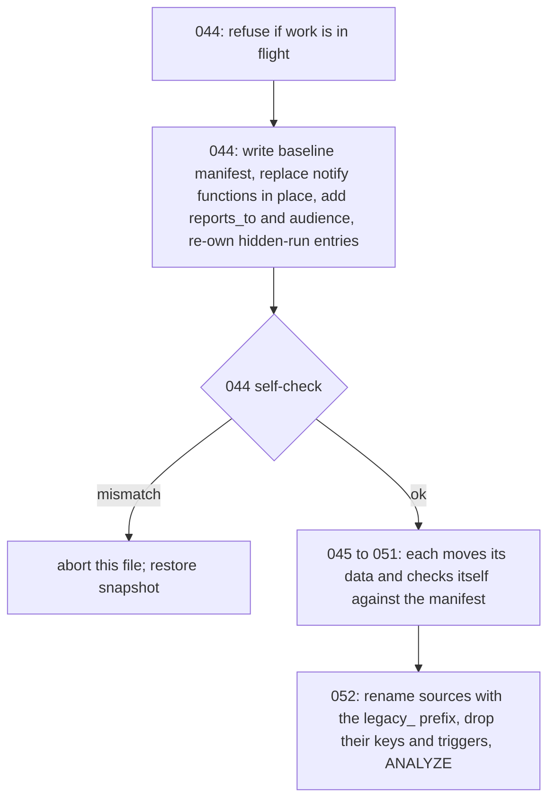

# State Store Consolidation - Plan

## Goal Capsule

- **Objective:** People and agents get correct answers quickly from RocketClaw's State Store, at Wallace's size and as it grows, because each fact is stored in one place and each screen is one simple read. Nothing people see or agents do changes.
- **Means:** Rebuild the State Store around a few core tables (conversations, turns, messages, steps, schedules) and remove the copy step that moves hidden-run history into visible chats.
- **Product authority:** The Product Contract wins on behavior; the Planning Contract's KTDs win on mechanism within it. Key Decisions record the choices the user made.
- **Execution profile:** `ce-work` implements the units in the Sequencing order on one branch, each unit landing green; all migrations ship in one release.
- **Stop conditions:** Stop and report if a unit cannot stay within the source CLOC budget, if a migration's in-place verification fails on a test or rehearsal database, if evidence shows a settled decision cannot work, or if `main` adds or alters a State Store table that KTD1's table map and the 044 manifest do not yet cover.
- **Who ships:** `ce-work` builds and verifies; the user merges, rehearses on copies of Wallace and Gene, and runs the scheduled downtime.
- **Open blockers:** None.

---

## Product Contract

### Summary

The State Store moves from 28 tables to about five core tables plus the small tables that own unrelated things. Every conversation, hidden runs included, is one row whose facts live on that row. Every unit of work is one turn with a state. Messages are stored once, on their turn, and a sandbox tag decides which agent sees them, so hidden-run history is no longer copied. Wallace and Gene move in one scheduled downtime with all history kept.

### Problem Frame

Answering almost anything in RocketClaw means stitching many tables together. One session-list row reads 10 of the 28 tables, three of them more than once. Whether a chat is listed is never stored: it is worked out by proving the chat is absent from three other tables and by reading its ID. About 13 SQL clauses and 17 Go checks parse conversation IDs to learn what a conversation is. On Wallace, 13,346 of the 26,658 conversations with history have no record at all; they are hidden-run histories and review histories, recognized only by their names.

The cost shows up as slowness first, then wrong answers. Postgres planned the session-origin query for 1 visible chat and got 6,865, which turned every search and list refresh into a 10-second wait until PR #506 rewrote that one query. Previews, the search index, and remote sessions are copies kept in step by hand. Hidden runs keep their own history and copy it into the visible chat afterwards, with side effects (scheduled reminders, the final reply) held back until that copy runs. A running turn rewrites its whole record on every save; on Wallace one such record is 641 MB, and the step journal holds 1.38 GB for 2 running turns.

Each fix so far has added another place for data to live. For example, remote OpenCode sessions got their own table because startup pruning would have deleted them from the main one. The user wants that cycle to stop.

### Key Decisions

- **The whole State Store is in scope, not only sessions.** (session-settled: user-directed — chosen over starting with sessions and their facts only: the sprawl and its fix-by-fragmenting cycle are everywhere.) Governs R1–R8.
- **Product behavior stays exactly as it is.** (session-settled: user-directed — chosen over changing how sandboxed runs execute: the sandbox property must not change.) Governs R9–R19, R25.
- **The conversation row is the source of truth for its facts, kept current by the same write that changes them.** (session-settled: user-directed — chosen over storing derived copies with atomic writes and over never storing derived values.) Governs R2.
- **A visible conversation is a strict superset of its sandboxed runs: one lane, one store, no copy.** (session-settled: user-directed — chosen over keeping each hidden run as its own conversation whose history is copied: the user asked to remove or simplify `SyncConversation`.) Governs R9–R15.
- **A sandboxed run's schedule changes take effect only when it finishes successfully.** (session-settled: user-approved — proposed to keep today's timing once the copy step is gone.) Governs R12.
- **One-time reminders are waiting turns; repeating rules share one schedules table.** (session-settled: user-approved — proposed over keeping three cron and reminder tables.) Governs R3, R5, R18.
- **Messages are saved one at a time; crash-recovery results go in one steps table.** (session-settled: user-approved — proposed over keeping a whole-turn record rewritten on every save.) Governs R4, R6.
- **Background jobs become turns; background scripts do not take the conversation's lane.** (session-settled: user-approved — proposed over keeping a separate jobs table.) Governs R17.
- **Conversation IDs stay unchanged but are never parsed for meaning.** (session-settled: user-approved — proposed because Web links and Slack routing are built from IDs.) Governs R8, R25.
- **Migration happens in one scheduled downtime and keeps all history.** (session-settled: user-directed — chosen over pruning unseen data, a fresh start with an archive, and a no-downtime migration.) Governs R22–R24.

### Requirements

**Storage shape**

- R1. One conversations table holds every conversation, including visible chats, Slack threads, hidden-run sandboxes, subagents, review histories, shadow sessions, and remote OpenCode sessions, each with its kind stored as a field.
- R2. Each fact Web or an agent reads about a conversation (kind, listed or hidden, parent, agent, space, pin, name, tags, preview, last updated, running, goal, External MCP binding) is stored on its conversation row and written in the same transaction as the change that causes it.
- R3. One turns table holds every unit of work, and a turn's state says whether it is waiting (queued, stashed, due at a time, or a pending wake), running, or done.
- R4. Each message is stored once, belongs to its turn, and is saved when it happens rather than by rewriting the whole turn.
- R5. Repeating rules, meaning cron schedule lines and recurring reminders, live in one schedules table that adds a waiting turn when a rule comes due.
- R6. Per-call results that crash recovery needs live in one steps table and are cleared when their turn finishes.
- R7. Tables that own unrelated things (attachments and pending attachment deletions, Web spaces and tab states, voice settings, hosted pages, Slack channel names, locks, the migration ledger) keep their own small tables.
- R8. No code decides what a conversation is by reading its ID, and existing IDs keep their current values.

**Sandboxed runs**

- R9. A hidden run's turns belong to the visible conversation and carry a sandbox tag: the hidden agent sees only turns with its own sandbox tag, and the visible conversation's agent sees all of the conversation's turns.
- R10. Compaction summaries written by a sandboxed agent are visible only inside that sandbox, so the visible conversation keeps the full messages.
- R11. Sandboxed turns and the visible conversation's own turns run one at a time in one lane, as they do today.
- R12. Reminders scheduled or reset by a sandboxed turn take effect on the visible conversation only when that turn finishes successfully.
- R13. A sandboxed turn's final reply is delivered once, to the visible conversation.
- R14. `SyncConversation` and every copy of hidden-run history into a visible conversation are removed.
- R15. A steer aimed at a hidden cron or External MCP run still becomes the next turn instead of joining the running one.

**Work lifecycle**

- R16. Queue, stash, steer, stop, Completion Notes, wake retries (1 minute, 5 minutes, then every 30 minutes), and restart recovery behave as they do today.
- R17. A background script is a turn that runs alongside the conversation's other turns, and a background task's subagent turns report to the conversation that started them.
- R18. A scheduled cron run is skipped while a run of the same cron file is still going, and recurring cron lines do not replay missed intervals; a one-off cron file whose time passed while the process was down runs once at startup.
- R19. Leftover sandbox-only data from finished hidden runs is cleaned up on today's schedule without removing any message the visible conversation shows.

**Reads**

- R20. The session list, session search, and a session's history are each answered by one straightforward query over the conversations, turns, and messages tables.
- R21. Message search reads an index over the stored messages instead of a separate copy of their text.

**Migration**

- R22. Wallace and Gene move to the new store in one scheduled downtime, rehearsed first on copies of their databases.
- R23. All existing history is kept, and every history without a conversation record today becomes a conversation row of the right kind.
- R24. Recurring cron runs that fall inside the migration downtime are not made up afterwards.
- R25. After migration, existing Web links, Slack thread routing, and External MCP conversation IDs keep working.

### Acceptance Examples

- AE1. Covers R9, R11.
  - **Given:** External MCP ticket-123 has a visible Web chat, and a person's follow-up turn is running there.
  - **When:** A new MCP call for ticket-123 arrives.
  - **Then:** The MCP turn waits for the person's turn to finish. The person's turn sees the ticket's MCP history. The MCP turn sees only ticket-123's sandboxed turns, not the person's follow-up.
- AE2. Covers R12.
  - **Given:** The 04:00 cron run calls "remind me in 2 hours".
  - **When:** The run finishes successfully.
  - **Then:** A reminder is due at 06:00 in the visible chat.
  - **When instead:** The run fails halfway.
  - **Then:** No reminder is created.
- AE3. Covers R10.
  - **Given:** A long MCP conversation's agent compacts its older history into a summary.
  - **Then:** The MCP agent's next turn starts from that summary, and the visible chat still shows every original message and no summary.
- AE4. Covers R18.
  - **Given:** `observabot.md` runs daily at 04:00, and yesterday's run is still going at 04:00 today.
  - **Then:** Today's run is skipped, and the next due time moves to tomorrow 04:00.
- AE5. Covers R16, R17.
  - **Given:** An agent starts the test suite as a background script.
  - **When:** The person keeps chatting.
  - **Then:** The person's turns run while the script runs. When the script ends, its Completion Note enters the running turn at its next step, or starts a new turn if none is running.
- AE6. Covers R23, R25.
  - **Given:** A finished cron run whose history has no conversation record today, and a Web link to the visible chat it reported into.
  - **Then:** After migration, the run is a hidden conversation row of kind cron run, the visible chat shows the same messages in the same order, and the old link opens it.

### Success Criteria

- On Wallace's data, the session list and a session search each answer in under about 100 ms, and that time stays roughly flat as chats grow.
- The State Store has about five core tables plus the small tables named in R7, down from 28.
- R2 and R8 hold everywhere: the roughly 13 SQL clauses and 17 Go checks that parse IDs today are gone.
- A long turn's save costs about the same at its hundredth step as at its first.
- The behavior documented in `cmd/rocketclaw/CHEATSHEET.md` and `CONCEPTS.md` is unchanged.

### Scope Boundaries

- Showing hidden-run progress in Slack is deferred as an optional extra, because it changes what Slack shows.
- A written project rule requiring human approval for new side tables, copies, or partial indexes is not part of this work.
- Product behavior, UI, and the contracts of agent-visible tools do not change.
- Conversation IDs and Web URL formats do not change.
- A migration without downtime is out of scope.

### Dependencies / Assumptions

- PostgreSQL remains the State Store.
- Copies of the Wallace and Gene databases can be made for rehearsal, as earlier migrations did (`docs/verification/2026-09-10-sidebar.md`).
- Rolling back means restoring the pre-migration database, since startup refuses migrations the running binary does not know (`docs/plans/2026-10-04-2254-feat-durable-conversation-work-plan.md`).

### Outstanding Questions

**Resolve Before Planning**

- None.

**Deferred to Implementation**

- Exact column lists and enum spellings for each new table, settled while moving each reader and writer (KTD1).
- Whether any reader still needs a lateral first-row lookup after the move; each one that stays keeps the documented subquery exception (KTD12).

Planning resolved the earlier deferred questions: the 1.1 GB of steps (KTD6), originals versus copies (KTD11), review histories and shadow sessions (KTD2), remote OpenCode fields and goals (KTD1), and the search index (KTD9).

### Sources / Research

- Hidden-run copy and its side effects: `internal/rocketclaw/backend/conversations.go` (`SyncConversation`), `internal/rocketclaw/backend/store_dao.go` (`projectProducerEffects`), `internal/rocketclaw/backend/bridge.go` (`ScheduleMessage`, `deliver`), `internal/rocketclaw/backend/store.go` (`externalMCPManagedEntry`, `reserveTurnPair`).
- Visibility and ID parsing: `internal/rocketclaw/backend/message_search.go` (`visibleChatsSQL`), `internal/rocketclaw/backend/revert.go`, `internal/rocketclaw/frontend/rpc/server.go`, `internal/rocketclaw/backend/origin.go`.
- Cron overlap rule: `internal/rocketclaw/backend/store.go` (cron schedule claim), `internal/rocketclaw/frontend/cron/manager.go`.
- Whole-turn journal saves: `internal/rocketcode/looper.go` (`saveTurn`), `internal/rocketcode/checkpoint.go`.
- Prior plans: `docs/plans/2026-10-16-1600-refactor-one-hidden-run-path-plan.md`, `docs/plans/2026-09-09-fast-conversation-sidebar.md`, `docs/plans/2026-10-17-1906-feat-remote-opencode-sessions-plan.md`, `docs/plans/2026-10-04-2254-feat-durable-conversation-work-plan.md`.
- Session-origin query fix: PR #506.
- Planning research: `docs/solutions/runtime-errors/deployment-binary-missing-live-migrations.md`, `docs/solutions/logic-errors/saved-queue-never-started-after-restart.md`, `docs/solutions/best-practices/postgres-extension-in-migration-with-shared-test-database.md`, `docs/solutions/best-practices/test-postgres-container-needs-larger-shm.md`.

Product Contract preservation: changed: R18, R24 — corrected to describe today's cron behavior, which startup rebuilds from cron files, per the behavior-unchanged decision. Other requirements, examples, and IDs are unchanged. Deferred questions were resolved in place. KTD3 and KTD5 carry interpretation call-outs on R9 and R4, recorded under Assumptions for the user to review.

---

## Planning Contract

### Key Technical Decisions

- KTD1. **The State Store ends with 14 tables.** The core tables are `conversations`, `turns`, `entries`, `steps`, and `schedules`. The owner tables stay as they are: `attachments`, `pending_attachment_deletions`, `slack_channel_facts`, `voice_settings`, `hosted_pages`, `web_spaces`, `web_tab_states`, `rocketclaw_locks`, and `pg_migrations`. Summaries, tags, goals, External MCP bindings, shadow bindings, and remote OpenCode sessions become columns or rows of `conversations`. (session-settled: user-directed — chosen over consolidating only session tables first: the sprawl and its fix-by-fragmenting cycle are everywhere.) Implements R1–R7.
- KTD2. **Kind, visibility, and identity are columns written by the code that creates the conversation.**
  - The columns are kind, listed or hidden, the parent and call ID (subagents, review histories, shadows), the Slack channel and thread, the cron path and run time, the External MCP external ID, and the remote server.
  - The migration derives them once from today's ID shapes and anti-joins. After that, no reader parses an ID.
  - Review histories and shadow sessions are conversation rows of their own kind with a stored parent.
  - Delete rules:
    - `reports_to` is `ON DELETE SET NULL`.
    - A parent is `ON DELETE RESTRICT`.
    - Turns and entries cascade only from their owning conversation.
  - (session-settled: user-approved — proposed because Web links and Slack routing are built from IDs.)
  - Implements R1, R2, R8, R25.
- KTD3. **A hidden run's entries and turns are owned by the run's own conversation row, which stores `reports_to`, the visible conversation it reports into.**
  - `reports_to` replaces today's `producer_inbound_json->>'SyncDestination'`. It is set once, first writer wins, as `bindProducer` does today. Only KTD4 adoption from null changes it later.
  - A visible conversation's history is its own entries plus the entries of runs reporting to it whose audience includes the visible view (KTD5).
  - A run's agent context is its own entries whose audience includes the run.
  - One shared reader strips compaction items and remaps replay indexes for the visible view, as `externalMCPManagedEntry` does today, so every surface uses the same message IDs.
  - Effects and the final reply apply where today's copy step applies them: at finish when the run is bound, at `postCronRoot`, or at `handoffProducer`. Each effect is applied once: the run's turn records that its effects were applied, replacing today's `producer_effects_through_id` marker.
  - A run's entry and turn writes also update its `reports_to` row's facts (has content, preview, last updated, running) in the same transaction, so a chat whose only content is a run stays listed and current.
  - (session-settled: user-directed — chosen over keeping private conversations whose history is copied: the user asked to remove `SyncConversation`.)
  - Conflict call-out on R9: R9 says a hidden run's turns "belong to the visible conversation". Here they are owned by the run and shown in the visible conversation, because a cron run exists before any visible chat does.
  - Implements R9–R14.
- KTD4. **Continuing a cron run in Web always yields the chat `web:<run>`, and repeating it returns that same chat.**
  - `web:<run>` stores a `continues` link to the run. Its visible view and its agent context include the run's visible entries through KTD3's reader, followed by its own entries. Nothing is copied.
  - The run keeps its own `reports_to` chat, such as its Slack report thread, so both chats show the run. A run whose `reports_to` is null is adopted instead: `reports_to` becomes `web:<run>`. `handoffProducer` uses the same rule when a silent run's reminder comes due.
  - (session-settled: user-directed — chosen over keeping private conversations whose history is copied: the user asked to remove `SyncConversation`.)
  - Implements R14, R25.
- KTD5. **Saved entries keep their bigint IDs and `"<entry id>:<replay index>"` message IDs.**
  - `entries` is today's `session_entries` plus an `audience` value:
    - `both`, the default for new entries;
    - `sandbox`, hidden from the visible view;
    - `visible`, hidden from the run's context.
  - No migration rewrites `entry_json`.
  - While a turn runs, each replay item and trace record is appended once to `steps` instead of the whole record being rewritten. The entry is written once, when the turn completes.
  - (session-settled: user-approved — proposed over keeping a whole-turn record rewritten on every save.)
  - Conflict call-out on R4: a "message" here is a saved entry, because Web paging, undo, search hits, and `rocketclaw_sessions_get` address messages by entry ID and replay index. Step rows are scratch that is cleared at turn end.
  - Implements R4, R6, R25.
- KTD6. **A stopped or failed turn keeps its partial record on its done turn row, not in `steps`.** Today that record lives only in `turn_steps`, which is the 1.1 GB found on Wallace. Moving it to the turn row keeps its position (the turn's anchor), its empty message ID, and its search behavior exactly as today, and lets `steps` be cleared at every turn end. A run that fails writes no entry, so it never shows in its visible chat. Implements R4, R6, R9.
- KTD7. **`turns` replaces `active_turns`, `thread_queue`, `scheduled_messages` one-time rows, `background_jobs`, and `shadow_turns`.**
  - Fields:
    - a state: waiting, running, delivering, or done, where a delivering turn keeps its outbound reply so restart resumes delivery instead of re-running the model;
    - a waiting reason: queued, stashed, scheduled, wake, or held;
    - a done outcome: completed, failed, or stopped;
    - a run-at time, a queue position, and whether the turn takes the lane;
    - a kind: model, script, or note.
  - Each lane, `COALESCE(reports_to, id)`, has one in-process worker that claims turns with a conditional update. RocketClaw runs one process per database, so there are no leases.
  - Dedup reads waiting and running turns plus saved entries' input IDs, as today. A unique key on (conversation, input ID) among waiting turns stops a second waiting turn for one input.
  - (session-settled: user-approved — proposed over keeping a separate jobs table.)
  - Implements R3, R11, R15–R17.
- KTD8. **`schedules` holds repeating rules: cron schedule lines and recurring reminders.**
  - Cron lines are rebuilt from cron files at every startup, as today (`internal/rocketclaw/frontend/cron/manager.go`), so the migration carries no cron state.
  - The overlap check asks whether a turn from that cron path is running.
  - One-time reminders are waiting turns with a run-at time, armed by the existing timers.
  - (session-settled: user-approved — proposed over keeping three cron and reminder tables.)
  - Implements R5, R18, R24.
- KTD9. **Message search reads `pg_trgm` GIN indexes over a `search_text` column on `entries` and on done turn rows that hold stopped or failed records.**
  - The Go builder writes `search_text` as one line per message part, prefixed with its replay index and part index, keeping today's attachment and principal rules. Hits, with their message IDs and order, are read from the matching row's `search_text`, never by decoding `entry_json` or a stopped record.
  - New rows compute `search_text` in Go in the writing transaction.
  - The migration backfills it from the existing `message_search` rows, which Go already computed.
  - This replaces `message_search` and `message_search_indexed`, and reuses migration 030's extension rules.
  - Implements R20, R21.
- KTD10. **Every table that Web watches keeps a notify trigger at every migration, with ID-only payloads.** 044 replaces `notify_transcript_change()` and the sync-destination notify in place: they drop the `sync_source_entry_id` copy fan-out and notify the owning conversation, its `reports_to`, and its parent. Each later file that renames or merges a watched table moves or recreates its trigger at the end of that same file, after its backfill, so bulk backfills do not notify and live updates work at every unit. The channel name and the Web protocol's wake-up hints do not change. Implements R9, R13, R20.
- KTD11. **The release ships one migration file per unit, numbered in execution order and applied at one startup during the scheduled downtime.**
  - Each file commits on its own, so:
    - The first new file (044) begins by refusing to run while any turn is running or delivering, any background job is running, or any shadow turn is unfinished. A refusal there commits nothing, and the previous binary still starts.
    - 044 then writes a baseline manifest into `legacy_`-prefixed tables in the State Store's own schema, because several State Store schemas can share one database:
      - `md5(entry_json::text)` per entry ID;
      - per visible conversation, the ordered entry IDs that today's history resolves, and per hidden run, its own ordered entry IDs;
      - the listed set from today's `visibleChatsSQL`, and the session list's shown set (listed, with history or a running turn);
      - per lane, the ordered inbound IDs of today's queued, stashed, and held work;
      - per-table and per-state row counts.
    - Every file ends by checking its own targets against that manifest, compared with `EXCEPT` in both directions, and aborts on mismatch.
    - No file deletes from or drops a source table. The last file renames the sources with the `legacy_` prefix, drops their foreign keys and triggers, and runs `ANALYZE`.
  - Hidden-run history keeps every existing row:
    - originals become `sandbox` entries, keeping their IDs, full replay, and NUL-free bytes;
    - copies become `visible` entries, keeping their IDs and positions;
    - only the copy in the run's `reports_to` chat is re-owned to the run. Any other copy stays owned by its chat.
  - Every original and copy falls into exactly one bucket (original with one copy, original with several copies, original only, copy only), and the bucket totals reconcile.
  - Any failure after 044 commits means restoring the pre-migration snapshot. Never start a changed binary on a partly migrated database.
  - (session-settled: user-directed — chosen over pruning unseen data, a fresh start, or a no-downtime migration.)
  - Implements R22–R25.
- KTD12. **Deletions land before additions, and every touched query is rewritten into CTEs.**
  - Source CLOC is 24,148, and the gate fails at 24,250, so 101 lines can be added.
  - Each unit states its expected CLOC delta, and `make cloc` is run before and after it.
  - Query text is not moved into migration-defined views or functions to dodge the count.
  - `internal/rocketcode` has its own budget (10,763 of 12,500), which the Journal change spends.
- KTD13. **Migration tests are pinned to absolute migration IDs before any migration is added.** About 8 tests step a fixed number of migrations back from head, and 3 assert ledger counts.

### High-Level Technical Design

Ownership after the move:

Reading a visible chat with a hidden run reporting into it (KTD3, KTD5):

Migration files inside the release, each its own transaction (KTD11):

### Sequencing

U1 → U4 → U10 → U2 → U11 → U3 → U12 → U5 → U8 → U6 → U13 → U7 → U9.

U4 and U10 delete the copy machinery first, which creates CLOC headroom. U2 and U11 come after. U8 follows U5, so stopped and failed records are already on turn rows when search moves.

| Migration | Unit |
|---|---|
| 044 | U4 |
| 045 | U2 |
| 046 | U3 |
| 047 | U5 |
| 048 | U8 |
| 049 | U6 |
| 050 | U13 |
| 051 | U7 |
| 052 | U9 |

U1, U10, U11, and U12 add no migration. Before each unit, rebase on `main` and renumber this release's migrations to follow `main`'s newest file.

### System-Wide Impact

| Surface | Consumer | Units | What must hold |
|---|---|---|---|
| `frontend.Backend.SyncConversation` | `cmd/rocketclaw/cron.go`, `cmd/rocketclaw/mcp.go`, `internal/rocketclaw/frontend/rpc/server.go`, three generated mocks | U4, U10 | Removed only in U10 |
| `protocol.Conversation` and `CreateConversation` | `cmd/rocketclaw/cron.go`, `cmd/rocketclaw/mcp.go`, `rpc/server.go`, `backend/bridge.go` | U2 | Every create path sets kind, listed, and `reports_to`; test fixtures get defaults |
| Slack outbound routing by conversation ID | `internal/rocketclaw/frontend/slack/connector.go`, `events.go` | U11 | Routing reads stored Slack facts; the External MCP final reply still lands in its thread |
| `HistoryRequest.source_conversation_id`, `ShadowTurn.parent_source_conversation_id`, `BackgroundJob.hidden` | `internal/rocketclaw/web/proto/web.proto`, `rpc/server.go` | U4, U6, U13 | Same values as today for hidden runs, shadows, and jobs |
| Saved-entry IDs and `"id:index"` message IDs | `web.proto` History, Transcript, and search messages | U4, U5 | Unchanged for old and new data (KTD3, KTD5) |
| `summaries_complete`, search `IndexComplete` | `rpc/server.go`, `session_commands.go` | U3, U8 | Always true; the Go computing them is deleted; the protocol is unchanged |
| `rocketclaw_sessions_get` and `_list` | `internal/rocketclaw/backend/session_tools.go` | U4, U5, U8 | Same pages and `before_entry_id` behavior; a private run ID returns the run view |
| Session tags landing on the destination | `backend/bridge.go` | U4 | Uses `reports_to` |
| NOTIFY channel | `backend/transcript.go`, `rpc/server.go`, `rpc/voice.go` | U4 to U9 | Channel name and wake-up hint meaning unchanged |
| `rocketcode.Journal` | `internal/rocketcode/checkpoint.go`, `looper.go`, `mcp_tools.go`, `raw_run.go`, `dynamic_workflow_tool.go`, `backend/bridge.go`, `handoff.go` | U12 | Restart recovery behaves as today |
| Cron store interface | `internal/rocketclaw/frontend/cron/manager.go` | U7 | Narrow interface keeps its shape |
| Docs | `cmd/rocketclaw/CHEATSHEET.md`, `CONCEPTS.md` | U9 | Behavior text unchanged; vocabulary updated |

### Risks

| Risk | Guard |
|---|---|
| A partial commit across files, or a fix that never runs | KTD11: the refusal and manifest in 044, a self-check in every file, no source deletes before 052, restore-only recovery |
| Messages moved, re-owned, or re-flagged unnoticed | KTD11's ordered per-view manifest; in the rehearsal, old-binary-versus-new-binary diffs of history, search, undo eligibility, and `rocketclaw_sessions_get` pages |
| Hidden-run history lost, reordered, or doubled | KTD11's keep-every-row mapping with reconciled bucket totals |
| Stopped or failed turns moved, duplicated, or re-run | KTD6 keeps them on turn rows; `applied_input_ids` moves with them |
| A migrated input accepted twice | KTD7: dedup reads saved entries as today |
| Misclassified or cascade-deleted conversations | KTD2's delete rules; 045 aborts on an unclassified ID; the listed and shown sets must equal today's |
| Search changes for old messages | KTD9's backfill from `message_search`; the rehearsal diffs a fixed term list |
| The `legacy_` tables keep rows past the 30-day prune | Accepted; a later release drops them |

### Assumptions

- RocketClaw runs one process per State Store database; a second process on the same database is not supported (KTD7).
- Wallace runs PostgreSQL 18.4, and Gene runs a version at least as new. U9's rehearsal confirms Gene.
- The release's migrations fit in the scheduled downtime on Wallace's data. U9's rehearsal measures this.
- Wallace's running turns, background jobs, and shadow turns are finished or stopped before the snapshot, so the 044 refusal does not fire. If stopping Wallace's 641 MB turn fails on the current binary in the rehearsal, the turn is left to complete before the downtime instead.
- R9's "turns belong to the visible conversation" is read as "shown in and laned with the visible conversation" (KTD3), because a cron run exists before any visible chat does.
- R4's "message" is a saved entry, with its replay items journaled one at a time while the turn runs (KTD5), because Web, undo, search, and `rocketclaw_sessions_get` address messages by entry ID and replay index.

---

## Implementation Units

| U-ID | Title | Key files | Depends on |
|---|---|---|---|
| U1 | Pin migration tests to absolute IDs | `backend/store_schema_test.go`, `store_test.go` | — |
| U4 | Hidden runs without copies | `backend/conversations.go`, `bridge.go`, `transcript.go`, migration 044 | U1 |
| U10 | Continue a cron run; remove `SyncConversation` | `rpc/server.go`, `frontend/backend.go`, `cmd/rocketclaw` | U4 |
| U2 | Conversations with stored kind and visibility | `backend/store.go`, `message_search.go`, `revert.go`, migration 045 | U4 |
| U11 | Frontends stop parsing IDs | `rpc/server.go`, `frontend/slack`, `cmd/rocketclaw/mcp.go` | U2 |
| U3 | Fold side tables into conversations | `backend/store_summaries.go`, `opencode.go`, `shadows.go`, migration 046 | U2 |
| U12 | Append-only Journal | `internal/rocketcode/checkpoint.go`, `looper.go`, `backend/store_dao.go` | U1 |
| U5 | Entries and steps | `backend/store_dao.go`, `transcript.go`, migration 047 | U12, U4 |
| U8 | Search on stored rows | `backend/message_search.go`, `session_search.go`, migration 048 | U5 |
| U6 | Turns for queue and lane | `backend/bridge.go`, `thread_bridges.go`, `store_dao.go`, migration 049 | U5 |
| U13 | Background jobs as turns | `backend/background.go`, `fork.go`, migration 050 | U6 |
| U7 | Schedules and reminders | `backend/store.go`, `frontend/cron/manager.go`, migration 051 | U6 |
| U9 | Legacy hand-off, rehearsal, docs | migration 052, `docs/verification/`, `CONCEPTS.md` | all |

### U1. Pin migration tests to absolute migration IDs

**Goal:** Adding migrations stops breaking tests that count back from the newest migration.
**Requirements:** R22 (KTD13).
**Dependencies:** None.
**Files:** `internal/rocketclaw/backend/store_schema_test.go`, `internal/rocketclaw/backend/origin_pairs_test.go`, `internal/rocketclaw/backend/active_turn_test.go`, `internal/rocketclaw/backend/store_test.go`.
**Approach:**
1. Replace each `Down N` step with a migration to a named migration ID, following `TestProducerHandoffMigration`'s "Up to N from empty" form.
2. Replace hard-coded ledger counts with the count of embedded migrations.
3. Tests whose subject is Go code a later unit removes are deleted in that unit.
**Patterns to follow:** `TestProducerHandoffMigration` in `store_schema_test.go`.
**Test scenarios:**
- Adding a no-op migration file locally leaves every migration test passing; remove it afterwards.
- Each pinned test still asserts the same schema state it asserted before.
**Verification:** No test references a migration position relative to head. Expected CLOC delta: 0.

### U4. Hidden runs without copies

**Goal:** Hidden runs show in their visible chat without copying, and keep their sandbox.
**Requirements:** R9–R13, R22; AE1, AE2, AE3 (KTD3, KTD5, KTD10, KTD11).
**Dependencies:** U1.
**Files:**
- New migration `internal/rocketclaw/backend/migrations/044_hidden_run_entries.sql`.
- Modified: `internal/rocketclaw/backend/conversations.go`, `bridge.go` (`postCronRoot`, `handoffProducer`, `ScheduleMessage`, `deliver`, `redirectBackgroundJobs`), `store.go`, `store_dao.go` (`bindProducer`, `headTurn`, `projectProducerEffects`), `transcript.go`, `history.go`, `revert.go`, `fork.go`, `message_search.go`, `attachments.go`, `session_tools.go`.
- Tests: `runtime_test.go`, `transcript_test.go`, `active_turn_test.go`, `fork_test.go`, `store_schema_test.go`, `store_test.go`, `internal/rocketclaw/frontend/rpc/live_test.go`.
**Approach:**
1. Migration 044 runs the KTD11 refusal and baseline manifest, and replaces the notify functions in place per KTD10.
2. It adds `reports_to` (promoted from `producer_inbound_json->>'SyncDestination'`) and the entry `audience`.
3. It re-owns hidden-run entries per KTD11, seeds the `reports_to` chats' facts from them, and checks itself.
4. Visible-chat readers union their entries with the `both` and `visible` entries of runs reporting to them, through the one shared compaction-stripping reader. Run context reads its `both` and `sandbox` entries.
5. A run's reminders and resets apply once to its `reports_to` chat on successful finish, at `postCronRoot`, or at `handoffProducer`, where today's copy step applies them. The final reply is published to the visible chat once. Run writes update the `reports_to` row's facts per KTD3.
6. The lane key and stop routing use `reports_to` instead of the turn-pair reservation.
7. Delete the internals of the copy path: `syncConversation`, `projectProducerEffects`, `producerEffects`, `advanceProducerEffects`, `pendingOutput`, `reserveTurnPair`, the `sync_source_*` joins, and producer routing in `producer_inbound_json`. `SyncConversation` stays on `frontend.Backend` as a no-op wrapper until U10.
**Patterns to follow:** The live hidden-run read in `observeTranscriptDB`, `bindProducer`'s first-writer-wins update.
**Test scenarios:**
- Covers AE1. While a person's turn runs in an External MCP chat, a new MCP call waits. The person's turn sees the MCP history; the MCP turn sees only its own run's entries.
- Covers AE2. A cron run that schedules a reminder and completes creates it on the visible chat; one that fails halfway creates none.
- Covers AE3. A run that compacted its history keeps the summary in its own context, and the visible chat shows every original message and no summary.
- A failed or stopped run's turn shows live while it runs and does not appear in its visible chat after it ends.
- A run entry that contains compaction gets the same message IDs from history, search, and undo.
- A Slack-delivered cron run is bound to its report thread at `postCronRoot` and shows there without new entry rows.
- A silent cron run whose reminder comes due creates `web:<run>` with the web agent and the cron's space, and shows the run's messages there.
- Undo in a visible chat with run entries cuts at the chosen message as today, and the run's next turn sees the same history as today.
- Migrating a database with an original run that has one copy, one with two copies, an orphan copy, and an original with no copy keeps every row, and reconciles the bucket totals.
- A seeded running turn makes 044 refuse, and the ledger still ends at 043.
- A Slack report thread whose only content is a cron run stays in the session list with the run's preview and time, and shows the run live while it runs.
- An External MCP run's reminder from an earlier call is not applied again by a later call.
- A Web live test sees a new entry and a running hidden-run turn without reloading.
**Verification:** No code path copies run history between conversations, and Web live tests pass unchanged. Expected CLOC delta: clearly negative.

### U10. Continue a cron run; remove `SyncConversation`

**Goal:** Continuing a cron run in Web keeps today's stable chat without copying, and the frontend interface loses its copy method.
**Requirements:** R14, R25 (KTD4).
**Dependencies:** U4.
**Files:** `internal/rocketclaw/frontend/rpc/server.go`, `internal/rocketclaw/frontend/backend.go`, `internal/rocketclaw/backend/conversations.go`, `cmd/rocketclaw/cron.go`, `cmd/rocketclaw/mcp.go`, regenerated mocks in `cmd/rocketclaw`, `internal/rocketclaw/frontend/rpc`, and `internal/rocketclaw/frontend/slack`. Tests: `internal/rocketclaw/frontend/rpc/server_test.go`, `cmd/rocketclaw/cron_test.go`, `cmd/rocketclaw/mcp_test.go`.
**Approach:**
1. Continue creates or returns `web:<run>` with its `continues` link, or adopts a run whose `reports_to` is null, per KTD4. The visible-view and agent-context readers from U4 include a linked run's visible entries before the chat's own.
2. Remove `SyncConversation` from `frontend.Backend` and its three callers, then regenerate the mocks.
**Patterns to follow:** The existing continue path in `rpc/server.go`.
**Test scenarios:**
- Continuing a run with null `reports_to` adopts it: the new chat shows the run's messages under their existing IDs, and no entry rows are added.
- Continuing a run bound to a Slack report thread shows the run's messages in `web:<run>` under their existing IDs, adds no entry rows, and keeps them in the Slack thread too.
- The agent in `web:<run>` sees the run's visible messages followed by the chat's own, as it does today with the copied history.
- Continuing the same run twice returns the same chat with no new rows.
**Verification:** `frontend.Backend` has no `SyncConversation`. Expected CLOC delta: negative.

### U2. Conversations table with stored kind and visibility

**Goal:** Every conversation is one row that says what it is and whether Web lists it.
**Requirements:** R1, R2, R8, R23, R25; AE6 (KTD2).
**Dependencies:** U4.
**Files:**
- New migration `045_conversations.sql`.
- Modified: `internal/rocketclaw/backend/store.go`, `store_dao.go`, `message_search.go`, `session_search.go`, `revert.go`, `origin.go`, `history.go`, `fork.go`, `shadows.go`, `thread_bridges.go`, `conversations.go`, `bridge.go`, `internal/rocketclaw/protocol/conversation.go`, `internal/rocketclaw/protocol/types.go`.
- Tests: `store_test.go`, `store_schema_test.go`, `revert_test.go`, `session_search_test.go`.
**Approach:**
1. Rename `managed_conversations` to `conversations`. Add the KTD2 columns and delete rules.
2. Insert rows for every history without a record, classifying each once from its ID shape. Abort when an ID matches no rule. Migration 038 did the same for unrecorded subagent histories.
3. Every conversation-creating path sets these columns from its own context.
4. Replace `visibleChatsSQL`, `ChatOriginFacts` origin derivation, `revertStateDB` eligibility, `sessionLabel`, `slackStateKeyTime`, and the `turn_steps` trigger's key-shape rule with column reads.
5. Move the `voice_settings` and `space_id` foreign keys to `conversations`.
6. Check that the listed set equals the 044 manifest's.
**Patterns to follow:** Migration 038 backfill, `stateDAO`, the `turnPhase` enum style in `store_dao.go`.
**Test scenarios:**
- Covers AE6. Migrating a schema seeded with a finished cron run's unrecorded history creates a hidden row of kind cron run, and the chat it reported into lists unchanged.
- Each existing kind (Web chat, Slack thread, cron run, one-off cron run, External MCP private chat, subagent, review history, shadow) is created with its kind and listed flag, and the session list includes exactly the listed ones.
- A Web chat continuing a cron run, whose ID contains `/`, is listed and is not treated as a review history.
- Undo eligibility for each kind matches today's prefix-based answer.
- An unrecorded history whose ID matches no rule makes 045 abort.
**Verification:** The backend has no `LIKE '<prefix>%'` or `HasPrefix` on conversation IDs, except code that builds new IDs. Expected CLOC delta: about neutral.

### U11. Frontends stop parsing conversation IDs

**Goal:** RPC, Slack, and command code read stored facts instead of IDs.
**Requirements:** R8 (KTD2).
**Dependencies:** U2.
**Files:** `internal/rocketclaw/frontend/rpc/server.go`, `internal/rocketclaw/frontend/slack/connector.go`, `internal/rocketclaw/frontend/slack/events.go`, `cmd/rocketclaw/mcp.go`, `internal/rocketclaw/protocol/conversation.go`. Tests: `internal/rocketclaw/frontend/rpc/server_test.go`, `internal/rocketclaw/frontend/slack/connector_test.go`, `cmd/rocketclaw/mcp_test.go`.
**Approach:**
1. Replace `ParseCronRun` callers, `HasPrefix` checks on `web:`, `cron:`, and `opencode:`, and `SlackThreadTarget` parsing in routing with conversation fields.
2. Slack routing uses `OutboundMessage.SlackReply` or the stored channel and thread.
**Patterns to follow:** `OutboundMessage.SlackReply` routing in `internal/rocketclaw/protocol/types.go`.
**Test scenarios:**
- A Slack mention reply, a cron report, and an External MCP final reply each land in the same thread as today.
- Web agent choices for a Web chat, a Slack thread, and a continued cron chat match today's.
**Verification:** No frontend or command code parses a conversation ID. Expected CLOC delta: negative.

### U3. Fold conversation side tables into the conversation row

**Goal:** A conversation's facts come from its row alone, and finished runs' sandbox-only data still expires.
**Requirements:** R2, R19, R20 (KTD1).
**Dependencies:** U2.
**Files:**
- New migration `046_conversation_facts.sql`.
- Modified: `internal/rocketclaw/backend/store_summaries.go`, `store.go`, `store_dao.go`, `opencode.go`, `shadows.go`, `history.go`, `internal/rocketclaw/frontend/rpc/server.go`, `cmd/rocketclaw/mcp.go`.
- Tests: `store_summaries_test.go`, `opencode_test.go`, `shadows_test.go`, `store_test.go`.
**Approach:**
1. Move these onto `conversations`:
   - `session_summaries`: preview and last updated;
   - `session_tags`;
   - `conversation_goals`;
   - `external_mcp_sessions`: binding fields, origin pairs, and a unique external ID;
   - `shadow_bindings`: parent, parent agent, and shadow agent;
   - `opencode_sessions`: rows of kind remote, with server, directory, title, synced-at, and running.
2. Write preview, last updated, and running in the same transaction as the entry or turn change that causes them.
3. Pruning removes an External MCP session's visible chat, its run, and the binding together only when both conversations are stale, as `pruneExternalMCP` does today. It never removes a visible chat alone while a run reporting to it is still live.
4. On today's 30-day schedule, the retention pass deletes `sandbox`-audience entries of finished cron runs whose last entry is older than the cutoff. It keeps the run row, its `both` and `visible` entries, and any attachment a shown entry references. External MCP run history is kept exactly as today's prune keeps it.
5. Delete the summary backfill and the `summaries_complete` computation.
**Patterns to follow:** `saveSessionSummary` transactions in `store_summaries.go`.
**Test scenarios:**
- Saving an entry updates the row's preview and last-updated time in the same transaction, and a failed save leaves both unchanged.
- Tagging, pinning, and naming a remote OpenCode session and a local chat both persist on their rows.
- An External MCP session whose visible chat and run are both stale is removed together, and one whose run is still live keeps its chat and history.
- A finished cron run past the cutoff loses its sandbox-only entries, and its visible chat still shows every message.
- An External MCP call for an existing external ID finds its binding by one indexed lookup.
- Goal start, continuation, and completion behave as before.
**Verification:** The session list reads `conversations` alone for local and remote rows. Expected CLOC delta: negative.

### U12. Append-only Journal in RocketCode

**Goal:** A long turn's saves stay cheap.
**Requirements:** R4, R6 (KTD5).
**Dependencies:** U1.
**Files:** `internal/rocketcode/checkpoint.go`, `internal/rocketcode/looper.go`, `internal/rocketcode/mcp_tools.go`, `internal/rocketcode/raw_run.go`, `internal/rocketcode/dynamic_workflow_tool.go`, `internal/rocketclaw/backend/store_dao.go` (`conversationJournal`, queue release, `preserveStoppedInput`), `internal/rocketclaw/backend/transcript.go`, `message_search.go`, `revert.go`, `session_tools.go`, `bridge.go`, `handoff.go`. Tests: `internal/rocketcode/looper_test.go`, `internal/rocketcode/mcp_tools_test.go`, `internal/rocketclaw/backend/active_turn_test.go`, `transcript_test.go`, `revert_test.go`.
**Approach:**
1. Change the `Journal` contract so a running turn appends each new replay item and trace record once, instead of re-marshalling the whole record in `saveTurn`.
2. Restart recovery rebuilds the record from appended items.
3. Update `InertJournal`, `TracelessJournal`, and every wrapper.
4. Rewrite every backend query that reads a running turn's whole record as one JSON document to read the appended rows: the live transcript, running-turn search, the already-recorded input check, queue release by applied input IDs, `preserveStoppedInput`, and the parking step in session tools. Count these rewrites in the unit's main-budget CLOC delta.
**Execution note:** Add characterization tests for restart recovery of a turn interrupted mid-call before changing the contract.
**Patterns to follow:** `turnStep` and `callStep` in `internal/rocketcode/checkpoint.go`.
**Test scenarios:**
- A turn interrupted after 3 completed tool calls resumes without re-running them, and reports a call cut off mid-way as interrupted.
- A 200-step turn's 200th save writes about as many bytes as its 1st.
- Accepted steers and applied input IDs survive a restart mid-turn.
- A running turn's live transcript shows the same messages as today.
- An input repeated while its turn is still running is rejected.
**Verification:** Restart-recovery tests pass unchanged. RocketCode CLOC stays within its budget.

### U5. Entries and steps

**Goal:** Saved history lives in `entries`, and running-turn scratch lives in `steps`.
**Requirements:** R4, R6, R25 (KTD5, KTD6).
**Dependencies:** U12, U4.
**Files:**
- New migration `047_entries_steps.sql`.
- Modified: `internal/rocketclaw/backend/store_dao.go`, `store.go`, `transcript.go`, `web_question.go`, `session_tools.go`, `message_search.go`.
- Tests: `active_turn_test.go`, `transcript_test.go`, `session_tools_test.go`, `store_schema_test.go`.
**Approach:**
1. Rename `session_entries` to `entries`.
2. Merge `turn_steps` and `code_mode_calls` into `steps`.
3. A stopped or failed turn's partial record and its `applied_input_ids` move onto its done `active_turns` row (KTD6). The record is built without a `jsonb` cast, because a record may exceed jsonb's 256 MB limit.
4. Readers rebuild stopped and failed turns from the turn row instead of `turn_steps`.
5. Steps are deleted at every turn end.
6. The migration moves existing stopped and failed records before merging `code_mode_calls`, and checks itself.
**Patterns to follow:** `conversationJournal` and `closeTurn` in `store_dao.go`.
**Test scenarios:**
- A stopped turn and a failed turn show in their chat's history in the same place and form as today, and leave no step rows.
- A human-stopped turn with a preserved prompt shows the prompt once.
- A queued input consumed by a turn that later failed is not run again after migration.
- `rocketclaw_sessions_get` paging with `before_entry_id` returns the same pages for migrated data.
- Migrating a database with a stopped turn whose only record is in `turn_steps` keeps it at the same position.
**Verification:** No step row survives a finished turn. Expected CLOC delta: about neutral.

### U8. Message search on stored rows

**Goal:** Search reads indexes over saved rows, with no copy of their text.
**Requirements:** R20, R21 (KTD9).
**Dependencies:** U5.
**Files:**
- New migration `048_entry_search.sql`.
- Modified: `internal/rocketclaw/backend/message_search.go`, `session_search.go`, `revert.go`, `fork.go`, `store.go`.
- Tests: `message_search_test.go`, `session_search_test.go`, `internal/rocketclaw/frontend/rpc/server_test.go`.
**Approach:**
1. Add `search_text` to `entries` and to done turn rows.
2. Backfill it from `message_search`, after checking that `message_search_indexed` marks every visible chat complete.
3. Add the trigram GIN indexes following migration 030's rules.
4. Hits are read from the matching row's `search_text` lines per KTD9.
5. Undo clipping updates the clipped row's text.
6. Drop the indexing code and the `IndexComplete` computation. U9 renames the old search tables with the `legacy_` prefix.
**Patterns to follow:** Migration 030's extension and lock-timeout handling.
**Test scenarios:**
- Searches for a word in a user message, an assistant reply, an attached text file, and a two-character term each return the same hits, message IDs, and order as today.
- A message removed by undo no longer matches.
- A run's sandbox-only compaction text does not match in its visible chat.
- A stopped turn's text is still found.
- A hit inside a large stopped record returns the same message ID without decoding the record.
- A query plan test shows the trigram index used for a three-character term.
**Verification:** Search tests pass unchanged. Expected CLOC delta: negative.

### U6. Turns for the queue and the lane

**Goal:** Queued, stashed, running, and done model turns are one table.
**Requirements:** R3, R11, R15, R16 (KTD7).
**Dependencies:** U5.
**Files:**
- New migration `049_turns.sql`.
- Modified: `internal/rocketclaw/backend/bridge.go`, `thread_bridges.go`, `store_dao.go`, `store.go`, `revert.go`, `shadows.go`, `session_tools.go`, `transcript.go`, `history.go`, `app.go`.
- Tests: `bridge_test.go`, `thread_bridges_test.go`, `shadows_test.go`, `revert_test.go`, `internal/rocketclaw/frontend/rpc/server_test.go`.
**Approach:**
1. Rename `active_turns` to `turns`, then merge `thread_queue` and `shadow_turns` into it per KTD7.
2. Each lane's worker claims the next waiting turn whose run-at time has passed.
3. Queue, stash, steer, stop, and held subagent prompts become state changes on turns.
4. `conversationHasPendingWork` and `headTurn` read `turns`.
5. The migration copies inbound IDs unchanged and checks each lane's ordered waiting list against the manifest.
**Execution note:** Keep the existing queue and steer tests as the behavior guardrail; change their setup, not their assertions.
**Patterns to follow:** The `turnPhase` enum and `headTurn` in `store_dao.go`.
**Test scenarios:**
- Web Send during a running turn queues, and Cmd/Ctrl+Enter steers, as today.
- A steer into a hidden cron or External MCP run becomes the next turn (R15).
- A stashed turn waits until popped and survives a restart.
- A Slack mention and a subagent task answered before the migration are rejected when delivered again after it.
- Stopping a parent stops its foreground subagent's turn and holds the parent's queued prompt.
- Restart mid-turn resumes the turn, and saved queued rows start without a new message.
**Verification:** Bridge, queue, and shadow tests pass with unchanged assertions. Expected CLOC delta: negative.

### U13. Background jobs as turns

**Goal:** Background scripts and Completion Notes are turns.
**Requirements:** R16, R17; AE5 (KTD7).
**Dependencies:** U6.
**Files:**
- New migration `050_background_turns.sql`.
- Modified: `internal/rocketclaw/backend/background.go`, `store_dao.go`, `fork.go`, `bridge.go`, `store.go`.
- Tests: `background_test.go`, `background_store_test.go`, `fork_test.go`.
**Approach:**
1. Merge `background_jobs` into `turns`.
   - Scripts become turns that do not take the lane.
   - Task jobs are the subagent's turns plus a note turn.
   - Wakes are waiting turns whose run-at time follows the 1, 5, then 30 minute retries.
2. `redirectBackgroundJobs` becomes `reports_to`.
3. Fork copies finished note turns as today.
4. `BackgroundJob.hidden` keeps its value.
**Patterns to follow:** The `noteState` enum and the wake retry schedule in `store_dao.go`.
**Test scenarios:**
- Covers AE5. A background script runs while the person's turns run, and its note enters the running turn at its next step or starts a turn.
- A hidden run's failed wake retries after 1 minute, then 5, then every 30.
- Stopping a task job stops its subagent's running turn and that subagent's own background jobs.
- A script killed by a restart is reported `killed` at the conversation's next turn.
**Verification:** Background tests pass with unchanged assertions. Expected CLOC delta: negative.

### U7. Schedules and reminders

**Goal:** Repeating rules live in one table, and one-time reminders are waiting turns.
**Requirements:** R3, R5, R18, R24; AE2, AE4 (KTD8).
**Dependencies:** U6.
**Files:**
- New migration `051_schedules.sql`.
- Modified: `internal/rocketclaw/backend/store.go`, `store_dao.go`, `bridge.go`, `internal/rocketclaw/frontend/cron/manager.go`.
- Tests: `internal/rocketclaw/frontend/cron/manager_test.go`, `store_test.go`, `bridge_test.go`.
**Approach:**
1. Replace `cron_schedules`, `cron_schedule_runs`, and recurring `scheduled_messages` with `schedules`.
2. One-time `scheduled_messages` become waiting turns armed by `armScheduledMessage`.
3. A due rule adds a waiting turn and advances its next time in one transaction.
4. A cron rule skips when a turn from its cron path is running.
5. The migration moves reminders and drops cron state, which startup rebuilds.
**Patterns to follow:** The cron claim transaction in `store.go` and `SyncCronSchedules`.
**Test scenarios:**
- Covers AE4. A daily cron line due while yesterday's run is still running is skipped and moves to tomorrow.
- A recurring 2-hour reminder fires every 2 hours and does not replay missed intervals after downtime.
- A one-time reminder due while the process is down runs once after restart.
- After an ordinary restart, a missed cron run fires once (R18).
- After the migration, no cron run missed during the downtime fires (R24).
- Resetting reminders from a chat clears its recurring and one-time reminders.
**Verification:** Cron and reminder tests pass. Expected CLOC delta: negative.

### U9. Legacy hand-off, rehearsal runbook, and docs

**Goal:** The release is safe to run on Wallace and Gene, and the docs describe the new store.
**Requirements:** R22–R25; Success Criteria (KTD10, KTD11).
**Dependencies:** All other units.
**Files:**
- New migration `052_legacy_handoff.sql`.
- New `docs/verification/2026-10-19-state-store-consolidation-rehearsal.md`.
- Modified: `CONCEPTS.md`.
- Tests: `store_schema_test.go`, `store_test.go`.
**Approach:**
1. Migration 052 checks the whole manifest once more. It then renames the source tables with the `legacy_` prefix, drops their foreign keys and triggers, and runs `ANALYZE`.
2. The runbook covers:
   - stopping cron and connectors from starting new work, then finishing or stopping running turns, background jobs, and unfinished shadow turns, and shutting down only when a query using 044's exact refusal predicate returns nothing;
   - on a Wallace copy with the current binary, stopping the 641 MB turn to confirm it stops cleanly, or else letting it complete before the downtime;
   - checking before the downtime that every visible chat is marked indexed, which 048 requires;
   - snapshotting the database;
   - starting the new binary;
   - timing the migrations on copies of Wallace and Gene, including the largest record;
   - diffing the old and new binaries' history, search, undo eligibility, and `rocketclaw_sessions_get` pages on the same copy;
   - recording bucket and per-kind counts;
   - checking session list and search times;
   - restore-only rollback.
3. Update `CONCEPTS.md` for Private Producer Conversation, Step Journal, Thread Queue, and State Store wording.
**Test scenarios:**
- A seeded schema with every legacy table populated migrates to head, and every self-check passes.
- A tampered manifest row makes 052 abort.
- Covers AE6. A link to a migrated chat opens it with the same messages in the same order.
**Verification:** The rehearsal runbook exists, the head schema has the 14 tables of KTD1 plus the `legacy_` tables, and `CONCEPTS.md` matches the new store.

---

## Verification Contract

| Gate | Command or check | Applies to |
|---|---|---|
| Format | `gofmt` on touched Go files | Every unit |
| Unit and integration tests | `go test ./...` with `ROCKETCLAW_TEST_DATABASE_URL` pointing at a Postgres started with `--shm-size=1g` | Every unit |
| Lint | `make lint` | Every unit |
| Full gate | `make test`, including coverage of at least 91.7% and both source CLOC budgets | Every unit |
| CLOC delta | `make cloc` before and after the unit | Every unit |
| Browser behavior | `make test` with `ROCKETCLAW_PLAYWRIGHT_MODULE` set to a `playwright-core` matching the cached Chromium | U2, U4, U5, U6, U8, U10, U11 |
| Rehearsal | The U9 runbook on copies of Wallace and Gene: migration time, every self-check passing, old-versus-new diffs empty, and the session list and a search each under about 100 ms with `EXPLAIN ANALYZE` | Before the scheduled downtime, by the user |

---

## Definition of Done

- Every unit in the Sequencing order is implemented, and each landed with every Verification Contract gate passing for it.
- The head schema has exactly the 14 tables of KTD1 plus the `legacy_` tables.
- No non-test code parses a conversation ID to decide what it is (R8).
- `frontend.Backend` has no `SyncConversation`, and no hidden-run history is copied between conversations.
- The rehearsal runbook exists, and the user has what they need to run it.
- Code from abandoned approaches is removed from the diff.
