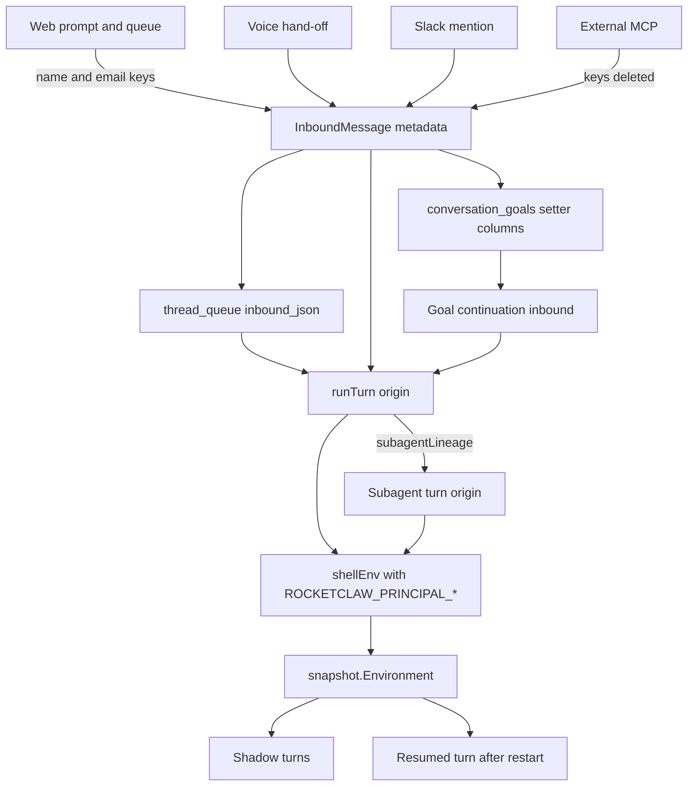

# Principal Shell Variables - Plan

## Goal Capsule

- **Objective:** Commands and skills an agent runs on a person's behalf can tell who that person is, by name, email, and a stable email-derived ID.
- **Means:** Connectors put the person's name and email on the inbound message's trusted metadata, and the turn builds the three variables from the turn's origin inbound. (KTD1, KTD2)
- **Product authority:** The Product Contract below is the source of WHAT; the Planning Contract is the source of HOW.
- **Product Contract preservation:** Product Contract unchanged; the R14/R15 overlap on promotion into a running turn is recorded as assumption A1.
- **Stop conditions:** Stop and report if the RocketClaw Go source CLOC (`make check-cloc-budget` in `internal/rocketclaw`) would reach 24250; the measured baseline is 24184, so the whole change has about 66 source lines.
- **Execution profile:** Go backend plus connectors, one SQL migration, docs. `ce-work` implements and verifies; shipping follows the `lfg` pipeline.
- **Open blockers:** None.

---

## Product Contract

### Summary

Every turn a person starts from Web, voice, or Slack exposes `ROCKETCLAW_PRINCIPAL_NAME`, `ROCKETCLAW_PRINCIPAL_EMAIL`, and `ROCKETCLAW_PRINCIPAL_ID` to its shell commands.
The values follow that person's work into subagents, shadows, later goal turns, and their queued messages.
When no email is known, only the name is set.

### Problem Frame

Shell commands, prompt `!` expansions, and permission patterns see `ROCKETCLAW_CONVERSATION_ID`, External MCP `ROCKETCLAW_METADATA_*` values, and `ROCKETCLAW_SHADOW`, but nothing about the person who asked.
RocketClaw already knows that person: Web signs them in by Tailscale login, and Slack looks up their profile for the prompt header's principal.
That knowledge stops at a display string in the model header, so a skill cannot set a git author, call an internal API as the person, or look up an avatar.

### Key Decisions

- **Only turns a person started carry the variables.** Cron, agent-written messages, and other system turns carry none. (session-settled: user-directed — chosen over reusing the last person seen in the thread: the variables must name who asked for this work.) Governs R9, R16.
- **A missing email degrades to name only.** (session-settled: user-approved — chosen over setting empty strings or refusing the turn: scripts test for presence and the turn still runs.) Governs R5.
- **NAME is the person's name, not the principal string.** (session-settled: user-approved — chosen over copying the header's `principal=` text such as `Alice (U123ABC)`: scripts want a name.) Governs R2, R7, R8.
- **Slack supplies email from the user's profile.** (session-settled: user-directed — chosen over Web-only email: Slack mentions are human turns too.) Governs R8.
- **External MCP turns carry no variables.** (session-settled: user-directed — chosen over exposing the client's Basic-auth username as NAME: External MCP never has a person as principal.) Governs R9.
- **Subagents inherit the person's values.** (session-settled: user-approved — chosen over top-level turns only: a subagent works on the same person's behalf.) Governs R11.
- **Goal continuation turns keep the goal setter.** (session-settled: user-approved — chosen over the first goal turn only: the loop works for the person who set it.) Governs R13.
- **The ID hashes a trimmed, lowercased email.** (session-settled: user-approved — chosen over hashing the email exactly as given: case and whitespace variants of one address get one ID, as Gravatar does.) Governs R4.
- **Queued work keeps its writer; a steer does not switch identity.** (session-settled: user-approved — chosen over using the promoter's identity or switching mid-turn: the values name who wrote the work being run.) Governs R14, R15.

### Requirements

**The variables**

- R1. The variables are named `ROCKETCLAW_PRINCIPAL_NAME`, `ROCKETCLAW_PRINCIPAL_EMAIL`, and `ROCKETCLAW_PRINCIPAL_ID`, and are visible wherever the turn's other `ROCKETCLAW_*` shell variables are.
- R2. `ROCKETCLAW_PRINCIPAL_NAME` holds the person's name with no connector ID attached.
- R3. `ROCKETCLAW_PRINCIPAL_EMAIL` holds the person's email as the source supplies it, without validation.
- R4. `ROCKETCLAW_PRINCIPAL_ID` is the lowercase hex SHA-256 of the email after trimming surrounding whitespace and lowercasing.
- R5. When no email is known, `ROCKETCLAW_PRINCIPAL_EMAIL` and `ROCKETCLAW_PRINCIPAL_ID` are unset, `ROCKETCLAW_PRINCIPAL_NAME` is still set, and the turn runs as usual.

**Where the values come from**

- R6. Web and voice turns signed in through Tailscale (the tsnet node or `tailscale whois`) use the Tailscale display name as NAME, falling back to the login, and the Tailscale login as EMAIL.
- R7. Web and voice turns signed in through a `web_users` entry use that entry's configured value as both NAME and EMAIL.
- R8. Slack turns use the sender's Slack name (display name, then real name) as NAME and the profile email as EMAIL; without the `users:read.email` bot scope or a profile email, R5 applies.
- R9. External MCP turns carry none of the variables.

**Which turns carry them**

- R10. Every turn a person starts from Web, voice, or Slack sets the values fresh from that person, replacing any earlier turn's values.
- R11. A subagent started by `task` during a person's turn carries that person's values.
- R12. A shadow of a person's turn carries that person's values.
- R13. Goal continuation turns carry the values of the person who set the goal, including after a restart.
- R14. A queued or stashed message carries its writer's values when it runs, including after a restart and when someone else promotes it.
- R15. A steer into a running turn leaves that turn's values unchanged; the next turn follows R10.
- R16. Cron turns, agent-written messages (including ones a person promotes), goal completion checks, and workflow workers carry none of the variables.
- R17. A turn resumed after a restart keeps the values it started with.

**Unchanged surfaces and docs**

- R18. The prompt header, its `principal=` text, and the Web message footer stay as they are.
- R19. The README documents the three variables and the Slack `users:read.email` scope with its reinstall step and name-only fallback.

### Acceptance Examples

- AE1. **Covers R4, R6.** **Given** Alice signs in to Web through Tailscale with login `Alice@Example.com ` and display name `Alice Smith`, **when** her turn runs `env`, **then** NAME is `Alice Smith`, EMAIL is the login, and ID is the SHA-256 of `alice@example.com`.
- AE2. **Covers R5, R8.** **Given** the Slack app lacks `users:read.email`, **when** Bob mentions the bot, **then** the turn sets NAME to `Bob` and leaves EMAIL and ID unset.
- AE3. **Covers R14.** **Given** Alice queues a message from Web and Bob promotes it, **when** it runs, **then** the variables name Alice.
- AE4. **Covers R13.** **Given** Alice sets a `$goal` and RocketClaw restarts mid-loop, **when** the next goal turn runs, **then** the variables still name Alice.
- AE5. **Covers R15.** **Given** Alice's turn is running, **when** Bob steers into it, **then** that turn's commands keep Alice's values.
- AE6. **Covers R9, R16.** **Given** a cron turn or an External MCP turn, **when** it runs `env`, **then** none of the three variables appear.

### Scope Boundaries

- Showing the email in the prompt header, the Web footer, or anywhere the model reads by default.
- Changing what External MCP puts in the prompt header's `principal=` today.
- Validating that EMAIL is a real address.
- Variables for goal completion checks and workflow workers, which get no RocketClaw extra env today.

### Sources

- Turn env build and capture: `internal/rocketclaw/backend/bridge.go` (`shellEnv`, `rocketcodeConfig`, `externalMCPMetadataEnv`).
- Web identity: `internal/rocketclaw/frontend/rpc/server.go` (`principal`, `tailscaleUsername`) and `internal/rocketclaw/frontend/rpc/http.go` (`NewTailnetHandler`).
- Slack principal: `internal/rocketclaw/frontend/slack/connector.go` (`slackPrincipal`, `slackDisplayName`).
- Queue principal: `internal/rocketclaw/protocol/later_work.go` (`ThreadQueueItem`).
- Goal state: `internal/rocketclaw/backend/store.go` (`GoalState`).
- Existing env docs: `README.md` (`ROCKETCLAW_SHADOW`), `cmd/rocketclaw/CHEATSHEET.md` (goal checks and workflow workers get no extra env).

---

## Planning Contract

### Key Technical Decisions

- KTD1. **Identity travels as two trusted inbound metadata keys.** Add `InboundPrincipalNameMetadataKey` and `InboundPrincipalEmailMetadataKey` next to `InboundPrincipalMetadataKey` in `internal/rocketclaw/protocol/types.go`. Every path that stores a full `InboundMessage` (`thread_queue.inbound_json`, `active_turns.inbound_json`) then keeps them with no new queue column. `rocketclaw_principal` stays the header string and keeps its meaning. Covers R2, R3, R14.
- KTD2. **The turn builds the variables from its origin inbound.** In `runTurn`'s non-captured branch, `origin` is the turn's own inbound for top-level turns and the root session's running-turn inbound for subagents (`subagentLineage`). One helper turns the two keys into the three variables per R1-R5 and merges them into `shellEnv` after the External MCP block. Capture, restart resume, and shadows then reuse `snapshot.Environment` unchanged. Covers R1, R4, R5, R11, R12, R17.
- KTD3. **The keys are the gate, not `Human`.** Goal continuations are non-human inbounds that must still carry the setter, so the helper reads the keys whenever present. Only Web, voice, Slack, and goal continuations set them. External MCP is the only ingress with caller-supplied metadata, and `submitExternalMCPInput` deletes both keys the way it already deletes `rocketclaw_principal`. Covers R9, R13, R16.
- KTD4. **The goal row stores the setter in two new columns.** Migration `045_goal_principal.sql` adds `principal_name` and `principal_email` (`TEXT NOT NULL DEFAULT ''`) to `conversation_goals`. `GoalState` gains matching fields, both goal-start paths fill them from the kickoff inbound, and both continuation constructors (`finishGoalTurn`, `StartActiveGoals`) copy them onto the continuation inbound. Restart survives because the row persists. Covers R13.
- KTD5. **Web queue and stash store the full inbound.** `frontend/rpc/server.go`'s `$enqueue`/`$stash` path is the only producer of queue rows without `Inbound`. Building the inbound there, as voice already does, makes all four rebuild sites keep the keys. Covers R14.
- KTD6. **External MCP metadata never echoes the keys.** Add both keys to `externalMCPMetadataEnv`'s skip list, so a person's turn in an External MCP thread neither exports them as `ROCKETCLAW_METADATA_*` nor writes the email into the model-visible metadata message. Covers R18.
- KTD7. **Shadows add `ROCKETCLAW_CONVERSATION_ID` only when the parent env had it.** `rocketcodeConfig` currently tests `shellEnv != nil`; Web and Slack turns now get a non-nil env, so the test becomes "the parent env carries `ROCKETCLAW_CONVERSATION_ID`". Shadows keep today's variable set plus the principal ones.

### High-Level Technical Design

### Assumptions

- A1. Promoting a queued item while another turn runs delivers it as a steer into that turn, so R15 applies and the running turn keeps its values. R14 holds whenever the item starts its own turn.
- A2. When Slack `users.info` fails or returns no name, the turn sets no variables; a Slack user ID is not a name (R2).
- A3. Web queue rows saved before this change hold no full inbound and run with no variables.
- A4. A detached background task whose subagent turn starts after the root turn that spawned it ended takes the identity of whatever root turn runs then, which may be another person, or none when no root turn runs. This is the same limit `createdBy` has today.
- A5. Every goal today starts from a Web `$goal`, so every goal has a person as setter; Slack `$goal` is plain text.

### Scope Boundaries (planning)

- Not built: a `thread_queue` column for identity (KTD5 covers it), copying identity in `WriteSubagent` (KTD2 covers it), and `continueSubagent` env (it only awaits a child whose own resumed turn reuses its captured env).
- Not built: dropping the dead `slack_recipient_*` columns on `conversation_goals`.

---

## Implementation Units

### U1. Principal env from turn origin

- **Goal:** A turn whose origin inbound carries the name or email keys exposes the variables to its shell, shadows, and resumed runs.
- **Requirements:** R1, R2, R3, R4, R5, R11, R12, R15, R17, R18; KTD1, KTD2, KTD3, KTD6, KTD7.
- **Dependencies:** None.
- **Files:** `internal/rocketclaw/protocol/types.go`, `internal/rocketclaw/backend/bridge.go`, `internal/rocketclaw/backend/shadows.go`, `internal/rocketclaw/backend/bridge_test.go`, `internal/rocketclaw/backend/shadows_test.go`, `internal/rocketclaw/backend/active_turn_test.go`.
- **Approach:**
  1. Add the two exported metadata key constants beside `InboundPrincipalMetadataKey`.
  2. Add one private helper in `bridge.go` that maps origin metadata to the three variables per R4/R5, then merge its result into `shellEnv` at the end of the non-captured branch of `runTurn`, after the External MCP block.
  3. Add both keys to the `externalMCPMetadataEnv` skip list.
  4. Change the shadow `ROCKETCLAW_CONVERSATION_ID` condition per KTD7.
  5. `claimShadowTurn` copies both keys from the decoded parent inbound onto the fresh shadow inbound, so subagents a shadow starts find them through `subagentLineage` (R11, R12).
- **Patterns to follow:** `externalMCPMetadataEnv` for env-map building; `TestRunTurnSendsExternalMCPMetadataAsDeveloperMessage` for an end-to-end `execute` bash check of env values.
- **Test scenarios:**
  - Covers AE1. A Web human turn with name `Alice Smith` and email `Alice@Example.com ` prints NAME, the email as given, and the SHA-256 hex of `alice@example.com`.
  - A turn whose origin has the name key and no email key prints NAME and has EMAIL and ID unset.
  - A turn whose origin has neither key has none of the three variables and no `ROCKETCLAW_CONVERSATION_ID` it lacked before.
  - A Web human turn in a conversation with stored External MCP metadata keeps the three variables, and the model-visible metadata message and `ROCKETCLAW_METADATA_*` contain neither key.
  - In `TestSubagentActsForRootTurn`, a subagent of a Web root turn sees the root person's variables, and a subagent of an External MCP or cron root sees none.
  - In `TestShadowToolConstructionAndRealEffects`, a captured env with the principal variables but no conversation ID gives the shadow the principal variables and `ROCKETCLAW_SHADOW` but no `ROCKETCLAW_CONVERSATION_ID`; a captured env with the conversation ID keeps today's assertions.
  - A subagent started inside a shadow of a Web person's turn sees that person's variables and `ROCKETCLAW_SHADOW`.
  - Covers AE5. While a turn whose inbound carries Alice's keys runs, a steer inbound carrying Bob's keys is delivered into it; a command run after the steer still prints Alice's values.
- **Verification:** The new and existing env tests pass, and shadows still never mutate the captured parent env.

### U2. Goal setter persistence and continuation identity

- **Goal:** Goal continuation turns, including after a restart, carry the person who set the goal.
- **Requirements:** R13; KTD3, KTD4.
- **Dependencies:** U1.
- **Files:** `internal/rocketclaw/backend/migrations/045_goal_principal.sql`, `internal/rocketclaw/backend/store.go`, `internal/rocketclaw/backend/store_dao.go`, `internal/rocketclaw/backend/conversations.go`, `internal/rocketclaw/backend/revert.go`, `internal/rocketclaw/backend/bridge.go`, `internal/rocketclaw/backend/thread_bridges.go`, `internal/rocketclaw/backend/bridge_test.go`, `internal/rocketclaw/backend/thread_bridges_test.go`, `internal/rocketclaw/backend/store_test.go`.
- **Approach:**
  1. Migration adds the two columns with empty defaults; existing goals keep empty setters.
  2. `GoalState` gains the two fields; `beginGoalDB` inserts them and the goal read selects them.
  3. Both `StartGoal` branches fill them from the kickoff inbound's keys: the `admitWeb` branch through its `GoalState` literal, the other through `BeginGoal`.
  4. `finishGoalTurn` and `StartActiveGoals` set both keys on the continuation inbound from the goal row; `StartActiveGoals` loads the goal for that.
- **Patterns to follow:** `044_opencode_session_replies.sql` migration header; existing `beginGoalDB` upsert.
- **Execution note:** Changing `BeginGoal`'s signature churns many test call sites; prefer the smallest signature change that keeps the CLOC budget.
- **Test scenarios:**
  - A goal started from a Web inbound with name and email persists both, and `Goal` returns them.
  - Covers AE4. `TestThreadBridgeManagerStartsActiveGoalAfterRestart`: the restart continuation inbound carries the setter's keys.
  - `TestFinishGoalTurnAccountsKickoffAndContinuation`: the next continuation inbound carries the setter's keys.
  - A goal row with empty setter columns produces a continuation with no variables.
- **Verification:** Goal tests pass, and the migration applies on the test database.

### U3. Web and voice identity

- **Goal:** Web prompts, Web queue and stash items, and voice hand-offs carry the person's name and Tailscale login.
- **Requirements:** R6, R7, R10, R14; KTD5.
- **Dependencies:** U1.
- **Files:** `internal/rocketclaw/frontend/rpc/server.go`, `internal/rocketclaw/frontend/rpc/voice.go`, `internal/rocketclaw/backend/conversations.go`, `internal/rocketclaw/frontend/rpc/server_test.go`, `internal/rocketclaw/frontend/rpc/voice_loop_test.go`, `internal/rocketclaw/backend/runtime_test.go`.
- **Approach:**
  1. `prompt` keeps both values `principal(ctx)` already returns: NAME is its returned name (Tailscale display name falling back to the login, or the `web_users` value), and EMAIL is its username.
  2. Set both keys on the steer and goal inbound, and build a full inbound for the queue and stash item the way `voice.go` does, keeping `web_message_id` equal to the item ID and the item's kind (held for a stash).
  3. `PopQueueItem`'s non-revert `UPDATE` also rewrites `inbound_json`'s `Kind` with `jsonb_set`, as `revert.go`'s pop already does, so a popped stash no longer runs as held. Rewrite that statement's position subquery as a CTE while touching it (AGENTS.md SQL rule).
  4. `voiceCall` keeps the username next to the principal and sets both keys on its hand-off inbound.
- **Patterns to follow:** `voice.go` hand-off that stashes `Inbound: inbound`.
- **Test scenarios:**
  - A Tailscale-identified Web prompt (`connected@example.com`, `Connected Person`) reaches the backend with both keys.
  - A `web_users` prompt carries the configured value as both name and email.
  - Covers AE3. A Web `$enqueue` item promoted when no turn runs starts a turn whose inbound carries the writer's keys.
  - A Web `$stash` in a conversation that is not revert-eligible (a Slack thread opened in Web), once popped, runs with kind enqueue and the writer's keys.
  - A voice hand-off carries both keys.
- **Verification:** rpc tests pass, and the queue listing still shows the item text and principal.

### U4. Slack identity

- **Goal:** Slack mentions carry the sender's name and profile email.
- **Requirements:** R8, R5; A2.
- **Dependencies:** U1.
- **Files:** `internal/rocketclaw/frontend/slack/connector.go`, `internal/rocketclaw/frontend/slack/connector_test.go`.
- **Approach:** The single `users.info` lookup in `slackPrincipal` also yields `slackDisplayName` as NAME and `Profile.Email` as EMAIL; the header principal string stays `Name (ID)`.
- **Test scenarios:**
  - `TestSlackPrincipal` with `"email"` in the profile yields the principal string, the bare name, and the email.
  - Covers AE2. A profile without email yields the name key only.
  - A failed `users.info` yields the user-ID principal and neither key.
- **Verification:** Slack connector tests pass.

### U5. External MCP stripping

- **Goal:** External MCP callers cannot inject identity.
- **Requirements:** R9; KTD3.
- **Dependencies:** U1.
- **Files:** `cmd/rocketclaw/mcp.go`, `cmd/rocketclaw/mcp_test.go`.
- **Approach:** `submitExternalMCPInput` deletes both keys beside its existing `InboundPrincipalMetadataKey` delete.
- **Test scenarios:**
  - Covers AE6. Caller metadata containing both keys reaches the backend without them.
- **Verification:** `cmd/rocketclaw` tests pass.

### U6. Documentation

- **Goal:** Operators know the variables and the Slack scope.
- **Requirements:** R19.
- **Dependencies:** U1-U5.
- **Files:** `README.md`, `cmd/rocketclaw/CHEATSHEET.md`, `internal/rocketclaw/frontend/rpc/README.md`.
- **Approach:** README: list the three variables next to the `ROCKETCLAW_SHADOW` paragraph and add `users:read.email` with the reinstall step and name-only fallback to the Slack scopes. Say that NAME is an editable display name for attribution only, that per-person permission patterns should use `${ROCKETCLAW_PRINCIPAL_ID}` or `${ROCKETCLAW_PRINCIPAL_EMAIL}`, and that the shell values tell who asked, not a credential. CHEATSHEET: same scope note. rpc README: one sentence that the login becomes EMAIL.
- **Test expectation:** none -- documentation only.
- **Verification:** Docs name all three variables, the hash rule, and the scope.

---

## Verification Contract

| Gate | Command | Applies to |
|---|---|---|
| Format | `gofmt -l` on touched Go files prints nothing | U1-U5 |
| Unit and integration tests | `go test ./...` from the repo root | U1-U5 |
| Lint | `make lint` | U1-U5 |
| Full suite, coverage, CLOC | `make test` and `make check-code-metrics` in `internal/rocketclaw` (CLOC must stay below 24250) | All |

---

## Definition of Done

- Every unit's test scenarios exist and pass, and all gates above pass.
- RocketClaw Go source CLOC stays below 24250.
- No defensive guards, new exported symbols beyond the two metadata keys, or abandoned-attempt code remain in the diff.
- README describes the three variables, the hash rule, their trust level, and the Slack `users:read.email` scope; CHEATSHEET carries the scope note; the rpc README states that the login becomes EMAIL.
