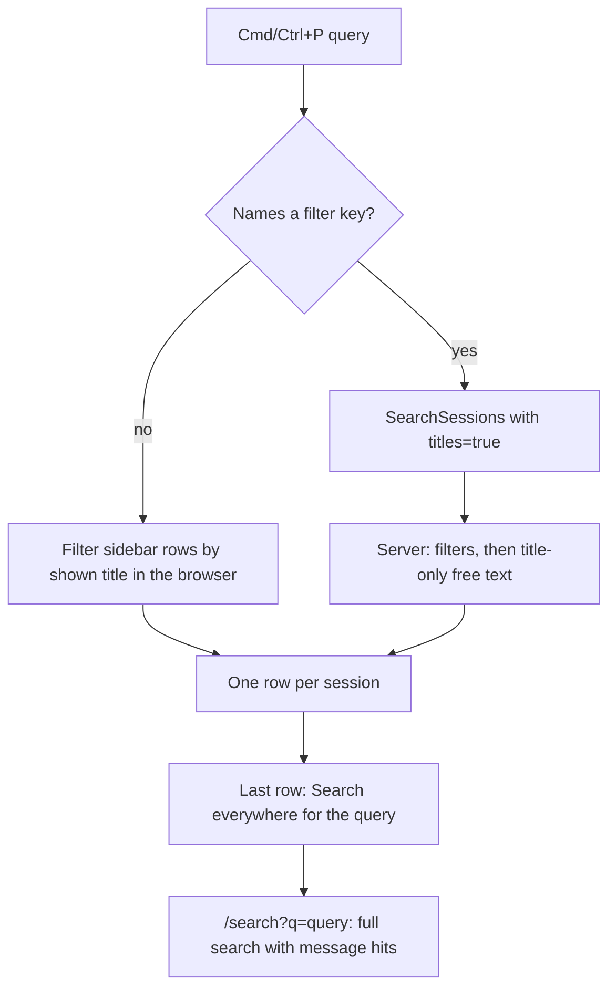

# Palette Title Search and Shortcuts - Plan

## Goal Capsule

- **Objective:** In the RocketClaw web app, Cmd/Ctrl+P finds sessions by title, instantly as you type plain text, and shows each command's keyboard shortcut. Search stays the place to dig through everything, and a read-only page lists every shortcut.
- **Product authority:** The requesting user, in the session that produced this plan. It follows up on PR 534 (`6536971d`), which made Cmd/Ctrl+P run the full Search query.
- **Means:** A titles-only server search mode for filtered queries (KTD1), in-browser title matching for plain text (KTD2), and one shortcut list feeding palette rows and a new `/shortcuts` page (KTD3).
- **Open blockers:** None.
- **Stop conditions:** Stop and report if the web source CLOC would cross its 8000-line failure line, or if the Go source CLOC would cross its 25000 failure line.
- **Execution profile:** One PR. `lfg` implements with `ce-work`, reviews, and opens the PR. Merge stays with the user.
- **Product Contract preservation:** Product Contract unchanged except one clarification. R7 now names "Shift" instead of "⇧" to match the key names the app already shows. The three questions deferred to planning were answered, by KTD1, KTD5 and KTD6, and removed.

---

## Product Contract

### Summary

Cmd/Ctrl+P becomes the quick look and Search stays the deep dig. Both read the same query syntax. In Cmd/Ctrl+P, plain text matches session titles in the browser on every keystroke. A query with a filter asks the server, which also matches titles only. Each session takes one row. The last row hands the query to Search. Every palette command shows its shortcut on the right, OpenCode style. The palette's shortcut footer goes away, and a new read-only page lists all shortcuts.

### Problem Frame

PR 534 made Cmd/Ctrl+P send the Search page's query, message text included, and draw each session's matched field and message excerpts as extra rows. Every pause in typing now costs a server round trip plus a message scan, and one session can fill several rows. The palette was meant for jumping to a session by name, and it now feels slow and noisy. Nothing connects the two tools either: Cmd/Ctrl+P has no way to carry a query to Search.

The palette's footer lists five shortcuts in a wrapping strip. Two of them (previous and next tab) don't work while the palette is open, which the footer itself admits with "(close menu first)". The only shortcut shown on a command row today is the one for "Sessions: New". OpenCode shows a command's shortcut on the same row as the command, which is what this app should feel like.

### Key Decisions

- **Plain text is instant; filters ask the server.** One copy of the filter rules lives on the server, so Cmd/Ctrl+P and Search cannot drift apart. Filtered queries are quick but not instant. Governs R1, R2. (session-settled: user-approved — chosen over making filtered queries instant with a second copy of the filter rules in the browser: one filter implementation, no drift)
- **Cmd/Ctrl+P shows no message contents.** Message and matched-field excerpts belong to Search, the way VS Code's search view owns content matches. Governs R3, R5. (session-settled: user-directed — chosen over PR 534's message and field rows in the palette: the palette must match on the title, not the body)
- **Filters and the Search hand-off both stay in Cmd/Ctrl+P.** The query syntax is the same in both places, and the hand-off row is the link between them. Governs R2, R4, R6. (session-settled: user-directed — chosen over a title-only palette with no filters and no hand-off row: the two tools need continuity)
- **Only today's shortcuts.** No key is added or remapped. Shortcuts that work today but have no palette command get one. Governs R9, R10. (session-settled: user-directed — chosen over adding new OpenCode-style default keybinds, and over showing keys only on commands that already exist)
- **"Title" means the title the row shows.** That is the session's name, or else the first line of its preview, the same text the session list displays. It is what the user reads, so it is what they type. Governs R1, R2.
- **The shortcuts page is reached through a palette command.** It gets no key of its own, which keeps R9 true. Governs R11, R12.

### Requirements

**Session matching in Cmd/Ctrl+P**

- R1. A Cmd/Ctrl+P query with no filter matches sessions by their shown title, case-insensitively, in the browser. Results update on every keystroke with no server request.
- R2. A Cmd/Ctrl+P query with any filter that Search supports goes to the server. The server applies the filters and matches the remaining free text against the shown title only, never other fields or message text.
- R3. Each matching session appears as exactly one row, drawn as in the session list. Cmd/Ctrl+P shows no message excerpts and no matched-field rows.
- R4. When the query is non-empty, the last row of Cmd/Ctrl+P is "Search everywhere for '<query>'". Choosing it opens the Search page with that exact query.
- R5. The Search page keeps its current behavior: it matches names, fields and message text and shows its hit rows.
- R6. Typing a filter key in Cmd/Ctrl+P still suggests the values in use (for example `server:`, `agent:`, `model:`), as it does after PR 534.

**Shortcuts in the palette**

- R7. Every palette command bound to a working keyboard shortcut shows that shortcut right-aligned on its row, in both Cmd/Ctrl+P and Cmd/Ctrl+Shift+P. On Mac it reads ⌘, Shift and Option, elsewhere Ctrl, Shift and Alt.
- R8. The palette's keyboard-shortcuts footer is removed.
- R9. The existing shortcuts keep their keys, and no new shortcut is added: Cmd/Ctrl+P, Cmd/Ctrl+Shift+P, Cmd/Ctrl+Alt+N, Cmd/Ctrl+[, Cmd/Ctrl+], Cmd/Ctrl+B, Escape on a page tab, and in the message box Cmd/Ctrl+Enter (steer) and Cmd/Ctrl+Alt+Enter (stash).
- R10. New palette commands run the existing keys' actions and show their keys: previous tab (Cmd/Ctrl+[), next tab (Cmd/Ctrl+]) and toggle sidebar (Cmd/Ctrl+B). Toggle sidebar is listed only when Cmd/Ctrl+B works, meaning tabs sit in the left sidebar on a wide window.

**Shortcuts page**

- R11. A read-only page lists every shortcut in R9, saying what each does and where it works.
- R12. A palette command opens the page, and it behaves like the app's other pages: it opens in a tab, and Escape closes it.
- R13. The palette rows and the shortcuts page always show the same key for the same action.

### Acceptance Examples

- AE1. **Covers R1, R3.** Given a session titled "Deploy fix" and another whose title lacks "deploy" but whose messages mention it, when the user types `deploy` in Cmd/Ctrl+P, then only "Deploy fix" appears, as one row, with no server request.
- AE2. **Covers R2.** Given sessions on servers `box` and `lab`, when the user types `server:box deploy`, then the server returns only `box` sessions whose shown title contains "deploy".
- AE3. **Covers R4, R5.** Given the query `deploy` in Cmd/Ctrl+P, when the user picks "Search everywhere for 'deploy'", then the Search page opens with `deploy` and lists the message-only match from AE1 with its message excerpt.
- AE4. **Covers R7, R10.** Given tabs in the left sidebar on a wide window, when the user opens Cmd/Ctrl+Shift+P and types `tab`, then the previous and next tab commands show ⌘[ and ⌘] on Mac, and toggle sidebar shows ⌘B.
- AE5. **Covers R10.** Given tabs placed on top, when the user opens Cmd/Ctrl+Shift+P, then no toggle sidebar command is listed.
- AE6. **Covers R8.** When either palette opens, there is no shortcut footer.

### Success Criteria

- With about 5,300 sessions loaded, typing plain text in Cmd/Ctrl+P updates the list with no visible lag and no network request. Commit `c486fa3e` measured the palette opening in under 50 ms at that size, and it should stay that fast.

### Scope Boundaries

- Remapping, user-defined keybinds, and an editable shortcuts page are out.
- New shortcuts for other commands (close tab, settings, search) are out.
- Changes to Search page matching, ranking or layout are out.
- Matching titles in the browser when the query has filters is out, per the first Key Decision.

### Dependencies / Assumptions

- The browser already holds every session row: they stream from `ListSessions` and refresh every 2 s (`internal/rocketclaw/web/src/ui.tsx:604-640`). R1 relies on this.
- Search reads `?q=` from the URL and opens with that query (`internal/rocketclaw/web/src/ui.tsx:2150-2151`), which R4 can use.
- `room:` and `principal:` need server-side data the browser rows lack (`internal/rocketclaw/backend/session_search.go:213-223`, `:292`), which is why R2 sends filtered queries to the server.

### Sources / Research

- Cmd/Ctrl+P today: `CommandPalette`, `paletteRows` and `useSessionSearch` in `internal/rocketclaw/web/src/ui.tsx` (around lines 1657-1952).
- Footer and the only row hint: `PaletteNavigationHints` and `PaletteCommandContent` in `internal/rocketclaw/web/src/ui.tsx:1954-1967`. Pinned by `internal/rocketclaw/web/src/session-list.browser.test.ts:198-206` and `:235`.
- Bound shortcuts: `internal/rocketclaw/web/src/ui.tsx:1432-1461`, `:4162`, `:4196`.
- Shown title: `sessionTitle` in `internal/rocketclaw/web/src/ui.tsx:400-402`.
- Earlier decision this partly reverses: `docs/plans/2026-10-09-0959-feat-unified-session-search-plan.md` (matching moved to the backend; making Cmd/Ctrl+P fast again was a non-goal).
- OpenCode reference: `packages/app/src/shell/commands/dialog.tsx` in `anomalyco/opencode` (`PaletteRow` shows a command's keybind on the right; session rows show the title).

---

## Planning Contract

### Key Technical Decisions

- KTD1. **A `titles` request flag joins `messages`.** `SearchSessionsRequest` keeps `bool messages = 2` and adds `bool titles = 3`. `SessionService.SearchSessions` replaces its `messages bool` parameter with a three-value scope enum: fields (today's `messages=false`), messages (today's `messages=true`), and titles. With the titles scope the server skips the message scan and matches free text only against the shown title: `Name`, else the first line of the summary's last message, else the session label. The fields scope stays because the backend tests for field matching use it, and titles needs the same skip-messages branch. The Search page and the agents' session tool keep the messages scope. Governs R2, R5. (session-settled: user-approved — chosen over making filtered queries instant with a second copy of the filter rules in the browser: one filter implementation, no drift)
  - **Amended after review (user-approved):** the flag became `filters`, and the server applies only the filters. The browser matches the free text against the titles as rows show them, markdown and Slack tags included, for plain and filtered queries alike, so the title rule lives in one place. Go `shownTitle` was removed.
- KTD2. **The palette routes by whether the query names a filter key.** If the query has a word starting with `tag:`, `cron:`, `agent:`, `room:`, `principal:`, `server:`, `model:`, `is:` or `sort:`, the palette passes it to `useSessionSearch` with `titles` true, and pills, suggestions, debounce and Enter all work as today. Otherwise it passes an empty query, so nothing is sent, and filters `sidebar.rows` by `sessionTitle(row, false)` containing the lowercased trimmed query. A bare key such as `principal:` counts, so its suggestions still load. The routing pattern sits next to the existing palette rule that hides commands for a filter query. Governs R1, R2, R6.
- KTD3. **One `shortcuts` list owns every key.** Each entry has an id, its keys written once with `mod` for ⌘/Ctrl and `Alt` for Option/Alt, what it does, and where it works. A palette row shows the entry whose id equals the row's command key. The shortcuts page renders the whole list. The window keydown handler keeps its own key checks; making it data-driven is out of scope. Governs R7, R9, R11, R13.
- KTD4. **SessionApp builds the tab and sidebar commands.** It passes `Tabs: Previous`, `Tabs: Next` and, only when `vertical`, `Tabs: Toggle sidebar` to `CommandPalette` in place of the `vertical` prop. The footer, the prop's only other use, is deleted. Previous and next share one step function with the Cmd/Ctrl+[ and ] handler. Picking a command already closes the palette and returns to the origin page before `run` (`choose` → `back`), which is the "close menu first" the old footer asked for. Governs R8, R10.
- KTD5. **The shortcuts page lives at `/shortcuts`.** It gets a `route.shortcuts` flag, the `showChat` exclusion, a `pageTabs` entry titled "Shortcuts", the server's SPA path list in `internal/rocketclaw/internal/web/assets.go`, and a palette command `Help: Keyboard Shortcuts` added to the existing page-link commands. Governs R11, R12.
- KTD6. **The hand-off row is a command row, and Search adopts a navigated `?q=`.** When the session query is non-empty, the last row is `Search everywhere for '<query>'`. It navigates to `/search?q=<query>` and is never ranked among commands. `SearchTabs` reads `?q=` only at mount and then overwrites the URL, so it gains an effect on `useSearch()`. When a navigation brings a `q` that differs from the active tab's query, it selects the saved tab with that query or adds one, the same rule its initializer uses. Governs R4.
- KTD7. **PR 534's palette hit rows are removed, not hidden.** `paletteRows` loses `response`, field rows and message rows. `SearchHit` goes back inline into `SearchResultGroup`, its only remaining caller. The palette keeps `SearchStatus` for searching, error and Retry on filtered queries. Governs R3.

### High-Level Technical Design

### Assumptions

- The browser title and the server title can differ in two cases, and both are acceptable. A session created in this tab can be titled by its first message until the session list has it (`firstMessages`). A Slack session's label is formatted differently on each side. Plain-text matching, which most queries are, uses the browser title.
- Escape on a page tab, steer and stash get no palette command, because they act on the page or the message box rather than from the palette. They appear on the shortcuts page only.
- The shortcuts page lists Cmd/Ctrl+B with its condition (tabs in the left sidebar, wide window) rather than hiding it, since the page is a reference.

### Scope Boundaries (planning)

- Making the window keydown handler read the shortcut list is out (KTD3).
- Considered and not built: a browser copy of the filter rules (first Key Decision).
- Considered and not built: a server index for title search. Filtered queries already run through `SidebarChats` in Go, and the message scan is what made PR 534 slow.

---

## Implementation Units

### U1. Titles-only server search

- **Goal:** `SearchSessions` with `titles` true applies filters and matches free text against the shown title only, with no message scan.
- **Requirements:** R2, R5. KTD1.
- **Dependencies:** none.
- **Files:**
  - `internal/rocketclaw/web/proto/web.proto`
  - `internal/rocketclaw/frontend/rpc/web.pb.go` and `internal/rocketclaw/frontend/rpc/protocol.gen.go`, regenerated with `go generate`
  - `internal/rocketclaw/frontend/rpc/session_commands.go`
  - `internal/rocketclaw/backend/session_search.go`
  - `internal/rocketclaw/backend/session_tools.go`
  - Tests: `internal/rocketclaw/backend/session_search_test.go`, `internal/rocketclaw/backend/session_tools_test.go`, `internal/rocketclaw/backend/opencode_test.go`, `internal/rocketclaw/frontend/rpc/server_test.go`
- **Approach:**
  1. Proto: add `bool titles = 3` with a one-line comment. Regenerate.
  2. Server: map the request to the scope (titles wins over messages). The shared-search key includes the scope.
  3. Backend: in `SearchSessions`, run the message block only for the messages scope. In the no-hits pass, the free-text test uses the title (`cmp.Or(name, first line of preview, label)`) for the titles scope and today's field list otherwise. Update the doc comment.
  4. Existing callers map mechanically: `true` becomes the messages scope and `false` the fields scope.
- **Patterns to follow:** the existing two-pass `withHits` loop and `sessionLabel` in `session_search.go`.
- **Test scenarios:**
  - Covers AE2. `titles` true with `server:box deploy` returns only `box` sessions whose shown title contains "deploy", and no named session whose preview or messages alone contain it.
  - `titles` true matches an unnamed session by the first line of its last message, and not by the second line.
  - `titles` true never calls the message search: there are no `Hits`, and a message-only match is absent.
  - The messages and fields scopes keep today's behavior: the existing tests pass after mapping `true` and `false` to those scopes.
  - A filter-only query (`tag:A`, empty free text) with `titles` true returns every passing chat.
- **Verification:** Backend and rpc tests pass. `rg "messages bool"` finds no stale backend signature.

### U2. Title-only Cmd/Ctrl+P with the Search hand-off

- **Goal:** Plain text filters titles in the browser with no request. Filtered queries go through U1. Each session takes one row, and the hand-off row comes last.
- **Requirements:** R1, R2, R3, R4, R6. KTD2, KTD6, KTD7.
- **Dependencies:** U1.
- **Files:**
  - `internal/rocketclaw/web/src/ui.tsx` (`useSessionSearch`, `paletteRows`, `CommandPalette`, `SearchTabs`, `SearchResultGroup`, `SearchHit`)
  - Tests: `internal/rocketclaw/web/src/search-page.browser.test.ts`, `internal/rocketclaw/web/src/session-list.browser.test.ts`, `internal/rocketclaw/web/src/session-commands.browser.test.ts`
- **Approach:**
  1. `useSessionSearch` sends `{ query, messages: true }` from the Search page and `{ query, titles: true }` from the palette.
  2. In `CommandPalette`, route per KTD2. Plain text produces rows from `sidebar.rows` filtered by title. A filtered query uses `search.rows` once a response for it exists. Until then it keeps the title-filtered rows, dimmed by `search.pending`, so adding a filter never flashes every session.
  3. `paletteRows` returns one row per session (KTD7) and appends the hand-off row after the sessions when the needle is non-empty. When a non-empty query lists no session or command rows, the `paletteEmpty` text ("No matches", "loading..." or "Search incomplete") shows as a non-selectable line above the hand-off row.
  4. Enter keeps today's order, with the hand-off row as the last fallback. A command containing the typed text wins, else the highlighted or first session, else the hand-off row. In plain-text mode `search.enter` already calls `shown()`, because nothing was sent.
  5. `SearchTabs` adopts a navigated `?q=` (KTD6).
- **Patterns to follow:** the pre-534 `paletteRows` tail in `jj diff --git -r 6536971d -- internal/rocketclaw/web/src/ui.tsx`, and the `SearchTabs` initializer's select-or-add rule.
- **Test scenarios:**
  - Covers AE1. With rows "Deploy fix" and a row whose title lacks "deploy", typing `deploy` lists only "Deploy fix", as one row, and the SearchSessions fixture records no request.
  - Covers AE2. Typing `server:box deploy` sends one request with `titles: true`. The rows follow the response, and filter pills still appear.
  - Covers AE3. Picking "Search everywhere for 'deploy'" lands on `/search?q=deploy`, the Search page sends `messages: true`, and its message hit renders.
  - The hand-off also works when Cmd/Ctrl+P is opened from the Search page itself: the active search tab shows the new query.
  - Typing `server:`, `agent:` and `model:` still offers suggestions. This replaces PR 534's parity test, keeping its suggestion loop.
  - An empty query lists the sidebar rows with no hand-off row and no request.
  - The existing typed-query empty-state tests (`empty-search` shows "No matches", `tag:zzz-nope` shows "loading...") still pass, and the hand-off row is present below the message.
  - A query that matches no title and only fuzzily matches a command opens `/search?q=<query>` on Enter.
  - Typing `deploy` and then ` server:` never renders rows outside the earlier title matches before the filtered response arrives.
  - The existing palette tests that asserted `messages: true` requests for plain text now assert no request.
- **Verification:** Browser tests pass. With the `many` fixture in `session-list.browser.test.ts`, plain typing sends no `SearchSessions` request.

### U3. Shortcut list, row shortcuts, new tab commands, no footer

- **Goal:** Every palette command with a shortcut shows it on the right in both palettes. The previous tab, next tab and toggle sidebar commands exist. The footer is gone.
- **Requirements:** R7, R8, R9, R10, R13. KTD3, KTD4.
- **Dependencies:** none. It shares `ui.tsx` with U2, so land it after U2.
- **Files:**
  - `internal/rocketclaw/web/src/ui.tsx` (`SessionApp` `onKey`, `CommandPalette` props, `PaletteCommandContent`, `PaletteNavigationHints` removed)
  - Tests: `internal/rocketclaw/web/src/session-list.browser.test.ts` (footer and `kbd` assertions near the "Sessions: New" hint test, the short-menu footer check, and the command-list text expectation that includes "Sessions: New⌘OptionN")
- **Approach:**
  1. Add the `shortcuts` list (KTD3) and a key formatter that turns `mod` and `Alt` into ⌘/Option or Ctrl/Alt using the existing `navigator.platform` test.
  2. `PaletteCommandContent` renders the matching entry's keys as `kbd` items, outside cron mode, in place of the `key === "new"` special case.
  3. Extract the tab step from `onKey` and build the three commands (KTD4). Drop `PaletteNavigationHints` and its call.
- **Patterns to follow:** the current `kbd` styling in `PaletteCommandContent`.
- **Test scenarios:**
  - Covers AE4. With tabs on the left and a wide window, Cmd+Shift+P filtered to `tab` shows ⌘[ on `Tabs: Previous`, ⌘] on `Tabs: Next` and ⌘B on `Tabs: Toggle sidebar`, using a Mac user agent as the existing test does.
  - Covers AE5. With tabs on top, no `Tabs: Toggle sidebar` row exists.
  - Picking `Tabs: Next` closes the palette and activates the next tab. Picking `Tabs: Toggle sidebar` hides the sidebar.
  - `Sessions: New` still shows ⌘ Option N, and no row without a shortcut has a `kbd`.
  - Covers AE6. Neither palette has a "Keyboard shortcuts" footer, at any viewport.
- **Verification:** Browser tests pass. `rg PaletteNavigationHints` finds nothing.

### U4. Read-only shortcuts page

- **Goal:** `/shortcuts` lists every shortcut from the list and opens from `Help: Keyboard Shortcuts`.
- **Requirements:** R11, R12, R13. KTD5.
- **Dependencies:** U3.
- **Files:**
  - `internal/rocketclaw/web/src/ui.tsx` (`useRoute`, `showChat`, `pageTabs`, main page outlet, `paletteRows` page commands, a `ShortcutsPage`)
  - `internal/rocketclaw/internal/web/assets.go`
  - Tests: `internal/rocketclaw/web/src/tabs.browser.test.ts` (route list) and `internal/rocketclaw/web/src/session-list.browser.test.ts` (palette to page). `internal/rocketclaw/internal/web/assets_test.go` (add `/shortcuts` to the existing SPA path list).
- **Approach:** `ShortcutsPage` renders `PageTitle` and a list of each entry's keys, label and where-note, reusing the U3 key formatter. Escape closing and tab behavior come from the existing page plumbing.
- **Patterns to follow:** `PageIndex` for a simple read-only page with `PageTitle`.
- **Test scenarios:**
  - `Help: Keyboard Shortcuts` opens `/shortcuts` in a tab titled "Shortcuts", which lists ⌘P, ⌘ Shift P, ⌘ Option N, ⌘[, ⌘], ⌘B, Escape, ⌘ Enter and ⌘ Option Enter with their labels.
  - A direct load of `/shortcuts` serves the app rather than a 404.
  - Escape on the page closes its tab.
- **Verification:** Browser and Go tests pass.

### U5. Docs and committed web build

- **Goal:** The README describes the new palette, shortcuts and page. The committed bundle matches the source.
- **Requirements:** all, for documentation.
- **Dependencies:** U1 through U4.
- **Files:**
  - `internal/rocketclaw/web/README.md`: the Cmd/Ctrl+P paragraphs PR 534 changed, the footer paragraph, and a new Shortcuts note
  - `internal/rocketclaw/frontend/rpc/README.md` if it documents `messages`
  - `internal/rocketclaw/internal/web/dist/*`, rebuilt by the web build
- **Approach:** Rewrite the PR 534 README text in place. Do not stack corrections on it.
- **Test expectation:** none. This is documentation and generated output, covered by the build and the README check in the final response.
- **Verification:** `make build` in `internal/rocketclaw/web` leaves `dist` consistent, with `index.html` pointing at the new hashes and the old assets removed.

---

## Verification Contract

| Gate | Command | Proves |
|---|---|---|
| Go format | `gofmt -l` on touched Go files | U1 formatting |
| Go tests | `go test ./...` from the repo root | U1, U4 Go side |
| Web lint and types | `make lint` in `internal/rocketclaw/web` | U2 through U4 |
| Web tests | `make test` in `internal/rocketclaw/web` (builds, then runs bun browser tests) | U2 through U4, AE1 through AE6 |
| Repo lint | `make lint` at the repo root | all |
| Repo tests and metrics | `make test` at the repo root | all, including CLOC budgets |
| CLOC | `make cloc` in `internal/rocketclaw/web` and `internal/rocketclaw` | web source stays below 8000, Go below 25000 |

---

## Definition of Done

- R1 through R13 hold, shown by the U1 through U4 tests and AE1 through AE6.
- Every gate in the Verification Contract passes on the final diff.
- No `PaletteNavigationHints` remains, and the palette never sends `messages: true`.
- The web source CLOC is no higher than needed. Code made unused by this change is deleted (`SearchHit` inlined, palette hit-row code removed).
- Abandoned-attempt code is removed from the diff.
- The README reflects the shipped behavior, and the final report states that README impact was considered.
