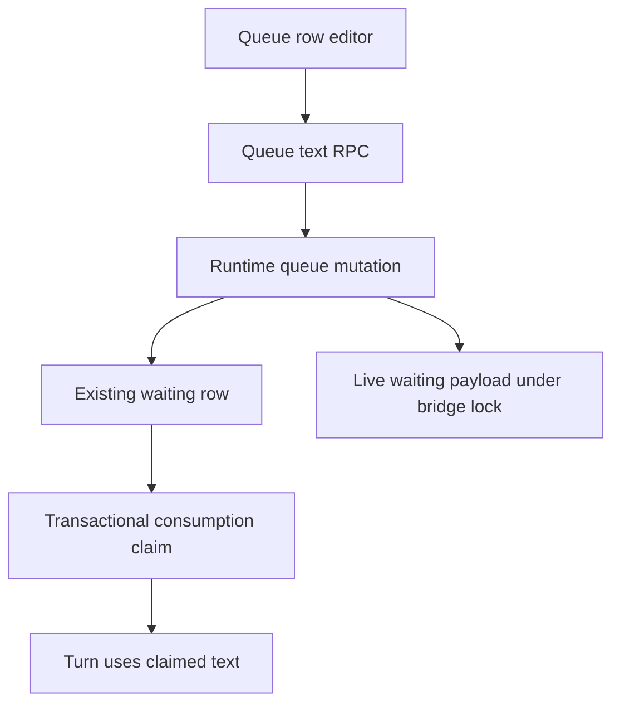
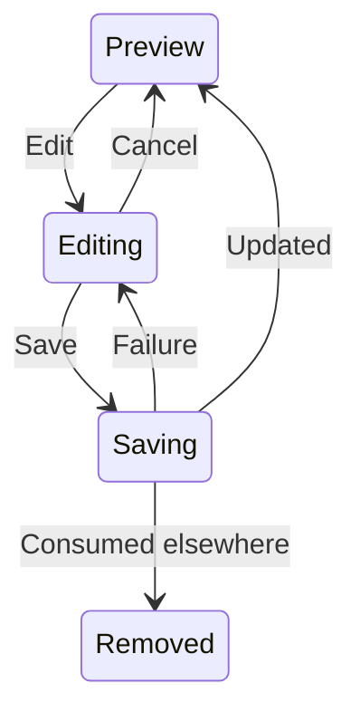

# Inline Queue Editing - Plan

## Goal Capsule

Let people correct waiting messages without moving them into the composer.
Implement and verify the change locally, then open a pull request; merging is separate.
Stop if preserving queue identity and execution semantics requires a different product behavior.

---

## Product Contract

### Summary

Add Edit, Save, and Cancel directly to queued and stashed message rows.

### Problem Frame

Queue rows currently allow reading, promotion, release, reordering, and removal, but not correcting their text.
Removing and resending would change queue identity and interfere with a separate composer draft.

### Requirements

**Editing**
- R1. Edit opens an inline text editor initialized from the row; Cancel changes neither the row nor the composer.
- R2. Save updates only text while keeping the original ID, position, attachments, delivery, source, principal, prompt framing, and outbound routing.
- R3. Keep the separate composer draft untouched throughout editing and saving.

**Execution**
- R4. Saving a consumed or removed item reports that it is no longer waiting, without inserting, resubmitting, or duplicating work.
- R5. Saved rows and live waiting payloads must agree before execution, including a request already offered to the bridge.
- R6. Disable conflicting controls while saving and prevent duplicate submissions; surface failures without discarding edited text.

### Scope Boundaries

No attachment editing, editing pending or consumed steers, remove-to-composer flow, delivery changes, new queue modes, or unrelated refactoring.
No automatic retries or new queue state machine: existing claim and locking boundaries provide ownership.

---

## Planning Contract

### Key Technical Decisions

- KTD1. Extend the existing queue RPC surface with a text update. Keep visibility and shadow-mutation checks at their existing boundaries.
- KTD2. Update saved message text and its serialized inbound text without upsert. Preserve attachment suffixes and all other inbound fields. Serialize live waiting changes with the existing bridge mutex. Restrict edits to queued and held rows; existing steer controls and journals remain unchanged.
- KTD3. At durable activation, use the claimed row's current text rather than a stale request's text. The transactional claim decides whether Save or consumption won.
- KTD4. Keep edit state inside QueuePanel, separate from ComposerDraft. Mutation failures stay at the row; invalidate the queue after settlement to remove consumed rows.

### High-Level Technical Design

### Assumptions

An empty text edit is valid for an attachment-bearing item; whitespace must otherwise be preserved exactly.
Existing queue serialization and attachment construction can preserve the noneditable attachment suffix without regenerating prompt metadata.

---

## Implementation Units

### U1. Update waiting text without changing ownership

- **Requirements:** R2, R4, R5; KTD1–KTD3.
- **Dependencies:** None.
- **Files:** `internal/rocketclaw/backend/conversations.go`, `internal/rocketclaw/backend/thread_bridges.go`, `internal/rocketclaw/backend/bridge.go`, `internal/rocketclaw/backend/store_dao.go`, `internal/rocketclaw/frontend/backend.go`, `internal/rocketclaw/frontend/rpc/server.go`, `internal/rocketclaw/web/proto/web.proto`, their generated contracts, `internal/rocketclaw/backend/runtime_test.go`, `internal/rocketclaw/frontend/rpc/server_test.go`.
- **Approach:** Extend existing mutation contracts and reuse bridge/history ownership. Never use PutThreadQueueItem to save an edit. Preserve the raw attachment representation and use the claimed saved payload at activation.
- **Patterns:** Existing queueItem visibility/NotFound handling, bridge waiting/steers, claimThreadQueueItem, admission in `internal/rocketclaw/backend/revert.go`.
- **Execution note:** Start with a behavioral failing regression through the actual backend/RPC route, not a mock-only test.
- **Test scenarios:**
  - Edit queued and held items with inbound overrides and attachments; only their text changes and order remains unchanged.
  - Edit a live waiting queued request; the eventual consumed prompt uses the new text and original framing/routing. Pending and consumed steers remain uneditable.
  - Consume/remove before Save; Save reports missing and no row is recreated.
  - Edit after a request is offered but before claim; activation sees the edited text exactly once.
  - Wrong-conversation, invisible, and shadow requests cannot mutate the item.
- **Verification:** Actual stored and consumed payloads agree, with unchanged nontext fields.

### U2. Inline editor and documentation

- **Requirements:** R1–R3, R6; KTD4.
- **Dependencies:** U1.
- **Files:** `internal/rocketclaw/web/src/ui.tsx`, `internal/rocketclaw/web/src/api.ts`, `internal/rocketclaw/web/src/session-list.browser.test.ts`, `internal/rocketclaw/web/README.md`, built web assets.
- **Approach:** Add row-local controlled text input and Save/Cancel controls using existing UI components and mutation wiring. Preserve the read-only Expand action.
- **Patterns:** Existing queue expansion browser scenarios and SessionComposer queue mutation invalidation.
- **Execution note:** Observe the missing Edit action fail in a real browser before implementation.
- **Test scenarios:**
  - Edit/Cancel leaves multiline text, attachments, order, and composer draft unchanged.
  - Save for both queue and stash changes only row text, including after refresh.
  - A delayed Save disables conflicting row actions and repeated clicks produce one mutation.
  - Save failure retains the edit and shows an error; a consumed item disappears after refresh.
  - Narrow and desktop layouts remain usable without horizontal overflow.
- **Verification:** Real-browser assertions exercise rendered controls and requests; README describes editing separately from expansion.

---

## Verification Contract

Run the targeted failed-first regressions, then gofmt on changed Go files, `go test ./...`, `make lint`, and `make test`.
Run `bun install --frozen-lockfile`, web lint/tests, and rebuild web assets before browser checks.
Use an isolated PostgreSQL test database and temporary files only under `.tmp/`.
Keep source and coverage budgets unchanged; inspect the final diff after tools modify it.

## Definition of Done

All R1–R6 checks pass, generated contracts and browser bundle are current, README reflects the controls, and the diff contains no unrelated changes.
