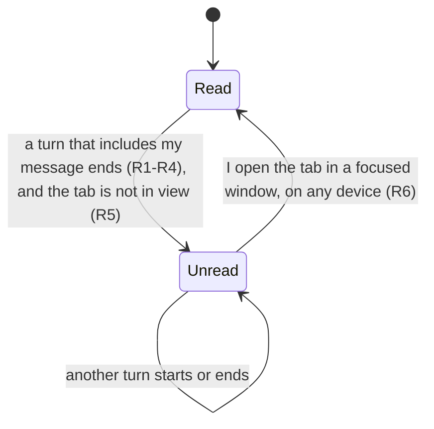

# Unread tabs for my own turns - Plan

## Goal Capsule

- Objective: a person using the RocketClaw Web can tell at a glance which sessions hold a finished turn they started and have not looked at yet, without being shown other people's turns.
- Means: unread marks on each person's saved tab rows, cascading from `conversations`, that turn ends write and the existing session-list poll reads and clears (KTD1, KTD2).
- Authority: this Product Contract, then the Planning Contract, then the project instructions in `AGENTS.md`.
- Stop conditions: the Go or TS CLOC budget would be exceeded and no honest deletion brings it back; the deployed OpenCode server does not store prompt `metadata` on user messages or does not filter messages by `type`; evidence shows a session-settled decision cannot work.
- Execution profile: backend store and migration, Web RPC and HTTP bridge, OpenCode relay and sync, and the Web tab UI, each with tests, plus the two READMEs.
- Who finishes: `ce-work` implements and verifies locally; the `lfg` pipeline reviews, opens the PR, and watches CI. Merging stays with the user.
- Open blockers: none.

---

## Product Contract

### Summary

A session becomes unread for a person when a turn they sent a message into ends. An unread tab shows a bold title and a thin accent bar along its top edge. Opening the tab in a focused window clears the mark on all of that person's devices. `is:unread` finds those sessions in search, and desktop notifications follow the same "only my turns" rule, for RocketClaw sessions and for remote OpenCode sessions.

### Problem Frame

A person starts turns in several tabs and then cannot tell which ones have finished and are waiting on them. The Web is multiplayer, so tabs also show activity from other people's turns, which that person does not need to act on. Desktop notifications exist today, but they fire for every finished turn in any open tab, whoever started it, and leave no trace once dismissed.

RocketClaw had a read/unread flag before. `docs/plans/2026-09-24-1402-feat-settle-snooze-plan.md` removed it as one shared flag per chat that overlapped with Settle. This work brings read tracking back in a different form: per person, and tied only to that person's own turns.

### Actors

- A1. The sender: a person who sends a message to a session from the Web.
- A2. Other Web people who have the same session open, or who sent messages into it.
- A3. Sources with no Web sender: Slack @mentions, crons, an agent waking on its own, and prompts typed directly into OpenCode's own TUI.

### Key Decisions

- **Opening the tab in a focused window clears unread** (session-settled: user-directed — chosen over clearing on opening alone and over clearing only on an explicit action: a turn that ends on the visible tab while the person is in another app should still be marked). Governs R5, R6.
- **The cue is a bold title plus a top accent bar on every unread tab** (session-settled: user-directed — chosen over a brighter, heavier icon, a dot on the icon's corner, and turning the pin glyph into a dot, all judged from a rough visual sketch; the bar goes on every unread tab rather than only on pinned ones, which have no title to bold). Governs R8.
- **`is:unread` lives in the existing search** (session-settled: user-directed — chosen over a new filter on the tab strip and over both: it reuses the `is:` filters and also finds sessions whose tab is closed). Governs R10.
- **Desktop notifications follow the same "only my turns" rule** (session-settled: user-directed — chosen over leaving notifications as they are: today they fire for other people's turns). Governs R11.
- **OpenCode senders are recorded in the prompt's message metadata** (session-settled: user-directed — chosen over RocketClaw keeping its own record of who sent each request through the relay: the sender should be carried in OpenCode's own stored messages, accepting that `/command` and shell turns have no metadata to carry it). Governs R12, R13.
- **An OpenCode turn with no recorded sender alerts nobody** (session-settled: user-directed — chosen over alerting everyone who has the tab open and over also attributing `/command` and shell runs at the relay: strict "only my turns" everywhere). Governs R14.
- **Unread state belongs to the person and lives on the server**, as each person's tab layout already does, so a turn that ends while all of that person's windows are closed is still waiting when they return. Governs R7.
- **Any ending counts as finished**: success, failure, or a stop. The person who started the turn needs to look at it in each case. Governs R1.

### Requirements

**What marks a session unread**

- R1. A session becomes unread for a person when a turn ends that includes a message that person sent from the Web, whether the turn succeeded, failed, or was stopped.
- R2. A turn's end marks no one who sent nothing into it, so other people's turns and turns started by A3 sources mark no one.
- R3. When several people sent messages into the same turn, its end marks the session unread for each of them, and each person's mark clears independently.
- R4. A message the person queued counts toward the turn in which it runs.
- R5. A turn that ends while the person has that session's tab active in a focused window, on any of their devices, does not mark it unread.

**Clearing and persistence**

- R6. A person's unread mark clears when they have the session's tab active in a focused window, and the clear applies on all of their devices.
- R7. Unread marks are stored per person on the server, so they survive reloads, follow the person across devices, and record turns that end while none of the person's windows is open.

**How an unread tab looks**

- R8. An unread tab shows its title in bold and a thin accent bar along its top edge, in both the top strip and the left sidebar layout, and a pinned tab in the top strip, which has no title, shows the bar.
- R9. Screen readers announce "Unread" on the tab, the same way they announce "Turn running".

**Search**

- R10. `is:unread` joins `is:pinned`, `is:forked`, and `is:cron` in the Cmd/Ctrl+P palette and on the Search page, and lists the person's unread sessions, including those whose tab is closed.

**Notifications**

- R11. Desktop notifications fire only for turn ends that would mark the person unread under R1–R5.

**OpenCode sessions**

- R12. When a person sends a prompt to a remote OpenCode session through the Web, RocketClaw records that person as the sender in the prompt's message metadata, keeping the metadata OpenCode's own app already sends.
- R13. RocketClaw reads the recorded sender back so that R1–R11 apply to OpenCode turns as they do to RocketClaw turns.
- R14. An OpenCode turn with no recorded sender marks no one and notifies no one, which covers `/command` runs, shell runs, and prompts typed in OpenCode's own TUI.



### Acceptance Examples

- AE1. **Covers R1, R6, R8.** **Given** Alice sends a message in session X and switches to tab Y, **when** X's turn ends, **then** X's tab shows a bold title and the top bar for Alice; when she opens X in a focused window, both go away.
- AE2. **Covers R2, R11.** **Given** Bob sends a message in session X, which Alice also has open, **when** the turn ends, **then** X is unread for Bob, Alice sees no cue, and Alice gets no notification.
- AE3. **Covers R5.** **Given** Alice is looking at X in a focused window, **when** her turn ends, **then** X is never marked. **Given** X is Alice's active tab but her browser window is behind another app, **when** the turn ends, **then** X is marked until she focuses the window.
- AE4. **Covers R7, R10.** **Given** Alice sends a message and closes her laptop, **when** the turn ends and she later opens the Web on another device, **then** X's tab is marked and `is:unread` lists X.
- AE5. **Covers R3.** **Given** Alice and Bob both send messages into the same running turn, **when** it ends, **then** X is unread for both, and Alice opening X leaves it unread for Bob.
- AE6. **Covers R10.** **Given** Alice closed X's tab before her turn ended, **when** she searches `is:unread`, **then** X is listed, and opening it in a focused window clears it.
- AE7. **Covers R12–R14.** **Given** an OpenCode session tab, **when** Alice's prompt's turn ends, **then** the session is unread for Alice; **when** her `/command` run or a prompt typed in OpenCode's TUI ends, **then** no one is marked or notified.

### Scope Boundaries

- A filter box on the tab strip itself.
- Attributing OpenCode `/command` runs, shell runs, and TUI prompts.
- Marking the Web sender unread for turns they started through Slack @mentions.
- Manual "mark as read", "mark as unread", or "mark all read" actions.
- Unread counts in the browser title or favicon.
- Showing a person what other people need to look at.
- Turns that ended before this ships: nothing is unread at launch.

### Dependencies / Assumptions

- OpenCode's `POST /api/session/:sessionID/prompt` accepts a free-form `metadata` record, stores it on the user message, and returns it from message reads (OpenCode source: `packages/protocol/src/groups/session.ts:335-344`, `packages/schema/src/session-inbox.ts:15-18`, `packages/core/src/session/projector.ts:654-664`). If OpenCode changes this shape, OpenCode tabs stop getting marked without any error. R12–R14 depend on it.
- OpenCode copies prompt metadata onto the user message when a queued prompt is delivered, not when it is accepted (`projector.ts:654-658`).
- OpenCode's own web app already fills `metadata` with `displayText`, `comments`, `attachments`, `agent`, and `model` (OpenCode source: `packages/app/src/composer/submit.ts:535-541`), and retries a failed prompt with an identical body (`submit.ts:545`). OpenCode keeps the first admission for a message ID (`packages/core/src/session/inbox.ts:163`).
- OpenCode's `/command` and `/shell` request bodies carry no `metadata` (`packages/protocol/src/groups/session.ts:357-363`, `:419-424`).

### Outstanding Questions

Planning resolved the five questions this section carried: the relay identity (KTD8), the OpenCode read-back (KTD9), the person key (KTD4), the notification source (KTD6), and the sidebar bar placement (U5). Two product consequences of R1 and R2 surfaced during planning and remain for the requester. Implementation follows R1 and R2 as written (U3 tests the goal case); an answer from the requester would change the requirements, not the units:

**Deferred to Planning**

- A goal marks its setter only when its first turn ends: later goal continuations are system turns with no Web sender, so R2 marks no one when the goal finishes. Should a goal's final turn mark the person who set it?
- Voice hand-offs are Web messages from the person (`internal/rocketclaw/frontend/rpc/voice.go:467-469`), so under R1 their turn ends mark and notify while the person is on the `/voice` page, which is a different tab from the session. Should the voice page count as viewing its session for R5?

### Sources / Research

- `internal/rocketclaw/web/src/ui.tsx:1171-1209`: `TabNotifications` raises a notification when a session goes from running to not running, skipping the active tab in a focused window, with no check on the sender.
- `internal/rocketclaw/web/src/ui.tsx:1361-1382`: `TabItem`. A pinned tab in the top strip has no title or close button, and shows its icon, a pin marker, and an actions button when active.
- `internal/rocketclaw/web/src/ui.tsx:1294`: in the horizontal strip, a group's colour rule runs along the tab's bottom edge, so nothing occupies the top edge.
- `internal/rocketclaw/web/src/ui.tsx:117`, `:2408`, and `internal/rocketclaw/backend/session_search.go:104-108`, `:133`, `:323`: the `is:` suggestions and the server-side `is:` filters.
- `internal/rocketclaw/backend/migrations/043_web_spaces.sql:13` and `internal/rocketclaw/frontend/rpc/tabs.go:17-28`: per-person tab state is stored on the server, keyed by username.
- `internal/rocketclaw/frontend/rpc/server.go:1511`: Web prompts record their sender in inbound metadata and in the prompt header.
- `internal/rocketclaw/frontend/rpc/relay.go`: the OpenCode relay forwards to OpenCode with one shared credential.
- `docs/plans/2026-10-19-2130-feat-web-running-tab-shimmer-plan.md`: the precedent for a tab-title cue and for the "Turn running" screen-reader announcement.
- `docs/plans/2026-09-24-1402-feat-settle-snooze-plan.md`: the earlier read tracking and why it was removed.

Product Contract preservation: R1–R14, A1–A3, AE1–AE7, Key Decisions, and Scope Boundaries unchanged; Outstanding Questions rewritten in place because planning answered them, with two residual product questions added; Sources line numbers refreshed after rebasing onto the consolidated State Store (`77fabe81`).

---

## Planning Contract

### Key Technical Decisions

- KTD1. **Unread lives on normalized saved-tab rows, not a separate read table.** Migration `060_web_tab_rows.sql` unpacks `web_tab_states` into a person row (`revision`, `space`, `placement`, `viewing`, `viewed_at`), `web_tab_groups` rows, and `web_tabs(username, path, conversation_id, position, pinned, preview, group_id, space, last, unread_at)` rows keyed by `(username, path)`. A session tab's `conversation_id` references `conversations` with `ON DELETE CASCADE`, so deleting a native or remote session (`kind = 'remote'`, migration `052`) removes its tabs and marks for everyone with no cleanup code. A mark writes the tab row under the path the Web spells (`/s/` or `/oc/` plus the base64url ID), computed in SQL, and saves decode each path to its conversation and store it under that same canonical path, so a mark and its tab share one row. Saves never write `unread_at`: a closed tab stays as a row while unread or some space's last tab, and is deleted otherwise. Startup converts each legacy protobuf blob into rows once, as one more save, and every save empties the blob. A history wipe keeps the conversation row and its marks; opening the session clears them per R6. The same migration adds the OpenCode cursor column of KTD9 to `conversations`. Governs R6, R7.
- KTD2. **The browser reports what it is viewing on the existing `ListSessions` poll.** `ListSessionsRequest` gains `viewing` (field 1): the session ID of the active tab while `document.hasFocus()` is true, otherwise empty. Today the transport drops the request (`internal/rocketclaw/frontend/rpc/transport.go:80-85`), so `listSessions` starts taking it. The HTTP bridge reads it from the `viewing` query parameter, as `/stream` reads `id`, and passes it on only when the request is same-origin by the rule `http.CrossOriginProtection` applies to unsafe methods (`Sec-Fetch-Site` is `same-origin` or `none`, or, without that header, `Origin` is absent or matches the host); otherwise it treats `viewing` as empty. The poll is a `GET`, which the Web's cross-origin protection lets through, so without this check any page in the person's browser could clear their marks. Before it enumerates, `listSessions` records a non-empty view: the caller's person row gets `viewing` and `viewed_at = now()`, which ends their view of any other session, and their tab rows for that session get `unread_at = NULL`. A `viewing` ID that names no conversation writes nothing. An empty `viewing` changes nothing, because unfocused windows poll too and must not end the focused window's view. A new stream would break the HTTP/1 connection budget (`docs/solutions/architecture-patterns/web-keep-alive-views-connection-budget.md`). Governs R5, R6.
- KTD3. **A sender is skipped when their person row has viewed the session in the last 10 seconds, by the database clock.** The window covers one 2-second poll plus a slow enumeration. Switching to another session tab ends the view at the next poll (KTD2). Leaving the window unfocused lets the view lapse within the window, because unfocused polls stop refreshing it. Governs R1, R5.
- KTD4. **Native senders are read inside `finishTurn`'s transaction, from the turn row's `inbound_json` and from its applied journaled steers.** A sender is an inbound with `Source = web`, `Human = true`, and a username in `rocketclaw_principal_email` (`protocol.InboundPrincipalEmailMetadataKey`). The display principal is not unique, and goal continuations and shadow child turns carry a person's name as system turns. Applied steers are the elements of step `<turn>/steers` whose `id` appears in `turns.applied_input_ids`. The write sits after `finishTurn` copies `applied_input_ids` onto the turn row and before it deletes the turn's steps (`internal/rocketclaw/backend/store_dao.go:953-1030`). The late-finish branch returns before that point and writes nothing, because the first finisher already marked. Only `listed` conversations are marked, so cron and External MCP runs, which finish on their own unlisted conversation with no Web sender, mark no one. Writing the mark in the same transaction that ends the turn means no snapshot shows the turn ended without its mark. Governs R1–R4.
- KTD5. **Each `Session` row carries `unread_at` for the caller as an RFC3339Nano string, empty meaning read, in proto field 27.** The format matches `updated_at`; tags 24–26 are taken and 6, 11, and 12 stay reserved for the removed flag. The private `sidebarSessions`, `SidebarChats`, `sidebarRows`, and `SearchSessions` take the caller's username, and an empty username means no person, so nothing is unread. The joined column sits before the origin columns in both the `local` and `remote` branches of `sidebarSessions`, because `scanChatOrigin` appends the origin columns last. One timestamp serves the cue (R8), the filter (R10), and notifications (KTD6). Governs R7, R8, R10.
- KTD6. **A window notifies when an open tab's `unread_at` moves past the value that window last saw.** This replaces the running-to-idle check. Another person's turn ending cannot notify, and a turn shorter than one poll still notifies, because the mark persists on the server. The first complete live enumeration after a page load or owner change seeds the remembered values without notifying; rows restored from the saved IndexedDB snapshot never seed or notify. Governs R11.
- KTD7. **`is:unread` filters by the caller's username, and the shared search carries the username in its key and request.** `sharedSearch` (`internal/rocketclaw/frontend/rpc/session_commands.go`) would otherwise hand one person's results to another. The agent session-search tool passes no person, so `is:unread` matches nothing there, and its description stays unchanged. Governs R10.
- KTD8. **The relay stamps `metadata.rocketclaw_username` into `POST /api/session/{id}/prompt` bodies, overwriting any client value.** Both admission paths hand the relay the username that `principal()` resolves for that caller: `AdmitHTTP` stops discarding it, and the tailnet handler already puts the login in the request context's outgoing gRPC metadata. The relay merges the key into the app's existing `metadata` object and leaves every other request untouched. The body is a dynamic JSON boundary, so a raw-message map is acceptable there. A body that is not a JSON object is forwarded unchanged and simply carries no sender (session-settled: user-directed — chosen over RocketClaw keeping its own record of who sent each relay request: the sender should be carried in OpenCode's own stored messages). Governs R12.
- KTD9. **When the sync finds an OpenCode session idle after a turn, it reads the newest `idle` marker and the recent `user` messages, and marks the senders created after the session's cursor and no later than that marker.** A session counts as idle after a turn when it is not busy and either the last sync saw it running or its OpenCode `time.updated` is newer than the stored `conversations.last_updated`; OpenCode bumps that time when it accepts a prompt, so a turn that starts and ends between two syncs is still found. OpenCode marks each turn's end with an `idle` message that covers every step since the previous marker, steered prompts included (OpenCode source: `packages/schema/src/session-message.ts:285-296`). The cursor is a new `conversations` column holding the last handled marker's OpenCode time in milliseconds, compared only with OpenCode times, so clock skew does not matter. A session with no cursor yet has no lower bound: user messages from before the relay stamps carry no `rocketclaw_username`, so R14 already marks no one for them. Marks are written in the same statement that records `running = false`. Governs R13, R14.

### High-Level Technical Design

```mermaid
sequenceDiagram
  participant B as Browser window
  participant W as Web RPC
  participant S as Store
  participant R as OpenCode relay
  participant O as OpenCode
  B->>W: ListSessions(viewing = active focused session or empty)
  W->>S: record view: person row viewing=session, viewed_at=now; that session's tab rows unread_at=NULL
  W->>S: SidebarChats(username)
  S-->>B: Session rows with unread_at for this caller
  Note over B: bold title + top bar when unread_at set; notify when unread_at advances (KTD6)
  Note over S: native turn end: finishTurn marks Web senders unless viewed in last 10 s (KTD3, KTD4)
  B->>R: POST /api/session/{id}/prompt
  R->>O: same body with metadata.rocketclaw_username (KTD8)
  S->>O: sync finds idle after a turn: GET idle marker + user messages
  S->>S: mark senders after cursor, advance cursor, running=false (KTD9)
```

### Assumptions

- The 10-second view window (KTD3) is long enough for a focused window's poll. Its cost: a turn that ends within 10 seconds after the person switches to another app, or to a non-session page, does not mark, contrary to AE3's second case for that short span.
- Two devices focused on different sessions at the same moment are rare. Each non-empty view ends the caller's other views (KTD2), so the second device's poll can briefly let a session watched on the first device be marked, until that device's next poll clears it.
- The OpenCode server RocketClaw talks to behaves like the OpenCode source checked on 2026-10-22: prompt `metadata` is stored on the user message, `GET /api/session/{id}/message` filters by `type`, and each turn ends with an `idle` message.
- The 50 newest user messages cover every prompt in one OpenCode turn.
- While a remote session's cross-origin iframe has focus, the parent document's `document.hasFocus()` is true, so `/oc/` tabs report their view like native ones.

### Sequencing

U1 first. U2 and U3 depend on U1. U4 depends on U2. U5 depends on U2. U6 is independent of U1–U5. U7 depends on U1 and U6. U8 lands last, alongside or after the code it documents.

---

## Implementation Units

### U1. Tab rows and OpenCode cursor

- **Goal:** persist each person's tabs, view, and unread state as rows, plus each OpenCode session's handled-turn cursor.
- **Requirements:** R6, R7, R13; KTD1, KTD9.
- **Dependencies:** none.
- **Files:** `internal/rocketclaw/backend/migrations/060_web_tab_rows.sql` (new); `internal/rocketclaw/backend/store_dao.go` (typed `TabState`/`SaveTabState`, legacy conversion); `internal/rocketclaw/frontend/rpc/tabs.go` (proto mapping, `ConvertTabStates`); `cmd/rocketclaw/assemble.go` (conversion before Web serves); `internal/rocketclaw/backend/store_test.go` (head-schema table list).
- **Approach:**
  1. In one migration, add the person-row columns to `web_tab_states` (its blob becomes nullable), the `web_tab_groups` and `web_tabs` tables with the cascading foreign key, and the `conversations` cursor column, with a leading comment and a `Down` that reverses them.
  2. Replace the blob API with typed rows, convert legacy blobs once at startup, and list the new tables in the head-schema test and its count comment.
- **Patterns to follow:** `internal/rocketclaw/backend/migrations/043_web_spaces.sql` and `050_*.sql` for shape; `052_*.sql` `shadow_turns` for the cascading foreign key; `docs/solutions/runtime-errors/deployment-binary-missing-live-migrations.md`.
- **Test scenarios:**
  - The head schema lists the new tables, and the rollback tests migrate down past 060 and back up cleanly.
  - Deleting a conversation removes its tab rows, and so its marks, for every person.
  - A save keeps marks on open and closed tabs, deletes closed tabs that are neither unread nor a space's last, and drops tabs of sessions that do not exist.
  - A legacy blob converts once to identical state, one revision later; a rerun changes nothing.
- **Verification:** backend tests pass against a real Postgres, and no old migration file is edited or renamed.

### U2. View reporting and per-person unread on the session list

- **Goal:** each `ListSessions` call records what the caller is viewing and returns `unread_at` for that caller.
- **Requirements:** R5, R6, R7; KTD2, KTD5.
- **Dependencies:** U1.
- **Files:** `internal/rocketclaw/web/proto/web.proto` and its generated files; `internal/rocketclaw/frontend/rpc/transport.go`; `internal/rocketclaw/frontend/rpc/http.go`; `internal/rocketclaw/frontend/rpc/server.go` (`listSessions`); `internal/rocketclaw/backend/store.go` (`SidebarSession`, `sidebarSessions`); `internal/rocketclaw/backend/store_dao.go` (view write); `internal/rocketclaw/backend/session_search.go` (`SidebarChats`, `sidebarRows`, `SearchSessions` username parameter); `internal/rocketclaw/backend/session_tools.go` (pass no person); `internal/rocketclaw/backend/equivalence_test.go` and the test call sites of the changed functions.
- **Approach:**
  1. Add `viewing` to `ListSessionsRequest` and `unread_at` to `Session`, then regenerate.
  2. Hand the received `ListSessionsRequest` to `listSessions` through the transport.
  3. Pass the `viewing` query parameter through the HTTP bridge for same-origin requests only (KTD2).
  4. In `listSessions`, record the caller's view (KTD2) before enumerating, using the username from `principal()`.
  5. Join the caller's tab row by conversation into both the `local` and `remote` branches of `sidebarSessions` before the origin columns, and pass `""` from the agent tool.
- **Patterns to follow:** `/stream`'s query-to-request mapping in `http.go`; `internal/rocketclaw/frontend/rpc/tabs.go` for username handling; `internal/rocketclaw/frontend/rpc/tabs_test.go` for RPC tests with per-IP usernames.
- **Test scenarios:**
  - Covers AE1. A session whose tab row is unread for Alice lists with `unread_at` set for Alice and empty for Bob.
  - Covers AE1. A poll from Alice with `viewing` set to that session clears her mark, and the same response lists it as read.
  - A poll with `viewing` set to Y ends Alice's view of X: a later mark on X inside the window is not skipped.
  - A poll with an empty `viewing` leaves Alice's existing view of X and her marks unchanged.
  - A poll whose `viewing` names no conversation succeeds and writes nothing.
  - A remote OpenCode session row carries `unread_at` the same way as a native one.
  - A cross-site `GET /api/ListSessions?viewing=X` (`Sec-Fetch-Site: cross-site`) leaves Alice's mark and views unchanged, while the same request with `Sec-Fetch-Site: same-origin` clears it.
- **Verification:** RPC and backend tests pass, and the HTTP bridge forwards `viewing` only for same-origin requests.

### U3. Native turn ends mark their Web senders

- **Goal:** every terminal native turn marks each Web person who sent a message into it.
- **Requirements:** R1–R5; KTD3, KTD4.
- **Dependencies:** U1.
- **Files:** `internal/rocketclaw/backend/store_dao.go` (`finishTurn`); tests in `internal/rocketclaw/backend/active_turn_test.go` or a new focused `internal/rocketclaw/backend/unread_test.go`.
- **Approach:**
  1. In `finishTurn`, after `applied_input_ids` reaches the turn row and before the turn's steps are deleted, collect usernames from the turn's `inbound_json` and from its applied steers (KTD4).
  2. Upsert their rows with `unread_at = now()`, skipping rows viewed within the window (KTD3), in the same transaction and only for `listed` conversations.
  3. Compose the SQL from CTEs (initial senders, applied steer senders), with no subqueries.
- **Patterns to follow:** the `applied_input_ids` handling already in `finishTurn`; the inbound metadata reads in `closeTurn` (`store_dao.go:1156-1173`); `execRows`/`queryScalar` helpers with lowercase operation names; the stop and steer tests in `active_turn_test.go`.
- **Test scenarios:**
  - Covers AE1. A Web turn from Alice that finishes marks Alice.
  - A failed turn and a stopped turn each mark their sender.
  - Covers AE2. A turn from Bob marks Bob and not Alice.
  - Covers AE5. Alice starts a turn and Bob's steer is applied into it, so the end marks both.
  - A steer that was journaled but not applied before the turn ended marks no one.
  - Covers AE3. A turn ending while Alice's row was viewed 3 seconds ago leaves her unmarked; one viewed 30 seconds ago marks her.
  - A goal continuation turn (system source carrying the setter's name) marks no one.
  - A late finish of an already-finished turn writes no second mark.
  - A queued message from Alice that runs as its own turn marks Alice when that turn ends.
- **Verification:** backend turn-lifecycle tests pass, and the SQL contains no subquery.

### U4. `is:unread` session-search filter

- **Goal:** `is:unread` lists the caller's unread sessions, closed tabs included.
- **Requirements:** R10; KTD7.
- **Dependencies:** U2.
- **Files:** `internal/rocketclaw/backend/session_search.go`; `internal/rocketclaw/frontend/rpc/session_commands.go` (`searchSessions`, `sessionSearch`, shared-search key); `internal/rocketclaw/backend/session_search_test.go`; `internal/rocketclaw/frontend/rpc/` search tests.
- **Approach:**
  1. Accept `unread` among the `is:` values in the parser, its documented regex comment, and `passes`.
  2. Pass the caller's username from `searchSessions` into `sessionSearch` and the shared-search key.
  3. Leave the agent session-search tool's description unchanged: `is:unread` can never match there (KTD7).
- **Patterns to follow:** `TestSearchSessionsPrincipalCriteria` table-driven style with `newSessionSearchFixture`.
- **Test scenarios:**
  - Covers AE4, AE6. `is:unread` for Alice returns her unread sessions, including one with no open tab, and omits read ones.
  - `is:unread` for Bob does not return Alice's unread sessions.
  - Two callers issuing `is:unread` at the same time each get their own results.
  - The agent tool's `is:unread` returns nothing.
  - `is:unread` combines with another filter such as `agent:` as an AND.
- **Verification:** search tests pass, and `is:foo` still stays ordinary text.

### U5. Web tab cue, view reporting, notifications, and search suggestions

- **Goal:** the browser reports its view, shows the unread cue, notifies on new marks, and suggests `is:unread`.
- **Requirements:** R5, R6, R8, R9, R10, R11; KTD2, KTD6.
- **Dependencies:** U2.
- **Files:** `internal/rocketclaw/web/src/types.ts`; `internal/rocketclaw/web/src/ui.tsx` (`SidebarOwner` tick, `TabItem`, `TabNotifications`, `typingWord`, `searchChoices`); `internal/rocketclaw/web/src/session-list.ts` (restored rows); `internal/rocketclaw/web/src/tabs.browser.test.ts`; `internal/rocketclaw/web/src/notifications.browser.test.ts`; `internal/rocketclaw/web/src/session-list.browser.test.ts`.
- **Approach:**
  1. Add `unread_at` to the `Session` type.
  2. Each poll tick passes `listSessions` a URL with `viewing`: the session of the current path (`pathSession(location.pathname)`, which covers `/s/` and `/oc/`) when `document.hasFocus()` is true, otherwise empty. `SidebarOwner` sits outside `TabActions`, so it reads the path, not tab state.
  3. In `TabItem`, set `data-unread` on the root and use it to bold the title. Draw the top bar as an absolutely positioned 2px (`h-0.5`) element in the theme's `primary` colour, matching the group rule's thickness; the `accent` token is the near-white hover tint and the group palette would read as a group rule. In the sidebar layout, place the bar at the tab's top edge, clear of the group's left colour rule. Add "Unread" to `aria-description`, alongside "Turn running" when both apply.
  4. Rewrite `TabNotifications` per KTD6.
  5. Add `unread` to the `is:` suggestion lists.
  6. Keep new branching out of `SessionApp`, which sits at the react-doctor complexity limit.
- **Patterns to follow:** the group colour rule in `TabItem`'s caller and the `data-running` shimmer variants; `docs/solutions/best-practices/react-doctor-complexity-limit-shapes-web-components.md`.
- **Test scenarios:**
  - Covers AE1. A row with `unread_at` set renders a bold title and a top bar, and the tab's description includes "Unread".
  - A pinned tab in the top strip with `unread_at` set shows the bar.
  - The cue appears in the sidebar layout.
  - The poll sends `viewing` for the active session tab, native or `/oc/`, while the window has focus, and sends it empty when `document.hasFocus()` is false.
  - Covers AE3. With the active tab's window unfocused, the poll sends an empty `viewing`, and a mark written after the view lapses shows the cue on that tab.
  - Covers AE2. A running-to-idle transition with `unread_at` unchanged raises no notification.
  - A notification fires when an open tab's `unread_at` advances between polls, including when it was already set.
  - The first live enumeration after a page load raises no notification for already-unread rows.
  - With a saved snapshot holding older `unread_at` values, the first live poll carrying newer values raises no notification.
  - Typing `is:` suggests `unread` alongside `pinned`, `forked`, and `cron`.
- **Verification:** browser tests pass, and the TS CLOC budget holds.

### U6. Relay stamps the sender into OpenCode prompts

- **Goal:** every prompt sent through the relay carries the admitted person's username in its message metadata.
- **Requirements:** R12; KTD8.
- **Dependencies:** none.
- **Files:** `internal/rocketclaw/frontend/rpc/relay.go` (`NewOpenCodeRelay`, `AdmitHTTP`); `internal/rocketclaw/frontend/rpc/relay_test.go`.
- **Approach:**
  1. Make both admission paths deliver the resolved username to the relay through the request context: `AdmitHTTP` keeps the username `principal()` returns, and the tailnet path's login is read from the outgoing gRPC metadata it already sets.
  2. In the proxy rewrite, for `POST /api/session/{id}/prompt` only, decode the JSON object, set `metadata.rocketclaw_username` while keeping the app's other metadata keys, re-encode it, and update the outgoing length.
- **Patterns to follow:** the `relayUpstream` recorder and `TestOpenCodeRelayOnTheTailnetStreams` with the mockery `mockTailnetWhoIs`.
- **Test scenarios:**
  - A prompt through the plain listener reaches the upstream with `metadata.rocketclaw_username` equal to the IP-admitted username and its `displayText` and `agent` keys intact.
  - A prompt through the tailnet listener carries the tailnet login.
  - A prompt with no `metadata` object gains one holding only the username.
  - A client-supplied `rocketclaw_username` is replaced with the admitted username.
  - `POST /api/session/{id}/command`, `/shell`, a `GET`, and SSE streaming pass through byte-for-byte.
  - A non-JSON prompt body is forwarded unchanged.
- **Verification:** relay tests pass, and the existing admission, CSP, and origin tests still pass.

### U7. OpenCode sync marks a turn's senders

- **Goal:** an OpenCode turn end marks each person whose stamped prompt was part of that turn.
- **Requirements:** R13, R14; KTD3, KTD9.
- **Dependencies:** U1, U6.
- **Files:** `internal/rocketclaw/backend/opencode.go` (`syncOpenCode`); `internal/rocketclaw/backend/opencode_test.go` (`fakeOpenCode` gains `type=idle` and `type=user` message responses).
- **Approach:**
  1. Replace the query that loads the sessions the last sync saw running with one that loads every stored session of this server with its `running` flag, `last_updated`, and cursor, so both KTD9 triggers can be checked.
  2. For each session that is not busy and was either seen running or has an OpenCode `time.updated` newer than its stored `last_updated` (KTD9), read the newest `idle` marker and the 50 newest `user` messages. The existing newest-assistant reply read keeps its `ran && !busy` trigger.
  3. Collect `rocketclaw_username` from user messages created after the cursor and no later than the marker.
  4. In the existing upsert statement, add a CTE that writes the senders' marks (skipping viewed rows per KTD3) and advance the cursor alongside `running = false`.
- **Patterns to follow:** the reply read and `openCodeCall` with typed `openCodeError`; the CTE chain of the upsert statement; `TestSyncOpenCodeListsRemoteSessions` driving `s.syncOpenCode` and toggling `fake.active`.
- **Test scenarios:**
  - Covers AE7. A session that goes busy, then idle, with Alice's stamped prompt after the cursor marks Alice.
  - Covers AE7. A turn whose only user messages are unstamped (TUI) marks no one, and a `/command` turn with no user message marks no one.
  - Two turns that both ended between polls mark both turns' senders.
  - A user message from before the cursor is not marked again on a later turn end.
  - A session created through `CreateOpenCodeSession` marks Alice when its first turn ends.
  - A turn that starts and ends between two syncs, never seen busy, marks its sender at the next sync because the session's `time.updated` moved.
  - An idle session whose `time.updated` did not move triggers no message reads.
  - Alice viewed the remote session 3 seconds before the sync saw it idle, so she is not marked.
  - A failed message read leaves the cursor in place, so the next detected turn end marks those senders.
- **Verification:** OpenCode sync tests pass against the fake server.

### U8. READMEs

- **Goal:** the READMEs describe unread, the notification rule, `is:unread`, view reporting, and relay stamping.
- **Requirements:** R8–R14.
- **Dependencies:** U2–U7.
- **Files:** `internal/rocketclaw/web/README.md` (tabs bullets, Notifications, search `is:`, ListSessions); `internal/rocketclaw/frontend/rpc/README.md` (`ListSessions`, relay and OpenCode sync).
- **Approach:**
  1. Replace the Notifications paragraph, whose "another window still notifies" behavior no longer holds.
  2. Note that anyone holding the OpenCode password can bypass the relay and forge `rocketclaw_username`.
- **Test expectation:** none -- documentation only.
- **Verification:** every behavior the READMEs describe matches R1–R14 and the KTDs.

---

## Verification Contract

| Gate | Command | Applies to |
|---|---|---|
| Format | `gofmt -l` on touched Go files reports nothing | U1–U4, U6, U7 |
| Go tests | `go test ./...` | U1–U4, U6, U7 |
| Lint | `make lint` (golangci-lint, oxlint, tsc, react-doctor) | all |
| Full gate | `make test` (generate, lint, coverage at or above 91.7 %, Go and TS CLOC budgets) | all |
| Browser tests | `make -C internal/rocketclaw/web test` | U5 |

Never edit `GO_SOURCE_CLOC_BUDGET`. The user raised `TS_CLOC_BUDGET` from 8000 to 8250 for this work; it ships with this change. After rebasing onto `77fabe81`, 1053 Go lines and 470 TS lines remain before failure.

---

## Definition of Done

- R1–R14 hold, and each AE has a passing test that covers it.
- Every gate in the Verification Contract passes on the final diff.
- No new subquery, nil-as-disabled dependency, one-use helper, or `//nolint` appears in the diff, and new error variables use the `errX` form.
- Proto tags reserved for the removed flag stay reserved, and no old migration file changed.
- Both READMEs are updated per U8.
- Code from abandoned approaches is removed from the diff.
