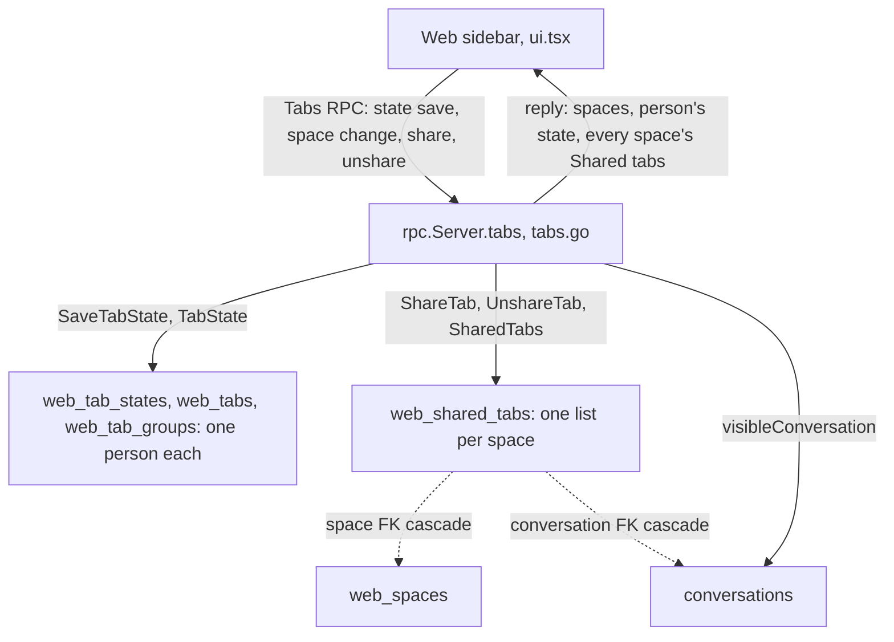
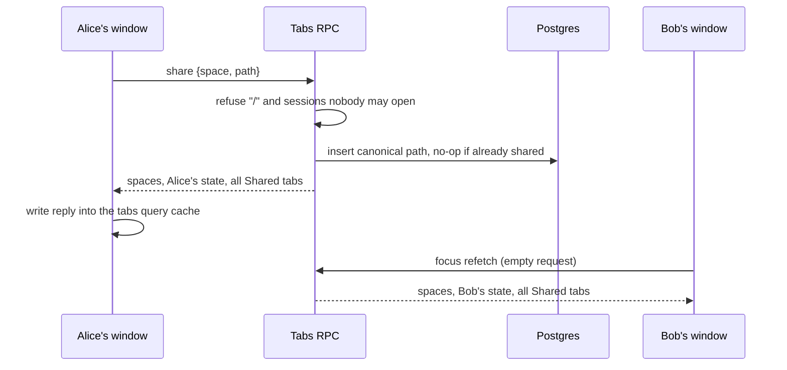

# Shared Tab Group per Space, No More Pinned Tabs - Plan

## Goal Capsule

- **Objective:** People working in the same space keep one common set of tabs that each of them sees first in their sidebar and any of them can change, and nobody pins tabs any more.
- **Means:** A server-wide table of Shared tabs per space, changed one tab at a time through the existing `Tabs` RPC and read back on every reply (KTD1, KTD2). Tab pinning is removed the way tab placement was removed in commit `30e72680` (KTD8).
- **Authority:** Product Contract requirements win on behavior. KTDs win on mechanism. Units override neither.
- **Stop conditions:** Stop and report instead of continuing in any of these cases:
  - a unit would push Go source over `GO_SOURCE_CLOC_BUDGET` (26000, `internal/rocketclaw/Makefile`) or Web TS over `TS_CLOC_BUDGET` (8250, `internal/rocketclaw/web/Makefile`); never edit either budget
  - migration `063` or `064` is already taken on the deployed database or by another in-flight branch
  - `react-doctor` fails on a touched React function and splitting it into a smaller component or hook does not fix it; never suppress the rule without approval
  - a session-settled decision below proves infeasible
- **Execution profile:** Remove pinning end to end first (U1). Then storage (U2), RPC (U3), Web (U4), docs (U5). Each unit lands as one reviewable change with its tests green and, when it touches the Web, a rebuilt committed bundle.
- **Finishes and ships:** the implementer, through the repo's normal PR flow.

---

## Product Contract

### Summary

Tab pinning goes away. Every space gets one grey group named Shared, shown first in the sidebar, whose tabs are the same for every Web user and which anyone can add to or remove from through the tab menu. A tab can sit in Shared and in a person's own group at the same time.

### Problem Frame

Tabs in the RocketClaw Web are personal: each person's tabs, groups, and pins are saved under their username and follow them across devices. Spaces are already shared by everyone, but nothing inside a space is. When several people work in the same space, there is no place to put the sessions and hosted pages everyone should keep at hand, so each person rebuilds the same tab set by hand or passes links around. Pinning only helps the person who pinned, and the team chose to retire it rather than keep two ways of keeping a tab at the top.

### Requirements

**No more pinned tabs**

- R1. People cannot pin a tab. Pin and Unpin leave the tab menu and the command palette, and no tab shows a pin mark.
- R2. A tab pinned before this change stays open in its space, in its saved place, as an ordinary tab that can be closed, grouped, and moved like any other.
- R3. Pinning a session ("Pin session", the session list's pinned-first order, and `is:pinned` search) is unchanged.

**The Shared group**

- R4. Every space has exactly one group named Shared, grey, shown first in the sidebar above the person's own tabs. It shows even when empty, with a hint on how to add a tab. Spaces created later, including ones created automatically for a session's birth space, have it too.
- R5. Shared lists the same tabs for every Web user, oldest added first.
- R6. Anyone can add a tab of the current space to its Shared group ("Add to Shared"), and anyone can take a tab out ("Remove from Shared"), which takes it out for everyone. Each add or remove changes only that one tab, so two people changing Shared at the same time both get their change.
- R7. Adding a tab to Shared keeps it among the person's own tabs, in its group if it has one. Opening a Shared tab does not add it to the person's own tabs.
- R8. Shared tabs have no close button, and their menu offers only Remove from Shared. Only the menu changes Shared: dragging cannot add a tab to Shared, take one out, or reorder it, and dropping a tab onto a Shared tab does nothing.
- R9. Collapsing Shared affects only the person who collapsed it. The choice applies in every space and follows the person across devices. The active tab stays visible while Shared is collapsed, as in other groups.
- R10. A tab that is both in Shared and among the person's own tabs is highlighted in both places while it is open.
- R11. New session cannot be added to Shared. Session tabs, hosted pages, and the other app pages (Search, Cron, Agents, Skills, Settings, Pages, Voice, Shortcuts) can.
- R12. A session that no Web user may open cannot be added to Shared. Deleting a session takes it out of every Shared group.
- R13. The person who adds or removes a tab sees the change at once. Everyone else sees it the next time their window regains focus or becomes visible.
- R14. Deleting a space moves its Shared tabs into the Shared group of the first remaining space. A tab already shared there stays once, and moved tabs keep their place by when they were first added.

**Shared tabs behave like ordinary tabs**

- R15. A Shared tab raises desktop notifications exactly like one of the person's own tabs. A turn ending in a session that is in some space's Shared group marks it unread for every Web person, whoever started the turn, except anyone viewing it; muting and snoozing stay each person's own. (session-settled: user-directed.)
- R16. Every tab keyboard shortcut works on Shared tabs: Cmd/Ctrl+[ and ] step through the space's tabs in sidebar order, Shared rows first, each tab once. Arrow keys, Home, and End move between the Shared rows and the person's own tabs. Shift+Arrow on a Shared row moves it among the Shared rows, which changes the order for everyone. The menu key opens a Shared row's menu.
- R17. Escape and "Tabs: Close" do nothing on a tab that is only in Shared. On a tab the person also has, they close the person's own copy.

**Mute and snooze notifications**

- R18. Any session tab, Shared or not, can be muted: it raises no desktop notifications for this person until unmuted. Muting is the person's own, follows them across devices, and belongs to the session, so it covers both copies of a tab and survives closing and reopening it.
- R19. Any session tab can be snoozed until a time: 1 hour, 4 hours, tomorrow 9:00, next Monday 9:00, or a date and time picked in a dialog that starts at tomorrow 9:00 and refuses a time in the past. A snooze ends by itself at that time.
- R20. The tab menu and the command palette offer Mute notifications, a Snooze notifications submenu, and Unmute notifications on a muted or snoozed tab. A muted or snoozed tab shows a bell-off icon whose tooltip says Muted or Snoozed until the time.
- R21. Muting and snoozing change only desktop notifications; an unread tab still shows its bold title.

### Key Decisions

- **No tab pinning; one Shared group per space instead.** (session-settled: user-directed — chosen over keeping pins alongside a shared group: pinning only helps one person, and the space-wide group replaces it.) Governs R1, R4, R5, R6.
- **A tab can be in Shared and in a private group at once.** (session-settled: user-directed — chosen over Shared membership replacing a tab's own place: people keep their own arrangement while sharing.) Governs R7.
- **Shared tabs have no close button; only Remove from Shared takes one out.** (session-settled: user-approved — chosen over a close button that removes the tab for everyone: one stray click would change every person's sidebar.) Governs R8.
- **Highlight in both places, per-person collapse, oldest-first shared order.** (session-settled: user-approved — chosen over highlighting only the clicked row and a shared collapse state: both rows open the same page, and collapsing should not hide tabs from others.) Governs R5, R9, R10.
- **Pinned tabs become ordinary tabs and do not move into Shared.** (session-settled: user-approved — chosen over moving every pinned tab into Shared: a personal pin is not a decision to show the tab to everyone.) Governs R2.
- **Sessions people may not open are hidden from Shared.** (session-settled: user-approved — chosen over showing a locked row: a row nobody can open is noise.) Governs R12.
- **Session pin stays, changes reach others on focus, one-tab-at-a-time changes, menu-only changes, space deletion merges into the first space, New session not shareable.** (session-settled: user-approved — confirmed as stated scope over instant push updates, whole-list saves, drag-to-share, and dropping a deleted space's Shared tabs.) Governs R3, R6, R8, R11, R13, R14.

### Scope Boundaries

- Private groups, spaces, and the space menu behave as they do today, apart from losing pins.
- Not built: instant push of Shared changes to other windows. The server's HTTP/1.1 connection budget makes another stream risky (`docs/solutions/architecture-patterns/web-keep-alive-views-connection-budget.md`); evidence that focus refresh is too slow in practice would change this.
- Not built: rewriting a shared hosted-page path after its space is renamed. Private hosted-page tabs have the same gap today.
- Not built: recording who added a Shared tab.
- Not built: dragging Shared rows. Shift+Arrow reorders them (R16); drag still does nothing on a Shared row (R8).

---

## Planning Contract

### Key Technical Decisions

- KTD1. **Shared membership is its own server data, outside each person's saved tab state.** A person's tabs are saved whole with a revision check and are keyed by `(username, path)` in `web_tabs`, so a cross-person list inside that state would be overwritten by every save and could not hold a path the person also has open. Shared rows are read on every `Tabs` reply and replaced in the browser, never merged or revisioned, the way spaces already are. Each person's own `web_tabs` row, which carries unread marks, is untouched by sharing.
- KTD2. **Add and remove ride the existing `Tabs` RPC as two one-shot request fields, and every reply carries every space's Shared tabs.** This mirrors `create_space`/`delete_space` and costs far fewer lines than a new RPC, which would touch the service definition, `transport.go`, `http.go`, and the dispatch tables. Go source has about 475 lines left under its budget. No stream or long-poll is added (R13).
- KTD3. **One table, `web_shared_tabs`, keyed by space and path.** Columns: `space` referencing `web_spaces (id) ON DELETE CASCADE`, `path`, `conversation_id` referencing `conversations ON DELETE CASCADE` (as `web_tabs` does), and `added_at`. No row is needed per space, so spaces created implicitly at session birth (`store_dao.go`, conversation creation) get an empty Shared group for free. Adding stores the canonical path through `tabPathSQL`/`tabConversation`, exactly as `SaveTabState` does, and drops a session path whose conversation does not exist. Adding a tab that is already shared is a no-op that keeps its place. Adding to a space that no longer exists stores nothing. Removing deletes by space and exact path.
- KTD4. **`DeleteSpace` moves the space's Shared rows in the same statement that deletes the space.** A data-modifying CTE copies them into the first remaining space, chosen by `created_at, id` to match `Spaces()` and the Web's `spaces[0]`, with `ON CONFLICT DO NOTHING` and their original `added_at`. The foreign-key cascade then removes the originals. Today's lock order (`ORDER BY id FOR UPDATE`) stays; the first-space choice reads the locked set ordered by `created_at, id`. SQL uses CTEs only.
- KTD5. **The RPC refuses what may not be shared, at add time.** New session (`/`) is refused with `InvalidArgument`. A session path is decoded with the backend's path decoder, exported as `TabConversation` because the RPC package now needs it, and checked with the existing `Server.visibleConversation`, which refuses unknown, shadow, cron-run, and private External MCP conversations. This instantiates the "sessions people may not open are hidden" decision (Governs R12). Conflict note: Web visibility is the same for every person and fixed when a conversation is created, so refusing at add time hides such sessions from everyone, which is the decided outcome reached without a per-viewer filter.
- KTD6. **A person's Shared collapse is stored as a member-less entry in their own tab groups under the reserved id `shared`.** `savedState` in `ui.tsx` keeps that entry while still dropping other empty groups, so it saves, syncs across devices, and three-way merges like any group's collapsed flag. No Go, proto, or schema change is needed. Rejected: a `shared_collapsed` column plus a `TabState` proto field, which costs Go lines under a tight budget for the same behavior. Private group ids are random digit pairs, so `shared` cannot collide.
- KTD7. **The Web reads Shared from the `tabs` query data, and every `Tabs` reply refreshes the Shared list in that query cache.** Shared changes made by others do not bump the person's revision, so they must not depend on the merge path. Replies other than a stale save update only the cached Shared list, so the revision-merge effect still sees the person's last read revision and does nothing new. A path shared in the current space counts as open in the current space, ahead of an own tab of the same path in another space, in four places:
  - `openTab`: opening it adds no own tab and keeps `state.space`, where today an own tab's space wins
  - `loadTabs`: a reload on its URL adds no own tab
  - `entry`: a space's last tab may be a Shared tab
  - the merge effect's "is the active tab still open" check
  Without this, opening a Shared tab would add an own preview tab or switch spaces, and a window showing a Shared tab would jump away whenever the person's tabs change elsewhere. Whenever the cached Shared list changes and the active path is neither an own tab of the current space nor shared in it, the window enters its space with `entry`, as it does today for a tab closed in another window. This covers removing the Shared tab being viewed, by the person or by someone else.
- KTD11. **Each space's last tab is saved as one map per person, on `web_tab_states.last`, not as a flag on the tab row.** `web_tabs` keeps one row per path, so a flag could not say that a Shared tab is Main's last tab while the person's own copy of it sits in Ops, and Main forgot it after a reload. The map is written under the canonical path saved tabs use. Closed rows that existed only to hold a last tab go away, and migration `064` carries the old flags over. A window whose space was deleted elsewhere leaves it the way the local Delete space does.
- KTD12. **Shared order is `added_at`, and Shift+Arrow swaps two neighbors' `added_at`.** A one-shot `swap_shared` request field on `Tabs` swaps the times of two Shared tabs in one space in one statement, so the order stays one shared fact with no position column, and new tabs still land last. (session-settled: user-approved — chosen over keeping Shared locked in oldest-first order.)
- KTD13. **Mutes live in their own table, `web_tab_mutes (username, conversation_id, until)`, changed one at a time through `Tabs`.** `until` NULL means muted, a time means snoozed; rows past `until` are ignored when read. The conversation foreign key cascades, so deleting a session clears its mutes. Every `Tabs` reply carries the person's live mutes by tab path, the same way it carries Shared tabs. Only session paths can be muted, since only sessions notify. Migration `065_web_tab_mutes.sql`; the coding-server MCP bridge branch ships after this and renumbers its own migration. (session-settled: user-directed — this PR ships first.)
- KTD14. **Notifications, stepping, and the arrow keys treat the Shared rows and the own-tab list as one sequence in sidebar order**, deduplicated by path. `close` ignores paths that are not the person's own tabs, which makes Escape and "Tabs: Close" inert on Shared-only tabs.
- KTD10. **Shared rows live in their own small list component, rendered above `TabStrip`'s list of the person's tabs, not inside it.** `TabStrip`'s list-level handlers (context menu, middle-click close, drop, Shift+Arrow move, Cmd/Shift-click selection) find a row by its path alone, so inside that list a Shared row would act on the person's own copy of the same path. A separate list gets none of those handlers. Its rows reuse `TabItem`, open on click, and open a menu holding only Remove from Shared. Each list keeps its own roving focus, so a tab shown in both lists has one keyboard stop per list. It also keeps `TabStrip` within react-doctor's complexity limit (`docs/solutions/best-practices/react-doctor-complexity-limit-shapes-web-components.md`).
- KTD8. **Pin removal follows the placement removal in commit `30e72680`.** Migration `063` drops `web_tabs.pinned`, and its Down adds the column back with its default. `web.proto` reserves `Tab` field 2 and the name `pinned`. Every pin branch in `ui.tsx`, the browser tests, the RPC test, and the Web README goes. `arrange()` keeps only group contiguity. Saved rows survive the column drop unchanged, which delivers R2 with no data conversion. The `Pin` icon import stays because "Pin session" uses it.
- KTD9. **Two migrations: `063` drops the pin, `064` creates `web_shared_tabs`.** Each lands with the unit that needs it, so every unit is atomic. Both ids are appended to the hard-coded lists in `store_schema_test.go`. Once applied, a binary that lacks them cannot start (`docs/solutions/runtime-errors/deployment-binary-missing-live-migrations.md`), and dropping the pin column cannot be undone by rolling back.

### High-Level Technical Design

Components and data:

Adding a tab to Shared:

Sidebar order, top to bottom: space menu, Shared header (grey pill, people icon, count), Shared rows (grey left rule, people icon in place of the close button), a divider, then the person's own tabs and groups as today.

---

## Implementation Units

### U1. Remove tab pinning end to end

- **Goal:** No pin exists anywhere for tabs, and tabs saved as pinned load as ordinary tabs.
- **Requirements:** R1, R2, R3; KTD8, KTD9.
- **Dependencies:** none.
- **Files:**
  - `internal/rocketclaw/backend/migrations/063_drop_web_tab_pin.sql` (new)
  - `internal/rocketclaw/backend/store_dao.go`
  - `internal/rocketclaw/backend/store_schema_test.go`
  - `internal/rocketclaw/web/proto/web.proto`
  - `internal/rocketclaw/frontend/rpc/web.pb.go`, `internal/rocketclaw/frontend/rpc/protocol.gen.go` (regenerated)
  - `internal/rocketclaw/frontend/rpc/tabs.go`, `internal/rocketclaw/frontend/rpc/tabs_test.go`
  - `internal/rocketclaw/web/src/ui.tsx`, `internal/rocketclaw/web/src/types.ts`
  - `internal/rocketclaw/web/src/tabs.browser.test.ts`, `internal/rocketclaw/web/src/session-list.browser.test.ts`
  - `internal/rocketclaw/web/README.md` (tab-pin passages only)
  - `internal/rocketclaw/internal/web/dist/` (rebuilt)
- **Approach:**
  1. Migration `063` drops `web_tabs.pinned`, modeled on `062_drop_web_tab_placement.sql`.
  2. `Tab` loses `Pinned`. `TabState` and `SaveTabState` drop the column from the read, the clear, and the write CTE, renumbering the `unnest` parameters.
  3. `web.proto` reserves `Tab` field 2 and `"pinned"` and updates the `Tab` comment. Regenerate with `go generate ./frontend/rpc` from `internal/rocketclaw`.
  4. In `ui.tsx`: remove `pinned` from `Tab`, `arrange`, `home`, `entry`, `savedState`, `mergeTabs`, `moveTo`, `deleteSpace`, `move`, `create`, and `commands`. Remove the `unpinned` helper so the close commands act on every tab shown, and drop the Pin/Unpin item so group commands show for every tab. `TabItem` always shows its close button, and every tab gets the group/space description.
  5. Update the Web README's tab section where it describes pins.
- **Patterns to follow:** commit `30e72680` (placement removal across migration, proto, UI, and tests).
- **Test scenarios:**
  - Migration: a `web_tabs` row with `pinned = TRUE` before `063` is still an open tab at the same position, with the same group and space, after it.
  - Migration test lists include `063`, and the Down of `063` restores the column so `TestDropWebTabStateBlobMigration`'s down-migration still runs.
  - `TestTabs` saves and reads a tab without any pin field and gets it back equal.
  - Browser: the tab menu of a session tab lists exactly `Close, Close others, Close to the right, Close all, Add to group, Move to space`.
  - Browser: the command palette's command list has no `Tabs: Pin`.
  - Browser: Close all closes every tab in the space, leaving New session.
  - Browser: every rewritten pin scenario (deleting a space, moving to a space, shimmer, unread bar) still passes on an ordinary tab; scenarios that only exercised pinning are deleted.
- **Verification:** `rg -n 'pinned|Pinned|"Pin"|Unpin'` under `internal/rocketclaw` finds only the session pin (`conversations.pinned`, `UpdateSession`, "Pin session", `is:pinned`, the search-result pin) and the proto `reserved` line.

### U2. Store Shared tabs per space

- **Goal:** The backend can list, add, and remove Shared tabs, and deleting a space or session keeps them consistent.
- **Requirements:** R5, R6, R12, R14; KTD3, KTD4, KTD9.
- **Dependencies:** U1 (migration numbering).
- **Files:**
  - `internal/rocketclaw/backend/migrations/064_web_shared_tabs.sql` (new)
  - `internal/rocketclaw/backend/store_dao.go`
  - `internal/rocketclaw/backend/store_schema_test.go`
  - `internal/rocketclaw/backend/store_test.go`
- **Approach:**
  1. Migration `064` creates `web_shared_tabs` per KTD3, with an index on `conversation_id` as `web_tabs` has. Its Down drops the table.
  2. Add a `SharedTab` type (space id and path), `SharedTabs` (every row ordered by `added_at`, then path), `ShareTab`, and `UnshareTab` on `SessionService`.
  3. Export `tabConversation` as `TabConversation` for U3.
  4. Extend `DeleteSpace` per KTD4.
- **Patterns to follow:** `SaveTabState`'s `incoming` CTE for path canonicalization and missing-conversation drop. `DeleteSpace`'s locking CTE. The space tests in `store_test.go`.
- **Test scenarios:**
  - Sharing two paths in space A returns them oldest first. Sharing the first again leaves the order and count unchanged.
  - Sharing a legacy-spelled session path stores the canonical `/s/` path, and removing that canonical path removes it.
  - Sharing a session path whose conversation does not exist stores nothing.
  - Sharing into a space id that does not exist stores nothing and returns no error.
  - Removing a path that is not shared is a no-op.
  - The same path shared in spaces A and B is two independent rows; removing it from A leaves B's.
  - Deleting a session removes its rows from every space's Shared tabs.
  - Deleting space B moves its Shared tabs into the first remaining space by `created_at`. A path already shared there stays once. Moved rows keep their original order by `added_at`. No row is left for B.
  - Deleting the last space still fails with `ErrSpaceRejected` and leaves its Shared tabs.
  - Migration test lists include `064`.
- **Verification:** backend store tests pass against Postgres. The new SQL contains no subqueries.

### U3. Share and unshare through the Tabs RPC

- **Goal:** The browser can add and remove Shared tabs, and every `Tabs` reply carries all Shared tabs.
- **Requirements:** R6, R11, R12, R13; KTD2, KTD5.
- **Dependencies:** U2.
- **Files:**
  - `internal/rocketclaw/web/proto/web.proto`
  - `internal/rocketclaw/frontend/rpc/web.pb.go`, `internal/rocketclaw/frontend/rpc/protocol.gen.go` (regenerated)
  - `internal/rocketclaw/frontend/rpc/tabs.go`
  - `internal/rocketclaw/frontend/rpc/tabs_test.go`
- **Approach:**
  1. Proto: a `SharedTab` message (space, path). `TabsRequest` gains one-shot `share` and `unshare` fields; `TabsResponse` gains `repeated SharedTab shared`. Comments are full sentences, as the file's are.
  2. `tabs` handles the two fields alongside the space changes, refusing per KTD5 before storing. Every reply, a save included, carries `SharedTabs`.
  3. Request strings are already bounded by `validRequest`, which walks nested messages.
- **Patterns to follow:** the `create_space`/`delete_space` cases in `tabs.go` and `ErrSpaceRejected`'s mapping to `InvalidArgument`. `TestTabs`' two-person setup (alice and bob by address).
- **Test scenarios:**
  - Alice shares a session tab in Main; Bob's empty-request reply lists it under Main, and Bob's own tab state is unchanged.
  - Alice shares X and Bob shares Y in the same space; both replies afterwards list X then Y.
  - Bob unshares Alice's tab; Alice's next reply no longer lists it, and Alice's own tabs still hold it if she had it open.
  - Sharing `/` returns `InvalidArgument` and stores nothing.
  - Sharing the private side of an External MCP pair returns `PermissionDenied`; sharing an unknown session path returns `NotFound`; neither stores anything.
  - Sharing a page path such as `/search` or a hosted page succeeds without a conversation check.
  - A tab-state save's reply carries the Shared tabs too.
  - A space deletion's reply lists the moved Shared tabs under the first space.
- **Verification:** `go generate ./frontend/rpc` leaves no diff after commit. RPC tests pass.

### U4. Shared group in the Web sidebar

- **Goal:** People see, open, add to, remove from, and collapse each space's Shared group as approved in the mockup.
- **Requirements:** R4 to R11, R13, R14; KTD6, KTD7, KTD10.
- **Dependencies:** U3.
- **Files:**
  - `internal/rocketclaw/web/src/ui.tsx`
  - `internal/rocketclaw/web/src/types.ts`, `internal/rocketclaw/web/src/api.ts`
  - `internal/rocketclaw/web/src/tabs.browser.test.ts`
  - `internal/rocketclaw/web/src/session-list.browser.test.ts` (palette command list)
  - `internal/rocketclaw/internal/web/dist/` (rebuilt)
- **Approach:**
  1. Types: `SavedTabs` gains `shared`, and the `tabs` mutation input gains `share` and `unshare`.
  2. `useTabs` exposes the current space's Shared paths from the query data. Every `Tabs` call refreshes the cached Shared list from its reply (KTD7): add, remove, space changes, tab-state saves, and the birth-space refetch.
  3. `openTab`, `loadTabs`, `entry`, and the merge effect's open check treat a path shared in the current space as open in the current space, and a Shared list change that drops the active tab enters the space (KTD7).
  4. `savedState` keeps the `shared` collapse entry (KTD6).
  5. `commands` covers three cases, which the row menus and the palette's "Tabs: …" commands both follow:
     - an own tab that is not New session and not shared in this space gets its usual commands plus "Add to Shared"
     - an own tab that is shared in this space gets its usual commands plus "Remove from Shared", as in the mockup
     - a path shared in this space that is not an own tab gets only "Remove from Shared"
     Add to Shared and Remove from Shared act on the one tab the menu was opened for, never on a multi-tab selection.
  6. The Shared component (KTD10) renders the header (grey pill named Shared with a people icon, and the count), the empty hint, and the rows. Rows reuse `TabItem` with a grey rule, no drag, and a people icon in place of the close button. The icon is hidden from screen readers and has the mockup's tooltip. The row's description starts with "Shared". When collapsed, only the active row shows. A divider follows.
- **Patterns to follow:** the approved mockup (`.tmp/mockups/shared-tab-group.html` in the workspace, not committed). `TabStrip`'s group header and rule markup, `groupColors.Grey`, `SpaceMenu` for a self-contained component. The browser test's second-window pattern for another person's change (mutate `saved`, dispatch `focus`).
- **Test scenarios:**
  - Covers R4: a fresh space shows an empty Shared header first, with the hint, above New session.
  - Covers R6, R7: Add to Shared on Alpha puts Alpha first under Shared, keeps Alpha among the own tabs, and the fake server records it under the current space.
  - Covers R10: with Alpha both shared and own, opening Alpha highlights both rows.
  - Covers R7: opening a Shared tab that is not an own tab leaves the own tabs unchanged, and reloading keeps it open from the URL without adding an own tab.
  - Covers R8: a Shared row has no close button, its menu lists only Remove from Shared, and dragging an own tab onto it changes nothing.
  - Covers R8: with Alpha both shared and own, middle-clicking or right-clicking Alpha's Shared row leaves the own Alpha tab open and offers only Remove from Shared.
  - Covers R6: Remove from Shared takes the row out; the own copy, if any, stays.
  - Removing the active Shared tab that is not an own tab, whether from its menu or by another person followed by `focus`, moves the window to the space's entry tab.
  - Covers R10: with X shared in Main and X an own tab in Ops, clicking X's Shared row in Main keeps the window in Main with the Shared row highlighted, and a save from another window does not move it to Ops.
  - With a Shared-only tab active, the palette offers "Tabs: Remove from Shared" and no "Tabs: Close"; an own tab already shared offers "Remove from Shared" in its menu.
  - A Shared row's accessible description starts with "Shared".
  - Covers R13: another person's share, simulated by changing the fake server's Shared list and dispatching `focus`, appears without a reload, and the window stays on its active tab.
  - A window showing a Shared tab stays on it when the person's own tabs change in another window.
  - Covers R9: collapsing Shared hides its rows except the active one, survives a reload, and is saved as the `shared` group entry; switching spaces keeps it collapsed.
  - Covers R11: New session's menu has no Add to Shared, and the palette shows no "Tabs: Add to Shared" while New session is active.
  - Entering a space whose last tab was a Shared tab returns to it.
  - Covers R14: deleting a space with Shared tabs shows them under the first space's Shared after the reply.
  - The Shared hint and rows render in the left sidebar drawer on a narrow screen.
- **Verification:** `bun run build` output is committed. Browser tests pass. react-doctor reports no new failure. The Web TS CLOC stays under its budget.

### U6. Shared tabs as ordinary tabs, and mute and snooze

- **Goal:** R15 to R21.
- **Requirements:** R15 to R21; KTD12, KTD13, KTD14.
- **Dependencies:** U4.
- **Files:**
  - `internal/rocketclaw/backend/migrations/065_web_tab_mutes.sql` (new), `internal/rocketclaw/backend/store_dao.go`, `internal/rocketclaw/backend/store_schema_test.go`, `internal/rocketclaw/backend/store_test.go`
  - `internal/rocketclaw/web/proto/web.proto`, `internal/rocketclaw/frontend/rpc/web.pb.go`, `internal/rocketclaw/frontend/rpc/protocol.gen.go`, `internal/rocketclaw/frontend/rpc/tabs.go`, `internal/rocketclaw/frontend/rpc/tabs_test.go`
  - `internal/rocketclaw/web/src/ui.tsx`, `internal/rocketclaw/web/src/types.ts`, `internal/rocketclaw/web/src/api.ts`, `internal/rocketclaw/web/src/tabs.browser.test.ts`, `internal/rocketclaw/web/src/notifications.browser.test.ts`
  - `internal/rocketclaw/web/README.md`, `internal/rocketclaw/internal/web/dist/` (rebuilt)
- **Test scenarios:**
  - Store: swapping two Shared tabs swaps their order; swapping with a tab not shared there changes nothing.
  - Store: muting, snoozing until a time, and unmuting a session tab; a snooze in the past is not returned; deleting the session clears its mute; each person's mutes are their own; a page path cannot be muted.
  - RPC: mute, snooze, unmute, and swap through `Tabs`; every reply carries the caller's live mutes and nobody else's.
  - Browser: a finished turn in a tab that is only in Shared raises a notification; a muted or snoozed tab raises none; after a snooze passes, it notifies again.
  - Browser: Cmd/Ctrl+] from the last Shared row goes to the first own tab and wraps; a tab in both lists is stepped once.
  - Browser: ArrowDown from the last Shared row focuses the first own tab; Shift+ArrowDown on a Shared row moves it down for everyone.
  - Browser: Escape and "Tabs: Close" on a Shared-only page tab change nothing.
  - Browser: the menu offers Mute, the Snooze submenu with its five choices, and Unmute when muted; the bell-off icon and its tooltip show; Pick date & time refuses a past time and snoozes until the chosen time.
- **Verification:** all Verification Contract gates pass.

### U5. Document the Shared group

- **Goal:** Docs and vocabulary describe Shared and no longer describe tab pins.
- **Requirements:** R1, R4 to R14.
- **Dependencies:** U4.
- **Files:**
  - `internal/rocketclaw/web/README.md`
  - `CONCEPTS.md`
- **Approach:**
  1. Web README: describe Shared (who sees it, adding and removing, no close button, collapse, deletion of a space) in the tabs section.
  2. `CONCEPTS.md`: the Space entry says that each space also has one Shared Group everyone sees, next to each person's own tabs. Check that the Shared Group entry matches what shipped.
- **Test scenarios:** Test expectation: none -- documentation only.
- **Verification:** no remaining README text describes tab pins. The CONCEPTS Space and Shared Group entries agree with R4 to R14.

---

## Verification Contract

| Gate | Command | Applies to |
|---|---|---|
| Format | `gofmt -l` on touched Go files prints nothing | U1-U3 |
| Proto regenerated | `go generate ./frontend/rpc` from `internal/rocketclaw`, then no diff | U1, U3 |
| Go tests | `go test ./...` with `ROCKETCLAW_TEST_DATABASE_URL` set, or `make -C internal/rocketclaw coverage-profile`, which starts a throwaway Postgres | U1-U3 |
| Web build | `bun run build` in `internal/rocketclaw/web` with Bun 1.4.4, bundle committed | U1, U4 |
| Browser tests | `make -C internal/rocketclaw/web test` (needs `ROCKETCLAW_PLAYWRIGHT_MODULE`, `ROCKETCLAW_CHROMIUM`); a skipped browser test is not a pass | U1, U4 |
| Lint | `make lint` (golangci-lint, oxlint, `tsc`, react-doctor) | all |
| Full suite | `make test` (coverage at least 91.7%, CLOC budgets) | all |
| Size budgets | `make check-cloc-budget` exits 0 | all |

---

## Definition of Done

- Every requirement R1 to R14 holds and is covered by the scenarios above.
- No tab pin remains in code, schema, proto (except `reserved`), tests, or docs; the session pin is untouched.
- Migrations `063` and `064` apply on a fresh schema, both migration-id lists in `store_schema_test.go` include them, and their Downs run.
- `web.pb.go`, `protocol.gen.go`, and `internal/rocketclaw/internal/web/dist/` match their sources.
- All gates in the Verification Contract pass, with neither CLOC budget edited.
- No new `//nolint`, react-doctor suppression, defensive guard, or nil-as-disabled dependency was added.
- Code from abandoned attempts is gone from the diff.
