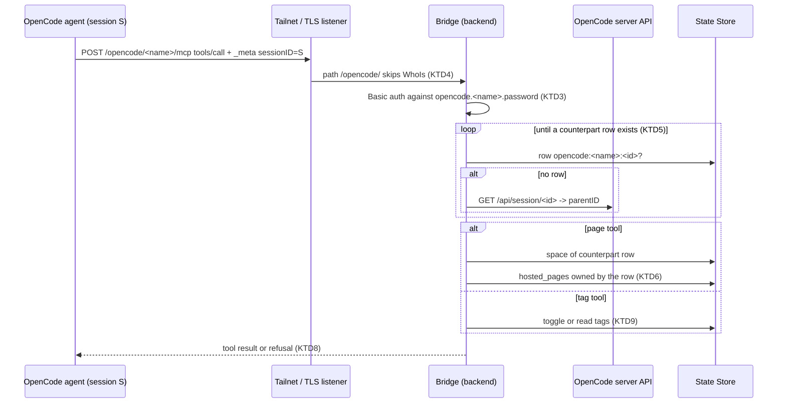

# Coding Server MCP Bridge - Plan

## Goal Capsule

- **Objective:** An agent working in a remote OpenCode session can set its own RocketClaw session tags and publish Hosted Pages that people open in that session's Web space, and those pages disappear when the session does.
- **Means:** RocketClaw serves one remote MCP endpoint per configured coding server on its Web listeners, identifies the calling session from OpenCode's `_meta` session ID, and reuses the existing tag and page code (KTD1).
- **Authority:** Product Contract Requirements and Key Decisions win on behavior; Key Technical Decisions win on mechanism; units carry neither. `AGENTS.md` and `CONCEPTS.md` bind every unit.
- **Stop conditions:** stop and report if the Go source CLOC budget (`make check-cloc-budget`) cannot hold the feature without deleting unrelated code, or if go-sdk v1.8.0 cannot route a request to a per-server MCP server.
- **Execution profile:** Go backend plus two small Web call-site edits; tests run against real PostgreSQL (`ROCKETCLAW_TEST_DATABASE_URL`) and an `httptest` fake OpenCode.
- **Finishing:** the `lfg` pipeline implements, reviews, and opens the pull request; merging stays with the user.

---

## Product Contract

### Summary

Each configured coding server can reach a RocketClaw MCP endpoint that offers two tool groups: session tags and Hosted Pages, each acting only on the calling OpenCode session. Pages written there belong to that session, live in its space, and are deleted with it. OpenCode sessions started or forked from the Web now record a Birth Space so their pages have a home.

### Problem Frame

Agents running inside remote OpenCode sessions cannot reach RocketClaw features. A RocketClaw agent can tag its session and publish Hosted Pages through built-in tools, but an OpenCode agent can only be tagged by hand from the Web and has no way to publish a page people can open next to its session. RocketClaw already keeps a counterpart `conversations` row for every listed OpenCode session and already deletes it when the session disappears, so the session is a natural owner for pages that should not outlive it. OpenCode, for its part, sends the calling session's ID with every MCP tool call, which lets one shared endpoint act per session.

### Requirements

**Endpoint and identity**

- R1. RocketClaw serves an MCP endpoint at `/opencode/<name>/mcp` for each configured coding server `<name>`, on both Web listeners (the TLS listener and the tailnet listener).
- R2. A request is accepted only with HTTP Basic credentials matching coding server `<name>`'s configured `password`; any other name or credential is refused before any tool runs.
- R3. The calling session is coding server `<name>`'s session named by the tool call's `_meta["ai.opencode/sessionID"]`; a subagent session acts for its nearest ancestor that has a counterpart row.
- R4. A tool call is refused, with a message the agent sees, when it carries no session ID or when neither the session nor any ancestor has a counterpart row; RocketClaw never creates that row on demand.

**Session tags**

- R5. The agent can read the calling session's tags and toggle one tag on it; any tag is allowed, as for remote sessions in the Web.

**Hosted Pages**

- R6. The agent can store, read, delete, and list Hosted Page files and store and read Page Data owned by the calling session, with the same path rules and 10 MiB cap as agent page tools and without the workspace `source` option.
- R7. A session's pages live in the space recorded on its counterpart row: their links name that space, they appear in that space's Page Index, and Web serves them; storing a page or Page Data is refused for a session with no space, while its other page tools and tag tools keep working, and deleting a space deletes the pages of the sessions in it.
- R8. Every page file and Page Data entry a session owns is deleted when its counterpart row is deleted.

**Birth Space for OpenCode sessions**

- R9. An OpenCode session created from the Web records the space the person was in as its Birth Space, and a fork records its source session's space.

**Setup**

- R10. A coding server gains the endpoint through its own OpenCode startup config; RocketClaw documents the config entry, the credential, and the certificate requirement.

### Key Decisions

- **Inject through OpenCode startup config.** Governs R10. (session-settled: user-directed — chosen over pushing the server per directory through OpenCode's experimental runtime MCP API: OpenCode has no server-wide runtime API, and startup config is stable across restarts)
- **Authenticate with the existing coding server password.** Governs R2. (session-settled: user-approved — chosen over a new per-server token: no new secret to configure)
- **Serve on the Web listener.** Governs R1. (session-settled: user-directed — chosen over the External MCP listener: the Web listener is where coding servers already meet RocketClaw)
- **The session owns its pages.** Governs R6. (session-settled: user-approved — chosen over one namespace per coding server: sessions never overwrite each other and deletion is whole)
- **Bridge pages are always ephemeral.** Governs R8. (session-settled: user-approved — chosen over a per-call ephemeral flag: no durable owner exists for a session's page)
- **Space comes from the counterpart row; no counterpart means refusal.** Governs R4, R7. (session-settled: user-directed — chosen over creating rows on demand and over spaceless pages listed in every space: the counterpart row is the one source of truth)
- **No space refuses publishing; deleting a space deletes its session pages.** Governs R7. (session-settled: user-directed — chosen over storing under no space, over guessing from the creator's tab, and over refusing every page call, which stranded pages whose space was deleted)
- **Record Birth Space for Web-created and forked OpenCode sessions.** Governs R9. (session-settled: user-approved — chosen over leaving every remote row without a space, which would refuse all page calls)

### Scope Boundaries

- Only tags and Hosted Pages are exposed; other RocketClaw tools (sessions, scheduling, goals) are not.
- Tools act only on the calling session; no tool names another session.
- RocketClaw does not edit or push OpenCode configuration.
- Sessions started directly in OpenCode, remote sessions that exist before this change, and rows sync re-inserts after a deletion have no Birth Space. Nothing sets a remote session's space after creation, so their page calls are always refused; only sessions created or forked from the Web can publish pages.
- The endpoint accepts password attempts, without throttling, from any host that reaches either Web listener, tagged tailnet nodes included. The setup docs require a randomly generated high-entropy password for every coding server that uses the bridge, because that password already grants shell access to the server.
- Considered and not built: a loop guard on the parent walk, because OpenCode assigns a parent once at creation and each lookup already times out; would change if OpenCode ever allowed re-parenting.
- Deferred to follow-up work: Page Index and page tab labels show the owner as `opencode:<server>:<id>`, not the session's name.
- Considered and not built: rate limits or quotas on bridge page writes, because callers authenticate with the coding server's own password and the per-file cap already applies; would change if pages from one server started crowding the store.

---

## Planning Contract

### Key Technical Decisions

- KTD1. **The bridge is one `http.Handler` built in `internal/rocketclaw/backend`.** It reuses unexported pieces only that package has: `pageTools`, `sessionTags`, `toggleSessionTag`, `openCodeCall`, and the thread manager's `webOrigin`. `cmd/rocketclaw/web.go` builds it from the runtime and passes it into `rpc.NewHTTPHandler`, adding no new cross-package import. The 471-line Go CLOC headroom rules out a parallel implementation.
- KTD2. **One go-sdk server per configured coding server, served statelessly.** `mcp.NewStreamableHTTPHandler` picks the server from the `{name}` path value, so each tool handler knows its coding server without request-context plumbing. Its request body limit is raised above go-sdk's 4 MiB default (`DefaultMaxRequestBodyBytes`) to about 16 MiB, so a 10 MiB file sent as `content_base64` fits (R6). Routes register per method (`POST`, `GET`, `DELETE /opencode/{name}/mcp`) because a method-less pattern conflicts with the SPA's `GET /` (precedent: `frontend/rpc/relay.go`).
- KTD3. **Basic auth uses username `opencode` and the server password, compared in constant time.** This mirrors how RocketClaw already authenticates to OpenCode. An unknown `{name}` gets the same refusal as a wrong password.
- KTD4. **The tailnet handler lets `/opencode/` paths through without its WhoIs check.** Coding servers are usually tagged Tailscale nodes, which `NewTailnetHandler` refuses today; Basic auth (KTD3) is the gate for this path on both listeners.
- KTD5. **Session resolution walks up until a counterpart row exists.** Starting at the `_meta` ID, the bridge checks for the row `opencode:<name>:<id>`; if absent it asks OpenCode for the session's `parentID` and repeats; an empty parent or a failed lookup refuses the call (R3, R4). It runs per call, so a session listed after a previous refusal works on the next call.
- KTD6. **Pages carry an explicit owning conversation, enforced by a foreign key.** Migration `066` adds a nullable `hosted_pages.conversation_id` referencing `conversations` with `ON DELETE CASCADE`, plus a partial index, following `web_tabs` in migration `060`. Bridge writes set it, and `hosted_pages.agent` holds the same conversation ID so existing reads, deletes, and lists by owner keep working. A write that races the session's deletion fails on the foreign key instead of leaving an orphan page (R8).
- KTD7. **A session page's space is read through the owning row at read time.** Page reads and listings join `conversations` and `web_spaces` through `hosted_pages.conversation_id` to return the space name. GetPage and ListPages use it when the owner is not an agent definition, so a renamed space moves the pages and their old links redirect, as agent pages do today.
- KTD8. **Bridge tools are the existing page tools, adapted at the boundary.** Names drop the `rocketclaw_` prefix (OpenCode already prefixes the MCP server's name), schemas gain `"type": "object"` (go-sdk refuses tools without it), the store schema and description drop `source`, and a call that still sends `source` is refused before the tool runs. Refusals return as error tool results whose text names the reason (no session ID, no counterpart session, no space), not as protocol errors.
- KTD9. **Tag tools reuse the remote-session tag path.** `get_tags` reads `sessionTags`; `toggle_tag` calls `toggleSessionTag` with a one-tag group, exactly as `ToggleManualTag` does for remote sessions, and both return the session's tags. `toggle_tag` trims its tag and refuses a blank one or one holding a NUL character, matching the Web's tag input check in `frontend/rpc/server.go`.
- KTD10. **Birth Space is written once and never overwritten by sync.** Creating an OpenCode session records the request's space ID when it names an existing space; forking copies the source row's space. Because a sync poll may insert the row first, the record step fills `space_id` only when it is still empty. Sync never touches `space_id`.

### High-Level Technical Design

Page lifecycle: a page is written with the counterpart row as owner. The existing sync removal and daily prune delete that row when the session leaves OpenCode, and the cascade deletes its pages with it.

### Assumptions

- Remote session rows in the Web session list report their recorded space, so remote tabs open in their Birth Space like other sessions; today that column is hard-coded empty.
- Page Data is per session, following from session ownership; a session's pages read only their own session's Page Data.
- Bridge tool names are `store`, `read`, `kv_store`, `kv_read`, `delete`, `list`, `get_tags`, and `toggle_tag`.
- Deleting a space deletes the pages of the OpenCode sessions in it. A session without a space may still read, list, and delete its pages; only storing a page or Page Data needs a space.
- Rows of coding servers removed from config stay stored and hidden, so their pages stay too until the server returns and sync prunes them.
- The tailnet listener with its real certificate, or a configured `web.tls_cert_file`, is how coding servers reach the endpoint; the per-start self-signed certificate is not supported for this path.

---

## Implementation Units

### U1. Session-owned page storage

- **Goal:** Hosted Pages can be owned by a counterpart conversation and are deleted with it.
- **Requirements:** R6, R8; KTD6, KTD7.
- **Dependencies:** none.
- **Files:**
  - `internal/rocketclaw/backend/migrations/066_hosted_page_conversation.sql` (new)
  - `internal/rocketclaw/backend/pages.go`
  - `internal/rocketclaw/backend/page_tools.go`
  - `internal/rocketclaw/backend/bridge.go` (the existing `pageTools` call site)
  - `internal/rocketclaw/backend/store_schema_test.go`
  - `internal/rocketclaw/backend/page_tools_test.go`
  - `internal/rocketclaw/backend/opencode_test.go`
- **Approach:**
  1. Add migration `066` with a real Down step: nullable `conversation_id` with the cascading foreign key and a partial index on non-null values.
  2. Give `Page` the owning conversation and its space name. `PutPage` writes the owner. `Page` and `Pages` return the owner's space through joins (CTEs only, no subqueries).
  3. Let `pageTools` take the owning conversation; agent callers pass none.
  4. Append `066` to the migration ledger the schema test pins.
- **Patterns to follow:** `migrations/060_web_tab_rows.sql` (cascading `conversation_id` and its index); `TestDropWebTabStateBlobMigration` for Up/Down checks.
- **Test scenarios:**
  - A page stored with an owning remote conversation reads back with that conversation's space name.
  - An agent page with no owner reads back unchanged, with no space from the join.
  - Deleting the owning row through the sync removal path deletes the session's page files and Page Data entries; another session's pages remain. The daily prune deletes rows with the same plain delete, so this one test covers the cascade.
  - Storing a page owned by a conversation that no longer exists fails and stores nothing.
  - Migration `066` applies on the released schema and its Down step removes the column.
- **Verification:** backend tests pass on a fresh database; the ledger test lists `066`.

### U2. Web serving and Page Index for session pages

- **Goal:** People open session pages by link and see them in their session's space.
- **Requirements:** R7; KTD7.
- **Dependencies:** U1.
- **Files:**
  - `internal/rocketclaw/frontend/rpc/pages.go`
  - `internal/rocketclaw/frontend/rpc/pages_test.go`
- **Approach:**
  1. GetPage uses the owning conversation's space when the owner is not an agent definition, and keeps its 404 for an owner that is neither.
  2. ListPages includes HTML files owned by a conversation that has a space, reporting that space.
- **Patterns to follow:** existing `getPage` and `listPages`; the `gone` agent case in `pages_test.go`.
- **Test scenarios:**
  - GetPage for a session page returns its body and the session's space name.
  - Opening a session page link under an old space name redirects to the current name after the space is renamed.
  - GetPage for a session's Page Data key returns the JSON value.
  - An owner that is neither an agent definition nor a conversation still returns 404.
  - ListPages includes a session's HTML page under its space and omits its non-HTML files and Page Data.
  - ListPages omits the pages of a session whose space was deleted, while GetPage still serves them.
- **Verification:** `frontend/rpc` tests pass; agent page cases are unchanged.

### U3. Birth Space for OpenCode sessions

- **Goal:** OpenCode sessions started or forked from the Web record a Birth Space.
- **Requirements:** R9; KTD10.
- **Dependencies:** none.
- **Files:**
  - `internal/rocketclaw/backend/opencode.go`
  - `internal/rocketclaw/backend/store.go` (remote branch of the session list)
  - `internal/rocketclaw/frontend/rpc/server.go` (`createSession` OpenCode branch)
  - `internal/rocketclaw/web/src/ui.tsx` (the two OpenCode `createSession` calls)
  - `internal/rocketclaw/backend/opencode_test.go`
  - `internal/rocketclaw/frontend/rpc/opencode_test.go`
- **Approach:**
  1. `CreateOpenCodeSession` takes the request's space ID; the record step stores it only when it names an existing space.
  2. `ForkOpenCodeSession` copies the source row's space, as `backend/fork.go` does for RocketClaw forks.
  3. The record step keeps an existing `space_id` and fills an empty one, so a sync poll that inserted the row first does not lose the space.
  4. The Web sends its current space with both OpenCode create calls; the remote session list reports the row's space.
- **Patterns to follow:** `backend/fork.go` source-space CTE; `CreateConversation`'s space handling in `backend/store_dao.go`.
- **Test scenarios:**
  - Creating an OpenCode session with a known space ID records that space and the session list reports it.
  - Creating with an unknown or empty space ID records no space and succeeds.
  - Forking a session that has a space gives the fork the same space.
  - When a sync poll has already inserted the new row without a space, recording the session still sets its space.
  - A later sync poll leaves a recorded space unchanged.
- **Verification:** backend and `frontend/rpc` tests pass; `make -C internal/rocketclaw/web test` passes.

### U4. MCP bridge handler

- **Goal:** One handler serves the per-server MCP endpoint with tag and page tools for the calling session.
- **Requirements:** R2, R3, R4, R5, R6, R7; KTD1, KTD2, KTD3, KTD5, KTD8, KTD9.
- **Dependencies:** U1, U3.
- **Files:**
  - `internal/rocketclaw/backend/opencode_mcp.go` (new)
  - `internal/rocketclaw/backend/opencode_mcp_test.go` (new)
- **Approach:**
  1. Build one go-sdk server per configured coding server and a stateless streamable handler that picks it by `{name}`, behind the Basic auth check.
  2. Each tool call reads the session ID from `_meta`, resolves the counterpart row (KTD5), and refuses per R4.
  3. Page tools read the row's space name, refuse when empty, and run the adapted page tools owned by the row (KTD8).
  4. Tag tools run the remote tag path (KTD9).
- **Execution note:** Start with a failing test that drives the endpoint through a real go-sdk client with Basic auth and `_meta`, as `frontend/externalmcp/server_test.go` does.
- **Patterns to follow:** `frontend/externalmcp/server.go` (go-sdk server and stateless handler); `fakeOpenCode` and `newOpenCodeTestService` in `backend/opencode_test.go`; the parent walk in `syncOpenCode`.
- **Test scenarios:**
  - Listing tools without credentials, with a wrong password, or under an unconfigured server name is refused.
  - `toggle_tag` on a listed root session adds the tag, a second call removes it, and `get_tags` reports each state.
  - A call from a child session whose parent is listed acts on the parent's row.
  - A call with no `_meta` session ID is refused with a message naming the missing ID.
  - A call from a session with no counterpart row and no listed ancestor is refused, and no conversation row is created.
  - `store` for a session with a space returns a link under `/pages/<space>/opencode:<name>:<id>/<path>`, and `read` returns the content.
  - `store` with a `source` argument is refused and stores nothing, and the `store` tool's description does not mention `source`.
  - `store` with a `content_base64` body over 4 MiB and under 10 MiB succeeds and `read` returns it.
  - `toggle_tag` with a blank tag or one holding a NUL character is refused and changes nothing.
  - Page tools for a session without a space are refused, while `toggle_tag` still works.
  - `kv_store` then `kv_read` round-trips a JSON value; `list` reports the session's files and keys only, not another session's.
  - `delete` removes a file and reports a missing one as not found.
- **Verification:** the new tests pass against real PostgreSQL and the fake OpenCode server.

### U5. Mount the bridge on both Web listeners

- **Goal:** Coding servers reach the bridge on the TLS and tailnet listeners.
- **Requirements:** R1, R2; KTD1, KTD2, KTD4.
- **Dependencies:** U4.
- **Files:**
  - `internal/rocketclaw/frontend/rpc/http.go`
  - `cmd/rocketclaw/web.go`
  - `internal/rocketclaw/frontend/rpc/server_test.go`
  - `internal/rocketclaw/frontend/rpc/relay_test.go`
  - `cmd/rocketclaw/web_test.go`
- **Approach:**
  1. `NewHTTPHandler` takes the bridge handler and registers it per method on `/opencode/{name}/mcp`; existing callers in tests pass an inert handler.
  2. `NewTailnetHandler` passes `/opencode/` requests to the next handler without WhoIs.
  3. `startWebRPC` builds the bridge from the runtime and configured coding servers and passes it in.
- **Patterns to follow:** per-method routes in `frontend/rpc/relay.go`; the tailnet sign-in table in `frontend/rpc/server_test.go`.
- **Test scenarios:**
  - Through `NewTailnetHandler`, a tagged caller reaches `/opencode/<name>/mcp` and gets the bridge's auth refusal rather than the tailnet refusal.
  - Through `NewTailnetHandler`, a tagged caller to any other path is still refused.
  - `GET /opencode/<name>/mcp` reaches the bridge, not the SPA.
  - A real `startWebRPC` with a configured coding server answers an authenticated MCP initialize on its listener.
- **Verification:** `frontend/rpc` and `cmd/rocketclaw` tests pass.

### U6. Documentation

- **Goal:** Operators can enable the bridge, and the domain vocabulary matches the new ownership.
- **Requirements:** R10, R7, R8, R9.
- **Dependencies:** U4, U5.
- **Files:**
  - `cmd/rocketclaw/CHEATSHEET.md` (`opencode` section and page tool rows)
  - `internal/rocketclaw/frontend/rpc/README.md` (HTTP routes and auth)
  - `CONCEPTS.md` (Hosted Page, Page Data, Page Index, Birth Space)
  - `README.md` (Hosted Pages line)
- **Approach:**
  1. Document the OpenCode `mcp` config entry named `rocketclaw` with `type: remote`, the endpoint URL, `oauth: false`, and a Basic `Authorization` header taken from an environment variable holding the precomputed base64 of `opencode:<password>`.
  2. State the operating conditions: a randomly generated high-entropy password, a certificate OpenCode verifies (tailnet listener or `web.tls_cert_file`, never disabled TLS verification), and that a connection that failed when its OpenCode location loaded stays failed until it is reconnected from OpenCode's `/mcps` or OpenCode restarts.
  3. Document the bridge tools, their per-session scope, and the refusals, including that only sessions created or forked from the Web can publish pages.
  4. Update CONCEPTS so a Hosted Page and Page Data can belong to an OpenCode session and are deleted with it, the Page Index includes them by session space, and Birth Space covers OpenCode sessions created or forked from the Web.
- **Test expectation:** none -- documentation only.
- **Verification:** each changed term in CONCEPTS matches the shipped behavior.

---

## Verification Contract

| Gate | Command | Applies to |
|---|---|---|
| Go formatting | `gofmt -l` on touched Go files prints nothing | U1-U5 |
| Go tests | `go test ./...` with `ROCKETCLAW_TEST_DATABASE_URL` set | U1-U5 |
| Web tests | `make -C internal/rocketclaw/web test` | U3 |
| Lint | `make lint` | all |
| Full suite and coverage | `make test` | all |
| Line budgets | `make check-cloc-budget` (Go source must stay under 26000; TS under its budget) | all |

## Definition of Done

- Every requirement R1-R10 is met; R1-R9 are covered by the unit tests named above, and R10 by the U6 documentation.
- An authenticated MCP call from a coding server, through either listener, can toggle the calling session's tag and store a page that opens in that session's space.
- Deleting a session's counterpart row deletes all its pages.
- `make test`, `make lint`, and `make check-cloc-budget` pass without new `//nolint`, budget edits, or code moved to excluded paths.
- No defensive guards, nil-as-disabled dependencies, or SQL subqueries were added.
- Dead-end code from abandoned approaches is removed from the diff.
- README impact is stated in the final report.

## Risks

- **CLOC headroom.** Only 471 Go source lines remain. KTD1, KTD8, and KTD9 reuse existing code; if the budget still fails, stop per the Goal Capsule rather than trimming tests or moving code.
- **Transient short session lists.** A sync poll that sees too few sessions deletes rows and, now, their pages. This is inherent to ephemeral pages and matches existing row deletion. The row a later poll re-inserts has no Birth Space, so that session can no longer publish pages.
- **Shared session namespace.** Subagents act for their top-level session, so parallel subagents writing the same page path overwrite each other, as agent pages already do.
- **OpenCode contract drift.** The bridge depends on OpenCode's `_meta["ai.opencode/sessionID"]` and `GET /api/session/:id` `parentID`, verified at OpenCode `dev` of 2026-10-22 (`packages/core/src/mcp/client.ts`) and the v2 docs.
- **Migration number collision.** Migrations `063` through `065` landed from other work first; check sibling bookmarks before landing (`docs/solutions/runtime-errors/deployment-binary-missing-live-migrations.md`).

## Sources

- `internal/rocketclaw/backend/opencode.go` (sync, prune, create, fork, parent walk, `openCodeCall`)
- `internal/rocketclaw/backend/page_tools.go`, `internal/rocketclaw/backend/pages.go`, `internal/rocketclaw/frontend/rpc/pages.go`
- `internal/rocketclaw/frontend/externalmcp/server.go` and its tests (go-sdk usage)
- `internal/rocketclaw/frontend/rpc/http.go` (`NewHTTPHandler`, `NewTailnetHandler`), `cmd/rocketclaw/web.go`, `cmd/rocketclaw/tailnet.go`
- OpenCode v2 MCP docs: https://opencode.ai/v2/docs/mcp-servers/
