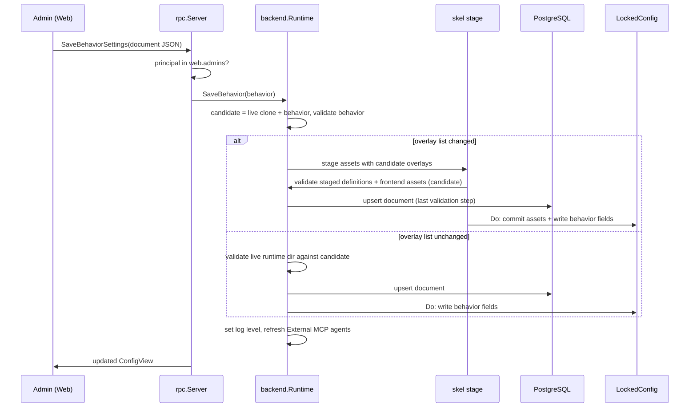
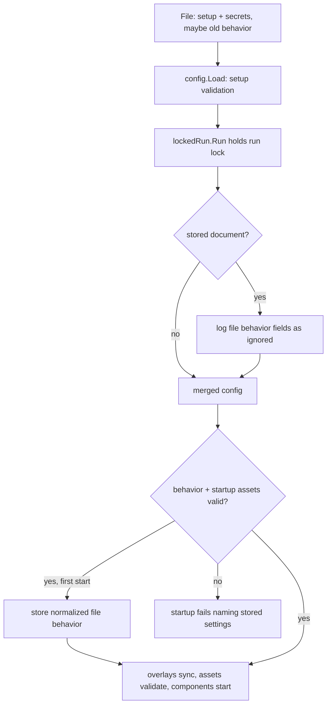

# Behavior Settings in PostgreSQL - Plan

## Goal Capsule

- **Objective:** RocketClaw admins change how the server behaves from the Web, the change takes effect on the running server as soon as it is saved, and the deployed config file carries only setup and secrets.
- **Means:** Behavior fields of `rocketclaw.json` / `femtoclaw.json` move into PostgreSQL. Setup and secrets stay in the file or AWS Secrets Manager.
- **Product authority:** The decisions below were made by the user in the invoking session. Planning may choose how, not what.
- **Open blockers:** None.
- **Stop conditions:** Stop and report if Go source cloc would exceed 27,500, or if a settled decision proves infeasible.
- **Execution:** implemented by `ce-work` under `lfg`, which ships it as a pull request. Merging is left to the user.

---

## Product Contract

### Summary

Behavior settings live in PostgreSQL as one document that admins edit on the Web Config page. Saving validates the whole document and applies it to the running server, or rejects it and changes nothing. `rocketclaw lint` and `rocketclaw agent-graph` become calls to the running server, which does the work against its live settings.

### Problem Frame

Today every setting lives in one file that is read once at startup. Changing which agent answers a Slack channel, which model a name maps to, or who a Web user is means editing a file on the host and restarting. Deployments that bake the file or pull it from AWS Secrets Manager cannot edit it at all. Only a handful of the fields are secrets; most are behavior that people want to adjust while the server runs.

### Requirements

**What moves**

- R1. These fields are behavior and live in PostgreSQL: `models`, `auto_approver_model`, `slack.channels` (channel, agents, allowed user IDs), `web_users`, `server_display_name`, `logging.level`, `instrumentation.hide_inputs`, `instrumentation.hide_outputs`, `web.sentry.environment`, `web.sentry.traces_sample_rate`, and `overlays`.
- R2. Every other field stays in the file, with the existing Secrets Manager merge and `{"aws":{"arn","key"}}` references unchanged. This includes `providers`, `openai`, `mcp_servers`, `opencode`, and `environment` in full.
- R3. The behavior settings are stored and edited as one document whose shape matches those fields in today's config file.

**Editing**

- R4. The file names the Web admins. Only an admin can edit behavior settings; every other Web user sees the Config page read-only.
- R5. Saving runs the same validation the file gets today, over the whole document. An invalid document is rejected with the validation error and nothing changes.
- R6. A saved document takes effect on the running server without a restart, for every field in R1. Fields read once at startup today must be re-applied: logging level, Web users, Slack channel routing and allowed users, display name, Sentry settings, and the overlay list.
- R7. Only current values are kept. There is no change history.

**Upgrade**

- R8. On the first start with no stored behavior document, the behavior fields in the file are copied into PostgreSQL.
- R9. After that, behavior fields left in the file are ignored and the server logs which ones it ignored.
- R10. A file with only setup and secret fields starts the server; behavior then comes entirely from PostgreSQL.

**Inspection commands**

- R11. `rocketclaw lint [next|current]` and `rocketclaw agent-graph [next|current]` keep their names, arguments, and output, but ask the running server to do the work.
- R12. The server runs lint and the agent graph against its live behavior settings and runtime assets.
- R13. When the server cannot be reached, or is too old to answer, the commands fail with a clear error. They never fall back to reading the file.
- R14. Applying a save is atomic. Either the stored document, the live settings, the runtime assets, and the External MCP agent list all change, or none of them do. A crash part way leaves the old settings in force after restart.
- R15. `rocketclaw settings` prints the live Behavior Settings from the running server, without Web users or Slack allowed user IDs, so agents can read them.
- R16. The Config page edits the settings through a control per setting: no field names or JSON to type.

### Key Decisions

- **Behavior in PostgreSQL; setup and secrets in the file or Secrets Manager.** (session-settled: user-directed — chosen over keeping everything in the file: only a few fields are secrets and most are behavior people want to change while running.) Governs R1, R2.
- **Entries that mix behavior with secrets stay in the file.** (session-settled: user-directed — chosen over splitting rows by name or allowing AWS references in database rows: avoids secrets in PostgreSQL and runtime AWS reads.) Governs R2.
- **Only admins listed in the file may edit.** (session-settled: user-directed — chosen over every Web user editing, or everyone editing except access settings: nobody can lock themselves out from the Web.) Governs R4.
- **Saved means applied.** (session-settled: user-directed — chosen over marking some settings "applies after restart" or saving then restarting.) Governs R6.
- **Import once, then ignore the file's behavior fields.** (session-settled: user-directed — chosen over refusing to start, keeping the file as defaults, or an explicit import command.) Governs R8, R9.
- **No change history.** (session-settled: user-directed — chosen over a full history or last-editor tracking.) Governs R7.
- **lint and agent-graph run on the server.** (session-settled: user-directed — chosen over removing them or having them read PostgreSQL directly.) Governs R11, R12, R13.
- **One document, saved whole.** Keeps cross-field validation unchanged and avoids partial states. Governs R3, R5.

### Acceptance Examples

- AE1. **Covers R5, R6.** Given an admin on the Config page, when they change `models.fast` and save, then the next turn that renders `{{ model "fast" }}` uses the new model with no restart.
- AE2. **Covers R5.** Given an admin saves a document whose Slack channel has no agents, then the save fails with the existing validation message and the running server keeps the previous settings.
- AE3. **Covers R4.** Given a Web user who is not an admin, when they open the Config page, then they see the settings and cannot save.
- AE4. **Covers R6.** Given an admin adds a user ID to a Slack channel's allowed users and saves, then that user's next @mention in that channel is answered without a restart.
- AE5. **Covers R8, R9.** Given an existing install whose file has `models` and no stored document, when it upgrades and starts, then the models are copied into PostgreSQL. When the file's `models` is later edited and the server restarted, the stored models still apply and the log names `models` as ignored.
- AE6. **Covers R11, R13.** Given the server is running, when an agent runs `rocketclaw lint next`, then it prints the same findings format as today. Given the server is stopped, the command fails saying it could not reach the server.

### Scope Boundaries

- Typing JSON or field names anywhere on the Config page (R16).
- Moving `providers`, `openai`, `mcp_servers`, `opencode`, or `environment` into PostgreSQL.
- Storing secrets or AWS references in PostgreSQL.
- Change history, audit, or last-editor tracking.
- Editing setup fields (listen addresses, TLS, tsnet, attachments, instrumentation endpoint, `database_url`) from the Web.
- Agents editing behavior settings through a tool.
- Considered and not built:
  - **Revision check against stale saves (KTD10).** Saves are rare and admins see the result. Build it if admins report lost edits.
  - **Blocking loopback from admin rights.** When `web_users` maps `127.0.0.1` to an admin, local processes can save. That matches today, where host processes can already edit the file and restart.
  - **Keeping admin-username `web_users` entries under file control.** An admin can map a new IP to an admin username from the Web. Admins are trusted to edit access settings, which was settled. Revisit if admin grants need a file edit.
  - **Excluding Secrets Manager values from the import.** Behavior fields are not secrets by definition. If someone put one in the AWS secret, it is still behavior. Revisit if a behavior field ever needs secrecy.

### Sources / Research

- `internal/rocketclaw/config/config.go` — field list, `Load`, `Validate`.
- `internal/rocketclaw/config/locked.go` — `LockedConfig`; `Store` has no production caller today.
- `internal/rocketclaw/backend/runtime.go` — Reload "never rereading the configuration file".
- `cmd/rocketclaw/serve.go`, `cmd/rocketclaw/web.go`, `cmd/rocketclaw/assemble.go`, `internal/rocketclaw/frontend/rpc/server.go`, `internal/rocketclaw/frontend/slack/connector.go` — values captured once at startup.
- `internal/rocketclaw/frontend/rpc/server.go` `ListConfig` and `web/src/ui.tsx` `ConfigPage` — today's read-only Config page.
- `cmd/rocketclaw/lint.go`, `cmd/rocketclaw/agent_graph.go`, `cmd/rocketclaw/CHEATSHEET.md` — current commands; skel skills `main-create-or-update-agent`, `main-create-or-update-skill`, `main-create-or-update-council` tell agents to run them.
- `docs/plans/2026-08-12-001-feat-rocketclaw-secrets-manager-plan.md` — Secrets Manager merge and references.
- `internal/rocketclaw/backend/store_schema.go` — embedded migrations.

**Product Contract preservation:** changed: R1, R2 — `environment` stays in the file instead of moving, because it has no production consumer (only validation and cloning read it). Moving it would build storage for a dead field; deleting it is out of scope.

---

## Planning Contract

### Key Technical Decisions

- KTD1. **One typed `Behavior` value in the config package, stored as one `jsonb` row.** The config package owns a `Behavior` struct whose JSON shape is exactly the R1 subset of today's file (`models`, `auto_approver_model`, `slack.channels`, `web_users`, `server_display_name`, `logging.level`, `instrumentation.hide_*`, `web.sentry.environment`, `web.sentry.traces_sample_rate`, `overlays`), plus methods to read it from and write it onto a `Config`. Migration `067` adds a single-row table holding it. It reuses the existing field types (`SlackChannelConfig`, etc.), so their contents aren't duplicated. The stored value is the normalized document: `#` prefixes, dedupe, the `openai/` model strip, and the `debug` log-level default are all applied. That makes the editor show what the server runs. Governs R1, R3.
- KTD2. **Load validates setup only; behavior is validated after the merge.** `config.Load` keeps parsing behavior fields (needed for the one-time import) but no longer requires them, so a setup-only file loads for `run`, `oai`, and `ts`. Behavior checks (Slack channels, web users, models, auto-approver model, Sentry `traces_sample_rate` range, logging default) run on the merged config at startup and on save. Governs R5, R10.
- KTD3. **Merge happens once the run lock is held.** At the start of `lockedRun.Run`, before overlays sync and assets validate, the server reads the stored document.
  - If there is no stored document, the server keeps the file's behavior (R8).
  - Otherwise it logs every behavior field that has a non-zero value in the file as ignored, then applies the stored document (R9).

  It then validates and normalizes the merged config. That includes the existing startup asset checks, so workflow models must exist in `models`. Only after every check passes does a first start store the normalized behavior. A failed import stores nothing, so the operator can fix the file and retry. An invalid stored document stops startup with an error that names the stored behavior settings and includes the validation message. The documented recovery fixes the stored `jsonb` in place with SQL: export it, edit it, then `UPDATE` it. Deleting the row to re-import from the file is a last resort, because it discards every Web edit. "Present in the file" means a non-zero decoded value. Because the merge runs under `holdRunLock`, only one process ever imports. A fresh install with no stored document and no behavior in the file fails today's validation ("slack.channels is required"); behavior must come from the file once or from the database. Governs R8, R9, R10.
- KTD4. **Save validates against the candidate; it re-stages assets only when the overlay list changes.** `Runtime.SaveBehavior` holds `reloadMu` and starts by building a candidate config with the new behavior and validating it. Then:
  - **Overlay list unchanged:** validate the live runtime directory against the candidate (`validateRuntimeAssets` and `ValidateAssets` with the candidate's mapped channels). Write the document to PostgreSQL. Then swap the behavior fields under `LockedConfig.Do`. Overlays are not fetched and pending workspace edits are not published, so a models-only save cannot ship unreviewed agent changes.
  - **Overlay list changed:** stage runtime assets with the candidate overlays (`skel.ReplaceRuntimeAssetsAfterValidation`). Validate the staged definitions and frontend assets against the candidate, and write the document to PostgreSQL as the last validation step. Then commit the staged assets and the behavior fields together under `LockedConfig.Do`. `ReplaceRuntimeAssetsAfterValidation` gains a `config.Behavior` parameter that its commit writes. Reload passes the current behavior, which changes nothing. Staged definitions are validated through a `LockedConfig` wrapping the candidate, not the live one, so new assets are checked against the new models. The save is one transaction (session-settled: user-directed — chosen over reporting "stored, applies on restart" or logging a failed refresh: "the whole configuration application has to be atomic"):
  1. Begin a database transaction and write the document in it.
  2. Swap the live assets (keeping the previous ones), swap the behavior fields, and refresh External MCP agents.
  3. Commit the transaction last.
  4. On any failure, including the commit, restore the previous assets and behavior fields, refresh External MCP agents again, and roll back. The save is reported as rejected with nothing changed.
  5. A crash before the commit leaves the old row; startup rebuilds assets and settings from it.
  Governs R5, R6, R14.
- KTD5. **Every behavior consumer reads the shared `LockedConfig` at use time.** The following components stop keeping their own copy:
  - `rpc.Server.usernames`
  - the Slack connector's channel config
  - the Web index page (Sentry settings and display name)

  The logger level becomes a `slog.LevelVar` that startup and save set. The server name fallback (tsnet hostname or `tailscale status`) is still computed once at startup; only the configured display name is read live. Governs R6.
- KTD6. **Admins are a setup field, `web.admins`, holding usernames.** The save RPC compares the caller's principal username against it. `ListConfig` reports whether the caller may edit, along with the document as JSON. For non-admins, that JSON leaves out `web_users`, matching today's Config page, which does not show the identity map. A save from a caller identified by IP (rather than a tailnet login) is rejected when the candidate `web_users` would resolve that IP to a different username than it does now. Without that check, an admin could lock themselves out, and only SQL could undo it. Governs R4.
- KTD7. **The Config page is a settings screen with one control per setting.** (session-settled: user-directed — chosen over a JSON text area: the screen "mechanically steers the user to do the right thing".) Models are a name → model table; the auto-approver model is a dropdown of configured models; Slack channels are rows whose agents come from the loaded agent list and whose allowed users are added one at a time; Web users are IP → username rows; log level is a dropdown; hide flags are switches; the Sentry sample rate is a 0–1 number; overlays are a list. Save sends the whole screen as one document; the server still validates it and the error names the setting. Governs R3, R4, R5, R16.
- KTD11. **`rocketclaw settings` reuses InspectAgents.** A third inspection kind returns the live document as JSON with `web_users` and every `allowed_user_ids` removed, through the same loopback-only exemption. The inspection target becomes a typed enum like the kind. Governs R15.
- KTD8. **Lint and the agent graph move into one server method and one RPC.** The new method `InspectAgents(target, kind)` runs `agentlint.Lint` or `agentlint.AgentGraphDOT` against the live config.
  - The `next` target stages under the workspace with `os.MkdirTemp(workspace, ".rocketclaw-inspect-*")`, as Reload already does. This replaces the system temp folder.
  - It returns the exact text the CLI prints today, plus the number of findings.
  - The CLI posts to `https://<loopback>:<port>/api/InspectAgents`. The port comes from the file's `web.listen_address`, and the host is always loopback. Certificate checks are skipped because the server's certificate is self-signed and regenerated at each start, and the connection never leaves the host.
  - The CLI keeps today's exit codes: 0 when clean, 1 on findings or error.
  - The CLI keeps `--aws-secrets-manager-arn`, because `web.listen_address` may come from the secret.
  - The CLI tells "could not reach the server" apart from an error the server returned.

  Governs R11, R12, R13. (session-settled: user-directed — chosen over removing the commands or reading PostgreSQL from the CLI: agents' skills keep calling the same commands.)
- KTD9. **Direct loopback callers may call `InspectAgents` without a principal.** Agents run the CLI on the server's host, where `tailscale whois 127.0.0.1` fails and `web_users` rarely maps loopback. The HTTP layer marks a request as direct-local only when the remote IP is loopback and the request carries no `X-Forwarded-For`, `Forwarded`, or `Tailscale-*` header. Those headers mean a relay such as `tailscale serve` forwarded it. The exemption covers only this one read-only RPC, and every other RPC keeps requiring a principal. Governs R11.
- KTD10. **Concurrent saves: last write wins.** Saves are serialized by `reloadMu`, and each one replaces the whole document. Admins are few and see the result on the page, so a version check would build a mechanism the request did not ask for (see Scope Boundaries).

### High-Level Technical Design

### Assumptions

- The Web listener is reachable on loopback at its configured port. A listener bound to one non-loopback IP makes the inspection commands fail with a clear "could not reach the server" error (R13).
- Sentry changes reach a browser tab on its next page load. Open tabs are not refreshed.

### Risks

- **Rollback past migration 067 needs a matching binary.** See `docs/solutions/runtime-errors/deployment-binary-missing-live-migrations.md`.
- **Startup fails on a stored document that no longer fits.** Every save is validated, but a later file or overlay change can make a stored document fail startup checks, for example a workflow model the document doesn't define. Recovery is to fix the stored row in place with SQL (KTD3). A model pointing at a provider removed from the file passes validation and fails per turn, as it does today.
- **Live Slack config reads clone the whole config per event.** That's acceptable at Slack event rates, and the clone is already used per turn.

---

## Implementation Units

### U1. Split behavior from setup in the config package

- **Goal:** `Config` exposes a `Behavior` value that can be read and written, and a setup-only file loads without errors.
- **Requirements:** R1, R2, R3, R10; KTD1, KTD2, KTD6.
- **Dependencies:** none.
- **Files:** `internal/rocketclaw/config/config.go`, `internal/rocketclaw/config/locked.go`, `internal/rocketclaw/config/config_test.go`, `internal/rocketclaw/config/locked_test.go`, `internal/rocketclaw/rocketclaw.example.json`.
- **Approach:**
  1. Add the `Behavior` struct with JSON tags that mirror the file shape, plus methods to read it from and set it on `Config`.
  2. Add `web.admins` (`[]string`) to `WebConfig` and clone it in `clone`.
  3. Move the behavior-only checks and normalization out of `Validate` into a behavior validation that runs on a merged config. This covers the Slack channels rules, `web_users`, `models`, `auto_approver_model`, and the `logging.level` default. `Load` keeps the setup checks: tokens, providers, MCP servers, OpenCode, attachments, web, tsnet, and instrumentation.
- **Patterns to follow:** the existing `validateSlack`, and `normalizeOpenAIModel` for the auto-approver model.
- **Test scenarios:**
  - A file with only setup fields (no `slack.channels`, no `models`) loads without error.
  - A file with behavior fields still exposes them through `Behavior()`.
  - Behavior validation rejects a Slack channel with no agents, a duplicate `@` entry, an empty model name, an invalid `web_users` key, and a `traces_sample_rate` outside 0–1, with today's messages.
  - Setting a `Behavior` onto a config and reading it back round-trips every R1 field, including `traces_sample_rate` and the hide flags.
  - `clone` deep-copies `web.admins`.
- **Verification:** config tests pass, and no setup check was lost from `Load`.

### U2. Store the document, import it once, and merge at startup

- **Goal:** the server's behavior comes from PostgreSQL, and the first start imports from the file.
- **Requirements:** R8, R9, R10; KTD1, KTD3, KTD5 (logger).
- **Dependencies:** U1.
- **Files:** `internal/rocketclaw/backend/migrations/067_behavior_settings.sql`, `internal/rocketclaw/backend/store_dao.go`, `internal/rocketclaw/backend/store_test.go`, `internal/rocketclaw/backend/app.go`, `internal/rocketclaw/backend/app_test.go`, `cmd/rocketclaw/logger.go`, `cmd/rocketclaw/serve.go`, `cmd/rocketclaw/main_test.go`.
- **Approach:**
  1. Add a single-row table with a `jsonb` document, using plain SQL and no extensions.
  2. Add `SessionService` get and put methods (`QueryRowContext`, where `sql.ErrNoRows` means absent, and an `execState` upsert).
  3. In `lockedRun.Run`, before `SyncInWithOverlays`, run the KTD3 flow on `s.cfg`.
  4. `newLogger` builds its handler on a `*slog.LevelVar`, and `serve` passes that `LevelVar` into the backend so the merge and saves can set it.
- **Patterns to follow:** `VoiceSettings` in `internal/rocketclaw/backend/store_dao.go`, and the migration header style of `066_hosted_page_conversation.sql`.
- **Test scenarios:**
  - Covers AE5. The first start with file `models` and no stored row stores those models, and the live config has them.
  - Covers AE5. A start with a stored row and different file `models` uses the stored models and logs `models` as ignored.
  - A start whose stored row fails behavior validation returns an error that names the stored behavior settings.
  - A start whose stored `models` lacks a model a workflow requires fails startup, naming the stored behavior settings.
  - A first start with no stored row and no behavior in the file fails with "slack.channels is required", and the table stays empty.
  - A first start whose file behavior fails validation stores nothing, and a corrected file then imports on the next start.
  - A setup-only file plus a stored row starts and serves the stored Slack channels.
  - Covers R6 (logging). The stored `logging.level` replaces the file level after the merge.
  - The store get on an empty table reports absent, and put then get round-trips.
- **Verification:** backend tests pass against the isolated test database. The migration applies on a fresh schema.

### U3. Make every behavior consumer read the live config

- **Goal:** nothing keeps a private copy of behavior fields.
- **Requirements:** R6; KTD5.
- **Dependencies:** U1.
- **Files:** `internal/rocketclaw/frontend/rpc/server.go`, `internal/rocketclaw/frontend/rpc/server_test.go`, `internal/rocketclaw/frontend/slack/connector.go`, `internal/rocketclaw/frontend/slack/connector_test.go`, `cmd/rocketclaw/assemble.go`, `cmd/rocketclaw/web.go`, `internal/rocketclaw/frontend/rpc/http.go`, `internal/rocketclaw/internal/web/assets.go`, `internal/rocketclaw/internal/web/assets_test.go`.
- **Approach:**
  1. `rpc.Server` drops `usernames` and reads `WebUsers` from `s.cfg` in `principal`.
  2. `slack.New` takes the `*config.LockedConfig` and reads tokens once and channels per use.
  3. `web.Handler` takes the `LockedConfig` and the startup fallback name, and builds the index per request from the current Sentry settings and display name.
- **Patterns to follow:** existing per-use `Clone()` calls in `internal/rocketclaw/backend/bridge.go`. Tests that wrote `server.usernames` now set the config.
- **Test scenarios:**
  - Covers AE4. After the live Slack channels gain an allowed user, `socialModeAllowsUser` accepts that user without rebuilding the connector.
  - After the live `web_users` maps a new IP, `principal` returns the new username.
  - After the live display name and Sentry environment change, the next index response carries the new title and Sentry JSON.
- **Verification:** frontend and cmd tests pass, and `rg` finds no remaining stored copy of these fields.

### U4. Save behavior from the Web RPC

- **Goal:** an admin's save is validated, persisted, then applied. Every check, including the database write, passes before live state changes (KTD4).
- **Requirements:** R4, R5, R6, R7; KTD4, KTD6, KTD10.
- **Dependencies:** U2, U3.
- **Files:** `internal/rocketclaw/backend/runtime.go`, `internal/rocketclaw/backend/runtime_reload_test.go`, `internal/rocketclaw/skel/skel.go`, `internal/rocketclaw/skel/skel_test.go`, `internal/rocketclaw/frontend/backend.go`, `internal/rocketclaw/web/proto/web.proto`, `internal/rocketclaw/frontend/rpc/web.pb.go`, `internal/rocketclaw/frontend/rpc/protocol.gen.go`, `internal/rocketclaw/frontend/rpc/server.go`, `internal/rocketclaw/frontend/rpc/transport.go`, `internal/rocketclaw/frontend/rpc/http.go`, `internal/rocketclaw/frontend/rpc/server_test.go`, `internal/rocketclaw/frontend/rpc/README.md`, regenerated mockery mocks.
- **Approach:**
  1. Add `Runtime.SaveBehavior` per KTD4, and add it to `frontend.Backend`.
  2. Add the `SaveBehaviorSettings` RPC (document JSON in, `ListConfigResponse` out), plus `behavior_json` and `can_edit` on `ConfigView`.
  3. A non-admin gets `PermissionDenied`, and invalid JSON or a failed validation returns `InvalidArgument` carrying the validation message.
  4. Register the RPC in `transport.go` and `http.go`, regenerate the protobuf code, and update the protocol hash.
- **Patterns to follow:** `voiceSettings` in `internal/rocketclaw/frontend/rpc/voice.go`, and `Runtime.Reload`.
- **Test scenarios:**
  - Covers AE1. An admin saves a changed `models` mapping, and the live config and stored row both carry it.
  - Covers AE2. A save whose Slack channel has no agents fails with the validation message, and both the live config and the stored row are unchanged.
  - Covers AE3. A non-admin save returns `PermissionDenied`, and `ListConfig` reports `can_edit` false.
  - A save that adds an overlay which fails to sync is rejected, and the live runtime assets and stored row are unchanged.
  - A save whose frontend asset check fails is rejected.
  - A save with malformed JSON returns `InvalidArgument`.
  - An admin identified by a `web_users` IP saves a document that drops that IP, and the save is rejected as a lockout.
  - An admin identified by `tailscale whois` saves a document that maps their own IP to another username, and the save is rejected as a lockout.
  - A save that leaves the overlay list unchanged does not publish a pending workspace agent edit and fetches no overlay.
  - A non-admin's `ListConfig` response has no `web_users` in `behavior_json`.
  - A save whose staged assets reference a model only the new document defines is accepted, which proves validation used the candidate.
  - Reload after this change still behaves as before (existing reload tests).
- **Verification:** RPC and backend tests pass, and the protocol hash tests in `web/src` are updated.

### U5. Edit behavior on the Config page

- **Goal:** admins edit the JSON document in the Web, and everyone else sees it read-only.
- **Requirements:** R3, R4, R5; KTD7.
- **Dependencies:** U4.
- **Files:** `internal/rocketclaw/web/src/types.ts`, `internal/rocketclaw/web/src/api.ts`, `internal/rocketclaw/web/src/ui.tsx`, a browser test beside the existing Config page tests.
- **Approach:**
  1. Add a mutation for `SaveBehaviorSettings` that updates the `config` query data only from the server's response, with no optimistic update. While the save is pending, Save shows "Saving…", Save and Cancel are disabled, and the controls are read-only.
  2. `ConfigLoaded` shows an Edit button when `can_edit` is true. Edit opens the settings screen of KTD7, with Save and Cancel, and a server error appears beside it.
  3. Keep the logic inside the Config page component so `SessionApp` gains no branches.
- **Patterns to follow:** the error display of `mutations.voiceSettings`, but not its optimistic update. See also `docs/solutions/best-practices/react-doctor-complexity-limit-shapes-web-components.md`.
- **Test scenarios:**
  - Covers AE3. With `can_edit` false, no Edit button is shown.
  - An admin edits, saves, and sees the updated view.
  - A rejected save shows the server message and keeps the edited text.
  - While a save is pending, Save is disabled and the view still shows the old settings.
- **Verification:** web tests and `make lint` (react-doctor) pass, and TS cloc stays under budget.

### U6. Run lint and agent-graph on the server

- **Goal:** the CLI commands keep their output and exit codes while the server does the work against live settings.
- **Requirements:** R11, R12, R13; KTD8, KTD9.
- **Dependencies:** U2, U4 (RPC plumbing pattern).
- **Files:** `internal/rocketclaw/backend/runtime.go` (or a sibling file in `internal/rocketclaw/backend`), `internal/rocketclaw/frontend/backend.go`, `internal/rocketclaw/web/proto/web.proto`, `internal/rocketclaw/frontend/rpc/server.go`, `internal/rocketclaw/frontend/rpc/transport.go`, `internal/rocketclaw/frontend/rpc/http.go`, `internal/rocketclaw/frontend/rpc/server_test.go`, `cmd/rocketclaw/lint.go`, `cmd/rocketclaw/agent_graph.go`, `cmd/rocketclaw/lint_test.go`, `cmd/rocketclaw/agent_graph_test.go`, `cmd/rocketclaw/CHEATSHEET.md`.
- **Approach:**
  1. Move the target resolution and `agentlint` calls from `cmd/rocketclaw/lint.go` into a `Runtime.InspectAgents` method. Its `next` target stages under the workspace.
  2. Add an `InspectAgents` RPC with the target and kind. It is exempt from the principal requirement only for direct-local requests (KTD9).
  3. The CLI reads `web.listen_address` from the file, posts to loopback over TLS without verification, prints the returned text, and exits 1 on findings. When the connection fails, it reports that it could not reach the server.
- **Patterns to follow:** today's output strings in `cmd/rocketclaw/lint.go` and `cmd/rocketclaw/agent_graph.go`. For the HTTPS loopback client, the test client in `cmd/rocketclaw/web_test.go`.
- **Test scenarios:**
  - Covers AE6. `rocketclaw lint next` against a running test server prints `rocketclaw lint next: OK` for clean definitions and exits 0.
  - Lint on definitions with an `RC006` finding prints the findings header and line, and exits 1.
  - `rocketclaw agent-graph current` prints DOT that matches today's output for the same definitions.
  - Covers AE6. With no server listening, the command exits 1 with the "could not reach" message.
  - An `InspectAgents` call from a non-loopback IP without a principal is refused, and a direct loopback call succeeds.
  - A loopback `InspectAgents` request carrying `X-Forwarded-For` and no principal is refused.
  - Lint reflects a `models` change saved through `SaveBehavior` without a restart.
- **Verification:** cmd and rpc tests pass, and nothing under `cmd/rocketclaw` imports `agentlint` anymore.

### U7. Documentation and vocabulary

- **Goal:** operators know where settings live, how to edit them, and that lint needs a running server.
- **Requirements:** R1, R2, R4, R9, R11.
- **Dependencies:** U1–U6.
- **Files:** `README.md`, `cmd/rocketclaw/CHEATSHEET.md`, `internal/rocketclaw/web/README.md`, `internal/rocketclaw/frontend/rpc/README.md`, `CONCEPTS.md`, `internal/rocketclaw/rocketclaw.example.json`, `internal/rocketclaw/backend/bridge.go`, `internal/rocketclaw/backend/bridge_test.go`, `internal/rocketclaw/skel/.rocketclaw/skills/main-update-rocketclaw-json/SKILL.md`, `internal/rocketclaw/skel/.rocketclaw/skills/main-create-or-update-council/SKILL.md`, `internal/rocketclaw/skel/.rocketclaw/skills/main-create-or-update-agent/SKILL.md`, `internal/rocketclaw/skel/agents/main.md`.
- **Approach:**
  1. Document `web.admins`, the fact that behavior fields in the file are imported once and then ignored, and recovery from a stored document that fails startup. Give the exact psql statements to export the document and `UPDATE` it in place. Deleting the row to re-import from the file is a last resort, because it discards every Web edit.
  2. Update the CONCEPTS "Restart" entry: overlay-list changes saved as Behavior Settings no longer need a restart.
  3. Update the `rocketclaw_restart` and `rocketclaw_reload` tool descriptions in `internal/rocketclaw/backend/bridge.go` so they stop telling agents that `rocketclaw.json` edits to behavior need a restart.
  4. Update the skel skills and `skel/agents/main.md`. They should say that behavior fields (R1) live in Behavior Settings, which an admin edits on the Config page. The jq skill now covers setup fields only. When a human asks an agent for a behavior change, the agent should point them to the Config page rather than edit the file. `{{ model }}` checks should use `rocketclaw lint` output rather than the file's `models`.
- **Test expectation:** `bridge_test.go` assertions on the tool descriptions are updated.
- **Verification:** the docs match the shipped behavior, and `bridge_test.go` passes.

---

## Verification Contract

| Gate | Command | Applies to |
|---|---|---|
| Format | `gofmt` on touched Go files | U1–U4, U6, U7 |
| Go tests | `go test ./...` | all |
| Repo tests | `make test` | all |
| Lint | `make lint` (golangci, react-doctor) | all |
| Go size budget | `make -C internal/rocketclaw check-cloc-budget` (limit 27,500) | all |
| Web size budget | `make -C internal/rocketclaw/web check-cloc-budget` (limit 9,250) | U5 |
| Coverage | `make -C internal/rocketclaw coverage-profile` meets `COVERAGE_REQUIRED` | all |

---

## Definition of Done

- Every R1–R16 holds, and AE1–AE6 are covered by the tests named above.
- A test forces a failure at each apply step after the database write (asset swap, External MCP refresh, commit) and proves the stored row, live settings, and runtime assets are all unchanged.
- A setup-only `rocketclaw.json` starts the server against a database that already has a stored document.
- No component keeps a startup copy of a behavior field.
- `cmd/rocketclaw` no longer runs `agentlint` itself.
- All Verification Contract gates pass.
- Abandoned-attempt code is removed, no `//nolint` was added, and the touched diff passes the AGENTS.md Go standards pass.
