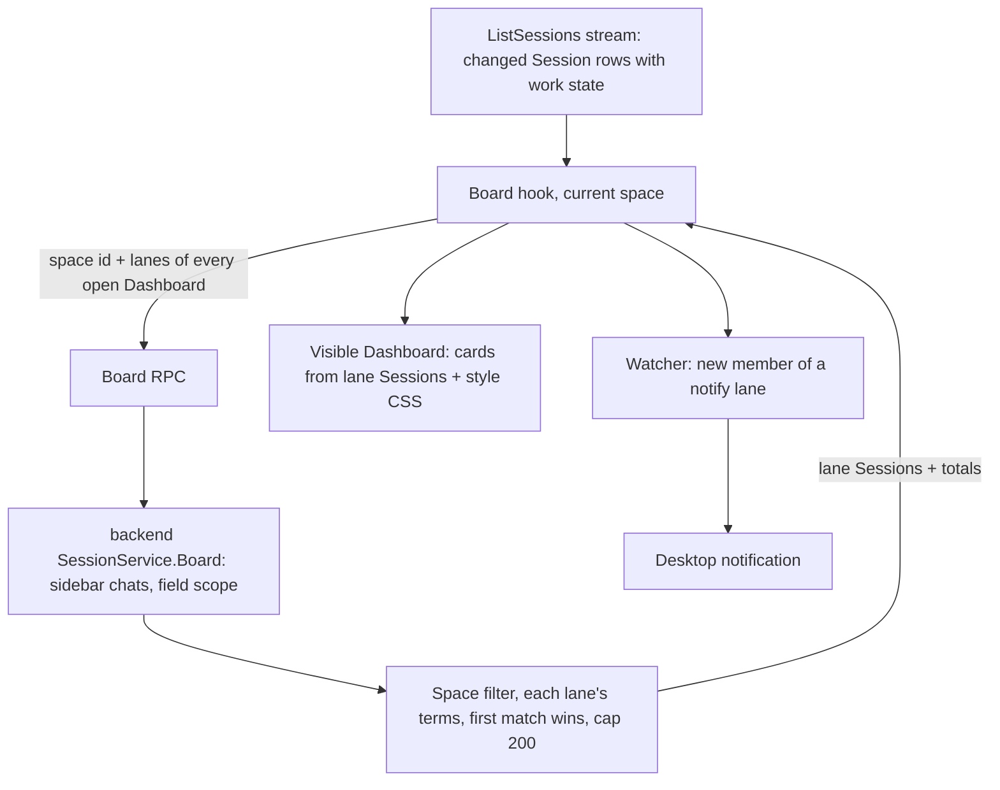
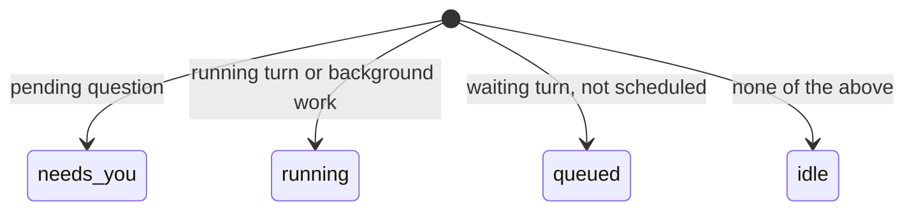

# Space Work Dashboards - Plan

## Goal Capsule

- **Objective:** A person working in a space can see, at a glance and without running searches by hand, which work in that space is new, running, queued, or waiting on a person, External MCP work included. They choose how that board looks from five distinct styles, adjust and copy it, share it with the space by default, and get desktop notifications from it while it is open.
- **Means:** a Dashboard is a Search Page with a board style, whose saved searches are its lanes; the server sorts the space's sessions into lanes (KTD1, KTD2).
- **Authority:** Product Contract requirements win on behavior; KTDs win on mechanism within them; units override neither. Repository `AGENTS.md` rules (budgets, no `git`, Go standards, CTE-only SQL, react-doctor) bind every unit.
- **Stop conditions:** stop and report instead of continuing when the web source line count would reach `TS_CLOC_BUDGET` (R16), when a unit would need a new database table or migration, or when react-doctor or the Go coverage gate fails and cannot be fixed without cutting requested behavior.
- **Execution profile:** Go backend first (U1, U2), then web (U3 to U6). Web browser tests run against the last bundle that built; confirm the build succeeded before trusting a browser test.
- **Finishes and ships:** `ce-work` implements; the calling `lfg` run reviews, commits, and opens the PR.

---

## Product Contract

### Summary

Add Dashboards: a Search Page switched to a board style, whose saved searches become lanes showing the space's work. Five board styles ship, each with its own layout, ordering, time display, and attention cue. New Dashboards start in the space's Shared Group with lanes for work that needs a person, is queued, is running, or came from External MCP. Any Search Page or Dashboard can be duplicated. While a Dashboard is open in a person's current space, work entering a lane marked for notification raises a desktop notification.

### Problem Frame

Spaces and tabs organize sessions a person already knows about. They do not show incoming work arriving in a space, and External MCP work is the worst case. Its Web chat is created without a Birth Space. It never marks anyone Unread unless the chat is already in a Shared Group. While it works, its chat shows only background activity. Today people approximate a work board with named Search Pages, but a Search Page shows one list at a time, has no notion of state or age, and goes stale because its results re-run only when the set of session IDs changes.

The owner points to air traffic control flight progress boards as the model. A controller sees every flight as a strip in a bay, and the bay a strip sits in says what state it is in. They want that, plus other styles, to track incoming and pending work.

### Requirements

**Dashboards**

- R1. A Dashboard is a Search Page with a board style chosen; its saved searches are its lanes, edited with the existing search tabs, and its name, lanes, and style are its configuration.
- R2. A Dashboard shows the work of the space it sits in. That covers sessions whose Birth Space is that space and sessions without a Birth Space whose agent's configured space is that space by name, ignoring case. Sessions with neither a Birth Space nor an agent space show in every space, as agents without a space do in the Page Index.
- R3. Each session appears once on a Dashboard, in the first lane, in lane order, whose query it matches. A lane's free text matches session fields such as name, agent, and preview, not message bodies.
- R4. Each card shows the session's title, agent, work state, and how long it has been in that state or since it arrived, from server-provided times that read the same for every person and survive reloads.
- R5. A Dashboard updates without a manual refresh when the live session list reports a change to a session in its space, including changes in work state.
- R6. A lane draws at most 200 cards and shows the total it matched when it holds more.

**Board styles**

- R7. Five board styles ship and stay selectable: Strip Bay, Dispatch Console, Triage Census, Kanban, and Radar Scope (see Board Styles below).
- R8. Each style differs from the other four in layout, card ordering, time display, and attention cue, not only in colour.
- R9. A card that newly enters a lane while the Dashboard is shown is marked once with a short arrival cue that then settles; cards already present when the Dashboard opens or a lane is edited get no cue, and the cue respects reduced-motion preferences.

**Create, configure, duplicate, share**

- R10. A person can create a new Dashboard from the current space. It opens with the Strip Bay style and the default lanes "Needs you" (`is:waiting`), "Running" (`is:running`), "Queued" (`is:queued`), and "External" (`is:external`), in that order, so a card's lane agrees with its work state. "Needs you", "Queued", and "External" start marked for notification; "Running" does not.
- R11. A new Dashboard is added to the current space's Shared Group when created, so everyone in the space sees and edits the same one; removing it from Shared keeps the existing Search Page behavior.
- R12. A person can duplicate any Search Page or Dashboard from its tab menu; the copy has its own address, the source's configuration, and the name "<source name> copy", and is added to the current space's Shared Group when the source was in it.

**Search terms**

- R13. The session search language gains `is:running` (a running turn or background work), `is:queued` (waiting turns other than scheduled ones), `is:waiting` (a pending question), and `is:external` (a Web chat bound to External MCP). Each one counts the Private Producer Conversations that report to a chat as that chat's own work, and each works in Search Pages and for agents alike.

**Notifications**

- R14. While a Dashboard is open in a person's current space, as one of their own tabs placed in that space or in that space's Shared Group, a session newly entering one of its lanes marked for notification raises one desktop notification, whether or not the window is focused.
- R15. A Dashboard's first load after opening or reloading records lane contents without notifying, and so does the first load after a lane's query changes or its notification mark is turned on. A session that leaves a lane and later re-enters it notifies again, with an alert even when its earlier notification is still showing. Clicking a notification opens the session.

**Constraints**

- R16. The web source stays under `TS_CLOC_BUDGET`, and Go source under `GO_SOURCE_CLOC_BUDGET`, with neither budget edited and no existing feature removed to make room.

### Board Styles

Every style renders the same lanes and cards. Each style is a CSS layout keyed by the style id plus one entry in a TypeScript style table. The entry gives the style's label and card ordering, and the CSS gives its layout, time display, and attention cue. "Age" means time in the current state. Age cues apply only to cards that are not idle: amber from 15 minutes, red from 60 minutes. Finished work never looks urgent.

| Style | Inspired by | Layout | Card order | Time shown | Attention cue |
|---|---|---|---|---|---|
| Strip Bay | ATC flight progress strips | Lanes as vertical bays of narrow strips with a coloured kind edge | Arrival, oldest at the bottom | Arrival clock time | Strip offset sideways while it needs a person |
| Dispatch Console | CAD unit status | Compact rows grouped by lane with status chips | Lane then age | Countdown since state change | Chip flashes once, then holds |
| Triage Census | ED tracking board | Grid with lane, agent, age columns | Age, oldest first | Elapsed with threshold bands | Row band by age threshold |
| Kanban | Kanban with WIP limits | Horizontal columns of cards | Arrival, oldest first | Relative age | Column header flags when its count passes 5 |
| Radar Scope | Radar display | Concentric rings by age, lanes as sectors | Age as distance from the centre | Age on hover and focus | New contact blips once |

### Scope Boundaries

- Dashboards show sessions. They do not show cron schedules, Hosted Pages, or remote OpenCode child sessions.
- Changing a lane's matching rules beyond the search language (R13) is out of scope; lanes are search queries.

#### Deferred to Follow-Up Work

- Giving External MCP Web chats their agent's space as Birth Space at registration. R2's agent-space match covers Dashboards without changing where those sessions open.
- Agents listing or reading Dashboards by name; agents already get R13's terms through session search.
- Restoring a closed Dashboard or Search Page.

#### Considered and Not Built

- **Per-person mute of a shared Dashboard's notifications.** The existing per-person tab mute is stored per conversation, so muting a Dashboard needs a new stored setting and a migration. Until then, a person who has a shared Dashboard open in their current space cannot opt out of its notifications. Removing it from Shared removes it for everyone, so their only options are switching space or blocking the site's notifications. This is an owner decision; see Outstanding Questions.
- **A server-side notification path or Slack delivery.** Notifications stay in the browser, matching the existing desktop notifications and the rule that Slack only answers mentions.
- **A new table for Dashboards.** The Search Page record already stores per-tab and shared configuration.
- **A `space:` search term.** R2 scopes by the Dashboard's own space, which survives renames; a stored space name would not.
- **Matching `Board` lanes against the server's cached listing rows instead of loading chats.** It would remove a database read per refresh but add per-person cached state. Measured `Board` latency above U2's 200 ms bound would change this.
- **Departures Board, Ticket Rail, Andon Wall, Train Line, and Berth Timeline styles.** They were built and tried; the owner dropped them after reviewing recordings and kept the five styles of R7.

### Outstanding Questions

- (Owner decision, non-blocking) Should each person be able to mute a shared Dashboard's notifications? That needs a stored per-person setting and a migration. See Considered and Not Built.
- (Owner decision, non-blocking) Should Dashboards notify only while open in the person's current space (R14), or from every space, as tab notifications do today? Every space catches External MCP work after a space switch, at the cost of more `Board` requests and more notifications.
- (Deferred, non-blocking) Finished External MCP work marks no one Unread unless its chat is in a Shared Group, so the "External" lane has no lasting "not yet looked at" mark. Changing Unread for External MCP turns is a separate product change.

### Sources

- `CONCEPTS.md`: Space, Shared Group, Search Page, Birth Space, Unread, Thread Queue, Private Producer Conversation.
- `docs/plans/2026-10-26-1002-feat-web-many-named-search-pages-plan.md`, `docs/plans/2026-10-24-0807-feat-web-shared-tab-group-plan.md`, `docs/plans/2026-10-19-0930-feat-web-desktop-notifications-plan.md`.
- `docs/solutions/best-practices/react-doctor-complexity-limit-shapes-web-components.md`, `docs/solutions/performance-issues/search-page-froze-rendering-every-result.md`, `docs/solutions/logic-errors/external-mcp-thread-lost-metadata-after-copy-free-hidden-runs.md`, `docs/solutions/best-practices/web-browser-tests-run-the-last-bundle-that-built.md`.
- Design prior art: NATS and Frequentis electronic flight strips, CAD unit status boards, ED tracking boards, and the MDN Notification API guidance on `tag` replacement.

---

## Planning Contract

### Key Technical Decisions

- KTD1. **A Dashboard is a Search Page with a board style.** `SearchPage` gains a board style field and `SavedSearch` gains a notify flag. Storage, naming, Shared editing with rebase, palette lookup, and moving between groups and spaces all come with the existing `web_tabs.search` and `web_shared_tabs.search` JSONB. This needs no migration, and the web budget cannot pay for a parallel entity. The style is a page-level field, so it changes through `editSearch` the way the name does, and `rebase` keeps it by the same mine-versus-base rule as the name. `notify` is per search, so `comparablePage` compares it.
- KTD2. **The backend sorts sessions into lanes and returns their cards.** A backend `SessionService.Board` in `backend/session_search.go` owns lane assignment, because the query parser, `passes`, and free-text matching are private there and the backend already loads agent definitions. The `Board` RPC handler only converts results to proto. It takes the space ID and every open Dashboard's lanes, and returns each lane's sessions, capped at 200 and newest arrival first, plus totals. Each is the `Session` proto `ListSessions` lists, built by the same conversion from the same sidebar chat, with the caller's unread marks. The browser renders cards and notifies from these sessions, not from its session list, so a session the Board lists before the session list has its row still shows and notifies once. Lanes use the field scope only, with no message hits, and load principals only when a lane has a `principal:` term, as `sandboxedAgents` does for `agent:`. The handler in `frontend/rpc` coalesces identical calls through `sharedSearch` (`frontend/rpc/session_commands.go`), keyed by person, space, and lanes. Browser-side matching was rejected because it would copy the query language into TypeScript the budget cannot afford.
- KTD3. **Refresh follows the live session list, scoped to the space.** `ListSessions` resends a row only when its encoded `Session` proto changes, so U1 adds work state, External MCP binding, and arrival time to that proto. A queue or question change then shows as a changed row. The browser requests `Board` when a changed row's space is the current space or empty, keeps at most one request in flight, and adds no timer or transport.
- KTD4. **Work facts live on the sidebar chat row.** The sidebar session query computes them:
  - waiting turns, External MCP binding, and running work, from the chat and the Private Producer Conversations that report to it;
  - pending questions, from the chat itself only, because only Web turns a person started can ask one;
  - arrival time, the creation time of the chat's newest turn, so new work in an old External MCP chat reads as new;
  - state-since time, the start of the turn that defines the current state (the running turn, or the oldest waiting turn), or the last update when idle.

  Waiting turns come from one CTE over the `turns_waiting_input` partial index. Pending questions are looked up by `conversation_id` from the active-turns set, never by a scan of `steps` keys. Both search (R13) and `Board` read the same facts.
- KTD5. **Space scope comes from where the Dashboard sits.** The visible page's space is always `state.space`, because opening a tab switches to its space. The watcher takes own Dashboards whose `tab.space` is `state.space` plus that space's Shared Dashboards, keyed by space and path. R2's agent-space fallback uses the agent definitions the backend already loads, the same rule cron applies in `frontend/rpc/server.go`.
- KTD6. **Styles are data plus CSS.** One `Board` component renders lanes and cards with `data-board`, `data-state`, and `data-new`, plus an `--age` custom property in minutes since the state began. Each style table entry is a label and one of three orders: arrival oldest first, arrival newest first, or age oldest first. Cards are sorted in the DOM by that order, so focus and reading order match what is shown, and no CSS `order` is used. `app/globals.css` gives each style its layout, time display, and attention cue.
- KTD7. **One board hook feeds both the page and notifications.** Only the visible Search Page is mounted. A single board hook under one react-query key fetches lanes for every Dashboard open in the current space. It remembers each lane's sessions under the Dashboard path and lane query, together with the Dashboard's ordered lane keys. Because a session sits only in the first lane it matches, any added, removed, reordered, or edited lane makes the whole Dashboard take one silent baseline, so sessions that merely moved between lanes are never new. The notify mark is not part of the key: toggling it neither refetches nor empties the lane, and sessions already in the lane are never new afterwards. A full lane's oldest arrival comes from those remembered sessions. The visible page reads its own lanes, cards, and new-card marks from that result. A watcher next to `TabNotifications` notifies on new members of notify lanes, titled from the Board's session, with tag `<dashboard path>:<session id>` and `renotify`, as tab notifications already do. It reuses the existing permission request on first interaction.

### High-Level Technical Design

Card work state, derived on the server in this order:

The first matching state wins, so a session with a pending question shows as needs-you even while background work runs.

### Assumptions

- "10 different implementations" meant ten selectable board styles to try for real, not ten throwaway prototypes; after trying them the owner kept five (see Considered and Not Built).
- "Space specific" means a Dashboard shows the work of the space its tab sits in (R2), and External MCP chats count toward their agent's space.
- "Shared by default" means a new Dashboard starts in the current space's Shared Group (R11), using the existing Shared semantics.
- "If open / focus they should emit notifications" means notifications fire while the Dashboard is open in the person's current space, whether or not the window is focused (R14).
- A lane's free text matching session fields only (R3) is acceptable, even though Search Pages in list view also match message bodies.

### System-Wide Impact

- **Every Web client's two-second poll.** The sidebar session query gains work-fact CTEs and runs on every `ListSessions` poll for every client. U1 holds it to a benchmark gate.
- **Agents.** R13's terms reach `rocketclaw_sessions_list` through the shared search language, and its help text in `backend/session_tools.go` lists them.
- **Space deletion.** Deleting a space moves its Shared Dashboards into the first remaining space, where they then show that space's work. This follows existing Shared Group behavior and is accepted.
- **Shared notifications.** Everyone with a shared Dashboard open in their current space gets its notifications (R14). Per-person muting is recorded under Considered and Not Built.

### Risks

| Risk | Decision |
|---|---|
| The web source budget (72 lines left) cannot fit U3 to U6 | Per-unit line caps in each unit. U3 ends with a budget check, and the run stops and reports before U4 if the remaining caps no longer fit (R16). |
| Work-fact CTEs slow the poll at scale | U1 extends the sidebar benchmark to 1,000 chats and 50,000 finished turns and checks the query plan uses the waiting-turn and `reports_to` indexes. |
| `Board` load on busy instances | KTD2 field scope and coalescing, plus KTD3 space-scoped, single-flight refresh. U2's measured latency at 1,000 chats stays under 200 ms. |

### Sequencing

U1 then U2 on the backend. U3 depends on the generated proto from U2. U4, U5, and U6 depend on U3. U4 and U5 can land in either order. U6 lands last because it reuses the board request and the notify flag.

---

## Implementation Units

### U1. Work facts and search terms

- **Goal:** Sidebar chats carry pending-question, queued, External MCP, and arrival facts, which reach the `Session` rows Web lists, and search understands R13's terms.
- **Requirements:** R4, R5, R13; KTD3, KTD4.
- **Dependencies:** none.
- **Files:**
  - Backend: `internal/rocketclaw/backend/store.go`, `internal/rocketclaw/backend/session_search.go` (parsing, `passes`, the regex doc comment), `internal/rocketclaw/backend/session_tools.go` (the `rocketclaw_sessions_list` help text).
  - Proto and RPC: `internal/rocketclaw/web/proto/web.proto` (`Session` gains work state, External MCP binding, arrival time), `internal/rocketclaw/frontend/rpc/web.pb.go` (generated), `internal/rocketclaw/frontend/rpc/server.go` (row building).
  - Web: `internal/rocketclaw/web/src/types.ts` (`Session`), `internal/rocketclaw/web/src/ui.tsx` (the `is:` lists on the unfinished-term line and the completion line).
  - Docs: `internal/rocketclaw/web/README.md` (search language).
  - Tests: `internal/rocketclaw/backend/session_search_test.go`, `internal/rocketclaw/backend/equivalence_test.go`, the sidebar benchmark in `internal/rocketclaw/backend/store_summaries_test.go`, `internal/rocketclaw/web/src/session-list.browser.test.ts`.
- **Approach:**
  1. Extend the sidebar session query with CTEs for the work facts of KTD4. Credit running and waiting work to the listed chat through `reports_to`. Treat waiting turns with reason `queued`, `stashed`, or `held` as queued, and exclude `scheduled`.
  2. Derive the work state in the order the state diagram gives. Carry it, the External MCP binding, the arrival time, and the state-since time on `SidebarSession` and on proto `Session` (KTD3).
  3. Add `running`, `queued`, `waiting`, `external` to `keyIs` parsing and `SidebarChat.passes`, then to the agent tool help text and README.
  4. Add the four keywords to the client's two existing `is:` lists without adding lines.
- **Web line cap:** 3 lines.
- **Patterns to follow:** `sandboxedAgents` crediting hidden-run agents to their chat; the existing `is:unread` term.
- **Test scenarios:**
  - `is:waiting` matches a Web chat with a pending question and does not match a chat without one.
  - A second External MCP prompt into a week-old chat sets its arrival time to the new turn's creation.
  - A chat with a turn running for 20 minutes reports a state-since time 20 minutes ago, unchanged by messages the turn writes.
  - `is:queued` matches a chat with a queued Thread Queue item and does not match one whose only waiting turn is scheduled.
  - `is:running` matches a chat whose only activity is a running hidden run reporting to it.
  - `is:external` matches an External MCP Web chat and not an ordinary Web chat with "external mcp" in its text.
  - Combining `is:queued agent:x` requires both.
  - Queueing an item into an idle chat changes its listed work state, so the chat appears in the next `ListSessions` changed rows.
  - An External MCP chat's listed row carries its binding and arrival time.
  - The sidebar benchmark at 1,000 chats and 50,000 finished turns shows no full scan of `steps` and uses the waiting-turn partial index.
- **Verification:** the new terms work in a Search Page and through `rocketclaw_sessions_list`, the benchmark holds, and Go coverage stays at or above the required threshold.

### U2. Board RPC

- **Goal:** One server call returns, for a space, every open Dashboard's lanes as `Session` cards with totals.
- **Requirements:** R2, R3, R6; KTD2, KTD5.
- **Dependencies:** U1.
- **Files:** `internal/rocketclaw/backend/session_search.go` (`SessionService.Board`), `internal/rocketclaw/backend/session_search_test.go`, `internal/rocketclaw/web/proto/web.proto`, `internal/rocketclaw/frontend/rpc/web.pb.go` (generated), `internal/rocketclaw/frontend/rpc/session_commands.go` (handler and coalescing), `internal/rocketclaw/frontend/rpc/http.go` and `internal/rocketclaw/frontend/rpc/transport.go` (allowlists), `internal/rocketclaw/frontend/rpc/server_test.go`.
- **Approach:**
  1. In the backend, load the sidebar chats once in the field scope and keep those in the space per R2.
  2. Parse each lane query with the existing parser, apply terms and field free text, and assign each chat to its first matching lane per Dashboard.
  3. Return up to 200 chats per lane, newest arrival first, with the total.
  4. Add the proto messages and a handler that coalesces through `sharedSearch` (KTD2) and converts each chat with `ListSessions`' row conversion, and register the method in both allowlists.
- **Patterns to follow:** `SearchSessions` in `backend/session_search.go` and `sharedSearch` in `frontend/rpc/session_commands.go`; `modelAgents` for agent definitions; `sandboxedAgents` for lazy loads.
- **Test scenarios:**
  - A space's Web chat and an External MCP chat whose agent's space has the same name ignoring case both appear; a chat in another space does not.
  - A chat with no Birth Space whose agent has no space appears in every space.
  - A chat matching two lanes appears only in the first.
  - A lane matching 250 chats returns 200 sessions and a total of 250.
  - A card equals the `ListSessions` row for its chat, even when a `model:` lane matched its agent's model.
  - Lane free text matches a session name but not text found only in a message body.
  - An empty lane query matches every chat in the space.
  - An unknown space ID returns empty lanes.
  - Two Dashboards in one request get independent lane assignments.
  - Measured `Board` latency at 1,000 chats stays under 200 ms.
- **Verification:** `Board` answers over HTTP for an allowlisted caller, and lane contents match the search rules.

### U3. Dashboard configuration on Search Pages

- **Goal:** Search Pages store a board style and per-lane notify flags, kept through saves, Shared edits, and rebases.
- **Requirements:** R1, R14; KTD1.
- **Dependencies:** U2 (shared proto regeneration).
- **Files:** `internal/rocketclaw/web/proto/web.proto`, `internal/rocketclaw/frontend/rpc/web.pb.go` (generated), `internal/rocketclaw/web/src/ui.tsx` (`editSearch`, `comparablePage`, `rebase`), `internal/rocketclaw/web/src/types.ts`, `internal/rocketclaw/web/src/api.ts`, `internal/rocketclaw/frontend/rpc/tabs_test.go`, `internal/rocketclaw/web/src/search-page.browser.test.ts`.
- **Approach:** apply KTD1's field changes in the hand-written web types and the proto. Confirm that `edit_shared` round-trips both fields.
- **Web line cap:** 6 lines. After this unit, run `make cloc` in `internal/rocketclaw/web`. If the lines left are fewer than the caps of U4, U5, and U6 combined (59), simplify existing code without removing features. If that cannot close the gap, stop and report the budget conflict before U4.
- **Patterns to follow:** how `name` round-trips through `SearchPage` JSONB, `editSearch`, and `rebase`.
- **Test scenarios:**
  - Changing only the board style of an own Search Page saves and survives reload.
  - Toggling a lane's notify flag on a shared Dashboard is seen by a second person after refetch.
  - Two people editing different fields of one shared Dashboard both keep their change after rebase.
  - A Search Page saved before this change loads as an ordinary Search Page.
- **Verification:** configuration survives reload, Shared editing, and moving between spaces.

### U4. Board view and five styles

- **Goal:** A Search Page with a board style shows its lanes as a board in the chosen style.
- **Requirements:** R1, R4, R5, R6, R7, R8, R9; KTD3, KTD6, KTD7.
- **Dependencies:** U3.
- **Files:** `internal/rocketclaw/web/src/ui.tsx`, `internal/rocketclaw/web/src/api.ts`, `internal/rocketclaw/web/app/globals.css`, `internal/rocketclaw/web/src/board.browser.test.ts`.
- **Approach:**
  1. Add the board hook of KTD7. It requests `Board` for every Dashboard open in the current space when a changed row qualifies under KTD3.
  2. Add a style picker to the Search Page header with "List" (no style) plus the five styles, and a notify toggle on the active lane's tab.
  3. When a style is set, render a `Board` component instead of the results, keeping the existing search tabs as the lane editor (R1). Cards come from the lane's own sessions in the `Board` result. While the first result loads or after an error, show the existing search notices, including Retry.
  4. Sort cards by the style's order (KTD6), set `--age`, and mark cards the hook reports as new (KTD7).
  5. Write each style's CSS per the Board Styles table, with reduced-motion fallbacks.
  6. Put new branches in the `Board` component or hooks, not `SessionApp`.
- **Web line cap:** 38 lines.
- **Execution note:** run `make cloc` in `internal/rocketclaw/web` after each step. Prefer sharing existing Search Page header and row code over new code. If the unit cannot fit its cap without removing a feature, stop and report (R16).
- **Patterns to follow:** `SearchTabs` and `SearchResults`; the `shimmer`/`shimmer-still` reduced-motion pattern; incremental drawing from the Search Page freeze fix.
- **Test scenarios:**
  - Each of the five styles renders a board with lanes and cards for a fixture of four lanes, and its `data-board` value matches the style.
  - Two styles with different ordering show the same fixture in their stated orders.
  - A session becoming running moves its card from "Queued" to "Running" after the next session list change, without a reload.
  - A card new since the previous result has `data-new` once and not after the following refresh.
  - Opening a Dashboard, and editing a lane's query, marks no card new.
  - Keyboard focus moves through cards in the same order they appear.
  - An idle card older than 60 minutes shows no age cue, and a queued card 20 minutes old shows amber.
  - A failed `Board` request shows the error notice with Retry, not an empty board.
  - A lane with a total over 200 shows the count.
  - Switching back to "List" shows ordinary search results.
  - Under reduced motion, no style animates.
  - A changed row in another space triggers no `Board` request, and a burst of changes while a request is in flight triggers one follow-up request.
- **Verification:** all five styles are selectable and visibly differ in layout and ordering; react-doctor passes; the web budget check passes.

### U5. New Dashboard and Duplicate

- **Goal:** People can create Dashboards in their space and duplicate any Search Page or Dashboard.
- **Requirements:** R10, R11, R12.
- **Dependencies:** U3.
- **Files:** `internal/rocketclaw/web/src/ui.tsx` (tab menu commands, palette rows), `internal/rocketclaw/web/src/dashboards.browser.test.ts`.
- **Approach:**
  1. Add a "New dashboard" command that opens a new `/search/<id>` page with R10's style and lanes and shares it into the current space's Shared Group with the existing `share` change.
  2. Add a "Duplicate" tab menu command for Search Pages and Dashboards. It copies configuration with new search IDs and names the copy per R12, sharing it when the source is in the current space's Shared Group.
- **Web line cap:** 10 lines.
- **Docs:** describe Dashboards, New dashboard, and Duplicate in `internal/rocketclaw/web/README.md`.
- **Patterns to follow:** the "Add to Shared" command and `sharing.mutate`; Search Page creation in `openTab`.
- **Test scenarios:**
  - "New dashboard" opens a Strip Bay board with the four default lanes in R10's order and notify marks, in the current space's Shared Group, visible to a second person.
  - Duplicating an own Search Page creates an own copy named "<name> copy" with identical lanes and a different address.
  - Duplicating a shared Dashboard creates a second shared Dashboard; editing the copy leaves the source unchanged.
  - Duplicating an unnamed Search Page names the copy after the shown query plus " copy".
- **Verification:** both commands work from the tab menu and Cmd+P without new branches in `CommandPalette`.

### U6. Dashboard notifications

- **Goal:** Open Dashboards in the current space notify on new arrivals in lanes marked for notification.
- **Requirements:** R14, R15; KTD7.
- **Dependencies:** U4, U3.
- **Files:** `internal/rocketclaw/web/src/ui.tsx` (watcher next to `TabNotifications`), `internal/rocketclaw/web/src/notifications.browser.test.ts`.
- **Approach:** read the board hook's new members of notify lanes (KTD7) and notify per R14 and R15 with KTD7's tag and `renotify`. The hook's baseline rule covers Dashboard opens, space changes, and lane edits.
- **Web line cap:** 11 lines.
- **Patterns to follow:** `TabNotifications` first-listing record, permission handling, and click-to-navigate.
- **Test scenarios:**
  - A session entering a notify lane of an open Dashboard raises one notification titled with the Dashboard and lane names, with the session title as body.
  - A session the `Board` lists before the session list has its row notifies once, from the Board's session, and not again when the session list catches up.
  - The first result after opening a Dashboard raises no notifications.
  - A session in a lane without the notify flag raises none.
  - A session leaving and re-entering a notify lane raises a second notification that alerts while the first is still showing.
  - Editing a notify lane's query, or turning on a lane's notify mark, raises no notifications for sessions already in the lane.
  - A Dashboard in another space's Shared Group raises none.
  - A notification fires while the window is focused on that Dashboard.
  - Clicking the notification opens the session.
  - With the Dashboard visible, the page and the watcher together make one `Board` request per refresh.
- **Verification:** notifications match R14 and R15 in the browser test, and existing tab notifications still pass.

---

## Verification Contract

| Gate | Command (run from) | Applies to |
|---|---|---|
| Go format | `gofmt -l` on touched Go files | U1, U2 |
| Go tests | `go test ./...` (repo root) | U1, U2, U3 |
| Lint | `make lint` (repo root), including golangci-lint, oxlint, `tsc`, react-doctor | all |
| Full test | `make test` (repo root), including web build, `bun test`, browser tests, Go coverage of at least 91.7%, both CLOC budget checks | all |
| Web budget | `make cloc` (`internal/rocketclaw/web`) shows source below `TS_CLOC_BUDGET` | U1, U3 to U6 |

Browser tests run against the last bundle that built, so check that the web build finished before reading browser test results.

## Definition of Done

- R1 to R15 hold, each covered by at least one passing test named in its unit, and R16 holds by the budget gates in the Verification Contract.
- Every gate in the Verification Contract passes without editing a budget, adding a `//nolint`, or relaxing react-doctor.
- No existing feature was removed to make room in a budget.
- New SQL uses CTEs only; new Go error variables follow `errX` naming; no new defensive guards or nil-as-disabled dependencies.
- `CONCEPTS.md` describes Dashboard, and `internal/rocketclaw/web/README.md` documents the new search terms and Dashboards.
- No abandoned-attempt code, unused styles, or debug output remains in the diff.
