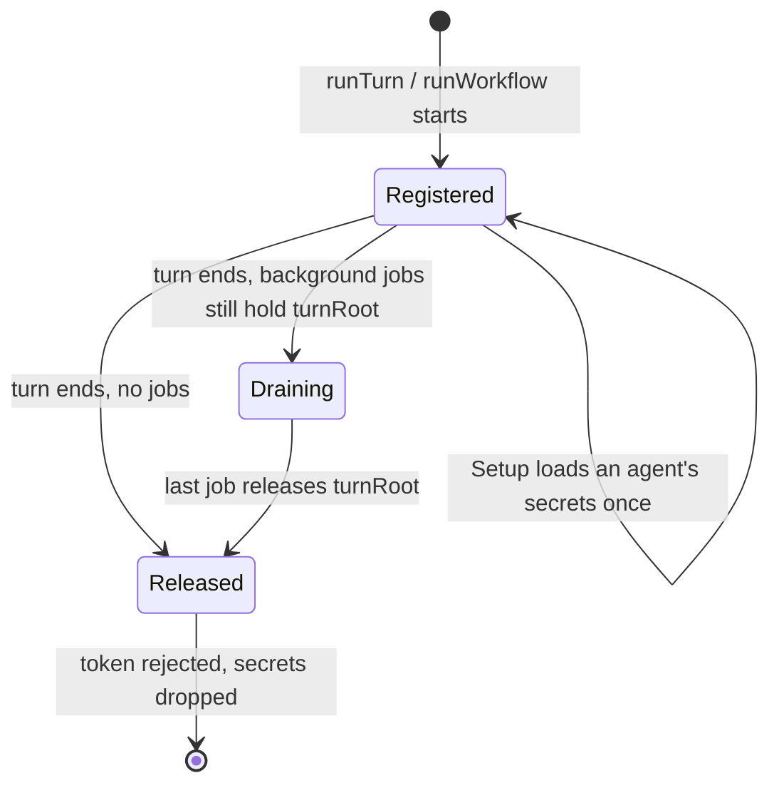
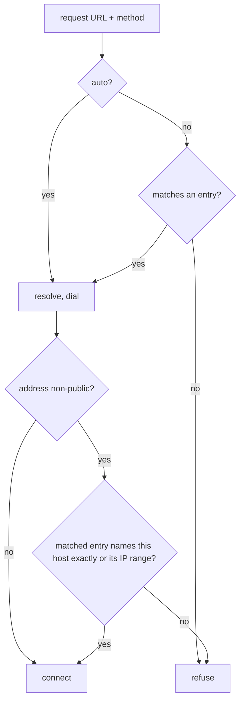

# Just-Bash Agent Shell - Plan

## Goal Capsule

- **Objective:** An agent marked `shell: just-bash` runs every bash command inside an emulated bash confined to its own folder. Only the host programs the agent file lists reach the real machine, network access follows the agent's rules, and its secrets are available as environment variables. All of it ships inside the `rocketclaw` binary with nothing downloaded at runtime.
- **Means:** vercel-labs/just-bash run by Node, one process per bash call, backed by a RocketClaw gRPC service on a Unix socket that hands out setup, runs host commands and serves network requests (KTD1, KTD2, KTD3).
- **Authority:** the user's decisions recorded as session-settled KTDs, then this plan's Requirements, then the root and `internal/justbash` `AGENTS.md`.
- **Stop conditions:** stop and report if just-bash cannot run its custom commands or network hook while calling gRPC (U4's first check), or if the runtime tree cannot be rebuilt byte-for-byte.
- **Execution profile:** Deep. Go and TypeScript, new package `internal/justbash`, backend wiring in `internal/rocketclaw/backend`.
- **Finishing:** one PR on `main`. The looper script (U8) is written outside the repository and is not part of the PR.

---

## Product Contract

### Summary

Add an opt-in agent shell built on just-bash. RocketClaw embeds a pinned just-bash runtime, unpacks it once, and points a just-bash agent's shell at a small launcher. Each bash call starts Node, which asks RocketClaw over a Unix socket for that agent's setup and runs the command in just-bash on the agent's folder. Host commands and network traffic go back to RocketClaw, which runs or refuses them.

### Problem Frame

Easy Mode Agent will eventually replace today's agents and cron, and it needs a safer default shell than host bash. Today the only sandbox hook is `customShell`, a program the operator writes and installs. just-bash already emulates bash with the usual tools (awk, sed, jq, Python, JavaScript, SQLite), but it is a TypeScript library, and RocketClaw is a Go binary that runs today without Node. RocketClaw also needs to keep control of what leaves the sandbox: secrets, host programs and network traffic.

### Key Decisions

- **Use upstream just-bash, not a Go port.** (session-settled: user-directed — chosen over a semantic Go port of just-bash: the port is ~148k lines, and the real need is running just-bash inside `cmd/rocketclaw`.) Governs R1, R13.
- **One just-bash process per bash call.** (session-settled: user-directed — chosen over one long-lived process per turn or per conversation, and over a per-turn pool: simplest shape and every call is isolated.) Governs R2.
- **RocketClaw loads secrets, once per turn, and hands them over the socket.** (session-settled: user-directed — chosen over the wrapper loading them with the AWS JavaScript SDK, and over caching for the process lifetime.) Governs R7.
- **Approved host commands run in RocketClaw, not in the wrapper.** (session-settled: user-directed — chosen over the wrapper starting host programs itself: one place decides what runs on the host.) Governs R5.
- **Network goes through RocketClaw, governed by `allowedNetworkTargets` with hard blocks.** (session-settled: user-directed — chosen over allow-everything and over per-agent allow-lists alone; entries may be hosts/ranges and URL prefixes with methods.) Governs R8, R9, R10.
- **Concurrent bash calls only have to be no worse than today.** (session-settled: user-directed — chosen over building cross-process write coordination.) Governs R2.

### Requirements

**Opting in**

- R1. An agent whose frontmatter sets `shell: just-bash` runs all its shell commands (the `bash` tool, `execute`'s `bash()`, `` !`…` `` prompt lines, goal checks, workflow workers) in just-bash instead of host bash.
- R11. An agent file that sets `customShell` together with `shell: just-bash`, sets any just-bash key without `shell: just-bash`, or gives a malformed value fails to load with an error naming the file and key.

**The sandbox**

- R2. Each bash call runs in a fresh just-bash process that exits when the command finishes; nothing about shell state carries between calls except files on disk.
- R3. `workingDirectory` (default: `justbash/$ROCKETCLAW_CONVERSATION_ID` under the workspace) is mounted read-write at its real absolute path; RocketClaw expands `$VAR` references in it from the turn's environment, resolves it against the workspace, and creates it when missing. The call's TMPDIR is also mounted read-write at its real path unless it already lies inside `workingDirectory`.
- R15. A `workingDirectory` that equals or contains the workspace root, the RocketClaw runtime directory (`.rocketclaw`), the config file, or the just-bash install directory, or lies inside the runtime directory, fails the bash call with a message naming `workingDirectory`. This keeps the sandbox from rewriting agent definitions, config or its own launcher.
- R4. Python, JavaScript (`js-exec`) and SQLite are available, and the environment the agent sees is the full environment the bash call received plus its secrets.

**Leaving the sandbox**

- R5. Each `commands:` entry (`name: "<bash command prefix>"`) appears inside just-bash as a command; calling it runs `<prefix> <args…>` on the host through `/bin/bash`, in the matching host folder, with the script's current environment (except variables that would change what bash or the dynamic loader runs, and `PATH`, which comes from the turn) and stdin, and returns stdout, stderr and the exit code when it finishes.
- R6. When the bash call ends early (timeout or cancel), any host command it started is stopped.
- R7. `secretsARN` lists AWS Secrets Manager secrets; each must hold a JSON object of string values, which become environment variables. A secret that cannot be loaded or parsed fails the bash call with a message naming the ARN, never the secret body.

**Network**

- R8. `curl`, Python and JavaScript network requests are made by RocketClaw on the sandbox's behalf. `allowedNetworkTargets: auto` (the default) allows any public address; a list allows only requests matching an entry.
- R9. A list entry is a host or IP address (`api.stripe.com`, `*.googleapis.com`, `127.0.0.1`), optionally with `:port` to restrict the port; a CIDR range (`10.0.0.0/8`); or a URL prefix (`https://api.stripe.com/v1/`). Any entry may be restricted to HTTP methods. Hosts, addresses and ranges allow any path; URL prefixes allow only URLs with the same origin whose path continues the prefix on a segment boundary, and refuse ambiguous path encodings, as upstream's allow-list does.
- R10. Loopback, link-local (including `169.254.169.254`), private and other non-public addresses are always blocked, checked on the address actually connected to and on every redirect hop, unless the request matches a list entry that names that host exactly or names an IP/range containing the address. Wildcards and `auto` never lift the block.

**Shipping**

- R12. The `rocketclaw` binary contains everything just-bash needs; at runtime it only needs `node` (version 20.19 or later) on the bash call's `PATH`. A missing or old Node fails that bash call with a clear message, and RocketClaw itself starts, and agents without `shell: just-bash` run, exactly as before on hosts without Node.
- R13. The embedded runtime pins an exact just-bash release and can be rebuilt byte-for-byte from the committed lockfile, so a looper can bump it.
- R14. `rocketclaw lint` warns when an `edit` permission can change a just-bash agent's own file.

### Success Criteria

- A just-bash agent can run `echo hi > out.txt; python3 -c 'print(open("out.txt").read())'` in its folder and the file is on disk afterwards; it cannot read a file outside its folder or TMPDIR.
- With `commands: {hello: "printf hi"}` and `allowedNetworkTargets: [127.0.0.1:<port>]`, `hello && curl http://127.0.0.1:<port>/` succeeds, while `curl http://127.0.0.1:<other-port>/` and `curl http://169.254.169.254/` are refused.
- A bash call that times out while an approved host command sleeps leaves no host process behind.

### Scope Boundaries

- Not in scope: the rest of Easy Mode Agent (subagents list, approver, selective MCP, skills/routines in frontmatter), and any change to agents without `shell: just-bash`.
- Not in scope: the `just-bash`/`just-bash-shell` CLIs, the browser build, and `@just-bash/executor`.
- Considered and not built: hiding the socket token or secrets from the sandbox's environment; the user ruled out new secret-exposure concerns since host bash already exposes them.
- Considered and not built: coordinating concurrent writes across just-bash processes; same as host bash today, and upstream's in-process hang (#442) cannot occur with one process per call.
- Considered and not built: a startup check for Node; a missing Node surfaces on the first bash call of a just-bash agent, where the agent and operator see it.
- Considered and not built: running goal checks on the host for just-bash agents; they follow R1 like every other shell path (see Open Questions).
- Considered and not built: streaming host-command output; just-bash custom commands return their output when they finish.

#### Deferred to Follow-Up Work

- Showing "just-bash" instead of the launcher path in the Web agents catalog.
- Updating the `main-create-or-update-agent` skel skill and `cmd/rocketclaw/CHEATSHEET.md` (the user marked the cheatsheet stale).

### Sources

- just-bash 3.6.0: `README.md` (exec isolation L25, `ReadWriteFs` L233–296, limits, security model L686–716), `src/Bash.ts` (`fetch` hook L168–174), `src/network/fetch.ts` (`SecureFetch`), `src/limits.ts` (normal profile: 1 h execution limit).
- Upstream issues: #442 (in-process `ReadWriteFs` hang), #386 (fails under Bun), #435 (jq regex blocks the event loop).
- Prior plan: `docs/plans/2026-10-10-1149-feat-agent-custom-shell-plan.md` (fail-closed frontmatter validation, one shell system per runtime).
- just-bash 3.6.0 `src/fs/mountable-fs/mountable-fs.ts` (nested mounts are rejected), `src/network/allow-list.ts` (`matchesAllowListEntry`), `src/limits.ts` (normal profile: 30 s Python/JS/SQLite limits), `src/interpreter/subshell-group.ts` (executed files always run as bash).

### Open Questions

- Deferred, not blocking: goal checks of just-bash agents run through just-bash (R1), so a check must be a bash script inside `workingDirectory`; Python-shebang or compiled checks fail. The user may later prefer running goal checks on the host.

---

## Planning Contract

### Key Technical Decisions

- KTD1. **Embed a pruned production `node_modules` tree, not a re-bundle.** Re-bundling just-bash with Bun breaks `python3` and `sqlite3`, because their workers and the CPython files are found by path relative to just-bash's own `dist/bundle/chunks/` (measured: python3 timed out, sqlite3 "worker not found"). Bun installs just-bash's production dependencies from a frozen `bun.lock`, a script prunes them with a fixed rule list (optional native packages, `typescript`, `@types/*`, `undici-types`, `.bin`, just-bash's `dist/bin`, `index.cjs`, `browser.js`, sql.js builds other than `sql-wasm.js`/`.wasm`, package test folders, `*.d.ts`, `*.map`, READMEs, changelogs), and the result is committed under `internal/justbash/runtime/` and embedded with `//go:embed all:runtime`. Measured: about 38 MB / 2,268 files before the just-bash and test-folder pruning; python3, js-exec, sqlite3 and file I/O all work, and the cold start is 0.35 s. Rejected: committing an archive (gzip output is not guaranteed stable across Go versions, which would break the CI rebuild check).
- KTD2. **Our wrapper is the only bundled file.** `internal/justbash/wrapper/src/main.ts` plus its gRPC/protobuf client is bundled by Bun into `runtime/wrapper.mjs` with `just-bash` marked external, so Node resolves just-bash from `runtime/node_modules`. Node, not Bun, runs it. (session-settled: user-directed — chosen over Bun: just-bash's safety layer fails under Bun, upstream #386.)
- KTD3. **gRPC over a Unix socket, one listener per RocketClaw process.** `google.golang.org/grpc` is already vendored. Each RocketClaw process creates its own short-named 0700 directory under `os.UserCacheDir()/rocketclaw/justbash/` for its socket and launchers and removes it at close (macOS caps socket paths at 104 bytes, so tests keep this directory short); only the unpacked runtime is shared between processes. It serves three RPCs: `Setup`, `RunCommand`, `Fetch`. Both sides raise gRPC's 4 MiB message limits to 256 MiB, just-bash's normal `maxOutputSize`. Each turn registers a session and gets a random token; requests carry the token and the agent name. Messages use protobuf-es on the TypeScript side with a hand-wired `@grpc/grpc-js` client (no `proto-loader`, whose `protobufjs` code generation may be blocked by just-bash's defense layer). (session-settled: user-directed — chosen over JSON or the wrapper talking to AWS and the network itself.)
- KTD4. **The agent is named by its launcher; the turn is named by the environment.** rocketcode runs `<customShell> <command>` with one argument and one environment per runtime, so the token cannot name the agent. RocketClaw writes one small launcher per just-bash agent name into the per-process directory: a `#!/bin/sh` script that prints the R12 message and exits 127 when `command -v node` fails on the call's `PATH`, and otherwise execs `node wrapper.mjs <hex agent name> "$1"`. `readRocketCodeDefinitionsIn` only parses and validates (R11); the launcher is assigned to `CustomShell` where a session is registered (`runTurn`, `runGoalCheck`, the workflow runner), since only those paths can run it and only they hold the backend's just-bash handle. The socket path and token travel as `ROCKETCLAW_JUSTBASH_SOCKET`/`ROCKETCLAW_JUSTBASH_TOKEN` in a copy of the turn env, never in the persisted `snapshot.Environment`.
- KTD5. **A session lives as long as `turnRoot`.** `runTurn` already ref-counts the turn's workspace root so background jobs keep it after the turn ends (`internal/rocketclaw/backend/background.go` `turnRoot`). The just-bash session registers before `rocketcode.NewWithModelResolver` (prompt `` !`…` `` lines run inside it) and unregisters on `turnRoot`'s last release. `runWorkflow` registers its own session for the workflow run. Secrets load lazily per agent on that agent's first `Setup` in the session and are dropped with it. (session-settled: user-directed — chosen over keeping secrets for the process lifetime: a changed secret takes effect next turn.)
- KTD6. **Mount 1:1 inside a `MountableFs`.** The wrapper builds a `MountableFs` over an `InMemoryFs` base and mounts `ReadWriteFs` roots for `workingDirectory` and TMPDIR at their real absolute paths, so rocketcode's path checks, TMPDIR, the call's working directory and file tools all name the same paths. A mount is skipped when its path already lies inside another mount, because just-bash rejects nested mounts and the outer mount already exposes it. The just-bash working directory is the call's working directory when it is inside a mount, else `workingDirectory`.
- KTD7. **Host commands run as `/bin/bash --noprofile --norc -c '<prefix> "$@"' <name> <args…>`.** This one rule serves every example the user gave (`stripe ... -c $VAR`, `bash -c --`, `mcpx <name> -- command`). RocketClaw looks the prefix up by name from the agent's settings; the wrapper only sends the name. The process gets its own process group, and the gRPC call's context cancels it with SIGTERM then SIGKILL, matching `internal/rocketcode/shell.go`. Its environment is the script's, minus `BASH_ENV`, `ENV`, `SHELLOPTS`, `BASHOPTS`, `PS4`, `BASH_FUNC_*`, `LD_*` and `DYLD_*`, with `PATH` taken from the turn env (R5); otherwise a script could make host bash source or run a file it wrote.
- KTD8. **Network policy is enforced at dial time.** RocketClaw's HTTP client checks the request against `allowedNetworkTargets` (R9) and checks the resolved IP in its `net.Dialer.Control` (R10), and it follows redirects itself so each hop is re-checked. Response size and redirect caps follow just-bash's `NetworkConfig` defaults.
- KTD9. **Keep just-bash's `normal` profile, but lift its interpreter limits.** The profile's overall limit is 1 hour, but it stops Python, JavaScript and SQLite after 30 s. The wrapper sets `maxPythonTimeoutMs`, `maxJsTimeoutMs` and `maxSqliteTimeoutMs` to the 1-hour execution limit, so rocketcode's timeout governs every command; the other normal-profile limits stay as upstream ships them.
- KTD10. **Just-bash settings parse in `internal/justbash`, from `Agent.Frontmatter`.** rocketcode's `Agent` keeps no new fields; the backend calls the parser for each agent while loading, like `additionalInstructions`. `internal/justbash` has its own `AGENTS.md`, its own Makefile, and no line-count budget. (session-settled: user-directed — chosen over a CLOC budget for the new package.) Raising `internal/rocketclaw`'s budget for the backend wiring is allowed (session-settled: user-directed — the user granted permission to raise any CLOC budget as needed).

### High-Level Technical Design

Components and one bash call:

```mermaid
sequenceDiagram
  participant RC as rocketcode bash
  participant L as launcher (per agent)
  participant W as node wrapper.mjs
  participant JB as just-bash Bash
  participant S as RocketClaw justbash service
  RC->>L: <launcher> "<command>" (env has SOCKET, TOKEN)
  L->>W: exec node wrapper.mjs <agent-hex> "<command>"
  W->>S: Setup(token, agent)
  S-->>W: mounts, env with secrets, command names
  W->>JB: new Bash(fs, env, customCommands, fetch); exec(command)
  JB->>W: custom command "hello a b"
  W->>S: RunCommand(token, agent, "hello", args, env, cwd, stdin)
  S-->>W: stdout, stderr, exit code
  JB->>W: fetch(url, options)
  W->>S: Fetch(token, agent, request)
  S-->>W: response or refusal
  W-->>RC: stdout, stderr, exit code
```

Session lifetime:



`allowedNetworkTargets` decision per hop:



### Output Structure

```text
internal/justbash/
  AGENTS.md
  Makefile
  justbash.go            embed, install/extract, launchers
  settings.go            frontmatter parsing (R3–R11)
  network.go             allowedNetworkTargets + dial checks (R8–R10)
  server.go              gRPC service, sessions, secrets, host commands
  *_test.go
  proto/justbash.proto
  justbashpb/            generated Go
  runtime/               committed, generated: wrapper.mjs + node_modules
  wrapper/               TypeScript project (marker go.mod, package.json, bun.lock)
    src/main.ts
    src/gen/             generated protobuf-es
    scripts/prune.ts
```

### Assumptions

- The frontmatter switch is `shell: just-bash`, echoing the `shell:` line in the user's Easy Mode example; the other keys use the user's names.
- `workingDirectory` defaults to `justbash/$ROCKETCLAW_CONVERSATION_ID` in the workspace instead of the whole workspace, and R15 forbids folders that contain RocketClaw's own files. Mounting the whole workspace read-write would let a just-bash agent rewrite its own agent file or the config and escape on the next turn. The user's example (`$PWD/somewhere/$ROCKETCLAW_CONVERSATION_ID`) has the same shape.
- Startup creates the just-bash service without touching disk or Node; it unpacks the runtime and opens the socket on the first session that has a just-bash agent.

---

## Implementation Units

### U1. Package scaffolding and build wiring

- **Goal:** `internal/justbash` exists with its rules, Makefile and CI wiring, so later units only add code.
- **Requirements:** R13; KTD10.
- **Dependencies:** none.
- **Files:** `internal/justbash/AGENTS.md`, `internal/justbash/Makefile`, `internal/justbash/.golangci.yml`, `internal/justbash/wrapper/go.mod` (marker, like `internal/rocketclaw/oc/go.mod`), `internal/justbash/wrapper/package.json`, `internal/justbash/wrapper/bun.lock`, `internal/justbash/wrapper/tsconfig.json`, `Makefile`, `.github/workflows/test.yml`, `.mockery.yml`, `cmd/rocketclaw/main.go` (stale-mock `find` path).
- **Approach:**
  1. `AGENTS.md` states: the root `AGENTS.md` applies; no CLOC budget; `runtime/` and generated code are never hand-edited; the just-bash version is pinned exactly in `wrapper/package.json` and bumped only by regenerating; Node runs the wrapper, Bun only builds it.
  2. Makefile targets `lint`, `test`, `cloc` (report only), `runtime` (install, bundle, prune, U5), and `generate` (protoc, U2). Root `Makefile` lists it in `lint`, `test-others` and `cloc`, not in `check-cloc-budget`.
  3. CI: the `checks` job sets up Node 24 with `actions/setup-node`, runs `make -C internal/justbash runtime lint test`, and fails on any diff (protobuf code is regenerated locally, like `web.proto`); the rocketclaw job also gets Node because backend tests start the wrapper.
- **Patterns to follow:** `internal/rocketclaw/oc/` (own `AGENTS.md`, marker `go.mod`, `make cloc` without budget), `internal/funneld/Makefile`.
- **Test expectation:** none -- scaffolding; U5's rebuild check proves it.
- **Verification:** `make -C internal/justbash lint` passes on the empty package and root `make cloc` lists it.

### U2. Protocol

- **Goal:** One `.proto` defines `Setup`, `RunCommand` and `Fetch`, with generated Go and TypeScript.
- **Requirements:** R5, R7, R8; KTD3.
- **Dependencies:** U1.
- **Files:** `internal/justbash/proto/justbash.proto`, `internal/justbash/justbashpb/*.pb.go`, `internal/justbash/wrapper/src/gen/*`, `internal/justbash/justbash.go` (`go:generate` lines).
- **Approach:**
  1. `Setup(token, agent)` returns mounts, the environment additions (secrets), and command names.
  2. `RunCommand(token, agent, name, args, env, cwd, stdin)` returns stdout, stderr and exit code.
  3. `Fetch(token, agent, url, method, headers, body, follow_redirects, max_redirects, timeout_ms)` returns the `FetchResult` fields (status, status text, headers, body, final URL, redirect chain).
  4. Go code via `protoc` + `protoc-gen-go` + `protoc-gen-go-grpc` in `go:generate`; TypeScript via `protoc-gen-es`.
- **Patterns to follow:** `internal/rocketclaw/frontend/rpc/server.go` `go:generate protoc` lines.
- **Test expectation:** none -- generated code; exercised by U4 and U5.
- **Verification:** regeneration produces no diff.

### U3. Agent settings

- **Goal:** Parse and validate the five just-bash keys from an agent's frontmatter.
- **Requirements:** R1, R3, R5, R7, R9, R11; KTD10.
- **Dependencies:** U1.
- **Files:** `internal/justbash/settings.go`, `internal/justbash/settings_test.go`.
- **Approach:** One exported function takes the frontmatter map and returns (settings, enabled, error). It validates `shell` (only `just-bash`), the `customShell` conflict, `workingDirectory` (string), `commands` (map of names without `/` or whitespace to non-empty strings), `secretsARN` (list of complete Secrets Manager ARNs, reusing the rule in `internal/rocketclaw/config/secrets.go`), and `allowedNetworkTargets` (`auto` or a list of strings or `{target, methods}` objects with valid hosts, CIDRs, `host:port`, `*.` wildcards or `http(s)://` prefixes, and known HTTP methods).
- **Test scenarios:**
  - Absent `shell` and no just-bash keys: not enabled, no error.
  - `shell: just-bash` alone: enabled with workspace folder, no commands, no secrets, `auto` network.
  - The full example from the user's frontmatter parses to the expected settings.
  - `shell: just-bash` plus `customShell`: error naming both keys.
  - `commands` without `shell: just-bash`: error naming `commands`.
  - Table of malformed values (`shell: zsh`, `commands: [a]`, command name `a b`, empty prefix, `secretsARN: arn::x`, `allowedNetworkTargets: none`, entry `ftp://x`, method `FETCH`, CIDR `10.0.0.0/33`): each an error naming the key.
- **Verification:** tests pass; every error message names the key.

### U4. RocketClaw service: sessions, secrets, host commands, network

- **Goal:** The gRPC service that a turn registers with and the wrapper calls.
- **Requirements:** R5, R6, R7, R8, R9, R10, R15; KTD3, KTD5, KTD7, KTD8.
- **Dependencies:** U2, U3.
- **Files:** `internal/justbash/server.go`, `internal/justbash/network.go`, `internal/justbash/server_test.go`, `internal/justbash/network_test.go`, `internal/justbash/secretfetcher_mocks_test.go` (mockery v3).
- **Execution note:** Before building the full service, prove with a throwaway script under `.tmp/` that a just-bash custom command and its `fetch` hook can make a `@grpc/grpc-js` call over a Unix socket with defense-in-depth on. If they cannot, stop per the Goal Capsule.
- **Approach:**
  1. A server owns one listener (socket in a 0700 directory), a session map guarded by one mutex, and a `SecretFetcher` (the existing interface in `internal/rocketclaw/config/secrets.go`, passed in; production passes `config.AWSFetcher{}`).
  2. `Register(agents map[name]settings, env)` returns a session with a random token and a `Release` method. On first use the server unpacks the runtime (U5) and opens its listener. `Setup` expands an agent's `workingDirectory` against `env`, makes it absolute against the workspace, applies R15, and creates it.
  3. `Setup` loads the agent's secrets once per session (R7) and returns mounts, env additions and command names.
  4. `RunCommand` runs KTD7 under the gRPC context.
  5. `Fetch` applies `network.go`: the entry matcher (R9, URL prefixes ported from upstream `matchesAllowListEntry`) and a dialer whose `Control` refuses non-public addresses unless the matched entry lifts it (R10); redirects followed manually, each hop re-matched.
  6. Unknown token, released session, unknown agent or unknown command: a gRPC error the wrapper prints as a failed command.
- **Patterns to follow:** process-group kill in `internal/rocketcode/shell.go`; typed errors like `SecretFetchError`.
- **Test scenarios:**
  - Setup with two ARNs returns their keys as env; a second Setup in the same session does not fetch again (mock call count).
  - A secret body that is not a JSON object of strings: error names the ARN and not the body.
  - RunCommand `hello: "printf '%s|' pre"` with args `a b` returns `pre|a|b|`, exit 0, in the given cwd with the given env.
  - RunCommand of a name not in the agent's commands: refused.
  - Cancelling the RunCommand context while the host command runs `sleep 30`: the call returns promptly and the process group is gone.
  - The address check, given a public IP under `auto`, allows it; given `127.0.0.1`, `169.254.169.254`, `10.1.2.3`, `::1` or `fc00::1`, refuses each. (Real HTTP tests use listed loopback servers, since tests cannot reach a public address.)
  - Fetch with `[127.0.0.1:<port>]` succeeds; `127.0.0.1:<other>` refused; `auto` to `127.0.0.1` refused; `*.example.com` resolving to `10.0.0.1` refused; a listed public host redirecting to `169.254.169.254` refused at the second hop.
  - URL-prefix entry with `methods: [GET]`: GET under the prefix allowed, POST refused, GET outside the prefix refused.
  - Requests after `Release`: unknown session.
  - RunCommand with script env `BASH_ENV=<file>` and `PATH=<sandbox dir>:…` does not source or run either file; `X=1` in the script env still reaches the host command.
  - URL prefix `https://api.stripe.com/v1` does not match `/v1evil` or `https://api.stripe.com.evil.com/`; `/v1/%2e%2e/x` and `/v1/a%2fb` are refused.
  - `workingDirectory` equal to the workspace, to `.rocketclaw`, or to a parent of the install directory: Setup fails naming `workingDirectory`.
  - A RunCommand whose stdout is 6 MiB and a Fetch of a 6 MiB body both succeed (above gRPC's default limit).
- **Verification:** tests pass with `-race`.

### U5. Wrapper, runtime tree, install and launchers

- **Goal:** The committed runtime tree, the TypeScript wrapper inside it, and Go code that unpacks it and writes per-agent launchers.
- **Requirements:** R2, R3, R4, R5, R8, R12, R13; KTD1, KTD2, KTD4, KTD6, KTD9.
- **Dependencies:** U2, U4.
- **Files:** `internal/justbash/wrapper/src/main.ts`, `internal/justbash/wrapper/scripts/prune.ts`, `internal/justbash/runtime/**` (generated), `internal/justbash/justbash.go`, `internal/justbash/justbash_test.go`.
- **Approach:**
  1. `main.ts`: check `process.versions.node` ≥ 20.19 before loading just-bash with a dynamic `import()` (static imports would load first and hide the R12 message); read agent (hex) and command from argv and socket/token from env; call `Setup`; build `MountableFs` (KTD6); `new Bash({fs, cwd, env: {...process.env, ...setup.env}, python: true, javascript: true, executionLimits (KTD9), customCommands, fetch})`, where each custom command forwards to `RunCommand` with `ctx.env`, `ctx.cwd`, `ctx.stdin` and the call's `AbortSignal`, and `fetch` forwards to `Fetch`; write stdout/stderr and exit with the exit code.
  2. `make runtime`: `bun install --frozen-lockfile --production --omit optional` into a staging dir, run `prune.ts`, `bun build src/main.ts --target=node --external just-bash` to `runtime/wrapper.mjs`, then replace `runtime/` atomically.
  3. Go install step (run lazily by U4's server): unpack the embedded tree into `dir/<sha256 of the tree>/` (temp dir plus rename, read-only files) and write launchers on demand into the per-process directory (KTD4). It does not look up Node. Production `dir` is `os.UserCacheDir()/rocketclaw/justbash`.
- **Patterns to follow:** `internal/rocketclaw/skel/skel.go` (writing embedded files), `internal/rocketclaw/internal/web/assets.go` (`go:embed`).
- **Test scenarios:** (Go tests that run the real launcher against a real U4 server; they require `node` and fail without it, like `rg` in rocketcode tests)
  - `echo hi > out.txt; cat out.txt` prints `hi`, and `out.txt` exists in the folder on disk.
  - `cat <file outside the folder>` fails; `mktemp` under TMPDIR works; `echo x > /dev/null` works.
  - TMPDIR inside `workingDirectory` (nested): the call still runs.
  - `python3 -c 'import time; time.sleep(35); print(1)'` prints `1` (KTD9).
  - With `node` absent from `PATH`, the launcher prints the R12 message and exits non-zero.
  - `python3`, `js-exec` and `sqlite3 :memory:` each print the expected value.
  - A secret key from the mock fetcher is visible as `$KEY`.
  - `hello a b` runs the host command; `export X=1; hello` sees `X`.
  - `curl` to a listed loopback server returns its body; to an unlisted one prints a refusal and exits non-zero.
  - A wrong token: the call fails with a clear message, exit non-zero.
  - Killing the launcher's process group while `hello` runs `sleep 30` on the host: the host process is gone shortly after (R6 end to end).
  - Running `make runtime` twice yields no diff (R13).
- **Verification:** tests pass; `runtime/` matches a rebuild.

### U6. Backend wiring

- **Goal:** Just-bash agents get the launcher as their shell, and every turn path registers a session.
- **Requirements:** R1, R11, R12; KTD4, KTD5.
- **Dependencies:** U3, U4, U5.
- **Files:** `internal/rocketclaw/backend/bridge.go`, `internal/rocketclaw/backend/background.go`, `internal/rocketclaw/backend/raw_run.go`, the backend `Runtime` constructor and serve wiring (`cmd/rocketclaw/serve.go`, `cmd/rocketclaw/assemble.go`), `internal/rocketclaw/backend/justbash_test.go`, `internal/rocketclaw/Makefile` (budget only if needed).
- **Approach:**
  1. The backend runtime owns one `justbash` server, created at startup without touching disk or Node and closed at shutdown, which removes its per-process directory.
  2. `readRocketCodeDefinitionsIn` parses each agent's settings (U3) and fails the load on error (shadow agents only log, as today). It does not touch `CustomShell`.
  3. `runTurn` registers a session for its just-bash agents after `shellEnv` is known and before `NewWithModelResolver`, sets each just-bash agent's `CustomShell` to its launcher, hands `Release` to `turnRoot` so its last release unregisters, and passes a copy of `shellEnv` with the two variables to `rocketcodeConfig`, the goal check and the dynamic workflow tool, never to `captureTurnInputs`.
  4. `runGoalCheck` reloads agents, so it sets the launcher on the reloaded just-bash agent from the turn's session; `runWorkflow` registers and releases its own session around the run, sets launchers on the workflow runner's agents, and adds the variables to `runner.shellEnv`.
- **Patterns to follow:** `additionalInstructions` frontmatter handling, `turnRoot` hold/release, existing `customShell` contract tests (`TestUpdateGoalToolRunsCheckThroughActiveAgentCustomShell`, `TestWorkflowAgentRunnerUsesRootCustomShell`).
- **Test scenarios:**
  - A `shell: just-bash` agent's `execute` bash call writes a file into its `workingDirectory` and a prompt `` !`echo $ROCKETCLAW_CONVERSATION_ID` `` line expands through just-bash.
  - `workingDirectory: .tmp/$ROCKETCLAW_CONVERSATION_ID` is created per conversation, and the default `justbash/<conversation id>` is created when the key is absent.
  - A just-bash agent cannot change its own agent file from bash (`echo x >> .rocketclaw/agents/<self>.md` fails because the folder is not mounted).
  - Startup with no `node` on `PATH` and no just-bash agents: the server starts and an ordinary agent's bash works.
  - A goal check and a workflow worker of a just-bash agent run through just-bash.
  - A background `execute` job keeps working after its turn ends and its token is rejected after the job finishes.
  - The captured turn env stored for resume contains neither variable.
  - An agent file with `customShell` and `shell: just-bash` fails to load with the U3 message.
  - Agents without `shell: just-bash` keep host bash (existing tests stay green).
- **Verification:** backend tests pass; coverage stays at or above `COVERAGE_REQUIRED`; CLOC budget raised only by what the wiring needs.

### U7. Lint and documentation

- **Goal:** Operators learn the feature from the README and get a lint warning for self-editable just-bash agents.
- **Requirements:** R14.
- **Dependencies:** U3.
- **Files:** `internal/rocketclaw/agentlint/agentlint.go`, `internal/rocketclaw/agentlint/agentlint_test.go`, `README.md`.
- **Approach:** Extend `lintCustomShellEdits` (RC010) so its own-file check also applies to agents whose frontmatter sets `shell: just-bash`, reusing the RC010 code. README gets a short "just-bash shell" section after the `customShell` paragraph: the five keys, the folder rule, the network rules, that executed files and goal checks run as bash scripts, the Node 20.19+ requirement, and where the runtime unpacks.
- **Patterns to follow:** `lintCustomShellEdits` and its tests.
- **Test scenarios:**
  - An agent with `edit: allow` on `.rocketclaw/agents/*` and a just-bash agent present: RC010 names the just-bash agent file.
  - No just-bash agents: no new warnings.
- **Verification:** `rocketclaw lint` tests pass; README section reads correctly.

### U8. Looper script (outside the repository)

- **Goal:** A loop that keeps the pinned just-bash release current.
- **Requirements:** R13.
- **Dependencies:** U1, U5 merged.
- **Files:** `~/Projects/rocketclaw/scripts/loop-platform-justbash-semport.sh` (not in this repository).
- **Approach:** Mirror `loop-platform-oc-semport.sh`: clone `~/Projects/platform-justbash-loop`, read-only upstream `~/Projects/just-bash`, label `justbash-semport`, newest tag matching `just-bash@X.Y.Z`. Cheap exit when `internal/justbash/wrapper/package.json`'s pinned version equals it and no PR is open. Otherwise the model bumps the pin, runs `make -C internal/justbash generate runtime`, reads upstream's changelog for changes to `Bash` options, `SecureFetch`, custom commands, `ReadWriteFs`/`MountableFs` and limits, fixes the wrapper, runs the verification, and opens or refreshes one labeled PR; ledger rows go to `PLATFORM_LOOPS.tsv`. The user creates the clones and schedules it.
- **Test expectation:** none -- operator script; `bash -n` must pass.
- **Verification:** `bash -n` passes; the no-change path exits before starting a model when versions match.

---

## Verification Contract

| Check | Command | Applies to |
|---|---|---|
| Go format | `gofmt -l` on touched Go files is empty | all Go units |
| Package tests | `make -C internal/justbash test` (race, requires Node ≥ 20.19) | U3, U4, U5 |
| Runtime rebuild | `make -C internal/justbash runtime` leaves no diff (CI); `make -C internal/justbash generate` leaves no diff (local, needs protoc) | U2, U5 |
| Backend tests | `make -C internal/rocketclaw test` (includes coverage and CLOC budget) | U6, U7 |
| Repo gates | `go test ./...`, `make lint`, `make test` | all |
| Script | `bash -n ~/Projects/rocketclaw/scripts/loop-platform-justbash-semport.sh` | U8 |

Tests that need PostgreSQL use the repo's `ROCKETCLAW_TEST_DATABASE_URL` convention. Scratch files go under the workspace `.tmp/`.

## Definition of Done

- Every Requirement is met and every listed test scenario exists and passes.
- `internal/justbash/runtime/` is committed and matches a clean rebuild.
- Agents without `shell: just-bash` behave exactly as before.
- The root `AGENTS.md` Go standards pass on the touched diff (error names, no defensive guards, no one-use helpers, mockery v3 mocks).
- Throwaway spikes and abandoned code are removed from the diff.
- README updated; U8 script written outside the repository.

## Risks & Dependencies

| Risk | Mitigation |
|---|---|
| Goal checks of just-bash agents must be bash scripts inside `workingDirectory` | Documented in README; Open Question for the user |
| just-bash's defense layer blocks gRPC calls inside custom commands or `fetch` | U4 execution note checks this first; stop and report if it fails |
| Binary grows by tens of MB | Accepted by the user's fully-embedded requirement; pruning in KTD1 |
| A future just-bash release moves worker or vendor paths | The pruned tree keeps just-bash's own layout; U5 tests run python3, js-exec and sqlite3 from it on every bump |
| Node missing on a host | Fails the bash call with a message (R12); README documents the requirement |
| `MountableFs` over `InMemoryFs` lacks `/dev/null` or `/tmp` | U5 tests cover `> /dev/null` and `mktemp`; mount TMPDIR (R3) |
