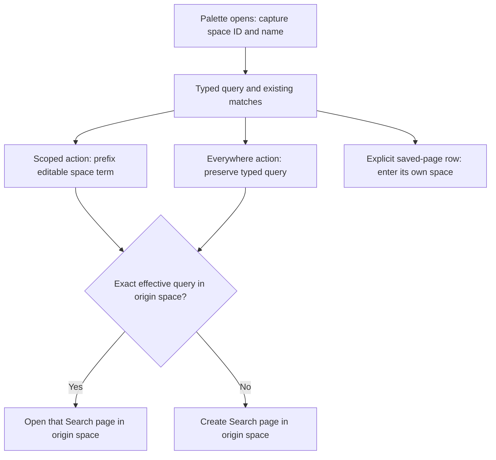
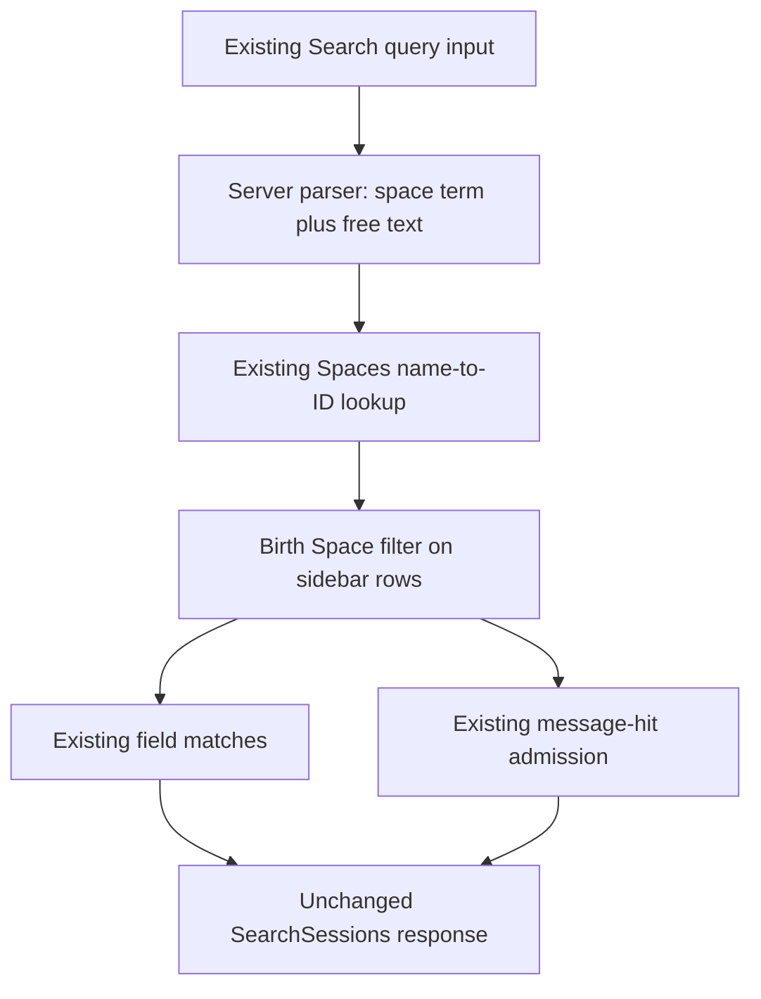

# Palette Space Search - Plan

## Goal Capsule

- **Objective:** A person can search sessions from their current space or across all spaces without being taken to an unrelated space.
- **Means:** Extend the existing search language and Search-page handoff (KTD1–KTD3).
- **Authority:** The request and `CONCEPTS.md` govern product behavior. Requirements own behavior; technical decisions own mechanism; units override neither.
- **Execution profile:** Search only. U1 and U2 form one request-sized commit in the combined Web PR with the separately planned shortcut change. The calling session owns implementation, checks, and shipping.
- **Stop conditions:** Report a required-check failure, an unavailable verification prerequisite, or a source/coverage budget conflict. Do not raise budgets, suppress lint, add dependencies, change the meaning of Birth Space, or replace the search mechanism.
- **Planning boundary:** This artifact authorizes no implementation, tests, push, merge, or public communication during planning.

---

## Product Contract

### Summary

The session palette offers two explicit search actions. Both open the existing Search page; the scoped action adds an editable `space:` term. Automatic handoff stays in the space where the palette opened, while selecting a saved Search page still enters that page's space.

### Problem Frame

The palette currently has only an everywhere handoff. Its exact-query lookup searches saved Search pages across every space, so choosing it can unexpectedly enter another space. Sessions already carry Birth Space, but the query parser does not recognize `space:`.

### Requirements

**Palette and handoff**

- R1. For nonempty trimmed session-palette text, offer `Search in this space for '<query>'` followed by `Search everywhere for '<query>'`, after the existing matches.
- R2. Capture the opening space's ID and name when the palette opens; previews must not change the source of scoped search or its destination.
- R3. Scoped search seeds `space:<origin space name>` followed by the typed query into the ordinary editable Search query, quoting the name when needed.
- R4. Everywhere adds no implicit space restriction, including for unassigned and remote sessions; explicit filters already in the person's query remain explicit filters.
- R5. Each automatic handoff reuses an exact-query Search page only in the opening space, including its existing Shared-page representation; otherwise it creates a Search page there.
- R6. Explicitly selecting a saved Search-page match keeps entering that page's own space, even when it differs from the palette's opening space.

**Search language**

- R7. `space:` filters by the session's Birth Space as defined in `CONCEPTS.md`, not its tab location, Shared Group membership, or its agent's current configuration.
- R8. Recognize `space:` in the same server parser and Web filter input used by other search terms, including quoted values, term pills, offsets, and suggestions from the existing Spaces list.
- R9. Apply the filter consistently to field matches and message hits through the shared search backend, preserving the existing visibility rules and remote-session support.

**Delivery**

- R10. Use existing Spaces, sidebar data, Search-page state, and APIs without a new dependency or persistence model. Public documentation, comments, and fixtures use synthetic examples only.
- R11. Keep the search request in one commit, separate from the shortcut request, within the combined Web PR. Planning makes no production/test edits and performs no network writes.

### Scope Boundaries

- No new search page type, hidden scope flag, separate results implementation, new endpoint, migration, or duplicated session-space field.
- No implicit filtering of the palette's existing session list by the opening space.
- No change to generic tab navigation or explicit saved-page selection to fix the handoff; those paths deliberately follow a chosen tab's space.
- Considered and not built: query rewriting on space rename, multi-window rename/delete recovery, or new retries/caches. This request adds a name-based query term, not a new lifecycle contract; evidence of a reproducible failure in the requested flows would justify revisiting that boundary.
- The separate keyboard-shortcut request is outside this plan.

### Acceptance Examples

- AE1. **Covers R1–R5.** From synthetic space `Team Blue`, type `needle`. Scoped search opens a Search page in `Team Blue` with `space:"Team Blue" needle`; everywhere opens one there with `needle`.
- AE2. **Covers R5–R6.** Only another space has a Search page with query `needle`. Everywhere creates one in the opening space; explicitly picking the other page's `Search: ...` row enters the other space.
- AE3. **Covers R2–R3.** Arrow through session previews before choosing scoped search. The seed and Search-page destination still use the opening space.
- AE4. **Covers R7–R9.** A session born in `Team Blue` has its tab moved to `Team Green`. `space:"Team Blue"` still finds it; merely placing another session's tab in `Team Blue` does not make that session match.
- AE5. **Covers R4, R9.** A broad query finds eligible local, remote, and unassigned sessions. Adding a space term excludes sessions without that Birth Space, including remote sessions with no Birth Space.

---

## Planning Contract

### Key Technical Decisions

- KTD1. **Extend the backend filter path, not candidate SQL or Web-only filtering.** Add the private search key in `internal/rocketclaw/backend/session_search.go`, recognize it in `parseSessionQuery`, and evaluate it with the other filters before matches and message hits are admitted. `SidebarSession.SpaceID` already carries Birth Space in `internal/rocketclaw/backend/store.go`. This covers R7–R9 without changing the response schema.
- KTD2. **Reuse the existing Spaces lookup and type.** Load `SessionService.Spaces` from `internal/rocketclaw/backend/store_dao.go` once per search only when a space term is present. Pass existing `[]Space` data into the private filtering path and compare its matching space ID with `SidebarSession.SpaceID`; do not add a name field to every sidebar chat, a mirror type, or a per-result store read. Preserve parsed values and source offsets for callers.
- KTD3. **Keep handoff reuse local and saved-page discovery global.** In `paletteRows`, keep the full `searchPages(tabs)` list for explicit matches, but restrict exact-query reuse for both handoffs to the captured origin ID. Pass that ID explicitly to `tabs.open`. Do not change `useTabs.open` or `openTab`, whose existing cross-space behavior is required by R6.
- KTD4. **Use the same query input for suggestions and pills.** Add the key to `filterKeys` and both hard-coded operator lists in `typingWord`. Give `searchChoices` the existing Spaces list from `TabActions`; `SessionSearch` serves both the palette and Search results. Reuse `termValue`, `usePills`, and the backend's JSON decoding instead of creating a separate quoting/parser implementation.
- KTD5. **Preserve shared caller behavior.** `internal/rocketclaw/frontend/rpc/session_commands.go` already forwards parser terms and filtered matches without knowing filter keys. `internal/rocketclaw/backend/session_tools.go` also calls `SearchSessions` through `searchSessionsWithin`; update its query-language description and one existing criteria test rather than adding another implementation. Keep its deliberate remote-session exclusion unchanged.

### Assumptions

These are explicit defaults for the non-interactive request, not previously confirmed product decisions.

- **A1 — Name matching:** Match the complete space name ignoring case, consistent with unique case-insensitive Space names. Do not accept IDs as an undocumented alternative. An unknown valid name matches nothing; an empty or malformed term remains ordinary text under the existing parser contract.
- **A2 — Repeated filters:** Space terms use the existing default AND rule, unlike the explicitly special OR rules for agents and rooms. Repeating one space is harmless; distinct space terms produce no matches. Scoped handoff prefixes its seed without deleting a space term the person already typed, so a conflicting explicit term remains visible and editable.
- **A3 — Keyboard defaults:** Keep current plain-Enter behavior: first matching session wins, otherwise the existing everywhere fallback for unfiltered text. Scoped search runs by click or deliberate arrow selection plus Enter. Filtered no-match Enter still opens nothing. This avoids turning the added row into an unrelated keyboard behavior change.
- **A4 — Names over time:** Capture the ID and name together at palette opening. Saved queries remain ordinary name-based text and are not rewritten after a space rename; sessions themselves retain their Birth Space ID.
- **A5 — Suggestions:** Offer every existing Space in its existing oldest-first order, including spaces with no loaded session. Match partial typed names ignoring case, insert the canonical name with existing quoting, and commit on the same keys/click behavior as other filters.

### High-Level Technical Design

Directional query grammar: `space:value` accepts a nonempty unquoted token or a nonempty JSON-quoted string, bounded by whitespace or the query ends, like the existing value-bearing keys. Its UTF-16 offsets describe the source term, not a resolved ID.

### Grounding and Impact

- **Single-pass behavior trace:** `CommandPalette` already snapshots its opening URL, restores it before running a choice, and restricts previews to the current space. It does not snapshot the opening space. Its `searchEverywhere` callback searches all saved pages and passes the found page's space to `tabs.open`; `openTab` also deliberately follows an already-open tab's own space. Restricting only a destination argument would therefore not fix global reuse.
- **Backend trace:** `SearchSessions` parses once, reads candidate/sidebar rows, applies `SidebarChat.passes`, and then retains only message hits belonging to passing rows. This admits a space filter at the shared layer without changing `SearchMessagesMentioning`, indexing, cancellation, or result pagination.
- **Existing documentation:** `CONCEPTS.md` defines Space, Search Page, and Birth Space. The previous many-Search-pages plan's global handoff reuse is superseded only for automatic handoff by R5; its explicit saved-page navigation remains valid.
- **Relevant learnings:** Keep react-doctor-required helper boundaries from `docs/solutions/best-practices/react-doctor-complexity-limit-shapes-web-components.md`. Build fresh Web assets before browser assertions, as required by `docs/solutions/best-practices/web-browser-tests-run-the-last-bundle-that-built.md`.
- **Architecture choice:** Query text already represents editable filters, and existing IDs already represent Birth Space. Hidden scope state and SQL rearchitecture offer no required capability, so there is no unresolved mechanism requiring a bake-off.
- **Performance:** Queries without `space:` incur no extra Spaces read. Preserve current result paging and request cancellation. No speculative index, cache, instrumentation, or extra goroutine is needed.
- **Safety:** Spaces filter results, not permissions. Existing visibility rules continue to exclude private producer and subagent sessions. The agent sessions tool continues to exclude remote sessions under its current contract.

---

## Implementation Units

### U1. Add Birth Space to the shared query language

**Goal:** The existing search backend understands and enforces a space term.

**Requirements:** R7–R10; AE4–AE5; KTD1, KTD2, KTD5; assumptions A1–A2.

**Dependencies:** None.

**Files:**
- Modify `internal/rocketclaw/backend/session_search.go`.
- Update query-language documentation in `internal/rocketclaw/backend/session_tools.go`.
- Extend `internal/rocketclaw/backend/session_search_test.go`.
- Extend the existing criteria test in `internal/rocketclaw/backend/session_tools_test.go`.
- Extend the existing response integration test in `internal/rocketclaw/frontend/rpc/server_test.go`.
- Reference only: `internal/rocketclaw/backend/store.go`, `internal/rocketclaw/backend/store_dao.go`, `internal/rocketclaw/frontend/rpc/session_commands.go`.

**Approach:**
1. Extend parsing and the private filtering path under KTD1–KTD2. Reuse existing fixture/service operations for synthetic spaces and assigned sessions.
2. Cover all three search scopes with the shared backend, preserving existing term source text, sort order, and match visibility.
3. Update the existing agent-tool description and criteria case under KTD5, then prove the existing RPC response transports the new term and filtered message hits without production RPC changes.

**Execution note:** Extend existing parser/filter tables before implementation. Add only the integration cases those tables cannot establish.

**Test scenarios:**
1. A mixed query with a quoted synthetic space, another filter, and free text yields the expected parsed terms and exact matching IDs in field, filters-only, and message scopes.
2. Uppercase key/name, Unicode names, spaces, quotes, and backslashes retain decoded values and correct source offsets. Extend existing UTF-16 offset cases rather than starting a second parser suite.
3. Unknown valid space names match no rows. Empty values, broken JSON escapes, and unclosed quotes follow existing literal-text behavior.
4. Repeated equal space terms preserve matches; distinct space terms do not. Combining a space term with existing room/agent alternatives preserves their OR-within-key and AND-between-key rules.
5. Covers AE4–AE5. A matching Birth Space includes assigned local and remote rows, excludes differently assigned and unassigned rows, and is unaffected by tab placement. An otherwise identical query without a space term retains the existing broad result set.
6. A foreign-space session whose message contains the needle contributes neither a result nor a message hit; a matching-space session contributes both through the existing RPC response, including the new term's key/text/offsets.
7. Renaming a synthetic Space leaves the session's ID unchanged, makes the new name match, and leaves the old name unmatched. Deleting the Space clears membership under the existing store contract.
8. The existing agent criteria test accepts the same space term and reports it as parsed, while private producer rows and remote rows remain excluded as before.

**Verification:** Existing parser/filter tests, response integration coverage, and the sessions-tool criteria contract pass without changing schemas, adding a store field, or duplicating filter behavior.

### U2. Add both palette actions and editable space suggestions

**Goal:** People choose scope explicitly and land on a Search page in the expected space.

**Requirements:** R1–R6, R8, R10–R11; AE1–AE3; KTD3–KTD4; assumptions A3–A5.

**Dependencies:** U1.

**Files:**
- Modify `internal/rocketclaw/web/src/ui.tsx`.
- Extend `internal/rocketclaw/web/src/search-page.browser.test.ts`.
- Extend `internal/rocketclaw/web/src/tabs.browser.test.ts` for preview/origin and cross-space navigation.
- Extend the existing `typingWord` table in `internal/rocketclaw/web/src/session-list.test.ts`.
- Update `README.md`'s sessions-list query-language documentation with `space:` and Birth Space meaning.
- Update the palette handoff, filter grammar, and unfinished-filter descriptions in `internal/rocketclaw/web/README.md`.

**Approach:**
1. Add the opening space to the existing palette origin snapshot, reading `TabActions` before that initializer. Use it for KTD3 rather than adding another independent state path.
2. Construct both effective queries through the existing Search-page handoff. Match the complete seeded query for scoped reuse and the unmodified typed query for everywhere reuse.
3. Update every branch keyed specifically to `searchEverywhereKey`: default Enter dispatch, fallback selection, and empty-state detection must distinguish ordinary commands from both handoff rows. When only the two handoffs remain for unfiltered text and no deliberate selection exists, highlight everywhere so the visible selection agrees with plain Enter. Apply A3 without changing session matching or folder/cron/command modes.
4. Extend the existing input/suggestion path under KTD4 and A5. Keep the backend-recognized term removable and editable through current pills.
5. Update exact row-order assertions in existing browser tests and the README. Keep helper extraction limited to what sharing or react-doctor requires.

**Test scenarios:**
1. Covers AE1. A nonempty query shows both exact labels in order after matches; whitespace-only input shows neither. Existing command-only, cron, and folder modes retain their behavior.
2. Covers AE1. Clicking each action produces the exact effective query and an origin-space Search page. The scoped term can be removed or replaced, and subsequent requests use the edited query without hidden scope.
3. Covers AE2. Seed an older exact-query Search page in a different space and no origin match. Both automatic actions ignore that foreign page. After an origin match exists, each reuses it without duplicating pages; an exact inactive inner search becomes active.
4. Covers AE2. Repeat the reuse case with an origin-space Shared Search page and a personal copy elsewhere. Explicitly choosing a foreign saved-page row still enters its own space and preserves its saved query.
5. Covers AE3. Open in one space, preview local/unassigned rows and attempt to preview a foreign-born row, then arrow-select scoped search. Query seed, destination, and cancellation return path remain tied to the opening space. Reopening in another space captures the new origin.
6. Preserve A3: plain Enter opens the first session, no-title-match plain text highlights everywhere and Enter runs it, ArrowUp selects scoped search, deliberately selecting either handoff runs it, and filtered no-match Enter opens nothing. An empty state still appears when only the two handoffs remain.
7. Typing `space:` offers all existing names, including an empty space. Partial matching ignores case; click, arrows plus Enter, and Tab insert the same correctly quoted term. A complete value commits as existing filters do.
8. Extend `typingWord` for bare `space:`, an unclosed quoted multiword/escaped name, a completed value, and trailing whitespace. Verify term-pill removal on the Search page uses server offsets correctly.
9. Covers AE4. Moving a session's tab into the origin space does not affect the effective query or its Birth Space meaning. Reloading a seeded Search page retains its editable query and permanent tab.
10. On a narrow viewport, both actions remain reachable by pointer and keyboard, with distinct accessible labels; existing paging still permits reaching trailing actions for large lists.

**Verification:** Browser assertions prove URL, active space, exact sent query, saved-page identity, inner-search selection, and visible editable state. Stubbed browser responses prove handoff only; U1's real backend/RPC tests prove filtering. Existing broad-search pagination and request-cancellation regressions remain green.

---

## Verification Contract

These are implementation gates, not checks executed while producing this plan.

| Gate | Location / scope | Required result |
| --- | --- | --- |
| Formatting and Go standards | Touched Go files | `gofmt`; inspect changed hunks before edits, before tests, and after tools rewrite files. Use `err`-prefixed errors, existing types, request-scoped contexts, and no new defensive guards or behavior callbacks. |
| Focused Go contracts | Backend tests and RPC response test named in U1 | Exact parsed terms, matching IDs, response offsets, and excluded message hits satisfy the enumerated cases. |
| Full Go suite | Repository root | `go test ./...` passes with the existing PostgreSQL/provider/browser prerequisites available. |
| Repository lint | Repository root | `make lint` passes; inspect any tool-modified files and keep unrelated changes out of the request commit. |
| Repository test/metrics | Repository root | `make test` passes, including RocketClaw's current coverage and source CLOC gates. |
| Web lint | `internal/rocketclaw/web` | `make lint` passes, including TypeScript and react-doctor without suppression. |
| Web tests and fresh assets | `internal/rocketclaw/web` | `make test` builds successfully before running browser tests and passes the Web source CLOC gate. |

Use only repository `.tmp/` paths for temporary files, browser scratch, and tool temporary directories. A shared JJ workspace can exceed the Unix-socket path limit: use a short directory under the repository's approved `.tmp/`, not system temp, following `docs/solutions/best-practices/unix-socket-tests-need-short-tmpdir-in-jj-workspaces.md`.

No new timer, goroutine, synchronization, filesystem abstraction, cleanup, or iterator API is required. The Go bootstrap guidance therefore constrains style and existing context/store use, not new infrastructure. Keep Unix-only scope and existing abstractions. Do not alter CLOC budgets or hide source in excluded paths.

README impact is present: `README.md`'s existing `rocketclaw_sessions_list` query-language list must include `space:` with Birth Space meaning. `internal/rocketclaw/web/README.md` must describe both actions, origin-only automatic reuse versus explicit cross-space selection, and the new filter/suggestions. `CONCEPTS.md` already defines all terms used here and needs no new entity or glossary expansion. Rebuilt Web assets follow the repository's tracked-asset policy during implementation; a successful fresh build is required before trusting browser results.

---

## Definition of Done

- U1 and U2 satisfy their test scenarios, and R1–R11 remain true after integration with the separately planned shortcut change.
- Automatic reuse stays in the captured opening space; explicit saved-page selection remains cross-space. These are verified separately.
- Scoped search is entirely represented by editable query text and uses Birth Space IDs, while everywhere keeps the existing eligible unassigned/remote result set.
- Required checks pass, current source/coverage budgets hold, and no unrun or unavailable check is reported as passed.
- The diff contains only this request's implementation, tests, README update, and required rebuilt assets. No abandoned-attempt code, private data, speculative guardrails, new dependencies, schema changes, or shortcut-request work remains in the search commit.
- The calling session groups this search commit with the independent shortcut commit in one Web PR. Public communication and shipping are outside this planning run.
