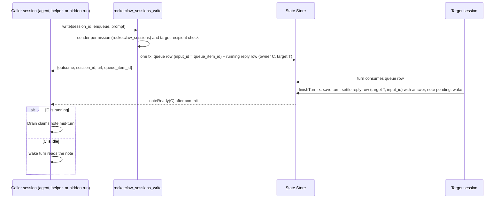
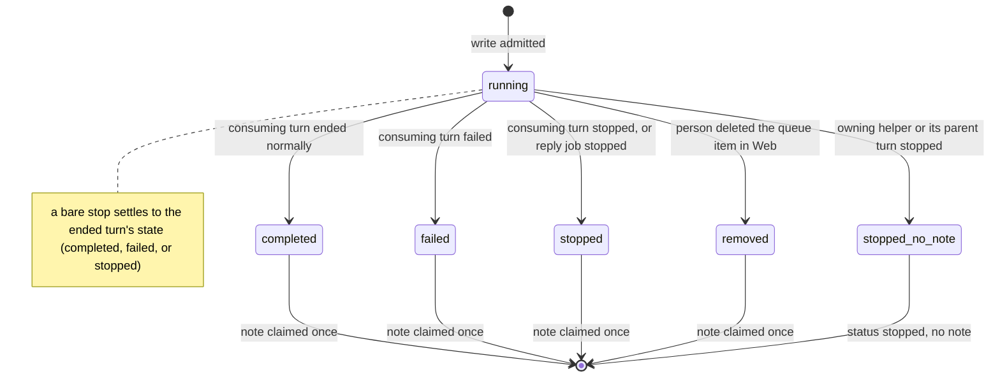
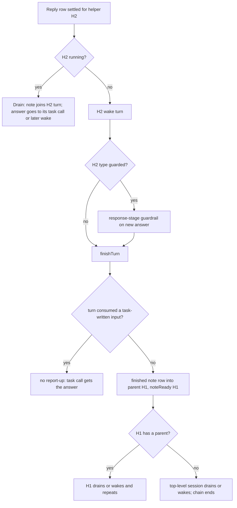
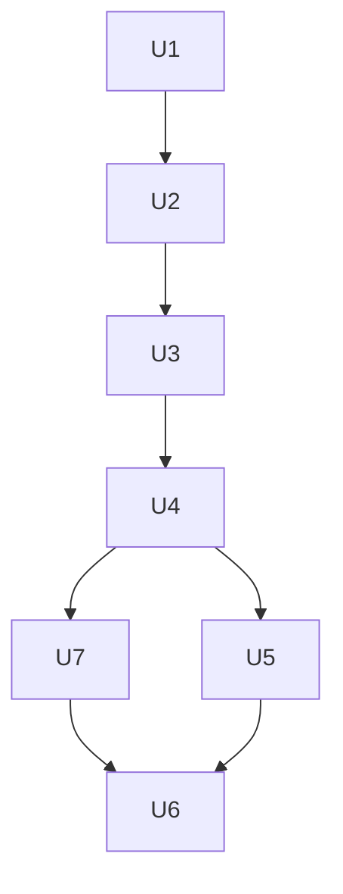

# Session Write Replies and Recipients - Plan

## Goal Capsule

- **Objective:** An agent that hands work to another RocketClaw session always learns how that work ended, without waiting, and an operator can decide which agents may hand work to each agent.
- **Means:** Every `rocketclaw_sessions_write` leaves a reply row that the target's consuming turn settles into a Completion Note for the exact caller (KTD1, KTD2); a helper woken by such a note reports its new answer up its parent chain (KTD5); a receiver-side `rocketclaw_sessions_recipient` setting gates writes (KTD8); one `rocketclaw_sessions` permission replaces the per-tool keys (KTD7).
- **Authority:** Product Contract Key Decisions and Requirements, then `AGENTS.md`, then this plan's KTDs, then existing code patterns. The R wins on product behavior; the KTD wins on mechanism.
- **Stop conditions:** Stop and ask when `internal/rocketclaw` source CLOC would exceed its `GO_SOURCE_CLOC_BUDGET`, when a fix needs `sync/atomic`, a linter suppression, an edited CLOC budget, or a Windows path, or when a settled decision proves infeasible.
- **Execution profile:** Deep. Go across `internal/rocketcode` and `internal/rocketclaw/backend`, two PostgreSQL migrations, model-facing tool and prompt text, docs and skeleton templates. No Web UI change beyond what existing Completion Note and Background Job rendering already shows.
- **Who finishes:** `ce-work` implements and verifies every unit. Shipping follows the calling pipeline.

---

## Product Contract

### Summary

`rocketclaw_sessions_write` stops being fire-and-forget: each write comes back to the calling session as a note when the target's turn that used it ends, including for helpers, whose late answers now travel up to their parent. A new per-agent `rocketclaw_sessions_recipient` setting decides who may write into an agent's sessions, and one `rocketclaw_sessions` permission replaces the five per-tool keys, the `children` scope, and `stash` mode.

### Problem Frame

An agent can start, steer, enqueue into, or stop another session, but it never hears back. Its only options are polling the other session's history or hoping the other agent writes back, which most agents do badly and which invites loops. Waiting for the answer was rejected because it blocks the caller, can deadlock two agents waiting on each other, and lets cancelling the waiter stop someone else's chat.

Helpers make it worse. A helper (a Subagent Session started by `task`) that sends a write and answers its task call before the reply arrives is woken by the reply, runs a new turn, and its new answer stays in its own history: nobody above it ever sees it. The same dead end already exists today when a helper's own Background Job finishes after the helper answered. OpenCode, Codex, and pi-durable all leave that gap open; none forwards a late helper answer up its chain.

Operators also cannot protect an agent from other agents. Any agent with write permission can create, steer, enqueue into, or stop any top-level session, and upcoming "sudo" agents must be able to refuse that. Meanwhile the sender side has grown five per-tool keys, a `children` scope tied to a `spawned_by` column, and a `stash` mode that leaves agent work waiting on a person.

### Requirements

**Sender permission**

- R1. One `permission.rocketclaw.rocketclaw_sessions` key with `allow`, `deny`, `auto`, or `auto(<reviewer>)` controls visibility and use of `rocketclaw_sessions_list`, `rocketclaw_sessions_get`, `rocketclaw_sessions_current_id`, `rocketclaw_sessions_get_url`, and `rocketclaw_sessions_write`; absent means deny.
- R2. The `children` scope no longer exists; an agent file that still uses `rocketclaw_sessions_write: children` fails to load.
- R3. The `spawned_by` creator column and all code that writes or reads it are removed.
- R4. The old per-tool keys (`rocketclaw_sessions_list`, `_get`, `_current_id`, `_get_url`, `_write` with `allow`/`deny`/`auto` values) load without error and grant nothing.
- R5. `rocketclaw_set_tag` / `rocketclaw_get_tags` keep their own tag-group setting.
- R6. `rocketclaw_stop_background_job` stays visible and callable only under `allow_background`.

**Writing**

- R7. `rocketclaw_sessions_write` offers `steer`, `enqueue`, and `stop` for existing sessions; `stash` is gone for agents. Web stash is unchanged.

**Replies**

- R8. Every write that delivers or creates work gets exactly one reply note in the calling session when the target turn that consumed the written message ends: for `enqueue` and create, the turn that runs it; for `steer`, the running turn that took it, or the turn that runs it if none took it.
- R9. A reply note carries the write's `queue_item_id`, the target session ID, URL and agent, the write mode, the outcome state, and the consuming turn's final answer; a steer reply says the answer covers the whole turn the message joined.
- R10. The reply goes to the exact session that made the call, including a helper and a hidden run, never to its parent or report destination.
- R11. When the consuming turn fails or is stopped, the note says so and suggests `rocketclaw_sessions_get` / `rocketclaw_sessions_list` with the target ID to find out more.
- R12. A `stop` with no message to a session whose turn was running gets a note once that turn is over, naming the state it ended in and suggesting `rocketclaw_sessions_get`.
- R13. Reply notes get no guardrail review.
- R14. When a note wakes a helper whose task call already returned, the helper's new answer goes to its parent as a note, level by level up to the top-level session; a busy parent takes the note into its running turn and an idle one wakes. This applies to every helper wake turn, including one woken by the helper's own Background Job.

**Recipient control**

- R15. `permission.rocketclaw.rocketclaw_sessions_recipient` accepts `true` (any agent may write in), `false` (no agent may), or a list of agent names (only those may); absent means `true` for every agent until the sudo-agent work defines its own default of `false`.
- R16. `false` refuses every sender, including another session running the same agent.
- R17. The sender checked is the agent that made the call; for a helper, the helper's own agent.
- R18. Create, `steer`, `enqueue`, and `stop` (with or without a message) are all refused before any side effect when the target agent's setting does not accept the sender, with an error that names the target agent, the sender agent, and the setting.

### Key Decisions

- **One sender key.** (session-settled: user-directed — chosen over per-tool exact keys: fewer knobs, one decision per agent.) Governs R1.
- **No `children` scope.** (session-settled: user-directed — chosen over keeping `children`: an agent that wants its own children uses `task`.) Files still using it may fail to load because no production agent uses it (session-settled: user-directed — chosen over a silent tolerance branch: no agent depends on it). Governs R2.
- **Drop `spawned_by`.** (session-settled: user-approved — chosen over keeping the column: nothing reads it once `children` is gone.) Governs R3.
- **Old per-tool keys are ignored silently.** (session-settled: user-approved — chosen over failing to load with a hint: the user chose silence.) Governs R4.
- **Tag tools keep their own setting.** (session-settled: user-approved — chosen over folding them into `rocketclaw_sessions`: tag groups need their own list.) Governs R5.
- **Stopping background jobs stays under `allow_background`.** (session-settled: user-directed — chosen over a separate permission: whoever may start background work may stop it.) Governs R6.
- **No agent stash.** (session-settled: user-directed — chosen over keeping `stash`: agent work must not wait on a person.) Governs R7.
- **Replies arrive later as notes.** (session-settled: user-directed — chosen over the caller waiting for the answer: waiting blocks, deadlocks, and lets a cancelled waiter stop another chat.) Governs R8, R9.
- **Reply to the exact caller.** (session-settled: user-directed — chosen over the parent or top-level session: the helper that asked is the one that needs the answer.) Governs R10.
- **Failed and stopped turns still reply.** (session-settled: user-approved — chosen over sending nothing: the caller must learn the work ended, and the hint lets it recover.) Governs R11.
- **A bare stop still replies.** (session-settled: user-directed — chosen over no reply: the caller must at least learn the turn is over.) Governs R12.
- **No guardrail on replies.** (session-settled: user-directed — chosen over a response guardrail like `task`'s: permissions are the control.) Governs R13.
- **Helpers report up.** (session-settled: user-approved — chosen over holding the helper's answer, rerouting the reply to the parent, or only saving it: keeps the reply with the helper, tells the parent, and nobody waits.) Governs R14.
- **Receiver-side recipient setting.** (session-settled: user-directed — chosen over no receiver control: sudo agents must be able to refuse other agents.) Governs R15.
- **`false` blocks everyone.** (session-settled: user-approved — chosen over allowing the same agent: simplest and safest for sudo.) Governs R16.
- **The real caller is the sender.** (session-settled: user-approved — chosen over the top-level session's agent: matches the reply going to the helper.) Governs R17.
- **Create and stop count as writes.** (session-settled: user-approved — chosen over guarding only existing-session messages: starting or stopping an agent's work is control over it.) Governs R18.
- **The setting lives under `permission.rocketclaw`.** (session-settled: user-approved — chosen over a top-level frontmatter key: it sits with `allow_background` and `load_agents_md`.) Governs R15.

### Acceptance Examples

- AE1. **Covers R8, R10.** Given Main in session S1 enqueues "summarize billing" into session S2 and ends its turn, when S2's turn that ran the message ends, then S1 wakes with one note naming the `queue_item_id`, S2, `state=completed`, and S2's answer.
- AE2. **Covers R8, R9.** Given S2 is running and Main steers into it, when S2's running turn takes the steer and ends, then Main gets one note whose body says the answer covers the whole turn.
- AE3. **Covers R11.** Given a person stops S2's turn that took Main's message, then Main's note says `state=stopped` and names `rocketclaw_sessions_get` with S2's ID.
- AE4. **Covers R12.** Given S2 is running, when Main sends `stop` with an empty message, then the result carries a `queue_item_id` and Main gets a "turn is over" note after S2's turn ends.
- AE5. **Covers R10, R14.** Given helper H under Main writes to S2 and answers its task call, when S2's reply arrives, then H wakes, and when H's wake turn ends Main gets a note carrying H's new answer.
- AE6. **Covers R16, R17, R18.** Given agent `ops` sets `rocketclaw_sessions_recipient: false`, when any agent, including another `ops` session or a helper, creates an `ops` session or steers, enqueues, or stops an `ops` session, then the call fails, nothing is created or queued, and nothing is stopped.
- AE7. **Covers R15, R17.** Given `ops` sets `rocketclaw_sessions_recipient: [main]`, when helper agent `researcher` under Main writes to an `ops` session, then it is refused; when Main's own agent writes, it is accepted.

### Scope Boundaries

- The recipient setting governs writes only; any agent with `rocketclaw_sessions` can still list and read every session, including a sudo agent's.
- `task` delegation and its guardrails are unchanged; replies never apply to `task` prompts.
- No hop cap or loop breaker beyond the tool description and receiver header text: a reply never triggers another reply by itself, and any loop needs agents choosing to write again.
- Several steers from one caller consumed by one turn produce one note each, not a combined note; wake batching already makes them one wake turn. Evidence that would change this: agents visibly confused by duplicate answers.
- The write tool is not made resumable: a restart that interrupts a write call can still lead the model to write again, as today. Evidence that would change this: duplicate writes observed after restarts.
- A reply whose target never consumes the message (for example a target session switched to an agent that never runs) keeps its row running and visible in the caller's job list until a person or agent stops it.

#### Deferred to Follow-Up Work

- Defining which agents are "sudo" and their `false` default belongs to the sudo-agent work (session `ses_e7727223effeiNEpht8LdgS2MO`); this plan only reads the setting.
- Showing in `rocketclaw_sessions_list` whether a session accepts the caller's agent.

### Outstanding Questions

- Deferred: a reply or a helper's report-up that wakes a Slack-mention conversation will post that wake turn's answer into the Slack thread through existing delivery, including for task-only flows whose helper's own Background Job ends late. The plan keeps that behavior and updates `internal/rocketclaw/skel/agents/main.md` guidance; confirm the operator wants it.
- Deferred decision: does a guarded helper type's report-up answer pass its response-stage guardrail (KTD6)? The plan keeps the existing guardrail contract by default; if "no guardrail on replies" was meant to cover report-up too, remove KTD6, U5 step 3, and its test scenario.
- Deferred decision: the generated `main` agent's shipped value. The plan ships `rocketclaw_sessions: allow`, which keeps Slack-to-Web session creation unreviewed but also lets an allowlisted Slack user have `main` read any session, including private External MCP ones, into a Slack thread. `auto` keeps creation working with every read and write reviewed; `deny` drops Slack-to-Web creation.

### Sources

- Prior art research (2026-10-29): OpenCode `packages/core/src/tool/plugin/subagent.ts`, `packages/core/src/session/subagent-completion.ts`, `packages/plugin/src/effect/README.md:131-135`; Codex `codex-rs/core/src/agent/control/completion.rs:112-128`, `codex-rs/core/src/session/turn_input.rs:776-788`; pi `packages/durable/test/examples/22-subagent-background.ts`. All three wake the caller with a note at most one level up and have no receiver allowlist.
- `docs/plans/2026-10-13-1309-feat-agent-session-control-plan.md` (REV1–REV5): the session-write and subagent-as-session design this plan extends.

---

## Planning Contract

### Key Technical Decisions

- KTD1. **A reply is a Background Job row of a new `reply` kind, owned by the calling conversation.** The row is created `running` at write time with `input_id` = the write's `queue_item_id`, origin = the calling bridge's own turn inbound (`msg`, not the root-routing `origin`), and the target conversation ID stored on the row. Owning conversation = `b.config.ConversationID`, which is the helper's own ID for helpers. Only `rocketclaw_sessions_write` creates these rows, so `task` prompts, which share the same sender metadata and ID shape, never get replies. Reusing Background Job storage gives exactly-once Completion Note claiming, mid-turn delivery through `Drain`, idle wakes through `pickLaterWork`/`claimWakeNotes`, hidden-run routing through the frozen origin, Web visibility in the caller's job list, and restart discovery of pending wakes. Considered: inserting a finished note row only when the target turn ends; rejected because the caller's routing origin and the Task/write distinction are not known at the target's finish. Considered: waiting with `awaitSubagent` in a worker; rejected because it needs a goroutine per write and loses replies across restarts unless re-armed. Implements R8, R10.
- KTD2. **Replies settle in SQL inside the transaction that ends or removes the consumed input, matched on (target conversation, input ID).** Every settle path sets status, result, `note='pending'`, and wake, guarded by `phase='running'` so only one path wins:
  1. `finishTurn` settles rows whose target is the finishing conversation and whose `input_id` is the turn's own inbound `web_message_id` or in its `applied_input_ids`; status follows the turn's terminal (completed, failed, stopped), and the result is the turn's final non-commentary assistant text.
  2. `postStopLines` settles a bare stop's row when it posts that stop's parked `stopped_by/<writer>/<call key>` line, with the state of the last turn that ended there.
  3. Web deletion of an agent-written queue item settles its row as `removed` in the same statement that deletes the item (a CTE), in all three `deleteQueueItem` branches.
  4. Stopping a reply job (Web Stop or `rocketclaw_stop_background_job`) settles it as `stopped` with a pending note and no wake; it never touches the target.
  5. Stopping a helper together with its task job, or stopping the parent turn whose attached task call waits on it (the `awaitSubagent` parent-stop branch), settles that helper's and its descendants' running reply rows as stopped with no note, matching `errStoppedWithOwner`.
  Matching on the target conversation keeps shadow comparison copies, which reuse the same `web_message_id`, from settling a reply. After commit, every path calls `noteReady` for each owner it settled with a wake, through the registry so `finishTurn`'s three callers (`Bridge.finish`, `stopIdleTurn`, `skipObsoleteGoal`) are all covered. Implements R8, R11, R12.
- KTD3. **Create delivers its first prompt through the agent-write queue path.** `createSession` records the conversation, then admits the prompt with `admitAgentWrite` and `web_message_id` = `queue_item_id`, in the same transaction as the reply row. Today create only pushes the prompt into memory with no message ID, so its turn could not be matched and a crash loses the prompt. Implements R8.
- KTD4. **Bare stops reply only when a turn was running.** With `turn_was_running: false` the result has no `queue_item_id` and no reply row; the result already tells the caller nothing was running. Startup discovery also starts conversations that hold parked `stopped_by/` steps, so a crash after the stopped turn ended still posts the line and settles the reply. Implements R12.
- KTD5. **Report-up runs in `finishTurn` for helper wake turns.** When a conversation with a parent finishes a wake turn (inbound carries `background_job_ids`), `finishTurn` inserts into the parent a finished `note`-kind Completion Note row with `subagent_key` = the helper's path relative to the parent, job ID = the helper's turn ID, the turn's answer or terminal as result, and an origin whose empty `SyncDestination` lets the `reports_to` fallback route hidden-run roots. It skips the insert when the turn also consumed a task-written queue row (the `recorded` delete removed any waiting row), because that answer already reaches the task call. A parent that is itself a helper wakes, runs its own wake turn, and reports again, so recursion needs no extra code. Implements R14.
- KTD6. **Report-up from a guarded helper type passes its response-stage guardrail first.** A helper type with a `guardrail` runs the response-stage review at the end of its wake turn, before `finish`, through a small exported RocketCode entry point on the helper's runtime, with the parent's agent as the originating agent and the wake text as the prompt; the approved answer is wrapped in `<task_result>` and carried on `turnFinish`. A rejection reports the blocked result instead. This keeps `docs/solutions/logic-errors/subagent-delivery-paths-must-run-guardrails.md`: every answer leaving a guarded helper is reviewed. Conflict call-out: R13 drops guardrails for cross-session reply notes only; this KTD reads "no guardrail on replies" as not covering a helper's answer to its own parent, which the existing contract governs. Implements R14.
- KTD7. **The five session tools share subject `rocketclaw_sessions`.** Each tool sets `Permission: "rocketclaw"` with `VisibilitySubjects` and `Subjects` = `rocketclaw_sessions`, the same pattern `rocketclaw_stop_background_job` uses with `allow_background`. The `children` rewrite in `parsePermissionRules` and `checkSessionTarget`'s `children` branch are deleted; `topLevelSessionCreator` becomes an existence check. Old per-tool keys need no code: no tool subject matches them. Implements R1, R2, R4.
- KTD8. **The recipient setting is skipped by the permission parser and validated at definition load.** `parsePermissionRules` skips `rocketclaw_sessions_recipient` the way it skips `rocketclaw_set_tag` sequences; `readRocketCodeDefinitionsIn` validates it as a YAML bool or a non-empty list of non-empty, unique names, with the same shadow-definition handling as tag groups; a reader in the `agentTagGroups` style reads it from `Agent.Frontmatter` at call time. The write tool resolves the target agent before any side effect: the requested agent for create, the session's recorded agent for existing sessions; the sender is `rocketcode.ToolCallAgent(ctx).Name`. Implements R15–R18.
- KTD9. **Model-facing text carries the protocol.** The write tool description drops `stash`, says the answer arrives later as a `<session_reply>` note naming `queue_item_id`, tells the agent not to wait, sleep, poll, or write again for it, and names recipient refusals. The receiver's provenance header for agent-written messages adds that its final answer returns to the sender automatically, so it must not write back. The `<session_reply ...>` note frames the body as the other session's answer, not instructions from the user. Implements R9, R11.
- KTD10. **Two migrations, numbered after `070`.** `071` drops `conversations.spawned_by` the way `063_drop_web_tab_pin.sql` drops a column; `072` widens `turns_kind_check` with `reply` and adds the reply target column. Both get Down steps and entries in `store_schema_test.go`. Numbering must be rechecked against the sudo-agent work before merge. Implements R3, R8.

### High-Level Technical Design

Reply lifecycle for an `enqueue` write; `steer`, create, and bare stop differ only in which step consumes or settles the input.

Reply row states (one transition wins, guarded by `phase='running'`):

Report-up chain when a reply reaches a finished nested helper:

### Assumptions

- A bare stop to a session with no running turn gets no reply row, no `queue_item_id`, and no note (KTD4); the result's `turn_was_running: false` is the answer.
- Reply notes and report-up notes skip the recipient check: they answer the caller's own write or travel its own helper chain, and without the exemption a `false` caller could never hear back.
- The recipient check uses the target's recorded agent at write time and is not repeated when a queued message later runs.
- Until the sudo-agent work lands, an absent `rocketclaw_sessions_recipient` means `true` for every agent.
- When a person deletes an agent-written queue item in Web, the caller gets a `removed` note, so a promised reply never silently disappears.
- When a person stops a reply job, the caller's note waits for its next turn and does not wake it.
- A helper stopped together with its task job or its waiting parent turn drops its pending replies without notes, as its own Background Jobs do, so stopped work stays stopped.
- Slack-mention, cron, and External MCP callers get replies by the same rules; their wakes follow existing note routing.
- A shutdown-interrupted turn that will resume produces no reply; only a turn that actually ended settles one.
- The generated `main` agent moves to `rocketclaw_sessions: allow`, which also grants list/get reads over every conversation, including private External MCP ones; the README calls this out.

### Sequencing

U1 and U2 are independent of the reply work and land first. U3 changes the write surface that U4 builds on. U4 introduces reply rows; U7 adds the remaining settle paths; U5 builds report-up on U4's `finishTurn` hook; U6 updates docs last.

---

## Implementation Units

### U1. Collapse the sender permission and remove `children` and `spawned_by`

- **Goal:** One `rocketclaw_sessions` key gates all five session tools; `children` and `spawned_by` are gone.
- **Requirements:** R1, R2, R3, R4, R5, R6; KTD7, KTD10.
- **Dependencies:** none.
- **Files:**
  - `internal/rocketcode/permission.go`, `internal/rocketcode/permission_test.go`
  - `internal/rocketclaw/backend/session_tools.go`, `internal/rocketclaw/backend/session_tools_test.go`
  - `internal/rocketclaw/backend/store.go`, `internal/rocketclaw/backend/store_dao.go`, `internal/rocketclaw/backend/thread_bridges.go`, `internal/rocketclaw/backend/thread_bridges_test.go`
  - `internal/rocketclaw/backend/migrations/071_drop_spawned_by.sql`, `internal/rocketclaw/backend/store_schema_test.go`
  - `internal/rocketclaw/backend/definitions_test.go`, `internal/rocketclaw/backend/active_turn_test.go`, `internal/rocketclaw/backend/shadows_test.go`, `internal/rocketclaw/backend/runtime_test.go`, `internal/rocketclaw/backend/bridge_test.go` (fixture keys)
- **Approach:**
  1. Point list, get, current_id, get_url, and write at subject `rocketclaw_sessions` (KTD7).
  2. Delete the `children` rewrite in `parsePermissionRules`, the `children` parameter and branch of `checkSessionTarget`, and the frontmatter read in the write tool; reduce `topLevelSessionCreator` to a top-level existence check used by `checkSessionTarget` and `rocketclaw_sessions_get_url`.
  3. Remove `spawnedBy` from `ThreadState`, `threadStart`, the insert in `store.go`, the `Thread` select, and `createSession`; add migration `071` with a Down step.
  4. Rewrite fixtures that use old per-tool keys to `rocketclaw_sessions`; delete `TestStartedThreadKeepsSpawnedBy` and the `children` rows; find created sessions in tests by another column than `spawned_by`.
- **Patterns to follow:** `background_tools.go` (`VisibilitySubjects` = `AllowBackgroundSubject`); `migrations/063_drop_web_tab_pin.sql`.
- **Test scenarios:**
  - `rocketclaw_sessions: allow` makes all five tools visible and callable; `deny` and absent hide all five.
  - `rocketclaw_sessions: auto` routes each of the five tools through review with subject `rocketclaw_sessions`.
  - An agent file with `rocketclaw_sessions_write: allow` and no `rocketclaw_sessions` loads and sees none of the five tools.
  - An agent file with `rocketclaw_sessions_write: children` fails to load with the unknown-action error.
  - `rocketclaw_sessions_get_url` still fails for subagent, private External MCP, and cron producer conversations.
  - Writing to the caller's own session or its report destination is still refused.
  - Tag tools still follow their tag-group setting; `rocketclaw_stop_background_job` still follows `allow_background`.
  - Migration list includes `071_drop_spawned_by.sql`, and the schema has no `spawned_by` column.
- **Verification:** All five tools move together under one key in `TestSessionToolsBridgePermissions`; no `spawned_by` or `children` reference remains outside historical plan docs.

### U2. Add the `rocketclaw_sessions_recipient` setting and enforce it on writes

- **Goal:** A receiver agent decides which sender agents may create, steer, enqueue into, or stop its sessions.
- **Requirements:** R15, R16, R17, R18; KTD8.
- **Dependencies:** U1.
- **Files:**
  - `internal/rocketcode/permission.go`, `internal/rocketcode/permission_test.go`
  - `internal/rocketclaw/backend/bridge.go` (`readRocketCodeDefinitionsIn`, `runTurn` wiring), `internal/rocketclaw/backend/definitions_test.go`
  - `internal/rocketclaw/backend/session_tools.go`, `internal/rocketclaw/backend/session_tools_test.go`
- **Approach:**
  1. Skip the key in `parsePermissionRules`; validate it at definition load as a bool or a list of unique non-empty names.
  2. Add a frontmatter reader in the `agentTagGroups` style returning "accepts sender X" for an agent, with absent meaning accept all.
  3. In the write tool, resolve the target agent (create: requested agent; existing: recorded session agent) and check the calling agent before `createSession`, `writeSession`, or `stopSession`; pass the turn's loaded agent definitions to the tool instead of reading them from disk again.
  4. Return a tool error naming the target agent, sender agent, and `rocketclaw_sessions_recipient`, distinct from the sender-permission denial.
- **Patterns to follow:** `load_agents_md` bool validation and `rocketclaw_set_tag` sequence skip in `permission.go`; tag-group validation in `readRocketCodeDefinitionsIn`; `agentTagGroups` in `session_tools.go`.
- **Test scenarios:**
  - Covers AE6. `false` refuses create, steer, enqueue, bare stop, and stop with a message, including from another session running the same agent; no session row, queue row, or stop happens, and the error names the target agent, the sender agent, and `rocketclaw_sessions_recipient` (R18).
  - Covers AE7. A list `[main]` accepts `main` and refuses a helper running `researcher`.
  - Absent setting and `true` accept every sender.
  - Load fails for a string value, an empty list, an empty name, or a duplicate name, naming the file and key.
  - A shadow definition with an invalid value follows the same warn-and-drop handling as tag groups.
  - The setting adds no rule to the `rocketclaw` permission bucket.
- **Verification:** Refused writes leave no trace in the State Store; accepted writes behave as before.

### U3. Reshape the write surface: no stash, durable create, and the reply protocol text

- **Goal:** The write tool offers steer, enqueue, and stop, create goes through the queue, and agents on both sides know replies come back automatically.
- **Requirements:** R7, R8, R9; KTD3, KTD4, KTD9.
- **Dependencies:** U2.
- **Files:**
  - `internal/rocketclaw/backend/session_tools.go`, `internal/rocketclaw/backend/session_tools_test.go`
  - `internal/rocketclaw/backend/thread_bridges.go`, `internal/rocketclaw/backend/thread_bridges_test.go`
  - `internal/rocketclaw/backend/bridge.go` (provenance header), `internal/rocketclaw/backend/bridge_test.go`
  - `internal/rocketcode/background.go` (`continueSteered` text)
- **Approach:**
  1. Remove `sessionWriteStash`, `sessionStashed`, the stash switch case, and the `mode != sessionWriteStash` guard around `releaseHeldInputs`; keep Web stash and held task inputs.
  2. Make `createSession` record the conversation and then admit the first prompt through `admitAgentWrite` with `web_message_id` = `queue_item_id` (KTD3); return `queue_item_id` for create.
  3. Return `queue_item_id` for a bare stop only when `turn_was_running` is true (KTD4).
  4. Rewrite the tool description and add the receiver header sentence for agent-written messages, not `task` prompts (KTD9); update `continueSteered` to describe report-up.
- **Patterns to follow:** `admitAgentWrite`/`writeSession` in `thread_bridges.go`; `movedNote` wording in `background.go`.
- **Test scenarios:**
  - `mode: stash` is rejected by the tool schema enum and the description no longer mentions stash.
  - A person's Web stash and a held task input still release before the next write.
  - Create admits its first prompt as a queue row with `web_message_id` = returned `queue_item_id`, and the first turn runs it after a restart that happens before activation.
  - Bare stop with a running turn returns a `queue_item_id`; with no running turn it returns none.
  - The receiver's prompt header for an agent write contains the "returned automatically" sentence; a `task` prompt's header does not.
  - Exact-text test of the write tool description.
- **Verification:** `TestWriteSessionDeliversByMode` covers steer, enqueue, and stop only; create and enqueue share the admit path.

### U4. Create reply rows and settle them when the consuming turn ends

- **Goal:** Every delivering write leaves a running `reply` row that the target's consuming turn settles into one Completion Note for the exact caller.
- **Requirements:** R8, R9, R10, R11, R13; KTD1, KTD2, KTD10.
- **Dependencies:** U3.
- **Files:**
  - `internal/rocketclaw/backend/migrations/072_session_reply_jobs.sql`, `internal/rocketclaw/backend/store_schema_test.go`
  - `internal/rocketclaw/backend/store_dao.go` (`turnKind`, `tool()`, `createBackgroundJob`, `finishTurn`), `internal/rocketclaw/backend/background_store_test.go`
  - `internal/rocketclaw/backend/background.go` (`backgroundNote`, `recoverJobs`, `turnFinished`), `internal/rocketclaw/backend/background_test.go`
  - `internal/rocketclaw/backend/thread_bridges.go` (`admitAgentWrite`), `internal/rocketclaw/backend/session_tools.go`
  - `internal/rocketclaw/backend/bridge.go` (pass the bridge's own `msg` to the write tool), `internal/rocketclaw/backend/bridge_test.go`, `internal/rocketclaw/backend/session_tools_test.go`, `internal/rocketclaw/backend/active_turn_test.go`
- **Approach:**
  1. Migration `072` widens `turns_kind_check` with `reply` and adds the reply target column; add `turnReply` to `turnKind` and its `tool()` mapping.
  2. Create the running reply row in the `admitAgentWrite` transaction (create, steer, enqueue, stop with a message) with owner `b.config.ConversationID`, origin = the bridge's own `msg`, `input_id` = `queue_item_id`, and the target conversation.
  3. In `finishTurn`, settle running reply rows whose target is the finishing conversation and whose `input_id` is the turn's own `web_message_id` or in `applied_input_ids`, with status from the turn's terminal and the turn's final answer as result; return their owners.
  4. Widen the registry's post-commit hook so every `finishTurn` caller calls `noteReady` for those owners.
  5. Render reply notes as `<session_reply queue_item_id session_id agent mode state url>` plus body, with the steer sentence, the "another session's answer" framing, and the recovery hint for failed and stopped states.
  6. Make `recoverJobs` leave running reply rows alone.
- **Execution note:** Start with a failing end-to-end test for AE1 using the `newNoteTest` harness, then build inward.
- **Patterns to follow:** `createBackgroundJob`, `finishBackgroundJob`, `claimBackgroundNotes`, `backgroundWake` in `store_dao.go`; `backgroundNote` in `background.go`; `newNoteTest` in `bridge_test.go`; `TestSessionsWriteRunsInTurn`.
- **Test scenarios:**
  - Covers AE1. Enqueue from an idle caller wakes it once with a `completed` note carrying the answer and `queue_item_id`.
  - Covers AE2. A steer drained by the running turn produces one note when that turn ends; a steer not drained produces its note when its own turn ends.
  - Covers AE3. A person stops the consuming turn: the note says `stopped` with the `rocketclaw_sessions_get` hint naming the target; a failed turn says `failed`.
  - A reply note to a helper whose type has a guardrail is delivered without guardrail review (R13).
  - Create's first turn settles the create's reply.
  - A busy caller takes the note mid-turn through `Drain` without a second wake.
  - Covers AE5 (first half). A helper caller owns the row and its own session gets the note.
  - A hidden-run caller's note wakes along its routing (Private Producer Conversation), not the root's.
  - A shadow comparison copy of the target finishing first does not settle the reply.
  - A `task` prompt into a helper creates no reply row.
  - A shutdown-interrupted consuming turn settles nothing; after restart the resumed turn settles the reply once.
  - Restart after the reply settled but before `noteReady`: the caller wakes once on startup.
  - Migration list includes `072_session_reply_jobs.sql`; a running reply row survives `recoverJobs`.
- **Verification:** Each consuming turn produces exactly one note per write, with no worker goroutine per reply.

### U7. Settle replies on every other way a write ends

- **Goal:** No reply row stays running when its write ends without a normal consuming turn.
- **Requirements:** R11, R12; KTD2, KTD4.
- **Dependencies:** U4.
- **Files:**
  - `internal/rocketclaw/backend/session_tools.go` (`postStopLines`, bare stop), `internal/rocketclaw/backend/session_tools_test.go`
  - `internal/rocketclaw/backend/thread_bridges.go` (`deleteQueueItem`, startup discovery), `internal/rocketclaw/backend/store_dao.go` (`DeleteThreadQueueItem`), `internal/rocketclaw/backend/thread_bridges_test.go`
  - `internal/rocketclaw/backend/background.go` (`stop`), `internal/rocketclaw/backend/background_test.go`, `internal/rocketclaw/backend/app_test.go`
- **Approach:**
  1. Bare stop with a running turn creates its reply row with the parked stop line; `postStopLines` settles it in its transaction with the state of the last turn that ended there.
  2. Startup discovery also starts conversations holding parked `stopped_by/` steps.
  3. Each `deleteQueueItem` branch deletes the item and settles its reply row as `removed` in one CTE statement, scoped to the item's conversation.
  4. `stop` settles a reply job in the State Store as `stopped`, with a pending note and no wake, when no in-memory run exists.
  5. Stopping a task job, and the `awaitSubagent` parent-stop branch, also settle the stopped helper's and its descendants' running reply rows as stopped with no note.
- **Patterns to follow:** `postStopLines` transaction and history lock; `errStoppedWithOwner` cascade in `background.go`; `TestRunStartsPersistedQueueWithoutOtherWork`.
- **Test scenarios:**
  - Covers AE4. Bare stop of a running target: the caller gets one "turn is over" note naming the ended state after the stopped turn finishes.
  - Crash after the stopped turn ended but before `postStopLines`: on restart the line posts and the note arrives.
  - A person deletes an agent-written queue item (each of the three branches, including an unread steer): the caller gets a `removed` note and the row is no longer running.
  - A person stops a reply job in Web: the row is `stopped`, the caller is not woken, and the note reaches its next turn.
  - `rocketclaw_stop_background_job` on a reply job reports it stopped rather than already finished.
  - Stopping a task job whose helper has a pending reply: the reply later arriving produces no note and no wake, and `TestStoppedParentStopsSubagentItWaitsOn` still holds.
  - A person stops Main while its attached task call waits on helper H, and H has a pending reply: when the reply's target turn ends, neither H nor Main wakes.
- **Verification:** A grep of settle paths shows every input removal path also settles its reply in the same transaction.

### U5. Report a woken helper's new answer up its parent chain

- **Goal:** A helper woken after its task call returned sends its new answer to its parent, recursively, with guardrails intact.
- **Requirements:** R14; KTD5, KTD6.
- **Dependencies:** U4.
- **Files:**
  - `internal/rocketclaw/backend/store_dao.go` (`turnFinish`, `finishTurn`), `internal/rocketclaw/backend/bridge.go` (`finish`, wake turn end)
  - `internal/rocketcode/tasks.go` (exported response-review entry point), `internal/rocketcode/tasks_test.go`, `internal/rocketcode/background_test.go`
  - `internal/rocketclaw/backend/active_turn_test.go`, `internal/rocketclaw/backend/bridge_test.go`
- **Approach:**
  1. In `finishTurn`, when the conversation has a parent and the finishing turn is a wake turn, insert the finished `note` row into the parent (KTD5) and return the parent among the owners to wake.
  2. Skip the insert when the turn's `recorded` delete removed any waiting row, meaning the turn consumed a task-written input.
  3. For guarded helper types, run the response-stage review at the end of the wake turn before `finish`, and carry the `<task_result>` answer or blocked result on `turnFinish` (KTD6).
- **Patterns to follow:** `guardTask`/`awaitTask` in `internal/rocketcode/tasks.go`; `backgroundNote`'s `<subagent>` rendering; `TestTaskContinueGuardsDelivery`.
- **Test scenarios:**
  - Covers AE5. Helper H answers its task, a reply wakes it, and Main gets a note with H's new answer and a `continue` key that opens H.
  - Two-level chain: a reply wakes H2 under H1 under Main; H1 wakes, and Main receives H1's note.
  - A busy parent takes the report-up note mid-turn without an extra wake.
  - A helper woken by its own late Background Job also reports up.
  - A wake turn that also consumed a task continue's steer does not report up; the task call gets the answer once.
  - A guarded helper type's report-up is reviewed and wrapped in `<task_result>`; a rejection delivers the blocked result.
  - A held task input that runs later with no wake still reports nothing (`TestStoppedParentStopsSubagentItWaitsOn` unchanged).
  - Crash after the helper's wake turn saved but before `noteReady(parent)`: the parent wakes once on startup.
  - A hidden-run root receives the report-up through its `reports_to` routing.
- **Verification:** A late helper answer is visible in the top-level session's transcript after the chain, with no duplicate notes.

### U6. Update docs, skeleton agents, and concepts

- **Goal:** Operators and agent authors see the new permission shape, recipient setting, and reply behavior.
- **Requirements:** R1–R18.
- **Dependencies:** U5, U7.
- **Files:**
  - `README.md`, `cmd/rocketclaw/CHEATSHEET.md`, `internal/rocketclaw/web/README.md`
  - `internal/rocketclaw/skel/agents/main.md`, `internal/rocketclaw/skel/.rocketclaw/skills/main-create-or-update-agent/SKILL.md`
  - `CONCEPTS.md`
- **Approach:**
  1. Replace per-tool examples with `rocketclaw_sessions`, remove `children` and agent `stash`, document `rocketclaw_sessions_recipient`, and add a release note that old keys stop granting anything and `main` gains reads.
  2. Set `main.md` to `rocketclaw_sessions: allow` and tell the Slack agent that a created session's answer comes back as a note.
  3. In `CONCEPTS.md`, update Thread Queue, Subagent Session (report-up), Background Job (reply jobs need no `allow_background`), and Completion Note (reply notes).
- **Test expectation:** none -- docs and templates only; U1's fixtures already exercise `main.md`'s key if the skeleton is loaded in tests.
- **Verification:** No doc or template mentions `children`, agent `stash`, or per-tool session keys except historical plans.

---

## Verification Contract

| Gate | Command | Applies to |
|---|---|---|
| Format | `gofmt` on touched Go files | every unit |
| Generate | `make generate` in `internal/rocketclaw` when a mocked interface changes | U4, U5, U7 |
| Unit and integration tests | `go test ./...` | every unit |
| Lint | `make lint` | every unit |
| Full suite and metrics | `make test` (includes rocketclaw `check-code-metrics`) | before finishing |
| CLOC budget | `make check-cloc-budget` in `internal/rocketclaw` and `internal/rocketcode` | before finishing; rocketclaw headroom was 1167 lines (667 before the hazard zone) |

State Store tests run against the repository's PostgreSQL test setup as existing `store_test.go` tests do.

## Definition of Done

- Every R1–R18 has a passing test named in its unit, and AE1–AE7 are covered.
- `gofmt`, `go test ./...`, `make lint`, and `make test` pass; CLOC stays within `GO_SOURCE_CLOC_BUDGET` without editing it.
- No `spawned_by`, `children`, `sessionWriteStash`, or per-tool session permission references remain in code, tests, docs, or templates outside historical plans.
- No reply row can stay `running` after its input was consumed, deleted, or its job stopped.
- Touched code follows AGENTS.md: no defensive guards, no nil-as-disabled dependencies, `err`-prefixed error variables, CTEs instead of subqueries, mockery v3 mocks.
- Abandoned-attempt code and unused helpers are removed from the diff.
- The README impact is stated in the final report.
