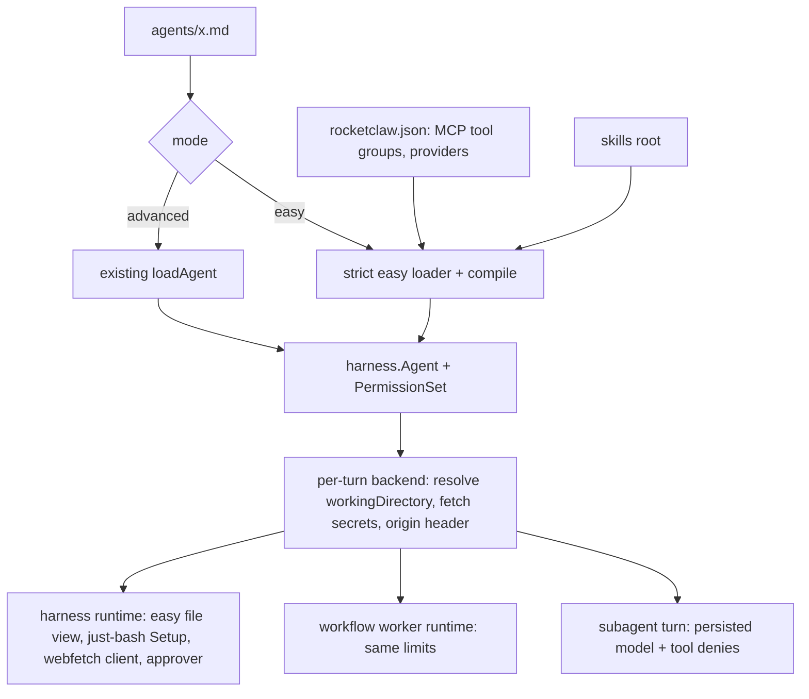

# Easy Mode Agents - Plan

## Goal Capsule

- **Objective:** An agent author can write a short `mode: easy` agent file. Any section left out is fully on behind a permission review. The agent runs in the emulated shell, confined to its own folder, with only the commands, secrets, MCP tools, skills, models and schedules its file names.
- **Means:** Compile easy frontmatter into the `harness.Agent` and `PermissionSet` the runtime already consumes, plus a few easy-only data fields on `Agent` (KTD1, KTD2).
- **Authority:** origin spec R1–R41, then Key Decisions, then KTDs, then unit text. A unit never overrides an R or a KTD.
- **Stop conditions:**
  - The Go source CLOC budget (`internal/rocketclaw/Makefile`) or the web TS budget (8250) cannot be met after honest reduction: stop and report.
  - The user raised `GO_SOURCE_CLOC_BUDGET` by 2500 lines, from 39250 to 41750, for this work. This overrides the AGENTS.md rule against editing it, for this budget only. Don't raise it again.
  - A settled decision proves infeasible during implementation: stop and report.
- **Execution profile:** `ce-work` implements. The security boundaries (U6, U7, U8, U10) are built test-first.
- **Who finishes:** `lfg` ships the pull request. Merging stays with the user.

---

## Product Contract

### Summary

Add `mode: easy` agent files, a second format that compiles into the runtime's existing agent and permission structures. Along the way:
- set `ROCKETCLAW_CONVERSATION_ID` on every turn;
- give every permission review a trusted origin header;
- remove the `rocketclaw.json` `models` section and its `{{ model }}` templates.

### Problem Frame

Advanced agent files expose every feature through exact-name `permission:` rules, so most agents never turn features on, and safe defaults (a sandboxed shell, a confined folder, scoped secrets) take expert setup. The origin spec settles an easier format that is meant to become the default. This plan carries it to implementation. The full product contract is the origin document.

### Requirements

R1–R41 keep their IDs and full text in the origin spec (see origin: `docs/specs/2026-10-30-easy-mode-agents-design.md`). One-line index:

**Format**
- R1. `mode: easy | advanced`. Omitted means `advanced`.
- R2. Any other `mode` value fails loading in both formats. Leftover test fixtures are removed.
- R3. Easy files are strict: unknown keys fail loading.

**Required keys**
- R4. `model` is a real model name with an optional `#effort`. The same syntax applies to `subagents` and `approver.model`.
- R5. `space` is required.
- R6. `workingDirectory` is required (R29).

**Sections**
- R7. `subagents`: omitted means the agent's own model only; `[]` means none. Delegation is `task` with `model` + `tools`.
- R8. `maxRecursion`: defaults to 1, accepts 0 or more.
- R9. `mcp`: per-server `read`/`write` groups, defined in `rocketclaw.json`.
- R10. `skills`: folders under `skills/`.
- R11. `rocketclaw`: the groups `sessions`, `pages`, `tags`, `background`, `workflow`, `restart`.
- R12. `tags`: tag groups. Without them, the `tags` group is off.
- R13. `allowedNetworkTargets`: the just-bash subset.
- R14. `delegatedFrom`: who may write into this agent's sessions.
- R15. `commands`: omitted means none.
- R16. `secretsARN`: omitted means none.
- R17. `approver`: optional model, and a prompt appended to the guardian prompt as tenant rules.
- R18. The calls `sudo` runs unreviewed stay unreviewed.

**Routines**
- R19–R24. Inline schedules:
  - parsed by the cron parser;
  - bare entries send a fixed message;
  - reports work as for cron files;
  - identity is agent plus schedule;
  - cron files cannot target easy agents.

**Other keys**
- R25. `schema.output` is kept.
- R26. These keys are refused: `description`, `reasoningEffort`, `verbosity`, `shell`, `permission`, `sudo`, `guardrail`, `additionalInstructions`.
- R27. No `AGENTS.md` and no reply-style line.

**Files and shell**
- R28. The emulated shell is always used.
- R29. `workingDirectory` resolution, variable rules, and the containment check.
- R30. The file tools are confined to `workingDirectory`, with read-only uploads and skill folders.
- R31. The emulator environment holds only the turn's variables and `TMPDIR`.
- R32. `commands` programs get the host environment plus secrets.
- R33. Body and `SKILL.md` ``!`…` `` lines run in host bash with secrets.
- R34. `webfetch` follows the same network rules as the emulator.

**Shadows**
- R35–R38. Shadows:
  - match the parent's mode;
  - share the required keys;
  - ignore their own routines;
  - skip routine turns.

**Global changes**
- R39. `ROCKETCLAW_CONVERSATION_ID` on every turn.
- R40. A trusted origin header in every permission review.
- R41. Remove `models` and the `{{ model }}` template lookup.

### Key Decisions

- **`mode` key in frontmatter.** Governs R1, R2. (session-settled: user-directed — chosen over a `.easy.md` suffix and a `format:` key: a key flips the default cleanly when advanced is deprecated.)
- **Distinct formats sharing one internal representation.** Governs R1–R38. (session-settled: user-directed — chosen over translating easy files into advanced frontmatter: easy is the future default, not sugar.)
- **Omitted section means on and reviewed; explicit means only what is listed.** Governs R7–R14. (session-settled: user-directed — chosen over a separate `all` keyword: `auto` always means a permission review.)
- **Emulated shell is mandatory.** Governs R28. (session-settled: user-directed — chosen over an optional `shell` key.)
- **Network rules are exactly what just-bash supports.** `webfetch` matches them exactly. Governs R13, R34. (session-settled: user-directed — chosen over contributing wildcards, CIDR and methods upstream or patching just-bash: just-bash is the common denominator.)
- **`approver.prompt` is appended, not a replacement.** Governs R17. (session-settled: user-directed — chosen over replacing the guardian prompt: built-in safety rules stay.)
- **Secrets never reach the emulator.** Governs R16, R31–R33. (session-settled: user-directed — chosen over per-command secret binding: the author keeps commands apart.)
- **Remove `models` entirely.** Governs R4, R41. (session-settled: user-directed — chosen over keeping short names without templates: one way to name a model.)
- **Routines replace cron files for easy agents.** Routines use the cron parser. Governs R19–R24. (session-settled: user-approved — chosen over keeping both paths and adding `every 30min` syntax: one schedule syntax.)
- **Shadows match their parent's mode.** Routine turns run without shadows. Governs R35–R38. (session-settled: user-directed — chosen over mixing modes: one implementation.)

### Scope Boundaries

Non-goals, each considered and not built:
- **Refusing a `$agent` switch between modes.** Old upload paths and subagent sessions fail visibly on use. Build a refusal only if users hit this.
- **Telling the reviewer the `commands` map or the network list.** The spec doesn't ask for it, and the reviewer still sees each call.
- **Load-time rejection of `{{` in `model`.** It would be a new rejection path, which AGENTS.md says needs approval. The PR body records the upgrade note instead.
- **An in-flight guard for overlapping routine runs.** Cron files behave the same today.
- **Load-time network checks for advanced agents' `webfetch`.** R34 covers easy agents only.
- **Moving Slack files into the uploads folder.** Slack inlines files into the prompt, so R30 uploads are Web-only.

### Deferred to Follow-Up Work

- Flipping the default `mode` to `easy` and deprecating advanced.
- Migrating existing advanced agent files.

---

## Planning Contract

### Key Technical Decisions

- KTD1. **Compile into `Agent` plus `PermissionSet` without the `Sudo` flag.**
  - An easy agent compiles to explicit rules:
    - each enabled section becomes `auto` rules on its subjects;
    - an explicit section becomes `auto` rules for the listed patterns only, so unmatched subjects fall to the default `deny`;
    - the unreviewed exceptions become `allow` rules: `skill` for enabled skills, `find_skills`, `task`, and the default-on RocketClaw tools.
  - `Sudo` stays false. Reusing it would show every MCP server, flip the recipient default to "none", and add the "Sudo Mode — every tool" prompt text (`harness/mcp_tools.go:48`, `backend/session_tools.go:186`, `harness/skills.go:357`).
  - `PermissionSet` gets an easy flag that the sudo-only gates also accept, so features that need "on" count `auto` as on and stay reviewed. The gates are:
    - `Enabled` (`harness/permission.go:395`), which gates restart, tags and each workflow;
    - the workflow-tool build in `maybeDynamicWorkflowTool` (`backend/dynamic_workflow_tool.go:109`);
    - the tag-bucket action in `readRocketCodeDefinitionsIn` (`backend/bridge.go:2875`).
  - `Agent` gains a `Mode` enum and easy-only data fields: approver, working directory, commands, secret ARNs, subagent models, routines, tag groups, delegated-from, and network targets. Advanced agents leave them at zero values.
  - Backend readers of raw frontmatter switch to these fields for easy agents: tags, recipients, the just-bash setup, and the reply instruction.
- KTD2. **Validate where both lint and runtime see it.**
  - `harness.LoadAgents` loses `agentModelRenderer` (R41) and takes a small data struct in its place, carrying:
    - the MCP server tool groups (R9);
    - the configured provider names, so `subagents` and `approver.model` must resolve (R7);
    - the skills root, for `skills` folder checks (R10).
  - The struct is data, not an injected behavior dependency.
  - `agentlint` and `readRocketCodeDefinitionsIn` both call `LoadAgents`, so lint and runtime agree.
- KTD3. **Resolve `workingDirectory` in Go, once per top-level turn.** This is the single owner of R29.
  - The backend expands variables from the top-level turn's environment plus the process environment. An unset variable fails the turn.
  - The value of every turn variable (`ROCKETCLAW_*`, the conversation ID included) is made path-safe injectively, per segment (escaped, never replaced). Callers control metadata and principal values, so `../x` must stay inside the folder. Process environment variables are used as written, since the author controls them.
  - The resolver creates the folder and resolves symlinks first, as the wrapper's `realpathSync` does today. It then runs the containment check on the real path. It also refuses any folder that is, contains, or lies inside the workspace overlay folders `agents`, `skills`, `cron`, `scripts` or `workflows` (Assumption A1).
  - Subagent and workflow-worker turns run the resolver with the top-level session's conversation ID and inbound, the same lineage `turnShellEnv` uses. They therefore get the parent's path, including after a restart, and never re-expand with their own ID.
- KTD4. **Build the just-bash Setup per turn for easy agents.** It carries:
  - the resolved folder;
  - read-only mounts for the chat's upload folder and each enabled skill folder, collapsed to the outermost when nested, mounted at their real paths with `OverlayFs({readOnly: true, mountPoint: "/"})` and a raised read cap;
  - the emulator's environment, which is the turn's variable map plus `TMPDIR`;
  - a separate host-command environment for `commands`: the process environment plus resolved secrets.

  Prefix filtering is not used: the process environment can hold `ROCKETCLAW_TEST_DATABASE_URL`.
- KTD5. **Fetch secrets per turn in the backend.**
  - Each ARN must hold a JSON object of string values, the existing `config/secrets.go` convention. Each key becomes one environment variable.
  - An invalid variable name, a non-string value, or a key in two ARNs fails the turn visibly.
  - Secrets go only to the host-command environment and to host-bash ``!`…` `` expansion. They never go into `ShellEnv` or the emulator.
  - Secrets are not resolved at load time: `LoadRuntimeDefinitions` runs on many read-only paths.
- KTD6. **The file tools for an easy agent use a per-agent view with several roots.**
  - The read-write root is `workingDirectory`; the read-only roots are uploads and skill folders. Each is opened with `os.Root`, and paths are real absolute paths.
  - `read`, `glob`, `grep` and `apply_patch` are swapped per agent in `assembleTools`, as `bash` already is (`harness/tools.go:116`). `rocketclaw_attach_files_to_response` (`backend/bridge.go`, `attachFilesTool`) resolves paths through the same view.
  - Symlinks out of a root stay refused, by `os.Root` semantics.
  - The `bash` tool for easy agents resolves `workdir` against the resolved `workingDirectory`, and skips the workspace-path pre-check `deniedBashPath` (`harness/shell.go:270`). The emulator's mounts do the confining, and that pre-check would refuse every absolute path outside the workspace.
- KTD7. **The per-agent approver is chosen in `reviewPermission`.**
  - The reviewer is the embedded guardian with the agent's `approver.model` (default `auto_approver_model`). Its prompt gets `approver.prompt` appended inside the "Tenant Risk Taxonomy and Allow/Deny Rules" section (`harness/guardian.go:68`).
  - `auto(name)` rules are not used, because unmatched subjects always pick the guardian (`harness/looper.go:2304`).
- KTD8. **The trusted origin header gets its own `harness.Config` field, not `ChildContext`.**
  - `ChildContext[0]` is assumed to be External MCP metadata (`backend/bridge.go:2260`).
  - The header reuses `provenanceFromInbound`'s vocabulary (`Web`, `Slack`, `Cron`, `ExternalMCP`, `System`), plus principal and sender agent, taken from the top-level turn's inbound. It omits `additional_instructions`.
  - R40 names scheduled messages as their own source, so a scheduled-message turn is labeled `ScheduledMessage`. Follow-on turns carry the source and principal of the turn that created them: scheduled messages, goal continuations and background wakes. A routine's follow-up is therefore still reviewed as `Cron`. The creating origin is stored with the scheduled message and the goal.
  - The reviewer prompt places it in the preamble, outside the untrusted transcript.
- KTD9. **Persist the subagent's model and tool list on its conversation.**
  - A new migration (`076_…`) adds nullable `subagent_model` and `subagent_tools` columns to `conversations`.
  - `startSubagent` writes them. `runTurn` overrides the model and adds deny rules for every Code Mode host, MCP tool and RocketClaw tool outside the list, never for `execute` itself. The deny rules matter because Code Mode hosts run inside `execute`, where the workflow-style `RestrictTools` cannot reach (`backend/raw_run.go:149`).
  - `tools` is declared as `["array","null"]`, so the field stays required by strict schemas. `null` means all of the parent's tools, which is R7's "omitted".
  - `continue` must name a model in the current `subagents` list, or it is refused.
- KTD10. **Workflow workers of an easy agent keep every easy limit.**
  - `workflowAgentRunner.Run` builds its runtime from the same compiled agent: approver, file view, Setup, `webfetch` client, model list, and the parent turn's origin header (KTD8).
  - `worker(model=…)` must be the agent's own model or in `subagents`. For advanced agents it accepts any real model name (R41).
- KTD11. **`webfetch` for easy agents uses a per-agent `http.Client`.**
  - A dial-time check refuses private addresses under `auto`. The origin and prefix allow-list is applied for lists, and redirects to disallowed URLs are refused.
  - The rules live in one Go matcher. A shared testdata table (`internal/rocketclaw/justbash/testdata/network_targets.json`) runs against both the Go matcher and the wrapper.
- KTD12. **Routines live in the cron manager.**
  - The manager loads agent definitions to read routines.
  - A routine's schedule ID is `agents/<agent>.md#<schedule>`, with no index, so reordering keeps identity.
  - A one-off routine with a recorded run for its cron path never fires again (Assumption A3).
  - The routine's stem for the Web and "Run" is its URL-escaped cron path.
- KTD13. **Uploads for easy agents move under `.rocketclaw/uploads/<chat>/`.**
  - `uploads` is added to the folders reload keeps (`skel/skel.go:596`).
  - The reference-stripping code recognizes both path formats (`backend/attachments.go:191`).
  - Shadows see their parent chat's upload folder read-only.
- KTD14. **No bake-off.** Subagent persistence (column or metadata) and the shape of the file view were the closest calls. Both are reversible inside one package and have one clear simplest form, so neither qualifies.

### High-Level Technical Design

Turn kinds:

| Turn kind | `ROCKETCLAW_CONVERSATION_ID` | `workingDirectory` expanded from | Origin header | Shadows | Upload folder |
|---|---|---|---|---|---|
| Web, Slack, External MCP top-level | its conversation | its own env | Web, Slack or ExternalMCP, with principal | yes | its own |
| Subagent | its own (unchanged) | inherited resolved path | top-level turn's | no | top-level chat's |
| Workflow worker | parent turn's | inherited resolved path | parent turn's | no | parent chat's |
| Shadow | its own | its own env | parent turn's | n/a | parent chat's (read-only) |
| Routine run (producer) | producer conversation | its own env | Cron | no | its own (none) |
| Report or continued chat | its own | its own env | Web, with principal | yes | its own |
| Goal, background wake or scheduled message | its conversation | its own env | creating turn's (scheduled message: `ScheduledMessage` plus creating source) | no in a routine producer, otherwise as top-level | its own |

### Assumptions

- A1. A `workingDirectory` that is, contains, or lies inside `agents`, `skills`, `cron`, `scripts` or `workflows` fails the turn. Otherwise an easy agent could rewrite its own file or a skill and reload.
- A2. `task`, `skill` and `find_skills` run unreviewed (R18). So loading an enabled skill runs its `SKILL.md` ``!`…` `` lines in host bash with secrets, unreviewed (R33).
  - The model's skill arguments are never expanded: host-bash expansion runs on the `SKILL.md` text before arguments are substituted or appended.
  - A1 stops an easy agent from writing skills through its folder. Anyone else who can write `skills/` (people, `commands` programs, advanced agents with edit rights) still controls what runs.
- A3. A one-off routine fires at most once. One with a recorded run for its cron path is done; a past-due one with no run fires once.
- A4. Advanced agents cannot `task` an easy agent. Easy agents are reachable through `rocketclaw_sessions`, which checks `delegatedFrom`.
- A6. Easy shadows keep `commands` and secrets, the same as their parent.
- A7. `opencode_api` belongs to no `rocketclaw` group. It stays on and reviewed. `websearch` runs on the provider and is never reviewed, as under sudo.
- A8. A relative `workingDirectory` starts from the RocketClaw process's working directory, as R29 says. That differs from the wrapper's current join with `workspace`.
- A9. A `mcp` entry naming an unknown server, or a group the server doesn't define, fails loading.

### Risks

| Risk | Mitigation |
|---|---|
| The Go CLOC budget, even after the user's raise to 41750, leaves about 5,200 lines from `main`, and this change is large. | U1 removes code first. Each unit reuses existing engines. Run `make cloc` after each unit, and stop per the Goal Capsule if the budget is exceeded. |
| The web TS budget leaves 64 lines. | The only web change is removing the models list and routine stems. Labels come from the backend. |
| A file-view bug leaks host files to an easy agent. | Test-first with `os.Root` fixtures. Tests cover the absolute path, `..`, symlink escape, and a write to a read-only root. |
| A secret leaks into the emulator or a transcript. | Tests assert the emulator environment never contains a secret key. Secrets are never logged and never placed in `ShellEnv`. |
| A just-bash `OverlayFs` read cap or a nested mount throws. | Collapse nested skill mounts. Set `maxFileReadSize` explicitly. Rerun the wrapper smoke test (`docs/solutions/best-practices/just-bash-runs-under-node-from-a-local-npm-install.md`). |
| `{{ model }}` left in deployed files fails only at turn time. | The PR body carries an upgrade note (Scope Boundaries). |

### Sequencing

- U1 first, to free budget and simplify `LoadAgents`.
- U2 → U3 build the loader and compile. U4 and U5 follow from U3.
- U6 → U7 and U6 → U8 → U9 build the sandbox.
- U10 and U11 depend on U7. U12 depends on U3 and U6.
- U13 depends on U2. U14 depends on U2 and U13.
- U15 comes last.

---

## Implementation Units

| U-ID | Title | Key files | Depends on |
|---|---|---|---|
| U1 | Remove `models` and template lookup | `config/config.go`, `harness/agents.go`, `backend/raw_run.go`, `frontend/rpc/server.go`, `web/src/ui.tsx` | — |
| U2 | `mode` key and strict easy loader | `harness/agents.go`, `harness/easy.go` | U1 |
| U3 | Compile easy sections to permissions | `harness/easy.go`, `harness/permission.go`, `backend/bridge.go`, `backend/session_tools.go` | U2 |
| U4 | MCP tool groups in config | `config/config.go`, `backend/bridge.go` | U3 |
| U5 | Per-agent approver and origin header | `harness/permission_review.go`, `harness/guardian.go`, `backend/bridge.go` | U3 |
| U6 | Conversation ID and `workingDirectory` resolver | `backend/bridge.go`, `backend/easy_turn.go` | U2 |
| U7 | Easy just-bash Setup, env split, secrets | `justbash/justbash.go`, `justbash/wrapper.ts`, `backend/easy_turn.go`, `config/secrets.go` | U6 |
| U8 | Easy file view | `harness/easy_files.go`, `harness/tools.go`, `backend/bridge.go` | U6 |
| U9 | Uploads under `.rocketclaw` | `frontend/rpc/attachments.go`, `backend/attachments.go`, `skel/skel.go` | U8 |
| U10 | `webfetch` network parity | `harness/webfetch.go`, `justbash/testdata/network_targets.json` | U7 |
| U11 | Host-bash `!` expansion with secrets | `harness/prompts.go`, `harness/tools.go` | U7 |
| U12 | Subagents by model, depth, workers | `harness/tasks.go`, `harness/background.go`, `backend/session_tools.go`, `backend/raw_run.go`, migration | U3, U6 |
| U13 | Routines | `frontend/cron/manager.go`, `config/cron.go`, `backend/session_search.go`, `frontend/rpc/server.go` | U2 |
| U14 | Shadows for easy agents | `backend/bridge.go`, `backend/shadows.go` | U2, U13 |
| U15 | Lint and docs | `agentlint/agentlint.go`, `README.md`, `cmd/rocketclaw/CHEATSHEET.md` | U1–U14 |

All paths below are under `internal/rocketclaw/` unless they start with `cmd/`, `docs/` or `README.md`.

### U1. Remove `models` and template lookup

- **Goal:** Every model is written by its real name everywhere.
- **Requirements:** R41, R4.
- **Dependencies:** none.
- **Files:**
  - `config/config.go`, `config/locked.go`
  - `harness/agents.go`, `.mockery.yml`, `harness/agentmodelrenderer_mocks_test.go` (delete)
  - `backend/raw_run.go`, `backend/app.go`
  - `frontend/rpc/server.go`, `web/proto/web.proto` and its generated files, `web/src/types.ts`, `web/src/ui.tsx`
  - Tests: `config/config_test.go`, `config/locked_test.go`, `backend/definitions_test.go`, `backend/raw_run_test.go`, `backend/bridge_test.go`, `backend/thread_bridges_test.go`, `frontend/rpc/server_test.go`, `cmd/rocketclaw/agent_graph_test.go`, `cmd/rocketclaw/lint_test.go`, `agentlint/agentlint_test.go`, and the harness tests using `mockAgentModelRenderer`.
- **Approach:**
  1. Delete the `Models` field, its validation, and `RenderAgentModel` with its `text/template` import.
  2. `loadAgent` keeps the `#effort` split and uses the text as written.
  3. `worker(model=…)` takes a real model name. Delete the reload check against `cfg.Models` (`backend/app.go:379`).
  4. Remove `ConfigModel` from the proto, regenerate with `go generate ./internal/rocketclaw/frontend/rpc` (needs protoc), and remove the Web models list.
  5. `LoadAgents` temporarily takes no renderer. U2 gives it the data struct (KTD2).
- **Patterns to follow:** the removal discipline in AGENTS.md: no compatibility shim, no new rejection.
- **Test scenarios:**
  - Agent `model: work/gpt-6.1-sol#high` loads with model `work/gpt-6.1-sol` and effort `high`.
  - Workflow `worker(model="work/gpt-6.1-sol")` runs with that model.
  - The config view returned to the Web has no models list.
- **Verification:** `rg 'RenderAgentModel|\{\{ model|cfg\.Models'` finds nothing outside docs history, and the CLOC count drops.

### U2. `mode` key and strict easy loader

- **Goal:** Files declare a mode, and easy files load strictly with their required keys.
- **Requirements:** R1–R6, R26, R27, R25.
- **Dependencies:** U1.
- **Files:**
  - `harness/agents.go`; new `harness/easy.go`
  - `harness/agents_test.go`, `harness/easy_test.go`
  - the 17 fixture files with `mode:` lines (59 `primary`, 10 `subagent`, 1 `invalid`)
- **Approach:**
  1. `loadAgent` reads `mode`. `advanced` or absent keeps today's path. `easy` hands the frontmatter node to the easy loader. Anything else fails.
  2. The easy loader checks the node's keys against the easy key set (R3). It requires `model`, `space` and `workingDirectory`, and refuses the R26 keys.
  3. It fills the easy-only `Agent` fields (KTD1) and the data struct inputs (KTD2).
  4. Easy agents never load `AGENTS.md`: compile a `load_agents_md` deny. They get no reply-style line: `buildPrompt` skips `defaultReplyInstruction` for easy agents.
  5. Remove every `mode:` fixture line, and rewrite the `mode: invalid` test to expect failure.
- **Execution note:** Start with a failing table test over frontmatter cases.
- **Test scenarios:**
  - `mode: easy` with `model`, `space`, `workingDirectory` and a body loads with `Mode` easy.
  - No `mode` loads as advanced, unchanged.
  - `mode: primary` and `mode: subagent` fail with an error naming `mode`, in both formats.
  - An easy file with `skils:` fails with an error naming the key.
  - An easy file missing `space` fails, and so does one missing `workingDirectory`.
  - An easy file with `description`, `sudo` or `shell` fails.
  - An easy file with `schema.output` loads, and its schema reaches the agent.
  - An easy agent's system prompt has no root `AGENTS.md` content and no "Reply in plain text suitable for Slack" line.
- **Verification:** The harness loader tests pass, and no `mode: primary` remains in the repo.

### U3. Compile easy sections to permissions

- **Goal:** Each easy section turns tools on behind review, exactly as R7–R14 and R18 say.
- **Requirements:** R7 (permission part), R9–R12, R14, R18, A7.
- **Dependencies:** U2.
- **Files:**
  - `harness/easy.go`, `harness/permission.go`, `harness/skills.go`
  - `backend/bridge.go` (`readRocketCodeDefinitionsIn`), `backend/session_tools.go`, `backend/dynamic_workflow_tool.go`
  - `harness/easy_test.go`, `backend/session_tools_test.go`, `backend/definitions_test.go`
- **Approach:**
  1. Build the `PermissionSet` per KTD1, including its easy flag.
     - The host buckets `bash`, `read`, `edit`, `glob`, `grep`, `webfetch`, `websearch` and `opencode_api` get `auto *`.
     - `execute` gets the exact `rocketclaw` rule `code_mode_approve: auto`, which keeps sudo's review of every Code Mode program.
  2. Map `rocketclaw` groups to subjects per the origin R11 table:
     - `restart` → `rocketclaw_restart`;
     - `background` → `allow_background` at `auto`.

     The allow-or-deny restriction on `allow_background` applies only to advanced frontmatter. The compiled easy rule is `auto`, as sudo evaluates it today.
  3. Tag groups come from top-level `tags`. With no `tags`, the group is off (R12).
  4. `agentRecipients` and `agentTagGroups` read the compiled fields for easy agents. The `delegatedFrom` default is true.
  5. Skill visibility comes from the enabled folders. The "Sudo Mode" prompt text is never added.
- **Test scenarios:**
  - An easy agent with no sections sees:
    - `bash`, `websearch`, every MCP server, every skill, and `task`;
    - all six RocketClaw groups except `tags`, including `rocketclaw_restart`, `rocketclaw_dynamic_workflow` and background control.

    Every call except `task`, `skill`, `find_skills`, `websearch` and the default-on tools resolves to a review. That includes restart, workflow and each `execute` program.
  - An easy agent with `tags:` sees the tag tools, and setting a tag resolves to a review.
  - `rocketclaw: [sessions]` shows the sessions tools and hides `rocketclaw_restart` and the page tools.
  - `rocketclaw: []` hides all six groups and keeps reload, schedule and reset messages, attach, update goal and ask question.
  - `rocketclaw: [tags]` without `tags:` fails loading. `tags:` without the `tags` group in an explicit list fails loading.
  - `skills: [marketing]` makes visible only the skills under `skills/marketing/`. `skills: [missing]` fails loading.
  - `delegatedFrom: false` refuses a `rocketclaw_sessions` write from `main`. `delegatedFrom: [main]` allows `main` and refuses `planner`. When omitted, any agent may write.
  - `mcp: {}` lists no MCP servers.
- **Verification:** Loader and session-tool tests pass. An easy agent's permission prompt lists no `allow` except the R18 exceptions.

### U4. MCP tool groups in config

- **Goal:** Operators define read and write tool groups per MCP server, and easy agents select them.
- **Requirements:** R9, A9.
- **Dependencies:** U3.
- **Files:**
  - `config/config.go`, `config/config_test.go`
  - `backend/bridge.go` (`toMCPClientServers`), `backend/mcp_tools_test.go`
  - `harness/easy.go`, `harness/easy_test.go`
- **Approach:**
  1. Add `tools: {read: [...], write: [...]}` to `MCPServerConfig`. Validate it: a tool name matching both lists is a config error.
  2. Convert to `mcpclient.ServerConfig` field by field, dropping `Tools`.
  3. Pass the groups in the `LoadAgents` data struct. `mcp` entries compile to `auto` rules `server.<pattern>`: `auto` → `server.*`.
- **Test scenarios:**
  - Config with `read: [list_*]` and `write: [list_x]` fails validation, naming the server.
  - `mcp: {s: [read]}` allows a review for `s.list_reports` and denies `s.update_x`.
  - `mcp: {s: auto}` allows a review for a tool in neither list.
  - `mcp: {unknown: [read]}` fails loading. `mcp: {s: [write]}` fails when `s` has no `write` group.
- **Verification:** Config and MCP tests pass. `toMCPClientServers` tests still assert the same client config.

### U5. Per-agent approver and origin header

- **Goal:** Every review uses the agent's approver and sees a trusted statement of who started the turn.
- **Requirements:** R17, R40, KTD7, KTD8.
- **Dependencies:** U3.
- **Files:**
  - `harness/permission_review.go`, `harness/guardian.go`, `harness/rocketcode.go` (the `Config` field)
  - `backend/bridge.go` (`runTurn` and the subagent lineage), `backend/raw_run.go` (worker header), and the scheduled-message and goal state that record the creating origin
  - `harness/permission_review_test.go`, `backend/bridge_test.go`
- **Approach:**
  1. Implement KTD7 and KTD8.
  2. The header line renders from `provenanceFromInbound` of the top-level inbound, without `additional_instructions`, and is escaped as the existing header is.
  3. Apply the header to advanced agents too (R40 is global).
- **Test scenarios:**
  - An easy agent with `approver.model: openai/gpt-6-luna#max` reviews on that model with effort `max`. With no `approver`, it reviews on `auto_approver_model`.
  - `approver.prompt` text appears inside the tenant-rules section of the review system prompt, and the built-in rules are still present.
  - A cron-started turn's review prompt has the header `[Cron]` in the preamble, and a transcript message claiming `[Web principal="x"]` does not change it.
  - A Web turn's header names the principal. A subagent's review carries its top-level turn's header.
  - An External MCP turn with metadata keeps its metadata in the main session input, so the `ChildContext[0]` behavior is unchanged.
  - A workflow worker's review carries its parent turn's header.
  - A scheduled message created during a routine run is reviewed with `ScheduledMessage` and the `Cron` source. A background wake in a routine producer conversation is reviewed as `Cron`.
- **Verification:** Review tests pass. A saved review entry still parses back through the existing reason reader.

### U6. Conversation ID and `workingDirectory` resolver

- **Goal:** Every turn knows its conversation ID, and every easy turn has one verified working folder.
- **Requirements:** R29, R39, A1, A8.
- **Dependencies:** U2.
- **Files:**
  - `backend/bridge.go` (`turnShellEnv`, `shellEnvFor`); new `backend/easy_turn.go`
  - `backend/easy_turn_test.go`, `harness/shell_test.go`
- **Approach:**
  1. `turnShellEnv` always sets `ROCKETCLAW_CONVERSATION_ID`. External MCP keeps its current value rules, and shadows keep their own ID.
  2. For easy agents, resolve per KTD3. Create the folder if missing. Fail the turn with a visible error on an unset variable or a refused path.
  3. Escape the conversation ID injectively, per path segment.
- **Execution note:** Test-first. This is the sandbox boundary.
- **Test scenarios:**
  - A Web turn without External MCP has `ROCKETCLAW_CONVERSATION_ID` equal to its conversation ID.
  - `workingDirectory: data/$ROCKETCLAW_CONVERSATION_ID` for conversation `slack-thread:C1:1.2` resolves to one folder, and `slack-thread_C1_1.2` resolves to a different one.
  - `workingDirectory: data/$NOPE` fails the turn with an error naming `NOPE`.
  - `workingDirectory: skills/marketing`, `agents`, `.` and `.rocketclaw/x` each fail the turn.
  - An absolute path outside the workspace is accepted.
  - `workingDirectory: data/$ROCKETCLAW_METADATA_CUSTOMER_ID`, with metadata value `../../x`, resolves to one folder inside `data/`.
  - `workingDirectory: data/x`, where `data` is a symlink into `agents`, fails the turn.
  - After a restart, a resumed background subagent resolves to its parent's folder.
  - A subagent and a workflow worker receive the parent's resolved path even though their own conversation ID differs.
- **Verification:** Resolver tests pass, and the External MCP metadata tests still pass.

### U7. Easy just-bash Setup, env split, secrets

- **Goal:** Easy agents' shell commands run in the emulator with the right folder, mounts, environments and commands.
- **Requirements:** R15, R16, R28, R31, R32, A6.
- **Dependencies:** U6.
- **Files:**
  - `justbash/justbash.go`, `justbash/wrapper.ts`, `justbash/justbash_test.go`
  - `backend/easy_turn.go`, `backend/justbash.go`
  - `config/secrets.go`, `config/secrets_test.go`
- **Approach:**
  1. Implement KTD4 and KTD5. The wrapper takes the resolved folder as given for easy agents, with no expansion. Advanced `shell: emulated` agents keep today's behavior.
  2. Turn a JSON secret into environment variables with a shared helper beside `secretField`.
  3. `installJustBash` treats any easy agent as needing just-bash.
- **Execution note:** Test-first. The secret-isolation assertions come before the mounts.
- **Test scenarios:**
  - In the emulator, `printenv` shows only the turn's `ROCKETCLAW_*` variables and `TMPDIR`. A process variable `ROCKETCLAW_TEST_DATABASE_URL` is absent.
  - A `commands` entry `show: printenv SECRET_KEY` prints the secret value. `echo $SECRET_KEY` in the emulator prints nothing.
  - `cat` of an upload file through its real path works. `echo x > <upload path>` fails.
  - `bash <skill folder>/scripts/run.sh` runs a skill script from the read-only mount.
  - `skills: [a, a/b]` mounts once without error.
  - Each of these fails the turn with an error naming the ARN, never the value: a secret that is not a JSON object, a non-string value, a key present in two ARNs, a key that isn't a valid variable name.
  - An easy agent with no `commands` has no host commands in the emulator.
  - With `workingDirectory` an absolute path outside the workspace, `cat <abs>/file` and a `bash` call with `workdir=<abs>` both work.
  - `cat /etc/hosts` fails inside the emulator.
- **Verification:** The just-bash tests pass under Node, including the existing smoke test.

### U8. Easy file view

- **Goal:** The file tools see exactly what the shell sees.
- **Requirements:** R30.
- **Dependencies:** U6.
- **Files:**
  - new `harness/easy_files.go`, `harness/easy_files_test.go`
  - `harness/tools.go` (`assembleTools`)
  - `backend/bridge.go` (`attachFilesTool`)
- **Approach:**
  1. Implement KTD6.
  2. The attach tool resolves paths through the same view.
  3. Path normalization and the permission subjects use absolute paths for easy agents.
- **Execution note:** Test-first with fixtures created through `*os.Root` (AGENTS.md sandbox rules).
- **Test scenarios:**
  - `read` of a file in `workingDirectory` by absolute path works.
  - `read` of `<workingDirectory>/../secret` fails, and so does a workspace-relative path outside the view.
  - A symlink inside `workingDirectory` pointing outside fails on read.
  - `apply_patch` creating a file in `workingDirectory` works, and `apply_patch` on an upload path fails as read-only.
  - `glob` and `grep` over the upload and skill roots return matches with absolute paths.
  - `rocketclaw_attach_files_to_response` with a `workingDirectory` file attaches it, and with a workspace file outside the view fails.
- **Verification:** File-view tests pass, and the advanced agents' sandbox tests are unchanged.

### U9. Uploads under `.rocketclaw`

- **Goal:** People's uploads to easy agents land where the agent can read them and survive reload.
- **Requirements:** R30 (uploads), KTD13.
- **Dependencies:** U8.
- **Files:**
  - `frontend/rpc/attachments.go`, `backend/attachments.go`, `skel/skel.go`
  - Tests: `backend/shadow_upload_test.go`, `backend/message_search_test.go`, `backend/bridge_test.go`, `frontend/rpc/server_test.go`, `frontend/rpc/live_test.go`
- **Approach:**
  1. When the chat's agent is easy, write to `.rocketclaw/uploads/<escaped chat>/<id>/<name>`, and reference that absolute path.
  2. Advanced chats keep `artifacts/uploads/`.
  3. Reference stripping accepts both formats. Reload keeps `uploads`.
- **Test scenarios:**
  - A Web upload in an easy chat writes under `.rocketclaw/uploads/<chat>/`, and the prompt names that path.
  - The same upload in an advanced chat keeps the `artifacts/uploads/` path and the existing reference text.
  - After a reload, the easy upload file still exists.
  - Search output strips both reference formats.
  - An easy shadow can read the parent's upload through its read-only mount.
- **Verification:** All upload-format tests pass with both formats.

### U10. `webfetch` network parity

- **Goal:** `webfetch` and the emulator allow and refuse exactly the same targets for easy agents.
- **Requirements:** R13, R34.
- **Dependencies:** U7.
- **Files:**
  - `harness/webfetch.go`, `harness/tools.go`, `harness/webfetch_test.go`
  - new `justbash/testdata/network_targets.json`; `justbash/justbash_test.go`
  - `harness/easy.go` (load-time refusal of wildcards, CIDR and `methods`)
- **Approach:**
  1. Implement KTD11.
  2. Each table row is a target list, a URL, and the expected allow or refuse.
  3. The Go test drives the matcher, and the just-bash test drives `curl` in the wrapper over the same rows.
  4. Advanced agents keep `http.DefaultClient`.
- **Execution note:** Write the shared table first.
- **Test scenarios:**
  - Under `auto`, `http://127.0.0.1/`, `http://169.254.169.254/` and a hostname resolving to `10.x` are refused by both. A public `httptest` stand-in is reached through a resolver hook in the Go test only.
  - With list `[api.example.com]`, `https://api.example.com/x` is allowed and `https://api.example.com.evil/` is refused.
  - With list `[https://api.example.com/v1/]`, `/v1/a` is allowed and `/v2/a` is refused.
  - A redirect from an allowed URL to a disallowed one is refused by both.
  - `allowedNetworkTargets: ['*.googleapis.com']`, a CIDR entry, and an entry with `methods` each fail loading.
- **Verification:** The Go and wrapper tests pass over the same table.

### U11. Host-bash `!` expansion with secrets

- **Goal:** Easy agents' body and `SKILL.md` ``!`…` `` lines run in host bash with secrets.
- **Requirements:** R33, A2.
- **Dependencies:** U7.
- **Files:**
  - `harness/prompts.go`, `harness/tools.go` (skill expansion)
  - `harness/prompts_test.go`
- **Approach:**
  - Prompt and skill expansion for easy agents use host bash instead of the agent's emulated shell. They run from the workspace folder, with the turn environment plus the turn's secret environment.
  - For easy agents, skill expansion runs on the `SKILL.md` text before `renderSkillArguments` substitutes or appends the model's arguments (`harness/tools.go:557-572`), so argument text is never executed (A2).
  - Advanced agents are unchanged.
- **Test scenarios:**
  - An easy body ``!`printf %s "$SECRET_KEY"` `` expands to the secret value.
  - An easy skill line runs in host bash: ``!`pwd` `` prints the workspace path.
  - `skill(name: <enabled>, arguments: "!`printf x > pwned`", direct: true)` creates no file, and the literal text appears in the output.
  - An advanced `shell: emulated` agent's body line still runs in the emulator.
- **Verification:** Prompt-expansion tests pass.

### U12. Subagents by model, depth, workers

- **Goal:** Easy agents delegate to listed models with chosen tools, within depth, everywhere work can be delegated.
- **Requirements:** R7, R8, A4, KTD9, KTD10.
- **Dependencies:** U3, U6.
- **Files:**
  - `harness/tasks.go`, `harness/background.go`, `harness/agents.go` (the `maxRecursion` default)
  - `backend/session_tools.go` (`startSubagent`), `backend/bridge.go` (subagent `runTurn`), `backend/raw_run.go`
  - new `backend/migrations/076_subagent_model.sql`
  - Tests: `harness/tasks_test.go`, `backend/session_tools_test.go`, `backend/raw_run_test.go`, `backend/background_tools_test.go`
- **Approach:**
  1. For easy agents, the `task` schema replaces `subagent_type` with `model` and `tools`. Both are always present, because `functionTool` makes every field required. `tools` is `["array","null"]`, and `null` means all of the parent's tools (KTD9).
  2. The description lists the allowed models.
  3. The background and `continue` paths repeat the same lookup.
  4. An advanced `task` naming an easy agent is refused (A4).
  5. `maxRecursion` defaults to 1 for easy agents, and below 0 fails.
  6. Implement KTD9 and KTD10.
- **Test scenarios:**
  - `task(model: <listed>, tools: ["bash"])` starts a subagent on that model whose `execute` can call `bash` but not `read`.
  - `task(model: <listed>, tools: null)` starts a subagent with every parent tool.
  - `task(model: <unlisted>)` is refused.
  - With `subagents: []`, `task` is absent.
  - With `maxRecursion` omitted, the subagent has no `task` tool. `maxRecursion: 0` removes `task` from the parent even when `subagents` lists models.
  - After a restart, a background subagent resumes on its persisted model and tools.
  - `continue` naming a model removed from `subagents` is refused, and the session is unchanged.
  - An advanced agent with `task: {"*": allow}` calling `task(subagent_type: easy)` is refused.
  - An easy agent's workflow `worker(model=<unlisted>)` is refused. A worker cannot read outside `workingDirectory` and is reviewed by the agent's approver.
- **Verification:** Task, session-tool and raw-run tests pass, and the migration applies on the test database.

### U13. Routines

- **Goal:** Easy agents schedule themselves inline, with history on the Cron page.
- **Requirements:** R19–R24, A3, KTD12.
- **Dependencies:** U2.
- **Files:**
  - `frontend/cron/manager.go`, `config/cron.go`
  - `cmd/rocketclaw/cron.go`, `cmd/rocketclaw/assemble.go`
  - `backend/session_search.go`, `frontend/rpc/server.go`, `web/src/ui.tsx` (stem encoding only)
  - Tests: `frontend/cron/manager_test.go`, `backend/session_search_test.go`, `frontend/rpc/server_test.go`
- **Approach:**
  1. The manager loads definitions through `backend.LoadRuntimeDefinitions` with the locked config and appends one definition per routine.
  2. Each routine definition has: path `agents/<agent>.md#<schedule>`, the agent, the agent's `space`, and as its body the instruction or `Scheduled run (<schedule>).`
  3. `ValidateAssets` refuses a cron file whose `agent` is easy.
  4. `CronName` maps a routine path to the agent name.
  5. "Run" and the stem routes accept the escaped routine path.
- **Test scenarios:**
  - A routine `"*/5 * * * *": "Check X."` runs the agent with prompt `Check X.` plus the cron reply instruction. A bare `"30m"` runs with `Scheduled run (30m).`
  - An empty reply opens no chat, and a reply opens a Web chat in the agent's `space`.
  - Reordering two routines keeps both next-due times.
  - A one-off routine fires once. After a restart, it does not fire again.
  - Two routines with the same schedule fail loading. `every 30min` fails loading.
  - A cron file with `agent: <easy>` fails validation.
  - `cron:marketing` finds runs of the `marketing` agent's routines.
  - "Run" on a routine row starts a run.
- **Verification:** Manager and search tests pass, and the web lint plus the CLOC budget pass.

### U14. Shadows for easy agents

- **Goal:** Easy shadows behave like easy parents and stay out of routine runs.
- **Requirements:** R35–R38.
- **Dependencies:** U2, U13.
- **Files:**
  - `backend/bridge.go` (shadow loading), `backend/shadows.go` (`admitShadowInputs`)
  - `backend/shadows_test.go`
- **Approach:**
  1. A shadow whose mode differs from its parent is warned about and dropped, through the existing shadow-failure path.
  2. The shadow's routines are ignored.
  3. `admitShadowInputs` skips every turn in a routine producer conversation.
- **Test scenarios:**
  - An easy parent with an advanced shadow loads the parent and drops the shadow with a warning naming both.
  - A routine run of an easy parent creates no shadow sessions.
  - A Web turn of the same parent mirrors into its easy shadow.
  - A shadow's own `routines` never produce a run.
- **Verification:** Shadow tests pass.

### U15. Lint and docs

- **Goal:** `rocketclaw lint` and the docs describe easy mode accurately.
- **Requirements:** all, documentation.
- **Dependencies:** U1–U14.
- **Files:**
  - `agentlint/agentlint.go`, `agentlint/agentlint_test.go`
  - `README.md`, `cmd/rocketclaw/CHEATSHEET.md`
- **Approach:**
  1. Lint gets easy checks through `LoadAgents` (KTD2). RC010 counts an easy agent's `workingDirectory` as write access. RC003 has no task edges for easy agents.
  2. The README gets an easy-mode section. Fix the `workingDirectory` example (R39), remove the `models` text and examples (R41), and note that Slack files are inlined rather than uploaded (R30).
  3. The CHEATSHEET gets the easy key table.
- **Test scenarios:**
  - `rocketclaw lint` on an easy file with an unknown key reports it.
  - Lint on a valid easy file reports nothing.
- **Verification:** Lint tests pass, and the docs mention every easy key.

---

## Verification Contract

| Gate | Command | When |
|---|---|---|
| Format | `gofmt -l` on touched files | every unit |
| Go tests | `go test ./...` | every unit |
| Lint | `make lint` (golangci-lint, funneld) | every unit |
| Full gate | `make test`, which includes generate, lint, coverage of at least 91.7%, and the Go CLOC budget of 41750 | before shipping |
| Web | `make lint` in `internal/rocketclaw/web` (bun lint, tsc, react-doctor) and the TS CLOC budget of 8250 | U1, U13 |
| Proto | `go generate ./internal/rocketclaw/frontend/rpc` (needs protoc) | U1 |
| just-bash | `justbash` tests under Node 22.18+ with `npm` network access | U7, U10 |

---

## Definition of Done

- Every unit's test scenarios exist and pass, and every gate in the Verification Contract passes.
- There are no `mode: primary`, `{{ model`, `RenderAgentModel` or `cfg.Models` references outside docs history.
- No easy agent's emulator environment contains a secret or a non-turn process variable, which the tests assert.
- The Go and web CLOC budgets are met without editing them.
- No defensive guards, nil-as-disabled behavior dependencies, or one-use helpers were added (AGENTS.md).
- Code from abandoned attempts has been removed from the diff.
- The README and CHEATSHEET describe easy mode, and the PR body carries the `{{ model }}` upgrade note and the plan's assumptions.

---

## Appendix

### Sources

- Origin spec: `docs/specs/2026-10-30-easy-mode-agents-design.md`.
- Sudo-mode precedent: `docs/plans/2026-10-29-1118-feat-agent-sudo-mode-plan.md`.
- just-bash runtime constraints: `docs/solutions/best-practices/just-bash-runs-under-node-from-a-local-npm-install.md`.
- just-bash 3.6.0 filesystem API: `OverlayFs({root, mountPoint, readOnly, maxFileReadSize})` and `MountableFs` (nested mounts throw), from the package's `dist/fs/*.d.ts`.
