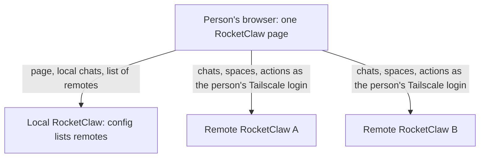
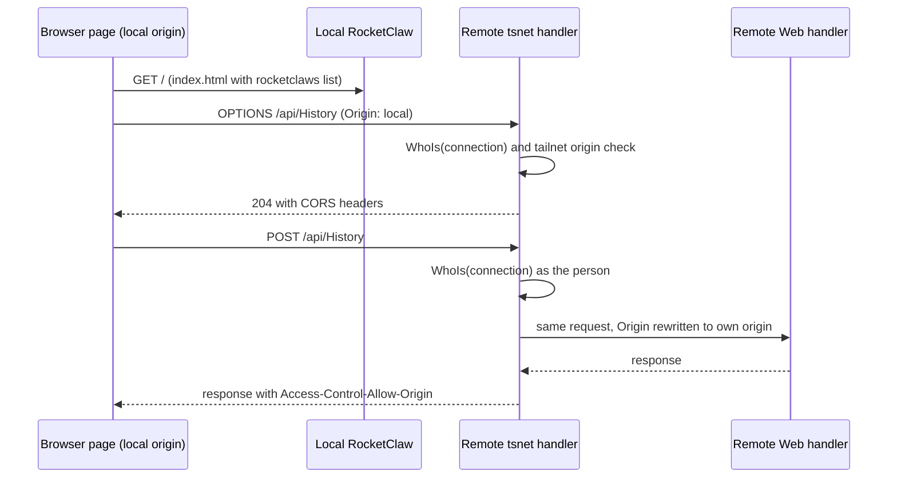
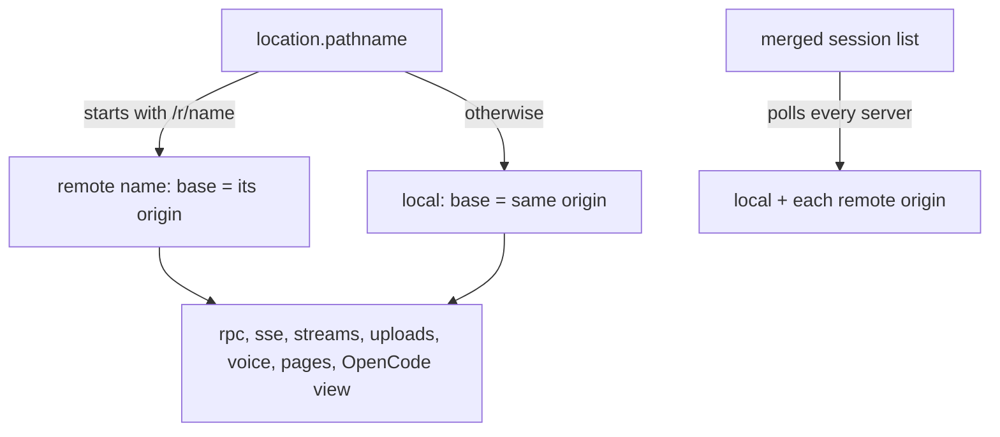

# Remote RocketClaws - Plan

## Goal Capsule

- **Objective:** A person who uses several RocketClaw servers operates every one of them from a single RocketClaw page, as themselves on each server, without switching browser tabs.
- **Means:** The local `rocketclaw.json` declares the remote RocketClaws; the browser talks to each remote's tsnet address directly, the page's URL names the server it is working on, and Tailscale is the only way any server identifies a person (KTD1, KTD3, KTD4).
- **Authority:** Product Contract Requirements win on behavior; Key Technical Decisions win on mechanism within them; units override neither. Root `AGENTS.md` rules bind every unit (no `git`, no subqueries, no nil-as-disabled dependencies, mockery v3, error naming, CLOC budgets never edited, no defensive code). Session-settled Key Decisions are not reopened.
- **Stop conditions:** Stop and report instead of continuing when the Web TS source budget (8250, at 8186 when planned) or the Go source budget (39250) would be exceeded after U4's honest simplification (KTD8); when a remote cannot be driven through the unchanged Web RPCs and a protocol change looks necessary; or when the tsnet node cannot report its tailnet's MagicDNS suffix (KTD3).
- **Execution profile:** Deep. Go config, HTTP, and identity changes first, then the React Web; no proto or migration change; one PR.
- **Finish and ship:** `ce-work` implements and verifies; the `lfg` pipeline reviews, commits, pushes, and opens the PR. Merging stays with the user.
- **Open blockers:** None.

---

## Product Contract

### Summary

A RocketClaw page lists, opens and operates the chats of every remote RocketClaw declared in its own config, with the same features the local server has. The space picker becomes a tree of servers and their spaces, and choosing a space points the whole page at that space's server. The `web_users` option is removed, so every server identifies people only by their Tailscale login.

### Problem Frame

The user runs more than one RocketClaw server, and other people share the remote ones. Each server's Web page knows only its own server, so every server needs its own browser tab. The user keeps alternating between those tabs for four equally common reasons: noticing that a chat finished, starting a chat with an agent that lives on a particular server, checking on running chats, and steering or stopping them. Anything less than full parity with the local page would still send the user back to the other tab.

### Actors

- A1. A person using a RocketClaw page on a device signed in to the tailnet.
- A2. The local RocketClaw: the server whose page the person opened and whose config declares the remotes.
- A3. A remote RocketClaw: a server declared in A2's config, shared by several people, with no config of its own for this feature.

### Key Decisions

- **Full parity with the local page, with no reduced first version.** Governs R13, R15. (session-settled: user-directed — chosen over a first version with remote chats only and no server switching: the user needs to operate a remote as completely as the local server)
- **Every person acts on a remote as themselves.** Governs R3, R15. (session-settled: user-directed — chosen over acting on remotes as the local machine's Tailscale user: other people use the remote servers)
- **The browser talks to each remote directly; no server speaks for a person on another server.** Governs R3, R4. (session-settled: user-directed — chosen over the local server relaying calls and vouching for the person to the remote)
- **Only the local config names remotes; a remote needs no setting.** Governs R1, R4. (session-settled: user-directed — chosen over one shared list on each server and over separate show and accept lists on each server: declaring a remote locally must be enough)
- **Removing `web_users` is part of this work.** Governs R2. (session-settled: user-directed — chosen over a separate change shipped first and over keeping the option: Tailscale becomes the one identity every server shares)
- **The space picker is a tree of servers, then their spaces.** Governs R11, R13.
- **A space holds only its own server's chats.** Governs R12, R13. (session-settled: user-directed — chosen over spaces that hold tabs from any server: the tree always answers which server the page is on)
- **A remote on a different version is operated on a best-effort basis, with a notice.** Governs R18. (session-settled: user-directed — chosen over drawing each remote with its own copy of the web app and over blocking a mismatched remote)

### Requirements

**Configuration and identity**

- R1. An operator declares each remote RocketClaw in the local `rocketclaw.json` by name and address, and nothing is configured on the remote; adding or removing a remote takes effect on restart.
- R2. The `web_users` option is removed together with its validation, documentation and tests, so every server identifies each Web caller only by Tailscale login.
- R3. The browser calls each remote directly, and the remote identifies the person itself.
- R4. Every RocketClaw accepts Web calls from RocketClaw pages served by machines on its own tailnet.
- R5. A remote is usable only when it serves an HTTPS address the browser trusts (its tsnet name) and runs a version with this feature; otherwise the page shows it as unavailable with a notice that names both conditions and the configured address.

**Session list**

- R6. The session list shows the chats of the local server and of every declared remote in one list sorted by recency, and each remote chat shows its server's name.
- R7. Remote chats show running, asking and unread state the same way local chats do, and refresh just as often.
- R8. A remote chat that becomes unread raises the same desktop notification and window-title count a local chat does.
- R9. While a remote cannot be reached from the browser, its last-known chats stay listed, greyed out and unopenable, until it answers again.
- R10. The sidebar filter, the ⌘P palette and Search pages find chats on every server.

**Spaces and server switching**

- R11. The space picker shows each server, local first, with that server's spaces under it.
- R12. Each server keeps each person's tabs, tab groups, current space and Shared Groups for its own spaces, as it does today.
- R13. Choosing a space points the page at that space's server: its tabs, agents, cron, skills, workflows, config, hosted pages, voice settings and new chats.
- R14. Opening a remote chat from the session list or the palette switches to a space on the chat's server: the one already holding its tab, else its Birth Space, else the person's current space on that server.

**Operating a remote**

- R15. Every action the page offers on a local chat or local page also works on a remote one, acting as the person with that remote's agents, permissions and accounts. This includes sending, queueing, steering, stopping, answering questions, files, revert, fork, tags, names, pins, deletion, background jobs, cron runs, voice, and the remote's own OpenCode sessions.
- R16. Voice on a remote chat uses that remote's OpenAI account and its one-live-call-per-person rule.
- R17. Links that RocketClaw hands out, such as the Slack footer's Open in Web, keep pointing at the chat's own server.

**Versions**

- R18. When a remote's protocol differs from the page's, the page keeps operating it, shows a notice beside that server in the tree and in its views, and reports failed actions as errors; a remote upgrade never reloads the page.

### Acceptance Examples

- AE1. **Covers R3, R15.** Given Alice and Bob both use the same local page, when each sends a message in the same remote chat, then the remote records Alice's message as Alice's and Bob's as Bob's.
- AE2. **Covers R14, R13.** Given Alice is in the local space Billing, when she opens a chat on remote A from the session list, then the picker shows remote A and the space holding that chat's tab, and the agents page now lists remote A's agents.
- AE3. **Covers R9.** Given remote A goes offline, when the list next refreshes, then remote A's chats stay listed, greyed out and unopenable; when remote A answers again, they return to normal without a page reload.
- AE4. **Covers R5.** Given a declared remote serves only its self-signed listener, when the page loads, then that remote shows as unavailable with a notice that it must serve its tsnet HTTPS address and run a version with this feature.
- AE5. **Covers R18.** Given remote B is upgraded to a newer protocol, when the person keeps working, then the page does not reload, a version notice appears beside remote B, and an action remote B rejects shows an error.
- AE6. **Covers R2.** Given a browser on the server machine opens `https://127.0.0.1:3000`, when it loads, then it is refused because no Tailscale login identifies it.
- AE7. **Covers R8.** Given a chat on remote A finishes while the person is looking at a local chat, then the person gets a desktop notification and the window-title count rises.

### Scope Boundaries

- Remote chats are never copied into the local database, and local agents, cron, Slack and External MCP never drive or show remote chats.
- A space never holds tabs from another server, and chats never move between servers.
- Remotes are never discovered automatically; only declared remotes appear.
- No per-remote allow-list or trust setting exists on the remote side.
- Access from devices outside the tailnet ends with the removal of `web_users`.
- Rereading the config without a restart is deferred.

### Dependencies / Assumptions

- Every person's devices, the local server and every remote are on the same tailnet.
- Every remote runs tsnet with tailnet HTTPS certificates, as the Voice setup already requires.
- A remote must run a version with this feature before any local page can operate it.

### Outstanding Questions

None open. The planning questions are answered by KTD3 (tailnet page rule), KTD4 (server in the URL), KTD5 (connections and streams), KTD7 (test identity), and KTD4 with U5 (hosted pages and OpenCode routes).

### Sources / Research

- Prior art for remote sessions beside local ones: `docs/plans/2026-10-17-1906-feat-remote-opencode-sessions-plan.md` and `docs/plans/2026-10-22-1105-feat-native-remote-session-view-plan.md`.
- Identity order today, tsnet login then `web_users` then `tailscale whois`, with tagged nodes refused: `internal/rocketclaw/frontend/rpc/server.go:1874-1898`, `:1927`; tsnet handler `internal/rocketclaw/frontend/rpc/http.go:225-240`.
- Every Web request passes `http.NewCrossOriginProtection` with no trusted origins: `internal/rocketclaw/frontend/rpc/http.go:38,177`.
- The page calls only relative same-origin paths: `internal/rocketclaw/web/src/api.ts:10,27`; `internal/rocketclaw/web/src/ui.tsx:540,1932,3857,4146`.
- The session list polls every 2 seconds with a `since` version: `internal/rocketclaw/web/src/ui.tsx:651-688`.
- The page reloads itself when its server's protocol hash changes: `internal/rocketclaw/web/src/ui.tsx:517-531`.
- Desktop notifications fire on `unreadAt` changes; asking only feeds the title count: `internal/rocketclaw/web/src/ui.tsx:1305-1325`.
- Spaces are server-wide; tabs, groups and current space are per person: `internal/rocketclaw/backend/migrations/001_baseline.sql:382-386`, `internal/rocketclaw/backend/migrations/060_web_tab_rows.sql:2-37`.
- The self-signed certificate covers only `localhost`, `127.0.0.1` and `::1`; tsnet uses tailnet certificates: `cmd/rocketclaw/web.go:139-172`, `cmd/rocketclaw/tailnet.go:46`.
- The server writes its display name and Sentry and PostHog settings into `index.html`: `internal/rocketclaw/internal/web/assets.go:57-71`.
- `web_users` lives in `internal/rocketclaw/config/config.go`, `internal/rocketclaw/config/locked.go`, `internal/rocketclaw/frontend/rpc/server.go` and 16 test files, and is documented in `README.md`, `internal/rocketclaw/frontend/rpc/README.md`, `internal/rocketclaw/web/README.md` and `cmd/rocketclaw/CHEATSHEET.md`.
- Go source size is 36,538 of a 39,250-line budget (`internal/rocketclaw/Makefile`, `make cloc`, 2026-10-30).
- Web TS source size is 8,186 of an 8,250-line budget (`internal/rocketclaw/web/Makefile`, `make cloc`, 2026-10-30).

---

## Planning Contract

**Product Contract preservation:** changed: R5, AE4 — the unavailable notice names both conditions together, because a browser cannot tell a remote that refused a call from another site from one it could not reach (failed cross-site calls are opaque by design). Every other requirement, decision, and ID is unchanged.

### Key Technical Decisions

- KTD1. **A `rocketclaws` map in `rocketclaw.json` names each remote and its tsnet HTTPS origin.** It mirrors the `opencode` map: `{"rocketclaws": {"work": {"url": "https://rocketclaw.tail1234.ts.net"}}}`. Names are `a-z`, `0-9`, and `-`, because they appear in page URLs (KTD4). The URL must be an `https` origin with no path. Restart applies changes, as `Runtime.Reload` never rereads the config file. Instantiates the Key Decision "Only the local config names remotes" and covers R1. (session-settled: user-directed — chosen over one shared list on each server and over separate show and accept lists: declaring a remote locally must be enough)
- KTD2. **The page learns the remote list from `index.html`, not from an RPC.** `internal/rocketclaw/internal/web/assets.go` already writes `sentry-config` and `posthog-config` script tags. It adds one `rocketclaws` tag holding `[{name, url}]`, sorted by name. No proto change is needed: every remote call uses the existing Web RPCs on the remote itself. Covers R1, R6, R11.
- KTD3. **The tsnet handler admits pages from its own tailnet and treats them as same-origin.** The handler learns the node's MagicDNS suffix (for example `tail1234.ts.net`) once the node runs, where `serveTailnet` already reads `CertDomains` and sets `cfg.Web.Tsnet.Origin` (`cmd/rocketclaw/tailnet.go:171-184`). The early `StatusWithoutPeers` call in `startTailnet` runs before the node connects, when `CurrentTailnet` can be nil, so it is not used. While the suffix is unknown or empty, no cross-site origin is trusted. A request whose `Origin` is `https` and whose host ends with `.` plus that suffix, or is a Tailscale IP that the node's `WhoIs` resolves, is a trusted tailnet page; the dot boundary keeps `node.xtail1234.ts.net` on another tailnet out. For such a request the handler does four things:
  1. It still signs the caller in by `WhoIs` on the connection, as today.
  2. It answers an `OPTIONS` preflight with `204`, echoing the requested `Access-Control-Request-Method` and `Access-Control-Request-Headers`. A fixed `GET`/`POST` list would block the remote's own OpenCode view, which sends `DELETE`, `PATCH`, and `PUT` with headers such as `x-opencode-directory` through the `/oc/<server>/api/` proxy.
  3. It sets `Access-Control-Allow-Origin` to that origin, plus `Vary: Origin`, on every response.
  4. It rewrites the request's `Origin` to its own origin and `Sec-Fetch-Site` to `same-origin` before calling the inner handler.

  Step 4 keeps every existing same-origin check working unchanged: `CrossOriginProtection` in `http.go`, the `viewing` rule of `ListSessions`, and the OpenCode proxy's own origin check in `relay.go`. The plain listener never trusts another origin, which is why R5 requires the tsnet address. No credentials mode is involved, because identity is the connection. Instantiates the Key Decisions "The browser talks to each remote directly" and "Only the local config names remotes", and covers R3, R4, R5. (session-settled: user-directed — chosen over the local server relaying calls and vouching for the person to the remote)
- KTD4. **The page's URL names the server it works on.** The local server keeps today's paths. A remote's paths are the same paths under `/r/<name>`, so `/r/work/s/<id>` is chat `<id>` on remote `work`. `internal/rocketclaw/web/src/navigation.tsx` owns the rule:
  - `usePathname` returns the path without the prefix.
  - `navigate` keeps the current prefix unless the caller names another server.
  - `Link` renders its `href` through the same prefix rule, so Cmd-click, middle-click and copied links stay on the page's server.
  - One `server()` helper returns the current remote, or none for local.

  `rpc`, `sse`, the `/stream` `EventSource`, uploads, downloads, `Voice`, hosted page frames, and the OpenCode view base their URLs on that remote's origin. The query client hashes the server into every query key. Because a space holds only its own server's chats (R12), everything on screen belongs to the URL's server except the merged session list (KTD5). The Go app route list in `assets.go` serves `/r/...` paths. Remote tab paths stay stored on the remote in their own unprefixed form. Covers R12, R13, R14, R15, R17.
- KTD5. **The merged session list polls each server on its own schedule and merges the rows by recency.** Each server keeps its own `since` version and its own owner check. The `viewing` parameter goes only to the server that owns the viewed chat, so opening a remote chat clears its unread mark on that remote. Rows carry their server name in a field of their own, because the row's existing `server` field already marks remote OpenCode rows in about ten places. A merged row's identity is its server name plus its chat ID: the merge, the unread and notification map, the `byId` maps, and the saved-sessions and composer-draft caches in IndexedDB all key on that pair. Non-Web chat IDs are built from shared inputs (`opencode:<name>:<sessionID>`, `slack:<channel>:<ts>`), so two servers can list the same ID. A server whose poll fails keeps its last rows, greyed out and unopenable, using the presentation remote OpenCode sessions already use for `offline`. Desktop notifications and the title count keep reading `unreadAt` and `asking` from the merged rows. They check each row against its own server's open tabs, Shared tabs and mutes (`TabNotifications`, `ui.tsx:1298-1325`), so each server's `Tabs` is fetched beside its session poll, and a row's unprefixed path is compared with that server's stored paths. Each remote has its own HTTP/2 connection, so the connection budget is per origin (`docs/solutions/architecture-patterns/web-keep-alive-views-connection-budget.md`). Covers R6, R7, R8, R9, R10.
- KTD6. **A changed local protocol still reloads the page; a remote's different protocol shows a notice.** `ProtocolGuard` keeps watching the local server. Each remote's `Protocol` hash is compared with the local one. A difference shows the version notice beside that server in the space tree and in its views, and never reloads. Covers R18. (session-settled: user-directed — chosen over drawing each remote with its own copy of the web app and over blocking a mismatched remote)
- KTD7. **Tests identify alice and bob through a fake `tailscale` executable, not `web_users`.** Package `rpc` installs the fake once in a `TestMain` with `os.Setenv`, prepending it to `PATH` and answering `whois --json <ip>` from one fixed table (127.0.0.1, 192.0.2.1 and 192.0.2.10 → alice; 192.0.2.2 and 192.0.2.3 → bob). Per-test `t.Setenv` is not used, because `runWebTest` calls `t.Parallel()` in CI mode and tests still need `bun` on `PATH`. Tests that need an unknown caller use an address outside the table, such as 192.0.2.99. `cmd/rocketclaw/web_test.go` cannot import `rpc` test helpers, so its two Web tests put a local fake `tailscale` on `PATH` that answers `whois --json 127.0.0.1` with alice. Production identity code keeps one path: tsnet login, else `tailscale whois`. Covers R2.
- KTD8. **The TS budget is a hard limit, and room comes before features.** Only 64 TS lines remain. U4 frees room by simplifying existing Web code with no loss of behavior, measured with `make cloc`, before U5 to U7 add code. If the remote Web work cannot fit after that, implementation stops and reports the budget conflict. `TS_CLOC_BUDGET` is never edited, and no code moves into excluded paths. The Go side has about 2,700 lines of room.
- KTD9. **`SessionApp` and `CommandPalette` sit at the react-doctor complexity limit.** New branching goes into small module functions or hooks, which react-doctor's rules take precedence for (`docs/solutions/best-practices/react-doctor-complexity-limit-shapes-web-components.md`).

### High-Level Technical Design

Request path from the page to a remote:

What decides the server in the page:

### Assumptions

- Every search surface R10 names queries every reachable server and merges the matches, through the one shared search path (U6).
- The space tree lists a remote's spaces from its `Tabs` RPC, fetched when the picker opens.
- A new chat started from a space starts on that space's server, through that server's `CreateSession`.

### Risks

- `ts.net` is on the Public Suffix List, so two RocketClaws on one tailnet are same-site but different origins. The browser therefore sends `Origin` and fetch metadata on every call, which is what KTD3's rule reads.
- Chrome's Local Network Access rules may treat a call from one tailnet address to another as a private-network request. Both ends sit in the same private range, which should need no prompt, but this has not been checked in a real browser. U5's browser test must run the two-server path in Chromium and record what Chrome does.
- The OpenCode relay copies upstream response headers with `Add`. If an OpenCode server sends its own `Access-Control-Allow-Origin`, a remote OpenCode response could carry two values and the browser would reject it. U3 sets the tailnet CORS header so that it replaces, not adds to, any upstream value.
- Remotes usually run a different build, so a protocol difference is a normal, lasting state rather than an upgrade moment (KTD6).

### Sequencing

U1, U2, and U3 are Go-only and can land in any order. U3 and U4 must finish before U5. U5 comes before U6 and U7, and U8 comes last.

---

## Implementation Units

### U1. Remove `web_users`

- **Goal:** Every server identifies Web callers only by tsnet login or `tailscale whois`.
- **Requirements:** R2, AE6.
- **Dependencies:** None.
- **Files:**
  - `internal/rocketclaw/config/config.go`, `internal/rocketclaw/config/config_test.go`
  - `internal/rocketclaw/config/locked.go`, `internal/rocketclaw/config/locked_test.go`
  - `internal/rocketclaw/frontend/rpc/server.go` (`usernames`, `principal`)
  - `internal/rocketclaw/frontend/rpc/*_test.go` that set `WebUsers`, and `cmd/rocketclaw/web_test.go`
  - one shared fake-`tailscale` test helper beside `testSocketPath` in `internal/rocketclaw/frontend/rpc`
- **Approach:**
  1. Delete the `WebUsers` field, its validation, its clone in `locked.go`, and `Server.usernames`.
  2. `principal` keeps the tsnet branch and the `tailscaleUsername` branch only.
  3. Replace every `WebUsers` fixture with the helper from KTD7. Tests that assert a username keep asserting it, now as the fake login.
  4. Delete `TestLoadWebUsers`. Do not add a test that rejects a leftover `web_users` key; normal decoding ignores it (root `AGENTS.md`).
  5. Rewrite `TestBrowserIdentityIgnoresHeaders` so the `mapped` case signs in through the fake `tailscale` table, and the `unmapped` case finds no login.
- **Patterns to follow:** `TestTailnetIdentity` in `internal/rocketclaw/frontend/rpc/server_test.go` (fake `tailscale` script), installed once per package per KTD7.
- **Test scenarios:**
  - Covers AE6. A loopback caller with no `tailscale` answer gets `401` on `Identity` and on a mutation; `Protocol` still answers.
  - A caller whose IP the fake `tailscale` maps to `alice@example.com` gets `Identity.username` `alice@example.com`.
  - A fake answer for a tagged node is refused with `401`.
  - Forwarding and `Tailscale-User-*` headers never choose the user.
  - Every existing behavior test that used `127.0.0.1 → alice` passes unchanged in its assertions.
- **Verification:** No `WebUsers` or `web_users` remains in Go source, tests, or docs (U8 handles docs). The rpc and config packages pass.

### U2. Declare remote RocketClaws and hand them to the page

- **Goal:** The local config names remotes, and the served page carries their list.
- **Requirements:** R1, R11.
- **Dependencies:** None.
- **Files:**
  - `internal/rocketclaw/config/config.go`, `internal/rocketclaw/config/config_test.go`
  - `internal/rocketclaw/internal/web/assets.go` and its test
  - `internal/rocketclaw/frontend/rpc/http.go` (`NewHTTPHandler` signature)
  - `cmd/rocketclaw/web.go`, and test call sites of `NewHTTPHandler`
- **Approach:**
  1. Add `RocketClaws map[string]RemoteRocketClawConfig` with `URL`, beside `OpenCode` (KTD1).
  2. Validation: names match `^[a-z0-9-]+$`, and each URL parses as `https` with a host and no path, query, or fragment. A bad entry fails startup with the entry's name.
  3. `web.Handler` adds the `rocketclaws` script tag only when the map is non-empty (KTD2).
  4. Add `/r/` to the app route prefixes in `assets.go` (KTD4).
- **Patterns to follow:** `OpenCodeConfig` in `config.go`; `sentry-config` injection in `assets.go`.
- **Test scenarios:**
  - A config with `work` → `https://rocketclaw.tail1234.ts.net` loads, and the page carries `[{"name":"work","url":"https://rocketclaw.tail1234.ts.net"}]`.
  - A name with uppercase or `/`, an `http` URL, and a URL with a path are each rejected, naming the entry.
  - With no remotes, the page has no `rocketclaws` tag.
  - `GET /r/work/s/abc` serves the app.
- **Verification:** Config and asset tests pass, and the page source shows the tag.

### U3. Accept Web calls from same-tailnet pages

- **Goal:** A remote's tsnet listener serves the local page's cross-site calls as the person on the connection.
- **Requirements:** R3, R4, R5, AE1.
- **Dependencies:** None.
- **Files:**
  - `internal/rocketclaw/frontend/rpc/http.go` (`NewTailnetHandler`)
  - `cmd/rocketclaw/tailnet.go` (hand the handler the MagicDNS suffix from `serveTailnet` once the node runs)
  - `internal/rocketclaw/frontend/rpc/http_test.go` or `server_test.go`
  - `internal/rocketclaw/frontend/rpc/relay_test.go`
- **Approach:**
  1. `NewTailnetHandler` gains the suffix. It applies KTD3's trust rule after its existing `WhoIs` sign-in.
  2. For a trusted page it answers preflight, adds the CORS headers, and rewrites `Origin` and `Sec-Fetch-Site`.
  3. An untrusted cross-site request passes through untouched, so `CrossOriginProtection` still refuses its mutations.
  4. The MCP-bridge bypass stays first and unchanged.
- **Patterns to follow:** `TestTailnetHandlerPassesOpenCodeMCP` with the generated `mockTailnetWhoIs`.
- **Test scenarios:**
  - Covers AE1. Two callers whose `WhoIs` answers alice and bob each `POST /api/Identity` with `Origin: https://local.tail1234.ts.net`, and each gets their own username plus `Access-Control-Allow-Origin: https://local.tail1234.ts.net`.
  - `OPTIONS /api/Prompt` from that origin returns `204` with the allowed method and header.
  - `OPTIONS /oc/<server>/api/session/<id>` from that origin, requesting `DELETE` and `x-opencode-directory`, returns `204` with both allowed.
  - The same `POST` from `Origin: https://evil.example` gets no CORS header, and a mutation is refused `403` by `CrossOriginProtection`.
  - An `http://local.tail1234.ts.net` origin is not trusted.
  - With suffix `tail1234.ts.net`, the origin `https://node.xtail1234.ts.net` is not trusted.
  - Before the suffix is known, or with an empty suffix, a `POST` from `Origin: https://evil.example` gets no CORS header and is refused with `403`.
  - A trusted `GET /api/ListSessions?viewing=<id>` clears that chat's unread mark, which shows the rewrite reaches the `viewing` rule.
  - A trusted request to `/oc/<server>/api/...` passes the relay's origin check.
  - A tagged or unknown caller is still refused before any CORS handling.
- **Verification:** Handler tests pass; the plain listener's behavior is unchanged (existing `http_test.go` cases).

### U4. Make room in the Web TS budget

- **Goal:** Enough TS budget for U5 to U7 without losing any Web behavior.
- **Requirements:** Constraint for R6 to R18 (KTD8).
- **Dependencies:** None.
- **Files:** Existing sources under `internal/rocketclaw/web/src/`, chosen by the implementer from measured duplication. Their existing tests stay unchanged in behavior.
- **Approach:**
  1. Measure with `make cloc` in `internal/rocketclaw/web`.
  2. Collapse duplicated control flow, inline one-use helpers react-doctor does not need, and merge parallel state paths.
  3. Remove no feature, user-visible behavior, or test of current behavior.
  4. Before simplifying, size U5 to U7 from their file lists: the routing prefix, per-origin URLs, the query-key server, both notices, per-server polling and merge, search fan-out, and the space tree. The working estimate is about 150 lines; replace it with the measured sketch and free at least that much.
  5. If that is not reachable honestly, stop the run here, before any U5 code exists, and report the numbers.
- **Execution note:** Characterize before simplifying: the existing browser and unit tests must pass before and after each simplification.
- **Test expectation:** none -- behavior-preserving refactor; the existing Web test suite is the proof.
- **Verification:** `make cloc` shows the freed room; `make lint` and `make test` in `internal/rocketclaw/web` pass with no test edits.

### U5. Server-scoped navigation, API base, and version notice

- **Goal:** A page under `/r/<name>/` works entirely against that remote, and a version difference shows a notice instead of a reload.
- **Requirements:** R5, R12, R13, R15, R16, R17, R18, AE4, AE5.
- **Dependencies:** U2, U3, U4.
- **Files:**
  - `internal/rocketclaw/web/src/navigation.tsx`
  - `internal/rocketclaw/web/src/api.ts`
  - `internal/rocketclaw/web/src/ui.tsx`: the `/stream` `EventSource`, upload and download URLs, `HostedPage`, `RemoteSession`, `ProtocolGuard`, and the raw `location.pathname` uses
  - `internal/rocketclaw/web/src/voice.ts`
  - tests in `internal/rocketclaw/web/src/api.test.ts`, a new `internal/rocketclaw/web/src/remote-transport.test.ts`, the Go test in `internal/rocketclaw/frontend/rpc` that starts it through `runWebTest`, and that test's name in the Web `Makefile` `-run` list
- **Approach:**
  1. Implement KTD4 in `navigation.tsx` and read the `rocketclaws` tag once.
  2. `rpc` and `sse` prefix the current server's origin.
  3. The query client's key hash includes the server.
  4. Replace raw `location.pathname` reads with the stripped path.
  5. `ProtocolGuard` follows KTD6.
  6. A remote that has never answered since page load is unavailable: it shows the R5 notice beside its server in the space tree and in place of any `/r/<name>/` view. A remote that answered before and now fails is offline per R9: greyed rows and no R5 notice, back to normal on its next answer.
- **Patterns to follow:** `RemoteSession` for another server's view; `sentry.ts` for reading an injected config tag.
- **Test scenarios:**
  - Under `/r/work/s/<id>`, `rpc("History")` calls `https://…work…/api/History`; under `/s/<id>` it calls `/api/History`.
  - `navigate("/agents")` from `/r/work/s/x` lands on `/r/work/agents`.
  - Query caches for `History` of the same ID on two servers do not collide.
  - Covers AE5. A remote whose `Protocol` hash differs from the local one shows the notice and does not reload; a local hash change still reloads.
  - Covers AE4. A remote whose `Protocol` call has never succeeded shows the unavailable notice naming its address.
  - A remote that answered and then fails shows no unavailable notice.
  - Transport test (`remote-transport.test.ts`, started by a Go test): two Go fixtures served by `httptest.NewTLSServer` under host names ending in a test suffix, mapped to 127.0.0.1 with Chromium's `--host-resolver-rules` and opened with `ignoreHTTPSErrors`. The remote is wrapped in `NewTailnetHandler` with the generated `mockTailnetWhoIs` and that suffix, and serves a chat. The run records whether Chrome's Local Network Access rules interfere. The local page opens `/r/<name>/s/<id>`, sends a prompt, and sees the reply.
- **Verification:** Unit and browser tests pass; no relative `/api` URL remains outside `api.ts`.

### U6. Merged session list across servers

- **Goal:** One session list, search, and notification stream for every server.
- **Requirements:** R6, R7, R8, R9, R10, AE3, AE7.
- **Dependencies:** U5.
- **Files:**
  - `internal/rocketclaw/web/src/ui.tsx` (`SidebarOwner`, `TabNotifications`, `SessionRowContent`, search pages)
  - `internal/rocketclaw/web/src/session-list.ts`, `internal/rocketclaw/web/src/session-list.test.ts`
  - `internal/rocketclaw/web/src/session-list.browser.test.ts`
- **Approach:**
  1. Poll each server per KTD5, merging rows by `updatedAt`.
  2. The saved-sessions cache keeps the merged rows.
  3. Remote rows show their server name and open `/r/<name>` followed by the row's own `rowPath`: `/s/<id>` for chats, `/oc/<id>` for the remote's own OpenCode sessions.
  4. Unreachable servers grey their last rows.
  5. The shared search path, `useSessionSearch` and the `searchMessages` query, fans out `SearchSessions` and `SearchMessages` to every reachable server and merges the results. That path feeds the sidebar filter, the ⌘P palette, and Search pages alike.
- **Patterns to follow:** The `REMOTE_OPENCODE` row label and `offline` presentation; `mergeSessionRows` in `session-list.ts`.
- **Test scenarios:**
  - Rows from local and `work` interleave by `updatedAt`, and `work` rows carry its label.
  - Covers AE3. A failing `work` poll keeps its rows greyed and unopenable, and a later success restores them without reload.
  - Covers AE7. A `work` row's `unreadAt` change raises a desktop notification while a local chat is open.
  - Opening a `work` chat sends `viewing` only to `work`.
  - A search query matches a chat that exists only on `work`, on a Search page and as a ⌘P filter query such as `tag:`.
  - A `work` chat open in a `work` tab notifies while a local chat is shown; the same chat in a muted `work` tab does not.
  - A `work` `REMOTE_OPENCODE` row opens `/r/work/oc/<id>`.
  - Local and `work` both list `opencode:box:ses_a`, and both rows appear with their own unread state.
  - Browser test: deleting a `work` OpenCode session from the local page succeeds.
- **Verification:** Unit and browser tests pass, and react-doctor reports no new findings.

### U7. Space tree and server switching

- **Goal:** The space picker is a server-then-spaces tree, and opening a remote chat lands in a space on its server.
- **Requirements:** R11, R12, R13, R14, AE2.
- **Dependencies:** U5, U6.
- **Files:**
  - `internal/rocketclaw/web/src/ui.tsx` (`SpaceMenu`, `useTabs`, `CommandPalette`, new-chat path)
  - `internal/rocketclaw/web/src/tabs.browser.test.ts`
- **Approach:**
  1. The picker lists the local server first, then each remote, each with the spaces its `Tabs` RPC returns.
  2. Choosing a remote space navigates under `/r/<name>/` and enters that space through that server's `Tabs` state.
  3. Opening a remote chat relies on the existing tab-opening rules (existing tab, else Birth Space), now running on that server.
  4. Tab state and its save queue belong to one server. `useTabs` builds its state once and keeps a saved-revision record, neither keyed by server, and one person usually has the same login on every server. So a change of the URL's server starts a fresh tab state, for example a component keyed by server, that loads like a first load from that server's `Tabs`. Until it answers, the tab strip and picker show today's loading state.
  5. The space tree stays usable whenever the local server knows the person, even when the current remote cannot be reached. Under an unreachable remote, the main view shows a status line in the style of the OpenCode offline message (`ui.tsx:2446`): "<name> is offline; this page reopens when it is reachable".
  6. Each remote branch shows a loading line until its `Tabs` call answers. A failed call shows the branch as offline, or with the R5 notice per U5. A version difference shows the R18 notice beside the server name. The closed picker shows "<server> / <space>" whenever the page is on a remote.
- **Patterns to follow:** The existing `SpaceMenu` and tab-opening rules in `useTabs`.
- **Test scenarios:**
  - The picker shows local spaces under the local name and `work`'s spaces under `work`.
  - Covers AE2. From local space Billing, opening a `work` chat shows `work` and the space holding its tab, and the agents page lists `work`'s agents.
  - A chat with no tab on `work` opens in its Birth Space there.
  - A new chat from a `work` space is created on `work`.
  - Switching from local Billing to a `work` space leaves local's saved tabs unchanged and shows only `work`'s tabs.
  - With `work` stopped while a `work` chat is open, the person can still choose a local space from the tree.
  - Choosing a `work` chat from the ⌘P palette lands in a `work` space per R14; arrowing over a `work` row from a local space does not leave the local server, keeping the palette's rule that browsing never switches spaces.
- **Verification:** Browser tests pass, and react-doctor reports no new findings.

### U8. Documentation

- **Goal:** Docs describe Tailscale-only identity and remote RocketClaws.
- **Requirements:** R1, R2, R4, R5.
- **Dependencies:** U1 to U7.
- **Files:** `README.md`, `cmd/rocketclaw/CHEATSHEET.md`, `internal/rocketclaw/frontend/rpc/README.md`, `internal/rocketclaw/web/README.md`.
- **Approach:**
  1. Remove every `web_users` instruction, including the `127.0.0.1` mapping advice and the principal paragraph that says a `web_users` mapping supplies both name and email (`README.md` "Agents and permissions").
  2. Add a short "Remote RocketClaws" section: the `rocketclaws` config, the tsnet requirement on remotes, and restart behavior.
  3. Describe the tailnet page rule in the transport README's identity boundary.
- **Test expectation:** none -- documentation only.
- **Verification:** `rg -i web_users` finds no current-behavior docs; the new section matches the shipped config shape.

---

## Verification Contract

| Gate | Command | Applies to |
|---|---|---|
| Go format | `gofmt -l` on touched Go files prints nothing | U1-U3 |
| Go tests | `go test ./...` from the repo root, with `TMPDIR` under the main checkout's `.tmp/t` (`docs/solutions/best-practices/frontend-rpc-tests-need-setup-in-fresh-jj-workspaces.md`) | U1-U3, U5-U7 |
| Repo lint | `make lint` from the repo root | all |
| Repo tests and budgets | `make test` from the repo root, which runs the CLOC budget checks | all |
| Web lint | `make lint` in `internal/rocketclaw/web` (Biome, `tsc`, react-doctor) | U4-U7 |
| Web tests | `make test` in `internal/rocketclaw/web`, after `bun run build` so browser tests use the new bundle (`docs/solutions/best-practices/web-browser-tests-run-the-last-bundle-that-built.md`) | U4-U7 |
| Web budget | `make cloc` in `internal/rocketclaw/web` stays under 8250 | U4-U7 |

## Definition of Done

- Every requirement R1-R18 and every acceptance example AE1-AE7 has a passing test or, for R17, a documented unchanged behavior.
- No `WebUsers` or `web_users` remains in source, tests, or current docs.
- Go and TS source stay under their budgets, and neither budget value changed.
- `gofmt`, `go test ./...`, root `make lint` and `make test`, and the Web `make lint` and `make test` all pass.
- README impact is handled by U8.
- No abandoned-attempt code, debug output, or unused helpers remain in the diff.
