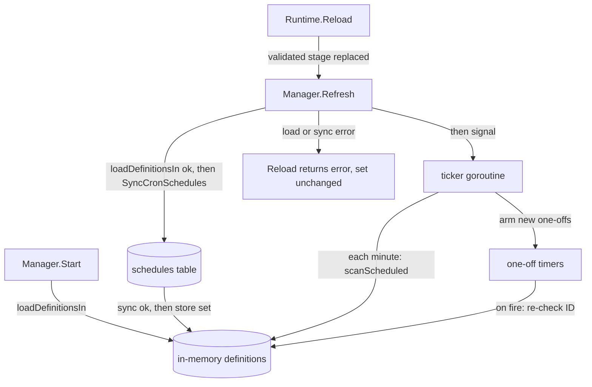
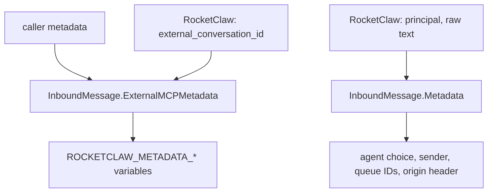

# Easy Mode Follow-Ups - Plan

## Goal Capsule

- **Objective:** After this PR, no tool advertises a field it cannot serve, an External MCP caller cannot steer RocketClaw's internal routing through its metadata, existing External MCP chats keep their `ROCKETCLAW_METADATA_*` variables through the upgrade, apart from the leaked raw-text variable (R7), the cron scheduler only runs definitions that startup or a reload validated, and a routine can no longer be given a one-time schedule that would silently fire again after 90 days.
- **Means:** Four separate fixes in one PR: a base `rocketclaw_store` plus a native wrapper (KTD1), a separate inbound field for External MCP caller metadata with migration NNN (next free; 080 today) (KTD2, KTD3), cron definitions held in memory and refreshed by reload (KTD4), and a loader check that rejects timestamp routines (KTD5).
- **Authority:** origin spec decisions D1–D4, then the Key Decisions and labeled KTDs here, then the unlabeled KTDs, then unit text. A unit never overrides an R or a KTD.
- **Stop conditions:**
  - The Go source CLOC budget (`GO_SOURCE_CLOC_BUDGET` in `internal/rocketclaw/Makefile`, 41750) cannot be met: stop and report. Never edit it.
  - Evidence that a session-settled decision cannot work: stop and report instead of choosing another design.
  - Migration NNN cannot keep every stored External MCP message's variables (R9): stop and report.
- **Execution profile:** one PR, four commits in this order (KTD6): D1 (U1), D2 (U2 and U3 together), D3 (U4), D4 (U5). Docs ride in the commit whose behavior they describe. Each fix starts with a test that fails before the fix.
- **Who finishes:** `ce-work` implements and verifies locally. Shipping and merging are the caller's call.

---

## Product Contract

### Summary

Fix the four loose ends easy mode (PR #822) left. The OpenCode MCP bridge serves a page store tool without `source` and stops editing the shared tool. External MCP caller metadata moves to its own inbound field, and migration NNN (next free; 080 today) moves stored rows over with their variables intact. The cron manager loads definitions at startup and after a successful reload, never on its minute tick. Routines accept repeating schedules only.

### Problem Frame

Each problem predates or was exposed by #822.
The bridge serves `rocketclaw_store` with a nil workspace root and patches the shared tool's schema and description to hide `source`.
External MCP callers write free-form metadata into the same map RocketClaw reads for internal routing (`rocketclaw_agent`, sender keys, `web_message_id`), guarded only by a six-key delete list.
The cron manager re-reads every agent and cron file each minute, so a hand edit inside `.rocketclaw/` can stop every schedule until fixed, and a bad shadow logs a warning every minute.
A timestamp routine's only "already ran" mark is a run record that retention deletes after 90 days (`internal/rocketclaw/backend/app.go:29`), so it would fire again.

Easy mode as the default, and moving the bundled `main` agent to easy mode, is out of scope (see origin: `docs/specs/2026-10-31-easy-mode-follow-ups-design.md`).

### Requirements

**Page store (D1)**

- R1. The `rocketclaw_store` tool every caller gets by default accepts `path`, `content`, `content_base64` and `content_type`, and neither its schema nor its description mentions `source`.
- R2. Native agent sessions keep `source` with today's behavior: advanced agents read from the workspace, easy agents only through their file view.
- R3. The OpenCode MCP bridge serves the default tool unchanged, with no schema trimming, description rewrite or nil workspace root.

**External MCP caller metadata (D2)**

- R4. An External MCP caller's metadata never enters `InboundMessage.Metadata`, so it cannot change the agent a turn runs as, its sender, or any other key RocketClaw reads there.
- R5. `ROCKETCLAW_METADATA_*` variables are built only from the caller metadata field, with today's naming rule.
- R6. `ROCKETCLAW_METADATA_EXTERNAL_CONVERSATION_ID` keeps appearing, set by RocketClaw and not overridable by the caller.
- R7. The `rocketclaw_raw_text` RocketClaw keeps in `Metadata` never becomes a variable.
- R8. The six-key delete list in `cmd/rocketclaw/mcp.go` and the skip list in `externalMCPMetadataEnv` are deleted.

**Upgrade (D2 migration)**

- R9. After migration NNN, every stored External MCP inbound yields the same `ROCKETCLAW_METADATA_*` variables it yielded before, apart from `ROCKETCLAW_METADATA_ROCKETCLAW_RAW_TEXT` (R7).
- R10. The migration moves caller keys planted in already stored rows out of `Metadata`, except the keys KTD3 leaves there: `rocketclaw_origin`, `rocketclaw_media`, `rocketclaw_principal`, `rocketclaw_principal_name`, `rocketclaw_principal_email` and `source`. It removes `rocketclaw_raw_text` from those rows instead of moving it (KTD3).
- R11. The down migration merges the field back into `Metadata`, skipping the keys the older binary deleted from caller input.

**Cron scheduling (D3)**

- R12. The cron manager loads definitions at `Start` and after each successful reload, and its minute tick reads no definition files.
- R13. A failed load or schedule sync at reload leaves the running set unchanged; the reload itself reports the failure.
- R14. A one-off cron file added by a reload is armed by that refresh and fires once; the timer re-checks the in-memory set when it fires.
- R15. A hand edit inside `.rocketclaw/` no longer changes what the scheduler runs; the next reload rebuilds `.rocketclaw/` from the workspace sources and the scheduler runs that result.

**Routines (D4)**

- R16. A timestamp schedule in `routines` fails loading at startup, reload and `rocketclaw lint`, with a message saying routines repeat and pointing at `rocketclaw_schedule_message` for a single future run.
- R17. Repeating routines, timestamp cron files and the Cron page's Run button behave as today.
- R18. Docs no longer promise that a routine's one-off time fires once.

### Key Decisions

- **Routines repeat; one-time runs use `rocketclaw_schedule_message`.** A routine is a line in an agent file RocketClaw never edits, so it cannot mark itself done, and nobody depends on timestamp routines yet. (session-settled: user-directed — chosen over a lasting "fired" table in a new migration, skipping past-due one-offs, and leaving it: a routine can't delete itself, and nobody depends on timestamp routines yet.) Governs R16, R17, R18.
- **Easy mode as the default is out of scope.** `main` manages `agents/`, `cron/`, `skills/` and `rocketclaw.json`, which easy agents cannot touch, so it needs its own design.

### Scope Boundaries

- The Cron page's job list (`Manager.Jobs`) and the Run button (`Manager.LoadOneOffCronjob`) keep reading files; only the scheduler moves to the in-memory set (Assumption A2).
- No rejection of a stray `source` argument at the bridge. The base tool ignores it like any unknown field (Assumption A7).
- Not built: a guard against a downgrade re-exposing caller keys. The down migration merges caller keys back into `Metadata` because the older binary reads them there, skipping the six keys that binary deleted from caller input (KTD3). That re-opens R4 on downgrade by design, back to the older binary's own guard. A removed `rocketclaw_raw_text` is not restored.
- Not built: a "fired" record for routines (rejected under the D4 Key Decision).

#### Deferred to Follow-Up Work

- Making easy mode the default and moving the bundled `main` agent to it.

---

## Planning Contract

### Key Technical Decisions

- KTD1. **Base page store without `source`; native sessions wrap it.** `pageTools` drops its `root` and `shell` parameters and builds a `rocketclaw_store` that turns `content` or `content_base64` into a page through the existing `outboundAttachment` path with no file path. A function in `internal/rocketclaw/backend/page_tools.go` wraps that tool for native sessions. It adds the `source` property and one description sentence. When `source` is set and both content fields are empty, it reads the file through `outboundAttachment(root, shell, …)` and stores the bytes it read through the base tool's store-and-URL step directly (a closure or small shared put inside `pageTools`). It does not re-enter the base tool with `content_base64`, because an empty workspace file stores an empty page today and the base tool would refuse it with "has no content or path". That keeps today's order, where content wins over a path. `bridge.go` swaps the store entry for the wrapped one. The OpenCode bridge serves `pageTools` output unchanged and loses its schema trimming, description rewrite and the `source` refusal in `callOpenCodeTool`. The wrapper is a named function, not inline code in the turn builder, because `TestPageStoreReadsEasyFileView` must reach it without running a turn. Covers R1–R3. (session-settled: user-directed — chosen over refusing `source` at the bridge, giving the bridge a real workspace root, and leaving it: never expose a field that trips the caller.)
  - Conflict call-out (workable): on `main` (834fae8e) `callOpenCodeTool` already refuses any call carrying `source` before it reaches the nil root (`internal/rocketclaw/backend/opencode_mcp.go`, the `Source` check before the session lookup), so the nil-root panic the spec describes is not reachable today. The decision stands, since the bridge still advertises a patched copy of a shared tool. The refusal is deleted with the trimming. The test that fails before the fix is the base tool's schema test (U1), because the bridge schema already hides `source` today.
- KTD2. **`protocol.InboundMessage.ExternalMCPMetadata` holds caller metadata.** It is a `map[string]string` stored under Go's default JSON name, beside `Metadata`. `submitExternalMCPInput` clones the caller map into it and then sets `external_conversation_id` there, overwriting any caller value as it does today. `Metadata` keeps only what `NewInboundMessageFromContent` and RocketClaw set, including `rocketclaw_principal`. `turnShellEnv` builds both its stored-metadata fallback and its per-turn extra variables from `origin.ExternalMCPMetadata`. `externalMCPMetadataEnv` keeps its signature and loses its key switch. Covers R4–R8. (session-settled: user-directed — chosen over dropping every `rocketclaw_*` key and extending the delete list: caller keys must never collide with internal keys.)
  - Conflict call-out (workable): deleting the skip list means a caller key named `rocketclaw_origin`, `rocketclaw_media`, `rocketclaw_principal`, `rocketclaw_principal_name`, `rocketclaw_principal_email`, `rocketclaw_sender_agent` or `source` now becomes a variable, for example `ROCKETCLAW_METADATA_ROCKETCLAW_PRINCIPAL`. Today those never do. "Identical variables" holds for any caller metadata without those seven names. The values were caller-controlled anyway, and the prefix keeps them apart from trusted variables.
  - Conflict call-out (workable): today a Web or other non-External-MCP turn in an External MCP chat gets extra variables made from its own internal `Metadata`, such as `ROCKETCLAW_METADATA_WEB_MESSAGE_ID`. After the change it gets none, because its `ExternalMCPMetadata` is empty. This is the same leak class as `rocketclaw_raw_text` (R7) and is treated as part of the fix.
  - Side effect: External MCP inbounds now keep the `rocketclaw_raw_text` that `NewInboundMessageFromContent` sets, because `Metadata` is no longer replaced by the caller's map. The Web's queue display and edit paths read it as they do for every other source. Stored External MCP rows lose theirs in the migration (KTD3), and their queue paths fall back to the row's message or content columns.
- KTD3. **Migration NNN (next free; 080 today) rewrites stored External MCP inbounds, using CTEs only.** For every stored inbound whose `Source` is `external_mcp`, it removes `rocketclaw_raw_text` from `Metadata` (it is not moved), and moves into `ExternalMCPMetadata` every other `Metadata` key except the kept list: `rocketclaw_origin`, `rocketclaw_media`, `rocketclaw_principal`, `rocketclaw_principal_name`, `rocketclaw_principal_email` and `source`. In practice `Metadata` then holds only `rocketclaw_principal` and `source`, plus any other kept-list key a row carried. The kept-pairs aggregate is wrapped in `COALESCE(…, '{}')`, so a row whose every key moves stores `{}`, not `null`. It covers `turns.inbound_json`, `shadow_turns.inbound_json` and `conversations.producer_inbound_json`, plus the journaled steers in `steps.value` under keys ending in `/steers`, which hold `[{"id", "inbound"}]` arrays (written by `saveSteersLocked` in `bridge.go`). It touches only rows that have a key to move or remove. The down migration selects rows by the presence of `ExternalMCPMetadata`, not by `Metadata`'s type. It merges `ExternalMCPMetadata` into `Metadata`, skipping `rocketclaw_origin`, `rocketclaw_media`, `rocketclaw_principal`, `rocketclaw_principal_name`, `rocketclaw_principal_email` and `rocketclaw_sender_agent` (the older binary's input delete list), with `Metadata` winning on other clashes, wraps the merge in `COALESCE(…, '{}')`, and drops the field. It cannot restore a removed `rocketclaw_raw_text`. Covers R9–R11. (session-settled: user-directed — chosen over accepting a one-time loss of variables for queued items: the user wants a safe upgrade.)
  - `json` or `jsonb` functions: either works; use whichever gives the simplest CTEs. Every writer of these columns strips `\u0000` with `removeSessionEntryNUL` (`startTurnDB` at `backend/store_dao.go:1113`, `putThreadQueueItem` at `:811`, `conversations.go:390`, `shadows.go:460` and `:826`, `bridge.go:506`), and existing queries already use `->>` and `::jsonb` on these columns.
  - Why `rocketclaw_raw_text` is removed, not kept: before the upgrade `submitExternalMCPInput` replaced `Metadata` with the caller's map, so a stored External MCP row's `rocketclaw_raw_text` is either caller-planted or from a Web queue edit. Keeping it would let a planted value drive the Web queue edit text (`rpc/server.go:1637`, `bridge.go:212`, `conversations.go:367-376`).
  - Other stored inbounds checked: `schedules` stores no inbound (only `message` and `origin`). `shadow_steps`, `entries` and the Slack connector's steps hold no `InboundMessage`. `turns` rows of every phase (waiting queue items, running, done, background jobs) share the one `inbound_json` column. History entries that already recorded variables (`externalMCPStoredMetadataEnv`) are untouched.
  - Moving every key outside the kept list is safe for internal lookups. On External MCP inbounds RocketClaw itself writes only `rocketclaw_principal` (kept), `external_conversation_id` (meant to be a variable) and, on a Web edit of a queued item, `rocketclaw_raw_text` (removed). The Web paths that add `web_message_id` (`admitWeb`, `writeSession`, `SubmitMention`, `promoteQueueItem` without a stored inbound) never handle External MCP inbounds. Re-check this list during implementation by grepping `Metadata[` writes.
- KTD4. **The cron manager keeps its definitions in memory; `Runtime.Reload` refreshes them.** `Manager` gains a `definitions` slice under its existing `mu`. `Start` loads, resets, syncs and arms from it, as today. A new exported `Refresh() error` loads definitions and returns any error without touching state. It then syncs the schedules table with `SyncCronSchedules` first and only then stores the set. If the sync fails it keeps the old set and returns the error, so the table and the set never diverge; the minute scan no longer repairs the table. Last, it signals the ticker goroutine. That goroutine arms new one-offs with its own run context. `scanScheduled` reads the stored set and computes next-due times from it without calling `loadDefinitionsIn` or `SyncCronSchedules`. `runOneOffTimer` re-checks its schedule ID against the stored set. In `internal/rocketclaw/backend/runtime.go`, the `externalMCPAgents` interface and `inertExternalMCPAgents` become a shared refresher interface and inert type, and a new `Runtime` field holds the cron manager. `Reload` calls its `Refresh` after the External MCP refresh. `app.go` sets the inert value, and `cmd/rocketclaw/assemble.go` sets the manager after `Start`, as it does for the External MCP agent index. Covers R12–R15. (session-settled: user-directed — chosen over falling back to the last good set on a failed per-minute load, and leaving it: the scheduler should only ever run validated definitions.)
  - Arming happens on the ticker goroutine after a refresh signal, rather than inside `Refresh`, because arming needs the run context `Start` derives and AGENTS.md forbids storing a context in a struct. The signal is a one-slot buffered channel created in `New`. A send that finds the slot full is dropped, since one pending wake covers any number of refreshes. A bake-off was not warranted: storing the context is the only alternative, the choice is local and cheap to reverse.
  - Renaming the interface reuses the existing concept rather than adding a second interface with the same method. The mockery config entry and the generated mock follow the rename (regenerated with `go generate ./cmd/rocketclaw`, mockery v3 per `.mockery.yml`).
- KTD5. **The timestamp check lives in `loadDefinitionsIn`'s routine loop.** Startup (`Start`), reload (`processAssembler.ValidateAssets` through `cronfrontend.ValidateRuntimeDefinitions`) and `rocketclaw lint` (also `ValidateAssets`) all pass through it. A parsed schedule with a non-zero `DueAt` fails with an error in the existing `agents/<file>: routines: schedule "<raw>": …` form. The message says routines repeat and names `rocketclaw_schedule_message` for a single future run. The routine branch of `runOneOffTimer`, the `CronRunRecorded` method on `cronScheduleStore` and `SessionService.CronRunRecorded` (only `manager.go` calls it) are deleted. Timestamp cron files keep the arming, self-delete and Run-button paths. Covers R16–R17 and instantiates the D4 Key Decision.
- KTD6. **Commit order: carried-over fixes first, then #822 follow-ups.** D1 and D2 predate #822; D3 and D4 follow it. U2 and U3 share one commit, because the field without the migration would drop stored variables. (session-settled: user-directed — chosen over one squashed commit: the user's PR convention.)

### High-Level Technical Design

Where the cron definitions come from after U4:

Where External MCP metadata flows after U2:

### Assumptions

These are unconfirmed bets made without a user to ask. Review them in the PR.

- A1. The new field is named `ExternalMCPMetadata`, and its stored JSON key is the same.
- A2. `Manager.Jobs` and `Manager.LoadOneOffCronjob` keep reading files. Several Web RPC tests build a manager they never start and expect `Jobs` to list files. The spec leaves the Cron page and the Run button unchanged. Until a reload rebuilds `.rocketclaw/`, the page may list a hand edit the scheduler does not run.
- A3. Arming on the ticker goroutine after a signal satisfies "arming moves into the refresh" (KTD4). The gap is microseconds, not the up-to-a-minute wait of today's scan.
- A4. Journaled steers in `steps` count as stored inbounds under the spec's "confirm no other stored inbound" and are migrated (KTD3).
- A5. The shared refresher interface takes the name `runtimeRefresher` and its inert type `inertRefresher`.
- A6. `main-create-or-update-agent` makes no one-off routine promise today. Only its routines example is checked, and only `main-update-cron-or-heartbeat`, the README routines bullet and two CHEATSHEET lines change (U5).
- A7. A bridge call that still sends `source` is not rejected. The base tool ignores the field, and a call with only `source` fails with the existing "no content" error.
- A8. No doc promises that cron edits apply within a minute (checked README, CHEATSHEET, the cron skill). U4 adds no doc text unless implementation finds one.

### Risks

| Risk | Mitigation |
|---|---|
| A sibling branch takes the same migration number | NNN is the next number free on `main` and open sibling branches, re-checked before merge; the test migrates down to NNN−1 (U3) |
| A stored inbound location was missed, so its variables vanish after upgrade | KTD3 inventory; U3 test asserts variables per column; implementer re-greps `json.Marshal` of inbounds |
| Tests that put caller keys in `Metadata` of External MCP inbounds silently stop asserting variables | U2 greps `SourceExternalMCP` tests that expect `ROCKETCLAW_METADATA_*` and moves their keys to the new field |
| Cron tests that edit files after `Start` now need `Refresh` | U4 rewrites them to call `Refresh`; their assertions stay |
| `Refresh` racing `Stop` | `Refresh` takes `mu` like every other state change, and the signal is non-blocking, so a stopped loop just leaves it unread |

---

## Implementation Units

### U1. Base page store and native `source` wrapper

- **Goal:** Every caller gets a `rocketclaw_store` without `source`, and only native sessions add it (KTD1).
- **Requirements:** R1, R2, R3; KTD1.
- **Dependencies:** none.
- **Files:**
  - `internal/rocketclaw/backend/page_tools.go`
  - `internal/rocketclaw/backend/bridge.go` (the `pageTools` call in the turn builder)
  - `internal/rocketclaw/backend/opencode_mcp.go`
  - `internal/rocketclaw/backend/page_tools_test.go`
  - `internal/rocketclaw/backend/opencode_mcp_test.go`
  - `internal/rocketclaw/backend/bridge_test.go` (the `pageTools(…, nil, …)` call in the tool listing test)
- **Approach:**
  1. Split `pageStoreDescription` into the base text, which says "exactly one of content (text) or content_base64 (binary)", and the wrapper's added sentence about `source` as a workspace file.
  2. Remove `Source` from `pageToolInput` if nothing else reads it; the wrapper parses its own small input.
  3. Build the base store on `outboundAttachment` with an empty `Path`, so its root and shell arguments are never read. It reuses the existing decode, naming and MIME rules instead of copying them. Its store-and-URL step is a closure or small shared put the wrapper also calls with the bytes it read, so a zero-byte file still stores an empty page.
  4. In `opencode_mcp.go`, delete the `source` property delete, the description replace and the `source` refusal block, and pass `pageTools` its new arguments. Keep setting `"type": "object"` on the advertised schema, because the MCP SDK requires it and it changes no field.
- **Execution note:** Write the base-schema test first; it fails on `main` because `pageTools` advertises `source`.
- **Patterns to follow:** `attachFilesTool` in `bridge.go` for `outboundAttachment` use; the existing `tool(...)` helper in `pageTools`.
- **Test scenarios:**
  - Base `rocketclaw_store` from `pageTools` has no `source` property, and its description has no "source". Fails before the fix.
  - Wrapped store with `source: "chart.js"` in a workspace root stores the file and returns its URL, with `content_type` inferred as `text/javascript` (moved from `TestPageTools`).
  - Wrapped store with both `content` and `source` stores `content`, as today.
  - Wrapped store with a zero-byte `source` file stores an empty page and returns its URL, as today.
  - `TestPageStoreReadsEasyFileView` passes unchanged against the wrapped store: relative source from the agent's folder, outside path refused with the exact current error.
  - OpenCode bridge `ListTools`: `store` has no `source` in its input schema or description. Existing assertion kept and extended to the schema.
  - OpenCode bridge `store` with only `source` fails with a tool error, not a panic. `store` with `content` and a stray `source` stores the content.
- **Verification:** The base and wrapped store tests pass, and `opencode_mcp.go` no longer mentions `source`.

### U2. External MCP caller metadata field

- **Goal:** Caller metadata lives in `ExternalMCPMetadata`, and variables come only from it (KTD2).
- **Requirements:** R4–R8; KTD2.
- **Dependencies:** none. Lands in one commit with U3.
- **Files:**
  - `internal/rocketclaw/protocol/types.go`
  - `cmd/rocketclaw/mcp.go`
  - `internal/rocketclaw/backend/bridge.go` (`turnShellEnv`, `externalMCPMetadataEnv`)
  - `cmd/rocketclaw/mcp_test.go`
  - `cmd/rocketclaw/external_mcp_env_test.go`
  - `internal/rocketclaw/backend/bridge_test.go`, `internal/rocketclaw/backend/active_turn_test.go` and any other test that sets caller keys on a `SourceExternalMCP` inbound's `Metadata` and expects variables
- **Approach:**
  1. Add the field with a doc comment saying it holds an External MCP caller's free-form metadata, becomes `ROCKETCLAW_METADATA_*`, and is never read for routing.
  2. In `submitExternalMCPInput`, stop replacing `Metadata`. Clone the caller map into the new field, set `external_conversation_id` there, and set `rocketclaw_principal` in `Metadata` as today. Delete the six `delete` calls and the nil-map fallback that only served them. Keep a nil-map initialization only where a write needs it.
  3. In `turnShellEnv`, pass `origin.ExternalMCPMetadata` to both `externalMCPMetadataEnv` calls.
  4. Delete the key switch in `externalMCPMetadataEnv`.
  5. Grep tests for `SourceExternalMCP` inbounds whose `Metadata` carries caller keys (for example `ticket`) and move those keys to the new field.
- **Execution note:** Start with the end-to-end agent test; it must fail on `main` to prove the spec's "not yet proven" claim (`rocketclaw_agent` read at `bridge.go` where `agent = cmp.Or(request.workflow.agent, request.inbound.Metadata[inboundAgentMetadataKey], agent)`).
- **Patterns to follow:** `TestExternalMCPMetadataReachesWebChatTurns` (real runtime, fake model server, real MCP client).
- **Test scenarios:**
  - End to end: agents `planner` (exposed) and `intruder` (not exposed). A call to `planner` with metadata `{"rocketclaw_agent": "intruder"}` runs as `planner`. The fake model checks the request's instructions carry `planner`'s prompt. Fails before the fix.
  - `submitExternalMCPInput` with metadata holding `ticket`, `rocketclaw_sender_session`, `rocketclaw_sender_action`, `rocketclaw_allowed_agents`, `web_message_id` and `background_job_ids`: the captured inbound's `Metadata` has none of them and has `rocketclaw_principal` and `rocketclaw_raw_text`. `ExternalMCPMetadata` holds all of them plus `external_conversation_id`. Fails before the fix.
  - A caller value for `external_conversation_id` is replaced by RocketClaw's.
  - `TestExternalMCPMetadataReachesWebChatTurns` also prints `ROCKETCLAW_METADATA_EXTERNAL_CONVERSATION_ID`, which equals the supplied ID in both the call turn and the Web chat turn.
  - In the same end-to-end test, the call turn's shell sees `ROCKETCLAW_METADATA_ROCKETCLAW_RAW_TEXT` unset, although the inbound's `Metadata` now holds RocketClaw's raw text.
  - A Web turn in the External MCP chat whose `Metadata` has `web_message_id` gets no `ROCKETCLAW_METADATA_WEB_MESSAGE_ID` (KTD2 call-out).
- **Verification:** No code path copies caller metadata into `Metadata`. `rg 'InboundSenderAgentMetadataKey' cmd/rocketclaw/mcp.go` finds nothing.

### U3. Migration NNN: move stored caller metadata

- **Goal:** Stored External MCP inbounds keep their variables after upgrade, and planted caller keys leave `Metadata` (KTD3).
- **Requirements:** R9, R10, R11; KTD3.
- **Dependencies:** U2 (same commit).
- **Files:**
  - `internal/rocketclaw/backend/migrations/NNN_external_mcp_metadata.sql`
  - `internal/rocketclaw/backend/store_schema_test.go`
- **Approach:**
  1. Number: "079" is taken by the sibling workspace `20261031-top-shelf` (`079_web_top_shelves.sql`). At implementation and again before merge, use the next number free on `main` and open sibling branches (080 today). The test migrates down to NNN−1, never a hard-coded 78.
  2. Up: one statement per location (`turns`, `shadow_turns`, `conversations`, `steps` steers), each a chain of CTEs.
  3. Down: the mirror statements, with the skip list and row selection from KTD3.
  4. A comment at the top states what moves, that `rocketclaw_raw_text` is removed and why, and that variables stay identical apart from the raw-text one.
- **Technical design (directional):** per row, `external` filters `json_typeof(col->'Metadata') = 'object' AND col->>'Source' = 'external_mcp'`. `pairs` is `json_each(col->'Metadata')`. `split` aggregates kept and moved pairs with `json_object_agg … FILTER`, with the kept aggregate wrapped in `COALESCE(…, '{}')` and `rocketclaw_raw_text` in neither, keeping only rows with at least one moved or removed key. `fields` is the row's other top-level pairs from `json_each(col)` `UNION ALL` the new `Metadata` and `ExternalMCPMetadata` pairs. `rebuilt` applies `json_object_agg` per row, and the final `UPDATE … FROM rebuilt` writes it. Steers add one level: `json_array_elements(value) WITH ORDINALITY`, the same split on each element's `inbound`, and `json_agg(… ORDER BY ordinality)`. Down's `external` filters on `col->'ExternalMCPMetadata'` being present instead. The `jsonb` equivalents are fine where they make a step simpler (KTD3). No subqueries (AGENTS.md SQL rule).
- **Execution note:** Write the migration test first. It fails before NNN exists because the decoded inbound has no `ExternalMCPMetadata`.
- **Patterns to follow:** `TestDropSpawnedByMigration`, `TestSlackThreadsMigration` (`ExecVersionContext … migrate.Down, <version>`, seed, `initializeSessionDB`). Migration file header style from `075_drop_guardrail_entries.sql`.
- **Test scenarios:**
  - Seed at version NNN−1, with each location holding an External MCP inbound whose `Metadata` has `ticket`, `external_conversation_id`, `rocketclaw_agent`, `rocketclaw_principal`, `source` and `rocketclaw_raw_text`. Migrate, decode, and check that `externalMCPMetadataEnv(conv, inbound.ExternalMCPMetadata)` equals the old rule's output on the original map, minus the raw-text variable. Expected maps are hard-coded.
  - After migration, `Metadata` keeps only `rocketclaw_principal` and `source`. `rocketclaw_agent` and `rocketclaw_raw_text` are gone from it.
  - An External MCP row with a planted `rocketclaw_raw_text` that differs from `Text`: the key is gone after up, from both `Metadata` and `ExternalMCPMetadata`.
  - An External MCP inbound with no `rocketclaw_principal` (unauthenticated server): after up its `Metadata` decodes to an empty map, not nil; after down it decodes to the original map.
  - A Web inbound and an External MCP inbound with only kept-list keys are byte-for-byte unchanged.
  - A steers array with one External MCP and one Web steer keeps order and IDs, and only the External MCP element changes.
  - Down to NNN−1 restores the original `Metadata` maps, minus `rocketclaw_raw_text`, and removes `ExternalMCPMetadata`.
  - Down: a row whose `ExternalMCPMetadata` holds `rocketclaw_principal_name` and `rocketclaw_sender_agent` lands neither in `Metadata`.
- **Verification:** `make test` applies NNN on a fresh database, and the migration test passes against the shared test database.

### U4. Cron definitions held in memory and refreshed by reload

- **Goal:** The scheduler runs only definitions validated at startup or a reload (KTD4).
- **Requirements:** R12–R15; KTD4.
- **Dependencies:** none (lands after U1–U3 per KTD6).
- **Files:**
  - `internal/rocketclaw/frontend/cron/manager.go`
  - `internal/rocketclaw/frontend/cron/manager_test.go`
  - `internal/rocketclaw/backend/runtime.go`
  - `internal/rocketclaw/backend/app.go`
  - `internal/rocketclaw/backend/runtime_reload_test.go`
  - `cmd/rocketclaw/assemble.go`
  - `.mockery.yml` and the regenerated mock (renamed from `internal/rocketclaw/backend/externalmcpagents_mocks_test.go`)
  - `cmd/rocketclaw/assemble_test.go` if it sets the renamed field
- **Approach:**
  1. Add `definitions` and the one-slot refresh channel to `Manager`; `New` makes the channel.
  2. `Start` stores what it loads.
  3. Add `Refresh`, with a doc comment saying reload calls it after validation. It syncs the schedules table first and only then swaps the in-memory set; if the sync fails it keeps the old set and returns the error, which the reload reports, so the table and the set never diverge. The minute scan no longer repairs the table.
  4. Add the channel case to `runTickerLoop`, which arms under `mu`.
  5. `scanScheduled` reads the stored set under `mu`.
  6. `runOneOffTimer` looks its ID up in the stored set; a missing ID clears `armed` as today.
  7. Rename the runtime interface and inert type (A5), add the cron field, and call it in `Reload` after the External MCP refresh, returning `refresh cron jobs: %w` on error.
  8. Set the field in `assemble.go` right after `cronjobs.Start` succeeds.
- **Execution note:** Rewrite `TestScanScheduledUsesLatestDefinitionAndPersistsState` first so it asserts the old body after an edit without `Refresh`; it fails on `main`.
- **Patterns to follow:** `ExternalMCPAgents` wiring in `runtime.go`, `app.go` and `assemble.go`; `TestRuntimeReload`'s mock and ordering checks.
- **Test scenarios:**
  - Edit a cron file's body after `Start`, then scan: the run uses the old body. Call `Refresh`, scan again: the run uses the new body, and `DueCronSchedules` shows the persisted next due. Fails before the fix. (Manager level: `Refresh` reads the directory it is given. At runtime that is the `.rocketclaw/` a reload just rebuilt, so what takes effect is a workspace-source change, not a hand edit.)
  - After `Start`, write an invalid cron file and scan: no error, and the loaded schedule still runs. `Refresh` then returns the parse error and the next scan still runs the old set.
  - A one-off cron file written after `Start` does not fire until `Refresh`. After `Refresh` it fires once and its file is deleted (from `TestOneOffsAddedAfterStartFireOnce`, routine parts removed).
  - Stale one-off: edit the time or delete the file, then `Refresh`. The old timer runs nothing, or runs only the new definition at its new time, and its ID leaves `armed` (`TestStaleOneOffTimerRunsNothing` with `Refresh` added).
  - `TestRuntimeReload`: the cron refresher runs after replacement under `reloadMu`. It is not called on invalid agents or frontend. A cron refresh error fails `Reload` with an empty receipt.
- **Verification:** `rg 'loadDefinitionsIn' internal/rocketclaw/frontend/cron/manager.go` shows calls only in `ValidateRuntimeDefinitions`, `Start`, `Refresh`, `Jobs` and `LoadOneOffCronjob`.

### U5. Routines take repeating schedules only

- **Goal:** A timestamp routine fails loading everywhere, and the dead one-off routine code and docs go (KTD5).
- **Requirements:** R16, R17, R18; KTD5; Key Decision "Routines repeat".
- **Dependencies:** U4 (both edit `runOneOffTimer`).
- **Files:**
  - `internal/rocketclaw/frontend/cron/manager.go`
  - `internal/rocketclaw/frontend/cron/manager_test.go`
  - `internal/rocketclaw/backend/store.go` (`CronRunRecorded`)
  - `cmd/rocketclaw/lint_test.go`
  - `README.md` (routines bullet)
  - `cmd/rocketclaw/CHEATSHEET.md` (Routines list: the schedule-syntax line and the "A one-off time fires once" line)
  - `internal/rocketclaw/skel/.rocketclaw/skills/main-update-cron-or-heartbeat/SKILL.md` (routines example and bullets)
  - `internal/rocketclaw/skel/.rocketclaw/skills/main-create-or-update-agent/SKILL.md` (checked; changed only if it promises one-off routines, A6)
- **Approach:**
  1. Add the check after `config.ParseCronSchedule` in the routine loop.
  2. Delete the routine branch and `routine` variable in `runOneOffTimer`, `CronRunRecorded` from the interface, and `SessionService.CronRunRecorded`.
  3. Delete `TestOneOffRoutineFiresOnce`.
  4. Docs: the routine schedule syntax lists cron, duration and shortcut only. Add a line that a timestamp fails loading and that `rocketclaw_schedule_message` sends a single future run. Remove the `"2026-11-02T09:00:00Z"` example entry from the skill. Cron-file timestamp text stays.
- **Execution note:** Add the table rows first; they fail on `main`, where timestamp routines load.
- **Patterns to follow:** `TestValidateRuntimeDefinitionsRefusesBadRoutines` table; `lint_test.go` table at "repeated routine".
- **Test scenarios:**
  - `ValidateRuntimeDefinitions` with routine `'2026-11-15T09:00:00Z': Launch.` errors with text containing `agents/marketing.md: routines: schedule "2026-11-15T09:00:00Z"`, "repeat" and `rocketclaw_schedule_message`. Fails before the fix.
  - `rocketclaw lint` on an easy agent with `routines: ["2026-11-15T09:00:00Z"]` fails with `validate cron definitions:` and the same message.
  - `TestRoutinesRunAsCronDefinitions` (cron and duration routines) passes unchanged.
  - A timestamp cron file still fires once and deletes itself (existing one-off cron tests unchanged).
- **Verification:** `rg CronRunRecorded` finds nothing. `rg -i 'one-off' README.md cmd/rocketclaw/CHEATSHEET.md internal/rocketclaw/skel/.rocketclaw/skills` finds only cron-file text.

---

## Verification Contract

Run these one at a time, never in parallel, from the workspace root unless noted.

| Gate | Command | When |
|---|---|---|
| Format | `gofmt -l` on touched Go files | every unit |
| Vet | `go vet ./internal/rocketclaw/... ./cmd/rocketclaw/...` | every unit |
| Tests | `go test ./internal/rocketclaw/... ./cmd/rocketclaw/...` | every unit |
| Mocks | `go generate ./cmd/rocketclaw` after the interface rename | U4 |
| Lint | `make lint` in `internal/rocketclaw` | before each commit |
| Full gate | `make test` in `internal/rocketclaw` (generate, lint, coverage at least 91.7%, Go CLOC budget 41750) | before shipping |

Go source CLOC estimate: 37286 today. The plan's net change is about +15 (range 0 to +60). U1 is about +15, U2 about −5, U3 is SQL only, U4 about +25 and U5 about −20. The budget has about 4400 lines of room.

---

## Definition of Done

- Each fix has a test that failed before it and passes after it, and every gate above passes.
- `opencode_mcp.go` no longer mentions `source`, and the base store schema has no `source`.
- No caller metadata reaches `InboundMessage.Metadata`. The delete list and skip list are gone.
- Migration NNN (the next number free on `main` and open sibling branches at merge time) and its down migration pass the U3 test, including steers.
- `scanScheduled` and `runOneOffTimer` read no files, and `Reload` refreshes the cron manager.
- Timestamp routines fail loading, and `CronRunRecorded` is gone.
- No defensive guards, nil-as-disabled dependencies, stored contexts or one-use helpers were added beyond those KTD1 and KTD4 justify (AGENTS.md).
- Code from abandoned attempts is removed from the diff. CLOC budgets are untouched.
- The PR body lists the Assumptions and the KTD conflict call-outs for review.
- The PR body warns that a timestamp routine in any agent file now stops startup and reload, and that before release `rocketclaw lint` from the new binary should be run on each deployed workspace to find them.

---

## Appendix

### Sources

- Origin spec: `docs/specs/2026-10-31-easy-mode-follow-ups-design.md`.
- Easy mode plan (routines, `TestOneOffRoutineFiresOnce` origin): `docs/plans/2026-10-30-1313-feat-easy-mode-agents-plan.md`.
- External MCP metadata lookup and its fixtures: `docs/solutions/logic-errors/external-mcp-thread-lost-metadata-after-copy-free-hidden-runs.md`.
- Migration ledger behavior: `docs/solutions/runtime-errors/deployment-binary-missing-live-migrations.md`.
- Code anchors: `pageTools` in `internal/rocketclaw/backend/page_tools.go`; `OpenCodeMCP` and `callOpenCodeTool` in `internal/rocketclaw/backend/opencode_mcp.go`; `submitExternalMCPInput` in `cmd/rocketclaw/mcp.go`; `turnShellEnv`, `externalMCPMetadataEnv`, `saveSteersLocked` and `outboundAttachment` in `internal/rocketclaw/backend/bridge.go`; `startTurnDB` and `SaveTurnStep` in `internal/rocketclaw/backend/store_dao.go`; `Manager` in `internal/rocketclaw/frontend/cron/manager.go`; `Runtime.Reload` in `internal/rocketclaw/backend/runtime.go`.
