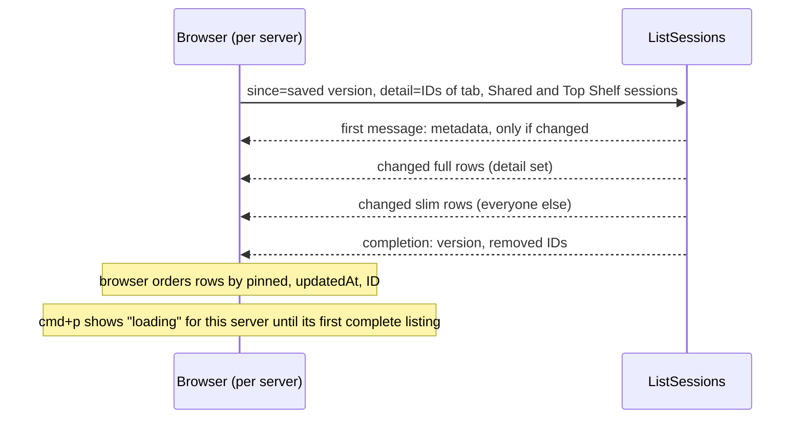

# Slim Sidebar Session List - Plan

## Goal Capsule

- **Objective:** On any link, including a slow relayed one around 50 KB/s, the Web UI reacts to switching tabs, the sidebar, and opening cmd+p in 200 ms or less, and cmd+p still reaches every session.
- **Means:** One sidebar stream that sends full rows only for sessions in the person's tabs and slim rows for the rest (KTD1), sends nothing but changes on a refresh and a reload (KTD3, KTD4, KTD8), and a server-driven search page (KTD7).
- **Authority:** The Product Contract's Requirements win on behavior; Key Technical Decisions win on mechanism; units override neither.
- **Execution profile:** Two pull requests. PR1 makes refreshes and reloads send only changes, caps text, and sends server metadata first (U1–U4, U9). PR2 adds the two detail levels and server-driven search (U5–U8). PR2 is built on top of PR1.
- **Stop conditions:** Stop and ask if a unit would need to change OpenCode's own code or requests (R9), or if the measured reaction time cannot reach 200 ms without a mechanism this plan does not list.
- **Who finishes:** The implementing agent lands both PRs with tests and the before/after measurement; the human partner deploys and confirms on Hally.

---

## Product Contract

### Summary

The sidebar stream stops sending every session in full. Full rows go only to sessions in the person's tabs, Shared tabs, and Top Shelf; every other session arrives as a slim row that cmd+p and other all-session features read. A refresh or reload with no changes sends at most 2 KB, session text is capped to what the UI shows, and the search page gets its rows from the server.

### Problem Frame

On Hally, the Web UI took 15–20 s to open a remote OpenCode session from a desktop browser, and switching between OpenCode tabs made it worse. The browser reaches Hally through a Tailscale relay, so the link is slow, and every request shares one HTTP/2 connection.

A HAR from that browser showed small requests such as `Identity` and `Tabs` waiting up to 17 s for their first byte, then all released together. A goroutine dump taken during a stall showed finished responses waiting to be written behind the connection's only writer, blocked in `gonet.(*TCPConn).Write`. The server was idle; the link was full.

What fills it is the sidebar stream (`ListSessions`):

| What | Raw | Gzipped | When |
|---|---|---|---|
| Full listing, 5,248 sessions | 7.5 MB | ~1.0–1.3 MB | page load, every reload, and whenever the server cannot send only changes |
| Refresh with no changes | 364 KB | ~80 KB | every 2–4 s |
| Of which, every session ID (`order`) | 262 KB | | every refresh |

Some rows carry about 100 KB of preview text the UI never shows, and every row event repeats all default-valued fields. The person sees about 11 tabs.

### Requirements

**Responsiveness**

- R1. Switching tabs, clicking in the sidebar, and opening cmd+p react in 200 ms or less on any link, including one throttled to about 50 KB/s, also while a cold load is still streaming.
- R2. A session's content then arrives as fast as the link allows, and RocketClaw adds no wait of its own before it starts loading.

**Traffic**

- R3. A sidebar refresh or page reload where nothing changed sends at most 2 KB, however many sessions exist.
- R4. Full session rows are sent only for the sessions in the person's tabs on that server: their own tabs in every space, Shared tabs, and Top Shelf entries. Every other session arrives as a slim row.
- R5. Session text sent to the browser is capped to what the UI shows: a title line, and up to 200 visible characters for notifications.

**cmd+p and search**

- R6. cmd+p reaches every session, including filtered searches. Until a server's slim rows have arrived, cmd+p shows the sessions it has plus a loading indicator.
- R7. The search page is fully server-driven: each result arrives with the row data needed to draw it, a page at a time, and the page's status reflects only its own search.

**Preserved behavior**

- R8. Features that read sessions outside the tabs keep working: Dashboards refresh when a session in their space changes, the tag picker, filter autocomplete, remote-session folder suggestions, handoff labels, Voice Reset's running check, and the tab menu's Delete. Opening a tab for a session with an unread mark raises no new notification.
- R9. OpenCode's own code and requests are unchanged. RocketClaw may only start mounting an OpenCode view sooner.

### Key Decisions

- **Leave OpenCode views alone.** (session-settled: user-directed — chosen over keeping OpenCode views alive across tab switches: risk of one session's state leaking into another.) Governs R9.
- **Do both steps.** (session-settled: user-directed — chosen over only making refreshes quiet and trimming text.) Governs R3, R4.
- **cmd+p reads every session from a background download.** (session-settled: user-directed — chosen over cmd+p asking the server per keystroke: cmd+p must feel instant.) Governs R6.
- **The search page is fully server-driven.** (session-settled: user-directed — chosen over waiting for the background list: search does not need to be instant.) Governs R7.
- **All RocketClaw servers run the latest version.** (session-settled: user-directed — chosen over falling back to today's full list for older servers.) Governs R3, R4, R7.
- **200 ms or less measures UI reaction on any link.** (session-settled: user-directed — chosen over measuring 200 ms to content on a normal link: content on a slow link is bounded by the link.) Governs R1, R2.

### Success Criteria

- On a browser throttled to 50 KB/s against a server with about 5,000 sessions, the measured tab switch, sidebar click, and cmd+p open are each 200 ms or less: after a warm reload, and during a cold load.
- On Hally, a fresh HAR shows no RocketClaw request waiting behind the sidebar stream, and refreshes and reloads of at most 2 KB when nothing changed.

### Scope Boundaries

- Not changed: OpenCode's own code, requests, and payloads (R9).
- Not changed: the 2 s poll cadence and the server-side SQL that builds the listing (about 112–163 ms at 6,000 chats).
- Not built: pacing or prioritizing bulk bytes on the connection. A cold load still sends the slim list once (about 255 KB gzipped for 5,248 sessions, about 5 s at 50 KB/s), which delays content but not UI reaction. Evidence that would change this: a measured content delay after cold loads that people notice.
- Not built: fallbacks for older RocketClaw servers (Key Decisions).

#### Deferred to Follow-Up Work

- Letting devices reach Hally directly instead of through a relay, by giving its tsnet node a fixed UDP port published from the container.

---

## Planning Contract

### Key Technical Decisions

- KTD1. **One stream, two detail levels.** `ListSessionsRequest` carries the IDs of the sessions the browser shows in tabs for that server. Those rows are sent full; all others are sent slim. One SQL run serves both, the existing version cache and per-row fingerprint keep working, and a row changing level changes its fingerprint, so it is resent. Rejected: the server working out the tab set itself, because it lags the browser by one save and a remote RocketClaw cannot see the person's Top Shelf (stored only on the local server, `web_top_shelves`). Rejected: a separate catalog RPC, because it doubles the SQL per poll and needs a second version cache.
- KTD2. **Tab rows first; server metadata first and only when changed.** The stream sends detail rows before slim rows. Owner, OpenCode server origins, and agent tags move from the completion message to the first message, and are omitted when unchanged since the `since` listing. The sidebar and the OpenCode wrapper (`RemoteSession`, which waits for `remote.servers`) therefore never wait for the slim rows.
- KTD3. **The completion names removed IDs instead of the full order.** A listing made `since` a version sends the IDs that disappeared since then; a listing without `since` is complete by definition. The browser orders rows itself by the server's rule in `sidebarSessions`: pinned first, then newest `updatedAt` compared at full nanosecond precision, then ID. Rejected: sending `order` only when it changed, because any new activity moves a session and would resend all IDs on most polls.
- KTD4. **Listing events omit default-valued fields.** `httpEvents` encodes `ListSessions` messages without `EmitDefaultValues`. The browser's listing reader treats every absent field as its default (`sessions` as empty, flags as false), and the merge replaces whole rows by ID, so a field cleared to its default is cleared in the browser.
- KTD5. **Text is capped in the shared row builder.** `sidebarSession` caps `preview` and `reply` at 400 characters on a character boundary, which covers the title line and the 200 visible characters notifications use after cleanup. Stored text stays full, because search reads it. Board cards and search results share this builder and only show titles.
- KTD6. **A slim row carries exactly what all-session features read.** It keeps `id`, `kind`, `name`, `title`, `label`, the preview's first line, `agent`, `server`, `model`, `directory`, `remoteSessionId`, `tags`, `cron`, `cronName`, `spaceId`, `updatedAt`, `pinned`, `forkedFrom`, `running`, `background`, `asking`, `workState`, `external`, `offline`, and `unreadAt`. `unreadAt` keeps a session joining the tab set in the notification baseline; `workState`, `background`, and `external` keep Dashboard filters current; `remoteSessionId` keeps Delete working before a full row arrives. Full-only fields are the rest, such as `reply`, `stateSince`, and `arrivedAt`.
- KTD7. **Search returns rows; only /search pages.** Each `SessionMatch` carries its full `Session` row, built the way `Board` builds lane cards. /search asks for 200 sessions at a time and continues from the last session it showed, so rows that move between pages are neither repeated nor skipped. cmd+p filter searches stay unpaged, because the browser matches typed text against the returned rows' titles after the server's filters. The client drops the `matchedRows` join. A search reruns when a server completes a new listing, not on every row update, and its status shows only its own request.
- KTD8. **Reloads send only changes.** The browser saves the listing version with its IndexedDB snapshot and sends it as `since` after a reload, so an unchanged session list costs at most 2 KB. A full slim list is sent only after a server restart, on a new device, or after more than 8 newer listings for that person.
- KTD9. **This replaces two choices of `docs/plans/2026-09-09-fast-conversation-sidebar.md`:** full previews in the listing, and no change-only feeds. Its other rules stay: merge rows by ID, drop missing rows only after a complete listing, never let a failed or cancelled stream overwrite the saved snapshot, and keep the snapshot per person.

### High-Level Technical Design

### Assumptions

- Chrome's network throttling approximates a slow link per request but does not reproduce TCP send-buffer backlog; the final check on Hally covers that.

### Risks

| Risk | Mitigation |
|---|---|
| A cold load still sends the slim list once (~255 KB gzipped), delaying content for about 5 s at 50 KB/s | Tab rows and metadata go first (KTD2); reloads send only changes (KTD8); measured during a cold load (U1, U8) |
| Redrawing every 16 ms while a cold load streams could push reactions past 200 ms | Measured during a cold load; if over budget, the fix stays in the browser's batching of updates |
| The browser's order drifts from the server's | One comparator implementing the server's rule, tested against the server's order for the same rows |
| When an OpenCode server stops answering, all its rows flip `offline` and are resent | Slim rows make that burst about 25 KB gzipped instead of about 1 MB; noted, not fixed |
| Several windows or devices polling evict the 8 cached versions and force full resends | Unchanged by this plan; resends are slim now |

### Sources

- Code map and consumer table: `internal/rocketclaw/frontend/rpc/server.go` (`listSessions`, `sidebarSession`), `internal/rocketclaw/frontend/rpc/http.go` (`httpEvents`), `internal/rocketclaw/backend/store.go` (`sidebarSessions`: the sort rule, and a nil ID list means every chat), `internal/rocketclaw/backend/session_search.go`, `internal/rocketclaw/frontend/rpc/session_commands.go` (`searchSessions`, `Board`), `internal/rocketclaw/web/src/ui.tsx` (`ServerSessions`, `SidebarMerge`, `TabNotifications`, `usePaletteSessions`, `useSessionSearch`, `matchedRows`, `useBoard`, `searchChoices`, `RemoteSession`, Voice Reset, tab menu Delete), `internal/rocketclaw/web/src/session-list.ts` (`listedRows`, `readSessionEnumeration`, `saveCompleteSessions`).
- Prior plans: `docs/plans/2026-09-09-fast-conversation-sidebar.md` (KTD9), `docs/plans/2026-10-27-2157-feat-space-work-dashboards-plan.md` (Dashboards refresh on session changes, R8).
- Learnings: `docs/solutions/best-practices/react-doctor-complexity-limit-shapes-web-components.md` (`SessionApp` and `CommandPalette` are at the complexity limit; new branches go into hooks), `docs/solutions/performance-issues/search-page-froze-rendering-every-result.md` (draw at most 200 search rows at a time), `docs/solutions/best-practices/dupword-fix-rewrites-repeated-test-strings.md`.

---

## Implementation Units

### PR1: Refreshes and reloads send only changes

Waits on: nothing.

### U1. Baseline measurement

- **Goal:** Record today's reaction times and bytes so every later unit is measured against them.
- **Requirements:** R1, R3, Success Criteria.
- **Dependencies:** none.
- **Files:** `docs/verification/2026-11-01-slim-sidebar-measurements.md`.
- **Approach:**
  1. Seed a test database with about 5,000 sessions (mostly remote OpenCode rows, some long previews) and about 10 tabs.
  2. Drive a headless browser throttled to 50 KB/s, measuring tab switch, sidebar click, and cmd+p open after a warm reload and during a cold load, plus first-listing, refresh, and reload bytes.
  3. Record the method and numbers so U8 can repeat them.
- **Test expectation:** none -- measurement only; budgets become tests in U2, U3, U5, and U9.
- **Verification:** The document records reproducible numbers that match the Problem Frame's order of magnitude.

### U2. Refreshes send only changes

- **Goal:** A refresh with no changes sends at most 2 KB.
- **Requirements:** R3.
- **Dependencies:** U1.
- **Files:** `internal/rocketclaw/web/proto/web.proto`, `internal/rocketclaw/frontend/rpc/server.go`, `internal/rocketclaw/frontend/rpc/http.go`, `internal/rocketclaw/web/src/session-list.ts`, `internal/rocketclaw/web/src/ui.tsx`, `internal/rocketclaw/frontend/rpc/sidebar_test.go`, `internal/rocketclaw/frontend/rpc/http_test.go`, `internal/rocketclaw/web/src/session-list.test.ts`.
- **Approach:**
  1. Replace the completion's `order` with the IDs removed since the `since` listing (KTD3).
  2. Order rows in the browser by the server's rule, with one comparator shared by the sidebar store and `SidebarMerge`.
  3. Encode listing events without default-valued fields, and read absent fields as defaults (KTD4).
- **Patterns to follow:** the existing fingerprint and version cache in `listSessions`; `TestListSessionsSendsChangesSince`.
- **Test scenarios:**
  - A second listing with `since` and no changes sends no rows and an empty removal list, under 2 KB for 5,000 sessions.
  - One session gets new activity: only that row is sent, and the browser moves it to the top.
  - A session deleted: its ID is in the removal list, and the browser drops it.
  - The browser's order for a fixed set of rows equals the server's order, including pinned rows, rows without `updatedAt`, and timestamps that differ only in nanoseconds.
  - A row field cleared to its default (for example `running` going false) reaches the browser as false.
  - A listing message with only a completion and no rows is read without errors.
- **Verification:** The refresh budget test passes; existing listing tests pass after their `order` assertions are rewritten for removal lists.

### U3. Cap session text on the wire

- **Goal:** No listing, Board, or search row carries more than 400 characters of `preview` or `reply`.
- **Requirements:** R5.
- **Dependencies:** U1.
- **Files:** `internal/rocketclaw/frontend/rpc/server.go`, `internal/rocketclaw/frontend/rpc/server_test.go`, `internal/rocketclaw/web/src/notifications.browser.test.ts`.
- **Approach:** Cap in `sidebarSession` on a character boundary (KTD5). Replace the test at `server_test.go` that requires a listing over 4 MiB with full 2 MiB previews.
- **Test scenarios:**
  - A 2 MiB preview is listed as its first 400 characters.
  - Multi-byte text is cut on a character boundary, never inside one.
  - Search still finds a word that appears only after the first 400 characters.
  - A tab notification still shows the first 200 visible characters of a long reply.
- **Verification:** The rewritten size test passes, and notification and title tests pass unchanged.

### U4. Metadata in the first message

- **Goal:** The sidebar and OpenCode tabs do not wait for the rest of the listing.
- **Requirements:** R2, R9.
- **Dependencies:** U2.
- **Files:** `internal/rocketclaw/frontend/rpc/server.go`, `internal/rocketclaw/web/src/session-list.ts`, `internal/rocketclaw/web/src/ui.tsx`, `internal/rocketclaw/frontend/rpc/opencode_test.go`, `internal/rocketclaw/frontend/rpc/sidebar_test.go`, `internal/rocketclaw/web/src/sidebar-transport.test.ts`.
- **Approach:** Send owner, OpenCode server origins, and agent tags in the first message, only when changed since the `since` listing (KTD2), and have the store publish them as soon as they arrive. `RemoteSession` keeps reading `remote.servers`; only when that value arrives changes.
- **Test scenarios:**
  - With the listing tail blocked, an OpenCode tab mounts its view before the listing completes.
  - A first listing carries owner, servers, and agent tags in its first message; a `since` listing with unchanged metadata omits them.
  - Changing an agent's tags resends the metadata on the next listing.
  - "This OpenCode session is no longer available" still waits for a complete listing.
- **Verification:** The blocked-tail browser test passes; the OpenCode RPC test's exact completion assertion is updated to match.

### U9. Reloads send only changes

- **Goal:** Reloading the page with an unchanged session list sends at most 2 KB.
- **Requirements:** R3.
- **Dependencies:** U2.
- **Files:** `internal/rocketclaw/web/src/session-list.ts`, `internal/rocketclaw/web/src/ui.tsx`, `internal/rocketclaw/web/src/session-list.test.ts`, `internal/rocketclaw/web/src/session-poll.browser.test.ts`.
- **Approach:** Save the listing version with the IndexedDB snapshot and restore it as the held version, so the first poll after a reload sends it as `since` (KTD8). Keep the existing rule that a failed or cancelled stream never overwrites the snapshot (KTD9).
- **Test scenarios:**
  - After a complete listing and a reload, the first poll sends the saved version as `since` and receives no rows.
  - A version the server no longer knows (after a restart) gets a full listing, which replaces the snapshot.
  - A cancelled listing leaves the saved snapshot and version unchanged.
  - A different person on the same browser does not reuse another person's version.
- **Verification:** The reload budget is met in U1's measurement setup.

### PR2: Two detail levels and server-driven search

Waits on: PR1, needed before this group can start: these units change the listing code PR1 changes and are built on top of PR1.

### U5. Full rows for tabs, slim rows for everything else

- **Goal:** The server sends full rows only for the detail set the browser names.
- **Requirements:** R4, R6.
- **Dependencies:** U2, U4.
- **Files:** `internal/rocketclaw/web/proto/web.proto`, `internal/rocketclaw/frontend/rpc/http.go`, `internal/rocketclaw/frontend/rpc/server.go`, `internal/rocketclaw/frontend/rpc/sidebar_test.go`, `internal/rocketclaw/frontend/rpc/reads_test.go`.
- **Approach:**
  1. Add the detail ID list to `ListSessionsRequest`, read from the GET query string next to `since` (KTD1).
  2. Build full rows for detail IDs and slim rows for the rest (KTD6), detail rows first (KTD2).
  3. Keep calling `SidebarChats` with every chat; the detail list only chooses the row level. An empty detail list means "no full rows", never "every chat".
- **Patterns to follow:** `validRequest` already checks repeated ID fields; `sidebarSession` stays the one row builder.
- **Test scenarios:**
  - Detail IDs get full rows; every other session gets a slim row with exactly the KTD6 fields.
  - An empty detail list yields only slim rows.
  - A session added to the detail list is resent full on the next `since` listing; removed, it is resent slim.
  - An unknown or malformed detail ID is ignored or rejected the way other ID fields are.
  - The full listing for 5,000 sessions with 10 detail IDs stays under a byte budget set from U1's numbers.
- **Verification:** Listing tests and the size budget pass; `TestSessionReads` still marks the viewed session.

### U6. Browser sends its tab set and reads slim rows

- **Goal:** The Web UI asks each server for full rows of its tab sessions, and every all-session feature works from slim rows.
- **Requirements:** R1, R4, R6, R8.
- **Dependencies:** U5.
- **Files:** `internal/rocketclaw/web/src/ui.tsx`, `internal/rocketclaw/web/src/session-list.ts`, `internal/rocketclaw/web/src/api.ts`, `internal/rocketclaw/web/src/types.ts`, `internal/rocketclaw/web/src/tabs.browser.test.ts`, `internal/rocketclaw/web/src/notifications.browser.test.ts`, `internal/rocketclaw/web/src/board.browser.test.ts`, `internal/rocketclaw/web/src/search-page.browser.test.ts`, `internal/rocketclaw/web/src/voice-page.browser.test.ts`, `internal/rocketclaw/web/src/remote-transport.test.ts`.
- **Approach:**
  1. Per server, compute the detail IDs from that server's saved tabs in every space, its Shared tabs, and the local Top Shelf entries for that server, read through a ref because the poll sits above the component holding live tabs. Send them on each poll.
  2. Show cmd+p's loading indicator as a status line at the top of its session list, per server, until that server's first complete listing; an unreachable server shows as offline instead, as today, so the indicator cannot stay forever.
  3. Keep the all-session readers (Dashboards refresh, tag picker, filter autocomplete, folder suggestions, handoff labels, Voice Reset, Delete) on the full row list, which now holds slim rows for most sessions.
  4. Put new branching in hooks or small functions, because `SessionApp` and `CommandPalette` are at react-doctor's limit.
- **Test scenarios:**
  - Opening a session in a new tab: its full row arrives on the next poll, and the tab shows its title from the slim row until then.
  - A Top Shelf entry for a remote server is requested as full from that server.
  - Opening a tab for a session that already has an unread mark raises no notification.
  - A Dashboard refreshes when a session in its space that is in no tab changes state (for example starts running).
  - cmd+p lists every session after the first complete listing, and shows the loading line before it; an unreachable server shows offline, not loading.
  - Delete on a just-opened OpenCode tab, before its full row arrives, deletes that session.
  - Voice Reset still asks for confirmation while the voice conversation is running.
  - The tag picker offers tags used on sessions outside the tabs.
  - A remote RocketClaw lists, searches, and follows a chat as before.
- **Verification:** Updated browser tests pass, and the U1 measurement shows tab switch, sidebar click, and cmd+p open at 200 ms or less.

### U7. Server-driven search with rows

- **Goal:** The search page and cmd+p filters draw results from rows the server returns.
- **Requirements:** R6, R7.
- **Dependencies:** U3.
- **Files:** `internal/rocketclaw/web/proto/web.proto`, `internal/rocketclaw/frontend/rpc/session_commands.go`, `internal/rocketclaw/backend/session_search.go`, `internal/rocketclaw/web/src/ui.tsx`, `internal/rocketclaw/web/src/api.ts`, `internal/rocketclaw/frontend/rpc/server_test.go`, `internal/rocketclaw/backend/session_search_test.go`, `internal/rocketclaw/web/src/search-page.browser.test.ts`.
- **Approach:**
  1. Add the row to `SessionMatch`, and for /search a page size and a continue-after position to the request, with "more" in the response (KTD7).
  2. Keep the stored model on returned rows, as `Board` does.
  3. Replace the `matchedRows` join and its "missing" state with the returned rows; rerun searches when a server completes a new listing.
  4. On /search, show "loading more" while the next page loads, a retry on failure, and start again from the first page when the search reruns. /search's status and stale icon reflect only its own request.
- **Patterns to follow:** `Board` in `session_commands.go`; `sharedSearch` coalescing.
- **Test scenarios:**
  - A match for a session outside every tab draws with its title and opens.
  - A filter-only query (`agent:main`) on /search returns 200 sessions and reports more; scrolling loads the next page with no repeated or skipped session.
  - cmd+p with `agent:main deploy` finds a matching session beyond the first 200 filter matches.
  - Rows returned by search equal the same sessions' full listing rows.
  - During a cold load, /search sends one search, not one per row update.
  - A failed next page shows a retry, and retrying loads it.
  - Two identical concurrent searches still share one run.
  - The exact response test (`TestSearchSessionsResponse`) is updated to include rows and paging.
- **Verification:** Search tests pass with rows, and /search draws at most 200 sessions at a time.

### U8. Documentation and after-measurement

- **Goal:** Docs describe the new stream, and the measurement shows the targets met.
- **Requirements:** R1, R3, Success Criteria.
- **Dependencies:** U6, U7, U9.
- **Files:** `internal/rocketclaw/frontend/rpc/README.md`, `internal/rocketclaw/web/README.md`, `docs/verification/2026-11-01-slim-sidebar-measurements.md`.
- **Approach:** Update the README passages on `ListSessions` streaming, snapshots, cmd+p, and search. Repeat U1's measurement and record before and after.
- **Test expectation:** none -- documentation and measurement.
- **Verification:** The README text matches the code, and the measurement document shows R1 and R3 met.

---

## Verification Contract

| Check | When |
|---|---|
| `gofmt` on touched Go files | every unit with Go changes |
| `go test ./...` | every PR |
| `make lint` (runs `golangci-lint --fix` with `dupword`; re-read the diff afterwards) | every PR |
| `make test` with `ROCKETCLAW_PLAYWRIGHT_MODULE` and `ROCKETCLAW_CHROMIUM` set; trust browser results only after the build prints `Built SPA:` | every PR |
| Coverage and CLOC budgets (`SOURCE_CLOC_BUDGET`, Web `TS_CLOC_BUDGET` 9300) without editing them | every PR |
| Throttled measurement from U1: tab switch, sidebar click, and cmd+p open at 200 ms or less at 50 KB/s, after a warm reload and during a cold load; refresh and reload at most 2 KB when nothing changed | U1 (before), U8 (after) |
| HAR from the human partner's browser on Hally after deploy: no request waiting behind the sidebar stream | after PR2 deploys |

---

## Definition of Done

- All requirements R1–R9 hold, and each unit's verification passes.
- Both PRs pass `make lint` and `make test`, within coverage and CLOC budgets.
- The measurement document shows the before and after numbers.
- READMEs describe the new stream, detail levels, removal lists, and search paging.
- No code from abandoned approaches remains in the diff.
