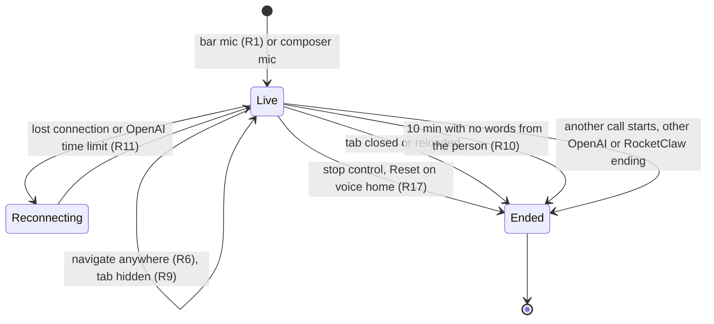
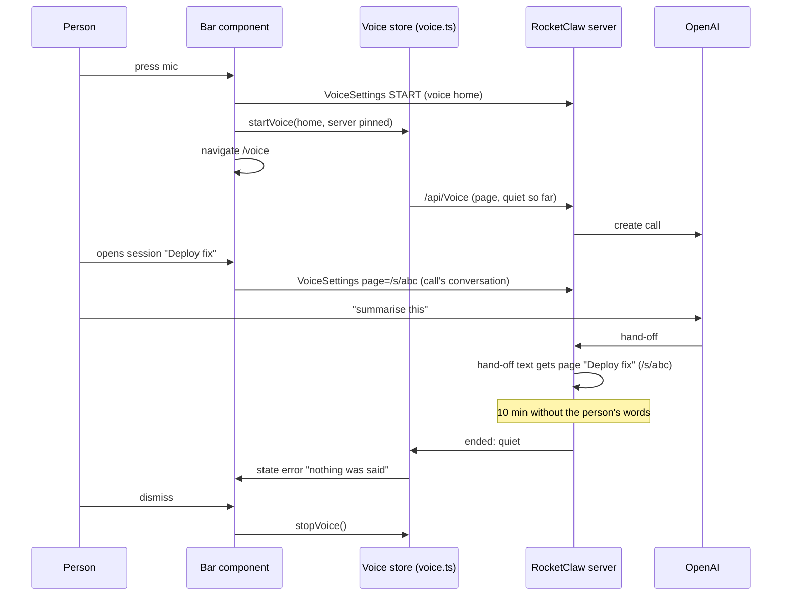
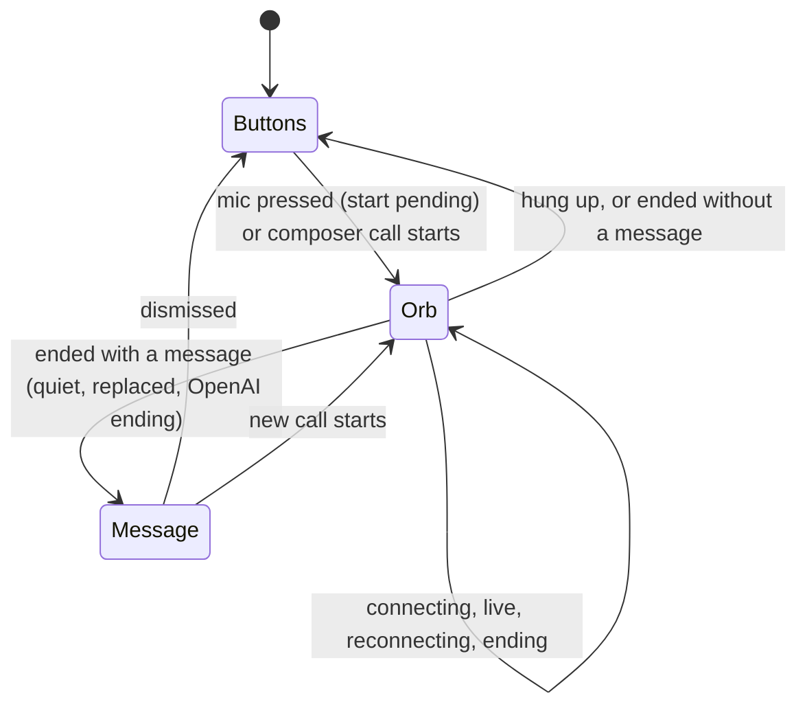

# Voice Stays On - Plan

## Goal Capsule

- **Objective:** A person on the RocketClaw Web starts voice from the bottom bar and keeps talking to RocketClaw while moving around the app, until they hang up, close the tab, or stop talking to it.
- **Means:** Keep the call in the existing module-level store, move every visible control for it into a bottom-bar component, and let the server own the no-words clock and the page note (KTD1, KTD5, KTD7).
- **Product authority:** This Product Contract, then the Planning Contract. It covers the first of three areas of sticky voice mode; the voice walk-through and the combined pane are not active scope.
- **Stop conditions:** Stop and report if the ChatGPT sign-in route ends calls at its time limit in a way that cannot reconnect (see Risks), or if react-doctor or the TypeScript size budget cannot be met without dropping a requirement.
- **Execution profile:** One pull request, built in unit order U1 → U6. The work is implemented, reviewed and shipped by the `lfg` pipeline.
- **Open blockers:** None.

---

## Product Contract

### Summary

Pressing the bottom-bar mic opens `/voice` and starts listening at once. From then on the orb replaces the bar's four centre buttons on every page until the call ends.
A call survives moving around the app, a hidden tab, and OpenAI's time limit. It ends when the person hangs up, closes the tab, or says no words for 10 minutes.
A bar call talks to the person's voice home and tells it which page is on screen. `/voice` stops being a tab.

### Problem Frame

Voice works only while the person stays on the Voice page, or in the session whose composer started the call.
Both places hang the call up on purpose when the person leaves: the Voice page when it closes (`internal/rocketclaw/web/src/ui.tsx:5418-5419`), and the composer whenever the route changes (`ui.tsx:5518-5519`).
The original voice plan deferred keeping the call alive across navigation (`docs/plans/2026-10-10-1146-feat-web-voice-mode-plan.md:110`).
So the person cannot talk to RocketClaw while looking at anything else. That is the first thing a hands-free walk through sessions would need.

Two other rules cut calls short.
A tab hidden for 30 seconds hangs up (`internal/rocketclaw/web/src/voice.ts:111-117`), so switching browser tabs or locking a phone ends the call.
OpenAI's time limit ends the call with "Call ended: time limit reached.", because `expired` is not in the list of losses that reconnect (`voice.ts:22`, `:31`, `:213`).

### Key Decisions

- **The bottom-bar mic opens `/voice` and starts listening; the orb then replaces the bar's centre buttons on every page.** Seeing the big orb confirms the call started; the bar orb keeps it visible and stoppable everywhere else. (session-settled: user-directed — chosen over starting the call where the person is, pressing Start on `/voice`, and showing the bar orb only away from `/voice`: the jump to `/voice` is how the person sees that voice is on.) Governs R1, R2, R4.
- **A bar call talks to the voice home, and every voice-home call tells it which page is on screen.** (session-settled: user-directed — chosen over a voice home with no screen information and over talking to whichever session is on screen: the home stays put while still able to act on what the person is viewing.) Governs R12, R13.
- **"On screen" means the page showing at the moment of the request.** (session-settled: user-directed — chosen over remembering the page the person came from before the mic took them to `/voice`: strict and predictable.) Governs R13.
- **The composer mic stays a direct call to its own session, and that call also survives navigation.** (session-settled: user-directed — chosen over removing the composer mic and over making it start the voice-home call: talking straight to one session stays available.) Governs R3, R14, R18.
- **A no-words limit replaces the hidden-tab rule.** (session-settled: user-directed — chosen over never ending a call on its own and over keeping the 30-second hidden rule: it catches forgotten calls without cutting the person off while they browse or lock their phone.) Governs R9, R10.
- **Only the person's own words reset the no-words clock.** (session-settled: user-directed — chosen over pausing the clock while a task handed off by voice runs or the voice speaks: the person may ask for something, wander off, and come back later; the task keeps running either way.) Governs R10.
- **`/voice` is not a tab.** The voice home belongs to the person and is the same on every device, so it never belonged to a space or tab group. (session-settled: user-directed — chosen over keeping `/voice` an ordinary tab: each space could otherwise hold its own Voice tab showing the same per-person call.) Governs R15, R16.
- **OpenAI's time limit reconnects instead of ending the call.** (session-settled: user-approved — proposed with the tradeoff that speech since the last request is lost at the reconnect; confirmed in the scoping summary.) Governs R11.
- **Reset and the Voice page act only on a voice-home call.** Once a composer call can follow the person to `/voice`, Reset must not hang it up. (session-settled: user-approved — proposed after the code check found Reset would end any running call; confirmed with the scoping summary.) Governs R17, R18.
- **The call keeps living outside the Voice page, as it already does.** The call store is module-level (`voice.ts:34-35`); nothing keeps the Voice page mounted in the background. Past attempts to keep views mounted broke several things (`docs/solutions/architecture-patterns/web-keep-alive-views-connection-budget.md`).

### Requirements

**Starting a call and the bar orb**

- R1. Pressing the bottom-bar mic opens `/voice` and starts a call on the person's voice home at once, with no separate Start press.
- R2. While this tab has a call that is connecting, live, reconnecting or ending, or one that ended with a message not yet dismissed (R5), the orb replaces the bottom bar's four centre buttons (New session, Search, Voice, Copy page link) on every page, `/voice` included; the sidebar and theme toggles stay.
- R3. The bar orb shows the call's state and its current notice, and for a composer call it also names the session the call talks to.
- R4. Tapping the bar orb's body opens `/voice`, and its stop control hangs up.
- R5. When a call ends with a message, such as R10's notice or "Voice moved to another device or tab.", the bar orb stays in place showing that message until the person dismisses it; when a call ends without one, or once the message is dismissed, the four centre buttons come back.

**How long a call lives**

- R6. Moving between pages never ends a call, including leaving `/voice` and leaving the session a composer call talks to.
- R7. Leaving `/voice` while a call is still connecting does not cancel it.
- R8. A call ends only when the person hangs up or presses Reset during a voice-home call (R17), the tab closes or reloads, the person starts another call (the existing one-live-call-per-person rule), OpenAI or RocketClaw ends it for a reason other than the time limit, or R10's no-words limit is reached.
- R9. A hidden tab no longer ends a call by itself.
- R10. A call ends after 10 minutes in which the person said no words, with a short tone and a notice that it hung up because nothing was said; only the person's own transcribed words reset that clock. The clock runs for the whole call: a reconnect does not reset it, and time spent reconnecting or with the page suspended by the browser counts as no words.
- R11. When OpenAI ends a call at its time limit, voice starts a new call on the same conversation and microphone, as it already does after a lost connection.

**What a call talks to**

- R12. A call started from the bottom bar talks to the person's voice home, the current voice conversation in their Voice Settings.
- R13. Every request a voice-home call passes to the agent, whether the call started from the bar mic or the orb on `/voice`, names the page on screen at that moment, and for a session page names the session, so the agent can act on it with its existing session tools.
- R14. A composer mic call keeps talking only to its own session for its whole life.

**The Voice page**

- R15. `/voice` is not a tab: opening it never adds or activates a tab, it is never a space's last tab, it cannot be grouped or shared, and the person's active tab stays the one they had before opening it.
- R16. Existing `/voice` tabs, including any in a space's Shared group, are removed.
- R17. Reset ends a running call only when that call is on the voice home.
- R18. While a composer call is live, `/voice` shows which session that call talks to; starting a voice-home call there replaces it under the one-live-call rule.

**Written rules**

- R19. The Web README, the main README, `cmd/rocketclaw/CHEATSHEET.md` and `CONCEPTS.md` describe the new rules. They drop "leaving hangs up", "hidden for 30 seconds", "no idle or no-speech timers" and "the Voice page is a tab", and state R6, R9, R10 and R15 instead.

### Key Flows

- F1. Start from a session and browse
  - **Trigger:** The person is reading session X and presses the bottom-bar mic.
  - **Steps:** `/voice` opens and the call starts on the voice home. The bar shows the orb. The person opens session Y from the sidebar and asks voice to summarise it. The request names session Y.
  - **Outcome:** The call keeps running across both moves, and the voice-home agent knows the person was looking at Y.
  - **Covered by:** R1, R2, R6, R12, R13
- F2. A forgotten call ends itself
  - **Trigger:** The person asks voice to run a long task, then switches to another browser tab and forgets about the call.
  - **Steps:** The tab is hidden; the call stays up. Ten minutes pass with no words from the person while the agent works.
  - **Outcome:** The call ends with a tone, and the bar orb stays showing the "nothing was said" notice until the person comes back and dismisses it; then the bar's buttons come back. The task keeps running, and its reply waits in the voice home.
  - **Covered by:** R9, R10, R2, R5
- F3. A composer call follows the person
  - **Trigger:** The person starts a call from session X's composer mic and then opens `/voice`.
  - **Steps:** The bar orb names session X. `/voice` shows that a call on X is running. The person presses Reset.
  - **Outcome:** The call on X keeps running, because Reset acts only on the voice home.
  - **Covered by:** R3, R14, R17, R18

### Acceptance Examples

- AE1. **Covers R6, R2.** **Given** a live call started from the bar, **when** the person goes from `/voice` to a session, then to the Agents page, **then** the call stays live and the bar shows the orb on each page.
- AE2. **Covers R7.** **Given** the person pressed the bar mic and the call is still connecting, **when** they open a session before it goes live, **then** the call still goes live.
- AE3. **Covers R9, R10.** **Given** a live call, **when** the person locks their phone for 5 minutes while still talking, **then** the call stays live; **when** they then say nothing for 10 minutes, **then** the call ends with the tone and the no-speech notice. The "still talking while locked" step counts as met only once it is checked on the phone actually used (see Dependencies / Assumptions).
- AE4. **Covers R10.** **Given** the person handed off a task by voice, **when** the voice model reads out a long reply while the person stays silent for 10 minutes in total, **then** the call ends; the voice model talking does not reset the clock.
- AE5. **Covers R11.** **Given** a call reaches OpenAI's time limit, **when** OpenAI ends it, **then** voice reconnects on the same conversation instead of showing "Call ended: time limit reached."
- AE6. **Covers R13.** **Given** the person just pressed the bar mic from session X and is now on `/voice`, **when** they say "summarise this session", **then** the request names `/voice`, not session X.
- AE7. **Covers R15, R16.** **Given** a space whose Shared group holds a `/voice` tab, **when** this ships, **then** that tab is gone, and opening `/voice` from the bar orb leaves the person's active tab unchanged.
- AE8. **Covers R18.** **Given** a composer call on session X is live and the person is on `/voice`, **when** they press the big orb, **then** a voice-home call starts and the call on X ends, and the bar orb stops naming session X.

### Scope Boundaries

- Keeping a call across a tab reload, closing the tab, or a RocketClaw update. An update reloads the page (`ui.tsx:496-499`), so it still ends live calls.
- Voice moving the person's screen, a focus that follows the person, and the "needs you" walk. These belong to the voice walk-through.
- Showing the person's words and the session in one pane. This belongs to the combined pane.
- Keeping what was said since the last request across a reconnect started by the browser, or across the time-limit reconnect.
- Other tabs or devices following the live call. Another device starting a call still ends this one.
- Making the 10-minute limit configurable.
- Removing the composer mic or changing what it talks to.

<!-- ce-section: work-relationships -->
### How This Work Fits Together

This plan covers **voice stays on**. The breakdown below is the current understanding from `docs/plans/2026-11-03-sticky-voice-mode-ideation.html`, not a committed roadmap.

- Voice walk-through: a fixed voice home with a focus that moves, tools that let voice move the screen, the "needs you" walk with visible drafts and "send, next", and spoken answers to pending questions.
  - Depends on this plan's call that survives navigation and on R13's note of what is on screen.
  - Still to decide: whether the voice side gets its own tools, modelled on the OpenCode voice in `internal/rocketclaw/oc/packages/app/src/voice/`, and whether the ChatGPT sign-in route accepts them.
- Combined pane: the person's spoken words and the session in one timeline on the right.
  - Depends on this plan's call that survives navigation.
  - Shares the voice walk-through's notion of which session is in focus.

### Dependencies / Assumptions

- The 10-minute no-words limit is the agreed starting value.
- The screen-awake lock already lasts as long as any call (`ui.tsx:1820-1822`). With R9 the screen stays awake until the call ends, which on a phone means battery use until R10 ends a forgotten call.
- Both the browser and the server already see the person's transcribed words (`voice.ts:16-17`, `internal/rocketclaw/frontend/rpc/voice.go:386-399`), so R10 needs no new data from OpenAI.
- With a ChatGPT sign-in, a dropped connection between RocketClaw and OpenAI already reconnects the same OpenAI call (`voice.go:290-341`); R11 adds only the time-limit case.
- Whether a phone keeps recording with its screen locked depends on the phone and browser. On Android 14 and later, capture is reported to go silent about 5 seconds after the browser goes to the background or the screen locks (Tencent TRTC WebRTC known issues, entry of 2026-07-14). A site added to the iPhone Home Screen is reported to lose the microphone in the background (WebKit bug 226620, 2024 comment). This is unconfirmed for iPhone Safari itself, and no source reports it for desktop browsers. On an affected phone a locked-screen call stays up but hears nothing, and that time counts toward R10's limit.

### Outstanding Questions

The planning questions this section held are answered in the Planning Contract: the no-words clock (KTD5), the tab exceptions (KTD8), where the bar orb lives (KTD1), dropping saved `/voice` tabs (KTD8), the page note (KTD7) and the tests that change (U1–U5).

### Sources / Research

- `docs/plans/2026-11-03-sticky-voice-mode-ideation.html`: ideas 1 and 2, and the rejection reasons for the other ideas.
- `docs/plans/2026-10-10-1146-feat-web-voice-mode-plan.md`: R7 and the deferred non-goal at line 110 that this plan reverses.
- `CONCEPTS.md` "Web Voice" (Voice Session, Voice Settings, Voice Hand-off) and "Web Spaces" (Space, Shared Group).
- `internal/rocketclaw/oc/packages/app/src/voice/context.tsx`: OpenCode's voice holds its call at the app root and ends it only when the page closes.
- `docs/solutions/architecture-patterns/web-keep-alive-views-connection-budget.md`: why the Voice page is not kept mounted.
- `docs/solutions/logic-errors/web-tab-state-holds-a-placeholder-main-space-before-its-first-load.md`: tab state is a placeholder until the first load, which matters for R15 and R16.

---

## Planning Contract

Product Contract preservation: Product Contract unchanged. Its planning questions now point here.

### Key Technical Decisions

- KTD1. **The module-level store owns the call; one bottom-bar component is its only always-mounted UI.** The call already lives in `internal/rocketclaw/web/src/voice.ts` outside React. The Voice page and the composer stop hanging up on unmount, and a new bar component replaces the centre `div` of the bottom bar (`ui.tsx:1908-1917`). That component subscribes to the store itself, so `SessionApp` gains no branch and no per-caption re-render. Keeping the Voice page mounted was rejected because of the keep-alive failures in `docs/solutions/architecture-patterns/web-keep-alive-views-connection-budget.md`. Governs R2, R6.
- KTD2. **A call keeps the server it started on.** `startVoice` reads the server once, and the store keeps it on the call. Every reconnect, every page note, the bar's link to `/voice` and the Voice page's claim on the call use that server. Today each reconnect re-reads it (`voice.ts:183`), so a call that follows the person into a remote view (`/r/<name>/`) would reconnect to the wrong RocketClaw. This follows `docs/solutions/architecture-patterns/tailnet-pages-calling-another-rocketclaw.md`. Governs R4, R6, R11, R13.
- KTD3. **The store records each call's kind and server.** `startVoice` takes whether the call is a voice-home call, and `VoiceView` exposes that and the call's server. R3, R13, R17 and R18 depend on the kind, and comparing against Voice Settings misreads a composer call made on the voice-home session itself. The Voice page treats a call as its own only when the call's server is the page's server.
- KTD4. **The bar starts calls through the same start mutation as the Voice page.** The page's start logic moves into a shared hook whose start mutation is keyed `["voiceCall", username, "start"]`; Reset keeps its own key under the `["voiceCall", username]` prefix. A bar press runs the start and navigates to `/voice` in the same handler, so phones still treat the start as a user gesture. While the start mutation alone is pending the bar counts the call as connecting (R2), and the bar's stop control cancels it (R4). A start that fails before `startVoice` runs puts its message into the store's `error` state, so the bar and the Voice page show it until it is dismissed (R5). The start is never encoded in the address, so a reload or Back cannot start a call.
- KTD5. **The server enforces the no-words limit on a connected call; the browser covers reconnects.** The voice loop keeps the time of the person's last transcribed words and ends the call with a new ending reason, `quiet`, after 10 minutes. Each `/api/Voice` request carries how long the person has already been quiet, so the clock continues across reconnects and the time-limit rollover. The browser keeps the same clock against wall time and ends the call itself before a reconnect attempt once 10 minutes have passed. A suspended page needs no check of its own: if its stream survived, the server has already ended the call, and if not, the page wakes into the reconnect path. A browser-only clock was rejected: a frozen phone page cannot fire it, and the server would keep the OpenAI call open. Governs R10.
- KTD6. **Endings with a message reuse the store's `error` state.** A call that ends with a message already stays in `state: "error"` until `stopVoice()` dismisses it (`voice.ts:68-72`, `:240`). The bar shows that state and its dismiss control calls `stopVoice()`. The `quiet` ending plays a short tone, and the store waits for it to finish before closing the audio context. Governs R5, R10.
- KTD7. **The browser reports the page on screen through the existing `VoiceSettings` RPC.** A new `VoiceSettingsAction` value and a `page` field on `VoiceSettingsRequest` carry the page on screen as the call's server reads it, and the call's conversation ID, sent to the call's server (KTD2). A page on that server is named by its path there, and any other page by its full address, so a call on a remote never reads a local `/s/` path as one of its own sessions. `startVoice` sends `page` on `/api/Voice` only for voice-home calls, and the server treats a call whose request carried a page as a voice-home call. It stores the path beside that call's entry under `voiceMu` and accepts later updates only for it; a call without a page takes no updates and gets no page element. `handOff` adds a `<page>` element to `<realtime_delegation>`. For a `/s/` path the element also carries the session's title, which the server looks up itself. The path is untrusted input, so it is escaped and bounded through `voiceDelegationField` and never copied into message metadata (`docs/solutions/security-issues/external-mcp-caller-metadata-shared-the-routing-map.md`). A new unary RPC was rejected: it costs four registration edits for the same result. Governs R13.
- KTD8. **`/voice` is filtered out of the tab model rather than migrated.** The route-to-active-tab sync (`ui.tsx:1115`), the address rewrite (`:1117-1121`), the first load (`loadTabs`, `:997-1005`) and the tab commands (`:1286-1311`) all skip `/voice`. `pageTabs` drops its `/voice` entry. Personal tabs, Shared tabs, Top Shelf tabs and `last` entries that equal `/voice` are dropped from every Tabs reply, in `queries.tabs` and `mutations.tabs` (`web/src/api.ts`), so `savedTabs()`, `useTabs`, `useTopShelf` and the other cache readers never see them. No database migration deletes the old rows: the next save drops personal rows, and the filter hides Shared and Top Shelf rows. Governs R15, R16.

### High-Level Technical Design

The bar component, the store and the server share one call. The diagram shows a bar start, a page change, a hand-off and the no-words limit.

What the centre of the bottom bar shows:

### Assumptions

- The 10-minute limit is a constant, not a setting.
- A collapsed bottom bar still hides the orb, as it hides the buttons today.
- Escape on `/voice` does nothing, since there is no tab for it to close.
- Old `/voice` rows in the Shared and Top Shelf tables stay in the database, hidden by the filter (KTD8).
- The page note names the address path. Only `/s/` sessions get a title, and remote OpenCode sessions and other servers are named by their path alone.

### Risks

- The ChatGPT sign-in route may report its time limit as a normal close rather than `expired` (`frontend/rpc/voice.go:258-263`, `:343-344`). A normal close maps to `closed`, which does not reconnect. U1 checks how the route ends a call at its limit. If it can't be told apart from OpenAI ending the call, R11 holds only for the API-key route, and the run stops per the Goal Capsule.
- On a phone, starting from the bar waits for the `START` reply before audio starts, as the Voice page's Start already does. If a phone refuses the late start, the fix is to create the audio context during the press, as `voice.ts:120-121` already does.
- Every proto change reloads open pages through `ProtocolGuard` (`ui.tsx:493-505`), so deploying this change ends live calls once.

### Sources & Research

- Research dossiers (machine-local, may be gone): `.tmp/research/ce-plan-research/bb661c0a/repo-research.md`, `spec-flow.md`, `learnings.md`.
- Size budgets: `internal/rocketclaw/web/Makefile` `TS_CLOC_BUDGET` 9300 (8273 used), `internal/rocketclaw/Makefile` `GO_SOURCE_CLOC_BUDGET` 41750 (39036 used).

---

## Implementation Units

### U1. Calls outlive pages and the time limit

- **Goal:** A call keeps running across navigation and reconnects on OpenAI's time limit, on the server it started on.
- **Requirements:** R6, R7, R9, R11, R14; KTD1, KTD2, KTD3.
- **Dependencies:** None.
- **Files:** `internal/rocketclaw/web/src/voice.ts`, `internal/rocketclaw/web/src/ui.tsx`, `internal/rocketclaw/web/src/voice.test.ts`, `internal/rocketclaw/web/src/voice-page.browser.test.ts`.
- **Approach:**
  1. Delete the Voice page's unmount hang-up (`ui.tsx:5418-5419`), the `left` ref that cancels a start on leaving (`:5450-5458`), and `VoiceToggle`'s route-change hang-up (`:5518-5519`).
  2. Delete the 30-second hidden timer (`voice.ts:104`, `:111-117`, and its cleanup). Keep `pagehide`.
  3. Add `endings.expired` to `networkLosses`.
  4. Read the server once at the top of `startVoice` and keep it on the call (KTD2).
  5. Add the call kind and server to `startVoice` and `VoiceView` (KTD3). The Voice page passes voice-home and `VoiceToggle` passes session.
- **Patterns to follow:** The reconnect test in `voice.test.ts:161-201` (cues and backoff under fake timers). `useSyncExternalStore(subscribeVoice, …)` for narrow subscriptions (`ui.tsx:1821`).
- **Test scenarios:**
  - Covers AE5. An `ended{reason:"expired"}` event gets the falling tone and `reconnecting` state, then a new `/api/Voice` request on the same conversation, not the "time limit reached" error.
  - A page hidden for 31 seconds keeps the call live. `pagehide` still ends it.
  - A reconnect after `serverURL()` changes still posts to the server the call started on.
  - Covers AE1. In the browser test, a live Voice page call stays live after opening a session and then the Agents page.
  - Covers AE2. Leaving `/voice` while START is pending still brings the call live.
  - A composer call on session X stays live after navigating to session Y and to `/voice`. This flips the current assertions at `voice-page.browser.test.ts:262-280`.
- **Verification:** No navigation, hidden tab or time-limit ending hangs up. The flipped browser assertions pass.

### U2. The bottom-bar orb and starting from the bar

- **Goal:** The bar's centre shows the orb while a call is starting, running or ended with a message, and the mic starts a voice-home call.
- **Requirements:** R1, R2, R3, R4, R5, R17, R18; KTD1, KTD2, KTD3, KTD4, KTD6.
- **Dependencies:** U1.
- **Files:** `internal/rocketclaw/web/src/ui.tsx`, `internal/rocketclaw/web/app/globals.css`, `internal/rocketclaw/web/src/voice-page.browser.test.ts`, `internal/rocketclaw/web/src/session-list.browser.test.ts`.
- **Approach:**
  1. Move the Voice page's settings-and-start logic into a hook both the page and the bar use (KTD4).
  2. Add a bar component that replaces the scrolling centre strip at `ui.tsx:1908-1917`. When idle and no start is pending it renders the four buttons. Otherwise it lays out three parts: `VoiceOrb` at a new bar size, a text column, and one stop-or-dismiss button. The orb and the button never shrink. The text column takes the rest of the width and shows, in order of priority, the call's error message, else its notice, else the state label. It then shows the session title for a session call, looked up by id in `useContext(Sidebar).all` and rendered with `sessionTitle`, falling back to "a session". It is clamped to two lines with the full text in `title`. The state label comes from `voiceStatus`, except that a pending start reads "Connecting…" and the error state shows the message, not "Tap to try again".
  3. Tapping the orb's body navigates to `/voice` on the call's server (KTD2).
  4. While a composer call is live, `/voice` keeps every control on the voice home. The big orb looks idle and reads "Start voice call", and pressing it starts a voice-home call that replaces the composer call (AE8). The transcript, pickers, Reset and "Open conversation" stay on the voice-home conversation, and one line under the orb names the session the running call talks to (R18). Reset hangs up only a voice-home call (R17).
  5. Give the bar's controls accessible names distinct from the page's ("Hang up voice", "Dismiss voice message"). The bar's text is a polite live region (`role="status"`) on every page except `/voice`, where it is `aria-live="off"` because the page already announces the same call. Scope the page's existing status locators in `voice-page.browser.test.ts` to `main`.
- **Patterns to follow:** The self-hiding component shape in `docs/solutions/best-practices/react-doctor-complexity-limit-shapes-web-components.md`. `VoiceOrb` and its CSS sizes (`app/globals.css:432-460`).
- **Test scenarios:**
  - With no call, the bar has six buttons (the existing count at `session-list.browser.test.ts:888`).
  - Pressing the bar mic lands on `/voice` with the call connecting, and the bar shows the orb and no mic.
  - Covers F1. With a live call, the bar orb is present on a session page and on the Agents page, and tapping its body opens `/voice`.
  - The bar's hang-up during a pending start leaves no call and brings the buttons back.
  - Covers AE8. With a session call live, `/voice` names that session, and pressing the big orb starts a voice-home call that replaces it.
  - Covers F3. With a session call live, Reset on `/voice` leaves it running.
  - A call ended with "Voice moved to another device or tab." keeps the bar orb showing that text until dismiss, and then the buttons return.
  - A START request that fails after a bar press shows its message in the bar and on `/voice` until dismissed.
  - Reset on `/voice` with no call running leaves the bar's four buttons in place.
  - At a 360px-wide viewport, the bar in its message state shows the dismiss button fully in view.
- **Verification:** `make -C internal/rocketclaw/web lint` passes react-doctor with `SessionApp` unchanged in branch count. The browser tests pass with locators unique to page or bar.

### U3. The no-words limit

- **Goal:** A call with no words from the person for 10 minutes ends with a tone and a notice, even across reconnects and suspended pages.
- **Requirements:** R8, R10; KTD5, KTD6.
- **Dependencies:** U1.
- **Files:** `internal/rocketclaw/web/proto/web.proto`, `internal/rocketclaw/frontend/rpc/web.pb.go` and `protocol.gen.go` (generated), `internal/rocketclaw/frontend/rpc/voice.go`, `internal/rocketclaw/frontend/rpc/voice_loop_test.go`, `internal/rocketclaw/frontend/rpc/voice_test.go`, `internal/rocketclaw/web/src/voice.ts`, `internal/rocketclaw/web/src/types.ts`, `internal/rocketclaw/web/src/voice.test.ts`.
- **Approach:**
  1. Add a quiet-so-far field to `VoiceRequest` and a `quiet` ending reason, then regenerate with `go generate ./internal/rocketclaw/frontend/rpc`.
  2. In the voice loop, reset the last-words time on each of the person's transcribed lines, where `c.said` gains a user line. A timer in the loop's `select` ends the call as `quiet` once 10 minutes pass from the request's starting quiet time.
  3. In `startVoice`, keep the last-words time across attempts. Send the elapsed time with each request. Check it before each reconnect, and end the call as `quiet` locally when it is over 10 minutes.
  4. Map `quiet` to a message such as "Call ended: nothing was said for 10 minutes." Play a short tone and close the audio context only after the tone (KTD6).
- **Patterns to follow:** `synctest` loop tests in `voice_loop_test.go:107-179`. Fake-timer tests in `voice.test.ts`, using `jest.setSystemTime` for a suspended page.
- **Test scenarios:**
  - In the Go loop, a call with no user lines ends with reason `quiet` at 10 minutes, and one user line at minute 9 moves the end to minute 19. This replaces the "No timer ends a silent call" row at `voice_loop_test.go:134`.
  - Covers AE4. In the Go loop, assistant speech and agent replies do not move the end.
  - A request that starts 8 minutes quiet ends 2 minutes later.
  - In the browser, words heard reset the clock. A reconnect attempt 10 minutes after the last words ends the call as `quiet` and makes no new request.
  - In the browser, `jest.setSystemTime` jumping 11 minutes and then a failed stream ends the call as `quiet` without a new request (a page that was suspended).
  - The `quiet` ending plays its tone and leaves `state: "error"` with the message.
- **Verification:** Go and browser tests pass. `CONCEPTS.md` and the READMEs no longer claim there are no idle timers (U6).

### U4. The page note on voice-home hand-offs

- **Goal:** Every request a voice-home call hands to the agent says which page was on screen.
- **Requirements:** R13; KTD2, KTD3, KTD7.
- **Dependencies:** U2 (its bar component sends the page updates), U3 (also edits `web.proto`; regenerate after both edits).
- **Files:** `internal/rocketclaw/web/proto/web.proto`, the generated `internal/rocketclaw/frontend/rpc` files, `internal/rocketclaw/frontend/rpc/voice.go`, `internal/rocketclaw/frontend/rpc/voice_test.go`, `internal/rocketclaw/frontend/rpc/voice_loop_test.go`, `internal/rocketclaw/web/src/voice.ts`, `internal/rocketclaw/web/src/api.ts`, `internal/rocketclaw/web/src/ui.tsx`, `internal/rocketclaw/web/src/voice-page.browser.test.ts`.
- **Approach:**
  1. Add the `VoiceSettings` action and `page` field, and the `page` field on `VoiceRequest` (KTD7).
  2. On the server, keep the page beside the person's call entry under `voiceMu`. Accept an update only when its conversation ID matches the person's live voice-home call, and read it in `handOff` to write the `<page>` element.
  3. In the browser, the bar component sends the current page, as KTD7 names it, to the call's server whenever this tab's voice-home call becomes live, including after a reconnect, and on every route change while it is connecting, live or reconnecting. `startVoice` reads the path when it builds each `/api/Voice` request.
  4. Update the doc comment above `handOff` and `frontend/rpc/README.md` to note that hand-offs now add a page element beyond the Codex format.
- **Patterns to follow:** The exact-text hand-off assertions in `voice_test.go:566-652` and the `voiceDelegation()` helper in `voice_loop_test.go:181-184`.
- **Test scenarios:**
  - Covers AE6. A hand-off made while the page is `/voice` carries `<page>/voice</page>`.
  - After an update to `/s/<id>`, the next hand-off carries that path and the session's title.
  - A page update whose conversation ID is not the person's live voice-home call changes nothing.
  - A session (composer) call's hand-offs carry no page element.
  - A page path with markup characters is escaped in the hand-off.
  - In the browser test, navigating during a live voice-home call posts the new path, and a session call posts nothing.
  - Navigating while the call is still connecting posts the new path once the call is live.
  - A remote call's page updates go to the call's server: its own pages by their path there, a local page by its full address.
- **Verification:** Hand-off text matches exactly in Go tests. The browser test records the update request.

### U5. `/voice` is not a tab

- **Goal:** Opening `/voice` leaves the tab strip and the active tab as they were, and old `/voice` tabs disappear.
- **Requirements:** R15, R16; KTD8.
- **Dependencies:** None.
- **Files:** `internal/rocketclaw/web/src/ui.tsx`, `internal/rocketclaw/web/src/api.ts`, `internal/rocketclaw/web/src/tabs.browser.test.ts`, `internal/rocketclaw/web/src/voice-page.browser.test.ts`.
- **Approach:** Apply KTD8's four exceptions and its filter on Tabs replies. On a reload at `/voice`, choose the active tab with `entry()` inside the first-load branch, not from the placeholder space.
- **Patterns to follow:** The Shared-tab "open without a tab" branch in `openTab` (`ui.tsx:959`). The non-Main-space rule in `docs/solutions/logic-errors/web-tab-state-holds-a-placeholder-main-space-before-its-first-load.md`.
- **Test scenarios:**
  - Covers AE7. In a non-Main space, opening `/voice` from a session tab keeps the address `/voice`, adds no tab, and leaves the session as the active tab and the space's last tab.
  - Reloading at `/voice` stays on `/voice` and adds no tab.
  - Covers AE7. Saved state holding a `/voice` personal tab, Shared tab, Top Shelf tab and `last` value loads with none of them.
  - The palette on `/voice` offers no "Add to Shared" or "Add to Top Shelf", and still lists "Voice". This updates the tab-strip expectation at `voice-page.browser.test.ts:137`.
- **Verification:** Tab browser tests pass. Copy page link still copies `/voice` (`tabs.browser.test.ts:287-317`).

### U6. Docs and concepts

- **Goal:** The written rules match the new behaviour.
- **Requirements:** R19.
- **Dependencies:** U1–U5.
- **Files:** `README.md`, `internal/rocketclaw/web/README.md`, `internal/rocketclaw/frontend/rpc/README.md`, `cmd/rocketclaw/CHEATSHEET.md`, `CONCEPTS.md`.
- **Approach:** Edit the lines listed in the research dossier (`repo-research.md` §7) so they state R6, R9, R10, R11, R13 and R15, and remove "leaving hangs up", "hidden for 30 seconds", "no idle or no-speech timers" and the Voice tab.
- **Test expectation:** none -- documentation only.
- **Verification:** A search for "hidden for 30 seconds", "no idle or no-speech" and "Leaving the page hangs up" finds nothing in these files.

---

## Verification Contract

| Check | Command | Proves |
|---|---|---|
| Generated code is current | `go generate ./internal/rocketclaw/frontend/rpc` | `web.pb.go` and `protoSHA256` match `web.proto` (U3, U4) |
| Go format | `gofmt -l` on touched Go files | No unformatted Go |
| RocketClaw Go tests, lint, coverage, size | `make -C internal/rocketclaw test` (runs in the Linux container on a Mac) | Voice loop and handler behaviour, coverage at or above 91.8%, Go size budget |
| Web lint | `make -C internal/rocketclaw/web lint` | oxlint, `tsc`, react-doctor (not covered by root `make lint`) |
| Web unit tests | `cd internal/rocketclaw/web && bun test src/voice.test.ts` | Store behaviour (U1, U3) |
| Web browser and full tests | `make -C internal/rocketclaw/web test`, on Linux or with `ROCKETCLAW_PLAYWRIGHT_MODULE` and `ROCKETCLAW_CHROMIUM` set; its `go test` step does not build on macOS | Bar, page, tabs and page-note browser behaviour (U1, U2, U4, U5), TypeScript size budget |
| Repository gates | `make lint` and `make test` at the root | Project-wide checks named in `AGENTS.md` |

Run browser tests only after a successful `bun run build`, because they serve the last bundle that built (`docs/solutions/best-practices/web-browser-tests-run-the-last-bundle-that-built.md`).

---

## Definition of Done

- Every unit's verification holds and every check in the Verification Contract passes.
- AE1–AE8 each have a passing test or, for AE3's locked-phone step, a note that it needs a check on a real phone.
- The TypeScript and Go size budgets still pass without changing either budget.
- `SessionApp` has no new branches, and react-doctor reports no new warning.
- No code from abandoned approaches remains in the diff.
- The README impact was considered and the docs in U6 are updated.

---

## Deferred / Open Questions

These are review items left for the author. They do not block implementation.

### From 2026-11-03 review

- **Background speech can keep a forgotten call alive** — R10, the 10-minute no-words limit (P1, adversarial, confidence 75)

  A forgotten call near a TV, a meeting or people talking can stay open, listening and billed, for hours. OpenAI transcribes everything the microphone hears and cannot tell whose voice it is, so background speech keeps resetting the no-words clock, and with the hidden-tab rule gone nothing else ends the call. The voice model may also pass overheard sentences to the agent as requests. Still to decide: accept this risk, or add a second limit that background speech cannot reset, such as a maximum call length.
