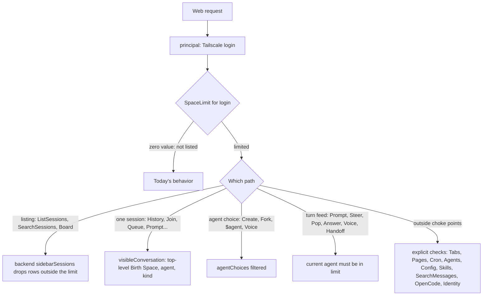

# Space Permissions - Plan

## Goal Capsule

- **Objective:** An operator can name Tailscale logins under a Space in `rocketclaw.json`, and those people reach only that Space in the Web: its sessions and its agents. Everyone not named keeps full access.
- **Means:** One per-person limit computed from config at request time, enforced at the existing Web choke points (the sidebar listing reader, `visibleConversation`, `agentChoices`), plus explicit checks on the few endpoints that bypass them (KTD2, KTD3, KTD4, KTD6).
- **Authority:** the user's request, then R-IDs, then KTDs, then unit text. Assumptions (AS-IDs) are unconfirmed bets the PR body must list.
- **Execution profile:** one PR. The config key and every guard ship together, so no state exists where the key is accepted but not enforced. Deep plan: Go backend and RPC, small Web UI changes, docs, a recorded demo.
- **Stop conditions:** a change would alter behavior for people not named in `permissions`; the Go or TS CLOC budget would be exceeded; a Web endpoint is found that reads or acts on a session, agent, or space with no place to put the check.
- **Who finishes:** `ce-work` implements and verifies; LFG reviews, records the demo, and opens the PR.

---

## Product Contract

### Summary

Add a `permissions` object to RocketClaw's config that maps a Space name to Tailscale logins. A person listed there sees only those Spaces, the sessions in them, and the agents assigned to them, and can only take turns with those agents. Agents with no space are hidden from them. People not listed are unaffected.

### Problem Frame

RocketClaw's Web treats every person Tailscale admits the same: every space, every session, every agent. The operator wants to let some people in for one area of work, such as a team or a customer, without showing them everything else on the server. Today the only lever is whether Tailscale admits someone at all. Sessions can still change agents after they start: an unrestricted person may hand a session to another space's agent. The limited person must keep seeing that session but must not drive the outside agent.

### Requirements

**Configuration**

- R1. `rocketclaw.json` (and the legacy `femtoclaw.json`) accept `"permissions": {"<tailscale login>": ["<space name>", ...]}`. A person whose Tailscale login is a key is limited to the spaces listed for it, one or more. Everyone else behaves exactly as today.

**What a limited person can see**

- R2. Only their spaces appear in the Web: space picker, tabs, and Shared groups.
- R3. Only the sessions of their spaces appear or open: sidebar, palette, Search pages, message search, Dashboards, History, attachments, live updates, and the Thread Queue (rule in AS3).
- R4. Only agents of their spaces are listed or usable. Agents without a space are never exposed: not in the agent picker, Agents page, agent tags, or anything derived from an agent, such as its Hosted Pages, Page Data, or cron jobs.

**Turns**

- R5. A limited person can start or feed a turn only when the session's current agent belongs to one of their spaces.
- R6. When an unrestricted person switches a visible session to another space's agent and takes turns, the limited person still sees the session and its history but cannot take turns until the session is switched back to one of their agents. They can make that switch themselves.

**Demo**

- R7. Screenshots and a screen recording show what a limited person and an unrestricted person each see and can do on the same server.

### Success Criteria

- A limited person reaching any Web endpoint gets only their spaces' data, or a refusal. A full-list equality test proves this for every listing.
- People not named in `permissions` see byte-identical responses to today's. Existing tests pass unchanged, apart from fixtures that now need config. `limited` is an `optional` field set only for limited people, so Identity replies stay identical.

### Scope Boundaries

- Slack, External MCP, and cron delivery are not Web and keep their own allowlists.
- Agents act with their own permissions. An in-space agent that has the `rocketclaw_sessions_*` tools, a host shell, or the config-editing skill can reach beyond the space for whoever prompts it. The same holds for a `sudo` agent, and for a `task` permission that reaches agents outside the space. Operators who limit people must give their space's agents none of those. This is documented, not enforced.
- Remote RocketClaws apply their own `permissions`. The local config cannot limit what a person does on another server.
- Not built: re-checking a queued or stashed item's agent when it starts. The check happens when the item is admitted (R5). Only an unrestricted person switching the agent in between can change the outcome, and they can already take turns with that agent. Evidence that would change this call: a need to limit what the unrestricted person's switch enables.
- Not built: hiding a Shared group tab of the limited person's space whose session lies elsewhere. Opening it is refused (R3), and filtering would cost one lookup per tab. Evidence that would change this: Shared tabs leaking titles.
- Not built: rewriting a limited person's own saved tabs that sit in other spaces. The Web already moves its current space and tabs to a space the Tabs reply lists, and an old tab opens into a refusal. Evidence that would change this: such tabs confusing people.
- Not built: protecting a space named in `permissions` from rename or delete by unrestricted people. A rename moves the limited person's view at once, so they notice it. To recover, the operator deletes the empty space the limited person's next page load recreated and renames the original back, or edits the config. Evidence that would change this: renames happening by accident.

### Open Questions

- Should limited people see Slack threads? Under AS3, a Slack thread answered by one of their space's agents is in their space. They can read it and prompt it from the Web, and the replies post to Slack, which goes around the Slack channel's own allowlist. The plan keeps this because it follows the session rule the request names. Hiding Slack threads from limited people is a one-condition change in the AS3 predicate.

#### Deferred to Follow-Up Work

- Live config reload of `permissions` without a Restart.

---

## Planning Contract

### Assumptions

These are unconfirmed bets made without the user present. The PR body lists them.

- AS1. Logins match the Tailscale login name ignoring case. Space names match ignoring case, like agents' `space:` today.
- AS2. A login listed under several spaces may use all of them.
- AS3. A session is in a space when its Birth Space is that space, or, with no Birth Space, when its current agent's `space:` names it. A session with neither is in no space a limited person has. Subagent and permission-review histories follow their top-level session; shadow sessions follow their parent; cron run traces follow their cron (AS5). Unlike the Dashboard rule, a session with no Birth Space and a spaceless agent is not in every space. A session with no Birth Space (a Slack thread, an External MCP chat, or one whose space was deleted) leaves a limited person's view when someone switches it to an outside agent, and returns when it is switched back.
- AS4. A space listed in `permissions` that does not exist yet is created when its limited person's Web loads its tabs, so the Web always has a space to show them. Nothing else creates it. A rename by an unrestricted person breaks the name link, as it already does for agents' `space:`.
- AS5. Cron jobs, cron runs, and cron traces follow the cron's space: its own `space`, else its agent's. Running a cron also needs its agent to be one of theirs (R5). Hosted Pages and Page Data follow the page's space: its agent's, or its OpenCode session's Birth Space.
- AS6. The following count as starting or feeding a turn (R5): Prompt (`$goal`, steer, queue, stash), `SteerQueueItem`, `PopQueueItem`, `AnswerQuestion`, a Voice call and each voice hand-off, the Handoff summary (a model call with the agent's model), `RunCronJob`, and creating a session or a voice conversation. `EditQueueItem` also feeds a turn, because the edited item runs with the session's agent. A steer into a running turn feeds that turn's agent, which can differ from the session's current agent after a switch. `$stop`, removing or reordering queue items, revert, rename, pin, tag, delete, and moving work to the background need only the session to be visible. In the Web, the composer already sends `$agent <first listed agent>` before a send when the current agent is not listed. So a limited person's first send on a switched session switches it back (R6).
- AS7. A limited person cannot create, rename, or delete spaces, nor share, edit, or unshare tabs in another space's Shared group. The space menu hides these actions for them.
- AS8. A limited person gets no OpenCode. OpenCode sessions are not listed for them, OpenCode create and fork are refused, and the `/oc/` proxy refuses them, because the proxy gives full control of every OpenCode server, including its shell.
- AS9. Global, non-space data stays available to limited people: the workflow list, Slack names, the full skill list, and Config, with Config's Slack channel agent lists filtered to their agents (R4). Reload is refused for them, because reloading changed agent files can widen what their limit admits.
- AS10. A config whose `permissions` has a blank space name, a blank login, or the same space twice ignoring case fails to load. Changes take effect on Restart, like the rest of `rocketclaw.json`.
- AS11. The new checks (visibility, turn feeding, Tabs, Reload, OpenCode) refuse with `PermissionDenied` (HTTP 403) and a plain message. Page lookups keep `NotFound`. Paths that already refuse an agent `agentChoices` does not offer (CreateSession, ForkSession, `$agent`, VoiceSettings) keep their existing codes.

### Key Technical Decisions

- KTD1. **Config shape: `Permissions map[string][]string` on `config.Config`, plus a lookup returning the space names that list a login.** Validated in `Validate` beside `validateRocketClaws` (AS10). Deep-cloned in `LockedConfig.clone`. The Web already reads `s.cfg.Clone()` per request, so no new plumbing is needed.
- KTD2. **A `backend.SpaceLimit` value describes one person's reach: their spaces (IDs and names) and the agents whose `space:` names one of them.** `SessionService` computes it per request from the locked config, `web_spaces`, and `LoadRuntimeDefinitions`. Building it never writes. Only the Tabs handler creates missing listed spaces (AS4), using the idempotent `ON CONFLICT ((lower(name)))` insert that `createConversation` already uses, so concurrent first loads all succeed. Its zero value limits nothing, and an unlisted person's lookup does no database or disk work. It answers four questions: may this agent be used, may this space ID be shown, may this space name be shown, and may a session with this Birth Space, agent, and kind be shown (AS3, AS8). Chosen over a `[]string` of names threaded through calls, because every check also needs IDs and agent membership.
- KTD3. **The listing filter lives in backend `sidebarSessions`, applied in Go after the rows are scanned.** It is the single reader under `SidebarChats` (ListSessions), `SearchSessions`, and `Board`, and it already receives the username. This filters every listing with no per-RPC code and keeps the per-person delta cache and coalesced searches correct, because those are keyed by username. Go rather than SQL, so the predicate is the same code as the single-session check (KTD4). It also covers the remote OpenCode branch of the `UNION ALL`, which a SQL filter on one branch would miss (`docs/solutions/logic-errors/remote-opencode-fork-marker-dropped-by-sidebar-remote-branch.md`).
- KTD4. **The single-session check is added to `rpc.Server.visibleConversation`.** It uses a backend query that walks `ancestorsSQL` to the top-level conversation and returns its Birth Space ID, agent, and kind. Every per-conversation RPC already passes through `visibleConversation`, or through `readableConversation`, which maps shadows to their parent first. Putting the rule at the choke point follows the lesson in `docs/solutions/security-issues/external-mcp-caller-metadata-shared-the-routing-map.md`: a list of RPCs to block misses new readers.
- KTD5. **Agent use is checked against the agent that will actually run.** `agentChoices` drops agents outside the limit, which covers CreateSession, ForkSession, VoiceSettings, and `$agent` through `sessionAgentChoices`. `sameSpace` already keeps every allowed choice when the current agent belongs to a foreign space, so `$agent` can switch back (R6). One RPC helper reads the session's current agent (`Thread`) and refuses turn-feeding calls (AS6) when the limit excludes it.
- KTD6. **Endpoints outside the choke points get explicit checks, each in its handler:**
  - SearchMessages: hits kept only for chats `SidebarChats` yields; flight key includes the username.
  - History cron traces (AS5).
  - ListCronJobs and RunCronJob.
  - GetPage and ListPages.
  - Tabs.
  - ListAgents, and the agent tags and OpenCode servers of ListSessions' first frame.
  - ListConfig's Slack channel agents and ListSkills' `agent`.
  - The OpenCode branches of CreateSession and ForkSession.

  The repo research lists each bypass with file and line (Sources).
- KTD7. **`IdentityResponse` gains an `optional bool limited`, set only for limited people.** The `/oc/` relay already admits through the Identity RPC, so it refuses limited people with no new plumbing (AS8). The Web uses the same field to hide the space menu's New, Rename, and Delete items (AS7). `web.proto` is regenerated with `go generate` (protoc 36.0 and protoc-gen-go v1.36.12 match the checked-in output).
- KTD8. **The demo is a live browser test against a real backend.** It configures `permissions` for the browser's identity, seeds sessions in several spaces, and saves screenshots and a Playwright video under the workspace `.tmp/permissions-demo/`, following the existing `*-transport.test.ts` real-backend pattern, which Go's `runWebTest` drives (for example `entry-transport.test.ts`). It doubles as the end-to-end proof that the Web stays coherent for a limited person.

### High-Level Technical Design

### Sequencing

U1 (config) feeds U2 (backend limit and listing filter). U3 builds on U2 and adds the shared RPC limit helper and `permissions_test.go`. U4 and U5 build on U3 and are independent of each other. U6 (Web UI) needs U5's Identity field. U7 (docs) and U8 (demo) come last.

---

## Implementation Units

### U1. Permissions config key

- **Goal:** Load, validate, clone, and look up `permissions`.
- **Requirements:** R1; AS1, AS2, AS10.
- **Dependencies:** none.
- **Files:** `internal/rocketclaw/config/config.go`, `internal/rocketclaw/config/locked.go`, `internal/rocketclaw/config/config_test.go`, `internal/rocketclaw/config/locked_test.go`, `internal/rocketclaw/rocketclaw.example.json`.
- **Approach:**
  1. Add the field and a `validatePermissions` call to the `Validate` chain. Reuse `normalizeStringList` for the logins.
  2. Add the lookup method from KTD1, matching logins ignoring case.
  3. Deep-clone the map and its slices in `clone()`.
  4. Add a small `permissions` example to `rocketclaw.example.json`. `TestExampleConfigUsesDirectSlackChannels` then loads it for free.
- **Patterns to follow:** `validateRocketClaws`, and the `SlackChannelConfig.AllowedUserIDs` normalization and clone.
- **Test scenarios:**
  - A valid map loads, and the lookup returns the space names for a login written in different case.
  - A login listed under two spaces gets both (AS2).
  - An unlisted login gets nil.
  - A blank space key, a blank login, and two keys equal ignoring case each fail with a `permissions` field-path error (one table).
  - `Clone` returns a deep copy: mutating the clone's slice leaves the original intact.
- **Verification:** config tests pass, and the example config validates.

### U2. Backend SpaceLimit, listing filter, and top-level space lookup

- **Goal:** One backend definition of a person's reach that every listing honors.
- **Requirements:** R2, R3, R4; AS3, AS4, AS8.
- **Dependencies:** U1.
- **Files:**
  - `internal/rocketclaw/backend/store_dao.go` (beside `Space`).
  - `internal/rocketclaw/backend/store.go` (`sidebarSessions`).
  - `internal/rocketclaw/backend/session_search.go` (`SearchSessions` principal suggestions).
  - `internal/rocketclaw/backend/session_search_test.go`.
  - `internal/rocketclaw/backend/store_dao_test.go`, or the nearest existing store test file.
- **Approach:**
  1. Add the `SpaceLimit` type and the `SessionService` method that builds it (KTD2). An unlisted login returns the zero value before any query. Add the idempotent creation of missing listed spaces as its own method, for U5's Tabs handler.
  2. In `sidebarSessions`, compute the limit once from `username` and skip rows it rejects. `SidebarChats`, `SearchSessions`, and `Board` inherit the filter (KTD3).
  3. Add the top-level lookup for KTD4: walk `ancestorsSQL` and return the root's Birth Space ID, agent, and kind. Write it with CTEs only, per AGENTS.md.
  4. When the limit applies, `SearchSessions` returns only principal names of the chats it listed.
- **Patterns to follow:**
  - `Board`'s inline space predicate, `session_search.go` around the `rows = slices.DeleteFunc` block.
  - `ShadowParent`'s use of `ancestorsSQL` in `history.go`.
- **Test scenarios:** one fixture serves all of these. It has spaces Main and Ops, and agents `ops-agent` (`space: Ops`), `main-agent` (`space: Main`), and `loose` (no space). Its chats:
  - one born in Ops;
  - one born in Main;
  - one with no Birth Space on `ops-agent`;
  - one with no Birth Space on `loose`;
  - one born in Ops but switched to `main-agent`;
  - a remote OpenCode row born in Ops;
  - a subagent child of the Ops chat.

  Scenarios:
  - `SidebarChats` for a person limited to `ops` returns exactly the Ops-born, the no-birth `ops-agent`, and the switched chat. Compare the whole ID list.
  - The same call for an unlisted person returns every row, the same as before.
  - `SearchSessions` with free text matching every chat returns only the limited person's chats. Principal suggestions name only their chats' senders.
  - `Board` for the Ops space ID returns no `loose` chat for the limited person, but does for an unlisted person (the Dashboard rule stays for them).
  - `Board` for the Main space ID returns no chats for the limited person.
  - Building the limit when Ops does not exist creates nothing. The create-missing method makes Ops once, and two concurrent calls both succeed.
  - The top-level lookup on the subagent child returns the Ops chat's Birth Space and agent.
- **Verification:** backend tests pass under `make -C internal/rocketclaw test`.

### U3. RPC: what a limited person can see

- **Goal:** Every read path in the Web refuses or filters what is outside the limit.
- **Requirements:** R2, R3, R4; AS3, AS5, AS9, AS11.
- **Dependencies:** U2.
- **Files:**
  - `internal/rocketclaw/frontend/rpc/server.go`: `visibleConversation`, `history` cron-trace branch, `listSessions` first frame, `listAgents`, `listSkills`, `listConfig`.
  - `internal/rocketclaw/frontend/rpc/transport.go`: `reload`.
  - `internal/rocketclaw/frontend/rpc/session_commands.go`: `searchMessages`.
  - `internal/rocketclaw/frontend/rpc/pages.go`.
  - New test file `internal/rocketclaw/frontend/rpc/permissions_test.go`.
- **Approach:**
  1. Add a small RPC helper that returns the caller's `SpaceLimit` from `principal`.
  2. `visibleConversation` applies the KTD4 lookup only when the limit applies.
  3. The cron-trace branch of `history` resolves the cron's space (AS5) for limited people. This also covers `DownloadAttachment`, which reads through `history`.
  4. Apply the KTD6 filters for SearchMessages, History cron traces, GetPage and ListPages, ListAgents, ListSessions' first frame, ListConfig, and ListSkills in their handlers. Cron jobs belong to U4, and Tabs and OpenCode to U5. Refuse `Reload` for limited people (AS9) in `transport.go`.
  5. Tests that build `&Server{}` without `cfg` (`tabs_test.go`, several in `server_test.go`) need a config once handlers read it.
- **Patterns to follow:**
  - `TestSessionReads` (`reads_test.go`) for comparing what alice and bob each see.
  - `TestBrowserIdentityIgnoresHeaders` for a table over RPC methods.
  - Inject the login with `rocketclaw-tailnet-login-bin` metadata, as in `sidebar_test.go`.
- **Test scenarios:**
  - ListSessions for a limited person equals exactly the U2 expected ID list. An unlisted person still gets every row.
  - The first ListSessions frame lists agent tags only for `ops-agent`, and no OpenCode servers.
  - History, ListQueue, Join, LoadSessionEntries, and DownloadAttachment on a Main-born chat are refused with `PermissionDenied`. The same calls on the switched Ops chat succeed.
  - History of a cron trace whose cron is in Ops succeeds. One for a Main cron is refused.
  - ListAgents with no session returns only `ops-agent`. With the switched chat's ID, it returns `ops-agent` and `CurrentAgent` stays `main-agent`.
  - SearchMessages for a needle present in every chat returns hits only from visible chats. A concurrent unlisted caller with the same needle still gets all hits, proving the shared flight is not shared across the limit.
  - ListPages lists only `ops-agent` pages. GetPage for `loose` or `main-agent` returns NotFound, both for a file and for Page Data.
  - ListSkills with `agent: main-agent` is empty for the limited person.
  - ListConfig's Slack channels list only allowed agents.
  - Reload is refused for the limited person and still works for an unlisted one.
- **Verification:** `rpc` tests pass under `make -C internal/rocketclaw test`. Each refusal uses `PermissionDenied`, except page lookups, which keep `NotFound`.

### U4. RPC: turns and agent choice

- **Goal:** A limited person drives only their own agents, and can switch a foreign-agent session back.
- **Requirements:** R4, R5, R6; AS5, AS6.
- **Dependencies:** U3.
- **Files:**
  - `internal/rocketclaw/frontend/rpc/server.go`: `agentChoices`, `prompt`, `queueItem`, `answerQuestion`, `createSession`, `listCronJobs`, `runCronJob`.
  - `internal/rocketclaw/frontend/rpc/session_commands.go`: `handoff`.
  - `internal/rocketclaw/frontend/rpc/voice.go`: Voice start and `handOff`.
  - `internal/rocketclaw/frontend/rpc/permissions_test.go`.
- **Approach:**
  1. Filter `agentChoices` by the limit (KTD5).
  2. Add one helper that refuses when the session's current agent is outside the limit. Call it in `prompt` after the `$stop` and `$agent` branches, in `SteerQueueItem`, `PopQueueItem`, and `EditQueueItem`, `answerQuestion`, `handoff`, at Voice start, and in each voice hand-off. A refused hand-off sends the existing notice event and does not end the call.
  3. Check how `SwitchConversationAgent` affects a running turn. If a steer can join a running turn whose agent differs from the session's current agent, the helper must also check the running turn's agent for steers (AS6).
  4. In `createSession`, a cron `source` must be a cron in the limit (AS5).
  5. `listCronJobs` drops jobs and run rows outside the limit.
  6. `runCronJob` needs both the cron's space and its agent to be in the limit.
- **Patterns to follow:**
  - `TestQueueEdit` and `startVoiceHarness` (`voice_test.go`) for real-backend turns.
  - The existing `$agent` tests.
- **Test scenarios:**
  - The limited person prompts the Ops chat on `ops-agent`, and the turn runs.
  - Prompting the switched chat on `main-agent` is refused with a message naming `$agent`.
  - `$stop` on the switched chat succeeds.
  - `$agent ops-agent` on the switched chat succeeds; then the prompt runs (Covers R6).
  - `$agent main-agent` is refused. A bare `$agent` lists only `ops-agent`.
  - Steer, Pop, and Edit on a queued item of the switched chat are refused. Remove and Reorder succeed.
  - While `main-agent` runs a turn, the limited person switches the session to `ops-agent` and sends a steer. The steer does not join `main-agent`'s turn: it is refused, or it waits as the next turn.
  - AnswerQuestion on the switched chat while `main-agent` asks is refused.
  - CreateSession with `main-agent` or `loose` is refused. With `ops-agent`, the new session's Birth Space is Ops.
  - ForkSession of the switched chat is refused: its agent is not offered. Fork of the Ops chat succeeds.
  - VoiceSettings UPDATE to `main-agent` is refused. START with `ops-agent` creates an Ops chat.
  - A voice hand-off after the agent was switched to `main-agent` sends the notice and starts no turn.
  - ListCronJobs shows only the Ops cron and its runs. RunCronJob on the Main cron is refused.
  - An unlisted person can still do every action above on every chat (one table row per action).
- **Verification:** `rpc` tests pass under `make -C internal/rocketclaw test`, including the voice harness.

### U5. Spaces, OpenCode, and Identity

- **Goal:** Tabs show only the limited person's spaces, they cannot reshape spaces, and OpenCode is closed to them.
- **Requirements:** R2, R3; AS4, AS7, AS8.
- **Dependencies:** U3.
- **Files:**
  - `internal/rocketclaw/frontend/rpc/tabs.go`.
  - `internal/rocketclaw/frontend/rpc/relay.go`.
  - `internal/rocketclaw/frontend/rpc/transport.go`: `identity`.
  - `internal/rocketclaw/frontend/rpc/server.go` and `session_commands.go`: the OpenCode branches.
  - `internal/rocketclaw/web/proto/web.proto`, regenerated `internal/rocketclaw/frontend/rpc/web.pb.go` and `protocol.gen.go`.
  - `internal/rocketclaw/frontend/rpc/tabs_test.go`, `internal/rocketclaw/frontend/rpc/opencode_test.go`, `internal/rocketclaw/frontend/rpc/permissions_test.go`.
- **Approach:**
  1. In `tabs`, for a limited person, create missing listed spaces (AS4). Then return only spaces in the limit and only those spaces' Shared tabs.
  2. In `changeTabs`, refuse CreateSpace, RenameSpace, and DeleteSpace, and refuse Share, EditShared, and Unshare when the named space is outside the limit.
  3. `identity` sets `limited` only for limited people.
  4. The relay refuses a limited identity with 403 before proxying.
  5. The OpenCode branches of CreateSession and ForkSession refuse limited people.
- **Patterns to follow:** `TestTabs` (per-IP direct calls) and the relay tests in `opencode_test.go`.
- **Test scenarios:**
  - Tabs for the limited person returns exactly `[Ops]`. When Ops was missing, it now exists.
  - Shared tabs of Main are absent from the reply.
  - CreateSpace, RenameSpace, DeleteSpace, and Share into Main are each refused (one table). Share into Ops of an Ops session succeeds.
  - Identity reports `limited` true for the limited person and false for an unlisted one.
  - A `/oc/<server>/api/session` request from the limited person gets 403 and never reaches the upstream. An unlisted person is proxied.
  - CreateSession with `opencodeServer` set, and ForkSession of an `opencode:` ID, are refused for the limited person.
- **Verification:** `rpc` tests pass. `go generate ./internal/rocketclaw/frontend/rpc` leaves no diff beyond the new field.

### U6. Web UI for limited people

- **Goal:** The Web stays coherent for a limited person: no dead controls and no hardcoded agent they cannot use.
- **Requirements:** R2, R4; AS7.
- **Dependencies:** U5.
- **Files:**
  - `internal/rocketclaw/web/src/api.ts`: the identity type.
  - `internal/rocketclaw/web/src/ui.tsx`: `SpaceMenu`, Handoff's New session, which creates `agent: "main"`.
  - The nearest existing browser test file for the space menu, likely `internal/rocketclaw/web/src/tabs.browser.test.ts`.
- **Approach:**
  1. Read `limited` from the identity query and hide New, Rename, and Delete space.
  2. Handoff's New session uses `main` when ListAgents offers it, else the first agent offered. That is the composer's rule for a new session, so unlisted people keep `main` as today.
  3. When the session's current agent is not among ListAgents' agents, a pending question card shows no answer controls, and Send takes the normal path. That path's existing auto-switch then moves the session to one of the person's agents (AS6).
  4. Check the Voice page's default agent (`"main"`) against what VoiceSettings returns for a limited person, and change it only if it would send a refused agent.
  5. Keep the code shapes react-doctor requires (`docs/solutions/best-practices/react-doctor-complexity-limit-shapes-web-components.md`).
- **Patterns to follow:** existing `queries.identity()` reads in `ui.tsx`.
- **Test scenarios:**
  - With a mocked Identity reply where `limited` is true, the space menu shows the space list and none of New, Rename, or Delete space. With `limited` false, all three show as today.
  - An unlisted person offered `assistant` and `main` starts Handoff's New session with `main`. A limited person offered only `ops-agent` starts it with `ops-agent`.
  - With `currentAgent: main-agent` absent from the list and a question pending, the card has no answer buttons. Send posts `$agent ops-agent` and then the prompt, and never calls AnswerQuestion.
- **Verification:** web lint (react-doctor) and the touched browser tests pass, and the TS CLOC budget holds.

### U7. Documentation

- **Goal:** Operators can configure the feature and know its limits.
- **Requirements:** R1; Scope Boundaries; AS1 to AS10.
- **Dependencies:** U1 to U6.
- **Files:**
  - `README.md` ("Web page" section, beside Remote RocketClaws).
  - `internal/rocketclaw/frontend/rpc/README.md` ("Identity boundary").
  - `internal/rocketclaw/web/README.md` ("Spaces").
  - `CONCEPTS.md`: Space ("shared by everyone"), Dashboard, Page Index, Shared Group, plus a new entry for the limit's vocabulary.
  - `internal/rocketclaw/skel/.rocketclaw/skills/main-update-rocketclaw-json/SKILL.md`.
- **Approach:**
  - Document the config shape and the AS3 rule.
  - State that changes need a Restart.
  - State that agents' own tools are not limited (Scope Boundaries), and that remote RocketClaws apply their own permissions.
  - Qualify CONCEPTS.md rules that say "everyone" or "every space".
- **Test scenarios:** Test expectation: none -- documentation only.
- **Verification:** each doc names the key, its shape, the restart rule, and the agent-tool caveat once, without contradicting the others.

### U8. Recorded demo

- **Goal:** Screenshots and a video show a limited and an unrestricted person on one server.
- **Requirements:** R7.
- **Dependencies:** U3 to U6.
- **Files:**
  - A new live test in `internal/rocketclaw/frontend/rpc/live_test.go`, or a sibling `*_test.go` beside it.
  - A new browser file `internal/rocketclaw/web/src/permissions-transport.test.ts`, which the Go test runs through `runWebTest`.
- **Approach:**
  1. Start a real backend, as the existing live tests do.
  2. Write agents in Ops, in Main, and with no space.
  3. Seed chats in each space.
  4. Set `permissions` so the browser's identity is limited to Ops, then swap the locked config to unlimited for the comparison pass (`LockedConfig.Store`, as tests already do).
  5. Record video through Playwright's context recording, and save numbered screenshots under `.tmp/permissions-demo/`. If the container lacks Playwright's ffmpeg, save frequent frames instead and assemble them into a video on the host with `ffmpeg`, which is installed there.
  6. Show the flows:
     - the space picker holds only Ops;
     - the sidebar holds only Ops chats;
     - the agent picker holds only `ops-agent`;
     - on the switched chat the agent picker offers only `ops-agent`, and the first send switches the chat back to `ops-agent` before the prompt runs (U4's RPC tests prove the refusal itself);
     - the unrestricted view shows everything.
  7. Use a space other than Main (`docs/solutions/logic-errors/web-tab-state-holds-a-placeholder-main-space-before-its-first-load.md`).
- **Test scenarios:**
  - The limited pass asserts the visible space names and sidebar titles exactly.
  - The unrestricted pass asserts all spaces are present.
- **Verification:** the test passes in the Linux container, and the screenshots and `.webm` exist under `.tmp/permissions-demo/`. The browser bundle is rebuilt before the run (`docs/solutions/best-practices/web-browser-tests-run-the-last-bundle-that-built.md`).

---

## Verification Contract

| Gate | Command | Applies to |
| --- | --- | --- |
| Go format | `gofmt -l` on touched Go files is empty | U1 to U5, U8 |
| RocketClaw tests, coverage ≥ 91.8%, Go CLOC budget 41750 | `make -C internal/rocketclaw test`, which runs on Linux in the container on a Mac | U1 to U5, U8 |
| Repo lint | `make lint` | all |
| Repo tests | `make test` | all |
| Web lint (react-doctor) and TS CLOC budget 9300 | `make -C internal/rocketclaw/web lint` and `make check-cloc-budget` | U6 |
| Proto regenerated | `go generate ./internal/rocketclaw/frontend/rpc` leaves a clean diff | U5 |

---

## Definition of Done

- Every R-ID holds, and every AS-ID is listed in the PR body as an assumption.
- A limited person's full listings equal the expected sets in tests (U2, U3), and every refusal path in U3 to U5 has a test.
- People not named in `permissions` see the same results as before: existing tests pass unchanged except for fixtures that needed `cfg`.
- No `//nolint`, no `SOURCE_CLOC_BUDGET` edits, no subqueries in new SQL, and no defensive nil guards on the new limit (its zero value is the inert form).
- Screenshots and the video exist under `.tmp/permissions-demo/`.
- Abandoned or experimental code from approaches that did not pan out is removed from the diff.

---

## Sources & Research

- Endpoint-by-endpoint map, with file and line for every bypass of `visibleConversation`: `.tmp/research/ce-plan-research/d6abdcfa/repo-research.md` (machine-local).
- Learnings applied:
  - `docs/solutions/security-issues/external-mcp-caller-metadata-shared-the-routing-map.md` (choke points over deny lists; full-list equality tests);
  - `docs/solutions/logic-errors/remote-opencode-fork-marker-dropped-by-sidebar-remote-branch.md` (both union branches);
  - `docs/solutions/architecture-patterns/web-keep-alive-views-connection-budget.md` (per-person caches);
  - `docs/solutions/logic-errors/web-tab-state-holds-a-placeholder-main-space-before-its-first-load.md` (test with a non-Main space);
  - `docs/solutions/best-practices/frontend-rpc-tests-need-setup-in-fresh-jj-workspaces.md` (unix-socket path length in workspaces).
- Session-to-space rule today: `Board` in `internal/rocketclaw/backend/session_search.go`; `sameSpace` in `internal/rocketclaw/frontend/rpc/server.go`.
- Identity: `Server.principal` and `tailscaleUsername` in `internal/rocketclaw/frontend/rpc/server.go`. Both the tailnet listener and the plain listener resolve the Tailscale login, so the limit applies on either.
