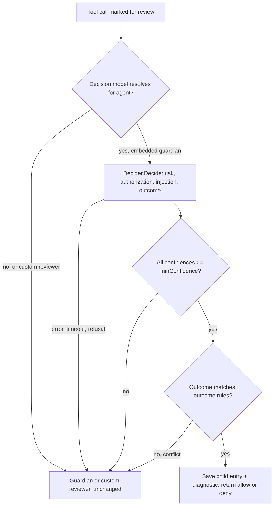

# Decision Models - Plan

## Goal Capsule

- **Objective:** Operators can configure decision models (OpenAI Decisions, TypeSafe System One) so that most Permission Reviews are settled in a fast, cheap decision call, while uncertain cases still get today's full review, and opted-in agents can ask typed questions through a `decision` tool.
- **Means:** Provider-neutral decision clients in the harness, injected per configured provider, called first by Permission Review and by an opt-in `decision` tool (KTD1, KTD3, KTD4).
- **Product authority:** The user, in the brainstorm conversation of 2026-11-09. Every Key Decision below was settled by the user. The Product Contract outranks the Planning Contract; the Planning Contract outranks unit text.
- **Execution profile:** One pull request. Units land in order U1 to U6.
- **Stop conditions:** Stop and report if the source CLOC budget (`internal/rocketclaw/Makefile` `GO_SOURCE_CLOC_BUDGET`) would be crossed, or if keeping existing saved-review readers working requires changing their stored format.
- **Who finishes:** `ce-work` implements and verifies; the `lfg` pipeline reviews and ships.
- **Open blockers:** None.

---

## Product Contract

### Summary

A new top-level `decision` block in `rocketclaw.json` / `femtoclaw.json` configures decision-model providers (`openai`, `typesafe`).
Permission Review asks a decision model first and acts on its answer only when it is confident and consistent; otherwise the current reviewer decides exactly as today.
Agents that opt in through their frontmatter get a model-facing `decision` tool.

### Problem Frame

Every Permission Review today runs a full reviewer agent loop (the guardian or a custom reviewer) on a chat model.
That loop is slow and costly for routine actions that a calibrated classifier could settle in one call.
Decision models (OpenAI's `POST /v1/decisions` on `gpt-6-luna`, TypeSafe's System One API on Jev) return typed answers with probabilities and confidence, which makes "act only when sure" possible in code.

### Key Decisions

- **Decision models augment Permission Review; they never replace it.** They run first when available, and anything short of a confident, consistent answer goes to the current reviewer. Governs R5, R6, R7, R8. (session-settled: user-directed — chosen over replacing the guardian loop or only using the decision model as an extra signal: keep today's reviewer as the authority for unclear cases)
- **Decision model and confidence threshold are per agent, with config defaults.** They are set in agent frontmatter and fall back to config-file defaults, mirroring how `approver.model` falls back to `auto_approver_model`. Governs R3, R4. (session-settled: user-directed — chosen over a provider-level threshold in the `decision` block or a fixed threshold in code: matches existing auto-approver model selection)
- **The `decision` tool is opt-in per agent.** Governs R10. (session-settled: user-directed — chosen over giving it to every agent whenever a provider is configured, or gating each call behind Permission Review)
- **The decision model judges the same four things the guardian decides, and may both allow and deny.** Governs R5, R6. (session-settled: user-approved — chosen over a decision model that may only allow: the user accepted the proposed question set and conflict rules)

### Requirements

**Configuration**

- R1. The runtime config accepts a top-level `decision` object whose keys name decision providers; `openai` and `typesafe` are supported, each with its own connection parameters (credentials and endpoint).
- R2. A configured provider is validated at load time like other providers: missing credentials or an unknown provider key is a config error.
- R3. The config file carries defaults for the Permission Review decision model (a `provider/model` reference such as `openai/gpt-6-luna` or `typesafe/jev-latest`) and its minimum confidence, in the same way `auto_approver_model` is the default reviewer model.
- R4. An agent's frontmatter can set its own Permission Review decision model and minimum confidence, overriding the config defaults, alongside its existing approver settings; a referenced decision provider that is not configured fails agent loading.

**Permission Review**

- R5. When a decision model resolves for the reviewed agent (R3, R4), Permission Review first sends one decision request with the review context and planned action, asking: risk (score: low, medium, high, critical), user authorization (score: unknown, low, medium, high), prompt injection (predicate), and outcome (choice: allow, deny).
- R6. The decision model's outcome is final only when every answer's confidence (for predicates, its probability's distance from undecided) meets the minimum confidence and the answers agree with the existing outcome rules: low and medium risk allow; high risk allows only with at least medium authorization; critical risk denies; detected prompt injection denies.
- R7. Any other result goes to the current reviewer (embedded guardian or custom reviewer) unchanged: low confidence, conflicting answers, a refusal, an API error, or a timeout.
- R8. With no decision model resolved, Permission Review behaves exactly as today.
- R9. A decision reached by the decision model appears wherever a Permission Review's outcome and reason appear today (Script Call Records, auto-approver diagnostics, saved review history), and identifies that a decision model made it.

**The `decision` tool**

- R10. An agent whose frontmatter turns it on gets a model-facing tool named `decision`; other agents do not see it.
- R11. The tool lets the model send shared input plus one or more predicate, choice, or score questions to a configured decision provider and returns each answer with its probabilities and confidence, or the refusal or error.

### Acceptance Examples

- AE1. **Covers R5, R6.** Given an agent with decision model `openai/gpt-6-luna` and minimum confidence 0.9, when the decision model answers risk low (confidence 0.95), authorization medium (0.93), injection probability 0.02, outcome allow (0.97), then the call is allowed without running the guardian, and the record says a decision model allowed it.
- AE2. **Covers R6, R7.** Given the same agent, when the outcome is allow with confidence 0.8, then the guardian reviews the call as today.
- AE3. **Covers R6, R7.** Given the same agent, when every confidence is above 0.9 but risk is critical and outcome is allow, then the answers conflict and the guardian reviews the call.
- AE4. **Covers R6.** Given the same agent, when risk is high (0.95), authorization unknown (0.92), injection probability 0.03, and outcome deny (0.96), then the call is denied without running the guardian.
- AE5. **Covers R7.** Given the decision provider returns an error or refuses any question, then the guardian reviews the call and the error does not by itself block it.
- AE6. **Covers R4, R8.** Given an agent whose frontmatter sets no decision model and a config with no decision default, then Permission Review runs only the guardian.
- AE7. **Covers R10.** Given two agents where only one turns on the `decision` tool in its frontmatter, then only that agent's model sees a `decision` tool.

### Scope Boundaries

- The bundled OpenCode web app's own auto-approve feature (`internal/rocketclaw/oc/`) is untouched.
- Decision models do not replace the reviewer, and there is no mode where a decision-model failure blocks a call by itself.
- Image inputs, TypeSafe Box questions, prompt-cache tuning, and usage reporting are not part of this work.
- Considered and not built: retries on decision-provider errors. The guardian fallback already handles a failed call, so a retry would only delay the review; revisit if providers prove flaky.
- Considered and not built: showing the new config keys in the Web settings view (`ConfigView`). Nothing in the request needs them there.

### Dependencies / Assumptions

- OpenAI Decisions is already in the vendored `openai-go/v3` SDK (`client.Decisions.New`); TypeSafe has no Go SDK, so its System One HTTP API needs a small client.
- Assumption: the decision model runs first for custom reviewers too, not only the embedded guardian, since it sits in front of "the current implementation" whichever reviewer that is.

### Sources / Research

- `internal/rocketclaw/harness/permission_review.go` — `reviewPermission`, the guardian outcome rules, and the structured decision schema.
- `internal/rocketclaw/harness/easy.go` — the `approver:` frontmatter block (`model`, `prompt`).
- `internal/rocketclaw/config/config.go` — `AutoApproverModel` and provider validation.
- `vendor/github.com/openai/openai-go/v3/decision.go` — OpenAI Decisions client.
- https://developers.openai.com/api/docs/guides/decisions — request shape, question types, confidence.
- https://docs.typesafe.ai/llms.txt and https://docs.typesafe.ai/api/system-one.md — TypeSafe System One API.
- `CONCEPTS.md` — Permission Review, Script Call Record, Provider.

---

## Planning Contract

Product Contract preservation: Product Contract unchanged; KTD1 to KTD8 settle the implementation choices it left to planning.

### Key Technical Decisions

- KTD1. **Config shape.** `decision` is a map from provider name (`openai`, `typesafe`) to `{api_key, api_base_url}`; any other key, or a provider without `api_key`, fails `Validate`. Two top-level defaults sit beside `auto_approver_model`: `auto_approver_decision_model` (`provider/model`, its provider must be in `decision`) and `auto_approver_min_confidence` (0 to 1). Governs R1, R2, R3.
- KTD2. **Decision credentials are separate from chat providers.** `decision.openai` never reuses the `openai` chat provider. A ChatGPT sign-in provider points at the Codex backend, which does not serve `/v1/decisions`, and the user's sketch gives each decision provider its own parameters. Governs R1.
- KTD3. **One harness interface, two clients, injected as a map.** The harness gets `Deciders map[string]Decider` in `harness.Config`, keyed by provider name. `Decider` asks one request (model, trusted instructions, untrusted input, questions) and returns normalized answers. OpenAI gets the instructions as a developer message and the input as a user message; TypeSafe gets a `state` object with separate `instructions` and `evidence` keys. `openAIDecider` wraps the vendored `client.Decisions.New`; `typeSafeDecider` posts to `<base>/v1/systemone` with a bearer key and the `TypeSafe-Danger-Zone-Long-Context: true` header, since review prompts often exceed TypeSafe's default context. Both live in `internal/rocketclaw/harness/decision.go`; the backend builds the map from config. A provider missing from the map is "not configured": config and agent loading reject such references, and the `decision` tool returns a tool error for a model whose provider is absent, so no nil or inert decider is needed. Governs R1, R5, R11.
- KTD4. **Normalized answers and confidence.** Every answer becomes `{name, type, probability, choice, score, confidence, probabilities}` with type `predicate`, `choice`, `score`, or `refusal`. A predicate's confidence is `|2p - 1|`, its distance from undecided scaled to 0 to 1, because neither API reports one for yes/no questions. A score's level is its most probable level, not the rounded expected score, so a split such as 55% low and 45% critical cannot round to medium. TypeSafe's `noul` maps to predicate, its `criteria` map to choice values and ordered score levels. Governs R6, R11.
- KTD5. **Per-agent settings live on the easy-agent `approver` block.** `approver` gains `decisionModel` and `minConfidence`, beside `model` and `prompt`. Advanced agents have no approver block today and use the config defaults, exactly as they do for `auto_approver_model`. When an agent sets `decisionModel` without `minConfidence`, the config default applies, then 0.9. Governs R3, R4. (session-settled: user-directed — chosen over a provider-level threshold or a fixed threshold in code: per-agent frontmatter with config defaults, like the approver model)
- KTD6. **The `decision` tool is a permission bucket whose subjects are models.** The tool takes a `model` argument, so the existing permission gate decides which models an agent may use. An advanced agent turns it on with a `permission` rule such as `decision: {"typesafe/*": allow}`. An easy agent gets a new `decision` key listing allowed models, compiled to allow rules. With no rule the tool is invisible, via the existing `toolVisible`. Governs R10, R11. (session-settled: user-directed — chosen over giving the tool to every agent or gating every call with review: opt-in per agent)
- KTD7. **Decision-first review is a prefix of the embedded guardian path in `reviewPermission`.** It runs only when the request goes to the embedded guardian (`ReviewerEmbedded`); a custom reviewer chosen with `auto(<agent>)` keeps sole authority, because the decision model cannot carry that reviewer's own rules. The trusted instructions are the guardian's prompt with tenant rules and the turn-origin rule, exactly as the guardian receives them; the untrusted input is the rendered review prompt (`permissionReviewPrompt`). The four questions follow R5. A pure function applies R6's rules. A final answer returns before the guardian child looper is built. Every non-final result continues into the unchanged guardian path and, when diagnostics are on, emits an `auto-approver` diagnostic naming the fallback reason (low confidence, conflict, refusal, or the error), so a misconfigured provider is visible. The call has its own 30-second timeout so a hung provider cannot spend the guardian's 90 seconds. Governs R5, R6, R7, R8.
- KTD8. **A decision-model verdict is saved like a guardian answer.** The decision path appends one child-session entry under the review's child key, holding the review prompt and a final assistant message with the decision JSON (`risk_level`, `user_authorization`, `outcome`, `rationale`). The existing readers (`PermissionReviewDecision`, `CodeModeCall`, Web `reviewRationales`) then work unchanged. The rationale names the decision model and its answers, and the diagnostic reviewer name is `decision:<provider/model>`. Governs R9.

### High-Level Technical Design

Permission Review with a decision model, as directional guidance:

Outcome rules, owned by R6: injection probability at or above 0.5 means deny; critical risk means deny; high risk allows only with authorization at least medium; low and medium risk allow.

### Assumptions

- The default minimum confidence is 0.9 when neither frontmatter nor config sets one.
- The decision-first step runs only in front of the embedded guardian (KTD7); custom reviewers are unchanged.
- Tenant deny rules in `approver.prompt` reach the decision model through the trusted instructions shared by all four questions; the conflict check cannot see them, so a confident allow that a tenant rule forbids relies on the decision model reading those rules.
- The decision model cannot run the guardian's read-only tool checks; it judges from the transcript and planned action alone. This is inherent to a single decision call and accepted with the user's augment-first decision.

### Decisions After Review

- Custom reviewers opt in: a reviewer agent's own `decisionModel` and `minConfidence` frontmatter make its reviews ask that decision model first, with its own prompt as the instructions (user-directed, over keeping custom reviewers decision-free). The runtime default still applies only to the embedded guardian.
- A fifth predicate, `needs_investigation`, sends a review to the reviewer when judging it would need files or state the evidence does not show (user-directed, over accepting the gap or stripping the guardian's inspection rules).
- TypeSafe receives the trusted instructions inside each question's `instructions`, and `state` holds only the evidence (user-directed, over keeping the rules in `state` or dropping them).
- The `decision` tool runs only inside Code Mode `execute`, not as a model-facing tool: a script passes a JSON `state` and questions by name, each with criteria describing its options, and gets a dict of answers back; provider failures come back as `stop_reason: "error"` because Starlark cannot catch errors (user-directed, over the top-level tool). R10 and AE7 now read "sees a `decision` tool in Code Mode".
- Frontmatter and config shape, revised 2026-11-10 (user-directed; details in `docs/plans/2026-11-10-1223-refactor-approver-decision-frontmatter-plan.md`): the pre-gate is an object, `approver.decision: {model, minConfidence, prompt}`, in easy agents for reviews of their own calls and in advanced agents only for their reviews of others as `auto(<agent>)`; the config uses `auto_approver_decision: {model, min_confidence}`. This replaces `approver.decisionModel`/`approver.minConfidence`, the top-level reviewer `decisionModel`/`minConfidence`, and `auto_approver_decision_model`/`auto_approver_min_confidence` used above. The decision model reads its own base prompt (the guardian's policy without investigating or answer format) plus `approver.decision.prompt`, and no longer reads `approver.prompt`.
- Each decision provider's `api_base_url` includes the API version, so it can point at another service speaking the same protocol (user-directed).
- The decision tool takes images (workspace files read through the agent's own `read` tool and permissions) and reports token usage; every decision call is a generation span with its tokens. Dollar cost is not computed, since RocketClaw keeps no cost totals (user-directed). This supersedes the earlier scope boundary that left out image inputs and usage reporting.

---

## Implementation Units

### U1. Decision provider config

- **Goal:** Load and validate the `decision` block and the two approver defaults.
- **Requirements:** R1, R2, R3; KTD1, KTD2.
- **Dependencies:** None.
- **Files:** `internal/rocketclaw/config/config.go`, `internal/rocketclaw/config/config_test.go`.
- **Approach:**
  1. Add `Decision map[string]DecisionProviderConfig` (`api_key`, `api_base_url`), `AutoApproverDecisionModel string`, and `AutoApproverMinConfidence float64` to `Config`.
  2. In `Validate`, reject unknown provider keys and missing `api_key`; normalize the decision model the way `normalizeOpenAIModel` trims it, but require a provider qualifier present in `Decision`; reject a confidence outside 0 to 1.
  3. Callers that need provider names take `slices.Sorted(maps.Keys(cfg.Decision))`; no helper.
- **Patterns to follow:** `TestValidateAutoApproverModels` table style; `validateOpenCode` for per-key errors.
- **Test scenarios:**
  - A config with `decision.openai` and `decision.typesafe` loads, and each keeps its key and base URL.
  - `decision.anthropic` fails with an error naming the key.
  - `decision.typesafe` without `api_key` fails.
  - `auto_approver_decision_model: typesafe/jev-latest` with no `decision.typesafe` fails.
  - An unqualified `auto_approver_decision_model: gpt-6-luna` fails because a decision model needs its provider.
  - `auto_approver_min_confidence: 1.5` fails; `0.85` loads.
- **Verification:** Config tests pass, and an existing config with no `decision` block loads unchanged.

### U2. Decision clients

- **Goal:** Ask decision questions through OpenAI or TypeSafe and get normalized answers.
- **Requirements:** R1, R5, R11; KTD3, KTD4.
- **Dependencies:** None.
- **Files:** `internal/rocketclaw/harness/decision.go`, `internal/rocketclaw/harness/decision_test.go`, `.mockery.yml` (add `Decider` as `mockDecider`), generated `internal/rocketclaw/harness/decider_mocks_test.go`.
- **Approach:**
  1. Define the `Decider` interface, a `decisionQuestion` (name, type enum, instructions, options) and a `DecisionAnswer` (KTD4).
  2. `openAIDecider` builds `DecisionNewParams` from questions (choice options become choices, score options become levels) and maps the answer union, including refusals.
  3. `typeSafeDecider` posts JSON with questions keyed by name, then maps `noul`, `choice`, and `score` answers back in question order. A missing answer is a refusal. A non-2xx response is an error carrying the status and body excerpt.
  4. Export constructors the backend calls with an API key, base URL, and HTTP client.
- **Patterns to follow:** `models_test.go` httptest resolver; `mcpclient/registry.go` HTTP client construction.
- **Test scenarios:**
  - OpenAI: an httptest `/decisions` server receives model, string input, and one predicate, one choice, and one score question in order; its canned answers come back normalized with probabilities and confidence.
  - OpenAI: a refusal answer comes back as type `refusal` under its question name.
  - TypeSafe: the request carries `Authorization: Bearer <key>`, `state`, and questions keyed by name with `noul`, choice `criteria` map, and score `criteria` list.
  - TypeSafe: a `noul` of 0.98 becomes a predicate with probability 0.98 and confidence 0.96.
  - TypeSafe: a 422 response returns an error mentioning 422.
- **Verification:** Both clients round-trip all three question types against fake servers.

### U3. Agent frontmatter

- **Goal:** Let easy agents set a decision model, a minimum confidence, and allowed `decision` tool models.
- **Requirements:** R4, R10; KTD5, KTD6.
- **Dependencies:** U1 (provider names).
- **Files:** `internal/rocketclaw/harness/agents.go`, `internal/rocketclaw/harness/easy.go`, `internal/rocketclaw/harness/easy_test.go`, `internal/rocketclaw/backend/bridge.go` (`AgentLoadConfig`), `internal/rocketclaw/agentlint/agentlint.go`.
- **Approach:**
  1. Add `ApproverDecisionModel` and `ApproverMinConfidence` to `Agent`, and `DecisionProviders []string` to `AgentLoadConfig`.
  2. Accept `approver.decisionModel`, `approver.minConfidence`, and a top-level `decision` list in `compileEasyAgent`; check each model's provider against `DecisionProviders`, and compile each `decision` entry to an allow rule in the `decision` bucket.
  3. Pass the configured decision provider names at both `LoadAgents` call sites.
- **Patterns to follow:** The existing `approver` decoding and provider check in `easy.go`.
- **Test scenarios:**
  - `approver: {decisionModel: openai/gpt-6-luna, minConfidence: 0.8}` loads with both fields set.
  - `approver.decisionModel: typesafe/jev-latest` with only `openai` configured fails, naming the provider.
  - `minConfidence: 2` fails.
  - `decision: [typesafe/jev-latest]` produces an allow rule for `decision` with that subject; an easy agent without the key has no `decision` rule.
- **Verification:** Easy-agent tests pass; existing easy agents compile to the same rules as before.

### U4. Decision-first Permission Review

- **Goal:** Settle confident, consistent reviews with the decision model and fall back otherwise.
- **Requirements:** R5, R6, R7, R8, R9; KTD7, KTD8; AE1 to AE6.
- **Dependencies:** U2, U3.
- **Files:** `internal/rocketclaw/harness/permission_review.go`, `internal/rocketclaw/harness/tools.go` (factory fields), `internal/rocketclaw/harness/rocketcode.go` (`Config` fields), `internal/rocketclaw/harness/permission_review_test.go`.
- **Approach:**
  1. Add `Deciders`, `AutoApproverDecisionModel`, and `AutoApproverMinConfidence` to `harness.Config`, copied onto `toolFactory`.
  2. In `reviewPermission`, after the guardian agent and tenant rules are assembled and only when `ReviewerEmbedded`, resolve the agent's decision model and confidence (KTD5); when set, ask the four questions with the shared field descriptions from `permissionReviewResponseFormat`, passing the guardian prompt as instructions (KTD7).
  3. A pure function turns answers into a decision or a fallback signal (R6).
  4. On a final decision, append the KTD8 child entry, emit the diagnostic, and return; otherwise emit the fallback diagnostic and continue to the existing guardian code.
- **Execution note:** Write the R6 rule function test-first as a table; it carries the safety logic.
- **Patterns to follow:** `permission_review_test.go` factory setup; `testModelResolverFunc` for a guardian that must or must not be called.
- **Test scenarios:**
  - Covers AE1. Confident low-risk allow returns allow, makes no guardian model request, and saves an entry whose `PermissionReviewDecision()` is allow with a rationale naming `openai/gpt-6-luna`.
  - Covers AE2. Outcome confidence 0.8 under a 0.9 threshold falls back, and the guardian's answer is returned.
  - Covers AE3. Critical risk with a confident allow falls back.
  - Covers AE4. Confident high risk, unknown authorization, and deny returns deny without the guardian.
  - Covers AE5. A decider error, and separately a refusal on any question, falls back.
  - Injection probability 0.97 with a confident allow falls back as a conflict; with a confident deny it returns deny.
  - Injection probability 0.7 falls back because its confidence (0.4) is under the threshold.
  - Risk probabilities of 0.55 low and 0.45 critical take level low with confidence below the threshold, and fall back.
  - A request routed to a custom reviewer never calls the decider.
  - A fallback emits an `auto-approver` diagnostic naming the reason.
  - Covers AE6. No decision model configured: the decider is never called.
  - An easy agent's `approver.minConfidence` 0.8 accepts an outcome confidence of 0.85 that the config default of 0.9 would reject.
  - The saved entry's `CodeModeCall` still finds the planned action.
- **Verification:** All review tests, including the existing guardian tests, pass.

### U5. The `decision` tool

- **Goal:** Give opted-in agents a model-facing `decision` tool.
- **Requirements:** R10, R11; KTD6; AE7.
- **Dependencies:** U2, U3, U4 (the `Deciders` field).
- **Files:** `internal/rocketclaw/harness/tools.go`, `internal/rocketclaw/harness/decision.go`, `internal/rocketclaw/harness/decision_test.go`.
- **Approach:**
  1. Define the tool with a strict schema: `model`, `input`, and `questions` (each `name`, `type` enum, `instructions`, `options`); nested objects carry `additionalProperties: false` and full `required` lists.
  2. `Permission: "decision"` with the model as its subject; add it to `baseTools` only when at least one decision provider is configured, so `toolVisible` and the permission gate handle opt-in. A `sudo` agent sees it then, with every call reviewed, matching sudo's documented every-tool contract.
  3. Resolve the provider from the model prefix through `Deciders`; an unconfigured provider returns a tool error. Return the answers as JSON text.
- **Patterns to follow:** `find_skills` and `webfetch` tool definitions.
- **Test scenarios:**
  - Covers AE7. An agent with `decision: {"openai/*": allow}` sees `decision` in its model tools; an agent without the rule does not.
  - A call with model `openai/gpt-6-luna` and one choice question returns the mock decider's answer as JSON with probabilities.
  - A call naming `typesafe/jev-latest` when only `openai` is configured returns an error result, not a panic.
  - With no decision provider configured, a `sudo` agent's tool list has no `decision` tool.
- **Verification:** Tool tests pass; no existing agent's tool list changes.

### U6. Backend wiring and docs

- **Goal:** Connect configuration to the harness and document the new keys.
- **Requirements:** R1, R3, R4, R10.
- **Dependencies:** U1 to U5.
- **Files:** `internal/rocketclaw/backend/bridge.go`, `internal/rocketclaw/backend/raw_run.go`, a backend test beside `raw_run_test.go`, `README.md`, `cmd/rocketclaw/CHEATSHEET.md`, `internal/rocketclaw/skel/.rocketclaw/skills/main-create-or-update-agent/SKILL.md`, `CONCEPTS.md`.
- **Approach:**
  1. Build the `Deciders` map from `cfg.Decision` and pass it with the two defaults at both `harness.Config` sites.
  2. Document `decision`, `auto_approver_decision_model`, and `auto_approver_min_confidence` in the providers section; document `approver.decisionModel`, `approver.minConfidence`, the easy `decision` key, and the `decision` permission bucket. In README, the easy-agent review sentence and the sudo paragraph mention the decision model and the `decision` tool.
  3. Update the Permission Review concept to say a decision model may settle a review first.
- **Patterns to follow:** How `AutoApproverModel` reaches both config sites.
- **Test scenarios:**
  - A workflow agent runner built from a config with `decision.openai` pointing at an httptest server and `auto_approver_decision_model` set sends its review to `/decisions` before any `/responses` call.
- **Verification:** Backend tests pass through `make -C internal/rocketclaw test`.

---

## Verification Contract

| Check | Command | Applies to |
|---|---|---|
| Format | `gofmt -l` on touched Go files | every unit |
| RocketClaw tests, lint, coverage, CLOC | `make -C internal/rocketclaw test` (runs in the Linux container on a Mac) | U1 to U6 |
| Repo lint | `make lint` | final |
| Repo tests | `make test` | final |
| Mocks | `go generate ./cmd/rocketclaw` after the `.mockery.yml` change | U2 |

Coverage must stay at or above `COVERAGE_REQUIRED` and source CLOC below `GO_SOURCE_CLOC_BUDGET` in `internal/rocketclaw/Makefile`.

---

## Definition of Done

- Every R1 to R11 is covered by a passing test or, for docs-only parts, by the updated docs.
- AE1 to AE7 each have a test marked `Covers AE<N>`.
- A config and agents without any decision settings behave exactly as before, with existing tests unchanged.
- No nil-checked behavior dependencies, no `//nolint`, and no abandoned experimental code in the diff.
- `make -C internal/rocketclaw test`, `make lint`, and `make test` pass.
