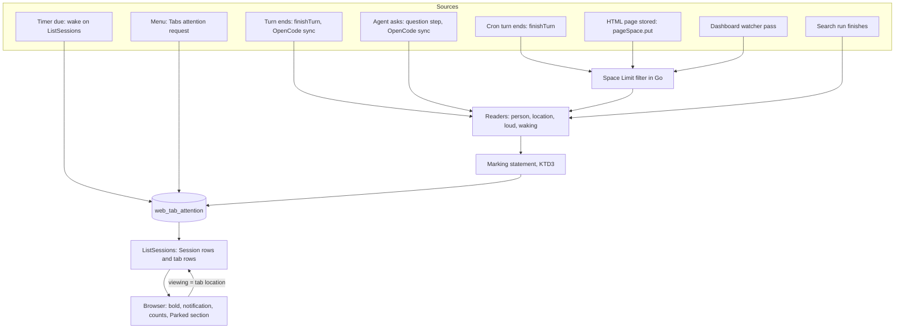
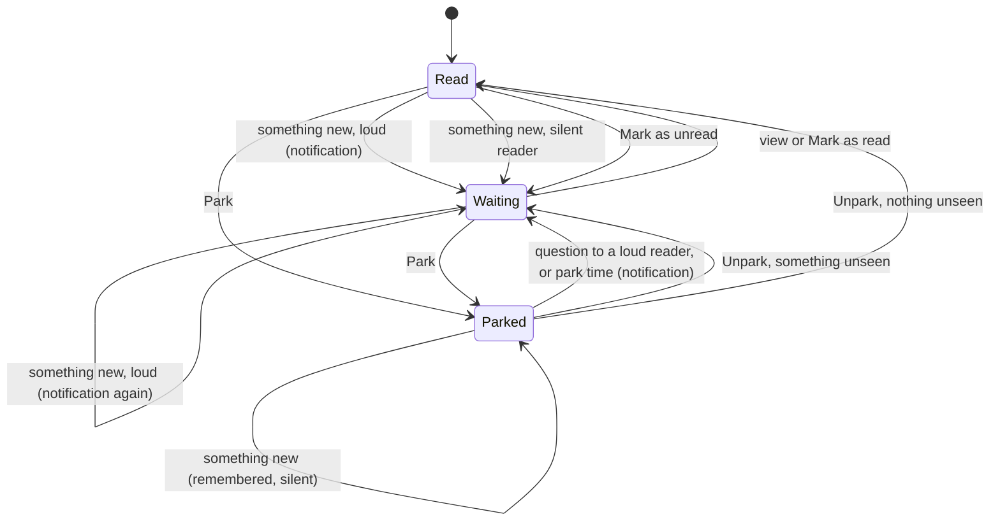
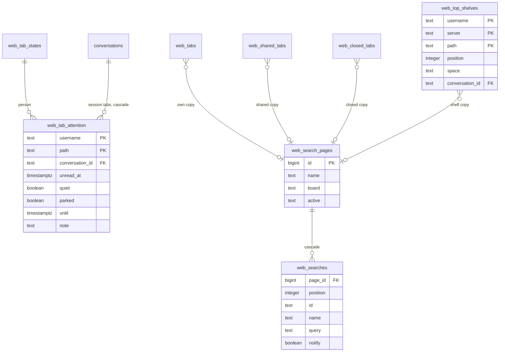
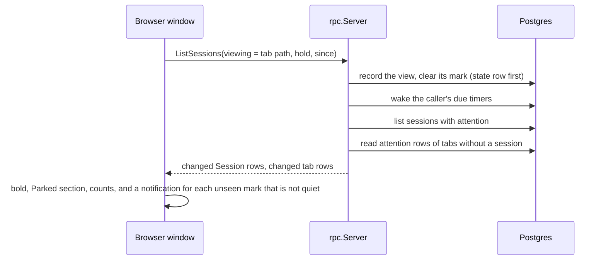

# Tab Attention - Plan

## Goal Capsule

- **Objective:** A person using RocketClaw's Web is told about everything that needs them and nothing else. Any tab that waits for them is bold, a desktop notification is raised when something starts waiting, and they can set a tab aside or have it come back at a time they choose.
- **Means:** One attention state per person per tab, stored and decided on the server (KTD1, KTD3). Mark as read/unread and Park replace Mute and Snooze.
- **Authority:** This plan's Product Contract, then its Planning Contract. `docs/specs/2026-11-09-tab-attention-design.md` is the design record; where the two differ, this plan wins. `AGENTS.md` governs code style, verification and the line budgets.
- **Execution profile:** One pull request, never split (Key Decisions). Deep. Three one-way migrations, protocol changes, two new server-side workers, a rebuilt tab menu. Twelve units, in the order given under Sequencing.
- **Stop conditions:** Stop and report when Go source lines would reach 41,250 or Web source lines 9,050 (KTD20). Stop when a settled decision cannot be met, when a migration cannot keep what R37 keeps, or when the TLA+ model no longer passes shape 7 after a rule in KTD3 changes.
- **Who finishes:** `ce-work` implements and verifies each unit. The PR is opened only after the Definition of Done holds for all units.

---

## Product Contract

### Summary

Every Web tab gets one attention state per person: read, waiting, or parked. Something new makes a tab waiting, which shows bold and raises a desktop notification. A person can mark a tab read or unread, park it until they unpark it, until a time, or, for a session, until its next turn ends. The server notices everything that is new, for sessions, Search pages, Dashboards, Cron tabs and Pages tabs, and it runs Search page searches itself. Attention, the Top Shelf and Search page content move into plain rows, and the upgrade clears old attention state.

### Problem Frame

Today "unread" and "notifications" are two systems with different rules. The server marks a session unread only for the people who sent the turn, or for everyone when the session is in a Shared group. The browser decides on pop-ups from where a person keeps the session and whether they muted it. Mute stops pop-ups but not bold. A session a person keeps open never reaches them when a teammate or a cron moves it. An agent's question, the most urgent state, never raises a pop-up. Dashboards notify through a third path that ignores Mute and works only while a window shows that space. A search is cancelled when its page is left. `docs/explainers/2026-11-09-tab-attention.md` describes each mismatch with code references.

The storage mirrors the split. The unread mark sits on the tab row, keyed by person and path, so closing an unread tab leaves a row with no position behind. Mutes sit in their own table and reach the browser in a different request from the marks. The Top Shelf is one JSON value per person, and Search page content is JSON in four places.

### Requirements

**Attention state**

- R1. Every tab has one attention state per person, kept on the server: read, waiting, or parked. New session, the Preview Tab and kept-group placeholders have none.
- R2. A waiting tab shows bold on every device. A parked tab is never bold.
- R3. Something new on a tab makes it waiting and raises a desktop notification in the person's open windows, unless R4, R6 or R13 makes the mark silent.
- R4. "Mark as unread" makes a read tab waiting without a notification. On the tab in view the mark holds until the person leaves and returns.
- R5. "Mark as read", or viewing a tab in a focused window, makes it read. This also holds while an agent still waits on an answer; the "needs you" badge stays.
- R6. "Park" sets a tab aside until unparked or until a chosen time. The tab shows in the Parked section, and what happens on it is remembered without a notification.
- R7. "Unpark" returns the tab to its place: waiting if something happened that the person has not seen, otherwise read, with no notification either way.
- R8. A parked tab comes back waiting, with a notification, when its time is up or when an agent asks a question that reaches the person with a notification (R12).
- R9. "Until it is done" parks a session's tab until the session's next turn ends, finished, failed or stopped, also when nothing runs yet. That turn end ends the park, and the tab becomes waiting with the reply's own notification. A question ends it early, as it ends any park.
- R10. Closing a tab keeps its unread mark, a park that has a time, and a park until it is done. A park time that comes due on a closed tab, or the turn end a park waited for, brings the tab back where it was: in its space, in its group when that group still exists, and at its old position when possible. Closing a tab parked "Until I unpark" ends the park. "Close others", "Close to the right", "Close all" and "Close group" skip parked tabs.
- R11. The window title count and Cmd/Ctrl+Alt+A cover the waiting tabs the person can see as a tab: own tabs in any space, Shared rows and Top Shelf rows, of any kind. Cmd/Ctrl+Alt+A visits sessions that wait on an answer first, then the rest, longest waiting first.

**Who something new reaches**

- R12. A turn ending or an agent asking reaches four groups. The people who sent or steered that turn from the Web, people with the session in their own tabs, and people with it on a Top Shelf this server keeps become waiting with a notification. People who only see it in the Shared group of a space they can see become waiting without one.
- R13. For a person reached without a notification, something new never replaces a mark that is already there and never unparks the tab.
- R14. A Shared row's menu offers "Add to my tabs" for a session, Cron tab or Pages tab the person does not have, as the way to get its notifications.
- R15. A server acts only on what it stores. A session of another RocketClaw that is only on the person's Top Shelf reaches them for turns they sent.
- R16. A person with a Space Limit never receives a mark, a notification text or a tab location from a space outside their limit.
- R17. Nobody is marked for the tab they are viewing: within 10 seconds of their last reported view for something new, within 4 seconds for a question or a timer.

**What counts as something new**

- R18. Session: a turn ends, or an agent starts asking. Asking keeps today's meaning: a RocketClaw session's running turn waits on an unanswered question, or a remote OpenCode session, or one under it, has a pending form or permission request.
- R19. Search page: a search the person entered finishes after they left the page. Only that person is marked, with a notification.
- R20. Dashboard: a session enters a lane flagged to notify. Everyone who has the Dashboard open is marked with a notification: in their own tabs, on their shelf, or Shared in a space they can see.
- R21. One cron's page: a turn of a run of that cron ends. Cron overview: the same, for a cron shown in the tab's space.
- R22. One published page: an HTML file of that page is stored. Pages list: the same, for a page shown in the tab's space.
- R23. Agents, Skills, one skill's page, Settings, Shortcuts, Voice and Recently closed get nothing automatic, only what the person sets.
- R24. The server notices each of these, once. No browser window reports what is new. The browser reports which tab is in view, of any kind.

**Searches on the server**

- R25. A Search page's search runs on the page's server and keeps running after the person switches tabs, closes the window or loses the connection. A new query for the same search replaces the run before it.
- R26. The finished result is handed to the page when the person returns. Results from other RocketClaw servers are fetched by the browser while the page is open, as today.

**Menu and display**

- R27. Tab menus and the command palette offer Mark as read, Mark as unread, Park and Unpark, acting on the whole tab selection. Mute, Unmute and Snooze are removed.
- R28. Park offers "Until I unpark", "Until it is done" on session tabs, 1 hour, 4 hours, tomorrow 9:00, next Monday 9:00 and a picked date and time, worked out in the browser's local time.
- R29. The Parked section is a collapsed section at the bottom of the tab strip. It lists this server's parked tabs from every space with their wake times. A parked tab keeps its space, group and position and returns there.
- R30. Shared rows and Top Shelf rows offer the same attention items, sent to the row's own server. A parked Shared or shelf row stays in place, dimmed, for that person.
- R31. A Top Shelf tab whose server is offline shows greyed and offers only "Remove from Top Shelf".
- R32. A notification is titled with the tab's title. Its body says what happened: an ended park on any tab, the session's reply for any other session mark, a finished search, the lane and session that arrived, a finished run, an updated page. Clicking it opens the tab in its space, or as a new tab in the current space when the person no longer has it.
- R33. Parked state, wake time and a shelf tab's offline server are stated in words for assistive technology, not only by dimming or position.

**Storage**

- R34. Attention is stored in one place, one row per person per tab location. Unread marks leave the tab rows, and mutes cease to exist.
- R35. The Top Shelf is stored as one row per shelf tab on the server the person opens. It behaves as today: a tab can be on the shelf and in the strip at once, tabs of any server reorder freely, and a deleted local session leaves the shelf.
- R36. Search page content is stored as rows, one per page copy and one per search. It behaves as today.
- R37. The upgrade clears the deck. Mutes, snoozes, unread marks and the tab rows kept only for a mark are deleted, and the old columns and the shelf JSON are dropped. Tabs, groups, spaces, Shared tabs, recently closed tabs, the Top Shelf and Search pages are kept.

### Key Decisions

- **Every kind of tab has attention, not only sessions** (session-settled: user-directed — chosen over sessions only: cron runs, searches and a timer on any tab are of interest). Governs R1, R19, R20, R21, R22, R23.
- **A kept session reaches its keeper for anyone's turn** (session-settled: user-approved — chosen over only turns the person sent: a cron or a teammate moving a kept session should reach them). Governs R12.
- **Shared makes a tab bold for everyone and notifies only people with it in their own tabs** (session-settled: user-directed — chosen over notifying everyone and over notifying nobody: bold is cheap, a notification interrupts). Governs R12, R13, R14.
- **A flagged Dashboard lane notifies everyone who has the Dashboard open** (session-settled: user-directed — chosen over applying the Shared rule to Dashboards: a flagged lane is the request to be told). Governs R20.
- **A Search page's news is a started search finishing** (session-settled: user-directed — chosen over a session newly matching the page: the person started the search and left). Governs R19.
- **The Pages list reacts to updates as well as new pages** (session-settled: user-directed — chosen over new pages only). Governs R22.
- **A question breaks a park** (session-settled: user-directed — chosen over staying quiet until unparked: the agent is blocked). Governs R8.
- **Mark as read clears a tab that waits on an answer, until the next event** (session-settled: user-approved — chosen over staying bold until answered: the person decides what is bold). Governs R5.
- **Parked tabs move to a Parked section** (session-settled: user-directed — chosen over staying in place dimmed). Governs R29.
- **No server learns what another server's shelf holds** (session-settled: user-directed — chosen over a "watching" record on the other server: a remote must stay unaware of what another server observes). Governs R15.
- **The Top Shelf stays on the opening server, as its own records** (session-settled: user-directed — chosen over marking the tab row on each owning server: a tab must be on shelf and strip at once, reorder across servers, and stay listed while its server is offline). Governs R35, R31.
- **The server watches Dashboards and runs searches** (session-settled: user-directed — chosen over the browser doing both: they must work with no window on that space, or no window at all). Governs R24, R25.
- **Search page content becomes rows** (session-settled: user-directed — chosen over leaving it as JSON: the server now acts on it). Governs R36.
- **The upgrade clears old attention state** (session-settled: user-directed — chosen over turning mutes and snoozes into parks: past states are not worth migrating, and no leftovers may stay). Governs R37.
- **Desktop notifications only while a RocketClaw window is open; no push** (session-settled: user-approved — chosen over adding a push service now). Governs R3.
- **A timed park brings a closed tab back where it was, and closing a tab parked without a time ends the park** (session-settled: user-approved — chosen over keeping every park on a closed tab: nothing would ever bring an untimed one back, so it would stay as hidden state). Governs R10.
- **One pull request** (session-settled: user-directed — chosen over a PR per reshape and per feature: the owner's rule)

Decided by the owner after the first build (2026-11-11), each checked against the model where it touches it
(shapes 9 to 12 in `docs/verification/tab-attention`); where one disagrees with a requirement above, this list wins:

- **A Shared group is a tab group several people share; its tabs behave like each person's own** (session-settled: user-directed — chosen over Shared marking without notifying). Something new on a Shared tab reaches everyone who can see its space with a notification, and a question ends a park on it. "Add to my tabs" goes. A parked Shared tab stays in the group, dimmed for the person who parked it; a Shared tab has no Close, only Remove from Shared, for everyone. Replaces R12's Shared group, R13 and R14.
- **Bulk closes close every tab of the space, parked ones too** (session-settled: user-directed — chosen over skipping parked tabs). Cmd/Ctrl+[ and ] still skip them. Replaces the last sentence of R10.
- **Attention belongs to tabs** (session-settled: user-directed — chosen over notifying for a tab the person closed). The server still marks the sender of a turn, as a remote server must for a session on another server's Top Shelf, but the browser notifies only for a tab the person has; opening a tab again makes the mark it kept quiet, and a window holding older tabs than its listing names waits for its reload before notifying.
- **A question on a closed tab parked with a time brings it back** (session-settled: user-directed — chosen over leaving it parked until its time). A question makes a park due at once, so the person's own timer wake ends it, brings the tab back, and notifies, within a poll.
- **A cron run marks once, when it ends** (session-settled: user-directed — chosen over once per turn). Replaces R21's per-turn rule.
- **A lane of unread sessions ignores a session it lists only for a quiet mark** (session-settled: user-directed — chosen over notifying for any arrival).
- **The 10- and 4-second view windows, the timer-in-view rules, and HTML files as the only page update stand** (session-settled: user-approved).
- **Park until it is done** (session-settled: user-directed). Governs R9. On every session tab; done is the next turn's end, finished, failed or stopped, also when nothing runs yet; it ends with the reply's own notification; a closed tab keeps the park and comes back at the turn end.. Governs the execution profile.

### Acceptance Examples

- AE1. **Covers R8, R12, R13.** Given a parked session, when its agent asks a question, then for a person with the session in their own tabs it is unparked, bold and notified, and for a person who only sees it in Shared it stays parked and gains a silent mark if it had none.
- AE2. **Covers R6, R7.** Given a turn ended on a parked tab, when the person unparks it, then it is bold and no window raises a notification, including a window that had not refreshed since before the park.
- AE3. **Covers R8, R17.** Given a park time that comes due while the person has no RocketClaw window open, when they next open the app on another tab, then the tab is back, unparked and bold, and no notification is raised for it. When they open the app on that tab itself, the park ends without a mark.
- AE4. **Covers R19, R25, R26.** Given a person enters a slow search and switches to another tab, when the search finishes, then the Search tab is bold with a "Search finished" notification, returning shows the result without running again, and later visits to that page raise nothing.
- AE5. **Covers R20, R6.** Given a Shared Dashboard with a flagged lane and two teammates working in other spaces, when a session enters the lane, then both are notified, and a third teammate who parked the Dashboard is not.
- AE6. **Covers R12.** Given a cron turn ends in a session, then a person with that session in their own tabs who sent nothing sees it bold with a notification, and a person who only sees it in Shared sees it bold without one.
- AE7. **Covers R16.** Given a person limited to space A who saved a tab for a cron of space B, when that cron's run ends, then nothing is written for them and no row for that tab reaches their browser.
- AE8. **Covers R37.** Given a database with mutes, an ended snooze, unread marks, closed-but-unread tab rows, a Top Shelf and Search pages in tabs, Shared tabs, closed tabs and shelf tabs, when the upgrade runs, then everything shows as read, nothing is muted, no tab row lacks a position, and every shelf tab and Search page is present with its content.
- AE9. **Covers R10.** Given a tab in a group with a park time, when the person closes it and the time comes, then the tab is back in that group and space, unparked and bold, with a notification, and a Search tab comes back with its searches. Given a tab parked "Until I unpark", when the person closes it and later reopens it, then it is an ordinary tab in the strip.

### Success Criteria

- The model `docs/verification/tab-attention/TabAttention.tla` passes shape 7 and still fails shapes 1 to 5 and 8, so the built rules are the checked ones.
- After the upgrade the database holds no table, column, row or JSON value of the retired shapes.

### Scope Boundaries

- Push notifications are not built.
- The Web keeps sending a Search page as one whole value; per-search edit requests and the removal of the Shared page compare-and-redo are not built.
- Tab locations that are not sessions keep the spelling the browser saved; they are not made canonical.
- Nothing changes in the copied OpenCode UI under `internal/rocketclaw/oc`, in Slack, or in how the command palette searches.
- The JSON columns `web_tab_states.last` and `web_tab_states.shared_order` stay as they are.

#### Considered and not built

- **A background job that fires timers.** Timers are woken when the person's session list is read (KTD5), which also covers a restart. Evidence that would change this: a need for a timer to act while nobody polls, beyond turning a tab bold.
- **Cancelling a server search when its tab closes.** The finishing mark requires that the person still has the tab (KTD15), and kept results are bounded. Evidence: searches that run long enough to load the server after the tab is gone.
- **Sorting a Shared Dashboard once for everyone.** The watcher sorts per person (KTD14). Evidence: a watcher pass that takes longer than its interval.
- **Backfilling a mark for sessions that already ask on upgrade day.** R37 starts everyone as read. A session blocked on a question has no next event until someone answers it, so it stays out of the bold tabs, the title count and Cmd/Ctrl+Alt+A; only its "needs you" badge shows. System-Wide Impact lists this among the day-one effects.

#### Deferred to Follow-Up Work

- Per-search edit requests for Search pages, which would let the compare-and-redo of Shared pages go.
- Paged, row-carrying search results, which `docs/plans/2026-11-01-1608-perf-slim-sidebar-list-plan.md` U7 plans for the same code (see Risks).

---

## Planning Contract

### Assumptions

These product defaults were proposed during planning and not confirmed by the owner. Each is a requirement above; a reviewer who disagrees changes the requirement.

- Bulk closes skip parked tabs (R10).
- A question does not unpark a tab for a person who only sees it in Shared (R13).
- Questions and timers use a 4-second viewing window where turn ends use 10 (R17).
- A park time due while the person views the tab just unparks it, without a mark (R8).
- A marked tab location that the person no longer has as a tab is not counted (R11).
- A cron run marks once per turn that ends, so a run with wake turns can mark more than once (R21).
- Only HTML files count for Pages tabs; page data writes, other files and deletes mark nothing (R22).
- "Add to my tabs" is not offered for Search pages and Dashboards, where it would create a second page copy (R14).

### Key Technical Decisions

- KTD1. **One attention table, made by reshaping `web_tab_mutes`** (session-settled: user-directed — chosen over adding a table beside the old ones: a reshape leaves no parallel store). The table is renamed `web_tab_attention` and keyed by `(username, path)`, with `conversation_id` set for session tabs and cascading on session delete. Columns: `unread_at`, `quiet`, `parked`, `until`, `note`. Keys are named explicitly, and a plain index on `conversation_id` serves the cascade and the listing join. Every writer uses a session's canonical path, so a session has one row per person; a second unique index is not added, because a conflict on an index other than the statement's conflict target raises an error and would fail the turn finish. A single-person action deletes that person's rows that end up read, unparked and without a timer, in the same transaction; multi-person marking never deletes. Implements R34.
- KTD2. **`quiet` is the one flag that silences a mark.** It replaces `web_tabs.marked_unread`. On the wire `Session.marked_unread` keeps its field number and name, so a page and a server on different builds agree on which marks are silent.
- KTD3. **One statement owns how a mark is written.** Every writer supplies its readers as rows of person, location, loud or not, and waking or not; one shared SQL fragment applies the matrix in the High-Level Technical Design. The fragment first reduces its readers to one row per person and location, strongest first (waking, then loud, then silent), because a repeated key fails the whole statement and with it the turn finish or the OpenCode sync. It writes in `(username, path)` order. Every decision that depends on the attention row is made on the locked row, in the conflict clause, never from a join on the attention table. The matrix is the six rules the model checked (`docs/specs/2026-11-09-tab-attention-design.md`, "Rules found by model checking") plus R13 and R17. Implements R3, R6, R7, R8, R13, R17.
- KTD4. **One lock order for every attention writer.** A writer for one person (view, wake, menu action) takes that person's `web_tab_states` row first, then attention rows in key order. A writer for many people takes attention rows only, in key order, and never a state row. No attention writer touches tab rows any more, so `TestViewSessionLocksStateBeforeTabs` is changed to probe the attention row, or it passes without testing anything.
- KTD5. **Timers are woken when the person's session list is read.** `ListSessions` runs, for a request that passes the same-origin check `viewing` passes today, in this order: record the view, run one wake statement for the caller, list. The wake is one plain update whose condition, the timer being due, is checked on the locked row; it unparks, clears the timer and writes a loud mark. A park time due on the tab the person is viewing unparks without a mark. Two windows polling at once therefore wake a timer once, and a cancelled or replaced timer cannot fire. No goroutine and no startup pass exist. The Scheduled Messages runner is not reused: it is a per-conversation turn that starts an agent. Implements R8, R9.
- KTD6. **The tab in view is a location.** `ListSessionsRequest.viewing` carries a tab path, `web_tab_states.viewing` stores it, and session marking compares it with the session's canonical path (`tabPathSQL`). `hold` keeps its meaning. Implements R17, R24.
- KTD7. **Attention travels in the session list.** A session's attention rides its own `Session` row, in both branches of the listing's `UNION ALL`. Rows of locations that have no session travel in a new repeated field of `ListSessionsResponse`, fingerprinted and sent only when changed, so the 2 KiB quiet-poll cap of `TestQuietSessionRefreshSize` holds. A session's attention never travels outside its session row (R16). The page's own `Tabs` reply is not polled, so it cannot carry them.
- KTD8. **One attention request.** `TabsRequest` gains one message: locations, an action from a Go-style enum (read, unread, park, park until done, unpark) and an optional time. It replaces `mute`, `unmute` and `mark_unread`, whose field numbers and names are reserved, and keeps `changeTabs` under the gocyclo limit with one new branch. Attention changes never pass through the tab save. Session paths pass `visibleConversation`; `/` and `group:` paths are refused. Implements R27.
- KTD9. **The Top Shelf table is reshaped in place and the wire is unchanged.** `web_top_shelves` becomes one row per shelf tab: person, position, server, space, path, the session for a local session tab, and its Search page. The collapsed state moves to a column on `web_tab_states`. The Web keeps saving the whole shelf in one request, so its save queue stays; the server replaces the rows under the person's `web_tab_states` row lock, which it takes anyway for the collapsed state. `liveShelfTabs` and `ExistingConversations` go, because the session foreign key removes the row. Implements R35.
- KTD10. **Search pages are two tables, owned through a delete trigger, and the wire is unchanged.** `web_search_pages` holds a page copy's name, board style and the id of the search it shows; `web_searches` holds each search's position, id, name, query and notify flag, keyed by page and position because search ids repeat inside a page, and cascading from its page. Tab rows, Shared rows, closed-tab rows and shelf rows each point at their own page copy. A trigger on each of the four tables deletes the page a row pointed at when the row is deleted or its reference changes, and only fires for a row that had a page, so the database leaves no orphan. Two rules keep that true: a copy always gets a new page id, and a page is created only for an owner row that was actually written. `SaveTabState` keeps deleting and re-inserting tab rows and therefore rewrites the person's pages on each save, which is safe because nothing refers to a page by its row id. `backend` gains typed page and search values; `internal/rocketclaw/frontend/rpc` maps them to the existing `SearchPage` message. Copies between owners stay copies, as the JSON is copied today, except that deleting a space moves its Shared rows by changing their space. Three writes lose their single-row atomicity and regain it by locking first: a Shared page edit and an unshare lock the Shared row before comparing or reading, and every read joins owner rows to pages in one statement. Implements R36.
- KTD11. **Questions are written where they are stored.** Local: the question step gets its own statement that marks only when the step row is new, the conversation is listed and the step's turn is its running turn; a resumed turn re-saves its question and must not mark again. Mid-turn, `turns.applied_input_ids` is still empty, so the statement finds steerers from the turn's `/steers` step filtered by the applied ids in the turn's own step row. Remote OpenCode: the sync statement marks when `asking` turns from false to true, read from the statement's own snapshot. For a session whose stored `asking` was false, the sync also reads the prompts stamped with a RocketClaw username since the session's read cursor, as it does when a turn ends, and adds those people as senders. A question is a waking event for loud readers (R8). Nothing is published on `Runtime.PublishOutbound`.
- KTD12. **Cron and page events are written in the transactions that already record them.** A cron turn's end is known in `finishTurn`, the only point that also runs after a restart resumes the run. A page write is `pageSpace.put` with `PutPage`, which gains a transaction. Each event selects candidate tab rows by prefix from own tabs, Shared rows and shelf rows, decodes each stored path the way the Web does, and marks the stored spelling. The cron's space name is passed into `finishTurn`, and `RunOneOffCronjob` starts carrying it. Implements R21, R22.
- KTD13. **Space Limits are applied in Go before a mark for a tab that is not a session is written.** Limits come from config and agent files, not the database. Every reader, whether through an own tab, a shelf row or a Shared row, must pass the event's own space check, `AllowsSpaceName` on the cron's or page's space; a reader through a Shared row must also pass `AllowsSpaceID` on that row's space. Session marks need no filter because a session's attention only travels in its listing row, which the listing already drops. Implements R16.
- KTD14. **The Dashboard watcher is a timed pass in the server process.** One blocking method on `SessionService`, modelled on `SyncOpenCode`: a 5-second ticker, last lane contents in loop locals, started and stopped beside the OpenCode sync. A pass does nothing when no lane is flagged, and skips the per-person sorting when a fingerprint of the session list without any person's marks is unchanged. The skip applies only to a person and Dashboard the loop already holds contents for; one it has not recorded is sorted and recorded on the pass that first sees it. It calls `Board` once per person and space, ports the browser's rule for what is new, and marks through KTD3 with every reader loud (R20). The first pass after a start only records, and a failed pass keeps the old contents. The transcript `NOTIFY` is not used: it does not fire for renames, tags, pins, agent switches, queue changes or remote OpenCode state, all of which a lane can depend on. Implements R20, R24.
- KTD15. **Server-run searches live on `rpc.Server`, keyed by person, tab location and search id.** A `SearchSessions` request from a Search page names its tab and search and says whether the person entered the query. The same query joins the run or takes the kept result; a different query replaces the run. A kept result is handed to one request and then dropped, so an open page keeps refreshing. A run may mark only when entered, only while it is still the current run, and only if the person still has the tab; the current-run check and the mark share one mutex hold, as `AnswerQuestion` does. A person has at most 8 entries, running or kept; a ninth evicts their oldest, cancelling it without a mark if it still runs. No context is stored on the server: each run's context is detached from its request with `context.WithoutCancel` and given its own cancel function, which the run map keeps, and `rpc.Server` gains an `errgroup` for runs and a stop method that cancels every run with a cause and waits. `sharedSearch` stays as it is for the palette and other callers. Implements R19, R25, R26.
- KTD16. **Counts and "next" read one list in the browser.** The Web builds the waiting tabs a person can see from session rows and tab attention rows, joined to own tabs of any space, Shared rows and shelf rows, leaving out parked tabs and rows of an offline server. `followed` and the mutes list go; `useTabsOf` stays without mutes. Implements R11.
- KTD17. **A mark carries a note.** `note` is the notification body for a mark the server writes on a tab without a session row, and for a park time: "Park ended". A session's notification uses the note when its mark carries one, which only a timer writes, and its reply otherwise. Several lane arrivals in one pass write one note naming the newest and how many more. Implements R32.
- KTD18. **`is:unread` means bold.** A parked session does not match in session search or in a Dashboard lane.
- KTD19. **The browser's Dashboard diff stays for drawing only.** `fresh` still marks new cards on the board; `BoardNotifications` goes.
- KTD20. **Line budgets are planned per unit and never raised.** Go source is 39,414 of 41,750 lines and Web source 8,416 of 9,300, measured with the Makefiles' own `cloc` filters. The work stays out of the hazard zones, which start at 41,250 and 9,050. SQL in migration files and generated `.pb.go` do not count. A unit that exceeds its budget in the table below by more than a quarter stops for a re-plan before the next unit starts.
- KTD21. **Three migrations, one per reshape, each one-way in data.** `084` Search pages, `085` Top Shelf, `086` attention, renumbered if `main` has taken a number. Each Down rebuilds the old shape only and restores no data, because seven existing tests roll back from an empty store through the older Downs and Down never runs in production. `086` Down leaves `web_tab_mutes`, `web_tabs.unread_at`, `web_tabs.marked_unread` and a nullable `position`; `085` Down leaves the `web_top_shelves` blob table and no collapsed column; `084` Down leaves `search` on `web_tabs`, `web_shared_tabs` and `web_closed_tabs`, and no page reference columns, page tables, triggers or function. No existing migration file is edited or renamed. Implements R37.
- KTD22. **The server restores a closed tab when its timer fires, and ends an untimed park when its tab closes.** `web_closed_tabs` gains the tab's group and position, written when the tab closes. A closed tab with a pending timer is never trimmed from the 50 kept. When the wake (KTD5) finds a due park time whose location is not among the person's tabs but is among their closed tabs, the same transaction re-creates the tab row from that record, with its Search page, removes the record and raises the person's tab-state revision. The listing reply carries that revision, and a focused window that holds an older one refetches its tabs, so the tab appears without a reload. A group that no longer exists leaves the tab ungrouped; a position past the end puts it last. When `SaveTabState` records a tab as closed and its attention row is parked without a time, the same transaction unparks it, leaving any mark as an unpark does; this is the server's consequence of the close, not an attention change sent through the tab save (KTD8). Implements R10.

### High-Level Technical Design

**How a mark travels.** Every event source writes through the one marking statement; the timer wake (KTD5) and the menu actions (KTD8) write the attention table with their own statements; the browser only reads.

**The attention state.** Mirrors the checked model; "loud" and "silent" refer to the reader, per R12.

**The marking matrix (KTD3).** One row per case, evaluated per reader. "View window" is R17.

| Event for this reader | Row state | What is written |
|---|---|---|
| Any event | Viewed inside the view window | No mark. A question for a loud reader, or a due park time, still unparks the tab and clears its park time. |
| Loud, not waking | Not parked | `unread_at = now`, `quiet = false`, note; replaces any mark |
| Loud, not waking | Parked | `unread_at = now`, `quiet = true`; stays parked |
| Loud, waking (question, timer) | Any | `parked = false`, park time cleared, `unread_at = now`, `quiet = false`, note |
| Silent reader | No mark | `unread_at = now`, `quiet = true`; a parked tab stays parked |
| Silent reader | Has a mark | Nothing |
| Mark as unread | Read, not parked | `unread_at = now`, `quiet = true` |
| Mark as read, or view | Has a mark | Mark cleared, unless the view is held and the mark is quiet |
| Park | Any | `parked = true`, `until` = time, none, or `'infinity'` until done; an existing mark becomes quiet |
| Unpark | Parked | `parked = false`, `until` cleared; the mark stays as it is |
| Tab closes | Parked without a time | `parked = false`; the mark stays as it is |

**The reshaped tables.**

**One session list request.**

### Sequencing

Units run in this order: U1, U2, U3, U4, U5, U6, U7, U8, U9, U10, U11, U12. U2 comes before U3 because shelf tabs carry Search pages. U4 comes before every event unit because they all write through its marking statement. U7 and U8 need U2's rows to read lanes and searches. The Web units come after the server units that change the protocol.

Between U4 and U10 the Web's old attention actions fail against the new server. That is acceptable inside one PR; the Go-owned browser tests of removed features are deleted in the unit that removes the server side, and the full gates run at the end.

### Line Budget

Estimates of net source lines per unit, counted as the Makefiles count them.

| Unit | Go net | Web net |
|---|---|---|
| U2 Search pages as rows | +160 | 0 |
| U3 Top Shelf as rows | +25 | 0 |
| U4 Attention core | +290 | 0 |
| U5 Session events | +120 | 0 |
| U6 Cron and page events | +170 | 0 |
| U7 Dashboard watcher | +200 | 0 |
| U8 Server-run searches | +170 | 0 |
| U9 Web attention model | 0 | +65 |
| U10 Web menu and Parked section | 0 | +140 |
| U11 Web Search page | 0 | +40 |
| **Total** | **+1,135, to about 40,550** | **+245, to about 8,660** |

### Risks & Dependencies

- **The migrations cannot be undone.** After they run, no older binary starts (`unknown migration in database`), and Down restores shape only. Rolling back means restoring a database backup. `docs/solutions/runtime-errors/deployment-binary-missing-live-migrations.md` gives the pre-deploy check.
- **A failed unpack blocks startup.** Each migration runs at startup in one transaction, so stored JSON it cannot unpack stops the server. U2 and U3 list what the unpack tolerates and test it.
- **Mixed builds fail.** The RPC layer refuses unknown request fields (`internal/rocketclaw/frontend/rpc/http.go`), so a new page gets a 400 from an older Remote RocketClaw for every attention action, and an older server ignores a location in `viewing`. All RocketClaw servers a person uses need this release together.
- **`main` has moved.** This workspace is based on `e94b3e75`; `main@origin` was `c845504c` on 2026-11-10. Rebase before the first unit and before each push, re-check the migration numbers, regenerate generated files, and never hand-merge them (`docs/solutions/best-practices/finding-merged-commits-that-silently-undid-earlier-ones.md`).
- **Another plan changes the same search code.** `docs/plans/2026-11-01-1608-perf-slim-sidebar-list-plan.md` U7 makes `/search` server-driven with rows and paging; it is not in this tree. Whichever lands second rebases onto the other. This plan adds no paging.
- **Watcher cost.** A pass costs one sidebar query per person per space with a flagged lane when the list changed, also for people who are away. Measured listing times are 60 to 126 ms (`docs/verification/2026-09-10-sidebar.md`).
- **In-memory state is lost on restart.** The first watcher pass records without marking, a search running at shutdown never marks, and a kept result is gone, so opening the page runs it again.
- **Complexity limits.** `SessionApp` and `CommandPalette` sit at react-doctor's limit of 15 and `changeTabs` near gocyclo's 30. New branches go into hooks, list-building functions and self-hiding components (`docs/solutions/best-practices/react-doctor-complexity-limit-shapes-web-components.md`).
- **Proto generation is manual.** `go generate ./internal/rocketclaw/frontend/rpc` needs `protoc` and `protoc-gen-go` v1.36.12 on `PATH`; `make generate` does not run it and the Linux container has no `protoc`.
- **Known gaps accepted.** A remote OpenCode session that leaves and re-enters the sync window while asking marks again; a second request inside one 5-second round marks nothing. A lane on `is:unread` sees a person's own mark changes only at the next session change. A timer due with no window open gives bold without a notification. A mark written before a person's Space Limit is narrowed still reaches them until it is cleared. An attention row for a tab that is not a session, such as a parked Search page whose tab and page are gone, stays in the table; no rule can tell that no shelf of another server still holds the tab (R15).

### System-Wide Impact

- **Data lifecycle:** three tables reshaped, two created, one renamed; `CONCEPTS.md` says retired data is kept aside, which this change overrides on the owner's decision.
- **Protocol:** `web.proto` changes reload every open local page through `ProtocolGuard`; the IndexedDB session cache is keyed by protocol hash and discards itself.
- **Notifications on day one:** mutes are gone and kept tabs are loud, so people get notifications from sessions they had muted and from teammates' and cron turns in tabs they keep. Sessions that already wait on an answer when the upgrade runs are not bold, not in the title count and skipped by Cmd/Ctrl+Alt+A until someone answers them; only their "needs you" badge shows.
- **Slack:** unaffected. "Needs someone" reads the asking state, which Mark as read does not change.

---

## Implementation Units

| Unit | Title | Key files | Depends on |
|---|---|---|---|
| U1 | Workspace readiness and baselines | none changed | - |
| U2 | Search page content as rows | `internal/rocketclaw/backend/migrations/084_*.sql`, `internal/rocketclaw/backend/store_dao.go`, `internal/rocketclaw/frontend/rpc/tabs.go` | U1 |
| U3 | Top Shelf as rows | `internal/rocketclaw/backend/migrations/085_*.sql`, `internal/rocketclaw/backend/store_dao.go`, `internal/rocketclaw/frontend/rpc/tabs.go` | U2 |
| U4 | Attention core: storage, rules, protocol | `internal/rocketclaw/backend/migrations/086_*.sql`, `internal/rocketclaw/backend/attention.go`, `internal/rocketclaw/backend/store.go`, `internal/rocketclaw/web/proto/web.proto`, `internal/rocketclaw/frontend/rpc/tabs.go`, `internal/rocketclaw/frontend/rpc/server.go` | U3 |
| U5 | Session events: reach and questions | `internal/rocketclaw/backend/store_dao.go`, `internal/rocketclaw/backend/web_question.go`, `internal/rocketclaw/backend/opencode.go` | U4 |
| U6 | Cron and page events | `internal/rocketclaw/backend/store_dao.go`, `internal/rocketclaw/backend/page_tools.go`, `internal/rocketclaw/backend/pages.go`, `internal/rocketclaw/frontend/cron/manager.go` | U4 |
| U7 | Dashboard watcher | `internal/rocketclaw/backend/dashboard_watch.go`, `cmd/rocketclaw/web.go` | U2, U4 |
| U8 | Server-run searches | `internal/rocketclaw/frontend/rpc/search_runs.go`, `internal/rocketclaw/frontend/rpc/session_commands.go`, `internal/rocketclaw/web/proto/web.proto` | U2, U4 |
| U9 | Web: attention model | `internal/rocketclaw/web/src/ui.tsx`, `internal/rocketclaw/web/src/types.ts`, `internal/rocketclaw/web/src/api.ts` | U4 |
| U10 | Web: menu, Parked section, shelf and Shared rows | `internal/rocketclaw/web/src/ui.tsx` | U9 |
| U11 | Web: Search page uses server runs | `internal/rocketclaw/web/src/ui.tsx`, `internal/rocketclaw/web/src/api.ts` | U8, U9 |
| U12 | Documentation and vocabulary | `CONCEPTS.md`, READMEs, spec | U1-U11 |

### U1. Workspace readiness and baselines

- **Goal:** Make the checks runnable in this workspace and record the numbers later units are held to.
- **Requirements:** KTD20, KTD21.
- **Dependencies:** none.
- **Files:** none changed.
- **Approach:**
  1. Rebase the workspace onto current `main@origin` and confirm `084` to `086` are free there and in sibling workspaces.
  2. Run `bun install --frozen-lockfile` in `web`.
  3. Confirm `protoc` and `protoc-gen-go` v1.36.12 are on `PATH`; ask the owner to install what is missing.
  4. Confirm which command runs the Web tests on this Mac: `make -C internal/rocketclaw/web test` runs a Go test on the host, which may not build on macOS; if it fails, use the `internal/rocketclaw` Makefile's container route and record the command in the PR description.
  5. Record `make cloc` output for Go and Web as the baseline.
- **Test scenarios:** Test expectation: none -- no behaviour changes.
- **Verification:** The full Go and Web gates pass on the rebased, unchanged tree, and the baseline numbers are written down.

### U2. Search page content as rows

- **Goal:** Store every Search page copy as a page row with search rows, with the same behaviour and the same wire as today.
- **Requirements:** R36, R37; KTD10, KTD21.
- **Dependencies:** U1.
- **Files:** `internal/rocketclaw/backend/migrations/084_web_search_pages.sql` (new), `internal/rocketclaw/backend/store_dao.go`, `internal/rocketclaw/backend/store_schema_test.go`, `internal/rocketclaw/backend/store_test.go`, `internal/rocketclaw/frontend/rpc/tabs.go`, `internal/rocketclaw/frontend/rpc/tabs_test.go`.
- **Approach:**
  1. The migration creates the two tables, adds the page reference to `web_tabs`, `web_shared_tabs` and `web_closed_tabs`, adds the triggers, unpacks each `search` JSON value into rows, and drops the three `search` columns. Down follows KTD21.
  2. The unpack tolerates everything `protojson` and an unchecked save can have stored: any key absent, an empty or missing `searches` list, repeated search ids, and an `active` that names no search. A page with no searches still gets its row.
  3. `backend` gains typed page and search values; `Tab.Search` and `SharedTab.Search` stop being bytes.
  4. Every reader and writer moves to rows: `TabState`, `SaveTabState`, `ClosedTabs`, `SharedTabs`, `ShareTab`, `EditSharedSearch`, `UnshareTab`, `DeleteSpace`.
  5. `SaveTabState` reads page content, not ids, for keep-own-page before it clears; gives each closing tab's copy a new page before the clear; and creates pages only for the rows that survive its duplicate-path and missing-session filters.
  6. `ShareTab` writes the Shared row first and a page only when that row was written. `EditSharedSearch` keeps its compare-and-swap meaning and edits the page in place.
  7. `internal/rocketclaw/frontend/rpc` maps the typed values to `SearchPage`; `searchPage` and `searchJSON` go.
  8. Add `084` to both lists in `TestInitializeSessionDBAdoptsReleasedStore` and the two tables to `TestSessionServiceHeadSchemaTables`.
- **Patterns to follow:** `TestSpaceLastTabMigration` for the migration test shape; `061_drop_web_tab_state_blob.sql` for a `DO` block; baseline triggers for trigger style.
- **Test scenarios:**
  - Migration: seed Search JSON in a tab, a Shared tab and a closed tab, including a page with no `board`, a search with no `notify` and an empty `searches` list; migrate up; the public read functions return equal pages.
  - Migration: a page with repeated search ids, a page whose `active` names no search and a page with no `searches` key all migrate, with `active` unchanged.
  - Migration down leaves the shape KTD21 names, and up runs again on it.
  - Saving tabs with a Search tab stores its page; a later save without the page keeps the stored one (today's keep-own-page case).
  - Closing a Search tab moves its page to the closed tab; reopening brings it back; the closed entry falling off the 50 leaves no page or search row.
  - Sharing, a refused stale edit, an accepted edit and unsharing behave as `TestWebSharedTabs` asserts today.
  - Deleting a space moves its Shared Search pages with their searches and keeps their `added_at`; a path already Shared in the target space keeps the target's page.
  - Two editors saving a Shared page from the same base: one is accepted, the other refused as stale.
  - After each path above, including a refused share, a re-share of an already Shared path and a share into a missing space, no row in `web_search_pages` or `web_searches` is left that nothing points at.
- **Verification:** `TestWebSpaces`, `TestWebSharedTabs`, `TestWebClosedTabs`, `TestTabs` and the migration tests pass; the Web is untouched and its tests pass unchanged.

### U3. Top Shelf as rows

- **Goal:** Store the shelf as one row per shelf tab, with the same behaviour and the same wire.
- **Requirements:** R35, R37; KTD9, KTD21.
- **Dependencies:** U2.
- **Files:** `internal/rocketclaw/backend/migrations/085_web_top_shelf_rows.sql` (new), `internal/rocketclaw/backend/store_dao.go`, `internal/rocketclaw/backend/store_schema_test.go`, `internal/rocketclaw/backend/store_test.go`, `internal/rocketclaw/frontend/rpc/tabs.go`, `internal/rocketclaw/frontend/rpc/tabs_test.go`.
- **Approach:**
  1. The migration reshapes `web_top_shelves` to rows, unpacks each blob with its nested Search pages, moves `collapsed` to `web_tab_states`, and adds the trigger from U2. Down follows KTD21.
  2. The unpack keeps the first of entries that repeat a server and path, creates pages only for kept entries, and inserts a state row for a person who has a shelf and none. It resolves a local session entry the way `TabConversation` does, legacy URI-encoded spellings included, through a function that exists only inside the migration and returns nothing for text it cannot decode, so a bad value never stops the migration. An entry that names an existing session is kept under that session's canonical path; one that names none is left out.
  3. `TopShelf` and `SaveTopShelf` read and replace rows; a local `/s/` or `/oc/` path resolves its session the way `ShareTab` does.
  4. Delete `liveShelfTabs`, its decode step and `ExistingConversations`.
- **Test scenarios:**
  - Migration: a blob with a remote tab, a local session tab, a local tab of a deleted session and a Search tab with a page becomes three rows in order, the page intact, the deleted session's entry absent.
  - Migration: a live session shelved under a legacy URI-encoded path is kept, under its canonical path; a local entry whose path cannot be decoded is left out and the migration succeeds.
  - Round trip through the RPC returns the shelf the request saved, including `collapsed`.
  - Deleting a local session removes its shelf row with no read-time filter.
  - Another person's shelf is not returned; an emptied shelf stays empty.
  - Two servers shelving the same path keep both rows.
  - Migration: a blob that repeats one server and path keeps the first entry; a person with a shelf and no saved tab state keeps their `collapsed` value.
  - Two windows saving the shelf at once leave one of the two shelves whole, never a mix or an error.
- **Verification:** The shelf cases of `TestTabs` pass on rows, `opencode.browser.test.ts` and `remote-transport.test.ts` shelf cases pass unchanged.

### U4. Attention core: storage, rules, protocol

- **Goal:** The server stores attention in one table, applies the marking matrix, and exchanges it with the browser.
- **Requirements:** R1-R10, R16, R17, R27, R34, R37; KTD1-KTD8, KTD17, KTD18, KTD21, KTD22.
- **Dependencies:** U3.
- **Files:** `internal/rocketclaw/backend/migrations/086_web_tab_attention.sql` (new), `internal/rocketclaw/backend/attention.go` (new), `internal/rocketclaw/backend/attention_test.go` (new), `internal/rocketclaw/backend/store_dao.go`, `internal/rocketclaw/backend/store.go`, `internal/rocketclaw/backend/opencode.go`, `internal/rocketclaw/backend/session_search.go`, `internal/rocketclaw/backend/unread_test.go`, `internal/rocketclaw/backend/store_schema_test.go`, `internal/rocketclaw/backend/store_test.go`, `internal/rocketclaw/web/proto/web.proto`, `internal/rocketclaw/frontend/rpc/web.pb.go` and `internal/rocketclaw/frontend/rpc/protocol.gen.go` (generated), `internal/rocketclaw/frontend/rpc/tabs.go`, `internal/rocketclaw/frontend/rpc/server.go`, `internal/rocketclaw/frontend/rpc/http.go`, `internal/rocketclaw/frontend/rpc/tabs_test.go`, `internal/rocketclaw/frontend/rpc/reads_test.go`, `internal/rocketclaw/frontend/rpc/sidebar_test.go`, `internal/rocketclaw/frontend/rpc/server_test.go`, `internal/rocketclaw/frontend/rpc/opencode_test.go`, `internal/rocketclaw/frontend/rpc/remote_test.go`.
- **Approach:**
  1. The migration renames and rekeys `web_tab_mutes` with explicitly named key, foreign key and indexes, deletes every row, drops `web_tabs.unread_at` and `marked_unread`, deletes tab rows without a position, makes `position` required, and clears `web_tab_states.viewing` and `viewed_at`, which held session ids. Down follows KTD21.
  2. `internal/rocketclaw/backend/attention.go` holds the marking statement (KTD3), the menu actions (KTD8), the view write (KTD6) and the wake (KTD5), all taking locks in KTD4's order.
  3. The two existing mark writers, `finishTurn` and the OpenCode sync, move to the marking statement with today's readers; U5 changes who the readers are.
  4. `SaveTabState` loses the ghost-row branch, the conflict clause and both `position IS NOT NULL` filters.
  5. The listing's `reads` CTE reads the attention table and adds parked, timer and note to both `UNION ALL` branches; `is:unread` follows KTD18.
  6. `web.proto`: `Session` gains parked, until and note; `ListSessionsResponse` gains the tab rows; `TabsRequest` gains the attention message; `mute`, `unmute`, `mark_unread`, `mutes` and `TabMute` are removed and reserved. Regenerate.
  7. `listSessions` runs view, wake, list in that order for a request that passes the check `viewing` passes today, and sends tab rows only when their fingerprint changed, including one empty row when a row stops existing.
  8. Confirm whether a poll of another RocketClaw made from the local page passes that check. If it does not, a timer on that server's tab fires only while that server's own page is open; record the result in the PR description.
  9. Remove `MuteTab`, `UnmuteTab`, `TabMutes`, `muteTab`, `tabMutes` and the old `MarkUnread`.
  10. The migration adds group and position to `web_closed_tabs`; `SaveTabState` fills them when a tab closes, exempts closed tabs with a pending timer from the trim, and unparks a closing tab that is parked without a time; the wake restores a closed tab per KTD22; `ListSessionsResponse` carries the tab-state revision.
- **Execution note:** Write the matrix tests first, one test case per matrix row, before the statement.
- **Patterns to follow:** `ViewSession`'s state-first upsert for lock order; `viewedAgo` in `unread_test.go` for moving time by SQL instead of sleeping; the listing's row fingerprint in `internal/rocketclaw/frontend/rpc/server.go`.
- **Test scenarios:**
  - Each row of the marking matrix, for a session location and for a location without a session.
  - A loud mark replaces a quiet one; a silent reader's event leaves an existing loud mark untouched.
  - Park on a bold tab makes its mark quiet; unpark leaves it bold and quiet.
  - A due park time wakes once: the first `ListSessions` returns the tab unparked with a loud mark and the note KTD17 names, the second changes nothing.
  - A wake does not run for a cross-site `ListSessions` request.
  - A park time that comes due inside the 4-second view window unparks without a mark; a turn end inside 10 seconds writes nothing; a question at 5 seconds writes a mark.
  - A question on a parked tab inside the 4-second view window leaves it unparked with no mark.
  - Viewing by location clears a session tab's mark and a Cron tab's mark; a held view keeps a self-set mark.
  - A menu action that leaves a row read, unparked and without a timer deletes the row.
  - Unpark of a parked tab with no mark runs while a turn end commits a mark on it: the tab ends unparked and bold.
  - A park commits while a loud event is being written for the same tab: the tab ends parked with a quiet mark.
  - Readers that name one person and location twice, once loud and once silent, write one loud mark and no error.
  - Two polls at once wake a due timer once.
  - Covers AE9. A park time comes due on a closed tab: the tab row is back in its space, group and position, unparked with a loud mark, the closed-tab record is gone, the revision rose, and a closed Search tab has its page again.
  - Saving tabs without a tab that was parked "Until I unpark" leaves its location unparked, bold if something happened while it was parked; one parked until a time stays parked.
  - The same with the group deleted since: the tab comes back ungrouped in its space.
  - Fifty newer closes do not trim a closed tab that has a pending park time.
  - A due park time on a tab that is still open, and one on a location that was never a tab of this person, restore nothing.
  - Deleting a session deletes its attention row.
  - The attention request refuses `/` and `group:` paths, and a session path the caller may not see; it acts on several locations at once.
  - `listSessions` returns parked, until and note on local and on remote OpenCode rows; a quiet refresh stays under 2 KiB with ten idle tab rows; a changed tab row is sent once.
  - `is:unread` does not match a parked session.
  - Migration: mutes, an ended snooze, marks and ghost rows are gone after up; down then up works.
  - `TestViewSessionLocksStateBeforeTabs` probes the attention row and fails when the order is reversed.
  - A request naming a legacy spelling of a session path writes the canonical one, so a session keeps one row per person.
  - A turn-end mark and the same person's Park create a session's first attention row at the same moment: both succeed and one row results.
- **Verification:** `unread_test.go`, the listing tests, `TestQuietSessionRefreshSize`, the read-count tests (`TestChatListingReadsScaleWithReportingRuns`, `TestSidebarSessionsReadNoHistory`) and the migration tests pass. Outside migrations and generated code, no source mentions `web_tab_mutes` or `TabMute`, and `marked_unread` appears only as the wire field KTD2 keeps.

### U5. Session events: reach and questions

- **Goal:** Turn ends reach keepers and shelf holders with a notification and Shared viewers without one, and a question becomes an event.
- **Requirements:** R8, R12, R13, R15, R18; KTD3, KTD11.
- **Dependencies:** U4.
- **Files:** `internal/rocketclaw/backend/store_dao.go`, `internal/rocketclaw/backend/web_question.go`, `internal/rocketclaw/backend/opencode.go`, `internal/rocketclaw/backend/unread_test.go`, `internal/rocketclaw/backend/web_question_test.go`, `internal/rocketclaw/backend/opencode_test.go`, `internal/rocketclaw/backend/store_summaries_test.go`.
- **Approach:**
  1. Readers of a turn end: Web senders and steerers, people with a positioned tab row for the session (never `group:` rows), people with a local shelf row for it, all loud; people who see it only through a Shared row, silent. Loud and silent sets are disjoint in the one statement.
  2. The question save in `web_question.go` gets its own statement with the mark and its mid-turn source of steerers, per KTD11; the withdraw and answer writes keep theirs.
  3. The OpenCode sync marks `ended` sessions with the new readers, and marks the false-to-true edge of `asking` as a waking event with the senders KTD11 names. The stored-state read gains `asking` so the sync knows when to fetch them.
- **Test scenarios:**
  - Covers AE6. A cron turn ends in a session: a keeper who sent nothing gets a loud mark, a Shared-only viewer a quiet one, a person with no tie none.
  - A person who is both sender and Shared viewer gets one loud mark.
  - A person with only a kept-group placeholder row is not a keeper.
  - A local shelf row makes its holder a loud reader; a shelf row naming another server does not.
  - Covers AE1. A question on a parked session unparks and loud-marks a keeper, and leaves a Shared-only viewer parked with a quiet mark only if they had none.
  - A resumed turn that re-saves its unanswered question writes no second mark.
  - A question saved in a hidden producer conversation marks nobody.
  - Remote OpenCode: `asking` going true marks keepers once; a round where it stays true marks nothing; going false then true marks again.
  - Remote OpenCode: a person who sent the running turn and has no tab for the session is marked loud when it starts asking.
  - A person who steered the running turn from the Web and sees the session only in Shared gets a loud mark when the agent asks.
  - A turn the person sent into their own parked session ends with a quiet mark and the tab stays parked.
- **Verification:** `TestTurnEndMarksWebSenders`, `TestQueuedWebMessageMarksItsSender`, `TestSyncOpenCodeMarksTurnSenders`, `TestSidebarSessionsMarkUnansweredQuestions` and the new cases pass.

### U6. Cron and page events

- **Goal:** A cron turn ending marks Cron tabs, and an HTML page being stored marks Pages tabs.
- **Requirements:** R16, R21, R22, R32; KTD12, KTD13, KTD17.
- **Dependencies:** U4.
- **Files:** `internal/rocketclaw/backend/store_dao.go`, `internal/rocketclaw/backend/bridge.go`, `internal/rocketclaw/backend/page_tools.go`, `internal/rocketclaw/backend/pages.go`, `internal/rocketclaw/frontend/cron/manager.go`, `internal/rocketclaw/backend/attention.go`, `internal/rocketclaw/backend/attention_test.go`, `internal/rocketclaw/backend/active_turn_test.go`, `internal/rocketclaw/backend/page_tools_test.go`, `internal/rocketclaw/frontend/cron/manager_test.go`.
- **Approach:**
  1. One helper finds the people who have a tab for a location among own tabs, Shared rows and local shelf rows, given a prefix and a match function over the stored path, and returns readers after the Space Limit filter (KTD13).
  2. Cron: in `finishTurn`, for a turn whose conversation is a cron run, mark tabs whose path decodes to the cron's stem and `/cron` tabs whose row space matches the cron's space name, or any space for a cron without one. Decode as `decodeSessionId` does: URI-escaped, base64 of Latin-1 bytes, or raw.
  3. Pages: in `pageSpace.put` for an HTML `PageFile`, mark tabs whose path names that agent and file, split on `/` before unescaping and treating an empty or trailing-slash path as `index.html`, and `/pages` tabs in the page's space.
  4. Own-tab and shelf readers are loud, Shared-only readers silent (R12's rule applied to these tabs). Notes: "Run finished", and "<agent> · <path> updated".
- **Patterns to follow:** `openCronReport` in `internal/rocketclaw/backend/bridge.go` for the cron's space; `docs/solutions/best-practices/backend-run-tests-keep-fixture-agents-in-workspace-agents.md` for fixtures.
- **Test scenarios:**
  - A cron turn ends: the holder of `/cron/<stem>` saved as the Web spells a stem containing `·` is marked; so is a holder of the hand-typed raw spelling.
  - The Cron overview tab is marked when the tab's space is the cron's, not when it is another space, and in every space for a cron without a space.
  - A run resumed after a restart still marks when its turn ends.
  - A one-off run started from the Web carries the cron's space.
  - Covers AE7. A limited person holding a Cron tab of a space outside their limit gets no row; a cron without a space marks no limited person.
  - Storing an HTML file marks that page's tab, in each spelling of its escaped path, and the Pages list of its space; storing a stylesheet, writing page data or deleting a file marks nothing.
  - A remote OpenCode session's page marks tabs in that session's Birth Space.
  - Shared-only viewers of a Cron or Pages tab get a quiet mark.
  - A Cron tab and a Pages tab Shared in space X, for a cron and a page of space Y, write no row for a person limited to X.
- **Verification:** The new cases pass, with the mark written in the same transaction as the turn end or page write.

### U7. Dashboard watcher

- **Goal:** The server marks a Dashboard tab when a session enters one of its flagged lanes.
- **Requirements:** R16, R20, R24, R32; KTD14, KTD17.
- **Dependencies:** U2, U4.
- **Files:** `internal/rocketclaw/backend/dashboard_watch.go` (new), `internal/rocketclaw/backend/dashboard_watch_test.go` (new), `internal/rocketclaw/backend/session_search.go`, `cmd/rocketclaw/web.go`.
- **Approach:**
  1. A single-pass method does the work and is what tests call; the ticker loop only calls it.
  2. A pass reads every Dashboard with a flagged lane from the page and search rows, with who has it open: own tab, local shelf row, or Shared in a space the person can see.
  3. It ports the browser's rule from `useBoard`: a session is new when the Dashboard's lane list is unchanged, the session was not in the lane's last contents, and it did not slide in from beyond the 200 cap.
  4. Every reader is loud. The note names the lane and the newest session, with "and N more" for several.
  5. Entries of closed Dashboards and removed people are dropped each pass.
- **Technical design:** Directional only: last contents are a map from person, space, tab path and lane id to the lane's query and session ids, held in the loop's locals; the ponytail comment names the per-person sort as the ceiling and one sort per Shared Dashboard as the upgrade path.
- **Patterns to follow:** `SyncOpenCode` and its single-pass test in `internal/rocketclaw/backend/opencode_test.go`; start and stop wiring in `cmd/rocketclaw/web.go`.
- **Test scenarios:**
  - The first pass records and marks nobody.
  - Covers AE5. A session entering a flagged lane of a Shared Dashboard marks every person who can see the space, loud, and leaves a parked Dashboard parked with a quiet mark.
  - An unflagged lane marks nobody.
  - A session moving from one flagged lane to another marks once, for the lane it entered.
  - Editing a lane's query, reordering lanes or turning a flag on only records on the next pass.
  - A lane holding 250 sessions: one sliding into the first 200 as another leaves is not new.
  - Three sessions entering in one pass write one mark whose note names the newest and "and 2 more".
  - A person viewing the Dashboard is not marked.
  - A limited person outside the Dashboard's space is not marked.
  - A pass with no flagged lane runs no sidebar query; a pass with an unchanged fingerprint runs one, plus the sorts for Dashboards not yet recorded.
  - A lane flagged while the session list is unchanged is recorded on the next pass, and the first session to enter it afterwards marks.
  - A pass whose `Board` call fails keeps the previous contents.
- **Verification:** The single-pass tests pass against the test database, and the loop starts and stops with the server.

### U8. Server-run searches

- **Goal:** A Search page's search runs on the server, survives the request, and marks its tab when an entered search finishes unseen.
- **Requirements:** R19, R25, R26; KTD15, KTD17.
- **Dependencies:** U2, U4.
- **Files:** `internal/rocketclaw/frontend/rpc/search_runs.go` (new), `internal/rocketclaw/frontend/rpc/search_runs_test.go` (new), `internal/rocketclaw/frontend/rpc/session_commands.go`, `internal/rocketclaw/frontend/rpc/server.go`, `internal/rocketclaw/frontend/rpc/http.go`, `internal/rocketclaw/web/proto/web.proto`, generated files, `cmd/rocketclaw/web.go`.
- **Approach:**
  1. `SearchSessionsRequest` gains the tab location, the search id and an entered flag. A request without a tab keeps today's path through `sharedSearch`.
  2. `rpc.Server` gains the run map, an `errgroup` for runs and a stop method, wired in `startWebRPC`, per KTD15.
  3. A replaced run is cancelled with its own cause.
  4. The mark goes through the backend's marking statement with one loud reader, note "Search finished", and the condition that the person still has the tab.
- **Patterns to follow:** `voiceCalls` for "a newer one replaces the older"; `searches` for run identity by pointer; `AnswerQuestion` for holding the mutex across the write.
- **Test scenarios:**
  - Covers AE4. A request with a tab is abandoned by its caller; the run finishes and marks the tab; the next request for the same key returns the kept result without a second scan.
  - The request after that scans again.
  - A different query for the same search cancels the first run, and the first run writes no mark even when its scan completes first.
  - A run started without the entered flag never marks.
  - The same search and query entered twice while the first run is still going marks once; entered again after the kept result was handed out, it runs and marks again.
  - The person viewing the Search tab when the run ends is not marked.
  - The person closed the tab before the run ends: no mark.
  - Nine entries for one person, running or finished, keep eight; an evicted run that was still going writes no mark.
  - Stopping the server cancels running searches and waits for them.
  - `TestSearchSessionsSharedFlightCancellation` passes unchanged for a request without a tab.
- **Verification:** The new tests and the existing search tests pass.

### U9. Web: attention model

- **Goal:** The browser reads attention for every tab, notifies from it, counts from it, and reports the tab in view.
- **Requirements:** R2, R3, R5, R11, R24, R32; KTD2, KTD7, KTD16, KTD17, KTD19.
- **Dependencies:** U4.
- **Files:** `internal/rocketclaw/web/src/ui.tsx`, `internal/rocketclaw/web/src/types.ts`, `internal/rocketclaw/web/src/api.ts`, `internal/rocketclaw/web/src/tabs.test.ts`, `internal/rocketclaw/web/src/tabs.browser.test.ts`, `internal/rocketclaw/web/src/notifications.browser.test.ts`, `internal/rocketclaw/web/src/board.browser.test.ts`, `internal/rocketclaw/web/src/api.test.ts`, `internal/rocketclaw/web/src/entry-transport.test.ts`, `internal/rocketclaw/web/src/sidebar-transport.test.ts`.
- **Approach:**
  1. `types.ts` and `api.ts` take the new `Session` fields, the tab rows of the listing and the attention request; `mutes` goes from `SavedTabs` and `tabsCall`, which must stay a top-level function because `tabs.test.ts` extracts it by name.
  2. `ServerSessions` sends the page's tab location as `viewing` and keeps each server's tab rows beside its session rows. `heldUnread` stores a location. A focused window refetches its tabs when the listing carries a newer tab-state revision than the one it holds (KTD22).
  3. `TabNotifications` notifies for an unseen mark that is not quiet, for session rows and tab rows, with R32's title, body and click target; the first complete listing after a load still only records. A mark on a location the person has no tab, Shared row or shelf row for still notifies, titled from the session row or the path.
  4. One function builds the waiting tabs a person can see (KTD16); the title count, `useNextAttention` and the bold of collapsed group, Shared and Top Shelf headers read it. The "needs you" badge on those headers keeps reading the asking state from the session rows (R5). `followed`, `muteOf` and `BoardNotifications` go.
  5. Opening a row that exists in Shared or on a shelf, and not in the person's own tabs, enters the row's space, so Cmd/Ctrl+Alt+A and notification clicks create no own tab for it. A notification for a location the person has nowhere opens it as an own tab in the current space.
- **Patterns to follow:** fixtures answer only the fields they need, so every new reply field is read through a default.
- **Test scenarios:**
  - A session row with a loud unseen mark notifies once per window; a quiet mark and a parked tab do not.
  - A Cron tab row with a loud mark turns its tab bold and notifies with the tab's title and the note as body.
  - The first listing after a page load raises nothing.
  - A session row whose park time ended notifies with "Park ended" as body, not the reply.
  - A park time ending on a closed Cron tab brings the tab back into the strip, bold, with a notification, in a window that was open the whole time.
  - A turn the person sent ends in a session whose tab they closed: it notifies, and the click opens the session as a new tab.
  - A collapsed group holding a read session that still asks shows "Needs you" and is not bold.
  - The title shows the number of waiting tabs across own tabs, Shared rows and shelf rows; a parked tab and a marked location with no tab are not counted.
  - Cmd/Ctrl+Alt+A visits an asking session, then older waiting tabs before newer ones, including a Dashboard.
  - `viewing` carries the path of a Cron tab in a focused window and is absent without focus.
  - A notification click on a Shared-only row opens it in its space without adding an own tab.
  - New Dashboard cards are still drawn as new; no notification comes from the browser's diff.
- **Verification:** The Web lint, including react-doctor, and the listed tests pass after a build whose last line is `Built SPA:`.

### U10. Web: menu, Parked section, shelf and Shared rows

- **Goal:** People can mark, park and unpark from every row, and see parked tabs in their own section.
- **Requirements:** R4-R10, R14, R27-R31, R33; KTD8.
- **Dependencies:** U9.
- **Files:** `internal/rocketclaw/web/src/ui.tsx`, `internal/rocketclaw/web/app/globals.css`, `internal/rocketclaw/web/src/tabs.browser.test.ts`, `internal/rocketclaw/web/src/notifications.browser.test.ts`, `internal/rocketclaw/web/src/opencode.browser.test.ts`, `internal/rocketclaw/web/src/remote-transport.test.ts`, `.github/web-test-seconds.tsv`.
- **Approach:**
  1. `commands` builds the attention items per row kind; `menuItems` allows them on Shared rows; shelf rows get them through the row's own server, pinned before any `await`.
  2. Menu contents: own tab shows Mark as read when any selected tab is bold, Mark as unread when any is read, and Park, with Until it is done when every selected tab is a session's; a Parked row shows Unpark; rows of an offline server or one on another protocol hash show no attention items.
  3. `SnoozeDialog` becomes the shared "Pick a time" dialog in its existing slot in `SessionApp`.
  4. The Parked section reads parked tabs of every space from saved data, keeps its collapsed state the way the Shared group does, shows the active tab when collapsed, and hides a group header whose members are all parked.
  5. Bulk closes and Cmd/Ctrl+[ and ] skip parked tabs.
  6. `TabItem` replaces the muted text and bell with parked and wake time, in `aria-description` too; a shelf row whose server is offline states "Server offline" there and in its tooltip.
  7. When Park or Unpark removes the focused row from its list, focus moves to that list's selected tab, as Close does today.
  8. A tab reopened while its location is still parked, which only a park with a time can be, shows in the Parked section.
- **Patterns to follow:** `docs/solutions/logic-errors/web-tab-state-holds-a-placeholder-main-space-before-its-first-load.md`: take spaces from saved data and test in a space other than Main; `docs/solutions/architecture-patterns/kept-tab-groups-hold-their-place-with-a-placeholder-tab.md`: read `shown`, never raw tabs.
- **Test scenarios:**
  - Parking a tab moves it to the Parked section and sends one attention request with the tab's location; unparking returns it to its group and position.
  - Park with "Tomorrow 9:00" sends tomorrow 9:00 in the browser's local time.
  - Marking three selected tabs, two read and one bold, offers both items and each acts only on the tabs it fits.
  - Mark as unread on the tab in view keeps it bold until the person visits another tab and returns.
  - "Close others" leaves parked tabs open; Close on a Parked row closes it and removes it from the Parked section.
  - A Shared row offers the attention items and "Add to my tabs" for a session, and not "Add to my tabs" for a Dashboard.
  - A shelf row of another server sends its attention request to that server; a shelf row whose server is offline is greyed, states "Server offline" and offers only Remove.
  - Parking a tab from its keyboard menu leaves focus on a tab.
  - Closing a tab parked until a time and reopening it before that time shows it in the Parked section, still parked; closing one parked "Until I unpark" and reopening it shows an ordinary tab.
  - A parked Shared row is dimmed for the person who parked it and unchanged for another person.
  - The palette offers the same items for the tab in view and no Mute or Snooze.
  - `aria-description` states "Parked until …" and "Parked until it is done".
- **Verification:** Web lint and tests pass; the removed mute and snooze tests are named in the PR description.

### U11. Web: Search page uses server runs

- **Goal:** A Search page starts its search on its server, picks up a finished run on return, and never notifies for a run the page started by itself.
- **Requirements:** R19, R25, R26; KTD15.
- **Dependencies:** U8, U9.
- **Files:** `internal/rocketclaw/web/src/ui.tsx`, `internal/rocketclaw/web/src/api.ts`, `internal/rocketclaw/web/src/search-page.browser.test.ts`.
- **Approach:**
  1. `searchAll` sends the tab location, search id and entered flag to the page's server only; other servers get today's request.
  2. `useSessionSearch` marks a request as entered when it follows typing, Enter or a link, and not when it follows a remount or a change in the session list. The palette and pills keep calling it without a tab.
  3. Leaving the page no longer aborts the page's server request's work; the abort only stops waiting.
- **Test scenarios:**
  - Covers AE4. Typing a query and leaving sends an entered request with the tab and search id; returning sends a request that is not entered.
  - A request caused by a new session in the list is not entered.
  - Another server in `searchAll` receives no tab or search id.
  - The palette's search request carries no tab.
  - The page draws 200 rows at a time from a result returned on return.
  - "A newer search replaces an in-flight search and retries errors" still passes.
- **Verification:** `search-page.browser.test.ts` passes with realistic volume, as the existing 1,000-session case uses.

### U12. Documentation and vocabulary

- **Goal:** The written description matches what was built.
- **Requirements:** all; Definition of Done.
- **Dependencies:** U1-U11.
- **Files:** `CONCEPTS.md`, `README.md`, `internal/rocketclaw/web/README.md`, `internal/rocketclaw/frontend/rpc/README.md`, `docs/specs/2026-11-09-tab-attention-design.md`.
- **Approach:**
  1. `CONCEPTS.md`: rewrite Unread, add Parked under Web Spaces, update Dashboard, Top Shelf, Search Page and Shared Group, and note in State Store that this change dropped retired data outright.
  2. READMEs: replace the mute, snooze, mark-as-unread, notification, Cmd/Ctrl+Alt+A, Dashboard and shelf passages the research lists.
  3. Spec: correct the points this plan changed (Dashboard reach, timers on read, the note column, the timed watcher, model state counts).
- **Test scenarios:** Test expectation: none -- documentation only.
- **Verification:** No document describes Mute, Snooze, the shelf blob or browser-side Dashboard notifications as current.

---

## Verification Contract

| Gate | Command | Applies to |
|---|---|---|
| Go format | `gofmt` on touched files | every Go unit |
| Go lint | `make lint` at the repo root | every Go unit, before tests, never at the same time as tests |
| Go tests, coverage, CLOC | `make test` at the repo root; on this Mac RocketClaw packages run through `make -C internal/rocketclaw test`, which re-runs in the Linux container | every Go unit; coverage must stay at or above 91.8% |
| Focused Go run | the wrapper script from `docs/solutions/best-practices/coverage-profile-kills-its-own-shell-when-make-is-pid-1.md`, saved under this workspace's `.tmp/` | while iterating |
| Proto | `go generate ./internal/rocketclaw/frontend/rpc` | U4, U8 |
| Mocks | `go generate ./cmd/rocketclaw` after adding an interface to `.mockery.yml` | any unit that mocks a new interface |
| Web lint | `make -C internal/rocketclaw/web lint` | U9, U10, U11 |
| Web tests | the command U1 confirmed; a build must end with `Built SPA:` before any browser test result counts | U9, U10, U11 |
| Line budgets | `make cloc` and `make check-cloc-budget` | after every unit, against KTD20 |
| Model | `make -C docs/verification/tab-attention` | once, after U5; again if KTD3 changes |

After `make lint`, read `jj diff --git` for words that `dupword --fix` removed from test strings (`docs/solutions/best-practices/dupword-fix-rewrites-repeated-test-strings.md`). If backend tests slow down, recreate the test database container before judging the migrations (`docs/solutions/best-practices/long-lived-test-database-slows-migrations.md`).

---

## Definition of Done

- Every requirement R1 to R37 is met and every Acceptance Example passes as a test.
- All gates in the Verification Contract pass on the final tree, rebased onto current `main`.
- Go source is below 41,250 lines and Web source below 9,050.
- The migration numbers are unused on `main`, and both ledger lists and the table list name the new files and tables.
- Outside generated files and migrations, no Go or TypeScript source mentions `web_tab_mutes`, `liveShelfTabs`, `TabMute`, `BoardNotifications` or the `followed` function.
- No nil guard, compatibility shim or fallback was added for the removed features, and no code from an abandoned attempt remains in the diff.
- The PR description names the tests deleted on purpose, states that the migrations are one-way and that every RocketClaw a person uses must run this release, and lists the day-one effects under System-Wide Impact.
- README impact is stated in the PR description.

---

## Sources & Research

- Design record and model: `docs/specs/2026-11-09-tab-attention-design.md`, `docs/explainers/2026-11-09-tab-attention.md`, `docs/verification/tab-attention/TabAttention.tla`, a PlusCal algorithm, with a `.cfg` per check, run by its `Makefile`.
- Mark writers and readers today: `internal/rocketclaw/backend/store_dao.go` (`finishTurn`, `ViewSession`, `MarkUnread`, `SaveTabState`, `tabPathSQL`, `TabConversation`), `internal/rocketclaw/backend/opencode.go` (`syncOpenCode`), `internal/rocketclaw/backend/store.go` (`sidebarSessions`, `reads` and `asking` CTEs), `internal/rocketclaw/backend/session_search.go` (`Board`, `SearchSessions`, `is:unread`).
- Questions: `internal/rocketclaw/backend/web_question.go` (`saveWebQuestionStep`, `webQuestions.change`, `AnswerQuestion`).
- Cron and pages: `internal/rocketclaw/frontend/cron/manager.go` (`executeJob`, `RunOneOffCronjob`, `Stem`), `cmd/rocketclaw/cron.go`, `internal/rocketclaw/backend/bridge.go` (`openCronReport`), `internal/rocketclaw/backend/page_tools.go` (`pageSpace.put`, `pageSpace.url`), `internal/rocketclaw/backend/pages.go` (`PutPage`).
- Loops to model on: `internal/rocketclaw/backend/opencode.go` (`SyncOpenCode`), `cmd/rocketclaw/web.go` (`startWebRPC`).
- RPC: `internal/rocketclaw/frontend/rpc/tabs.go` (`changeTabs`, `liveShelfTabs`), `server.go` (`listSessions`, fingerprints, `voiceCalls`), `session_commands.go` (`sharedSearch`), `http.go` (same-origin `viewing`, unknown-field refusal), `transport.go` (`Register`, `validRequest`).
- Web: `internal/rocketclaw/web/src/ui.tsx` (`useTabs`, `commands`, `menuItems`, `TabStrip`, `TopShelfTabs`, `TabItem`, `TabNotifications`, `useNextAttention`, `useBoard`, `useSessionSearch`, `SnoozeDialog`, `ServerSessions`), `session-id.ts` (`encodeSessionId`, `decodeSessionId`).
- Migrations: `internal/rocketclaw/backend/migrations/` (060, 064, 065, 068, 079, 082, 083), `store_schema.go`, `store_schema_test.go` (`TestInitializeSessionDBAdoptsReleasedStore`, `TestSpaceLastTabMigration`), `store_test.go` (`TestSessionServiceHeadSchemaTables`).
- Learnings applied: the `docs/solutions/` files cited inline, plus `architecture-patterns/web-keep-alive-views-connection-budget.md` (no new poll, quiet polls stay small), `architecture-patterns/tailnet-pages-calling-another-rocketclaw.md` (pin the server), `architecture-patterns/slack-agent-session-status-follows-the-running-turn.md` (no mid-turn publish), `logic-errors/plain-cancel-of-a-child-context-can-erase-the-shutdown-cause.md` (cancel with a cause), `logic-errors/remote-opencode-fork-marker-dropped-by-sidebar-remote-branch.md` (both listing branches), `best-practices/web-browser-tests-run-the-last-bundle-that-built.md`.
- Measurements of 2026-11-10: Go source 39,414 lines, Web source 8,416 lines, both with the Makefiles' `cloc` filters; TLC results for shapes 1 to 8, shape 7 passing with 605,082 states.
