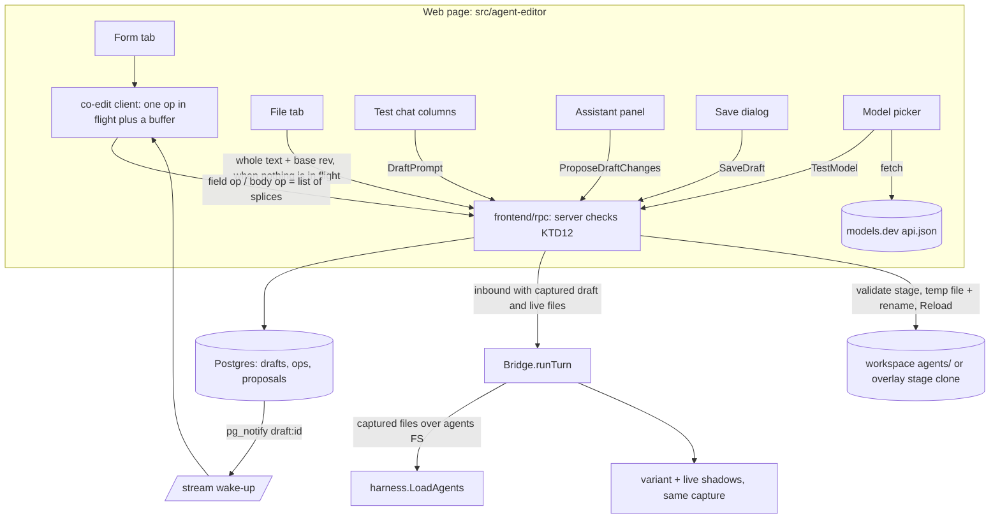
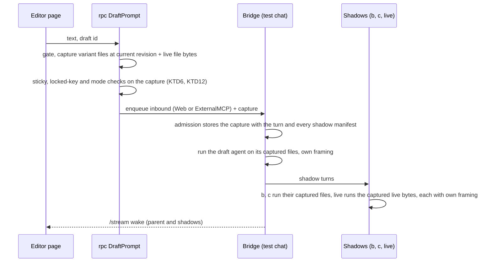
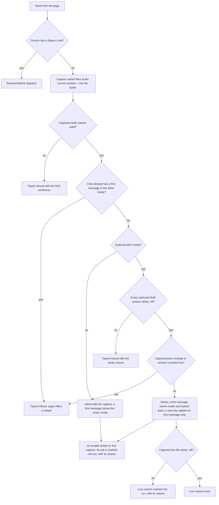
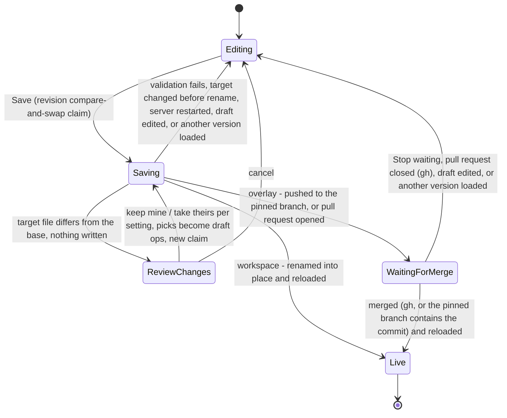

# Agent Editor - Plan

## Goal Capsule

- **Objective:** A person who is not an engineer can create a working RocketClaw agent on their own, prove it works by talking to it, compare versions side by side, and save it to the right place.
- **Means:** A Web page over server-stored drafts. Test turns run a copy of the draft and the live file captured when each message is sent (KTD4), variants and the live agent run as shadows of one test chat (KTD5), and saving validates the draft before renaming the agent file into place and running the existing Reload (KTD8). The save lifecycle, co-editing, test turns and External MCP mode were model-checked before implementation (`docs/verification/agent-editor-state-model.md`).
- **Product authority:** Ucirello (human partner). The layout was chosen through two prototype rounds: design 21 (workbench with Form / File tabs, assistant panel, live co-editing).
- **Plan authority:** Requirements (R) win on product behavior. KTDs win on mechanism within their cited Rs. Units override neither.
- **Execution profile:** Deep. Seven pull requests in merge order (see Implementation Units). Backend first; the Agents-page entry points ship last, so users reach the editor only when it is complete.
- **Stop conditions:** Stop and report when a CLOC budget would be exceeded after the one approved raise (KTD1). Stop when a settled decision proves unworkable in code. Stop when react-doctor's limit or a linter would need a suppression.
- **Who finishes:** The implementing agent builds, verifies and opens each PR. Ucirello reviews and merges.
- **Open blockers:** None. Prototype 21 was approved on 2026-11-12.

---

## Product Contract

Product Contract preservation: restructured; two behavior changes. R1–R30, A1–A4, F1–F3, AE1–AE8 and the Key Decisions keep their IDs, and all but R19, R29 and AE8 keep their text. R19 was reworded with the user's approval on 2026-11-12 to name the ways a waiting draft leaves "waiting for merge", following the user's Stop waiting decision (KTD9). R29 and AE8 were reworded by the user's decision on 2026-11-12: test-chat metadata copies real External MCP, where a key added after the first message applies to that message only, and Key Decisions gains an entry for it. (session-settled: user-directed — copy real External MCP over freezing the whole set of pairs at the first message: a test should show what a real call does.) Outstanding Questions is removed: its two "Deferred to Planning" questions are answered by KTD4–KTD5 (testing a draft, variants as shadows) and KTD2 (setting-help source). Dependencies / Assumptions replaces "Unverified: whether the server's Git credentials can push or open pull requests" with the settled answer (KTD9) and adds models.dev reachability. Scope Boundaries gains a "Considered and not built" list.

### Summary

A "Create New Agent" page in the RocketClaw Web UI where a person picks an easy or advanced agent, fills in its settings and instructions with plain-language help, talks to the draft while editing, compares variants and the live version side by side, gets suggestions from an assistant, and saves the agent to the workspace or a Git overlay.
Drafts live on the server and can be shared with teammates.

### Problem Frame

Making an agent today means hand-writing `agents/<name>.md`, getting it past the loader, and triggering a reload that has no button; the Web Agents page is read-only.
Even easy mode exposes many settings, and when a new setting ships nobody can tell where it lives or what it does.
Testing needs a saved file and a reload, and comparing two versions means juggling separate chats or hand-writing shadow files.
The result is that only engineers who know the file format can make agents, and even they find it painful.

### Actors

- A1. Editor: a RocketClaw user with no space limits. May be a non-engineer who knows basic GitHub workflows.
- A2. Teammate: another unlimited user who opens the same draft.
- A3. Draft agent and its variants: run test turns with real tools.
- A4. Assistant: suggests draft changes from a description, from requests, or from test-chat answers.

### Key Decisions

- **Lives in the Web UI as its own page next to the Agents page.** (session-settled: user-directed — chosen over a `rocketclaw agent new` terminal command and over both: the Web UI is RocketClaw's primary interface.) Governs R1.
- **"Easy vs advanced" means the agent's own `mode`.** (session-settled: user-directed — chosen over a page-detail toggle: the page shows the settings that mode allows.) Governs R3, R4.
- **All variants share the draft's mode.** (session-settled: user-directed — chosen over mixing modes in the editor or lifting the rule everywhere: keeps the existing rule that a shadow's mode matches its parent's.) Governs R4, R14.
- **Comparisons are variants of the draft and draft-vs-live.** (session-settled: user-directed — chosen over saving permanent shadows from the editor.) Governs R14, R15.
- **Test chats run real tools, with a clear warning.** (session-settled: user-directed — chosen over blocking writes, tool-less variants, or a per-variant workspace copy: shows true behavior.) Governs R13.
- **A chat continues after an edit by default, with restart and restart-and-replay.** (session-settled: user-directed — chosen over always-continue or always-restart.) Governs R12.
- **Drafts are stored on the server and shareable.** (session-settled: user-directed — chosen over tab-only or browser-only drafts.) Governs R16.
- **Reduce toggles three ways: hide defaults, start from a template or copy, and describe-to-fill.** (session-settled: user-directed — chosen over any single one.) Governs R5, R6, R7.
- **The assistant can change the draft any time and reads the test chat.** (session-settled: user-directed — chosen over start-only or panel-only assistants.) Governs R7, R8, R9.
- **Only people with no space limits may use the editor.** (session-settled: user-approved — chosen over draft-only access or an access ceiling for limited users: a draft can grant itself `sudo` and test chats run real tools.) Governs R22.
- **The save destination is a choice: workspace `agents/` or a configured Git overlay.** (session-settled: user-directed — raised by the user when layer precedence came up.) Governs R18, R20, R21.
- **Saving to a Git overlay offers push or pull request each time.** (session-settled: user-directed — chosen over always-push or always-PR.) Governs R19.
- **Users are assumed to know basic GitHub workflows.** (session-settled: user-directed — chosen over hiding Git terms behind plain-language defaults.) Governs R19.
- **Everything ships; no reduced first slice.** (session-settled: user-directed — the user rejected a smaller first version.)
- **Layout: the workbench with Form / File tabs (prototype 21), inside the real Web UI.** (session-settled: user-directed — chosen after 12 standalone and 3 in-app prototypes over a stacked form-and-file split with the assistant in the composer, and over an assistant-led start.) Governs R1, R3, R5, R11, R14.
- **Co-editing is live, in both form and file.** (session-settled: user-directed — the user asked for design 12's live editing over locks and merge-on-save.) Governs R17.
- **The plain-language help is kept in sync with what the loader accepts.** Without it the editor goes stale on the next new setting, recreating the reported pain. Governs R2.
- **The server never lists models; it reports configured provider names only.** (session-settled: user-directed — chosen over asking each provider for its models and over an operator-written model list in `rocketclaw.json`: keeps the easy-mode rule that RocketClaw never lists a provider's models, accepting that a suggestion may not be served.) Governs R23, R24.
- **Model suggestions come from models.dev, matched by provider name.** (session-settled: user-directed — the user corrected matching by provider URL to matching by provider name.) Governs R24.
- **Intelligence comparison is a link to slopalytics, never copied data.** (session-settled: user-directed — chosen over an optional operator Artificial Analysis key and over no intelligence data: slopalytics shows Artificial Analysis data whose terms restrict reuse.) Governs R25.
- **A Test button checks the chosen model on demand.** (session-settled: user-directed — added so a wrong model name shows up before the first test message.) Governs R26.
- **External MCP agents are tested in a full "Test as External MCP" mode.** (session-settled: user-directed — chosen over a metadata-only panel in a normal Web test chat and over offering both.) Governs R27, R28, R29, R30.
- **Test-chat metadata copies real External MCP exactly.** (session-settled: user-directed — chosen over freezing the whole set of pairs at the first message: a test should show what a real call does, including a key added later.) Governs R29.

### Requirements

**Page and settings**

- R1. A "Create New Agent" page in the Web UI also opens existing agents for editing.
- R2. Every setting the loader accepts appears in the editor with a plain explanation and its default, and adding a loader setting without editor help fails a check.
- R3. The editor first asks "easy agent or advanced agent?" and shows only settings valid for that mode, plus the instructions body.
- R4. The whole draft can switch between easy and advanced, carrying every variant with it.
- R5. Settings left at their defaults stay collapsed in labeled groups that state the default in words; required and commonly changed settings stay visible.
- R6. A draft can start blank, from a starter template, or as a copy of an existing agent.
- R7. An assistant can fill the settings and body from a plain description, and later change them on request.
- R8. The assistant can read the test chat; pointing at a bad answer and asking for a fix yields a proposed change.
- R9. Assistant changes are proposals the editor accepts or rejects; the assistant never saves to live and never runs tools.
- R10. Validation errors appear in plain language next to the field that caused them, never as raw YAML or loader text.

**Testing and comparison**

- R11. The editor can talk to the unsaved draft from the page.
- R12. After an edit, the next message uses the new version and the chat continues; "restart" and "restart and replay" are always offered, and each answer shows which version produced it.
- R13. Test turns run real tools, and the page warns that side effects run once per variant and can repeat or collide.
- R14. The editor can add variants that change one or two things, such as model or prompt; one message goes to every variant and answers show side by side.
- R15. When editing an existing agent, the saved live version can answer next to the draft and its variants.

**Drafts and collaboration**

- R16. Drafts, their variants, and their test chats are stored on the server, can be reopened from any device, and teammates can open them.
- R17. Teammates co-edit a draft live: each person's cursor and edits appear in both the form and the agent file as they type, and no edit is lost.

**Saving**

- R18. Saving picks one variant and writes it to a chosen destination: workspace `agents/` or a configured Git overlay. The page shows which layer currently provides an agent of that name and warns when a later layer hides the destination.
- R19. Saving to a Git overlay offers push to the branch or open a pull request each time; a pending pull request keeps the draft as "waiting for merge" until it is merged, the pull request is closed (seen with `gh`), or an editor clicks Stop waiting.
- R20. Saving over an agent from an earlier layer, including built-ins like `main`, warns that future updates to the original will no longer reach this workspace.
- R21. A save that would overwrite a live agent changed since the draft began requires the editor to review the difference first.
- R22. Only users with no space limits can open the editor; limited users keep the read-only Agents page.

**Model choice**

- R23. The model picker offers only the providers configured in this installation; the server reports provider names and never lists models.
- R24. For the chosen provider, model names are suggested from models.dev by matching the provider name, each showing price, context size, and allowed effort levels; typing any model name stays allowed.
- R25. Each suggested model links to compare it on slopalytics; no slopalytics or Artificial Analysis data is copied into RocketClaw.
- R26. A Test button beside the model picker sends one small request to the chosen provider and model when clicked, and reports "works" or the provider's error in plain words.

**External MCP testing**

- R27. A "Test as External MCP" switch makes every test column, including variants and live, behave as an External MCP call: entered metadata pairs and caller name, the same metadata message and `ROCKETCLAW_METADATA_*` variables, and no ask-user tool.
- R28. The switch is available only for `sticky: off` agents; otherwise it is disabled with the reason in plain words.
- R29. Metadata in a test chat follows real External MCP. The keys sent with the first test message are fixed for the whole chat: changing or removing one offers a restart with the new metadata instead of being ignored. A key added after the first message is sent with that message only, as External MCP does. The chat shows the metadata each message actually used. Switching External MCP mode on or off after the first message also offers a restart.
- R30. When an easy agent's settings or instructions use `$ROCKETCLAW_METADATA_*` variables, the page suggests External MCP mode before the first test message.

### Key Flows

- F1. New agent. **Trigger:** Editor clicks "Create New Agent". Picks easy or advanced (R3), starts blank, from a template, or by description (R6, R7), adjusts visible settings (R5), talks to the draft (R11), adds a variant (R14), asks the assistant to fix a bad answer (R8, R9), saves a variant to a destination (R18, R19).
- F2. Edit existing agent. **Trigger:** Editor opens an agent from the Agents page. The draft starts as a copy; the live version answers beside it (R15); save checks for changes made since the draft began (R21) and layer warnings (R18, R20).
- F3. Shared draft. **Trigger:** Teammate opens a draft link. Sees the same variants and chats (R16); concurrent edits follow R17.

### Acceptance Examples

- AE1. **Covers R12.** The editor changes the model mid-chat and sends a message: the chat continues, the new answer is labeled with the new version, and restart buttons remain.
- AE2. **Covers R18.** The editor saves `triage` to the first overlay while the workspace also has `agents/triage.md`: the page warns the save will be hidden by the workspace layer.
- AE3. **Covers R20.** The editor saves an edited `main` to workspace `agents/`: the page warns that built-in `main` updates will stop applying.
- AE4. **Covers R4.** The draft has three variants in easy mode and the editor switches to advanced: all three variants become advanced.
- AE5. **Covers R22.** A space-limited user opens the editor URL: they are refused and see the read-only Agents page.
- AE6. **Covers R24, R26.** The chosen provider is named `work`, which matches no models.dev provider: no suggestions appear, the editor types a model name, and Test reports whether it works.
- AE7. **Covers R28.** The agent is `sticky: user`: the External MCP switch is disabled and says External MCP only serves `sticky: off` agents.
- AE8. **Covers R29.** The editor sent one message in External MCP mode and then edits the value of a key sent with that message: the page offers to restart with the new metadata instead of sending it. Adding a new key is sent with the next message and shown as applying to that message only.

### Success Criteria

- A non-engineer creates a working agent alone: it passes a test chat, then gets saved without engineering help.

### Scope Boundaries

- Saving editor variants as permanent shadows that run in everyday chats.
- A sandbox or workspace copy that isolates test-chat side effects.
- Mixing modes across variants or shadows.
- Tracking upstream changes to an overridden built-in or overlay agent.
- A terminal or TUI agent editor.
- Listing a provider's models from the server, or an operator-maintained model list.
- Showing intelligence scores inside RocketClaw.

**Considered and not built** (each would change on the evidence named):

- Deleting or expiring drafts. Not requested; drafts are small rows. Revisit when the Drafts menu gets cluttered in real use.
- A "file on the branch equals our bytes" rule for detecting merged pull requests without `gh`. Settled the other way: Stop waiting covers those merges (KTD9).
- Closing the pull request when someone clicks Stop waiting. Not requested; the page says the pull request is still open. Revisit if abandoned pull requests get merged by mistake.
- A lock shared with the main agent's file tools around the save's final compare and rename. It would reach into the harness tools for a window of a few milliseconds; the race is accepted instead (KTD8). Revisit if a lost agent edit is ever traced to a concurrent save.
- Preserving YAML comments and key order on save. Settled the other way (KTD7).
- An agent tool for the editor's operations. Agents keep their existing path (`main-create-or-update-agent`), which ends in the same file write and Reload (KTD8).

### Dependencies / Assumptions

- Overlays are pinned by `URL@ref` in `rocketclaw.json`; an overlay pinned to a tag or commit cannot receive a push. Pushes use the host's existing Git credentials, as agents already do from bash; pull requests use `gh` when it is installed and logged in (KTD9).
- Saving still triggers the existing validated Reload; overlay saves reload after push or merge.
- The browser can reach `https://models.dev/api.json` (CORS `*`; the main Web app sets no CSP).

### Sources / Research

- Agent loading and validation: `internal/rocketclaw/harness/agents.go`, `internal/rocketclaw/harness/easy.go`.
- Shadow mode rule: `internal/rocketclaw/backend/bridge.go` (`loadAgentDefinitions`), `docs/plans/2026-10-30-1313-feat-easy-mode-agents-plan.md` R35.
- Shadow comparison UI and semantics: `docs/plans/2026-10-11-1632-feat-agent-shadow-comparison-plan.md`, `CONCEPTS.md`.
- Layering and overlays: `internal/rocketclaw/skel/skel.go`, `internal/rocketclaw/backend/bridge.go` (`overlayPromptSection`).
- Reload restriction for space-limited users: `internal/rocketclaw/frontend/rpc/transport.go` (`reload`).
- Current conversational path: `internal/rocketclaw/skel/.rocketclaw/skills/main-create-or-update-agent/SKILL.md`.
- Field reference and known doc drift: `cmd/rocketclaw/CHEATSHEET.md`.
- Providers and model references: `internal/rocketclaw/config/config.go` (`Providers`, `ProviderNames`), `internal/rocketclaw/backend/model_resolver.go`; the no-listing rule in `docs/specs/2026-10-30-easy-mode-agents-design.md` (R41).
- External MCP metadata: `internal/rocketclaw/frontend/externalmcp/server.go`, `cmd/rocketclaw/mcp.go`, `internal/rocketclaw/backend/bridge.go` (`turnShellEnv`, `externalMCPMetadataDeveloperMessage`), `CONCEPTS.md` (External MCP Metadata).
- Model checks of the save lifecycle, co-editing, test turns and External MCP mode: `docs/verification/agent-editor-state-model.md`, specs and configs in `docs/verification/agent-editor-model/`.
- Model data: https://models.dev/api.json (MIT); https://slopalytics.com/ (links only; data from Artificial Analysis).
- Prototypes (machine-local, best effort): `/Users/ucirello/Projects/platform/.tmp/workspaces/20261111-new-agent-interface-in-cmd-rocketclaw/.tmp/ce-prototype/20261111-agent-editor/`, with `decisions.md`; the approved design is `round2/21-file-tab/` (`NOTES.md`, `shots/`). A missing prototype is not a blocker; this plan's requirements govern any disagreement.

---

## Planning Contract

### Key Technical Decisions

- KTD1. **Raise the two CLOC budgets once, by the approved amounts.** `TS_CLOC_BUDGET` goes from 9,300 to 13,550 (approved as +3,500, then +750) in `internal/rocketclaw/web/Makefile`, and `GO_SOURCE_CLOC_BUDGET` from 41,750 to 45,750 in `internal/rocketclaw/Makefile`. No other budget, hazard zone, or coverage value changes. Measured on 2026-11-12: TS 8,467 (833 left), Go 40,400 (1,350 left). The approved prototype alone was 2,321 TS lines. (session-settled: user-directed — chosen over deleting existing code, a mix, or staged shipping: "everything ships" cannot fit the old budgets.) Planned totals per unit are in the Unit Index: about 3,620 Go and 4,130 TS lines, leaving about 1,730 Go and 950 TS lines of margin (1,230 and 700 before the hazard zones).
- KTD2. **One setting-help source in Go, next to the loader, with a check that fails on a key without help.** A help table in `internal/rocketclaw/harness` holds, for every key: modes, group, label, plain explanation, default in words, the plain sentence for what is allowed, the Form control kind, and whether it is required or common. The Web renders it from an RPC; the assistant's prompt reads it; R10 messages come from it. Easy mode's closed key lists (today call arguments in `harness/easy.go`) move into package variables that both `checkKeys` and the check read. Advanced mode has no closed list, so the help table's advanced entries become the list the R2 check and the Form use. The advanced loader stays open and still accepts keys outside it. The check scans the frontmatter keys the harness and backend actually read (`frontmatterField`, `frontmatterValue`, `argString(frontmatter, …)`, `Frontmatter["…"]`) with `go/ast`. It also scans index reads on maps derived from those reads and the `yaml` tags of structs decoded from frontmatter. Governs R2, R5, R10. Help lives in Go rather than TypeScript or `CHEATSHEET.md` because the loader and the check live in Go. `CHEATSHEET.md:407-430` seeds the easy-mode text.
- KTD3. **Drafts live in Postgres; fields are last-write-wins, the instructions body is operational-transform text.** Migration `087_agent_drafts.sql` creates the draft, variant, op-log, presence and proposal tables plus a nullable `conversations.agent_draft_id`, and adds `agent_draft` to `conversations_kind_check` (`001_baseline.sql:228`; drop and re-add as `074_session_reply_jobs.sql` does for `turns_kind_check`), or no `KindAgentDraft` row can be inserted. Every change commits as one op with the next draft revision. The op log is the catch-up feed and History; Restore writes a new op. Rules: (session-settled: user-approved — co-editing rules proposed with their tradeoffs and accepted.)
  - A setting is one value per key per variant. The last write wins; History keeps both values.
  - The body is one text per variant. A body op is `{baseRevision, opId, splices: [{at, remove, insert}, …]}`, a list of splices applied in order; `opId` is the client id plus a sequence number. A single splice cannot carry the transform: a delete with a concurrent insert strictly inside must become two deletes around it. The server transforms an op against every op committed after its base. Overlapping edits keep both texts in server order. Text typed inside a passage someone else deletes survives at that spot.
  - The client keeps one op in flight plus a buffer, rebases both against remote ops, and recognizes its own `opId` in fetched ops as the ack (U12). While its own write to a setting is unacknowledged, it ignores remote writes to that key; the server still applies last write wins and logs both.
  - The File tab is not a second document. An edit there goes to the server as the whole text with its base revision, sent only when no form op is in flight or buffered. The server parses it. Invalid YAML stores nothing and returns "not yet valid" to the typist only; teammates keep seeing the last valid version. Valid text becomes field ops for the keys that changed plus one body op from an exact multi-range diff against the body at the base revision. A changed `mode` becomes the draft-wide set-mode op, never a field op on one variant. The diff is a small Myers diff on runes in Go only, with no new dependency; a prefix/suffix diff re-inserts text the typist never touched. The server therefore keeps enough to rebuild the body at any recent revision.
  - Each committed op notifies in the same statement (`WITH changed AS (…) SELECT pg_notify(…)`, as `backend/web_question.go` does) under the id `draft:<id>`. `/stream` stays a wake-up hint; the client then fetches ops since its revision.
  - These rules pass the co-editing model (`CoEditing.cfg`); each rule left out fails a property (`docs/verification/agent-editor-state-model.md`).
- KTD4. **A test turn loads the draft as an in-memory layer over the effective agents directory, before `harness.LoadAgents`.** `readRocketCodeDefinitionsIn` gains the draft's rendered files (`<name>.md` and `<name>/<variant>.md`) and layers them over the runtime `agents` FS. The draft then goes through the same loader, mode rule, tag and permission post-processing as a saved file, and nothing is written under `.rocketclaw/` (wiped by Reload) or `agents/` (live). A staged runtime directory per draft was rejected: it copies the whole runtime per draft, and `runTurn` hard-codes the runtime directory for shell temp, skills and scripts. Governs R11, R12, R15.
  - **Capture at send.** `DraftPrompt` reads every variant's rendered files at the current draft revision and the live agent's file bytes together, runs the server checks on exactly those bytes (KTD6, KTD12), and passes them with the inbound. The live bytes are the effective runtime file (`<runtimeDir>/agents/<name>.md`), read under the config lock as `loadRocketCodeDefinitionsIn` reads it, so an overlay-provided agent has a live column too. The admission transaction stores them with the turn and every shadow manifest, beside `admitShadowInputs` (`bridge.go:1078`). Every column runs that capture as its layer and never re-reads the current draft or disk; subagent sessions reach it through their top-level session's lineage. (session-settled: user-approved — the live file is captured with the draft when the message is sent, chosen over reading it when the live column runs and labeling the version actually used: a row then compares draft and live as they stood when the question was asked.)
  - **Not at turn start.** Capturing with the parent's turn input (`captureTurnInputs`, `bridge.go:2435`) is too late: it runs when the turn starts, so a message queued behind another runs a newer version than the one it was sent with.
  - **Invalid captures.** `DraftPrompt` validates the captured files (U4's validation). An invalid draft column refuses the send with the R10 sentences. An invalid variant or live capture is admitted, and its cell is marked "not run" with the reason.
  - The version label on an answer comes from its capture. A column's label is the revision of the last op that changed that column's rendered file; the live column's is the live file version. An answer fades only when its column's file has changed since. These rules pass the test-turn model (`TestTurns.cfg`).
- KTD5. **Variants and the live agent are shadows of one draft test chat.** The draft test chat is a conversation of a new kind, `KindAgentDraft`, bound to the draft through `agent_draft_id`, so normal lists never show it. Shadows already inherit the parent's captured environment and origin header, and already notify the parent, so the page needs one `/stream` for the whole chat instead of one per column. Governs R12, R13, R14, R15, R27.
  - **Roster from the draft.** For a draft test chat, `reconcileShadows` builds its roster from the captured draft variants, never from disk (`shadows.go:706`, `:730`), and reuses the existing binding SQL. Its parent insert as `KindWebChat` (`:732`) is `ON CONFLICT DO NOTHING`, so the test chat, created first, keeps its kind. Today a new agent with no saved directory gets no shadows at all (`shadows.go:707-709`), and a variant removed in the draft would still get messages. Variant B runs `<name>/b`.
  - **Live column.** The live column (R15) is a shadow bound to the parent's own agent name, a binding `ShadowNames` never returns, so it has its own roster rule. It runs the live bytes captured at send (KTD4), not the saved file at run time. Renaming a draft of an existing agent makes it a new agent: the next capture has no live file, so the Live column goes away, and the original stays as it is.
  - **Own framing.** Each column frames the shared user text with its own captured definition (instructions and mode). Today a shadow runs the parent's prepared input (`bridge.go:2420`), framed by `buildPrompt` with the parent's definition.
  - **Restart is a new conversation.** The old one keeps draining its in-flight turns, and their answers stay there. Restart and replay re-sends the earlier user messages to the new conversation with one fresh capture.
  - **Answers are placed by message.** The page places each answer by its parent turn (`shadow_turns.parent_turn_id`), never by position.
  - A save replaces the file by rename (KTD8), so a capture never reads half a save.
  - Each message is its own turn: the draft prompt never sends the steer kind that `prompt` defaults to (`frontend/rpc/server.go:1614`). Web mode sends the enqueue kind; External MCP mode keeps the prompt kind `submitExternalMCPInput` uses (`cmd/rocketclaw/mcp.go:195`, KTD6). Only a steer joins a running turn (`bridge.go:645`), which would give two messages one answer. The models did not cover steers, so U7 tests this in both modes.
- KTD6. **External MCP mode only changes how the test prompt is built.** In this mode the draft prompt RPC builds the inbound the way `submitExternalMCPInput` (`cmd/rocketclaw/mcp.go`) does: `SourceExternalMCP`, the entered pairs plus `external_conversation_id` (the test chat's id) in `ExternalMCPMetadata` only, and the typed caller name as `InboundPrincipalMetadataKey`. Every send carries the draft's current pairs, on the same test conversation, and the bridge applies its existing rule unchanged. The mode's settings are stored on the draft, so teammates see them. Governs R27, R28, R29. (session-settled: user-directed — the permission reviewer sees exactly what a real call shows, and the typed caller name reads as real; chosen over a reviewer note and over naming the tester as the caller.) Accepted risk: a tester can make a review read as if a real External MCP caller asked.
  - **The bridge's rule** (`turnShellEnv`, `bridge.go:2632-2712`). The first External MCP turn stores its pairs as the conversation's one metadata entry; those keys are locked. Later, a locked key keeps its stored value even when a different one is sent, silently. A new key goes into that turn's variables and an "additional metadata" message for that turn only, and is never stored. Shadows get the parent turn's variables through the captured snapshot (`bridge.go:2432`), and ask-user is offered only to human Web turns. (session-settled: user-directed — test-chat metadata copies real External MCP exactly, chosen over freezing the whole set of pairs at the first message: a test should show what a real call does.)
  - **No silent drop.** The bridge's silent drop must not reach a test chat, or the page shows one value while the agent uses another. `DraftPrompt` refuses, with a typed error, a send whose captured pairs (KTD4) change or remove a locked key; the page offers a restart with the new metadata. The locked keys are the first message's pairs, stored on the test chat. Checking an earlier read of the draft is not enough: a teammate can change the pairs between the check and the capture.
  - **Mode is fixed per chat.** The first message's mode is stored on the test chat. Switching External MCP mode on or off after it refuses the send and offers a restart.
  - **Returns once stored.** `DraftPrompt` returns once the message is stored, in both modes. External MCP mode must not hold the request for the whole turn, as `submitExternalMCPInput`'s `RunTurn` does. It submits through the thread queue (`StashQueueItem`, `backend/conversations.go:486`) and keeps `SourceExternalMCP`, the metadata pairs and the caller principal.
  - The page shows each message's metadata as the agent got it: locked keys with a lock, later keys as "this message only". The `sticky` rule is KTD12's. These rules pass the External MCP model (`ExternalMCP.cfg`).
- KTD7. **The agent file is rebuilt from settings and body in a standard order.** The order is the help table's order; the body follows the frontmatter. Keys outside the help table are kept as "other settings" and follow the known keys in their original order. Saving an existing agent therefore drops its YAML comments and may reorder it, and the save dialog shows that difference before saving. Go renders and parses the file (it already depends on `yaml.v3`); the Web has no YAML library and gets none. (session-settled: user-directed — chosen over preserving comments and order through `yaml.Node` edits and over rebuilding only new agents.) Governs R18, R21.
- KTD8. **Saving validates first, replaces the file atomically, then runs the existing Reload; there is no undo.** This ends in the same state the agent path (`main-create-or-update-agent`) reaches, so the two surfaces cannot drift. Governs R16, R18, R19, R20, R21.
  1. **Claim.** Save moves the draft from editing to saving with the draft-revision compare-and-swap (KTD3). A plain read-then-write lets two people save at once. On server start, drafts left in "saving" go back to editing.
  2. **Stale check.** When a draft takes its name, it records each destination layer's bytes for that name; an absent file is a recorded value too. R21 compares the destination now with the destination's recorded bytes: workspace `agents/<name>.md` itself, or the file in the overlay stage clone (KTD9). Saving an overlay-only agent to the workspace, or a workspace agent to an overlay, therefore needs no review unless the destination changed. It never compares against the copy the running server loaded, which misses an edit nobody has reloaded yet. A difference writes nothing, releases the claim, and answers "review needed" with both texts. The three-way review's base is the destination's recorded bytes.
  3. **Validate a stage that holds the draft.** The existing Reload validation runs on a stage directory with the draft's file dropped in. Only when it passes is anything written.
  4. **Write.** The file goes to a temp file through the workspace `os.Root` and is renamed over `agents/<name>.md`. Right before the rename, the target is compared with the base again; a change sends the draft back to editing. A write from the emulated shell or an agent's file tool between that compare and the rename is still lost; this race is accepted. (session-settled: user-approved — chosen over a lock shared with the main agent's file tools, which would still not cover shell writes.)
  5. **Reload and mark live.** The draft becomes live only if it is unchanged since the claim and the loaded file equals the saved bytes. Otherwise it goes back to editing with the saved bytes as the destination's new base.
  - Validate-then-rename means a crash never leaves a bad or half-written file, so the undo after a failed Reload is deleted: no restore marker, no startup hook. An undo could also write old bytes over someone's later edit.
  - **Keep mine / take theirs.** The R21 review shows each setting the live file changed, with keep mine or take theirs per setting, and lets new instruction lines be brought in. The picks become ordinary draft ops, the reviewed live bytes become the destination's base, and the save starts again with a new claim. (session-settled: user-approved — per-setting keep mine / take theirs in the stale review, as in prototype 21, chosen over showing the difference and requiring acknowledgment only.)
  - R20 compares against the earlier layers' bytes: startup copies built-in `main` and `voice` into workspace `agents/` (`skel.go:77-81`), so "a workspace file exists" cannot mean "already overridden". Byte-equality only labels a workspace file "copy of built-in" for R20; any workspace file still hides an overlay destination (R18).
  - **Names.** One server-side rule checks an agent name on create, copy and rename, and again at save: a single path segment of `[A-Za-z0-9._-]` that does not start with `.` or `-`. Stage writes go through `os.Root`.
  - These rules pass the save-lifecycle model (`DraftLifecycle.cfg`, `_overlay.cfg`, `_overlay_gh.cfg`); each one left out fails a property.
- KTD9. **Overlay saves commit in a separate clone; pull requests use `gh` when available, else a compare link.** The live overlay clone is re-created on every Reload, so a save clones the overlay into a stage under the workspace (`.rocketclaw-save-*`, as Reload stages), writes the file, commits with the person as author, and pushes with the host's Git credentials. The claim, stale check and mark-live rules are KTD8's; the stale check compares against the file in the stage clone, the commit the push builds on. Governs R18, R19. (session-settled: user-directed — chosen over a compare link only and over a GitHub token setting.)
  - **Validate, then push.** The file is validated through KTD4's loader before any push. Nothing is force-pushed; a rejected push means the branch moved, so the save goes back to a fresh stale check.
  - **Branch.** An overlay pinned without a ref uses the remote's default branch (`git ls-remote --symref origin HEAD`) for the push, the PR base and the merge check, and the layers report shows that branch. A PR branch is a fixed prefix plus the draft id and the save's claim revision, never the agent name, so each PR save gets its own branch and a later save never has to force-push over an open pull request.
  - **Stage Git.** Every Git command in the stage runs with `-c core.hooksPath=/dev/null -c core.fsmonitor=false`. Right before the commit, the staged file is compared with the validated bytes again.
  - **Push mode** pushes to the pinned branch, puts the draft in "waiting for merge" and runs the merge check at once, which finds the commit, reloads and marks the draft live. After the push the commit is on the branch whether or not a Reload succeeds, so this is the same path as a merged pull request.
  - **PR mode** pushes a new branch. With `gh` installed and logged in it runs `gh pr create` and shows the number and state; otherwise it shows a GitHub compare-page link.
  - **Merge check.** The draft waits until the pinned branch contains the commit, or with `gh` until `gh pr view` reports merged; then the server reloads and marks it live. With `gh`, a closed pull request returns the draft to editing. The runtime overlay clone is fetched with `--depth=1` (`applyGitOverlay`), which cannot answer "contains this commit", so the check fetches enough history of the pinned branch to answer it.
  - **Stop waiting.** Any editor can click Stop waiting to return a waiting draft to editing. It covers squash and rebase merges without `gh`, closed pull requests without `gh`, and pull requests nobody acts on, all of which otherwise wait forever. The pull request stays open on GitHub, and the page says so. (session-settled: user-approved — a Stop waiting button and no "file on the branch equals our bytes" rule, chosen over adding the bytes rule too and over accepting stuck drafts: a teammate's later edit defeats the bytes rule, while the button resolves every case.)
- KTD10. **The assistant is a one-shot, tool-less model call that returns JSON proposals.** It copies `backend.GenerateHandoff`: `prepareRocketCode` for `main`, prompt overridden, `RestrictTools([]string{})`, inert journal, in-memory history, plus a strict `ResponseFormat` JSON schema as `raw_run.go` sets it. Input: the help entries for the draft's mode, the current files, the flattened test-chat transcript, the pointed-at answer, and the request. The transcript is evidence inside the input; the rules sit in the instructions. Output: a message, setting changes `{variant, key, value_yaml, reason}`, and body replacements. The server keeps only keys the help table allows for the mode, stores the proposal on the draft with its base revision, and turns an accepted proposal into ordinary ops based on that revision, recording who accepted it. An accepted `mode` change becomes the draft-wide set-mode op. Its model is a new optional `rocketclaw.json` setting, `agent_editor_model`; when unset it uses `main`'s model. (session-settled: user-directed — chosen over `main`'s model only and over a per-draft picker.) Governs R7, R8, R9. The `main-create-or-update-agent` skill is not injected: it tells the model to edit files and reload, which contradicts R9.
- KTD11. **No server model listing; the browser fetches models.dev.** `ConfigView` gains `repeated string providers = 12`, filled from `cfg.ProviderNames()`, the same list the easy loader accepts (it always includes `openai`). The Test button calls a `TestModel` RPC: the existing model resolver resolves the reference, and one `Responses` request with a few output tokens returns "works" with its time, or the provider's error text. The browser fetches `https://models.dev/api.json` directly, caches it with react-query, and matches the provider name; a server proxy or embedded snapshot would cost Go lines and freshness. The file is about 6 MB (614 KB gzipped), so the page fetches it when a model picker first opens, not on page load. (session-settled: user-directed — chosen over asking each provider for its models and over an operator-written model list: keeps the rule that RocketClaw never lists a provider's models.) Governs R23, R24, R25, R26.
- KTD12. **The server enforces two editor rules: one editor gate for every editor RPC and the draft stream, and the External MCP `sticky` rule at send.** A list of editor methods in `frontend/rpc/transport.go`'s `webCall` refuses people with a Space Limit before dispatch ("people limited to spaces cannot use the agent editor"), with the check `reload` already uses. `join` refuses `draft:` ids the same way, and `visibleConversation` refuses `KindAgentDraft` chats to limited people. The Web hides entry points for them (Identity already exposes `Limited`). (session-settled: user-approved — chosen over draft-only access or an access ceiling for limited users: a draft can grant itself `sudo` and test chats run real tools.) Governs R22, R27, R28.
  - **Sticky at send.** In External MCP mode, `DraftPrompt` refuses a send when any captured draft version (KTD4) is not `sticky: off`, checking the captured bytes and the chat's stored mode (KTD6). The page's disabled switch alone fails even with one editor: a teammate sets `sticky: user` after the switch is on, or a stale page turns it on. Real External MCP refuses such agents on every call (`bridge.go:2962-2970`, checked from `cmd/rocketclaw/mcp.go`), but `submitExternalMCPInput` itself does not check, so the draft path must.
  - **Live column.** In External MCP mode the Live column does not run when the captured live file is not `sticky: off`, and its column says why. Shadows are created `sticky: off` and never check (`shadows.go:748`), so without this a `sticky: user` live agent would answer as External MCP.
- KTD13. **The Web editor is a new folder of small components mounted as a self-hiding page.** Code goes in `internal/rocketclaw/web/src/agent-editor/`. It mounts from `ui.tsx`'s page map as `Page({show})`, adding no branch to `SessionApp` (react-doctor's limit is 15). It reuses the existing transcript pieces (`useSessionStream`, the shadow comparison cells) for the columns, with one composer and its own viewport refs. Co-edit traffic is debounced body ops (about 200 ms), not whole documents.

### High-Level Technical Design

These sketches show the intended shape for review. They are directional guidance, not implementation specifications; the KTDs they cite own the rules.



A test message, end to end:



Send-time checks in `DraftPrompt`, all on the capture (KTD4, KTD6, KTD12):



One co-edit round trip (KTD3):

```mermaid
sequenceDiagram
  participant C as Editor client (coedit.ts)
  participant R as rpc (apply op / edit file)
  participant D as Postgres (draft, op log)
  participant T as Teammate client
  C->>R: field op or body op (base revision, opId, list of splices)
  R->>D: transform against ops after base, revision compare-and-swap, log row, pg_notify draft:id, one statement
  R-->>C: new revision and transformed cursor
  D-->>T: /stream wake-up
  T->>R: ops since my revision
  R-->>T: ops in order, each with its opId
  T->>T: rebase in-flight op and buffer, apply
  Note over C,R: File tab, only with nothing in flight or buffered
  C->>R: whole file text, base revision N
  R->>R: parse; invalid YAML returns "not yet valid" to the typist and stores nothing
  R->>D: field ops for changed keys + one body op from a rune Myers diff against the body at N
```

Save lifecycle of one draft (KTD8, KTD9):



Each of the four concurrent areas has a model checked with TLC before implementation: the save lifecycle, co-editing, test turns and External MCP mode. `docs/verification/agent-editor-state-model.md` has the full diagrams, the properties with their requirement IDs, the results, the counterexamples that changed this plan, and how to re-run them; the specs are in `docs/verification/agent-editor-model/`.

### Assumptions

- `openai` counts as configured, because `ProviderNames()` and the easy loader both treat it so (R23).
- Renaming a draft's agent rebinds the test chat on the next message; existing answers keep their old labels. Renaming a draft of an existing agent makes it a new agent: a banner says the original stays as it is, the Live column goes away, and save checks treat it as new (KTD5, KTD8).
- Restart creates a new test chat and points the draft at it; restart-and-replay then sends the old chat's user messages, in order, to the new chat with one fresh capture (KTD5).
- The version label on an answer is the revision of the last op that changed that column's rendered file, or for the live column the live file version, captured with its message (KTD4).
- Without `gh`, compare links are built only for `github.com` remotes; other hosts get the branch name.

### System-Wide Impact

- **Turn loading:** `readRocketCodeDefinitionsIn` gains a draft layer. Every other caller passes none and behaves as today.
- **Shadows:** a new roster source (captured draft variants), a new shadow shape (agent equal to the parent's), and per-column prompt framing for draft test chats. The existing comparison UI, `shadow_turns` and ordinary shadows' use of the parent's framed input keep working.
- **Name lookups:** about 15 paths look agents up by name from disk (`createSession`, search, pages, attachments). A draft-only name is unknown to them; the draft test chat is created through the DAO directly and never through `CreateSession`.
- **Permissions:** Space Limits apply to people only. Agents keep their own path to change agents, gated by `permission.rocketclaw`; this plan does not change that.
- **Database:** one migration, which also widens `conversations_kind_check` (KTD3); each open editor page holds one pooled connection for `/stream` per stream (draft and test chat), as `Changes` does today.
- **Vocabulary:** "overlay" in the editor means a configured Git overlay (CONCEPTS Overlay Clone), never workspace `agents/`, which the agent skill calls "the writable overlay directory". In Web code "draft" already means a composer draft (`src/drafts.ts`, `ComposerDraft`, which `useSessionStream` takes), so editor identifiers say "agent draft".

### Risks

| Risk | Mitigation |
|---|---|
| A draft-only agent name breaks a lookup inside a test turn (History, sessions tools, pages). | U6/U7 integration tests run a full draft turn with a variant, a subagent and the live column through `backend.Run`. |
| The live shadow, bound to its parent's own agent name, trips an assumption that shadow names contain `/`. | U6 test asserts the live column's answer comes from the captured live bytes and that ordinary shadows are unchanged. |
| Body transform differs between Go and TS, losing text. | One shared vector file read by both test suites (U4, U12), including the model's counterexamples. |
| A push succeeds but Reload then fails, leaving a bad file in the overlay. | Validate through the draft loader before any push (KTD9). As KTD8 step 5 says, the draft goes back to editing with the pushed bytes as its base, and the error names the pushed commit. |
| An emulated-shell or agent file-tool write lands between the save's final compare and its rename, and is lost. | Accepted (KTD8); the window is one compare and one rename. The model shows the gap (`docs/verification/agent-editor-state-model.md`, Limits). |
| A message sent while a turn runs joins it as a steer (`bridge.go:645`), so one answer covers two messages. | The draft prompt never sends the steer kind (KTD5); U7 tests two quick messages get two answers per column in both modes. Not model-checked. |
| A variant added mid-chat inherits the draft column's transcript as its own history (`shadows.go:756-780`), so its first answer is not a clean comparison. | Not model-checked. A U6 test pins which history a mid-chat variant gets, so a change to it is visible. |
| A shadow stopped by the 1.5x step limit (`drainShadowInputs`, `shadows.go:529-600`) shows a "stopped" answer, not a real one. | Not model-checked. A U14 browser scenario confirms the cell shows the stop in its message's row. |
| Co-editing cursors, undo, reconnect after missed ops, three or more editors, and repeated characters in the File-tab diff were not model-checked. | Reconnect uses the same "ops since my revision" fetch as every wake-up (KTD3); the shared vectors include repeated-character File edits; a U12 browser scenario reloads one page mid-edit. |
| TS budget runs out before the last UI unit. | Per-unit CLOC targets (Unit Index); measure after each PR; stop and report per KTD1. |
| NOTIFY per keystroke burst wakes every listener in the schema. | Debounced body ops; acceptable at team scale (known limit). |

### Deferred to Implementation

- Where the per-message draft capture is persisted (a field on the turn input snapshot or a small draft-version row), as long as shadows and subagents read the same capture.
- The exact query that climbs from a subagent or shadow session to its draft binding.
- Exact table columns and RPC message names; the shapes in the units are directional.
- How the File tab keeps the typist's text while they type and when it re-renders from shared state.
- The `go/ast` scan's exact call patterns for advanced keys (KTD2).
- Merge detection timing: on draft open and on Drafts menu load, or also on a timer.
- How the server rebuilds the body at an op's base revision (KTD3): the removed text stored in each op row, or a body snapshot per revision.
- How much history the merge check fetches (KTD9): a deeper fetch of the pinned branch, or `gh`/GitHub's compare API when available.
- Where the rule "a shadow's mode matches its parent's" is enforced. The live column must still answer after the draft switches mode (R15); if that rule would drop it, exempt the live binding there. Not model-checked.
- Whether variants can change `sticky`. The models assumed they cannot; KTD12's check covers every captured variant either way.
- Whether a thread queue item (`StashQueueItem`, `backend/conversations.go:486`) carries an External MCP inbound's metadata pairs and caller principal to the turn (KTD6). If it does not, extend the queue item to carry them.

---

## Implementation Units

### Unit Index

| U-ID | Title | Key files | Depends on | Est. Go / TS lines |
|---|---|---|---|---|
| U1 | Raise CLOC budgets | `internal/rocketclaw/Makefile`, `internal/rocketclaw/web/Makefile` | — | 0 / 0 |
| U2 | Setting-help source and R2 check | `harness/agent_settings.go`, `harness/easy.go`, `harness/agents.go` | U1 | 360 / 0 |
| U3 | Provider names, Test model, editor gate | `frontend/rpc/transport.go`, `frontend/rpc/server.go`, `backend/model_resolver.go`, `web.proto` | U1 | 110 / 0 |
| U4 | Draft store, ops, file render and parse | `backend/migrations/087_agent_drafts.sql`, `backend/agent_drafts.go` | U2 | 1,060 / 0 |
| U5 | Draft RPCs and draft stream | `frontend/rpc/drafts.go`, `web.proto`, `frontend/rpc/server.go` | U3, U4 | 450 / 0 |
| U6 | Send-time capture, draft layer, draft roster | `backend/bridge.go`, `backend/shadows.go` | U4 | 300 / 0 |
| U7 | Draft test chat, prompt, restart, External MCP | `backend/agent_draft_chat.go`, `frontend/rpc/drafts.go` | U5, U6 | 340 / 0 |
| U8 | Layers report, workspace save, stale review | `skel/skel.go`, `backend/agent_draft_save.go` | U5 | 400 / 0 |
| U9 | Overlay save, PR, merge detection, Stop waiting | `backend/agent_draft_overlay.go` | U8 | 340 / 0 |
| U10 | Assistant proposals | `backend/agent_draft_assistant.go`, `config/config.go` | U5 | 260 / 0 |
| U11 | Editor page shell, start pane, Drafts menu | `web/src/agent-editor/index.tsx`, `web/src/ui.tsx`, `web/src/api.ts`, `web/src/types.ts` | U5 | 0 / 600 |
| U12 | Form and File tabs with live co-editing | `web/src/agent-editor/form.tsx`, `file.tsx`, `coedit.ts`, `history.tsx` | U11 | 0 / 1,330 |
| U13 | Model picker | `web/src/agent-editor/model-picker.tsx` | U3, U12 | 0 / 280 |
| U14 | Test chat columns and External MCP panel | `web/src/agent-editor/chat.tsx`, `mcp.tsx` | U7, U12 | 0 / 820 |
| U15 | Assistant panel | `web/src/agent-editor/assistant.tsx` | U10, U12 | 0 / 300 |
| U16 | Save dialog and Agents-page entry points | `web/src/agent-editor/save.tsx`, `review.tsx`, `diff.ts`, `web/src/ui.tsx` | U8, U9, U14 | 0 / 800 |
| | **Total** | | | **~3,620 / ~4,130** |

All Go paths are under `internal/rocketclaw/`; Web paths under `internal/rocketclaw/web/`. Budget headroom after KTD1: Go 5,350, TS 5,083; hazard zones start 500 Go / 250 TS before the limit. The estimates include the model-check fixes, the document-review corrections, and keep mine / take theirs at the top of their ranges (U8 Go 40–60, U16 TS 150–250).

Existing artifact the units build against: the model checks in `docs/verification/agent-editor-state-model.md`, with specs and configs in `docs/verification/agent-editor-model/`. They are done; no unit changes them. Each counterexample class against the design as built has a named test scenario in the unit that owns the fix; configs that check a rejected design need no test. A unit that changes a modeled rule updates the spec and re-runs its configs in the same PR.

### PR1: Foundations

Waits on: nothing.

### U1. Raise CLOC budgets

**Goal:** Apply the one approved budget raise.
**Requirements:** Enables everything; KTD1.
**Dependencies:** None.
**Files:** `internal/rocketclaw/Makefile` (`GO_SOURCE_CLOC_BUDGET ?= 45750`), `internal/rocketclaw/web/Makefile` (`TS_CLOC_BUDGET ?= 13550`).
**Approach:** Change the two values only. The commit message cites Ucirello's approval.
**Test scenarios:** Test expectation: none -- budget values only; `check-cloc-budget` exercises them.
**Verification:** Both `check-cloc-budget` targets report the new limits.

### U2. Setting-help source and R2 check

**Goal:** One Go table of plain help for every loader key, and a check that fails when the loader reads a key the table lacks.
**Requirements:** R2, R5, R10; KTD2.
**Dependencies:** U1.
**Files:**
- Create `internal/rocketclaw/harness/agent_settings.go` (help table, exported for the RPC and the assistant).
- Modify `internal/rocketclaw/harness/easy.go` (lift the top-level and nested easy key lists into package variables that `checkKeys` uses).
- Modify `internal/rocketclaw/harness/agents.go` (lift the `approver.decision.*` key list the same way).
- Test: `internal/rocketclaw/harness/agent_settings_test.go`.
**Approach:**
1. Lift the easy key lists out of the `checkKeys` call arguments (`easy.go:48-49`, `:57-61`, and `approver.decision.*` in `agents.go:363`).
2. Write help entries in file order, seeded from `cmd/rocketclaw/CHEATSHEET.md:407-430` for easy keys and the "Agent Frontmatter And Permissions" section for advanced keys, including backend-read keys (`additionalInstructions`, `permission.rocketclaw.*` tag and recipient settings).
3. Each entry carries modes, group, label, explanation, default in words, allowed sentence, control kind (text, switch, choice, list, model, or edit-in-file), and required/common flags.
**Patterns to follow:** existing table-driven key handling in `harness/easy.go`; Go-owned contract served to TS as with `web.proto`.
**Test scenarios:**
- Every easy key variable entry, nested ones included, has a help entry marked for easy mode, and no easy help entry names a key outside the variables.
- The `go/ast` scan of `harness` and `backend` finds every literal key passed to `frontmatterField`, `frontmatterValue`, `argString(frontmatter, …)` and `Frontmatter["…"]`; each has an advanced help entry.
- A fixture source file reading an unknown key `fooBar` makes the scan report `fooBar` (proves the check can fail). One fixture per shape: a direct call, an index read on a map derived from a frontmatter read, and a `yaml` tag on a struct decoded from frontmatter.
- Every entry has non-empty label, explanation, default-in-words and allowed sentence.
**Verification:** Adding `frontmatterField(node, "newKey")` anywhere in the loader without a help entry fails `make -C internal/rocketclaw test`.

### U3. Provider names, Test model, editor gate

**Goal:** The page can list configured providers, test a model on demand, and every editor RPC refuses limited people.
**Requirements:** R22, R23, R26; KTD11, KTD12.
**Dependencies:** U1.
**Files:**
- Modify `internal/rocketclaw/web/proto/web.proto` (`ConfigView.providers = 12`; `TestModel` request/response and service entry).
- Modify `internal/rocketclaw/frontend/rpc/server.go` (`listConfig` fills providers; `testModel` handler).
- Modify `internal/rocketclaw/frontend/rpc/transport.go` (register `TestModel`; editor-method gate in `webCall`).
- Modify `internal/rocketclaw/backend/model_resolver.go` (exported one-request test through the resolver) and the frontend `Backend` interface; regenerate mocks with mockery v3.
- Test: `internal/rocketclaw/frontend/rpc/server_test.go`, `internal/rocketclaw/backend/model_resolver_test.go`.
**Approach:**
1. The gate is a method list beside `Register`'s list; `webCall` checks it before the switch. U5, U7–U10 add their methods to it.
2. `TestModel` resolves `provider/model#effort`, sends one minimal `Responses` request with a small output cap and the effort when given, and returns elapsed time or the provider's error text.
**Patterns to follow:** `reload`'s limit check (`transport.go:241-249`); `McpServers` in `listConfig` (`server.go:1174`).
**Test scenarios:**
- `ListConfig` returns providers `["anthropic","work","openai"]` for a config with providers `anthropic` and `work` (order as `ProviderNames`).
- A limited person calling `TestModel` gets PermissionDenied with the plain message.
- `TestModel` against a fake OpenAI-compatible server returns works and a duration; an unknown-model 404 returns the provider's error text.
- `TestModel` on a `chatgpt` provider with no login returns the resolver's plain error.
**Verification:** Unlimited people get provider names and Test results; limited people are refused by the server.

### PR2: Drafts and co-editing backend

Waits on: PR1 (merge order only).

### U4. Draft store, ops, file render and parse

**Goal:** Drafts with variants, revisions, an op log that doubles as History, the body transform, file rendering and parsing, and plain validation.
**Requirements:** R4, R6, R10, R16, R17, R21; KTD3, KTD7.
**Dependencies:** U2.
**Files:**
- Create `internal/rocketclaw/backend/migrations/087_agent_drafts.sql` (drafts, variants, ops, presence, proposals, `conversations.agent_draft_id`, `agent_draft` in `conversations_kind_check`; KTD3). Claim the number late; add it to both lists in `TestInitializeSessionDBAdoptsReleasedStore` (`store_schema_test.go:643`, `:648`).
- Create `internal/rocketclaw/backend/agent_drafts.go` (DAO on `SessionService`, transform, render, parse, validate).
- Modify `internal/rocketclaw/backend/store_dao.go` (`KindAgentDraft`, matching the migration's `agent_draft` kind, so U6 tests can create a draft test chat through this DAO).
- Create `internal/rocketclaw/backend/agent_templates/*.md` (two or three starter agents, embedded).
- Modify `CONCEPTS.md` (new "Agent Draft" entry: one home for drafts, variants, test chat).
- Test: `internal/rocketclaw/backend/agent_drafts_test.go`, `internal/rocketclaw/backend/testdata/body_transform.json` (shared vectors, also read by U12).
**Approach:**
1. Create a draft blank, from an embedded template, or as a copy of an effective agent file (parsed into settings and body). When a draft takes its name, at start or by rename, it records each destination layer's bytes for that name, absence included, as its per-layer base (KTD8). Create, copy and rename check the name rule (KTD8).
2. Ops: set field, edit body, add/rename/remove variant, set mode, set External MCP settings, set test chat, set save state, restore. Each carries its client `opId` and is a CAS on the draft revision plus a log row plus `pg_notify` in one CTE statement. All SQL uses CTEs, never subqueries.
3. Body transform per KTD3: splice against splice returning a list (same-spot inserts in server order; an insert inside a deleted range lands at its start; a delete with an insert strictly inside splits in two; overlapping deletes drop the overlap), list against list, and apply a list. Mode switch converts every variant in one op: keys the new mode does not allow are dropped (History keeps them; Restore brings them back).
4. File edits: parse, diff the body against the body at the submit's base revision with a Myers diff on runes, and emit field ops plus one body op (KTD3). A changed `mode` emits the set-mode op of step 3.
5. Render a variant file in help-table order, then "other settings" in their original order (KTD7); parse a file into settings plus body with `yaml.v3`.
6. Validate by loading the rendered files through the same loader path U6 uses, and for easy drafts run `resolveWorkingDirectory` when the folder holds no variables. Map each loader error to `{key, sentence}` from the help table; YAML syntax errors become "line N isn't valid yet".
**Execution note:** Write the transform test-first from the shared vector file, starting with the co-editing model's counterexamples.
**Patterns to follow:** `SaveTabState` CAS (`store_dao.go:609-637`); notify-in-statement (`web_question.go:89`); migration style of `064_web_shared_tabs.sql`; constraint widening in `074_session_reply_jobs.sql`.
**Test scenarios:**
- Two concurrent field writes to the same key from the same base: the later revision wins and History shows both values with their authors.
- Covers R17. Insert at 5 and insert at 5 from the same base: both texts kept in server order.
- Covers R17. A delete of [3,20) and a concurrent insert at 10 from the same base: the insert survives at the deletion point, and the committed delete is two splices around it (model: `CoEditing_plan.cfg`, `_shape.cfg`).
- The delete-wins and clipped-delete shapes are absent: after the case above, no text the deleter saw remains and the inserted text is present (model: `_clip.cfg`, `_deletewins_lost.cfg`).
- A File edit with invalid YAML stores nothing, bumps no revision, and returns "not yet valid" with the line.
- A valid File edit that changes `model` and one body line commits a `model` field op and one body op; a teammate's concurrent change to `space` survives.
- A File edit that makes two separate changes ("XY" to "aX") while a teammate types "b" before "X": the result is "baX"; with the teammate deleting "X" instead, the result is "a". The diff emits two splices and never re-inserts untouched text (model: `_anyfile.cfg`, `_anyfile_lost.cfg`).
- A File edit based on revision N after later ops: the server diffs against the body at N, not the current body.
- Covers AE4. Switching a three-variant easy draft to advanced converts all three; an easy-only key dropped by the switch comes back through Restore.
- A File edit that changes `mode` in variant `b` commits one set-mode op that converts every variant.
- Copy of `support-bot` yields settings and body equal to its file, rendered back in standard order.
- Copy of an advanced agent with `temperature` and `hidden`, which the help table lacks: both stay as other settings, after the known keys in their original order, and render back unchanged.
- Create, copy and rename refuse the names `../x`, `a/b` and `--upload-pack=x` with a plain sentence.
- A draft records its per-layer base when it takes its name: an agent only in an overlay records the overlay bytes and an absent workspace file.
- Validation of an easy draft without `space` returns `{space, "<allowed sentence>"}`, with no file path or raw loader text.
- Ops since revision N return exactly the later ops in order, each with its `opId`.
- A conversation row of kind `agent_draft` inserts after migration 087 (the kind check accepts it).
**Verification:** Drafts round-trip, concurrent edits never lose text, and the shared vectors pass.

### U5. Draft RPCs and draft stream

**Goal:** The Web can create, list, open, edit and follow drafts live, and read the help table.
**Requirements:** R1, R6, R16, R17, R22; KTD3, KTD12.
**Dependencies:** U3, U4.
**Files:**
- Modify `internal/rocketclaw/web/proto/web.proto` (draft messages; RPCs for create, list, get with ops since N, apply op, edit file, presence, and setting help).
- Create `internal/rocketclaw/frontend/rpc/drafts.go` (handlers).
- Modify `internal/rocketclaw/frontend/rpc/transport.go` (register methods; add them to the editor gate).
- Modify `internal/rocketclaw/frontend/rpc/server.go` (`join` accepts `draft:<id>` after the gate and calls `Changes` unchanged).
- Modify `internal/rocketclaw/frontend/rpc/README.md` (draft stream ids).
- Test: `internal/rocketclaw/frontend/rpc/drafts_test.go`.
**Approach:** Handlers stay thin over U4. Presence rows carry variant, place (field key or file offset) and a seen time; stale rows expire like `web_tab_states.viewing`. Every op response returns the new revision and the caller's transformed cursor.
**Patterns to follow:** `frontend/rpc/tabs.go`; LISTEN/NOTIFY test barriers in `server_test.go:4249-4255`.
**Test scenarios:**
- Covers AE5. A limited person is refused by every draft RPC and by `/stream?id=draft:<id>`.
- Two clients joined on `draft:<id>`: an op from one wakes the other's stream, and its ops-since call returns that op.
- Listing drafts returns each with its state (editing an existing agent, new, waiting for merge, live).
- The setting-help RPC returns the U2 table for the requested mode.
**Verification:** A browserless two-client test co-edits a draft through the real server.

### PR3: Test turns backend

Waits on: PR2 (merge order only).

### U6. Send-time capture, draft layer, draft roster

**Goal:** A draft test turn runs the draft and live versions captured when its message was sent, with variants and the live agent as shadows beside the draft.
**Requirements:** R11, R12, R14, R15; KTD4, KTD5.
**Dependencies:** U4.
**Files:**
- Modify `internal/rocketclaw/backend/bridge.go` (the admission transaction stores the inbound's capture with the turn, beside `admitShadowInputs`; `readRocketCodeDefinitionsIn` takes a column's captured files and layers them over the agents FS; `runTurn` reads the turn's capture, including for subagents through `subagentLineage`; shadows of a draft test chat frame the shared user text with their own captured definition).
- Modify `internal/rocketclaw/backend/shadows.go` (`reconcileShadows` takes its roster from the captured draft variants for `KindAgentDraft` parents, plus the live binding when the draft edits an existing agent under its original name; manifests carry the capture).
- Modify `internal/rocketclaw/backend/raw_run.go` (pass no capture).
- Test: `internal/rocketclaw/backend/agent_draft_turn_test.go`.
**Approach:**
1. The layer is a small private `fs.FS` whose `ReadDir` merges captured entries over disk entries and whose `Open` prefers captured files.
2. The live column's layer is the captured live file bytes, read from the effective runtime file under the config lock (KTD4, KTD5).
3. Draft test chats build each column's prompt from its own captured definition; ordinary shadows keep the parent's prepared input.
4. Shadow errors for draft variants are returned to the page through validation (U4), not only logged.
**Execution note:** Start with a failing integration test through `backend.Run`, with fixture agents in workspace `agents/` (never `.rocketclaw/agents/`). The test-turn model's counterexamples (`docs/verification/agent-editor-state-model.md`) are the first cases.
**Patterns to follow:** subagent per-conversation patch (`bridge.go:2175-2208`); shadow binding SQL (`shadows.go:748-754`); manifest fan-out (`startShadowManifests`, `shadows.go:803-817`).
**Test scenarios:**
- An unsaved draft `triage` (not on disk, no `agents/triage/` directory) answers a test message with its own instructions, and its variant `b` answers too.
- Draft `support-bot` with variant `b` (different model) and live: one message produces three answers, each from the files captured at send.
- Save between send and live answer: m1 is sent while live is v1, a save writes v2 before the live shadow runs, and the live answer to m1 comes from v1 with label v1 (model: `TestTurns_plan_live_disk.cfg`, `_plan_label_at_send.cfg`).
- Edit between send and turn start: m2 is queued behind m1, the draft is edited before m2's turn starts, and m2's answer comes from the revision current when m2 was sent (model: `TestTurns_capture_parent_start.cfg`, `_today.cfg`).
- Roster from the draft: a variant removed in the draft but still present as `agents/support-bot/b.md` gets no message; a variant added in the draft gets the next one (model: `TestTurns_roster_disk.cfg`).
- Own framing: a draft in easy mode with an advanced live agent, and a variant with different `additionalInstructions`, each run their own framing (model: `TestTurns_parent_framing.cfg`).
- A variant added after message 2 answers message 3 only; the test pins which transcript it inherits (`shadows.go:756-780`).
- An easy draft whose subagent session runs the draft agent loads it through the parent's lineage.
- A draft of an agent provided only by an overlay has a live column, and it answers from the effective runtime file captured at send.
- After a draft of `support-bot` is renamed to `support-bot-2`, the next message has no live column.
- Ordinary shadows (`agents/x/y.md`) and normal turns behave exactly as before, including using the parent's framed input.
- The draft test chat is still `KindAgentDraft` after its first message creates shadows (KTD5).
**Verification:** No draft file appears under `.rocketclaw/` or `agents/` during or after a test turn, and no column of a draft test chat reads the draft store or the live file after admission.

### U7. Draft test chat, prompt, restart, External MCP

**Goal:** The page sends test messages in Web or External MCP mode, restarts, and replays.
**Requirements:** R11, R12, R13, R27, R28, R29; KTD4, KTD5, KTD6, KTD12.
**Dependencies:** U5, U6.
**Files:**
- Create `internal/rocketclaw/backend/agent_draft_chat.go` (create the `KindAgentDraft` chat through the DAO; take the capture; store the first message's mode and pairs on the chat; restart; replay with one capture).
- Modify `internal/rocketclaw/frontend/rpc/drafts.go` (`DraftPrompt` with the sticky, locked-key and mode checks on the capture, `RestartDraftChat`; gate list).
- Modify `internal/rocketclaw/frontend/rpc/server.go` (`visibleConversation` refuses `KindAgentDraft` to limited people).
- Test: `internal/rocketclaw/backend/agent_draft_chat_test.go`, `internal/rocketclaw/frontend/rpc/drafts_test.go`.
**Approach:**
1. `DraftPrompt` takes the capture (KTD4), then refuses with a typed error, before admission: an invalid captured draft column, with the R10 sentences (KTD4); a non-`sticky: off` captured version in External MCP mode (KTD12); a captured pair set that changes or removes a locked key (KTD6); a mode different from the chat's first message (KTD6). The refusal names what to restart with.
2. Web mode builds the inbound as `prompt` does. External MCP mode builds it as KTD6 describes; only `ExternalMCPMetadata` gets caller pairs. The inbound kind per mode is KTD5's. Both modes submit through `StashQueueItem` and return once the message is stored (KTD6).
3. An invalid captured variant or live file marks that manifest not run, with its reason (KTD4). In External MCP mode the live manifest is also marked not run, with its reason, when the captured live file is not `sticky: off` (KTD12).
4. The parent conversation's agent follows the draft's current name on each message.
5. Restart creates a new chat and sets it on the draft through an op, so teammates follow; the old chat drains on its own.
**Patterns to follow:** `submitExternalMCPInput` (`cmd/rocketclaw/mcp.go:194-205`); `prompt` (`server.go:1561`); `StashQueueItem` (`backend/conversations.go:486`).
**Test scenarios:**
- Covers R27. External MCP mode with pairs `customer_id=acme-042` and caller `zendesk-bridge`: every column's developer entry reads `This external MCP thread has metadata:` with sorted `ROCKETCLAW_METADATA_*` lines, the header names `zendesk-bridge`, no column has the ask-user tool, and the inbound `Metadata` map equals exactly `{principal: zendesk-bridge}` (assert with `Equal`).
- Covers AE8. After message 1 with `customer_id=acme-042`, changing it to `acme-043`, or removing it, is refused with the restart error and nothing is admitted; a restart then carries `acme-043` (model: `ExternalMCP_real_silent.cfg`).
- Covers AE8. Adding `ticket=77` after message 1 is sent: message 2's columns get `ROCKETCLAW_METADATA_TICKET` and the "additional metadata" message, and message 3 without it does not.
- The locked-key check uses the capture: a teammate removes the locked key between the page's last read and the send, and the send is refused (model: `ExternalMCP_real_early.cfg`).
- Switching External MCP mode on after a Web message 1, or off after an External MCP message 1, is refused with the restart error (model: `ExternalMCP_base_frozen.cfg`, `_base_hybrid.cfg`).
- Covers AE7. A teammate sets the draft to `sticky: user` after the switch was turned on: the next send is refused by the server, even with the switch still on in the page (model: `ExternalMCP_base_sticky.cfg`, `_sticky_pageclears.cfg`, `_sticky_uncaptured.cfg`).
- A `sticky: user` live agent in External MCP mode: the draft and variant columns answer, and the live column records "not run" with its reason (model: `ExternalMCP_live_run.cfg`).
- Two messages sent while the first turn still runs get two answers in every column, never one merged answer, in Web mode and in External MCP mode (`bridge.go:645`).
- In both modes, `DraftPrompt` for message 2 returns while turn 1 still runs, and message 2 gets its own answer in every column. In External MCP mode, message 2's turn still has `SourceExternalMCP`, its metadata pairs and the caller principal.
- A captured draft column with an invalid value refuses the send with the R10 sentence, and nothing is admitted. An invalid variant `b` is admitted as "not run" with its reason, and the draft column answers.
- Restart in place is impossible: an answer still running in the old chat when Restart is clicked lands in the old chat, never in the new one (model: `TestTurns_restart_in_place.cfg`).
- Restart and replay: the new chat receives the old chat's three user messages in order with one capture, each answered in order.
- Draft test chats never appear in `ListSessions`.
**Verification:** Test chats behave as real External MCP calls for every column and stay out of normal lists.

### PR4: Save backend

Waits on: PR3 (merge order only).

### U8. Layers report, workspace save, stale review

**Goal:** The page can show which layer provides a name, review live changes setting by setting, and save a variant to workspace `agents/` safely.
**Requirements:** R16, R18, R20, R21; KTD7, KTD8.
**Dependencies:** U5.
**Files:**
- Modify `internal/rocketclaw/skel/skel.go` (report, for a name, each layer in precedence order: built-in payload, each overlay with its ref, workspace; presence and bytes; run the existing Reload validation on a stage that holds a given file).
- Create `internal/rocketclaw/backend/agent_draft_save.go` (claim, stale check, validate the stage, temp file and rename, re-check before rename, Reload, mark live or return to editing; reset "saving" drafts on start; per-setting review).
- Modify `internal/rocketclaw/frontend/rpc/drafts.go` (`DraftLayers`, `SaveDraft`; gate list).
- Test: `internal/rocketclaw/skel/skel_test.go`, `internal/rocketclaw/backend/agent_draft_save_test.go`.
**Approach:**
1. `SaveDraft` re-checks the name rule, then follows KTD8's five steps. The stale check compares the destination with the destination's recorded bytes (KTD8 step 2). "Review needed" carries that base, the target file and the draft, parsed into settings and body.
2. The review compares base, live and draft per setting: a key only live changed defaults to theirs, a key only the draft changed to mine, and a key both changed is flagged. New live instruction lines are offered as one body op. The person's picks are submitted as ordinary ops with the reviewed live bytes as the new base, then Save claims again (KTD8).
3. The layers response flags "hidden by a later layer" and "replaces an earlier layer". Any workspace file hides an overlay destination, even one byte-equal to an earlier layer. Byte-equality only labels a workspace file "copy of built-in" for R20. An overlay destination for `main` or `voice` also warns that startup recreates the workspace copy (`skel.go:77-81`), which hides the overlay file.
4. The response also returns the file that will be written next to the current one, for the KTD7 warning.
**Patterns to follow:** `Runtime.Reload` (`runtime.go:60-88`); `OverlayInfos`; `SaveTabState` CAS (`store_dao.go:609-637`).
**Test scenarios:**
- Covers AE3. Saving an edited `main` when workspace `agents/main.md` equals the built-in: the response flags "replaces built-in".
- Covers AE2. `triage` in overlay 1 and in workspace `agents/`: overlay 1 is flagged "hidden by Workspace".
- Saving `main` to overlay 1 when workspace `agents/main.md` equals the built-in: overlay 1 is still flagged "hidden by Workspace", and the response warns that startup recreates the workspace copy.
- An agent only in overlay 1 saved to workspace `agents/`: no review is needed while the workspace file is still absent; once a workspace file appears after the draft began, Save answers "review needed".
- A draft of `support-bot` renamed to `support-bot-2` saves as a new agent: its checks use the layers for `support-bot-2`, and `agents/support-bot.md` keeps its bytes.
- A draft whose stored name is `../x` (written to the table directly) is refused at save, and nothing is written.
- Covers R21. The main agent writes `agents/support-bot.md` and nobody reloads: Save answers "review needed" with that text, though the loaded copy is unchanged (model: `StaleNeedsReview` in `DraftLifecycle_ws_plan.cfg`).
- Keep mine / take theirs: live changed `model` and added an instruction line, the draft changed `model` too; taking theirs on the line and keeping mine on `model` saves a file with the draft's model and the new line, and History shows the take-theirs op.
- The target file changes again after the person reviewed it: Save compares against the reviewed bytes, writes nothing and answers "review needed" with the newer text. The pre-rename re-check calls the same comparison.
- A crash after a valid save's file swap and before Reload leaves the new valid file: the restarted server starts, loads it, and the draft that was saving returns to editing (model: `NoInvalidLive`, `StartupOK`).
- An invalid draft is refused before any write, so `agents/<name>.md` keeps its old bytes.
- A draft that validates alone but fails the stage's Reload validation (another agent file is broken) writes nothing.
- The file is written by rename: a reader during the save sees either the old or the new bytes, never a mix (model: `TestTurns_torn_save.cfg`).
- Two Save calls at the same revision: one claims the draft, the other gets "already saving" (model: `SaveExclusive`).
- A teammate edits the draft while the save runs: the save writes the claimed revision, and the draft returns to editing with the saved bytes as its base, not live (model: `NoMixedLive`).
- When the file Reload loaded differs from the saved bytes (the main agent rewrote it in between), the draft returns to editing instead of live (model: `HonestLive`).
- A draft left in "saving" by a server restart is in "editing" after startup (model: `SavingResolves`).
- A successful save leaves `.rocketclaw/agents/<name>.md` equal to the saved bytes, and a later Reload is a no-op for it.
**Verification:** Workspace saves end in the same state the agent path produces, and no code path writes old bytes back.

### U9. Overlay save, PR, merge detection, Stop waiting

**Goal:** Save to a Git overlay by push or pull request, follow a pending PR to live, and let anyone stop waiting.
**Requirements:** R18, R19, R21; KTD8, KTD9.
**Dependencies:** U8.
**Files:**
- Create `internal/rocketclaw/backend/agent_draft_overlay.go` (stage clone, stale check against the stage file, validate, commit, push or branch, `gh` or compare link, merge check with enough history, reload, Stop waiting).
- Modify `internal/rocketclaw/frontend/rpc/drafts.go` (overlay destination in `SaveDraft`; merge check on draft open; `StopWaiting`; gate list).
- Modify `README.md` (editor saves to overlays; `gh` optional; Stop waiting).
- Test: `internal/rocketclaw/backend/agent_draft_overlay_test.go` (local bare repositories; `gh` through a fake on `PATH`).
**Approach:**
1. Clone the overlay URL at its ref into `.rocketclaw-save-*`, compare the stage's file with the destination's recorded bytes (KTD8 step 2), validate, write the file through `os.Root`, compare the staged file with the validated bytes again, commit with the person's name and login as author, push without force. Every Git command in the stage runs with `-c core.hooksPath=/dev/null -c core.fsmonitor=false` (KTD9).
2. The layers report marks an overlay pinned to a tag or commit as not pushable, with the reason (`git ls-remote --heads`). For an overlay without a ref it shows the remote's default branch (`git ls-remote --symref origin HEAD`), which the push, the PR base and the merge check use.
3. A PR branch is a fixed prefix plus the draft id and the save's claim revision; the pending save stores that exact branch.
4. Pending state (branch, commit, PR number or link) is stored on the draft by an op. Push mode runs the merge check right after the push (KTD9).
5. `StopWaiting` moves a waiting draft to editing through the revision compare-and-swap, keeping the pending link for display.
**Patterns to follow:** `applyGitOverlay` (`skel.go:538-580`) for Git invocation and environment.
**Test scenarios:**
- Push to a branch-pinned bare repo: the commit lands on the branch, the merge check finds it, Reload runs, and the draft is live.
- A teammate pushes a change to the same file after the draft began: the save answers "review needed" from the stage clone, though RocketClaw has not reloaded (model: `StaleNeedsReview` in `DraftLifecycle_overlay_plan.cfg`).
- The branch moves between the stage clone and the push: the push is rejected, nothing is forced, and the draft gets a fresh review.
- PR mode with a fake `gh` logged in: a branch is pushed, `gh pr create` runs with base = ref, and the draft shows the number and "waiting for merge".
- PR mode without `gh`: a branch is pushed and the draft holds a compare link for a `github.com` URL.
- After the commit is merged into the pinned branch, opening the draft reloads and marks it live, with the runtime overlay clone still at depth 1.
- With a fake `gh` reporting the PR closed, opening the draft returns it to editing.
- Stop waiting returns to editing: after a squash merge without `gh`, the draft stays waiting; Stop waiting moves it to editing for every viewer, and the page still shows the PR link (model: `WaitingResolves` in `DraftLifecycle_overlay_plan.cfg`).
- A tag-pinned overlay is refused with the plain reason before any clone.
- An invalid draft file is refused before any push.
- A workspace agent saved to an overlay that lacks the file: no review is needed unless the overlay file appeared or changed after the draft began.
- An overlay pinned without a ref: the push lands on the remote's default branch, PR mode uses it as the base, the merge check watches it, and the layers report names it.
- A `pre-commit` hook planted in the stage clone never runs during a save.
- PR mode for a draft named `support-bot` pushes a branch named by the fixed prefix, the draft id and the claim revision.
- A draft opens a PR, someone clicks Stop waiting, edits the draft and saves as a PR again: a second branch is pushed and a second PR opens, with no force-push and the first branch untouched.
**Verification:** Both methods work end to end against local repositories, and no waiting draft lacks a way back to editing.

### PR5: Assistant backend

Waits on: PR4 (merge order only).

### U10. Assistant proposals

**Goal:** The assistant fills a draft from a description, changes it on request, and proposes a fix for a pointed answer, without saving or running tools.
**Requirements:** R7, R8, R9; KTD10.
**Dependencies:** U5.
**Files:**
- Create `internal/rocketclaw/backend/agent_draft_assistant.go`.
- Modify `internal/rocketclaw/config/config.go` (`AgentEditorModel string` `json:"agent_editor_model,omitempty"`).
- Modify `internal/rocketclaw/rocketclaw.example.json` and `README.md` (the new setting).
- Modify `internal/rocketclaw/frontend/rpc/drafts.go` (`ProposeDraftChanges`, `DecideProposal`; gate list).
- Test: `internal/rocketclaw/backend/agent_draft_assistant_test.go`.
**Approach:** Strict schema: every nested object sets `additionalProperties: false` and lists all properties as required. Accepting turns the proposal into field ops and a body op from base to proposed, submitted with the proposal's base revision so U4 rebases it. An accepted `mode` change becomes the set-mode op (KTD10).
**Patterns to follow:** `GenerateHandoff` (`handoff.go:19-80`); JSON schema lines in `raw_run.go:181-188`; transcript flattening in `frontend/rpc/session_commands.go:396-436`.
**Test scenarios:**
- With `agent_editor_model` unset, the request goes to `main`'s model; set, it goes to the configured one.
- A fake model returns a change to an advanced-only key for an easy draft: that change is dropped; the rest is stored.
- Accepting a proposal made at revision 5 after a teammate's body edit at revision 6 keeps both edits, and History shows "Assistant (accepted by <person>)".
- Rejecting leaves the draft unchanged and marks the proposal rejected for every viewer.
- The request carries no tools, and the transcript appears only inside the input, after the instructions.
**Verification:** Proposals are shared, revision-safe, and never write files.

### PR6: Web editor, part one

Waits on: PR5 (merge order only); PR2 (needed before this group can start: the page calls its RPCs).

### U11. Editor page shell, start pane, Drafts menu

**Goal:** The page itself: the gate, the start pane, the Drafts menu, the header (mode switch, presence, share) and routing.
**Requirements:** R1, R3, R4, R6, R16, R22; KTD12, KTD13.
**Dependencies:** U5.
**Files:**
- Create `internal/rocketclaw/web/src/agent-editor/index.tsx`.
- Modify `internal/rocketclaw/web/src/ui.tsx` (page map entry for `/agents/drafts/<id>` and `/agents/new`; export the transcript pieces U14 reuses).
- Modify `internal/rocketclaw/web/src/api.ts`, `internal/rocketclaw/web/src/types.ts` (draft calls and types; draft stream hook).
- Modify `internal/rocketclaw/web/README.md` (the editor).
- Test: `internal/rocketclaw/web/src/agent-editor-transport.test.ts`, run by a new `TestAgentEditorRealBackendBrowser` in `internal/rocketclaw/frontend/rpc/agent_editor_live_test.go` through `runWebTest`, as `shadow_live_test.go:164` runs `shadows-transport.test.ts`. The `-transport` suffix matters: `web/Makefile` runs every other `*.test.ts` directly with `bun test`, without the Go backend. Extend `TestSpacePermissionsRealBrowser` (`permissions_live_test.go`); add the new Go test to the table in `docs/solutions/best-practices/frontend-rpc-tests-need-setup-in-fresh-jj-workspaces.md` and to the `go -C .. test ./frontend/rpc -run` list in `web/Makefile`.
**Approach:** The start pane asks "Easy agent or advanced agent?" first, then Describe, Template, Copy or Blank. The editor URL is reachable only by link until U16 adds the Agents-page buttons.
**Patterns to follow:** self-hiding pages (`ShortcutsPage({show})`); `docs/solutions/best-practices/react-doctor-complexity-limit-shapes-web-components.md`.
**Test scenarios:**
- Covers AE5. A limited person opening `/agents/drafts/<id>` sees the plain refusal and a link to the read-only Agents page.
- Covers AE4. Switching a three-variant draft to advanced updates every variant in a second open browser.
- A second person opening the share link sees the same draft and both presence avatars.
**Verification:** The page loads from a fresh `dist` (check for `Built SPA:`), and react-doctor passes.

### U12. Form and File tabs with live co-editing

**Goal:** Edit settings and instructions in either tab, with teammates' cursors and edits live, History and Restore.
**Requirements:** R2, R3, R5, R10, R17; KTD3, KTD7, KTD13.
**Dependencies:** U11.
**Files:**
- Create `internal/rocketclaw/web/src/agent-editor/form.tsx`, `file.tsx`, `coedit.ts`, `history.tsx`.
- Test: `internal/rocketclaw/web/src/agent-editor/coedit.test.ts` (reads `internal/rocketclaw/backend/testdata/body_transform.json`); browser scenarios in `agent-editor-transport.test.ts`.
**Approach:**
1. The Form renders help-table groups: visible rows for required, common and set keys; collapsed groups stating defaults in words; edit-in-File for complex values; errors under the field from validation. Keys outside the help table appear read-only in an "Other settings" group after the known keys and are edited in the File tab (KTD7).
2. The File tab is a textarea with an overlay for teammate cursors, error underlines and hover help. Edits go as whole text with base revision, held until no form op is in flight or buffered (KTD3); "not yet valid" stays local.
3. `coedit.ts` keeps one op in flight and a buffer that grows by concatenating splice lists, rebases both against incoming ops with the same list transform as Go, treats its own `opId` in fetched ops as the ack, and ignores remote writes to a setting while its own write to that key is pending (KTD3).
**Test scenarios:**
- `coedit.test.ts`: every vector in the shared file yields the same text as Go, including a delete split around an insert.
- `coedit.test.ts`: Bob's client receives Alice's insert inside his in-flight delete; after his ack both clients and the server show the same text with Alice's insert kept (model: `CoEditing_plan_conv.cfg`).
- `coedit.test.ts`: a form insert is in flight when the person edits the File tab; the File submit waits for the ack and the insert appears once (model: `CoEditing_busyfile.cfg`).
- `coedit.test.ts`: Alice's write to `model` commits, then Bob's pending write to `model` is acked; Bob's screen shows Bob's value, the server's last write (model: `CoEditing_naiveset.cfg`).
- `coedit.test.ts`: the client's own op in a fetched op list is treated as its ack and applied once.
- Covers R17. Two browsers type in the instructions at the same spot: both texts appear in both, in the same order.
- One browser reloads mid-edit and catches up from ops since its revision with no lost or doubled text.
- Half-typed invalid YAML in the File tab is marked "not yet valid" for the typist; the teammate's view does not change until it parses.
- An easy draft without `space` shows a plain sentence under the Space field and a mark in the File tab.
- An advanced draft with `temperature` and `hidden` shows both read-only under Other settings; changing `temperature` in the File tab updates the Form.
- History lists a change by person and field; Restore brings the old value back for everyone.
**Verification:** Co-editing in both tabs loses no text across two browsers.

### U13. Model picker

**Goal:** Pick a model from configured providers with models.dev suggestions, a slopalytics link, and Test.
**Requirements:** R23, R24, R25, R26; KTD11.
**Dependencies:** U3, U12.
**Files:**
- Create `internal/rocketclaw/web/src/agent-editor/model-picker.tsx` (used by every model-kind Form row and by "+ Variant → Pick a model").
- Test: browser scenarios in `agent-editor-transport.test.ts`, with `https://models.dev/api.json` answered from a fixture through Playwright request routing (`page.route`, as `revert-transport.test.ts` does).
**Approach:** Suggestions show price in and out per million tokens, context size, and effort levels, which fill the effort choice; free text is always allowed. Test runs only on click and says it sends one small paid request.
**Test scenarios:**
- Covers AE6. Provider `work` has no models.dev match: no suggestions; typing a name and clicking Test shows the result.
- Provider `openai` lists suggestions from the fixture with price, context and efforts; each links to `https://slopalytics.com/`.
- A Test error shows the provider's text in plain words.
**Verification:** No model list ever comes from the RocketClaw server.

### PR7: Web editor, part two

Waits on: PR6 (merge order only); PR3, PR4 and PR5 (needed before this group can start: the chat, save and assistant UIs call their RPCs).

### U14. Test chat columns and External MCP panel

**Goal:** Talk to the draft, its variants and live side by side, with version labels, restart, the real-tools warning, and External MCP mode.
**Requirements:** R11, R12, R13, R14, R15, R27, R28, R29, R30; KTD5, KTD6, KTD13.
**Dependencies:** U7, U12.
**Files:**
- Create `internal/rocketclaw/web/src/agent-editor/chat.tsx`, `mcp.tsx`.
- Test: browser scenarios in `agent-editor-transport.test.ts`.
**Approach:**
1. One `useSessionStream` on the parent test chat drives every column; one composer; each column has its own viewport ref.
2. Each answer is placed in its message's row by parent turn id, never by position (KTD5), and shows its variant and captured version (KTD4). It fades only once that column's file has changed; column headers say when the next message uses a newer version. Restart and Restart & replay sit in the chat header.
3. A sticky warning says each message runs once per column and side effects can repeat or collide.
4. Add, rename and remove variants. "Fix this" on an answer opens the assistant with that answer (U15). Renaming a draft of an existing agent shows a banner that the original stays as it is, and the Live column goes away.
5. The External MCP panel: switch, caller name, pairs. The switch is disabled with the plain reason unless the draft and every variant are `sticky: off`; the server enforces the same rule (KTD12). The External MCP suggestion follows R30. In External MCP mode, the `$ROCKETCLAW_METADATA_*` keys the draft uses are listed as required pairs, and Send stays disabled until they are filled. In Web mode the composer says these values come only from External MCP. The suggestion is advisory and page-only; the server does not check it.
6. After the first message, locked keys show a lock. Changing or removing one, or toggling the mode, turns Send into "Restart with new metadata" (KTD6); the server's typed refusal shows the same offer. Each message shows the metadata it used, with later keys as "this message only".
7. A variant or live column marked not run shows its reason in its cell; a shadow stopped by the step limit shows "stopped" in its row. A send the server refuses for an invalid draft shows the R10 sentences next to their fields.
**Test scenarios:**
- Covers AE1. Change the model mid-chat and send: the chat continues, the new answer carries the new version, restart buttons remain.
- Covers AE7. A `sticky: user` draft shows the switch disabled with "External MCP only serves `sticky: off` agents".
- Covers AE8. After one External MCP message, editing a locked pair offers "Restart with new metadata"; adding a new pair sends, and that message shows it as "this message only".
- A `sticky: user` live agent in External MCP mode: the live cell says it was not run and why.
- R30: a draft whose working folder uses `$ROCKETCLAW_METADATA_CUSTOMER_ID` suggests External MCP before the first message (model: `ExternalMCP_base_suggest.cfg`; this browser test is its only coverage). In External MCP mode, `customer_id` is listed as a required pair and Send stays disabled until it is filled; in Web mode the composer says it comes only from External MCP.
- Editing variant `b`'s model fades only `b`'s earlier answers; the draft column's answers keep their labels and do not fade.
- Renaming a draft of `support-bot` shows the "original stays as it is" banner, and the Live column is gone for the next message.
- An invalid variant `b` shows "not run" with its reason in its cell while the draft column answers.
- One message to a draft with variant `b` and live yields three answers in one row.
- Variant `b` removed before m1 and added back before m2: its answer to m2 sits in m2's row, and m1's row shows no `b` answer (model: `TestTurns_positional.cfg`).
- A variant whose fake model keeps calling tools past the step limit shows "stopped" in its message's row.
**Verification:** Only one `/stream` is open for the test chat, whatever the column count.

### U15. Assistant panel

**Goal:** Describe, ask and fix through the assistant; review its proposals as accept/reject cards.
**Requirements:** R7, R8, R9; KTD10.
**Dependencies:** U10, U12.
**Files:**
- Create `internal/rocketclaw/web/src/agent-editor/assistant.tsx`.
- Test: browser scenarios in `agent-editor-transport.test.ts` against a fake model.
**Approach:** Cards show each change with its reason and preview it as "Suggested" in the Form and as a diff in the File tab. The panel says it suggests and never saves; it can be hidden.
**Test scenarios:**
- Describe-to-fill on a blank easy draft produces a card; Accept fills the settings and body.
- "Fix this" on a variant `b` answer produces a card scoped to `b`.
- Reject removes the card for both open browsers and leaves the draft unchanged.
**Verification:** No assistant action changes the draft without an Accept.

### U16. Save dialog and Agents-page entry points

**Goal:** Save one variant to a destination with layer warnings, the per-setting stale review, the rewrite warning, push or PR, and the waiting-for-merge state with Stop waiting; open the editor from the Agents page.
**Requirements:** R1, R18, R19, R20, R21, R22; KTD7, KTD8, KTD9.
**Dependencies:** U8, U9, U14.
**Files:**
- Create `internal/rocketclaw/web/src/agent-editor/save.tsx`, `review.tsx` (the R21 review), `diff.ts` (line diff).
- Modify `internal/rocketclaw/web/src/ui.tsx` (`AgentsPage`: "Create New Agent" and per-agent "Edit", hidden for limited people).
- Test: `internal/rocketclaw/web/src/agent-editor/diff.test.ts`; browser scenarios in `agent-editor-transport.test.ts`.
**Approach:**
1. Steps: pick a variant; pick a destination from layers in precedence order with "provides it now", "hidden by", "replaces"; for overlays pick Push or Open pull request, with no default.
2. Before writing, show the line diff between the file on disk and the file to be written (KTD7).
3. When the server answers "review needed", the review lists each setting the live file changed with Keep mine / Take theirs, flags settings both sides changed, and offers new live instruction lines to bring in. "Bring in and save" sends the picks as ops with the reviewed base and saves again; "Keep my draft as is" saves the draft over the reviewed bytes (KTD8, R21).
4. A pending PR shows "Waiting for merge" with its number or link and a Stop waiting button in the header; after Stop waiting, the header says the PR is still open on GitHub (KTD9). While waiting, a banner says the next edit stops waiting and the PR stays open; after an edit ends the wait, the header shows the same note.
5. Each save result has its own plain message: live; validation failed, with the R10 sentences next to their fields; already saving, by someone else; target changed, which opens the review; saved but the draft was edited during the save, so it is back in editing; pushed but Reload failed, naming the commit, with the draft back in editing.
6. "Edit" on the Agents page opens the latest draft in editing for that agent name if one exists, else creates one.
**Test scenarios:**
- `diff.test.ts`: an added, a removed and a changed line render as such; identical texts render no change.
- Covers AE2. Saving `triage` to overlay 1 with a workspace copy shows "hidden by Workspace".
- Covers AE3. Saving edited `main` to workspace shows the built-in warning.
- Saving an existing agent with comments shows the comment lines as removed before saving.
- Keep mine / take theirs: the live file changes `model` and adds an instruction line during the draft, and the draft also changed `model`. The review flags `model` as changed by both; keeping mine on `model` and taking the new line saves a file with the draft's model and the new line, and a second browser sees the brought-in line in the draft.
- Stop waiting returns to editing: a draft waiting for merge shows Stop waiting; clicking it returns both open browsers to editing and keeps the PR link visible.
- A draft waiting for merge shows the "next edit stops waiting" banner; after an edit, the draft is in editing and the header says the PR is still open.
- A second browser clicking Save while a save runs sees the "already saving" message.
- "Edit" on `support-bot` opens its latest editing draft when one exists; with none, it creates a new draft.
- A limited person sees no Create or Edit buttons on the Agents page.
**Verification:** F1, F2 and F3 run end to end in the browser test.

---

## Verification Contract

| Gate | Command | Applies to |
|---|---|---|
| Go format, lint, generate, tests, coverage (91.8%), Go CLOC budget | `make -C internal/rocketclaw test` (runs in the Linux container on a Mac) | Every PR |
| Web type check, oxlint, react-doctor | `make -C internal/rocketclaw/web lint` | PR6, PR7 |
| Web unit and real-browser tests, TS CLOC budget | `make -C internal/rocketclaw/web test` | PR6, PR7 |
| Whole repo | `make test` and `make check-cloc-budget` at the repo root | Every PR before review |
| State models | TLC on the four main configs, as `docs/verification/agent-editor-state-model.md` "How to re-run" describes (jar in `<repo>/.tmp/tla/`, metadata under `.tmp/tla/states/`) | Any PR that changes a modeled rule, after updating the spec |

- The four main configs pass today: `DraftLifecycle.cfg` (5,946 distinct states), `CoEditing.cfg` (276,529), `TestTurns.cfg` (3,740,278) and `ExternalMCP.cfg` (5,649,728); `DraftLifecycle_overlay.cfg` and `_overlay_gh.cfg` also pass. A change to a modeled rule keeps them passing.
- Each counterexample class against the design as built has a named test in the unit that owns its fix: lost or duplicated text and diverged clients (U4, U12); version at send, roster, framing, restart and answer placement (U6, U7, U14); locked metadata keys, mode changes and `sticky` (U7, U14); invalid or torn files, stale saves, double saves, untrue "live", stuck saving and stuck waiting (U8, U9, U16). Configs that check a rejected design need no test. The R30 stale-page case (`ExternalMCP_base_suggest.cfg`) is advisory and is covered by the U14 browser test only.

- Browser tests run the last bundle that built: confirm `Built SPA:` in the output before trusting a run, and never run `make lint` or `make generate` beside another test run.
- New mocks come from mockery v3 through `make generate`.
- Parity checks: an invalid agent file gets the same verdict from the editor's validation and from `rocketclaw lint`; after an editor save, `rocketclaw_reload` changes nothing; an agent edit made mid-draft triggers the R21 review.
- Measure both CLOC counts after each PR and compare with the Unit Index; stop and report on any overrun (KTD1).

---

## Definition of Done

- Every unit's verification holds, and every AE (AE1–AE8) is covered by a passing test named in its unit.
- `make test` passes at the repo root with coverage at or above 91.8%; Go source CLOC is under 45,750 and TS under 13,550; neither budget changed beyond KTD1.
- react-doctor passes with no new suppression; no `//nolint` was added.
- No draft file is ever written under `.rocketclaw/` or workspace `agents/` before a save, and no save path writes old bytes back.
- Every counterexample class in `docs/verification/agent-editor-state-model.md` against the design as built has a passing test, and the four main configs still pass if any modeled rule changed. Configs that check a rejected design need no test; the R30 stale-page case needs only its U14 browser test.
- A limited person is refused by every editor RPC, the draft stream and draft test chats, server-side.
- `CONCEPTS.md`, `README.md`, `internal/rocketclaw/web/README.md`, `internal/rocketclaw/frontend/rpc/README.md` and `rocketclaw.example.json` describe what shipped.
- Code from abandoned approaches is removed from the diff; no defensive guards, nil-as-disabled dependencies, or one-use wrappers remain in touched Go code.
