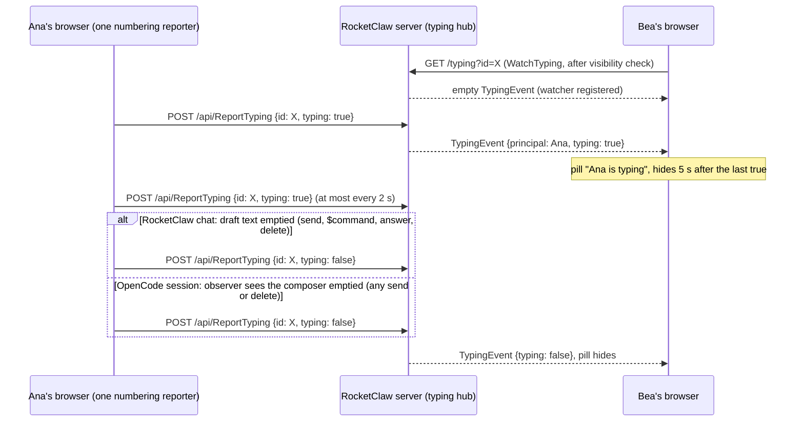

# Web Typing Indicator - Plan

## Goal Capsule

- **Objective:** People who have the same chat open in RocketClaw's Web see, within a moment, that someone else is typing there, in RocketClaw chats and OpenCode sessions alike.
- **Means:** an in-memory typing stream, separate from the chat's change stream, shown as a floating pill at the top of the chat (KTD1, KTD9).
- **Authority:** Product Contract Key Decisions, then Requirements, then Key Technical Decisions, then Implementation Units. A unit never overrides an R or a KTD.
- **Stop conditions:** stop and report if catching OpenCode keystrokes or placing the pill would require changing any file under `internal/rocketclaw/oc/`, copied or `host/` (R8), if the Go or TypeScript line budgets cannot fit the change without editing them, or if `protoc-gen-go` v1.36.12 cannot be run to regenerate `web.pb.go`.
- **Execution profile:** one pull request. Order: U1, then U3, then U4.
- **Who finishes:** the `lfg` pipeline implements, reviews, and opens the pull request.

---

## Product Contract

### Summary

When one person types in a chat's composer, everyone else viewing that chat sees a small high-contrast pill at the top of the chat: "Ana is typing" with animated dots. It arrives by push, works the same in RocketClaw chats and in OpenCode sessions, and leaves OpenCode's copied code untouched.

### Problem Frame

RocketClaw's Web is multiplayer: several people can have one chat open, and a `sticky: global` agent exists for exactly that. Nothing tells them when another person is composing. Two people send at once, or ask the agent the same thing, because neither can see the other at work. Upstream OpenCode has no user presence, so its embedded view offers nothing to build on. RocketClaw's own existing signals are the 2 s `ListSessions` poll, too slow for typing, and per-chat change hints, which by design carry nothing displayable.

### Requirements

**What people see**

- R1. When a person types in a chat's composer, everyone else currently viewing that chat on the same RocketClaw server sees the typing pill within about a second, by push rather than polling.
- R2. The pill shows the typist's initial, display name, "is typing" and animated dots. Two typists read "Ana and Cy are typing", three read "Ana, Bea and Cy are typing", and four or more read "Ana, Cy and N others are typing". Long names are cut with an ellipsis so the pill stays inside the chat.
- R3. A person never sees a pill for their own typing, from any window or device.
- R4. The pill disappears when the typist sends by any path, empties the draft, or stops typing for about 5 s, and when the viewer leaves the chat.
- R5. It works for RocketClaw chats and OpenCode sessions. In an OpenCode tab it names who types in the tab's session; while the view shows a subagent session, which takes no prompts, it adds "in the main session".
- R6. The pill floats at the top of the chat, centered on the conversation, without covering anything around the composer. In OpenCode sessions it sits just below OpenCode's header. It never blocks clicks.
- R7. Screen readers hear "Ana is typing" politely, once per change. The dots are hidden from them, and the animation stops under reduced motion.

**Constraints**

- R8. No file under `internal/rocketclaw/oc/` changes, copied or `host/`.
- R9. Only the fact of typing reaches the server and other people, never draft text.
- R10. Watching and reporting follow the rules for viewing the chat: RocketClaw chats use the existing visibility check, and OpenCode sessions refuse people limited to spaces, as the OpenCode proxy does. Refusals and failures stay silent: no error message and no Sentry report.
- R11. Typing adds no database connection, query load per keystroke beyond the visibility check, or stored state, and no stream for chats that are not on screen.

### Key Decisions

- **Pill at the top of the chat.** Governs R6. (session-settled: user-directed — chosen over a heads-up strip on the composer and a pill floating just above the composer area: the area above each composer holds OpenCode's shell and to-do chips, queued follow-ups and RocketClaw's queue panel, and changes height, so a pill there covered them.)
- **Instant push.** Governs R1. (session-settled: user-directed — chosen over reusing the 2 s `ListSessions` poll: too slow for typing.)
- **Typing only.** Governs R1, R3, R4. (session-settled: user-directed — chosen over showing who is viewing a chat: only typing matters.)
- **No OpenCode code changes.** Governs R8. (session-settled: user-directed — chosen over registering a RocketClaw plugin in OpenCode's built-in plugin list, one copied-file line: every upstream merge would have to carry it.)

### Scope Boundaries

- Who is viewing a chat (presence) is out of scope.
- Slack threads and voice calls show and report nothing. Speech is not typing.
- People reaching one OpenCode server through different RocketClaw servers do not see each other; each RocketClaw server has its own stream.
- Not built: a server-side snapshot so a viewer who arrives mid-typing sees the pill at once. The typist's next report arrives within 2 s. Revisit if people report missing pills.
- Not built: telling one person's windows apart. If Ana types in two windows and sends from one, her pill blinks off until the other window's next report. Revisit if it confuses people.
- Not built: hiding a typist when their message appears in the transcript. KTD6 clears the pill wherever the draft empties, which every send path does.
- Not built: clearing typing in the OpenCode proxy on prompt, shell or command requests. It would race the browser's own reports and miss sends that use neither (`/btw`, built-in slash commands); the composer observer in KTD6 sees all of them. The proxy would only help when a browser closes within moments of sending, where the 5 s expiry already ends the pill.
- Not built: stopping reports to an older remote RocketClaw that lacks the call. They fail silently, at most once every 2 s while typing.

### Sources

- Prototype (machine-local, best effort; a missing prototype is not a blocker and this plan governs any disagreement): `/Users/ucirello/Projects/platform/.tmp/workspaces/20261113-other-user-is-typing/.tmp/ce-prototype/2026-11-13-other-user-typing/`. Read `decisions.md`; `01-typing-indicator/screens/001-typing-variants.html`, variant 4 "Floating pill" with "top of the chat"; `demo/site/pill-*.mp4` show the chosen position against the rejected one.
- `docs/solutions/architecture-patterns/web-keep-alive-views-connection-budget.md`: hidden views keep their streams open; open new streams only for what is on screen.

---

## Planning Contract

### Key Technical Decisions

- KTD1. **A separate typing stream and a report call, not the chat's change stream.** Add a unary `ReportTyping {id, typing}` and a server-streaming `WatchTyping {id}` that emits `TypingEvent {principal, typing}`, with routes `POST /api/ReportTyping` and `GET /typing?id=…`. Names are proposals. The event carries the typist's display name; for someone whose display name is blank it is their login, as on their prompts. Watchers key typists by it. The `Join` stream cannot carry it:
  - `ConversationChange` is content-free by rule (`frontend/rpc/server_test.go` asserts two fields; `frontend/rpc/README.md` and `web/README.md` say so).
  - `Join` answers NotFound for OpenCode sessions no sync has stored.
  - `Join` holds a PostgreSQL LISTEN connection that never fires for OpenCode ids.
  - Its first frame would make the browser read History for an `opencode:` id, which `web/src/opencode.browser.test.ts` forbids.
  - Mixing a second source into `join` would need another goroutine and a send lock.
- KTD2. **One mutex-guarded hub on `Server`, relay only.** Map conversation id to its watchers, each a buffered channel plus the watcher's username. `ReportTyping` sends to every watcher of that id except the reporter's username, without blocking: a full channel drops the event. A watcher removes itself when its stream ends. Once registered, `WatchTyping` sends one empty `TypingEvent`, as `Join` sends an initial empty change: it lets the HTTP bridge write its headers and tells tests the watcher is listening. The browser ignores events with an empty display name. No stored typists, no timers, no database. RocketClaw runs one process per database (run lock), so memory reaches every viewer of that server.
- KTD3. **Expiry lives on the watcher; reports are throttled and numbered.**
  - A watcher hides a typist 5 s after their last `typing: true` and at once on `false`, comparing timestamps so slowed background timers cannot leave a stale pill.
  - The reporter sends `true` on the first keystroke, then at most once per 2 s. It sends `false` once when the draft becomes empty.
  - Each report leaves at once, so one that hangs holds back nothing, and carries its tab's id and a number counting the tab's reports from 1. While a chat has watchers, the server keeps the newest number from each person's tab and drops a report that arrives after a later one, so a late `true` never undoes a `false`. The numbers go with the chat's last watcher. (Built first as one ordered chain of reports per tab; a report that hung held back the rest, and giving up on it let it arrive after the later `false`. The model in `docs/verification/typing` checks the numbered design and shows the chain's failure.)
- KTD4. **The server supplies identity.** `ReportTyping` takes the username and display name from `Server.principal`, never from the request body. This satisfies R3 by filtering on username and R9 because the request carries no text.
- KTD5. **One visibility helper for both calls.** An id beginning with `opencode:` refuses people limited to spaces with `errOpenCodeClosed` and needs no stored row, matching `frontend/rpc/relay.go`. Every other id goes through `visibleConversation`, which already refuses shadow sessions, private conversations and out-of-space chats. R10.
- KTD6. **Every send clears typing in the typist's own browser, through the one reporter.**
  - RocketClaw chats: the composer reports from its draft text, covering both `setText` and `sendComposer`'s direct `draft.text = ""`. Sends, `$fork`, `$handoff`, `$undo`, `$redo` and question answers all empty the draft, so all of them report `false`.
  - OpenCode sessions: OpenCode empties its composer in its own code, which fires no `input` event, and some sends reach no single endpoint (`/btw` uses `session.generate`; a picked slash command runs `command.trigger`). So once the KTD7 listener has seen input from OpenCode's composer element, a `MutationObserver` watches that element; when the draft turns empty under KTD7's rule, it reports `false` for the shown session. A later `input` from a new composer element moves the observer there.
  - Both paths go through the one reporter, so the `false` is numbered after any earlier `true` (KTD3).
- KTD7. **OpenCode keystrokes are caught outside OpenCode's code.**
  - Typing is detected by an `input` listener on `RemoteSession`'s container, matching OpenCode's composer `[role=textbox][contenteditable]`. The draft is empty when its `textContent` holds nothing but line breaks and zero-width spaces (U+200B), the rule OpenCode's own `isEditorDomBlank` (`oc/packages/app/src/composer/editor/dom.ts`) uses; a mention pill counts as content. The view shares the page with RocketClaw, no iframe, and nothing in `oc/host/` stops `input` propagation.
  - Reports name the session the view shows. `RemoteSession` keeps it in React state, updated by the existing `reportSession` navigation callback. The pill watches the tab's own session, which is the shown one unless the view shows a subagent's.
  - The listener captures the server and id at the keystroke, because one view moves between that server's tabs.
- KTD8. **The browser side opens nothing it does not show, and fails quietly.**
  - The pill component opens `WatchTyping` with `EventSource` only while its chat is on screen. It relies on `EventSource`'s own reconnect; a refused stream (a non-200 response) closes for good.
  - Reports use a plain `fetch` with errors swallowed, not `rpc()`, which reports every failure to Sentry.
  - Both target `serverURL(server)` for the chat's own server, so remote RocketClaw servers work.
- KTD9. **The pill is placed from outside both views.**
  - RocketClaw chats: an absolutely positioned child of the transcript's `MessageScroller`, beside `MessageScrollerViewport`, centered near the top the way `MessageScrollerButton` is placed. That root does not scroll and is already `relative overflow-hidden`, so the pill neither scrolls away nor pushes turns down.
  - OpenCode sessions: a sibling of the OpenCode view inside `RemoteSession`'s wrapper, offset below OpenCode's 48 px header and RocketClaw's version pill. That keeps it clear of OpenCode's `overflow: hidden` root and under OpenCode's portal (z-index 50).
  - `pointer-events: none` in both.
  - The hook, component and reporter live in a new `web/src/typing.tsx`, because `SessionApp` already sits at react-doctor's complexity limit.

### High-Level Technical Design

### Implementation Constraints

- `make generate` does not regenerate the proto. Run `go generate ./internal/rocketclaw/frontend/rpc`, which needs `protoc` (present at `/opt/homebrew/bin/protoc`) and `protoc-gen-go` at the version pinned in `web.pb.go`'s header, v1.36.12. It is not installed on this Mac; install that exact version with `GOBIN` under the repository's `.tmp/`. Commit `web.pb.go` and `protocol.gen.go` together, since `web/src/api.test.ts` checks the hash.
- Any proto change makes every open page reload once on deploy (`ProtocolGuard`), which is expected.
- Line budgets: Go has about 939 lines before `GO_SOURCE_CLOC_BUDGET`'s hazard zone (`internal/rocketclaw/Makefile`), TypeScript about 705 before `TS_CLOC_BUDGET`'s (`internal/rocketclaw/web/Makefile`). Never edit either budget.
- RocketClaw packages build only on Linux; on a Mac run their checks through `make -C internal/rocketclaw …`.

### Deferred to Implementation

- Final RPC, message and route names.
- The exact OpenCode top offset, after checking OpenCode's header height at narrow widths (`virtualizer.tsx` notes it can be 48 px or 80 px).
- Whether Playwright's `fill` on OpenCode's contenteditable fires the bubbling `input` event, or the test must type keys.

---

## Implementation Units

### U1. Typing protocol, hub and permissions

**Goal:** the server relays typing reports to that chat's other watchers, under the chat's visibility rules.

**Requirements:** R1, R3, R9, R10, R11; KTD1, KTD2, KTD4, KTD5.

**Dependencies:** none.

**Files:**
- `internal/rocketclaw/web/proto/web.proto`
- `internal/rocketclaw/frontend/rpc/web.pb.go`, `internal/rocketclaw/frontend/rpc/protocol.gen.go` (generated)
- `internal/rocketclaw/frontend/rpc/transport.go`
- `internal/rocketclaw/frontend/rpc/http.go`
- `internal/rocketclaw/frontend/rpc/server.go` (hub fields and their initialization in `New`)
- `internal/rocketclaw/frontend/rpc/typing.go` (new: both handlers and the visibility helper)
- `internal/rocketclaw/frontend/rpc/typing_test.go` (new)
- `internal/rocketclaw/frontend/rpc/permissions_test.go`
- `internal/rocketclaw/frontend/rpc/http_test.go`
- `internal/rocketclaw/frontend/rpc/README.md`

**Approach:**
1. Add the request, response and event messages and both RPCs to `web.proto`, then regenerate.
2. Register `ReportTyping` in `Register`'s unary method list and `webCall`, and `WatchTyping` in `desc.Streams`. `validRequest` already checks the `id` field.
3. Route `POST /api/ReportTyping` with `id` required in `httpInput`, and `GET /typing` beside `/stream`.
4. Put the hub's mutex directly above the map it guards in `Server`, with a comment, as the other `Server` mutexes are, and create the map in `New`.
5. Document both calls in `frontend/rpc/README.md` next to `Join`, including that they carry names and are not content-free.

**Patterns to follow:**
- `MoveToBackground` is the template for a unary call, from proto through the `mutations` helper.
- `join` and `/stream` are the template for the stream.
- `voiceCalls` in `server.go`: per-person cleanup that deletes only its own entry.
- `Runtime.Subscribe` in `backend/runtime.go` removes a subscriber when the context ends. Do not copy its lazy map creation or its blocking sends.

**Test scenarios** (`typing_test.go` drives the gRPC server the way `reads_test.go` does, with principals from metadata. It catches relay, filtering and permission behavior, but not the HTTP/SSE framing that `http_test.go` covers. Each test reads the watch's initial empty event before reporting):
- Opening a watch delivers one empty event first.
- Bea watches chat X; Ana reports `true` on X; Bea receives `{principal: Ana's display name, typing: true}`.
- Ana watches X and reports on X; Ana's stream receives nothing.
- Ana reports `false`; Bea receives `typing: false`.
- A report on chat Y reaches no watcher of X.
- A watcher whose channel is full does not block the reporter; the report returns promptly.
- After Bea's stream is cancelled, her entry is gone from the hub.
- An `opencode:s:ses_1` id with no stored row: a person not limited to spaces can watch and report.
- A person limited to spaces is refused on `opencode:` ids with the OpenCode-closed status.
- `permissions_test.go`: rows for both calls, refusing a shadow session, a private conversation and an out-of-space chat, as the `Join` row does; the allowed `WatchTyping` case ends on its first `SendMsg`, like `Join`'s.
- `http_test.go`: `GET /typing?id=X` reaches `WatchTyping` and writes `data:` frames; `POST /api/ReportTyping` without `id` is rejected.

**Verification:** both calls work end to end over HTTP, the permission table covers them, and `make -C internal/rocketclaw lint test` passes, including the Go line budget and coverage threshold.

### U3. Pill and reporting in RocketClaw chats

**Goal:** RocketClaw chats show other people's typing and report their own.

**Requirements:** R1, R2, R3, R4, R6, R7, R9, R10, R11; KTD3, KTD6, KTD8, KTD9.

**Dependencies:** U1.

**Files:**
- `internal/rocketclaw/web/src/typing.tsx` (new: the reporter, the watch hook and the pill component)
- `internal/rocketclaw/web/src/ui.tsx` (`SessionComposer` reporting; mounting the pill in `Transcript` while the chat is shown)
- `internal/rocketclaw/web/src/typing.browser.test.ts` (new)
- `internal/rocketclaw/web/src/composer.browser.test.ts`, `question.browser.test.ts`, `background.browser.test.ts`, and other browser tests whose mocks must answer the new routes or whose exact request lists now include reports
- `internal/rocketclaw/web/README.md`

**Approach:**
1. Reporter: per KTD3 and KTD8. It skips the new-chat page (empty id).
2. `SessionComposer` reports after each draft text change from `setText` and after `sendComposer` empties the draft. Loading a saved draft is not typing and reports nothing.
3. Watch hook and pill: per KTD3, KTD8 and KTD9. Keep a `role="status"` `aria-live="polite"` element mounted, empty, for as long as the chat is on screen, and render the visible pill inside it only while someone types; screen readers often skip live regions inserted with their text already in place. Dots are `aria-hidden`, the animation uses `motion-reduce:animate-none`, and the initial is the name's first code point. The pill uses the theme's inverted tokens (`bg-foreground text-background`), not a fixed dark color, so it contrasts in light and dark themes, and its width is capped to the pane with names truncated.
4. Mount the pill only for the chat on screen, never in the hidden kept-alive `Transcript` (R11).
5. Document the new route and call in `web/README.md`'s HTTP contract, and the pill in its chat section.

**Patterns to follow:**
- `useSessionStream` in `ui.tsx` for `EventSource` handling.
- `background.browser.test.ts` for a mocked stream the test pushes frames into.
- The running-tab shimmer in `ui.tsx` for `motion-reduce` handling.

**Test scenarios** (browser tests against the built Web with mocked routes. They catch rendering, timing and the requests sent, not server relaying):
- The `role=status` element exists, empty, before any frame arrives. A pushed `{principal: Ana, typing: true}` frame then shows a pill reading "Ana is typing" inside it, at the top of the conversation.
- Scrolling the transcript leaves the pill where it is, and showing or hiding the pill does not move the first turn.
- Frames for Ana and Cy show "Ana and Cy are typing". Three typists show all three names. Four typists show "Ana, Cy and 2 others are typing".
- Two long display names at a phone width keep the pill inside the pane, truncated.
- A `typing: false` frame hides that typist at once.
- With a mocked clock, no new frame for 5 s hides the pill.
- Typing "hel" sends one `ReportTyping {id, typing: true}`. Continued typing sends at most one more per 2 s, and no request carries the draft text.
- Sending the message reports `false` at once, numbered after any pending `true`.
- `$undo` and answering a pending question each report `false`.
- A page opened with a saved non-empty draft sends no report.
- The new-chat page sends no report.
- A `/typing` request answered with 403 shows no error and opens no new stream. A `ReportTyping` answered with 404 plain text shows no error.
- Leaving the chat for another page closes its `/typing` stream, and the hidden kept-alive transcript has none open.

**Verification:** `make -C internal/rocketclaw/web lint test` passes, including react-doctor and the TypeScript line budget.

### U4. Pill and reporting in OpenCode sessions

**Goal:** OpenCode sessions show other people's typing and report their own, with no OpenCode file changed.

**Requirements:** R1, R4, R5, R6, R8; KTD6, KTD7, KTD8, KTD9.

**Dependencies:** U1; U3 for `typing.tsx`.

**Files:**
- `internal/rocketclaw/web/src/ui.tsx` (`RemoteSession`: the shown-session state, the `input` listener, the composer observer and the pill wrapper)
- `internal/rocketclaw/web/src/opencode.browser.test.ts`

**Approach:**
1. `RemoteSession` keeps the shown session in state, set from its route and from `reportSession`.
2. Add the KTD7 listener on its container and the KTD6 composer observer, both reporting through U3's reporter.
3. Wrap the container in a positioned element and render the pill beside the view per KTD9, watching `opencode:<server>:<shown session>`.

**Execution note:** start with a failing browser test that types into the real OpenCode composer from the built `oc-dist` and expects a `ReportTyping` request for the `opencode:` id. That test is the guard against an upstream change to OpenCode's composer.

**Patterns to follow:** `opencode.browser.test.ts`'s `start()`, which serves the built view with the fake OpenCode server from `oc/host/test/server.ts`, and its existing composer locators.

**Test scenarios** (browser tests with the real built OpenCode view. They catch event bubbling and placement against OpenCode's actual layout, not server relaying):
- Typing in OpenCode's composer sends `ReportTyping {id: "opencode:<server>:<session>", typing: true}`. Deleting the whole draft sends `false`.
- After a Shift+Enter line break and some text, deleting everything sends `false`.
- Sending a prompt, running a shell command in shell mode, sending `/btw`, and picking a built-in slash command each send `ReportTyping {false}` from the browser once OpenCode empties the composer.
- With a `ReportTyping {true}` held pending by the test, sending the prompt issues the `false` at once, numbered after the pending `true`.
- After the view opens a subagent session, which OpenCode gives no composer, the pill keeps watching the tab's session and reads "Ana is typing in the main session". Typing in another tab's session the view moves to reports that session's id.
- A pushed typing frame shows the pill below OpenCode's header, not overlapping the header, the composer, or the chips above the composer. Check at desktop and narrow widths.
- The pill does not block a click on the first message under it.
- Typing in OpenCode's terminal or its settings search sends no report.
- The existing assertion that `/api/History`, `/stream` and `/api/ListQueue` are never called with `opencode:` ids still holds.

**Verification:** `make -C internal/rocketclaw/web test` passes with the OpenCode browser tests, and the change touches nothing under `internal/rocketclaw/oc/`.

---

## Verification Contract

| Check | Command | Applies to |
|---|---|---|
| Proto regeneration | `go generate ./internal/rocketclaw/frontend/rpc` with `protoc-gen-go` v1.36.12 on `PATH` | U1 |
| Go format | `gofmt` on touched Go files | U1 |
| RocketClaw Go lint | `make -C internal/rocketclaw lint` | U1 |
| RocketClaw Go tests, line budget and coverage | `make -C internal/rocketclaw test` (Linux container on a Mac; needs the test PostgreSQL per that Makefile) | U1 |
| Web lint (oxlint, tsc, react-doctor) | `make -C internal/rocketclaw/web lint` | U3, U4 |
| Web tests, browser tests, TypeScript line budget | `make -C internal/rocketclaw/web test`, after `bun install --frozen-lockfile`, with `ROCKETCLAW_PLAYWRIGHT_MODULE` and `ROCKETCLAW_CHROMIUM` set per `web/README.md` | U3, U4 |
| Repository gates | `make lint`, `make test`, `go test ./...` for non-RocketClaw packages | all |
| OpenCode untouched | `jj diff --git --stat` shows no path under `internal/rocketclaw/oc/` | all |

---

## Definition of Done

- R1 to R11 hold, each demonstrated by a U1–U4 test scenario, except R8, which the Verification Contract's "OpenCode untouched" check demonstrates.
- Every command in the Verification Contract passes; neither line budget was edited.
- `web.pb.go` and `protocol.gen.go` match `web.proto`.
- `frontend/rpc/README.md` and `web/README.md` describe the new call, stream and pill.
- No file under `internal/rocketclaw/oc/` changed.
- No abandoned-attempt code, debug logging, or unused helpers remain in the diff.
