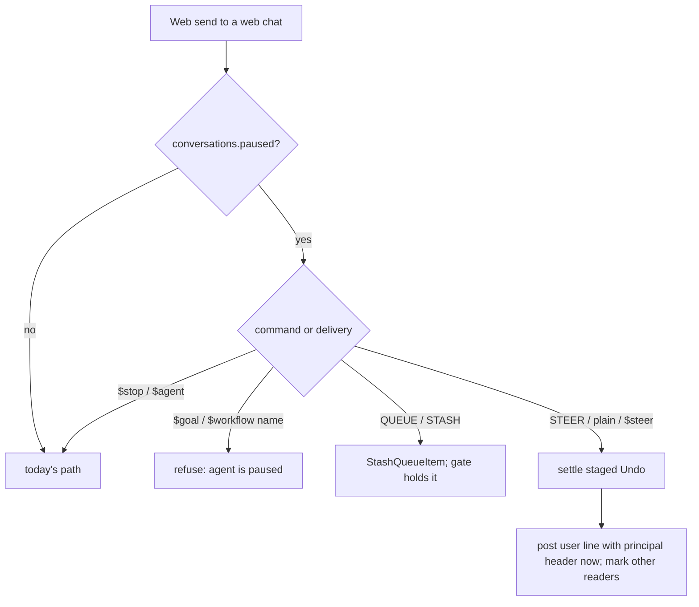
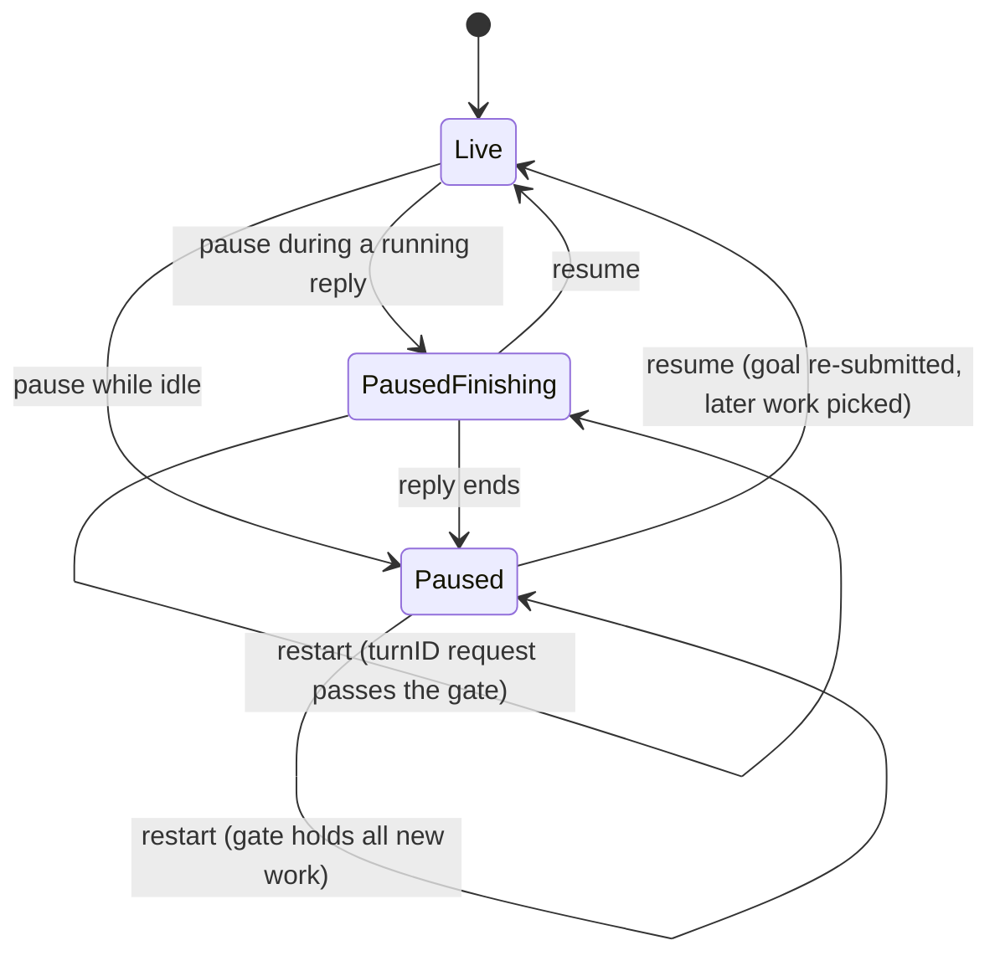

# Pause the Agent in Web Chats - Plan

## Goal Capsule

- **Objective:** People in a RocketClaw session they started in the Web can switch the agent off, talk to each other in that chat without the agent replying, and switch it back on so the agent rejoins with that conversation in its context.
- **Means:** one shared pause flag per Web-started session, offered only while nothing outside reports into it (KTD7), checked where new turns are admitted (KTD2), with paused messages and the pause/resume lines written straight to history (KTD3).
- **Authority:** Product Contract requirements win on behavior; KTDs win on mechanism; units carry only local detail. `AGENTS.md` rules (no `git`, `.tmp/` scratch only, no `//nolint`, CLOC budgets, mockery v3, SQL without subqueries) bind every unit.
- **Execution profile:** one pull request, landed as one commit per unit in U-ID order. Deep plan; touches a migration, turn admission, RPC, and the Web app.
- **Stop conditions:** stop and report if the admission gate cannot pass `make -C internal/rocketclaw lint` without a `//nolint` or a complexity suppression; if the Go or TS CLOC budget would be exceeded; or if, after the U6 pause-line text adjustment, real-model checks still show the agent answering paused-time messages one by one or ignoring the paused discussion when the post-resume request depends on it.
- **Who finishes:** `ce-work` implements and verifies; the `lfg` pipeline reviews, commits, pushes and opens the PR. Merging stays with the user.

---

## Product Contract

### Summary

Add a Pause agent / Resume agent switch to RocketClaw sessions people start in the Web. While paused, a person's plain message posts straight into the chat with their name at once, so the session feels like a plain chat, and nothing makes the agent take a turn. Resuming lets waiting work run as usual, and the agent reads the paused conversation the next time it takes a turn.

### Problem Frame

Every message sent in a Web chat today becomes an agent turn, at once or from the Thread Queue. People sharing a chat cannot talk among themselves there: each remark triggers a reply, and their messages only show for others once a turn consumes them. Teams end up discussing elsewhere and pasting conclusions back, which loses the context the agent would need when it rejoins.

### Requirements

**The switch**
- R1. Each pausable session has one pause switch whose state is the same for everyone who can see the chat and survives a restart.
- R2. Anyone who may send prompts into the session may pause or resume it. Only a session a person started in the Web pauses, whatever its agent's sticky setting (off, user or global), and only while nothing outside reports into it. Cron report chats, External MCP chats, Slack threads, Remote OpenCode Sessions, Shadow and Subagent Sessions, and anything an outside trigger started never show the switch and refuse it.
- R12. A `sticky: global` agent's Sticky Session stops being pausable once a cron job or Routine runs that agent, since their runs report into it. The switch disappears, and a paused one is resumed, with a RocketClaw-written resume line, at the next restart or Reload that loads the cron job or Routine.
- R13. External MCP agents are `sticky: off` agents, so External MCP never reports into a Sticky Session. Main already enforces this; this change adds nothing for it.
- R3. Web shows the paused state in the open chat, labels the composer accordingly, marks the chat's sidebar row, and offers Pause agent / Resume agent in the chat and in the command palette, only on pausable sessions. A switch the server refuses shows the server's reason. A message typed in New session that lands in an existing (sticky) session follows that session's pause.
- R4. Pausing adds a line to the chat saying who paused the agent; resuming adds one saying who resumed it. The person's name is quoted in those lines, and Web shows every name as plain text, never as markup.

**While paused**
- R5. A plain message a person sends (including `$steer`) appears in the chat for everyone at once, attributed to them, and starts no turn. Its attachments, search indexing, Undo and Fork behave as for any user message.
- R6. No agent turn starts from any source: Web queue items, Goals, Scheduled Messages, other agents' session writes, and Completion Note wakes all wait. Background Jobs already running keep running; only their wake waits.
- R7. A reply that is running when someone pauses finishes, also across a restart. Messages sent while it runs appear at once; they may sort above that reply. The pause is forward-looking: a request already starting a turn when someone pauses just runs.
- R8. `$enqueue` and `$stash` keep their meaning: the item waits in the Thread Queue and runs after resume. `$stop` and `$agent` work as today.
- R9. Requests that need the agent at once get a clear "agent is paused" answer instead of waiting: Voice Hand-offs, `$goal`, and `$workflow <name>`. Nothing outside reports into a pausable session (R2, R12), so producer runs need no refusal of their own.
- R10. A paused message gives the chat's other readers an Unread mark like other new activity. It does not auto-park the sender's tab.

**Resume**
- R11. Resuming starts no turn just to read the paused conversation. Work that waited runs in its usual order, and the next turn the agent takes reads the paused messages as people talking among themselves. A message sent just as someone resumes goes through as a normal message to the now-live agent.

### Key Decisions

- **Resume adds no catch-up turn.** (session-settled: user-approved — chosen over an immediate catch-up turn on resume: simplest and predictable.) Governs R11. Conflict call-out: held work (queue items, a continuing Goal, due Scheduled Messages, agent writes, wakes) has no other trigger, so resume starts it at once. The settled rule is read as "nothing starts only to catch up on the paused chat".
- **A running reply finishes.** (session-settled: user-approved — chosen over stopping the reply when someone pauses: no lost work.) Governs R7.
- **Pause holds all non-human work too.** (session-settled: user-approved — chosen over pausing only human messages: "paused" means the agent does nothing.) Governs R6, R9.
- **Web-started sessions only.** (session-settled: user-approved — chosen over pausing every Web chat: a session that cron or External MCP reports into stays always on.) Governs R2, R12.
- **Paused messages post at once.** (session-settled: user-approved — chosen over holding them until a running reply ends: the session should feel like a plain chat; a message typed in a reply's last seconds may sort above it.) Governs R5, R7.
- **Races are not strict.** (session-settled: user-approved — the pause is forward-looking; "eventually stops turning" is enough.) Governs R7, R11.

### Acceptance Examples

- AE1. Covers R5, R10. **Given** Ann and Bob both have a paused, idle chat open, **when** Ann sends "lunch at noon?", **then** Bob's view shows Ann's message under her name within one live update, Bob's tab gets an Unread mark, Ann's tab is not parked, and no turn row exists.
- AE2. Covers R7. **Given** the agent is mid-reply, **when** Bob pauses and Ann sends a message, **then** Ann's message and the pause line appear at once, above the reply, and the reply completes, including when the server restarts before the reply ends.
- AE3. Covers R6, R11. **Given** a paused chat with a queued item and an active Goal, **when** the server restarts, **then** nothing runs; **when** Bob resumes, **then** the Goal's next turn runs before the queued item.
- AE4. Covers R2, R12. **Given** a cron report chat, an External MCP chat and a `sticky: global` Sticky Session that a person paused, **when** a Reload loads a Routine for that sticky agent, **then** the Sticky Session is resumed with a line saying RocketClaw resumed the agent, and none of the three shows the switch or can be paused.

### Scope Boundaries

- Considered, not built: stopping running Background Jobs on pause. `$stop` already does that, and pause is about new turns. Would change if people expect pause to halt tools.
- Considered, not built: refusing agent session writes into a paused chat. They are stored and wait (R6), so the writer's reply note arrives after resume. Would change if writers stall on long pauses.
- Considered, not built: a separate Shadow Session treatment. Shadows receive only consumed inputs, so they never see paused messages; comparisons after a pause carry that difference.
- Considered, not built: keeping tabs parked until done through paused messages. A paused message ends such a park as other news already does in `markTabsSQL`; the tab comes back bold, which the person sees at once. Would change if people report parks ending during long human-only chats.
- Not in scope: Slack threads, Remote OpenCode Sessions, an agent-facing pause tool.

#### Deferred to Follow-Up Work

- An `is:paused` search filter and a distinct paused work state in Dashboard lanes; a paused chat with waiting work still reads as queued there.
- Telling an agent whose session write landed in a paused chat that the chat is paused.

---

## Planning Contract

### Key Technical Decisions

- KTD1. **A `conversations` column holds the pause, read by the server, never by client state.** One boolean column, added by migration `092`, set and cleared under the conversation's history lock so it serializes with turn start and posted lines. Every decision (gate, prompt routing, permission) reads the column, so two people toggling at once or a stale Web view cannot disagree with the server. The switch sets a target state, so repeating it is a no-op. Remote rows in the sidebar union read `FALSE` for both `paused` and `pausable`. A Fork does not copy it, so a fork starts live; when a fork's copied history holds a pause line with no later resume line, the fork appends the KTD5 resume line attributed to the person forking, so its agent is not left under the pause framing. Governs R1, R2, R5. See `docs/solutions/logic-errors/remote-opencode-fork-marker-dropped-by-sidebar-remote-branch.md`.
- KTD2. **Gate turn admission where Undo's cutoff already gates it, not per start path.** The flag is checked in `Bridge.handle` and at the top of `Bridge.pickLaterWork`, beside the existing `revert_message_id` checks, not in `Bridge.activateInbound`: a request caught starting a turn at the moment of a pause just runs, so no caller ever hangs. That gate covers Web, Goal, Scheduled Message, agent write, wake and startup recovery, and a restart cannot end the pause. Rules:
  1. The check reads the lane conversation (`b.config.ConversationID`), not a hidden run's producer.
  2. A request that resumes an existing turn (`turnID` set) passes, so a reply interrupted by restart still finishes (R7).
  3. A gated human request, or a recurring schedule, is kept durably with its completion, as `preserveRevertRequestLocked` does today. Any other gated request has its completion closed with a typed paused error, so no caller hangs. There is no branch for producer runs: nothing outside reports into a pausable session (KTD7). Nothing durable is lost: Thread Queue rows, one-time Scheduled Message rows and Completion Notes are only taken inside `activateInbound`'s transaction, after `pickLaterWork`'s gate, so a gated request leaves them waiting for resume's `pickLaterWork`. Only the Goal continuation has no row, and resume re-submits it (KTD4). The paused error must not end the Goal.
  4. Pausing closes `inputOpen`, as `StageRevert` does, and `openInputWindow` keeps it closed while the lane conversation is paused, so a Web or agent steer never joins the finishing reply, also when that reply resumes after a restart.
  Rejected: separate checks in each start path, and a held-marker per item. Both were tried and removed before (`docs/solutions/logic-errors/saved-queue-never-started-after-restart.md`, `docs/solutions/logic-errors/attached-subagent-wait-must-be-recorded-before-work.md`). Governs R6, R7, R11.
- KTD3. **Paused messages and pause/resume lines go straight into history.** Each is appended to `entries` with `appendSessionEntryDB` in the transaction that records it, under the history lock, also while a reply runs, so it may sort above that reply. `postStopLines`, the "Stopped by" line route, and the startup query in `StartQueuedConversations` stay as on main. A message sent again is recognized by its Web message ID (`reconcileWebDB`) and posts once.
  A paused message is a `user` replay item whose `prompt_header` comes from `provenanceHeader` with the sender as `principal`, whose `input_id` is the Web message ID, and whose content carries attachments the way `uploadContent` writes them. That gives Web the author, the optimistic bubble its match, search its text, and Undo its target. Governs R4, R5, R7.
- KTD4. **Resume mirrors `ClearRevert`.** Under the history lock it clears the flag and appends the resume line, so the line is in history before any released turn starts. After commit it:
  1. re-submits the Goal continuation when a Goal is active, no turn runs, and the bridge is neither handling nor holding a request, as `StartActiveGoals` does for one conversation;
  2. calls `pickLaterWork` for the chat.
  Nothing else starts a turn. Governs R11.
- KTD5. **Framing lives in RocketClaw-written developer lines, not in user text or the system prompt.** The pause line reads, in substance, `"Ann" paused the agent. Until it is resumed, messages here are people talking to each other, not requests to you.` The resume line reads `"Bob" resumed the agent.` The name is quoted with `strconv.Quote`, as `provenanceHeader` quotes a principal; the fork's resume line quotes the forker the same way. Each person's own message stays factual, with only the normal `[Web principal]` header. Text that claims authority inside user content read as prompt injection before (`docs/solutions/logic-errors/review-request-claiming-its-own-trust-reads-as-injection.md`). The lines also survive Fork and compaction, where a live flag would not. Governs R4, R11.
- KTD6. **The Web send path decides paused routing on the server, in a helper outside `Server.prompt`'s main body.** After `promptable` and `turnFeedable`, a paused web chat routes:
  - STEER, plain sends and `$steer` become paused lines, and skip `AttentionSent`. When the backend finds the chat resumed meanwhile, it runs the message as `RunTurn` would (R11).
  - QUEUE and STASH go through `StashQueueItem` unchanged; the gate holds them.
  - `$goal` and `$workflow <name>` are refused.
  - `$stop` and `$agent` are unchanged.
  - Promoting or popping a queued item into a run (`PromoteQueueItem` through `mutateWebQueue`) is refused with the paused error before it claims the item, so the item stays where it was.
  - A pending agent question is never answered by a paused send; it is answered from its question card. Paused lines sent while the reply waits on that answer post at once (R7).

  A paused line first settles a staged Undo exactly as `admitWeb` does, in the same transaction, so a line sent right after Undo is not hidden behind the cutoff and deleted. `Server.prompt` has 3 complexity points left, so the branching lives in the helper. Governs R5, R8, R9.
- KTD7. **Only a session nothing outside reports into can pause, decided from recorded facts.** The sidebar query computes `pausable` for each row: kind `web_chat`, `created_by` a person (not empty, as External MCP chats are, nor `cron`, as cron report chats are), no `cron_run`, no conversation reporting into it (the existing `reporting` CTE, which catches a Web "Run now" cron chat and Web continuations of cron runs), and not a `sticky: global` session whose agent a loaded cron job or Routine runs. The cron manager hands the agents of the definitions it loads to the store (`SessionService.ScheduleAgents`) on start and on each successful Refresh; the runtime then resumes, as RocketClaw and through `SetAgentPaused`, every paused `sticky: global` session of those agents, at startup after queued work starts and after each Reload. `UpdateSession` refuses to pause a session whose own sidebar row is not pausable; resuming is always allowed. The bridge gates read only `paused`, which the resume clears, so sidebar, RPC and gates agree. Producer runs need no refusal: `Runtime.RunTurn`'s former check for paused destinations is gone. Voice Hand-off refuses through its existing notice path and keeps the unspoken transcript for the next hand-off. External MCP agents are `sticky: off` by `ExternalMCPAgentsIn`, which every External MCP call checks through `mcpAgentIndex.Exposed`. Governs R2, R9, R12, R13.
- KTD8. **The switch reuses `UpdateSession` and one new runtime method; posting a paused line is a second one (U3).** `UpdateSessionRequest` gains an optional `paused`; `Session` gains `paused` and `pausable`, so the sidebar fingerprint carries both to every viewer. When `paused` is set, `Server.updateSession` applies the prompt permission rule (`turnFeedable(…, false)`), refuses pausing a session that is not pausable (KTD7), and calls a new `frontend.Backend` method that sets the target state, writes the pause or resume line, and drives the bridge (KTD2 rule 4, KTD4). This follows the shape of `SwitchConversationAgent`. Regenerate the proto and the mockery v3 mocks. Governs R1, R2, R3.
- KTD9. **A paused line marks readers through the existing reader fan-out, unchanged.** The line produces one event through `sessionReadersSQL` and `markTabsSQL` as they are, the way `opencode.go` marks for remote turns, written in the transaction that posts the line. The sender is excluded. Like other news, it ends a park until done. Governs R10.

### High-Level Technical Design

How a Web send is routed while the chat is paused:

The conversation's state over a pause:

### Assumptions

These are unconfirmed bets made without the user, recorded for review:

- The pause and resume lines (KTD5) render as Web's existing developer-line row, as "Stopped by" lines do, rather than as a new visual element.
- Paused messages mark other readers Unread (R10). In a Shared Group this can produce one notification per message for everyone in the space.
- A `sticky: global` session that cron runs once reported into stays unpausable while those runs are recorded, even after its agent's cron jobs and Routines are removed (KTD7 reads the `reporting` CTE).
- A Web-started chat with no history yet has no sidebar row, so it shows no switch and cannot pause until its first message lands.
- A paused message ends other readers' parks until done, as other news does; tabs parked until done in a chat nobody writes in stay parked until the first turn after resume ends.
- While the agent waits on a question it asked before the pause, Send posts paused lines at once rather than answering; the question is answered from its card.
- A person with a Space Limit who paused a chat can no longer resume it if someone switches the chat to an agent outside their spaces; anyone else can.
- `$stop` while paused also stops an active Goal, as today, so resume will not continue it.

---

## Implementation Units

### U1. Pause flag in the store and on the wire

- **Goal:** persist the shared flag and show it to every viewer.
- **Requirements:** R1, R3; KTD1, KTD8.
- **Dependencies:** none.
- **Files:**
  - `internal/rocketclaw/backend/migrations/092_conversation_paused.sql` (new)
  - `internal/rocketclaw/backend/store.go` (`SidebarSession`, both branches of the sidebar query)
  - `internal/rocketclaw/backend/store_schema_test.go` (both migration-ID lists in `TestInitializeSessionDBAdoptsReleasedStore`)
  - `internal/rocketclaw/web/proto/web.proto` (`Session.paused`, `UpdateSessionRequest.paused`) and the regenerated `internal/rocketclaw/frontend/rpc/web.pb.go`
  - `internal/rocketclaw/frontend/rpc/server.go` (`sidebarSession`)
  - `internal/rocketclaw/backend/store_summaries_test.go`
- **Approach:**
  1. Write the migration with Up and Down, following the shape of `072_remote_asking.sql`.
  2. Select the column in the local branch of the sidebar query, and select `FALSE` in the remote branch.
  3. Map the column into the `Session` proto. Default false is omitted, so listing events stay small.
- **Patterns to follow:** `pinned` end to end; `086_conversation_sticky.sql`.
- **Test scenarios:**
  - A chat with the column set lists with `paused` true through `listSessions`; an unset chat lists without it.
  - A Remote OpenCode row lists with `paused` and `pausable` false.
  - A session a person started lists as pausable; a cron report chat, an External MCP chat, a chat a run reports into and the `sticky: global` session of a scheduled agent do not (KTD7).
  - The released-store adoption test still passes with `092` in both lists.
- **Verification:** schema tests pass, and a listed session round-trips the flag.

### U2. Turn admission gate, pause and resume in the backend

- **Goal:** while paused, no new turn starts from any source, a running reply finishes, and resume releases waiting work.
- **Requirements:** R6, R7, R11, R12; KTD2, KTD4, KTD7, KTD8 (runtime method).
- **Dependencies:** U1.
- **Files:**
  - `internal/rocketclaw/backend/bridge.go` (`handle`, `pickLaterWork`, `openInputWindow`)
  - `internal/rocketclaw/backend/revert.go` (share or extend `preserveRevertRequestLocked` for the paused case)
  - `internal/rocketclaw/backend/thread_bridges.go` (runtime pause method, Goal re-submission)
  - `internal/rocketclaw/backend/store.go` (`pausable` in the sidebar query, `ScheduleAgents`), `internal/rocketclaw/backend/runtime.go` and `app.go` (resuming scheduled Sticky Sessions on Reload and at startup), `internal/rocketclaw/frontend/cron/manager.go` (handing the loaded definitions' agents to the store)
  - `internal/rocketclaw/frontend/backend.go` (new method), with the regenerated mocks under `internal/rocketclaw/frontend/rpc`, `internal/rocketclaw/frontend/slack` and `cmd/rocketclaw`
  - tests in `internal/rocketclaw/backend/revert_test.go`, `internal/rocketclaw/backend/thread_bridges_test.go`, `internal/rocketclaw/backend/active_turn_test.go`
- **Approach:**
  1. Define one typed paused error. It ends in `Error`, has `Unwrap` only if it wraps something, and callers match it with `errors.AsType`.
  2. Add the gate at the two points in KTD2.
  3. The runtime method sets the target state under `lockSessionHistory` and appends the pause or resume line (KTD3, KTD5 text), then on pause closes `inputOpen`, or on resume follows KTD4. It is a no-op when the state is already the target.
  4. `openInputWindow` keeps input closed while the lane conversation is paused (KTD2 rule 4).
  5. Compute `pausable` and resume scheduled Sticky Sessions (KTD7).
- **Execution note:** start with a failing test for a restart mid-reply on a paused chat (AE2). It is the case the revert gate never had to handle.
- **Patterns to follow:** `ClearRevert` and `StageRevert` in `revert.go`; `StartActiveGoals` for re-submitting a Goal; the bare-`Bridge` gating tests in `revert_test.go`.
- **Test scenarios:**
  - Covers AE3. A paused chat with a waiting queue row, an active Goal, a due one-time Scheduled Message, and an unread Completion Note stays idle after `Run`. On resume, the Goal turn runs first, then the queue row, the Scheduled Message and the wake each run, and the Goal is still active after its gated continuation.
  - Covers AE2. A paused chat whose reply was interrupted by a restart finishes that reply after `Run`.
  - An agent session write into a paused chat is stored as a waiting row. It runs after resume, and the writer gets its reply note then.
  - An agent steer arriving while the pre-pause reply still runs does not join that reply, including after a restart mid-reply. It runs after resume.
  - Covers AE4. A paused `sticky: global` session whose agent becomes scheduled is resumed with a RocketClaw resume line and lists as not pausable.
  - Resume posts the resume line before the first released turn starts.
  - A recurring Scheduled Message that came due several times during the pause runs once after resume.
  - A Goal continuation gated at `handle` closes its completion with the paused error. Resume re-submits it.
  - Pausing an already-paused chat writes no second line. Resuming a live chat starts nothing.
  - Resume of a chat with no waiting work starts no turn.
- **Verification:** the gate tests pass. `make -C internal/rocketclaw lint` reports no gocyclo finding for the touched functions.

### U3. Paused messages posted to history

- **Goal:** a person's plain message in a paused chat lands in history at once, attributed, and marks other readers.
- **Requirements:** R4, R5, R7, R10; KTD1 (Fork), KTD3, KTD6 (staged Undo settlement), KTD8, KTD9.
- **Dependencies:** U2.
- **Files:**
  - `internal/rocketclaw/backend/revert.go` (reuse the staged-Undo settlement from `admitWeb`)
  - `internal/rocketclaw/backend/attention.go` (event for a paused line, through the unchanged reader fan-out)
  - `internal/rocketclaw/backend/fork.go` (resume line for a fork with an unclosed pause line)
  - the runtime method that posts a paused line, placed beside the U2 pause method, and its `internal/rocketclaw/frontend/backend.go` entry with the regenerated mocks under `internal/rocketclaw/frontend/rpc`, `internal/rocketclaw/frontend/slack` and `cmd/rocketclaw`
  - tests in `internal/rocketclaw/backend/session_tools_test.go`, `internal/rocketclaw/backend/attention_test.go`, `internal/rocketclaw/backend/revert_test.go`, `internal/rocketclaw/backend/fork_test.go`
- **Approach:**
  1. Build the replay item per KTD3. Use `provenanceHeader` for the header string rather than formatting it by hand.
  2. In one transaction under the history lock:
     - settle a staged Undo;
     - append the line;
     - write the attention event.
  3. When the chat turns out to be live, run the message as `RunTurn` would (R11).
  4. In Fork, append the resume line when the copied prefix ends under a pause line (KTD1).
- **Patterns to follow:** `appendSessionEntryDB`; `opencode.go`'s use of `sessionReadersSQL + markTabsSQL`; `admitWeb`'s Undo commit.
- **Test scenarios:**
  - Covers AE1. On an idle paused chat a posted line appears in `ObserveHistory` at once. It has the sender's principal and `input_id`, and no turn row exists.
  - Covers AE2. Lines from two people, posted while a reply runs, appear at once in the order sent, above that reply's entries.
  - A message sent just after the agent was resumed runs as a turn.
  - A posted line is found by message search under the sender's name. A line with an image attachment shows the attachment in History.
  - A line sent while an Undo is staged settles the Undo first, and stays visible after the Undo commits.
  - The next turn after resume receives the paused lines and the pause/resume developer lines in its model input, in order.
  - Other readers get an Unread mark. The sender gets none.
  - A Fork made at a paused message of a paused chat lists as live, and its last developer line is a resume line attributed to the person forking. A Fork made before the pause line gets no resume line.
- **Verification:** the backend tests pass.

### U4. RPC routing, permissions and refusals

- **Goal:** the Web and voice surfaces drive the pause correctly and refuse what needs the agent now.
- **Requirements:** R2, R5, R8, R9, R10, R12; KTD6, KTD7, KTD8.
- **Dependencies:** U2, U3.
- **Files:**
  - `internal/rocketclaw/frontend/rpc/server.go` (`updateSession` paused branch; `prompt` routing helper)
  - `internal/rocketclaw/frontend/rpc/voice.go` (refusal notice)
  - tests in `internal/rocketclaw/frontend/rpc/server_test.go`, `internal/rocketclaw/frontend/rpc/permissions_test.go`, `internal/rocketclaw/frontend/rpc/voice_test.go`
- **Approach:**
  1. `updateSession` with `paused` set applies the KTD8 permission rule and calls the runtime method.
  2. `prompt` reads the flag after `promptable` and `turnFeedable`, and routes per KTD6 through one helper.
  3. Voice hand-off checks the flag where it already checks `turnFeedable`.
- **Patterns to follow:** the `UpdateSession` pinned table at `server_test.go`; `TestSpacePermissionTurns`; `startVoiceHarness`.
- **Test scenarios:**
  - Pausing a Remote OpenCode session, a Slack thread, a Shadow Session or a cron report chat is refused. Pausing a chat a person started succeeds and lists as paused and pausable.
  - A Space-Limited person can pause a chat whose agent is in their spaces, and cannot pause one whose agent is outside them.
  - A plain send and a `$steer` send on a paused chat return at once, start no turn, and do not auto-park the sender.
  - QUEUE and `$enqueue` on a paused chat create a waiting row, and STASH creates a held item. After resume, the waiting row runs.
  - `$goal` and `$workflow <name>` on a paused chat return the paused error.
  - `$stop` on a paused chat stops a still-running reply. `$agent` switches the agent.
  - Promoting a queued item on a paused chat returns the paused error, and the row keeps its position.
  - A Voice Hand-off into a paused chat sends the paused notice and queues nothing.
- **Verification:** the RPC tests pass against the real backend harness.

### U5. Web switch, banner and composer

- **Goal:** people see that the agent is paused, can flip it, and their messages go out as chat.
- **Requirements:** R3, R5; KTD6 (client side).
- **Dependencies:** U4.
- **Files:**
  - `internal/rocketclaw/web/src/types.ts` (`Session.paused`, `Session.pausable`)
  - `internal/rocketclaw/web/src/api.ts` (`updateSession` input)
  - `internal/rocketclaw/web/src/ui.tsx` (`useSessionActions` palette entry, composer switch row and banner, `composerLabels`, `sendComposer` delivery, queue panel Send/Steer, sidebar row marker)
  - tests in `internal/rocketclaw/web/src/composer.browser.test.ts`, `internal/rocketclaw/web/src/session-commands.browser.test.ts`, `internal/rocketclaw/web/src/transcript.test.ts`, `internal/rocketclaw/web/src/entry-transport.test.ts`
- **Approach:**
  1. Offer the palette entry only on rows the server lists as `pausable`.
  2. Put a switch row above the composer on every pausable session, with the shadcn `Switch` that `AutoParkRow` uses; while paused it carries the banner text in the plain `role="status"` paragraph style already used there, and a refused toggle shows the server's message as an alert.
  3. While paused, `sendComposer` sends STEER, sets no busy state, and puts the optimistic line into `lines`, also during a finishing reply. It reads the pause of the session the send lands in, so a New session send that resumes a paused sticky session follows that session.
  4. While paused, the composer label takes precedence over a pending question, so Send never answers it (KTD6); the question card still answers it.
  5. While paused, the queue panel's Send/Steer action is disabled with the title "Runs after the agent is resumed".
  6. Keep the new branching in `composerLabels` and `useSessionActions`, and out of `SessionComposer` and `SessionApp`, which sit at react-doctor's complexity limit (`docs/solutions/best-practices/react-doctor-complexity-limit-shapes-web-components.md`).
- **Patterns to follow:** the pin palette entry; `AutoParkRow`; `composerLabels`.
- **Test scenarios:**
  - A live Web chat's switch sends `UpdateSession` with `paused: true`. A paused chat shows the banner and the paused composer label, and its switch sends `paused: false`.
  - A paused send on an idle chat shows its bubble in the transcript with no "Working…".
  - A paused send during a finishing reply shows in the transcript at once, and "Working…" stays with the reply's turn.
  - A refused switch shows the server's reason; a person's name such as `` shows as literal text as the message author and in the pause line.
  - A New session send that resumes a paused sticky session posts as chat, without queueing or a busy state.
  - A paused send while the agent waits on a question does not answer the question.
  - A paused chat's queued item offers no enabled Send/Steer.
  - The palette shows "Pause agent" on a live pausable session and "Resume agent" on a paused one. It shows neither on a remote OpenCode row.
  - The sidebar row of a paused chat shows the paused marker.
  - `UpdateSession` with `paused` round-trips against the real backend in `entry-transport.test.ts`.
- **Verification:** `make -C internal/rocketclaw/web lint` passes, react-doctor included, and the web tests pass on a fresh build.

### U6. Model framing check and vocabulary

- **Goal:** confirm the agent treats paused-time messages as people's own conversation, and record the concept.
- **Requirements:** R4, R11; KTD5.
- **Dependencies:** U3.
- **Files:**
  - `CONCEPTS.md`, the Agent Pause entry, checked against what shipped
  - the pause-line text, owned by U2
- **Approach:**
  1. Run a resumed chat containing several paused-time questions between people, against a real model, at least three times.
  2. Check that the reply addresses the post-resume message rather than each paused question.
  3. Run a second case whose post-resume message depends on the paused discussion, such as "go with what Ann and Bob agreed above", and check that the reply acts on what they agreed.
  4. Adjust only the pause-line text if either check fails, then rerun both.
  5. Keep the text change in its own commit, separate from mechanism changes.
- **Execution note:** this is a behavioral prompt check. String-presence tests cannot show it. If no real model is reachable, record that as an unverified item in the PR body instead of claiming it passed.
- **Test scenarios:** Test expectation: none -- the check is a manual real-model evaluation. The unit tests in U3 already prove the lines reach the model input in order.
- **Verification:** three real-model runs of each case answer the post-resume request and use the paused discussion when it asks for it, or the PR records why the check could not run.

---

## Verification Contract

| Gate | Command or check | Applies to |
|---|---|---|
| Format | `gofmt` on touched Go files | U1–U4 |
| Generated code | `go generate ./internal/rocketclaw/frontend/rpc` (proto); `go generate ./cmd/rocketclaw` (mockery v3 mocks) | U1–U3 |
| Go lint | `make -C internal/rocketclaw lint`. On a Mac it runs in the Linux container. gocyclo stays at or under 30 with no suppression. | U1–U4 |
| Go tests and metrics | `make -C internal/rocketclaw test`: tests, coverage at or above `COVERAGE_REQUIRED`, Go CLOC within `GO_SOURCE_CLOC_BUDGET` (today 41,311 of 42,750) | U1–U4 |
| Web lint | `make -C internal/rocketclaw/web lint`: eslint, `tsc --noEmit`, react-doctor | U5 |
| Web tests | `make -C internal/rocketclaw/web test`. Builds first; TS CLOC within `TS_CLOC_BUDGET` (today 9,095 of 10,050) | U5 |
| Repo gates | root `make lint` and `make test` | all |
| Model check | the real-model framing evaluation in U6 | U6 |
| Formal model | `make -C docs/verification/agent-pause` (TLC; see below) | U2, U3, U4 |

RocketClaw packages do not build on macOS; run their Go checks only through `make` in `internal/rocketclaw`. Fresh JJ workspaces need the setup in `docs/solutions/best-practices/frontend-rpc-tests-need-setup-in-fresh-jj-workspaces.md` before RPC tests run.

### Formal model of the pause

The pause is stateful work: concurrent people, work sources, the chat's bridge, and crash recovery. Per `docs/packs/formal-modeling/stateful-design.md` it has a PlusCal model, checked with TLC, in `docs/verification/agent-pause/`. The model came after the build, so it checks the code as built rather than gating it. Its `README.md` holds the state diagram, the properties, the fairness, the bounds, what the model leaves out, and the evidence record.

**Outcome: VERIFIED** for the model's finite worlds. Earlier runs found three defects in the pause as first built, and one older defect on main; four fixes followed:

- A: a resume could strand an active goal and the queue behind it. `Bridge.handle`'s gate sets `b.goalHeld`; `SetAgentPaused`'s resume takes it.
- B1: a paused gate could drop a person's send. `preserveRevertRequestLocked` hands the arriving completion to the request already held for the same row.
- B2 (older, on main): a request `activateInbound` did not admit kept its caller waiting. `Bridge.handle` closes its completion; on the history-busy branch, preservation takes it.
- C: a held caller whose row a duplicate ran was never answered. `takeHeldCaller`, after `activateInbound`'s claim, drops that held request and gives its caller to the claiming request, or closes it.

The model follows the code as built (`jj diff --git -r @`), and each fix is turned off in a must-fail check that finds its old counterexample again.

Checks (`make -C docs/verification/agent-pause`; worlds, reductions, state counts and times in the README):

- Required, the code as built: `safety`, `callers`, `queue`, `sources`, `goal`, `goal-once` and `stops` each finished with "Model checking completed. No error has been found."
- Must fail, and did, with the named violation:
  - the handle gate removed: `no-gate` (`ForwardLookingPause`), `no-gate-stops` (`StopsTurning`);
  - fix A off: `no-resubmit` (`GoalCompletes`), `stranded` (`GoalCompletes`, `HeldRunsAfterResume`), `duplicate` (`AtMostOneContinuation`);
  - fix B1 off: `repause-orphan` (`CompletionOwned`);
  - fix B2 off, with no pause: `orphan-baseline` (`CompletionOwned`);
  - fix C off: `no-take` (`CallerReleasedWhenLive`).

Each model step and the code it stands for:

| Model step (label) | Code |
| --- | --- |
| `TStart` | `Runtime.SetAgentPaused` → `recordAgentPauseLocked` (under `b.mu`, one transaction: flag, line; pausing closes `inputOpen`) |
| `TGoal`, `TRunning`, `TIdle`, `TSubmit` | `SetAgentPaused` on resume: `Sessions.Goal`, `Sessions.HasActiveTurn`, `held := b.goalHeld; b.goalHeld = false` under `b.mu`, `b.Submit(goalContinuation(…))` when held, the goal is active and no turn runs, then `b.pickLaterWork` |
| `SRoute`, `SPost` | `Server.pausedSend` (`AgentPaused`, unlocked); `Runtime.PostPausedMessage` → `postPausedMessageLocked` (re-reads the flag under `b.mu`; a resumed chat runs the message through `RunTurn`) |
| `SAdmit`, `SEnqueue`, `SWait` | `Runtime.RunTurn`: `admitWeb`, `Bridge.enqueue`, waiting on the completion |
| `QAdmit`, `QEnqueue` | `Runtime.StashQueueItem`: `admitWeb`, then `bridge.enqueue` |
| `WAdmit`, `WPick` | `threadBridgeManager.writeSession`: `admitAgentWrite`, then `PickLaterWork` |
| `NCreate`, `NPick` | a Completion Note (`noteReady`) or a one-time Scheduled Message timer, then `pickLaterWork` |
| `PL1`, `PL2` | `Bridge.pickLaterWork`: the cutoff read (`paused`), then wake, `submitEnqueuedItem` or `submitDueScheduled` |
| `LBoot` | `Bridge.Run` → `headRequest` (the turn a restart interrupted) |
| `LDequeue`, `LGate` | `Bridge.loop`; `Bridge.handle`'s gate under `b.mu`: `turnID` passes; human or recurring → `preserveRevertRequestLocked` (an already-held request for the same row takes the arriving completion); a goal continuation → `AgentPausedError` and `b.goalHeld = true`; else `AgentPausedError` |
| `LActivate`, `LStart` | `Bridge.activateInbound`: the goal hold, then the turn-start transaction (no pause check) and `takeHeldCaller` |
| `LOpen` | `Bridge.openInputWindow` (reads the flag under `b.mu`) |
| `LEnd`, `LGoalNext`, `LSettle`, `LNotAdmitted`, `LIdle` | `Bridge.finish` → `finishTurn`; `finishGoalTurn`; `settleSteers` and `handle`'s tail; `handle` after a request is not admitted (closes its completion); `handle`'s deferred cleanup |
| `LCrash`, `LBootGoals`, `LBootSubmit` | process death; `StartActiveGoals`; `StartQueuedConversations` |

---

## Definition of Done

- Every requirement R1–R11 is covered by a passing test or, for the model framing, by the U6 check or a recorded gap.
- Every Acceptance Example AE1–AE4 has a named passing test.
- All Verification Contract gates pass, with no `//nolint`, no linter config change, and no CLOC budget edit.
- `CONCEPTS.md` describes the Agent Pause as shipped.
- README impact considered and stated in the PR.
- No abandoned-attempt code, unused helpers or debug logging remain in the diff.
- Touched Go code passes the AGENTS.md standards pass:
  - error names use `err…` / `…Error`;
  - no one-line wrappers;
  - no defensive nil guards;
  - injected dependencies are real or explicitly inert.

---

## Appendix

### Sources and research

- Turn admission and the revert gate: `internal/rocketclaw/backend/bridge.go` (`handle`, `activateInbound`, `pickLaterWork`), `internal/rocketclaw/backend/revert.go` (`preserveRevertRequestLocked`, `ClearRevert`, `StageRevert`, `admitWeb`).
- Turnless history lines: `internal/rocketclaw/backend/session_tools.go` (`parkStopLine`, `postStopLines`), `internal/rocketclaw/backend/thread_bridges.go` (`StartQueuedConversations`, `StartActiveGoals`, `admitAgentWrite`).
- Web prompt routing and permissions: `internal/rocketclaw/frontend/rpc/server.go` (`prompt`, `promptable`, `turnFeedable`, `updateSession`, `historyEvent`).
- Attention: `internal/rocketclaw/backend/attention.go` (`markTabsSQL`, `sessionReadersSQL`), `docs/solutions/logic-errors/opencode-background-turns-never-ended-park-until-done.md`.
- Learnings applied: `docs/solutions/logic-errors/saved-queue-never-started-after-restart.md`, `docs/solutions/logic-errors/attached-subagent-wait-must-be-recorded-before-work.md`, `docs/solutions/logic-errors/remote-opencode-fork-marker-dropped-by-sidebar-remote-branch.md`, `docs/solutions/logic-errors/review-request-claiming-its-own-trust-reads-as-injection.md`, `docs/solutions/best-practices/react-doctor-complexity-limit-shapes-web-components.md`.
