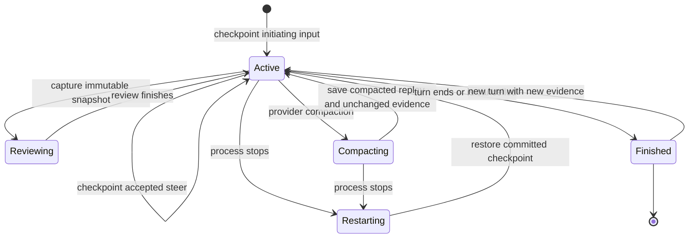

# Keep current-turn input evidence through compaction

## Contract

Permission reviews must retain the initiating input and incorporated steers in
their original order, including withdrawals. Compaction must not turn a summary
into authorization or turn an agent-originated message into a person's approval.
Provider replay stays compacted. Earlier completed-turn material still follows
the existing transcript-pruning contract.

The repair is prospective: an older checkpoint may already have lost evidence.
Do not reconstruct absent inputs from a compacted summary or unrelated replay.

## Smallest implementation

Keep ordered `PromptInput` snapshots on the journal's private `turnStep`, not on
`SessionEntry`. Capture the initiating input before shell expansion and capture
steers only after their existing ID-deduplication gate accepts them. Omit
attachment contents from the review evidence, retaining attachment metadata.
Preserve submitted text, source header, role, identity and direct-skill arguments.

Carry the evidence in every atomic turn save alongside applied input IDs.
Restore it before pending-response dispatch. Overflow changes replay, not this
list. Pass an immutable dispatch-time snapshot through direct and nested
permission checks, including background calls. Present it as ordered input
events, not as additional messages or a cached grant. Existing risk and outcome
rules remain unchanged.

Keep the evidence complete even when a transcript input has the same ID. This
deliberately duplicates text before compaction and can reach a review model's
context limit sooner; the checkpoint head also rewrites this text on each save.
Do not truncate evidence or filter it by replay identity.

## Verification gate

The model in `docs/verification/permission-input-evidence/InputEvidence.tla`
was written, translated and checked before implementation. Its positive check
and all three expected-negative checks passed; the evidence record gives the
commands, bounds and limits. A supplemental negative check exercises prior-turn
evidence leaking into the next turn.

The finite model covers two turns, up to three input events per turn, two
compactions and two restarts per turn. Input IDs stand for the complete immutable
input event, including its source. Saving the input list and applied IDs is one
atomic step, matching `Journal.SaveTurn`. A crash before a save does not make an
input applied; a restart restores only the saved state. Snapshots are immutable.
No fairness or liveness claim is needed: the checks concern finite safety
properties, not scheduling or completion.

Required invariants:

- incorporated inputs and durable evidence have exactly the same order;
- compaction and restart preserve the full incorporated sequence;
- starting another turn does not import previous-turn evidence;
- a dispatched review snapshot does not change when later inputs arrive.

Negative configurations must independently expose lost compaction evidence,
lost restart evidence, an aliased review snapshot and prior-turn leakage. A parse error is not an
expected counterexample.

Model-to-code mapping:

| Transition | Code seam |
| --- | --- |
| IncorporateAndSave | `openTurn` or accepted `appendSteers` input followed by `saveTurn` / `Journal.SaveTurn` |
| Compact | `runTurn` overflow checkpoint callback |
| Restart | `openTurn` journal load |
| Dispatch | `dispatchToolCalls` / nested permission context |
| NextTurn | new `turnStep`, not loaded session history |

Check existing compaction/restart tests and add a focused review-request regression:
the existing tests cover provider replay, not review evidence delivery. Strengthen
existing background, agent-switch and shell-expansion tests. The regression must fail
without the repair. Check initial checkpoint, withdrawal ordering, redelivery,
provider replay, prior-turn exclusion, nested/background snapshots, agent
switching and escaped prompt framing separately. Run formatting, full Go tests,
root lint/test and source/coverage gates. Review the exact final head before
publication.

## State diagram

Attachment decoding, model judgment, legacy evidence reconstruction, tool
execution, immediate cancellation of already-running background work and
database transaction implementation are outside the finite model. Tests and
code review must check the model's mapping; TLC alone proves none of those.
