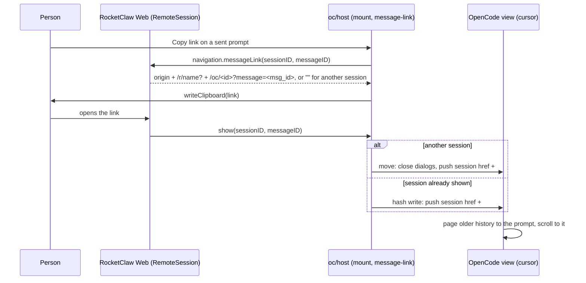

# Message Deep Links - Plan

## Goal Capsule

- **Objective:** A person can copy a link to one message in a RocketClaw session or a Remote OpenCode Session, and anyone who opens that link lands in that session with that message on screen.
- **Means:** Reuse the `?message=` address native sessions already honor, and translate it into the `#message-<id>` anchor OpenCode's own view already pages and scrolls to (KTD1, KTD2).
- **Authority:** Product Contract requirements win on behavior. KTDs win on mechanism. `internal/rocketclaw/oc/AGENTS.md` and the semport loop's rules win on how copied OpenCode files may change (R8).
- **Execution profile:** One PR. Web changes in `internal/rocketclaw/web/src/`, OpenCode view changes in `internal/rocketclaw/oc/` with the rebuilt `internal/rocketclaw/internal/web/oc-dist/` committed in the same change.
- **Stop conditions:** Stop and report if the OpenCode side needs a copied-file edit beyond R8's marked edits, if upstream's `#message-` cursor cannot be driven from the host's memory history, or if the change requires altering the session-identity protocol modeled in `docs/verification/oc-view-session/`.
- **Finishing:** `lfg` implements, reviews, and opens the PR. Merging stays with the user.

---

## Product Contract

### Summary

Add a "Copy link" action to each stored message in a native session and to each sent prompt of a Remote OpenCode Session. Native links keep the existing `/s/<id>?message=<entry:index>` form. OpenCode links take the form `/oc/<id>?message=<msg_id>`, and opening one moves the OpenCode view to that prompt, loading older history when needed.

### Problem Frame

People share and revisit specific moments in long sessions: a decision, an error, an answer. Native sessions already open at a linked message (search hits and last-seen restore use it), but nothing lets a person get such a link for a message they are looking at. Remote OpenCode Sessions have no link to a message at all from RocketClaw's side, even though the OpenCode view inside them already knows how to jump to a prompt. The result is that the only way to point someone at a message is to describe where to scroll.

### Requirements

**Native sessions**

- R1. Each user and assistant message in a session's own transcript that has a stored message id offers a "Copy link" action, which copies an absolute link on the page's server (including a `/r/<name>` remote prefix) to `<session path>?message=<message id>`.
- R2. Messages without a stored message id (a running turn's lines, pending steers) and messages shown inside delegation panels or shadow comparison cells offer no "Copy link".
- R3. Opening a native message link keeps today's behavior: the session opens with that message centered, loading earlier history when the message is older than the loaded page.

**Remote OpenCode Sessions**

- R4. Opening `/oc/<id>?message=<msg_id>` shows that session with that prompt's turn scrolled into view, loading older history as needed.
- R5. The same holds when the session is already open in its tab and only the linked message differs.
- R6. Each sent prompt of the tab's own session offers "Copy link" in its message menu in the OpenCode view, which copies the absolute RocketClaw link to that prompt. Pending steers and subagent prompts offer none.
- R7. An OpenCode link to a message the view cannot find behaves as upstream's own missing-anchor case: a link that opens the session shows it at its end, and a link into the session already shown leaves the view where it is.

**Upstream mergeability**

- R8. OpenCode-side logic lives in `internal/rocketclaw/oc/host/`. Copied upstream files change only by `rocketclaw:`-marked edits: one import and one JSX line in `packages/session-ui/src/message/message-content.tsx`, the same shape as the existing sender label, and one condition in `packages/app/src/session/timeline/interaction.ts` (KTD9).

### Scope Boundaries

- No visual highlight of the linked message on either side; today's native link does not highlight, and upstream's anchor does not either. Would change if people report losing the target after landing.
- No links to subagent prompts inside the OpenCode view. Such a link would open a tab whose route is a subagent, a state the view-session model (`docs/verification/oc-view-session/`) does not check; adding it means extending and rerunning that model.
- No per-assistant-reply links inside the OpenCode view. Upstream anchors are per prompt (turn), and an assistant link would need a second copied-file edit in `AssistantTextContent`.
- The OpenCode view does not write its current message back into RocketClaw's address bar. Upstream's previous/next-message commands change only the view's in-memory hash.
- No message search hits for Remote OpenCode Sessions; their messages are not stored in RocketClaw.
- Delegation panels and shadow cells do not learn the `message` parameter (R2 hides the action there instead).

#### Deferred to Follow-Up Work

- Message search hit rows build links with `sessionPath` (always `/s/`) instead of `rowPath` (`internal/rocketclaw/web/src/ui.tsx`, search row builder). Harmless while OpenCode sessions have no message hits.
- The semport loop prompt (`loop-platform-oc-semport.sh` in the separate `platform-bts` checkout) lists the sender label among Principal's decisions. Adding the "Copy link" and dock-settle marked edits there would make future ports re-attach them explicitly if upstream reshapes the menu or the timeline's resize handling. That file is outside this repository.

---

## Planning Contract

### Key Technical Decisions

- KTD1. **Reuse the native `?message=` address.** `useTranscriptPosition` and `Transcript` already scroll to it and load earlier history (`internal/rocketclaw/web/src/ui.tsx`), and search hits and last-seen restore already produce it. The native work is only the action that produces the link.
- KTD2. **OpenCode links use RocketClaw's `?message=` and the host translates it to upstream's `#message-<id>`.** Upstream v2.3.2 (the copy's tag, and the newest upstream release) parses `#message-` (`packages/app/src/session/message-id-from-hash.ts`), pages history toward the prompt, and scrolls to it (`packages/app/src/session/timeline/cursor.ts`, `cursor-machine.ts`). The view runs on a `MemoryRouter` (`oc/host/mount.tsx`), so the host writes the hash into the view's own history. No new scroll or paging code.
- KTD3. **`Mounted.show` takes an optional message id and treats a same-session message as a hash write.** For another session, `show` keeps today's move (close dialogs, push, new Back floor) with `#message-<id>` appended. For the tab's own session, it navigates the view's router to the session href with the new hash, as OpenCode's own anchor writes do: no dialog closing, no new Back floor, and the stale-location guard in `oc/host/navigation.tsx` still applies. `RemoteSession` calls `show` when the session changes, or when a non-empty linked message differs from the last one it showed; a message that disappears from the address on the same session calls nothing, so the view does not jump to the end. `MountOptions` gains an optional `messageID` that a newly mounted view opens at.
- KTD4. **The modeled session-identity protocol is unchanged.** `docs/verification/oc-view-session/ViewSession.tla` models the Web's show as a push that happens when the route names another session; under KTD3 that is still the only time the view moves sessions. A same-session message link reaches the view through its router as the app's own navigation: a hash write on the session it shows, or, when a subagent is shown, the ancestor trail back to the tab's session. The model already covers both transitions. Because R6 links only the tab's own session, no product action makes a subagent route reachable. The stateful-design gate (pack: formal-modeling, stateful-design.md) therefore needs no new model run; if implementation finds a hash write moves the shown session or the Back floor, stop per the Goal Capsule.
- KTD5. **The OpenCode "Copy link" item is a host component attached by one marked import and one marked JSX line in the prompt menu.** It renders after "Copy message" in `renderMenu` of `CurrentUserMessageDisplay` (`packages/session-ui/src/message/message-content.tsx`), only for sent prompts (the `!pending()` check the Fork item uses), mirroring `oc/host/author.tsx`. The semport loop already preserves marked edits of this shape.
- KTD6. **RocketClaw's Web builds the OpenCode link through a new `Navigation.messageLink(sessionID, messageID)` that returns the link text; the view copies it.** The view does not know `encodeSessionId`, `rowPath`, or the `/r/<name>` prefix, so `RemoteSession` builds the absolute link with `rowPath` and `serverPath` and returns an empty string for any session other than the tab's own (R6). The host item copies with upstream's `writeClipboard` (`@opencode/session-ui/copy`), as "Copy message" does, because its plain-HTTP fallback keeps the selection inside an open menu's focus trap; RocketClaw's `copyText` appends to `document.body`, outside it. The item does not render when the link is empty, and the host's inert navigation returns an empty string.
- KTD7. **The native action shows only where the line belongs to the page's session.** The condition is a stored `messageId` and the transcript's conversation being the session the page path names, the same guard `useTranscriptPosition` uses. This hides it in delegation panels and shadow cells without new props.
- KTD8. **Comment rules.** The copied-file edits carry `rocketclaw:` markers as `oc/AGENTS.md` requires; the semport loop finds edits by them. No other new comments, per the root `AGENTS.md`, including in `oc/host/api.ts`.
- KTD9. **A jump to a message stays put while the composer settles.** On a first load the composer dock settles its height after the cursor starts its jump; upstream then scrolled back to the end because the view was still near it, which cleared the anchor. The dock's resize handler is a closure inside `interaction.ts` that `oc/host/` cannot reach, so one marked condition skips that snap while the cursor's jump is fresh, seeking, or pending.

### Assumptions

- A link to an OpenCode prompt is enough for "a message" in OpenCode sessions, since upstream's turn view groups the replies under the prompt.
- "Copy link" belongs in the existing per-message action row (native) and the prompt's chevron menu (OpenCode), not in a new menu.
- The native button sits immediately before "Copy message", which stays last as the row's existing rule says.
- No highlight is needed for the feature to be useful; scroll-to-message is what people get today from search hits.

### High-Level Technical Design

---

## Implementation Units

### U1. Native "Copy link" message action

- **Goal:** Stored messages in a session's own transcript offer "Copy link".
- **Requirements:** R1, R2, R3
- **Dependencies:** none
- **Files:** `internal/rocketclaw/web/src/ui.tsx`, `internal/rocketclaw/web/src/session-commands.browser.test.ts`, `internal/rocketclaw/web/src/entry-transport.test.ts`
- **Approach:**
  1. In `MessageActions`, add an icon button labeled "Copy link" before "Copy message", shown under KTD7's condition.
  2. Build the link as the origin plus `serverPath` of `sessionPath(conversationId)` with `?message=` and the encoded id, and copy it with `copyText`.
  3. Keep the row's one status region, with the link's own messages: "Link copied" and the check icon on the link button on success, "Could not copy the link." on failure. "Copy message" keeps its current text.
  4. `MessageActions` needs the conversation id; `TranscriptLine` already has it.
  5. If react-doctor flags `MessageActions`, split the button into its own small component.
- **Patterns to follow:** the tab menu "Copy link" in `ui.tsx` (`copyText` with `serverPath`), and the search row's `?message=` encoding.
- **Test scenarios:**
  - Clicking "Copy link" on an assistant message in `/s/<id>` puts `<origin>/s/<id>?message=<encoded id>` on the clipboard and the status announces "Link copied".
  - Under `/r/<name>/s/<id>`, the copied link keeps the `/r/<name>` prefix.
  - A message in an open delegation panel shows no "Copy link".
  - Update the two existing button-list assertions (`entry-transport.test.ts`, `session-commands.browser.test.ts`) to include "Copy link" where a stored id exists.
  - Opening the copied link in a fresh page shows the message centered (existing `long-chat.browser.test.ts` and `delegations.browser.test.ts` coverage stays green).
- **Verification:** The browser tests above pass and fail if the button builds a `/s/` link without the message or without the remote prefix.

### U2. OpenCode view opens at a linked prompt

- **Goal:** `/oc/<id>?message=<msg_id>` shows that prompt, on first open and when the session is already shown.
- **Requirements:** R4, R5, R7
- **Dependencies:** none
- **Files:** `internal/rocketclaw/oc/host/api.ts`, `internal/rocketclaw/oc/host/mount.tsx`, `internal/rocketclaw/oc/host/mount.test.tsx`, `internal/rocketclaw/web/src/ui.tsx`, `internal/rocketclaw/web/src/opencode.browser.test.ts`, `internal/rocketclaw/internal/web/oc-dist/`
- **Approach:**
  1. `Mounted.show` gains an optional message id; `mount.tsx` moves sessions or writes the hash as KTD3 states, using `createViewHistory`'s `show` for a move and the router's `navigate` for a link into the tab's own session.
  2. `RemoteSession` reads `message` from `useSearch()` under the same `pagePath()` guard native uses (against `rowPath`), keeps the last shown message beside the last shown session, and calls `show` under KTD3's rule.
  3. Rebuild `oc-dist`.
- **Patterns to follow:** `RemoteSession`'s `show` effect event, `useTranscriptPosition`'s page-path guard, upstream's hash handling in `cursor.ts`.
- **Test scenarios:**
  - Host: `show(otherSessionID, messageID)` leaves the view's router location at that session's href with `#message-<messageID>`.
  - Host: `show(sameSessionID, messageID)` updates the hash, keeps an open dialog open, and Back returns to the previous entry of the same session.
  - Browser: opening `/oc/<id>?message=<prompt id>` scrolls the view so that prompt's `id="message-<prompt id>"` row is in view (extend the fake server with enough messages that the prompt starts out of view, or older than the first page if paging is cheap to fake).
  - Browser: with the session open, navigating to the same session with a different `?message=` scrolls to that prompt (R5).
  - Browser: an unknown message id on first open shows the session at its end (R7).
- **Verification:** The host and browser tests pass and fail when the host drops the hash.

### U3. OpenCode "Copy link" in the prompt menu

- **Goal:** Each prompt's menu in the OpenCode view copies the RocketClaw link to it.
- **Requirements:** R6, R8
- **Dependencies:** U2 (the link it copies must open)
- **Files:** `internal/rocketclaw/oc/host/message-link.tsx` (new), `internal/rocketclaw/oc/host/api.ts`, `internal/rocketclaw/oc/host/navigation.tsx`, `internal/rocketclaw/oc/packages/session-ui/src/message/message-content.tsx`, `internal/rocketclaw/oc/host/mount.test.tsx`, `internal/rocketclaw/web/src/ui.tsx`, `internal/rocketclaw/web/src/opencode.browser.test.ts`, `internal/rocketclaw/internal/web/oc-dist/`
- **Approach:**
  1. Add `messageLink(sessionID, messageID)` to `Navigation`, returning an empty string from the host's inert navigation (KTD6).
  2. New `host/message-link.tsx` renders a menu item "Copy link" when `messageLink` returns a link for the message's session and id, and copies it with `writeClipboard`.
  3. In `message-content.tsx`, one marked import and one marked JSX line place it right after "Copy message" in `renderMenu`, for sent prompts only (KTD5, KTD8).
  4. `RemoteSession` implements `messageLink` with `rowPath` and `serverPath` for its own session and returns an empty string for any other, passing it in the mount's navigation.
  5. Rebuild `oc-dist`.
- **Patterns to follow:** `oc/host/author.tsx` and its two marked lines; "Copy message"'s `writeClipboard` call; the other `Navigation` methods wired as effect events in `RemoteSession`.
- **Test scenarios:**
  - Host: choosing "Copy link" in a sent prompt's menu writes the link `messageLink` returned for that prompt's session and message id to the clipboard, in both timelines.
  - Host: a pending steer's menu, and a prompt whose session `messageLink` answers with an empty string, show no "Copy link".
  - Browser: choosing "Copy link" in the view puts `<origin>/oc/<encoded opencode:box:ses_…>?message=<msg_id>` on the clipboard.
- **Verification:** Tests pass. A diff of `internal/rocketclaw/oc/packages/` shows only R8's marked edits.

---

## Verification Contract

| Gate | Command | Applies to |
|---|---|---|
| OpenCode view lint, tests, build | `make -C internal/rocketclaw/oc lint test build`; rebuilding again changes nothing | U2, U3 |
| Web bundle | `make -C internal/rocketclaw web-assets` | U1, U2, U3 |
| Web lint (includes react-doctor) and tests | `make -C internal/rocketclaw/web lint test`, with `ROCKETCLAW_PLAYWRIGHT_MODULE` and `ROCKETCLAW_CHROMIUM` set for browser tests | U1, U2, U3 |
| Repository gates | `make lint`, `make test` at the root (the Go server embeds `oc-dist`) | all |

Build with the Bun version pinned in `internal/rocketclaw/web/package.json` so committed bundles match CI.

## Definition of Done

- R1 through R8 hold, each shown by a test named in its unit.
- `oc-dist` is rebuilt in the change and a second build produces no diff.
- The only copied-file changes are R8's marked edits.
- Web and OpenCode-host CLOC budgets pass.
- No abandoned-attempt code, debug output, or new comments outside the two markers.
