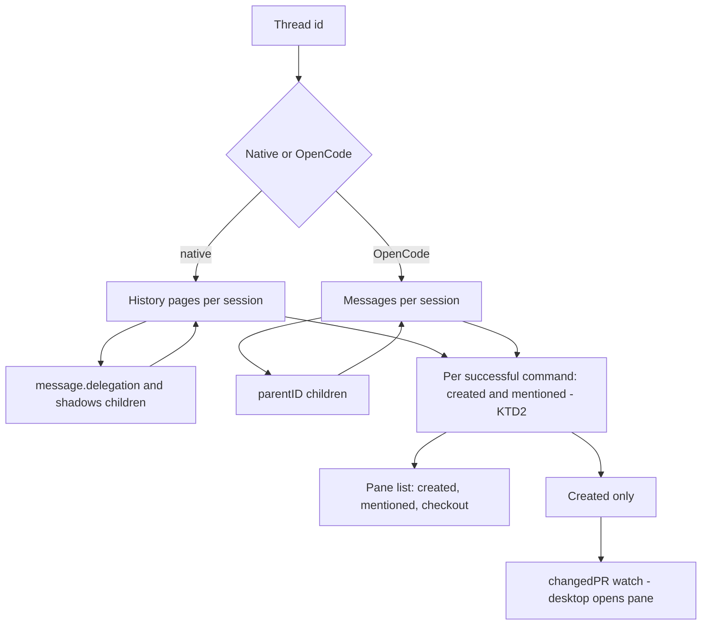
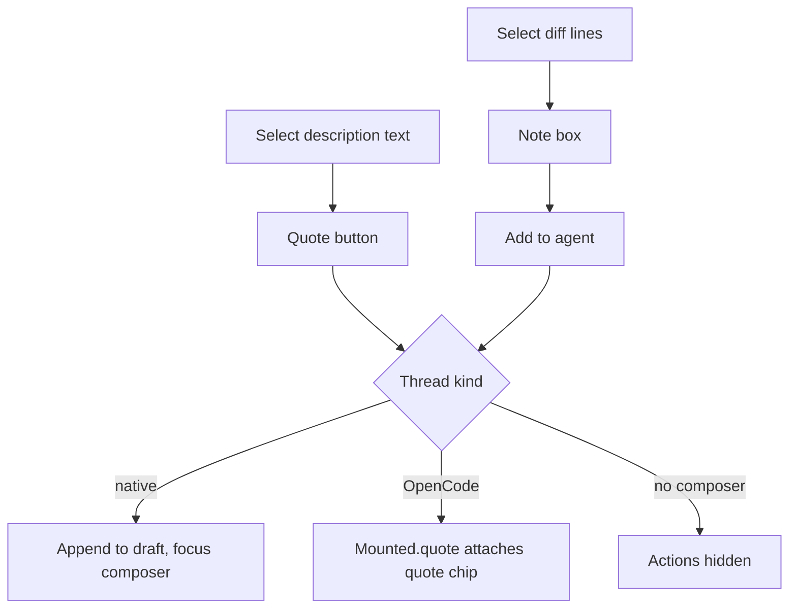
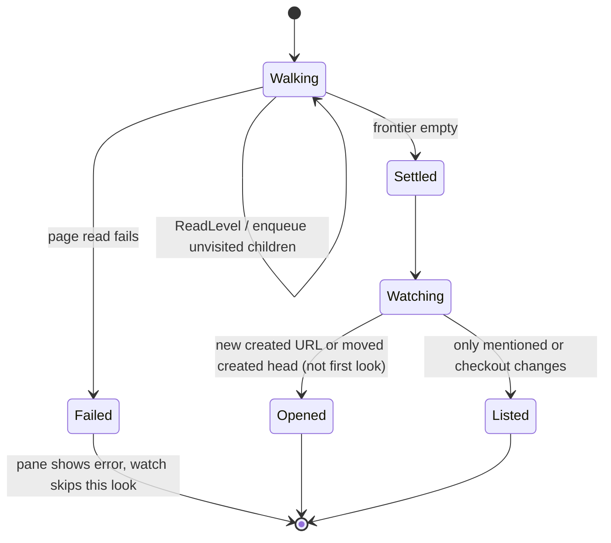

# Pull request pane for the whole thread, with Markdown, automatic files and quoting - Plan

## Goal Capsule

- **Objective:** A person working in a RocketClaw thread can find, read and discuss every pull request the thread's agents touched without leaving the thread: the right-side pull request pane lists PRs from the agent, its subagents and its shadows, reads like GitHub, shows code without extra clicks, and feeds what the person selects into their next message.
- **Product authority:** The human partner. All four reported problems are in scope as one work unit. Where t3code (`pingdotgg/t3code` at `8cf97b5f`) has the behavior, RocketClaw matches it; where t3code lacks it, the requirements below govern.
- **Means:** Classify native commands' created and mentioned PRs in the backend (KTD1), walk the whole session tree in the browser (KTD3), and extend the existing PR detail and the OpenCode view's host API rather than adding a new viewer (KTD6 to KTD11).
- **Open blockers:** None. The image-privacy conflict under Key Decisions is a merge-time question for the human partner, not a build blocker.
- **Stop conditions:** Stop and report instead of building when the formal model (U1) does not pass TLC, when TLC cannot run, or when a source CLOC budget would be exceeded.
- **Execution profile:** One pull request, built in unit order U1 to U8; U1 gates U2 and U3.
- **Who finishes:** The implementing agent builds, verifies and opens the PR; the human partner reviews and merges.

---

## Product Contract

### Summary

The pane lists every GitHub pull request linked in successful command output from the thread's agent, any of its subagents and any of its shadow sessions, except output from commands that only list or search PRs.
The PR detail renders its description as GitHub-style Markdown, loads changed files on its own when the Code tab opens, and lets the person add selected description text or selected diff lines with a note to the thread's composer, in native and OpenCode sessions alike.

### Problem Frame

Agents increasingly do their PR work inside subagents and shadow sessions, but the pane reads only the top session's own history in native threads and only `gh pr create` output everywhere, so PRs a subagent opened, pushed to or edited are missing.
When a PR is shown, its description appears as raw text with Markdown syntax and HTML visible, the code stays hidden behind a "Load files" button, and the only way to discuss a passage is to copy it by hand into the composer.
The person ends up switching to GitHub and back, which defeats the pane.

### Key Decisions

- **One plan and one PR for all four problems.** Markdown and automatic files are small, quoting builds on both, and discovery stands alone. (session-settled: user-approved — chosen over separate runs per problem: quoting depends on what the other two display.)
- **Any PR link in command output counts, except list and search commands.** Governs R1, R2. (session-settled: user-directed — chosen over keeping today's create-only rule and over counting list and search output: the person wants every PR the agents touched, without the noise of PR listings.)
- **Subagents and shadow sessions follow the same rule as the top agent.** Governs R1, R3. (session-settled: user-approved — chosen over the agent and its Task subagents only: a PR a shadow opens is real and lives on GitHub.)
- **Match t3code where it has the behavior; the person's answers govern where it does not.** Governs R6 to R16. (session-settled: user-directed — chosen over strict t3code parity, which lists no subagent PRs in the parent and has no description quoting.)
- **Markdown is the app's chat Markdown plus t3code's PR extras, with read-only checkboxes.** Governs R6, R7. (session-settled: user-approved — chosen over full t3code Markdown with math, video and editable checkboxes, and over the chat Markdown unchanged.) Conflict: rendering description images reverses R5 of `docs/plans/2026-11-11-pull-request-previews.md` ("never raw HTML, images or remote embeds"), so viewing a PR fetches images from whatever host its body names. The plan builds images as chosen (KTD7) and asks the human partner to confirm at merge.
- **Only a PR a create command printed opens the pane by itself.** Governs R4. (session-settled: user-approved — chosen over opening for any newly found PR and over turning automatic opening off: broader discovery would otherwise make the pane jump to PRs an agent merely looked at.)
- **OpenCode sessions receive quotes through OpenCode's own composer quote attachment.** Governs R15. (session-settled: user-approved — chosen over pasting `> ` text into the OpenCode prompt: OpenCode already attaches quotes this way from its terminal and comments from its review tab.)
- **`gh api` output is excluded with the list and search commands.** It usually returns PR listings, and t3code excludes it for the same reason. Governs R2.
- **Native sessions receive quotes as text appended to the draft.** This matches the transcript's existing Quote. Governs R14.
- **No "Add to review".** Nothing in this work writes to GitHub, so the diff-line action offers only "Add to agent". Governs R13.

### Requirements

**Which pull requests the pane lists**

- R1. The pane lists every GitHub pull request whose URL appears in the output of a successful command run by the thread's agent, by any subagent at any depth (native Subagent Sessions and OpenCode child sessions), or by any Shadow Session of the thread.
- R2. Output of a command that runs `gh pr list`, `gh pr status`, `gh search prs` or `gh api` contributes no pull requests, and neither does a command that failed or is still running.
- R3. Native and OpenCode threads apply the same rule; the OpenCode pane's existing current-checkout entry stays in the list.

**When the pane opens by itself**

- R4. On desktop, the pane opens by itself only for a pull request that a `gh pr create` command printed, in the top session, a subagent or a shadow, or when such a pull request gains new commits where its head can be read; other newly found pull requests join the list without opening the pane.

**Description**

- R5. An opened pull request starts on the tab the person last chose, or on Summary if they never chose one.
- R6. The description renders as GitHub-flavored Markdown: the app's chat Markdown plus sanitized HTML (`
`, images, hidden comments), GitHub alerts, autolinks for `#12`, `owner/repo#12`, commit SHAs and `@user` against the PR's repository, and GitHub's line breaks.
- R7. Task-list checkboxes are read-only, and nothing in a description can run script or open a `javascript:` link.

**Code**

- R8. Opening the Code tab loads the first page of changed files with no button press, as t3code does.
- R9. Further pages load as the person scrolls to the end of the loaded files, with a manual "Load more files" still available, as t3code does.
- R10. The file tree starts closed and the pane remembers whether the person opened it, as t3code does.

**Adding to the composer**

- R11. Selecting text in the description shows a Quote action that adds the selected text to the thread's composer draft.
- R12. Selecting lines in a diff opens an inline note box beside them, as t3code does; Cmd/Ctrl+Enter confirms and Escape cancels.
- R13. "Add to agent" is enabled only with a non-empty note, and adds the note together with the selected lines, their file path and their line range to the composer draft.
- R14. In a native session, a quote appends to the end of the draft as `> ` lines, as the transcript's Quote does, and "Add to agent" appends the note followed by the selected lines labelled with path and range.
- R15. In an OpenCode session, both actions attach an OpenCode quote labelled with the pull request, with the note as the quote's comment.
- R16. Neither action sends the message, and neither appears where the thread has no composer to receive it, such as an OpenCode subagent session.

### Acceptance Examples

- AE1. **Covers R1, R4.** **Given** a native thread whose Task subagent ran `gh pr create` and printed `https://github.com/o/r/pull/7`, **when** the subagent's call finishes on desktop, **then** the pane opens on PR #7.
- AE2. **Covers R1, R4.** **Given** a shadow session that ran `gh pr edit 8 --title …`, which prints PR #8's URL, **when** the pane next refreshes, **then** #8 appears in the list and the pane does not open by itself.
- AE3. **Covers R2.** **Given** an agent that ran `gh pr list` printing ten PR URLs, **when** the pane refreshes, **then** none of the ten is added.
- AE4. **Covers R2.** **Given** a command that printed a PR URL and exited non-zero, **then** that URL is not added.
- AE5. **Covers R8.** **Given** an open PR on Summary, **when** the person selects the Code tab, **then** files load with no further action.
- AE6. **Covers R13, R14.** **Given** a native session with draft "Hi", **when** the person selects lines 10 to 12 of `a.go`, types "why?" and presses Cmd+Enter, **then** the draft becomes "Hi" followed by "why?" and those three lines labelled `a.go` 10 to 12, and nothing is sent.
- AE7. **Covers R15.** **Given** an OpenCode session, **when** the person quotes a sentence from the description, **then** an OpenCode quote chip labelled with the PR appears in the composer and the prompt text is unchanged.

### Scope Boundaries

- t3code's comments, reviews, "Add to review", timeline, guide, checks, stack views, PR editing, editable checkboxes, math rendering and video players.
- t3code's manual PR linking, agent link tools and the proactive-panels setting.
- Quoting from PR comments, which RocketClaw does not show.
- Changing how the transcript's own Quote works.
- Considered and not built: listing a PR from a command that exited non-zero after printing it, such as `gh pr create --attach` whose upload failed. R2's success-only rule decides; a later successful command that prints the URL lists it.
- Considered and not built: partial results when one subagent or shadow history cannot be read. The pane shows its existing error for the whole thread, which a person sees at once; evidence of frequent failures would change this.

### Dependencies / Assumptions

- A native subagent's or shadow's history can be read by the same person who can read the thread; planning confirmed this (KTD3).
- Native threads with many subagents make more history requests per refresh; the same cost was accepted for OpenCode in `docs/solutions/integration-issues/pr-pane-missed-prs-in-jj-workspaces-and-subagent-sessions.md`.
- Discovery and automatic opening are modelled in `docs/verification/thread-pr/`, which covers one session; changing both brings the work under the stateful-design gate (pack: formal-modeling, stateful-design.md).

### Outstanding Questions

**Gate on merging**

- Should description images from any host render, as chosen? Rendering any host reverses the 2026-11-11 privacy rule (see the Markdown Key Decision and KTD7). Alternatives: only images GitHub hosts, or reading GitHub's rendered `body_html`, whose images all go through GitHub's image proxy so no other host sees the viewer.
- Should output of plain search and read commands count as mentions? Under R1 as chosen, `rg`, `grep`, `cat` of docs, `jj log` and the body `gh pr view` prints all list the PRs they show, and those stay listed for the thread's life. The plan builds R1 as chosen.

The questions planning owned are answered in the Planning Contract: history reach and depth (KTD3), the OpenCode composer path (KTD11), "Load diff" for withheld patches (KTD8), actions in transcript Previews (KTD10), page size (KTD8) and dry runs (KTD2).

### Sources / Research

- t3code at `8cf97b5f`: `apps/server/src/orchestration-v2/PullRequestSyncReactor.ts` (discovery and excluded commands), `apps/web/src/components/pullRequest/PullRequestMarkdown.tsx` and `pullRequestMarkdown.logic.ts` (Markdown), `PullRequestDetailPanel.tsx` and `PullRequestCodeTab.tsx` (tabs, automatic loading, file tree, "Add to agent"), `apps/web/src/hooks/useProactivePanels.ts` (automatic opening).
- Discovery today: `internal/rocketclaw/web/src/thread-pr.ts`, `internal/rocketclaw/web/src/thread-pr-panel.tsx`.
- PR detail today: `internal/rocketclaw/web/src/github-pr-preview.tsx`, `internal/rocketclaw/web/src/github-pr-code.tsx`; chat Markdown in `internal/rocketclaw/web/src/transcript-text.tsx`.
- Transcript Quote: `SelectionQuote` in `internal/rocketclaw/web/src/ui.tsx`.
- OpenCode composer quotes and comments: `internal/rocketclaw/oc/packages/plugin/src/gui/host-apis.ts` (`ComposerQuote`, `Composer.attach`), used by `internal/rocketclaw/oc/packages/gui-plugins/src/terminal/panel.tsx` and `internal/rocketclaw/oc/packages/gui-plugins/src/review/model.ts`; the view's API to RocketClaw in `internal/rocketclaw/oc/host/api.ts` and `internal/rocketclaw/oc/host/mount.tsx`.
- Vocabulary: `CONCEPTS.md` (Delegation History, Subagent Session, Shadow Session).
- Research dossiers (machine-local, best effort): `.tmp/rocketclaw/ce-plan-research/06cbaac6/repo-research.md` and `learnings.md` in the workspace that wrote this plan.

Product Contract preservation: restructured, no scope change: R3 and R5 wording clarified, the Markdown Key Decision gained its conflict call-out, two considered-and-not-built items joined Scope Boundaries, and the planning-owned Outstanding Questions now point to the KTDs that answer them.

---

## Planning Contract

### Key Technical Decisions

- KTD1. **The backend classifies native bash calls and records created and mentioned PRs.** Native histories keep only a bash call's last output line, cut to 200 bytes, and its arguments clipped at 4 KiB (`internal/rocketclaw/harness/public_progress.go`), so a long `gh pr create --body …` is lost in the browser today. The harness applies the KTD2 rule to the unclipped command and the full output when the call finishes, and stores two distinct, ordered URL lists on the call record, each capped at 100 because the record is stored. `CodeModeCall` in `internal/rocketclaw/web/proto/web.proto` carries them to the Web. Older records lack them, so the browser keeps today's rule on the summary line for those. The rule therefore exists twice: Go for native calls, TypeScript for OpenCode and older records; one shared table of test cases keeps them aligned. Governs R1, R2.
- KTD2. **Each successful command yields two sets, created and mentioned, with t3code's create guards.** A command that runs `gh pr list`, `gh pr status`, `gh search prs` or `gh api` yields nothing. Otherwise, created follows t3code's `changeRequestsCreatedBy`: a `gh pr create` that runs as a command and is not a dry run; URLs alone on an output line; none whose number another command in the script names; and none at all when the output has more such URLs than create commands. Mentioned is every other PR URL anywhere in the output. Quote and heredoc blanking is today's `createdPRs` blanking. URLs are normalized to `https://github.com/<owner>/<repo>/pull/<n>` so `/files` or query suffixes do not duplicate a PR. Governs R1, R2.
- KTD3. **The browser walks the whole session tree, level by level.** Native: page each session's `/api/History`, follow each message's `delegation` id (set for subagents only) and each page's `shadows[].childConversationId`, keep a visited set, and run each level with `Promise.all`, like the OpenCode walk. OpenCode keeps its `parentID` walk unchanged. Every request keeps `pull-request-discovery=1`, which telemetry masking and tests rely on. The same viewer may read subagent and shadow histories (`readableConversation` in `internal/rocketclaw/frontend/rpc/server.go`). Governs R1, R3.
- KTD4. **Only created PRs feed the automatic-open watch, and they lead the list.** `loadThreadPRs` returns created and mentioned URLs. The pane lists created PRs first, then mentioned ones marked "mentioned" in the picker, as t3code labels each PR's source, then the OpenCode checkout entry, so the default selection is a created PR when one exists. `ThreadPRWatch` passes only created URLs, and their heads where readable, to `changedPR`; the checkout PR therefore no longer opens the pane, which R4 requires. Governs R3, R4. (session-settled: user-approved — chosen over opening for any newly found PR: mentions would make the pane jump.)
- KTD5. **The formal model changes before the code.** `docs/verification/thread-pr/ThreadPR.tla` gains the create/mention split, a session tree walked level by level with a visited set, and the automatic-open step, as specified in Model Specification below. U1 is pending until TLC passes. (pack: formal-modeling, stateful-design.md)
- KTD6. **PR Markdown is a PR mode of `MarkdownText`, not a second renderer.** The chat keeps today's pipeline. The PR mode adds `rehype-raw` then `rehype-sanitize` (GitHub's schema, which drops comments and scripts), `remark-breaks`, and two small local remark plugins, ported from t3code: GitHub alerts and repository autolinks. The Slack-tag `span` handler applies only in chat mode. Links keep `GitHubPRLink`, so PR links in a description keep their Preview action. Checkboxes render disabled. Governs R6, R7.
- KTD7. **Images render from any other HTTPS host, with no referrer and lazy loading.** This follows the settled Markdown decision. An image renders only when its URL, resolved against the page, uses `https:` and an origin other than RocketClaw's own; otherwise its alt text shows. Same-origin and relative URLs would send the viewer's authenticated request to RocketClaw or its OpenCode proxy. The 2026-11-11 browser assertion that no untrusted image renders is replaced by one that images render with `referrerpolicy="no-referrer"`. The merge gate in Outstanding Questions asks the human partner to confirm. Governs R6.
- KTD8. **The Code tab loads files on its own and pages by scroll, without retry loops.** Page 1 starts whenever the Code tab is shown, the PR is loaded, no files are loaded, no load is running, the PR has changed files, and the person has not cancelled and no load has failed since the PR was last loaded. A sentinel at the end of the loaded files loads the next page under the same no-cancel, no-failure condition, as t3code avoids re-arming after a failure. After a cancel or failure the existing button ("Load files" or "Load more files") is the manual retry, and the "N of M files loaded" line stays. The manual Refresh keeps today's reset of files, so page 1 then loads again once. Pages stay at 100 files, GitHub's maximum and the only size the OpenCode reader allows; t3code's 30 is its own server's choice. Withheld patches keep today's "open on GitHub" note: fetching one file's diff needs a GitHub read the OpenCode reader does not allow. Governs R8, R9.
- KTD9. **The last tab and the file tree's state are preferences.** Both use `usePreference`/`setPreference` in `transcript-text.tsx`; the tree defaults to closed. Governs R5, R10.
- KTD10. **The diff note box uses `@pierre/diffs` line selection and annotations.** `onLineSelectionEnd` opens a note annotation under the selected range, rendered like t3code's `DiffCommentAnnotation`. The quote actions appear only in the right pane, where the thread's composer is known; Previews opened from transcript links keep today's read-only view. Governs R12, R13.
- KTD11. **Each pane gets one composer target for its thread.** Native: the pane receives `SessionApp`'s drafts and `onDraftChange`, appends text, bumps `edit` and `focus`, and calls `onDraftChange`, as `HandoffDialog` does. The description Quote reuses `SelectionQuote`'s selection and button behavior with the description as its container, rather than duplicating it. OpenCode: `Mounted` in `internal/rocketclaw/oc/host/api.ts` gains `quotable()` and `quote(...)`, implemented in `oc/host/mount.tsx` from `useHostApis()`'s screen composer, the way `openPalette` is wired, plus `subscribeQuotable(listener)` driven by a Solid effect on the composer's reactive `quotable()`. The Web reads it with `useSyncExternalStore`, so the actions hide when the view moves into a subagent session within the same tab, and `quote(...)` does nothing while `quotable()` is false. Copied OpenCode packages stay untouched. Governs R14, R15, R16. (session-settled: user-approved — chosen over pasting `> ` text into the OpenCode prompt: OpenCode already attaches quotes this way from its terminal.)

### High-Level Technical Design

Discovery and opening, as data flow. The diagram adds nothing the KTDs do not state; it shows how they connect.

Quote flow:

### Model Specification

Safety-only checks; no fairness is assumed beyond the model's existing `DiscoverySettles` property, which keeps its current fairness on the discovery process.

- **New constants:** a session tree of thread, subagent, nested subagent and shadow, where the nested subagent is reachable twice; per-session pages; per-command evidence with kind created, mentioned, listing or failed.
- **New variables:** `visited` (sessions read), `frontier` (sessions queued for the next level), `created` and `mentioned` (URLs found), `opened` (the URL the watch navigated to, or none), `seenCreated` (the watch's last look).
- **Initial state:** `frontier = {thread}`, everything else empty, `opened = none`.
- **New labels:** `ReadLevel` reads one page of every frontier session and enqueues unvisited children; `Classify` adds a command's evidence to `created` or `mentioned`; `Watch` compares `created` with `seenCreated` and may set `opened`.
- **Invariants:** `OpenedOnlyCreated` (`opened` is none or in `created`, replacing `OnlyProvenCreateOwned`), `ListedOnlyAccepted` (listed URLs come only from successful non-listing commands), `ChildEvidenceListed` (when discovery settles, every session's accepted evidence is listed), `EachSessionReadOnce`.
- **Configurations:** `discovery.cfg` must pass; `mention-opens.cfg` must fail `OpenedOnlyCreated`; `listing-listed.cfg` must fail `ListedOnlyAccepted`; `skip-child.cfg` must fail `ChildEvidenceListed`; `no-visited.cfg` must fail `EachSessionReadOnce`.

| Model step | Code |
|---|---|
| `ReadLevel` | `loadThreadPRs` level walk in `internal/rocketclaw/web/src/thread-pr.ts`, native and OpenCode |
| `Classify` | Harness classification (U2) for native calls; the KTD2 functions in `thread-pr.ts` for OpenCode and older records |
| list | the pane's URL list in `internal/rocketclaw/web/src/thread-pr-panel.tsx` |
| `Watch` | `ThreadPRWatch` passing created URLs to `changedPR` |

### Assumptions

- A subagent's or shadow's activity updates the thread row's `updatedAt`, which is the pane's refresh key. If shadows run after the parent's turn without touching it, their PRs appear on the next refresh of the thread rather than at once.
- OpenCode's `execute` tool is not counted as a command; only `bash` and `shell` parts are, as today.

### Alternatives Considered

- Reading full command output from the browser for native threads: no endpoint returns it, and adding one would ship whole outputs to the browser to find a few URLs. KTD1 stores only the URLs.
- Server-side tree walk returning all descendants: `descendantsSQL` exists but no endpoint exposes it, and the browser walk matches the OpenCode one already in place.

### Sequencing

U1 first and must pass before U2 and U3, since both build the modelled behavior. U2 before U3. U4 then U5 then U7, independent of discovery. U6 and U7 before U8.

---

## Implementation Units

### U1. Formal model for tree discovery and created-only opening

**Goal:** Update and rerun the thread PR model so the new discovery and opening rules pass TLC before code changes.

**Requirements:** R1, R2, R4; KTD5.

**Dependencies:** None.

**Files:** `docs/verification/thread-pr/ThreadPR.tla`, `docs/verification/thread-pr/Makefile`, new `.cfg` files beside it, `docs/verification/thread-pr/README.md`.

**Approach:**
1. Add the constants, variables, labels and invariants in Model Specification.
2. Add the four negative configurations beside `discovery.cfg` and list them in the Makefile's NEGATIVE set with their expected violations.
3. Translate, run `check`, and record the run, bounds, expected counterexamples and the step-to-code rows in the README's existing table.

**Patterns to follow:** The existing PASS/NEGATIVE runner in `docs/verification/thread-pr/Makefile`; `docs/packs/formal-modeling/stateful-design.md`.

**Test scenarios:**
- The discovery configuration passes with the tree and both evidence kinds.
- A configuration where a mention opens the pane fails with the created-only invariant.
- A configuration where a failed command's link is listed fails with the listing invariant.
- A configuration where the walk skips the nested subagent fails with the child-evidence invariant.
- A configuration without the visited set fails with the read-once invariant.

**Verification:** `make -C docs/verification/thread-pr translate check` passes with every expected counterexample matched. If TLC cannot download or run, report BLOCKED / NOT VERIFIED and stop before U2.

### U2. Record PR links from full native output

**Goal:** Native bash call records carry the created and mentioned PRs of their command and full output.

**Requirements:** R1, R2; KTD1, KTD2.

**Dependencies:** U1.

**Files:** `internal/rocketclaw/harness/public_progress.go`, `internal/rocketclaw/harness/public_progress_test.go`, `internal/rocketclaw/harness/testdata/pr-discovery-cases.json`, `internal/rocketclaw/web/proto/web.proto`, `internal/rocketclaw/frontend/rpc/web.pb.go` and `protocol.gen.go` (generated), `internal/rocketclaw/frontend/rpc/server.go`, `internal/rocketclaw/web/src/types.ts`, and the generated Web proto code if the Web build generates any.

**Approach:**
1. Keep the unclipped command from the call's raw arguments until the call finishes.
2. In the finish step, before the summary is cut, apply the KTD2 rule to that command and the whole output, and store the two lists, up to 100 each, on a successful call only.
3. Add two repeated string fields to `CodeModeCall` in the proto, regenerate with the package's `go:generate` directives, and copy them into the transcript event in `server.go`.
4. Share one table of command/output cases, `internal/rocketclaw/harness/testdata/pr-discovery-cases.json`, read by the Go test and by `thread-pr.test.ts`.

**Patterns to follow:** Existing `Summary` handling and its tests; the generate directives at the top of `frontend/rpc/server.go`.

**Test scenarios:**
- A `gh pr create --body` command over 4 KiB whose URL is not the last output line records that PR as created.
- Output of `gh pr view 12` with three PR links, the last line unrelated, records all three as mentioned in order of first appearance.
- `gh pr list` output records nothing; so does a script that lists and then creates.
- A create whose output prints more URLs alone on a line than it has create commands records none as created.
- Repeated links record once; binary output records none; a failed call records none.
- Output with more than 100 distinct links records the first 100.
- History over the RPC carries the field for a bash call (extend the existing live test that checks "actual tool output reaches PR discovery").

**Verification:** `go test ./...` passes; History JSON for a bash call shows the links.

### U3. Discover PRs across the session tree and open only for created ones

**Goal:** The pane lists created and mentioned PRs from every session in the tree, and opens itself only for created ones.

**Requirements:** R1, R2, R3, R4; KTD2, KTD3, KTD4. Covers AE1 to AE4.

**Dependencies:** U1, U2.

**Files:** `internal/rocketclaw/web/src/thread-pr.ts`, `internal/rocketclaw/web/src/thread-pr.test.ts`, `internal/rocketclaw/web/src/thread-pr-panel.tsx`, `internal/rocketclaw/web/src/github-pr.browser.test.ts`, `internal/rocketclaw/web/src/opencode.browser.test.ts`.

**Approach:**
1. Add the mentioned-set rule beside `createdPRs`, sharing its quote blanking.
2. Make `loadThreadPRs` return created and mentioned URLs, walking native children per KTD3; read the recorded lists for native calls and apply today's rule to the summary line only for records without them.
3. Apply the same per-command rule to OpenCode shell messages and tool parts.
4. Feed only created URLs to `ThreadPRWatch`; list created first, then mentioned with its picker label, then the checkout entry (KTD4).

**Patterns to follow:** The OpenCode level walk in `thread-pr.ts`; the fetch-faked tests in `thread-pr.test.ts`; `docs/solutions/integration-issues/pr-pane-missed-prs-in-jj-workspaces-and-subagent-sessions.md`.

**Test scenarios:**
- Covers AE1. A native subagent's `gh pr create` link is created, and the browser test opens the closed pane on it.
- Covers AE2. A shadow's `gh pr edit` link is listed and does not open the pane.
- Covers AE3. `gh pr list` output with ten links adds none; `gh api` and `gh search prs` likewise.
- Covers AE4. A failed command's link is not listed.
- A script running `gh pr list` then `gh pr create` yields nothing, as t3code does.
- A thread with an earlier mention and a later create opens the pane, when opened by hand, on the created PR; the mentioned one is labelled "mentioned".
- In an OpenCode thread, a new checkout PR, or new commits on it, lists the PR without opening the pane.
- A subagent of a subagent is reached; a session reached twice is read once.
- A record without recorded links still yields its created summary line.
- An OpenCode child session's `gh pr view 7` output link is listed and does not open the pane.
- Every discovery request carries `pull-request-discovery=1`.

**Verification:** Unit and browser tests pass; the first look still opens nothing.

### U4. Render the description as GitHub Markdown and remember the tab

**Goal:** The Summary tab renders the PR body per R6 and R7 and the pane remembers the last tab.

**Requirements:** R5, R6, R7; KTD6, KTD7, KTD9.

**Dependencies:** None.

**Files:** `internal/rocketclaw/web/package.json`, `internal/rocketclaw/web/bun.lock`, `internal/rocketclaw/web/src/transcript-text.tsx`, `internal/rocketclaw/web/src/transcript-text.test.tsx`, `internal/rocketclaw/web/src/github-pr-preview.tsx`, `internal/rocketclaw/web/src/github-pr.browser.test.ts`.

**Approach:**
1. Add `rehype-raw`, `rehype-sanitize` and `remark-breaks`.
2. Give `MarkdownText` a PR mode that takes the PR's repository and adds the KTD6 plugins; port t3code's alert and autolink plugins as small local functions.
3. Render the Summary tab with it, with t3code's "No description provided." for an empty body, and keep the tab in a preference.

**Patterns to follow:** t3code `apps/web/src/components/pullRequest/pullRequestMarkdown.logic.ts` and `packages/shared/src/markdownGithubAlerts.ts`; existing `MarkdownText` tests.

**Test scenarios:**
- `

` renders as a disclosure; `<!-- hidden -->` does not render.
- `<script>`, `onerror` attributes and `javascript:` links do not survive.
- `> [!NOTE]` renders as an alert.
- `#12`, `other/repo#3`, a 7-character hex SHA with a letter and `@user` link to the PR's GitHub repository; text inside code or existing links is untouched.
- A single newline renders as a line break.
- A task list renders disabled checkboxes.
- An image renders with `referrerpolicy="no-referrer"`; the old untrusted-image assertion is replaced accordingly.
- Chat Markdown output is unchanged: raw HTML still shows as text and Slack tags still render.
- Choosing Code, closing and reopening the pane opens on Code.

**Verification:** Tests pass; react-doctor passes; source CLOC stays under budget.

### U5. Load files when Code opens and page by scroll

**Goal:** Opening Code shows files without a button, later pages load on scroll, and the file tree starts closed with its state remembered.

**Requirements:** R8, R9, R10; KTD8, KTD9. Covers AE5.

**Dependencies:** U4 (shared file and tab preference).

**Files:** `internal/rocketclaw/web/src/github-pr-preview.tsx`, `internal/rocketclaw/web/src/github-pr-code.tsx`, `internal/rocketclaw/web/src/github-pr.browser.test.ts`, `internal/rocketclaw/web/src/opencode.browser.test.ts`.

**Approach:**
1. Start page 1 under KTD8's condition, tracking cancel and failure per loaded PR so neither the tab trigger nor the sentinel retries on its own.
2. Add an end-of-list sentinel that loads the next page while more remain, reusing the existing scroll loader pattern the learnings name.
3. Add a toggle for the file tree, closed by default, stored as a preference.

**Patterns to follow:** t3code `PullRequestCodeTab.tsx` footer sentinel and tree toggle; `docs/solutions/logic-errors/pr-pane-jumped-because-its-loading-line-followed-every-background-refetch.md`.

**Test scenarios:**
- Covers AE5. Selecting Code loads the first 100 files with no click; the existing tests drop their "Load files" clicks.
- Scrolling to the end loads file 101; the "Load more files" button still works.
- A PR with zero changed files makes no file request.
- A background thread refetch while files load does not double-load or reset the list.
- Refresh on Code clears the files, then loads page 1 exactly once; the OpenCode browser test's post-Refresh assertion changes to match.
- Cancelling the automatic load leaves it cancelled until the button is pressed.
- A failed first or later page makes exactly one request until the person presses the button.
- The tree is closed on first open, and its open state survives reopening the pane.

**Verification:** Browser tests pass, including the OpenCode pane test.

### U6. Let the OpenCode view take a quote from RocketClaw

**Goal:** RocketClaw's Web can ask the embedded OpenCode view whether it takes quotes and attach one.

**Requirements:** R15, R16; KTD11. Covers AE7.

**Dependencies:** None.

**Files:** `internal/rocketclaw/oc/host/api.ts`, `internal/rocketclaw/oc/host/mount.tsx`, `internal/rocketclaw/oc/host/mount.test.tsx`, `internal/web/oc-dist/` (rebuilt and committed).

**Approach:**
1. Add `quotable()`, `subscribeQuotable(listener)` and `quote(...)` to `Mounted` (KTD11).
2. In `mount.tsx`, capture the host APIs' screen inside the tree, as `Palette` captures the command palette; `quote` attaches an OpenCode quote with a fresh comment id and focuses it.

**Patterns to follow:** `openPalette` in `oc/host/mount.tsx`; `oc/packages/gui-plugins/src/terminal/panel.tsx` quote; the draft mock in `oc/host/mount.test.tsx`.

**Test scenarios:**
- Covers AE7. `quote` attaches a quote part with the given text, label and comment to the shown session's draft and leaves the prompt text unchanged.
- `quotable()` is false for a subagent session, and a subscriber is notified when the view moves into one.
- `quote` does nothing while `quotable()` is false.
- A quote made before the draft loads applies once it loads.

**Verification:** `make -C internal/rocketclaw/oc lint test build` pass and `oc-dist` is rebuilt.

### U7. Note box and "Add to agent" on diff lines

**Goal:** Selecting diff lines opens a note box whose confirmed note goes to the composer target.

**Requirements:** R12, R13; KTD10.

**Dependencies:** U5.

**Files:** `internal/rocketclaw/web/src/github-pr-code.tsx`, `internal/rocketclaw/web/src/github-pr.browser.test.ts`.

**Approach:**
1. On line selection end, show a note annotation under the range with a textarea and an "Add to agent" button disabled while the note is empty.
2. Cmd/Ctrl+Enter confirms, Escape cancels and clears the selection.
3. On confirm, hand the note, path, range and selected lines to the Code tab's caller.

**Patterns to follow:** t3code `components/diffs/DiffCommentAnnotation.tsx` and `PullRequestCodeTab.tsx` selection handling.

**Test scenarios:**
- Selecting lines 10 to 12 opens the box under them.
- An empty note keeps "Add to agent" disabled and Cmd+Enter does nothing.
- Escape closes the box and clears the selection.
- A selection on the deletions side reports that side's line numbers.

**Verification:** Browser tests pass.

### U8. Quote and "Add to agent" reach the thread's composer

**Goal:** The pane's Quote and "Add to agent" add to the native draft or the OpenCode composer, and hide when no composer can take them.

**Requirements:** R11, R14, R15, R16; KTD11. Covers AE6, AE7.

**Dependencies:** U6, U7.

**Files:** `internal/rocketclaw/web/src/ui.tsx`, `internal/rocketclaw/web/src/thread-pr-panel.tsx`, `internal/rocketclaw/web/src/github-pr-preview.tsx`, `internal/rocketclaw/web/src/github-pr.browser.test.ts`, `internal/rocketclaw/web/src/opencode.browser.test.ts`.

**Approach:**
1. Pass the thread's composer target from `SessionApp` to `ThreadPRPanel`: native drafts for native threads, the shown `Mounted` for OpenCode threads.
2. Generalize `SelectionQuote` to take its container and quote action, keeping the transcript's behavior.
3. Native text formats: a quote is `> ` lines like today; "Add to agent" is the note, a blank line, a line naming the path and range, and the lines in a `diff` fence one backtick longer than the longest backtick run in them, at least three.
4. Connect U7's confirmed note to the composer target.
5. While a native draft is sending, hide Quote and disable "Add to agent" with the note box kept open, so the send cannot wipe the addition.
6. When the pane is a Sheet on narrow screens, keep focus in the pane and show a brief "Added to message" status instead of focusing the covered composer.
4. OpenCode labels: the description quote names the PR; the diff quote names the PR, path and range, with the note as its comment.

**Patterns to follow:** `HandoffDialog`'s draft write in `ui.tsx`; `remoteView` and `openPalette` wiring in `ui.tsx`.

**Test scenarios:**
- Covers AE6. A native draft "Hi" becomes "Hi", the note and the labelled lines; nothing is sent; the composer gets focus.
- A native description quote appends `> ` lines to the end of the draft.
- The transcript's own Quote behaves as before (existing session-list browser test).
- Covers AE7. An OpenCode description quote adds a chip and leaves the prompt text unchanged.
- An OpenCode subagent session shows neither action.
- Quote is hidden while the native draft is sending; "Add to agent" is disabled and the typed note survives.
- Selected lines containing three backticks stay inside the fence.
- On a narrow viewport, the draft gains the text, the Sheet stays open and the status is announced.
- Moving the OpenCode view into a child session within the same tab hides both actions.

**Verification:** Browser tests pass for native and OpenCode threads.

---

## Verification Contract

| Gate | Command | Applies to |
|---|---|---|
| Formal model | `make -C docs/verification/thread-pr translate check` | U1; rerun after any change to discovery or opening |
| Go | `gofmt` on touched files, `go test ./...` | U2 |
| Web | `make -C internal/rocketclaw/web lint test` (needs `ROCKETCLAW_PLAYWRIGHT_MODULE` for browser tests; tests run the last built bundle) | U3 to U5, U7, U8 |
| OpenCode view | `make -C internal/rocketclaw/oc lint test build` | U6 |
| Repository | `make lint`, `make test` at the root, including both CLOC budgets | All |

---

## Definition of Done

- Every R1 to R16 and AE1 to AE7 is covered by a passing test named in its unit.
- The U1 model passes TLC and its README records the run; a model that cannot run is reported BLOCKED / NOT VERIFIED and the work stops.
- `oc-dist` is rebuilt from the committed source.
- No code comments other than tool-read ones; no defensive guards; no dead code from abandoned attempts left in the diff.
- Both CLOC budgets pass without editing them.
- The PR description carries the image-privacy merge gate.
