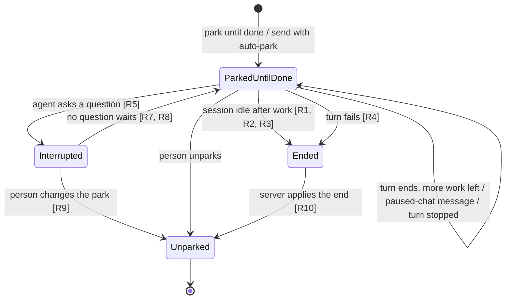
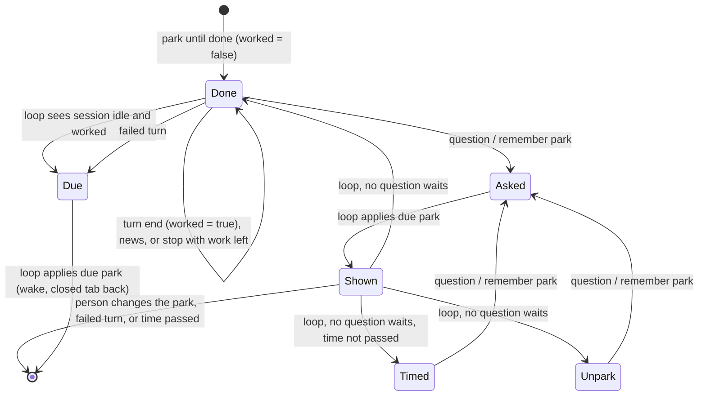

# Park Until the Session Is Idle - Plan

## Goal Capsule

- **Objective:** A person who parks a session's tab "until it is done" gets it back once, when the agent has truly stopped working or needs them, so they no longer park the same tab again and again.
- **Product authority:** this Product Contract, settled with the owner on 2026-11-18. A global Working shelf was discussed and is not active scope.
- **Means:** each person's attention row remembers whether a turn ended during the park and which park a question interrupted, and one server loop ends, restores and applies parks from that state (KTD1, KTD2, KTD3).
- **Open blockers:** none.
- **Stop conditions:** a TLC check of U1 fails or cannot run (BLOCKED / NOT VERIFIED, nothing in U2 to U4 is built); `make lint`, `go test ./...` or `make test` fails; the source CLOC budget is reached.
- **Execution profile:** one PR. U1 lands first in it and gates U2 to U4.
- **Who finishes:** the autonomous run implements, reviews and opens the PR; the owner merges.

---

## Product Contract

### Summary

A park until it is done ends when the session is idle: no turn running, nothing queued to run, and no background work. Only an agent question or a failed turn ends it sooner, and answering the question puts the tab back on the park it had. The server ends parks on its own, so no browser window has to be open for a park to end.

### Problem Frame

Today a park until it is done ends at the session's next turn end, and any news on the session ends it. Three common situations bring the tab back too early: several queued messages (the park ends after the first answer), a turn that hands work to the background (the park ends while the work goes on), and people talking in a chat whose agent is paused. The owner reports parking the same sessions again and again, which defeats the point of parking.

Ending a park also depends on a browser window. The server only applies an ended park when one of the person's windows asks for the session list, so it waits while no window is open, and a hidden window's throttled timers can delay it by about a minute. For a Remote RocketClaw the browser lists that server's sessions across origins, which skips the step that wakes parks, so a park there likely ends only when the person opens that server's own page.

### Key Decisions

- **Done means the session is idle, not that the next turn ended.** (session-settled: user-directed — chosen over ending at the next turn end: the owner keeps re-parking sessions that still have queued or background work.) Governs R1.
- **Idle covers everyone's work in the session.** (session-settled: user-directed — chosen over ending once only the parker's own work finished: simpler and predictable, and a shared turn can mix several people's messages.) Governs R2.
- **A failed turn ends the park at once.** (session-settled: user-directed — chosen over staying parked until everything finished: the person can stop the agent before it builds on the failure.) Governs R4.
- **An agent question still ends any park at once.** (session-settled: user-approved — chosen over waiting for idle: the agent cannot go on without the person.) Governs R5.
- **Messages in a paused chat no longer end a park until it is done.** (session-settled: user-approved — chosen over today's rule that any news ends it: people talking while the agent is paused is not the agent being done.) Governs R6.
- **A park until it is done on an idle session keeps waiting for the next round of work to finish.** (session-settled: user-directed — chosen over ending it at once: the park doubles as a snooze.) Governs R3.
- **Answering a question puts back the park it interrupted, honoring its original time.** (session-settled: user-directed — chosen over always parking until done after an answer: the person's own choice of park should survive the interruption.) Governs R7.
- **The server ends parks itself.** (session-settled: user-approved — chosen over waiting for a window's session-list request: parks must end with no window open and on Remote RocketClaws.) Governs R10.
- **Whoever answers, the park comes back, and auto-park does not matter.** Restoring is the person's own earlier choice, not a new park. Governs R8.
- **Stopping a turn is not a failure.** The person who stops it is already looking. Governs R4.

### Requirements

**When a park until it is done ends**

- R1. A tab parked until it is done stays parked until its session is idle: no turn running, no message queued to run, and no Background Job running or waiting to wake the agent. Held messages and scheduled reminders are not work.
- R2. Idle is judged on the whole session, including work other people queued or steered.
- R3. A park until it is done set while the session is already idle waits until the session works and then becomes idle again.
- R4. A turn that fails ends the park at once, even while more work is queued. A turn a person stops is not a failure and ends nothing by itself.
- R5. An agent question ends any park at once, as it does today.
- R6. Nothing else ends a park until it is done; in particular, messages posted while the chat's agent is paused do not.

**After a question**

- R7. Once no question from the agent is waiting, each person's tab that a question unparked goes back to the park the question ended: until it is done, until the same time, or until they unpark it. A park whose time passed meanwhile does not come back.
- R8. R7 holds whoever answered and whether or not the person auto-parks.
- R9. A person who changes the tab's park themselves after the question, by parking, unparking or marking it, keeps their change; R7 does not override it.

**How an ended park reaches the person**

- R10. The server applies an ended park on its own, within a few seconds of the event that ended it, whether or not any of the person's windows is open, and also for parks kept by a Remote RocketClaw.
- R11. Notifications behave as today: an open window notifies for a park that ended; a park that ended while no window was open shows bold without a notification once a window opens.

**Remote OpenCode sessions**

- R12. Remote OpenCode Sessions follow R1 to R7 with whatever the OpenCode server reports about running, queued and background work, failed runs and questions. Where it reports one of these less precisely than RocketClaw's own sessions, the plan names the signal used in its place.

**Verification**

- R13. The tab-attention model under `docs/verification/tab-attention/` is updated for R1 to R10 and passes TLC before the behavior is built (pack: formal-modeling, stateful-design.md).

### State Diagram

One person's park until it is done on one session. Timed parks and "until I unpark" share the question and restore paths but not the idle end.



**Assumptions for the model.** Actors: the person, other people in a shared session, the turn runner, Background Jobs, the OpenCode sync, the person's windows, and the server step that applies ended parks. Attention, turns and Background Jobs persist in Postgres; window state and in-process timers do not survive a restart. A turn start and a turn end each commit in their own transaction, so the session can look idle between a turn's end and the start of a queued turn; the idle check must count queued work, not only running turns. The server can restart between a park ending and it being applied.

**Safety.** A park until it is done never ends while its session still has work running, queued or waking, unless a turn failed or a question arrived.

**Liveness.** Once a parked session is idle after working, or a turn failed, the park ends and the server applies it, with no window open.

### Acceptance Examples

- AE1. **Covers R1, R2.** Given Bob parked a session until it is done and three messages are queued, Alice's among them, when the first two turns end, the tab stays parked; when the third ends and nothing else is queued, the tab comes back bold with the reply's notification.
- AE2. **Covers R1.** Given a turn ends saying it keeps working in the background, when that turn ends the tab stays parked; when the Background Job's result has woken the agent and that turn ends, the tab comes back.
- AE3. **Covers R4.** Given three queued messages and the second turn fails, when it fails the tab comes back at once, before the third turn runs.
- AE4. **Covers R4.** Given the person presses Stop and nothing else is queued, the session is idle, so the tab comes back under R1; given more work is queued, it stays parked.
- AE5. **Covers R5, R7.** Given a tab parked until 15:00 and a question at 13:00, the tab comes back at 13:00; once the question is answered at 13:10, it is parked until 15:00 again. Answered at 16:00 instead, it stays unparked.
- AE6. **Covers R7, R8.** Given Bob's tab parked until it is done and Alice answers the agent's question, Bob's tab goes back to being parked until it is done, even though Bob never opened it and does not auto-park.
- AE7. **Covers R9.** Given a question brought the tab back and the person then parked it for 1 hour, answering the question leaves the 1-hour park as it is.
- AE8. **Covers R6.** Given the agent is paused and Bob and Alice exchange messages, Carol's tab parked until it is done stays parked.
- AE9. **Covers R10, R11.** Given no window is open, when the session becomes idle the server unparks the tab and brings a closed tab back; when a window opens later the tab is bold, with no notification.
- AE10. **Covers R10.** Given a tab of a Remote RocketClaw session parked until it is done and viewed only from another server's page, when that session becomes idle the tab leaves Parked within a few seconds.

### Scope Boundaries

- A global Working shelf across spaces and servers is deferred to its own brainstorm.
- Push notifications or a service worker for alerts with no window open stay out of scope.
- Changing how timed parks end, other than R7's restore and R10's server-side apply, is out of scope.
- Auto-park on send keeps its current rules; answering a question is not a send.

### Dependencies / Assumptions

- RocketClaw can tell a failed turn from a stopped one at turn end.
- The OpenCode server reports enough to judge idle and failure (its own app shows queued prompts as busy and a run's failed outcome); the plan confirms which fields the sync can read.

### Outstanding Questions

**Deferred to Planning**

- Where the server step that applies ended parks runs, and how it covers a server restart.
- How the person's interrupted park is remembered so R7 can restore it.
- Which OpenCode fields stand in for queued work and failed runs under R12.

### Sources / Research

- `CONCEPTS.md` "Parked" (current rules this changes).
- `docs/specs/2026-11-09-tab-attention-design.md` and `docs/plans/2026-11-10-0947-feat-tab-attention-plan.md` (the original design, including the park until it is done addendum).
- `docs/plans/2026-11-13-1148-feat-pause-agent-in-web-chats-plan.md` (the decision this reverses: paused messages ending parks).
- `docs/solutions/logic-errors/opencode-background-turns-never-ended-park-until-done.md` (both producers of a turn end must be covered).
- `docs/verification/tab-attention/` (model to update).
- `internal/rocketclaw/backend/store_dao.go` `markTurnEnd` (the cron path's existing nothing-left check), `internal/rocketclaw/backend/attention.go` (`markTabsSQL`, `PollAttention`), `internal/rocketclaw/frontend/rpc/http.go` (cross-origin check that skips the wake for Remote RocketClaw listings).

---

## Planning Contract

Product Contract preservation: Product Contract unchanged.

### Key Technical Decisions

- KTD1. **Marking stays one path; a turn end adds one per-session update.** `markTabsSQL` keeps marking every producer's readers, and only a question (its existing `waking` rows) ends a park there, remembering it; the special pass for rows parked until done is gone, so news touches no park. A turn end (`markTurnEnd`, and the OpenCode sync for a new idle marker) then runs `endTurnParksSQL` in the same transaction, by conversation: it records `worked` on every park until it is done and every remembered park of that session, whoever the event reached, and a failed turn ends the park and drops a remembered one. The upsert only sees an event through the columns it inserts, so carrying event kinds into it would have meant smuggling flags through stored columns. Governs R4, R5, R6.
- KTD2. **Two new facts on `web_tab_attention`: `worked` and a remembered park.** `worked` says a turn ended since the park until it is done began (or since the interrupted one did), so a park set on an idle session waits for work (R3). `resumes` with `resume_until` hold the park a question ended: `'infinity'` for until done, a time, or NULL for until unparked. A timed park whose time passed is not restored (R7). A new park, unpark or mark by the person clears the remembered park (R9); closing the tab clears a remembered park until unparked, as closing ends that park, and keeps the others. A failed turn clears it too, so a failure during a question is not hidden by a restore.
- KTD3. **One server loop owns ending, restoring and applying parks.** A goroutine started beside the OpenCode sync in `cmd/rocketclaw/web.go` runs every 2 seconds and, in order: makes due each park until it is done whose session is idle and `worked`; restores remembered parks once the session has no question waiting; applies every due park for every person, with the wake that `PollAttention` runs today. `PollAttention` keeps only recording the tab in view and reading the revision. This removes the dependence on a window's same-origin session list (R10) and puts the waking where the model already had it, as a server timer process.
- KTD4. **Idle is read from the turns table and the conversation row, not from events.** A session is busy while any of its turns, or a turn of a run reporting to it, is running or delivering, waits with reason `queued`, or is a Background Job note pending that will wake the agent (`note = 'pending' AND wake`, as the session's existing pending-work check in `store.go` counts it); or while it has an active goal, whose next turn is queued in memory after the previous one closes; or, for a remote session, while its conversation row says `running` or `background` (the OpenCode sync writes these). Held, stashed and scheduled waiting turns do not count (R1). The check starts from the sessions with a park to decide, so each tick reads only their turns. It differs from the cron path's nothing-left check in `markTurnEnd` on purpose: it adds `delivering`, so the park ends after the reply is delivered, and counts only Background Job notes that will wake the agent.
- KTD5. **A done park that ends at idle keeps the reply's notification.** It is made due at the time of its unread mark (`until = COALESCE(unread_at, now())`), so the wake keeps the turn end's note instead of writing "Park ended", as today when a turn end ends it.
- KTD6. **A remote OpenCode failure is the `outcome` of a new idle marker.** The sync already fetches the newest idle marker; it also reads that marker's `outcome` (`Session.Message.Idle` in `internal/rocketclaw/oc/packages/schema/src/session-message.ts`) and marks the event `failed` when it is `failed`. `interrupted` is a stop, not a failure (R4). OpenCode's `/session/active` stands in for queued prompts (see Assumptions).
- KTD7. **A remembered park until it is done comes back even when the session already finished.** The next idle check then ends it, bringing a closed tab back with the reply. Dropping it instead, as first planned, left a closed tab out; the cost is a second notification on an open tab in the rare case the turn ends within one tick of the answer. A second question while the first one's park is still being applied keeps the first remembered park.

- KTD8. **The loop never waits on a row lock.** A turn end locks attention rows in two passes (marking, then the turn-end update), so its lock order can cross the loop's; the loop's statements lock with `SKIP LOCKED` and pick a skipped row up on the next tick, and one person's failed wake does not stop the others'.

### High-Level Technical Design

One person's park on one session. `worked` and the remembered park are the only new state; every arrow is one statement in one transaction.



`Timed` is a park with a time, `Unpark` a park until unparked, `Shown` an unparked tab that remembers its park.

The loop, per tick:

```text
idle_end:  parked done rows, worked, session not busy      -> until = COALESCE(unread_at, now())
restore:   resumes rows, not parked, session not asking    -> parked again with resume_until, unless
                                                             resume_until passed
wake:      for each person with until <= now()             -> today's PollAttention wake, closed tabs back
```

### Assumptions

- OpenCode lists a session in `/session/active` while it still has queued prompts to run, so `running` from the sync covers its queue. Where it does not, a remote park ends between two queued prompts, which is today's behavior.
- A remote failure is seen only when the sync next finds the session not active, and only through the newest idle marker, so a failure followed by queued prompts ends a remote park at idle rather than at once. This is R12's named stand-in for R4.
- RocketClaw runs one web process per database, as the OpenCode sync already assumes; two loops would apply the same idempotent updates.
- A 2-second tick matches the browsers' session-list poll, so a park ends as fast as today with a window open.

### Sources and Research

- `internal/rocketclaw/backend/attention.go` (`markTabsSQL`, `sessionReadersSQL`, `turnEventsSQL`, `ChangeAttention`, `PollAttention`).
- `internal/rocketclaw/backend/store_dao.go` (`markTurnEnd` and its cron `pending` check, `closeTurn`, tab close at the `touched`/`unparked` CTEs).
- `internal/rocketclaw/backend/opencode.go` (`SyncOpenCode`, idle marker events), `internal/rocketclaw/backend/web_question.go`, `internal/rocketclaw/backend/thread_bridges.go` (paused message).
- `docs/verification/tab-attention/` and the formal-modeling pack (pack: formal-modeling, stateful-design.md).
- `docs/solutions/logic-errors/opencode-background-turns-never-ended-park-until-done.md`: both producers of a turn end must carry the new event kind.

---

## Implementation Units

### U1. Update the tab-attention model and check it

- **Goal:** the model describes R1 to R10 and TLC passes before any Go changes.
- **Requirements:** R13, and through the model R1 to R10.
- **Dependencies:** none.
- **Files:** `docs/verification/tab-attention/TabAttention.tla`, `docs/verification/tab-attention/one-window.cfg`, `docs/verification/tab-attention/two-windows.cfg`, `docs/verification/tab-attention/old-turn-end.cfg`, `docs/verification/tab-attention/Makefile`, `docs/verification/tab-attention/README.md`.
- **Approach:**
  1. Add session work: `busy` (running, queued or background) and `worked`. The Person starts work, and a turn ends either leaving more work or not, and either failed or not.
  2. Turn end no longer makes a park until it is done due; it sets `worked`. A failed turn end makes it due. News (the paused message) is its own action that writes a mark and leaves the park alone.
  3. A question remembers the park (`resume`) when it ends one. Anyone can answer, not only a viewer (R8). Parking, unparking, marking and closing clear `resume` as KTD2 says.
  4. Replace the turn-end rule in the server's timer process with KTD3's loop: idle end, restore, and the existing due-timer wake.
  5. Replace `DoneEndsAtTurnEnd` with `DoneEndsOnlyWhenIdle` (safety: no park until it is done becomes due while the session is busy, unless the event was a failure or a question) and `IdleEndsDone` (liveness: a parked-until-done tab whose session is idle and `worked` stops being parked until done). Add `QuestionRestores` (liveness: a remembered park comes back or is dropped once no question waits) and keep every existing invariant and property.
  6. Add `_POSSIBLE` states for a done park ending at idle, a restored park and a failure ending a park, so the checks cannot pass vacuously.
  7. Add a CONSTANTS switch for the old rule (a turn end makes a park until it is done due) and an `old-turn-end.cfg` check. The Makefile gains a must-fail target that passes only when TLC exits 12 or 13 and its log names `DoneEndsOnlyWhenIdle` (pack: formal-modeling, stateful-design.md).
  8. Run `make -C docs/verification/tab-attention`. Fix the design for any counterexample. Record bounds, state counts, times and versions in `README.md`.
- **Test scenarios:** the checks are the tests: `one-window` and `two-windows` pass with every invariant, property and `_POSSIBLE` state; the `old-turn-end` target passes because TLC finds `DoneEndsOnlyWhenIdle` violated.
- **Verification:** both checks print `Model checking completed. No error has been found.`; README records the run.

### U2. Event kinds, remembered parks and the schema

- **Goal:** each event changes a park only as R4 to R9 say, and attention rows hold `worked` and the remembered park.
- **Requirements:** R1, R2, R4, R5, R6, R7, R8, R9, R12 (KTD1, KTD2, KTD6).
- **Dependencies:** U1.
- **Files:** `internal/rocketclaw/backend/migrations/104_web_park_until_idle.sql`, `internal/rocketclaw/backend/attention.go`, `internal/rocketclaw/backend/store_dao.go`, `internal/rocketclaw/backend/web_question.go`, `internal/rocketclaw/backend/thread_bridges.go`, `internal/rocketclaw/backend/opencode.go`, `internal/rocketclaw/backend/attention_test.go`, `internal/rocketclaw/backend/opencode_test.go`.
- **Approach:**
  1. Migration adds `worked BOOLEAN NOT NULL DEFAULT FALSE`, `resumes BOOLEAN NOT NULL DEFAULT FALSE` and `resume_until TIMESTAMPTZ` to `web_tab_attention`, with a Down.
  2. `markTurnEnd` and the OpenCode sync run `endTurnParksSQL` after marking, in the same transaction, with whether the turn failed: `finish.terminal`, or the idle marker's `outcome` (KTD6).
  3. `markTabsSQL`'s upsert applies KTD1 and KTD2 for questions; its view filter no longer lets non-question events through for rows parked until done.
  4. `ChangeAttention` clears `resumes` for every action but the auto-park toggles, resets `worked` on a new park, and its idle-row delete also requires `NOT resumes`. Closing a tab clears a remembered park until unparked, mirroring how it ends that park.
- **Patterns to follow:** the existing `CASE` columns of `markTabsSQL` and `ChangeAttention`; CTEs, no subqueries.
- **Test scenarios:**
  - Covers AE1. A done park stays `until=done` after a turn end with another queued turn, and records `worked`.
  - Covers AE3. A failed turn end makes a done park due even with a queued turn.
  - Covers AE4. A stopped turn end only records `worked`.
  - Covers AE8. A paused-chat message leaves a done park as it was, `worked` unset.
  - Covers AE5. A question on a park until 15:00 makes it due and remembers 15:00; on a park until unparked it remembers NULL.
  - Covers AE7. Parking the tab after the question clears the remembered park.
  - A failed turn after a question clears the remembered park.
  - Closing a tab whose remembered park is until unparked clears it; one remembering until done keeps it.
  - Covers R12. The OpenCode sync: a new idle marker records `worked`; with `outcome` `failed` it makes the park due; `interrupted` only records `worked`.
- **Verification:** the scenarios pass in `go test ./internal/rocketclaw/backend`.

### U3. The server loop that ends, restores and applies parks

- **Goal:** parks end and come back on the server, with no window open and for Remote RocketClaws.
- **Requirements:** R1, R2, R3, R7, R10, R11 (KTD3, KTD4, KTD5, KTD7).
- **Dependencies:** U2.
- **Files:** `internal/rocketclaw/backend/attention.go`, `cmd/rocketclaw/web.go`, `internal/rocketclaw/backend/attention_test.go`, `internal/rocketclaw/backend/unread_test.go`, `internal/rocketclaw/frontend/rpc/tabs_test.go`, `internal/rocketclaw/frontend/rpc/sidebar_test.go`.
- **Approach:**
  1. A private tick on `SessionService` runs the three steps of KTD3, each locking rows in `(username, path)` order as `markTabsSQL` and today's wake do.
  2. The wake step is today's `PollAttention` wake and closed-tab restore, run per person with due rows, reading the tab in view from `web_tab_states`.
  3. An exported loop method runs the tick on a 2-second ticker until the context ends; `cmd/rocketclaw/web.go` starts it in the existing `serving` group beside the OpenCode sync.
  4. `PollAttention` drops its wake and keeps the view and revision.
- **Execution note:** move existing park-wake assertions from `PollAttention` to the tick before adding new ones, so the old contract keeps its coverage.
- **Test scenarios:**
  - Covers AE1. With a queued turn left, the tick leaves a worked done park parked; once the queue is empty it unparks it, bold, with the reply's note.
  - Covers AE2. A pending Background Job note keeps it parked; the tick ends it after the job's turn ends.
  - A done park set on an idle session survives ticks until a turn ends.
  - A pending Background Job note with `wake = FALSE`, left by a stopped wake turn, does not keep a worked park until it is done parked.
  - Covers AE5, AE6. After a question is answered by another person, the tick restores until 15:00, until done or until unparked; past 15:00 it leaves the tab unparked.
  - KTD7: answered with the session idle and `worked`, the tick puts the done park back and the next tick ends it.
  - Covers AE9. With no window having polled, the tick unparks a due park and brings back its closed tab, raising the revision.
  - Covers AE10. The rpc sidebar test that listed sessions with `SameOrigin` to wake a timed park now wakes it through the tick, and a listing without `SameOrigin` sees it unparked.
  - `PollAttention` no longer unparks a due park by itself.
- **Verification:** the scenarios pass; the rpc package tests pass.

### U4. Documentation of the new rules

- **Goal:** the project's vocabulary and API comments say what the code does.
- **Requirements:** R1 to R11.
- **Dependencies:** U3.
- **Files:** `CONCEPTS.md`, `internal/rocketclaw/frontend/rpc/README.md`, `internal/rocketclaw/web/proto/web.proto` and its generated `internal/rocketclaw/frontend/rpc/web.pb.go`, `docs/specs/2026-11-09-tab-attention-design.md`.
- **Approach:** rewrite the Parked entry's end rules and the server check; update the proto comment and regenerate; add a dated addendum to the spec.
- **Test scenarios:** Test expectation: none -- documentation and a generated comment.
- **Verification:** `make generate` leaves no diff beyond the comment.

---

## Verification Contract

| Gate | Command | Applies to |
|---|---|---|
| Model | `make -C docs/verification/tab-attention` | U1, and again if U2 or U3 changes a transition |
| Format | `gofmt -l` on touched Go files | U2, U3 |
| Package tests | `go test ./internal/rocketclaw/backend ./internal/rocketclaw/frontend/rpc` with `ROCKETCLAW_TEST_DATABASE_URL` | U2, U3 |
| All tests | `go test ./...` | all |
| Lint | `make lint` | all |
| Full gate | `make test` (generate, lint, coverage and CLOC budgets) | all |

## Definition of Done

- `make -C docs/verification/tab-attention` passes: both checks pass and `old-turn-end` finds its named violation; README records the run.
- AE1 to AE10 each have a passing test, except AE10's remote server, which the tick test covers without a second server.
- `PollAttention` no longer wakes parks; the loop runs in the web process.
- `make lint`, `go test ./...` and `make test` pass, inside the CLOC and coverage budgets.
- No leftover code from abandoned approaches, and no source comments.
