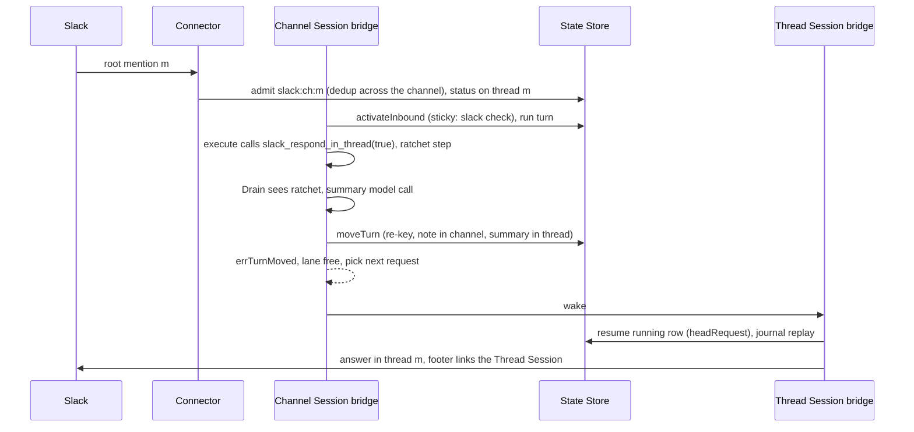
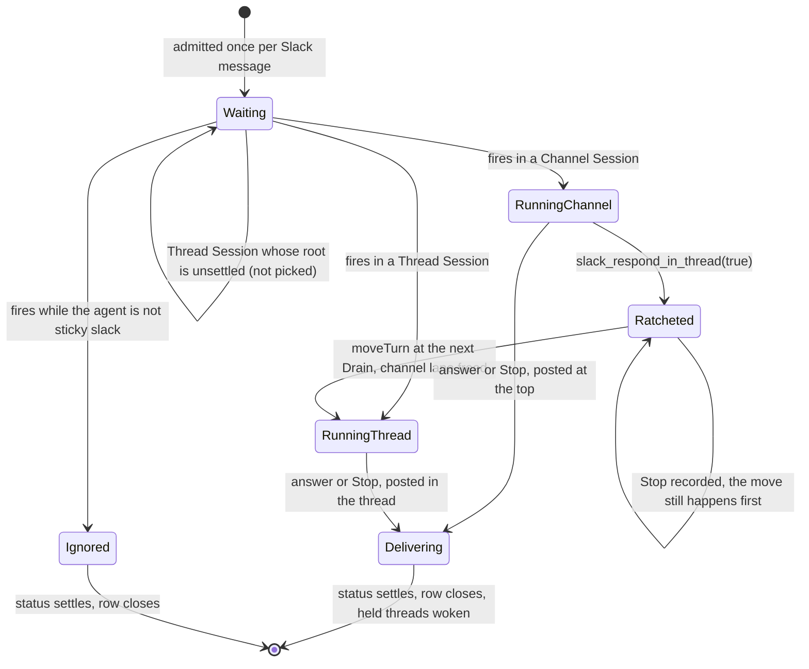

# Sticky Slack Sessions - Plan

## Goal Capsule

- **Objective:** A Slack channel keeps one ongoing conversation with its agent, and the agent decides per request whether to answer at the top of the channel or to continue in a thread that has its own conversation.
- **Means:** a new `sticky: slack` agent mode with Channel Sessions and Thread Sessions, a `slack_respond_in_thread` tool whose first `true` moves the running turn into the Thread Session (KTD1, KTD2), built on the verified design in `docs/verification/slack-sticky/`.
- **Authority:** the R-IDs below own product behavior. KTDs own mechanism. The PlusCal model in `docs/verification/slack-sticky/` gates the stateful behavior (U1). Units cite both and override neither.
- **Execution profile:** one pull request. Units land in the order U1, U2, U3, U5, U4, U6, U7, U8.
- **Stop conditions:**
  - U1's TLC rerun fails, or cannot run.
  - The Go CLOC budget (`GO_SOURCE_CLOC_BUDGET` in `internal/rocketclaw/Makefile`, about 4,080 lines left) cannot hold the change.
  - A settled decision turns out infeasible.
- **Finishing:** `lfg` implements, reviews, commits, pushes and opens the PR. Merging stays with the owner.

---

## Product Contract

### Summary

Add `sticky: slack`, the only agent mode Slack answers with. Each channel gets a Channel Session that answers mentions at the top of the channel. Each thread gets a Thread Session that answers in the thread. A channel turn can call `slack_respond_in_thread(true)` once to move the rest of its work into the mention's thread. The four current Slack behaviors that would break this design are fixed in the same change.

### Problem Frame

Today every Root Slack Mention opens a new Managed Slack Thread with no memory of the channel. A channel cannot hold a running conversation with its agent, and every answer lands in a thread whether or not one is wanted. People who want a quick answer in the channel, or a long piece of work kept out of the channel, have no way to get either. The verified design in `docs/verification/slack-sticky/README.md` also found that four behaviors in today's Slack code break as soon as answers go to the top of the channel: lost top-level posts are posted again, mentions are deduplicated per conversation, threads under the bot's own messages are ignored, and Stop can end the wrong turn.

### Requirements

**Agent mode**

- R1. Agents accept `sticky: slack`. Only `sticky: slack` agents run turns in Slack sessions.
- R2. Whether the agent is `sticky: slack` is checked when a turn fires: when its session takes the request off its waiting line and starts running it. This applies to every kind of turn. A turn resumed after a restart is the same turn continuing and is not checked again. A failing check logs a warning and the turn does not run.
- R3. The Slack channel settings choose the channel's agent exactly as today. A configured agent that is not `sticky: slack` no longer fails startup or Reload. It is reported in the logs and in a warning strip at the top of the Web app, like the sandbox one.
- R4. `sticky: slack` agents are not offered for new Web sessions, cron jobs, Routines, External MCP, Voice, or a `rocketclaw_sessions` call that creates a session. People can open their Slack sessions in Web and type into them.

**Sessions**

- R5. A Root Slack Mention goes to the Channel Session of its channel and agent. The answer is posted at the top of the channel. A busy Channel Session makes the next request wait.
- R6. A mention inside a thread goes to the Thread Session of that thread and agent, and the answer is posted in the thread. This includes threads the bot did not open (earlier messages are adopted as today) and threads under the bot's own top-level answers.
- R7. A thread mention whose root mention still waits for, or runs in, a Channel Session turn waits until that root moves or finishes. When Slack delivers the thread mention first and the root mention is recent, the root is taken in first. An older root that was never taken in is read as thread history, as today.
- R8. Existing Managed Slack Threads keep their conversations and history. A later mention in one continues there when its agent matches the channel's agent. Otherwise, for example after a channel switches from `assistant` to `slack`, the mention opens a new Thread Session that reads the thread's earlier Slack messages as R6 does, and the old conversation stays readable in Web.

**Responding in a thread**

- R9. A Channel Session turn started by a Slack mention has the tool `slack_respond_in_thread(bool)`. Thread Sessions do not have it. The tool can be called at any point and any number of times. Calling `false`, or never calling it, keeps the answer at the top of the channel.
- R10. The first `true` is final. From that moment the rest of the turn runs in the Thread Session of the mention's thread, which is created if missing. The answer is posted in that thread. The Channel Session is free to take its next request as soon as the tool call that said `true` returns.
- R11. The Thread Session starts with the trigger message, the turn's own work so far, and a short summary of the Channel Session's earlier history.
- R12. The Channel Session records that the thread opened, with the Thread Session's ID, so its agent can later write into the thread with `rocketclaw_sessions`.

**Slack surface**

- R13. Working state uses Slack's native agent session status on the turn's thread, and it follows a turn that moved. The footer keeps today's form and links to the session that answered.
- R14. No answer, footer or root is posted twice, including after a crash and for posts at the top of the channel.
- R15. A Slack message is admitted at most once, even when the channel's agent changes between two deliveries of it.
- R16. A Slack Stop ends only the turn its thread showed, wherever that turn now runs.

### Scope Boundaries

- Web, cron, External MCP and Voice sessions behave as today.
- No Web control to move a turn into a thread.
- Plain channel messages between mentions are not read into the Channel Session.
- Considered and not built: refusing `true` while the turn still owns background jobs or detached subagents. It would narrow R9's "at any point". Their results wake the Channel Session and post at the top of the channel (KTD9), not in the thread the turn moved into. This would change if people miss those results in practice.
- Considered and not built: special handling for a turn that compacted its context before calling `true`. Such a turn carries the compacted Channel Session history into the Thread Session, and the history pruning drops the summary entry, so R11's small start does not hold for it. It needs a very long Channel Session; this would change if moved turns show up carrying channel history.
- Considered and not built: a Slack reply under mentions ignored by R2. The owner chose "warn in the logs and move on".

#### Deferred to Follow-Up Work

- A Task `continue` from a Thread Session of a subagent started before the move fails, because subagent IDs extend the Channel Session's ID.

### Key Decisions

- **Move the turn, do not redirect its output.** (session-settled: user-directed — chosen over keeping the turn in the Channel Session and only posting into the thread: the channel frees at once and the Thread Session owns the work.) Governs R10.
- **The Thread Session starts small.** (session-settled: user-directed — chosen over copying the whole Channel Session history: trigger, the turn's work so far, and a short summary.) Governs R11.
- **One `sticky: slack` check, when the turn fires.** (session-settled: user-directed — chosen over also checking when a mention arrives: configuration is forward-looking, and a resumed turn is not re-checked.) Governs R2.
- **The four Slack fixes ship with the feature.** (session-settled: user-directed — chosen over separate pull requests: the feature is wrong without them.) Governs R14, R15, R16, R6.
- **Configuration and session keys stay as the owner described.** (session-settled: user-directed — chosen over a key without the agent: the channel's agent comes from the existing settings, and sessions are per channel or thread and agent.) Governs R3, R5, R6.

### Open Questions

- Deferred, merge gate for the owner: is offering the tool only on Slack-mention turns acceptable (KTD8)? Web input, other agents' writes and Background Job wakes in a Channel Session answer at the top without the tool; goal, scheduled and session-reply wake turns stay in Web (KTD9).
- Deferred, merge gate for the owner: the shipped `assistant` stays `sticky: off` because External MCP only accepts `sticky: off` agents, and a new shipped `slack` agent serves Slack (KTD14). Installs whose channel settings name `assistant` see the warning, and Slack mentions there are ignored, until they switch. After the switch, mentions in threads created under `assistant` open new `slack` Thread Sessions that re-read the thread's Slack messages (R8); the old conversations stay readable in Web.

---

## Planning Contract

### Key Technical Decisions

- KTD1. **The tool sets a durable ratchet, and the next `Drain` moves the turn.** `slack_respond_in_thread(true)` writes the step `<turnID>/respond-in-thread` and returns. When the channel Bridge's `Drain` (`internal/rocketclaw/backend/conversations.go`) next runs, which is after each tool round and before a final answer, it moves the turn in one transaction (KTD2). It then cancels the channel run with a new `errTurnMoved` sentinel, and `handleInbound` returns without finishing, freeing the channel lane. The tool is `Resumable` and returns the same result on repeat calls. Inside one `execute` script, any `true` among parallel calls wins. A running looper cannot follow a re-keyed journal, so the move hands the turn over rather than renaming it mid-flight (see `move-trace` notes in Sources). (session-settled: user-directed — chosen over keeping the turn in the Channel Session and only redirecting output: governs R10.)
- KTD2. **One move transaction re-keys what the turn owns.** `moveTurn` in `internal/rocketclaw/backend/store_dao.go`, next to `finishTurn`, does all of this in one transaction:
  1. Lock both histories with `lockHistories`, in sorted order.
  2. Create the Thread Session if missing.
  3. Update the turn row's `conversation_id`, its history anchor, and `inbound_json.ConversationID`.
  4. Re-key the turn's `steps`, except job-owned steps, and the attachments with its `turn_id`.
  5. Re-point delegation children's `parent_conversation_id` and other sessions' `reply_target`.
  6. Close the channel's shadow comparison rows for the turn.
  7. Append the summary entry to the thread and the note entry to the channel.
  8. Recompute `running` for both sessions.

  9. Mark the Channel Session's background notes this turn claimed (`claimed_by = <turnID>`) as consumed, as `finishTurn` does.

  The turn's captured `canonical` environment is left unchanged, so the moved turn keeps the Channel Session's working folder, shell temp folder and `ROCKETCLAW_CONVERSATION_ID` until it finishes; resolving those from the captured environment instead of the bridge keeps files written before the move. Later Thread Session turns use the thread's own. The SQL uses CTEs (AGENTS.md). `finishTurn` is fenced on `conversation_id`, so a late channel-side finish cannot close a moved row. This is the model's `move` step.
- KTD3. **The summary is one model call before the transaction.** A sibling of `harness.GenerateTitle` (`internal/rocketclaw/harness/title.go`) summarizes the Channel Session's recent entries, up to the turn's history anchor, with the channel agent's model. It runs in `Drain` before `b.mu` and the transaction. If the call fails, the move goes ahead with no summary entry and a warning log, so `true` stays honored (R10 wins over R11). A crash before the commit runs the summary again on resume.
- KTD4. **The Thread Session resumes the moved turn the way a restart does.** `pickLaterWork` gets a "running row of this conversation first" branch, placed after the `producing` check. Through `headRequest` → `activateInbound` → `openInputWindow`, the journal replays the trigger and the turn's work, and the triggering `execute` call returns its recorded output. The new branch is limited to `turn.conversationID == b.config.ConversationID`. `activateInbound` refuses to start a new turn while the conversation already holds a running lane row, so a Web input sent just after a move waits until the moved turn finishes (model: `NoClobber`).
- KTD5. **Channel Sessions reuse `KindSlackThread` with no `slack_thread`.** This avoids a new kind, its CHECK migration, and the proto enum. The IDs:

  | Session | ID |
  | --- | --- |
  | Channel Session | `slack-channel:<channel>:<agent>` |
  | New Thread Session | `slack-thread:<channel>:<ts>:<agent>` |
  | Existing Managed Slack Thread | `slack-thread:<channel>:<ts>`, reused when its recorded agent is the channel's agent (R8) |

  IDs never contain `/`, which marks a Delegation History. Connector lookups that derive IDs with `protocol.SlackThreadConversationID` move to one resolver that takes the channel, the thread and the agent.
- KTD6. **The hold on a thread is computed when the turn fires, not stored.** In a Thread Session, `activateInbound` admits no new turn while the root mention `slack:<channel>:<ts>` waits or runs unmoved in a Channel Session; the request stays a waiting row, like the existing goal-active block. The check sits in `activateInbound`, next to KTD13, because Web input, goal kickoffs and wakes reach the lane without `pickLaterWork`; `pickLaterWork` skips held work too. The existing `held` rows are released by any Web input or agent write (`conversations.go`, `thread_bridges.go`), so a stored flag would let those bypass the hold. The release is a wake: a Channel Session turn that closes or moves wakes the Thread Sessions of its root's thread (model: `RootUnsettled`, `no-wake-on-release`).
- KTD7. **Dedup by Slack message across the channel's conversations.** `SubmitMention`'s seen-check keeps both of its sources, turn rows and the `replay_input` of saved entries. It is scoped to the conversations with `slack_channel = <channel>` through the existing `conversations_slack_channels` index, instead of to one conversation. Root-first admission (R7) inserts the root and the thread mention in the same admission transaction, and only for a root that mentions the bot, comes from an allowlisted user, and was posted at most 10 minutes before the thread mention (Slack's last event retry comes about 5 minutes after the first). An older root is adopted as thread history, so pruned or never-delivered roots are not answered again. No migration is needed (model: `OneAdmission`).
- KTD8. **The tool is offered only on Channel Session turns started by a Slack mention.** It is never offered to subagents, shadows, agent drafts, goal turns, wake turns, Web-input turns, or agent-write turns. It joins the default-allow `rocketclaw` tool list in `bridge.go`. Each excluded turn has no Slack message to thread under, so offering the tool there would need a new backend-to-Slack root post. R9 already states this narrowed form; the owner's original design offered the tool on every Channel Session turn. Flagged in Open Questions; if rejected, R9 and this KTD widen together. The tool description and the Channel Session note tell the agent to call `slack_respond_in_thread(true)` in its own `execute` call before other work, because the move happens when that call returns.
- KTD9. **What a Channel Session posts depends on what started the turn.** Turns started by a Slack mention, Web input, an agent write or a Background Job note post at the top of the channel. Consumed Web input is mirrored at the top first. Session-reply wakes (Completion Notes of the Channel Session's own `rocketclaw_sessions` writes) and scheduled or goal turns stay in Web. Without that, a write into a thread wakes the channel, which posts again at the top, and the two loop. Channel Sessions are recognized as `kind = 'slack_thread' AND slack_thread IS NULL`, never by a missing thread alone, because subagent and review histories copy the parent's channel without a thread.
- KTD10. **`postOnce` finds lost top-level posts.** The posting marker records a lower time bound. For a marker with no thread, `findPosted` pages `conversations.history` from that bound, matching on the block ID. Channel Session answers carry Slack message metadata (`event_type` `rocketclaw_channel_reply`, slack-go `MsgOptionMetadata`). The Report Thread check in `handleAppMentionEvent` reads replies with `IncludeAllMetadata` and treats a bot root carrying that mark as a Thread Session root, not a Report Thread (model: `OneReply`, `legacy-report`).
- KTD11. **Stop and status follow the turn, not the conversation.** The connector's in-memory session is found by channel and thread timestamp. A Stop interrupts that session's turn ID through a new `PrimaryTextRouter.InterruptTurn`, which finds the conversation that holds the running row and interrupts only that turn there. An idle holder uses `stopIdleTurn`. A Stop that lands between `true` and the move: `runTurn` ends interrupted, and `handleInbound` sees the ratchet step, runs `moveTurn` (no summary) instead of `finish`, and wakes the Thread Session, whose bridge finishes the moved row as stopped through `stopIdleTurn`. The stopped footer posts in the thread. `TurnProgress` resolves by turn ID, so the working status survives the move (model: `StopPrecise`, `StatusClears`).
- KTD12. **A Channel Session may write into its own channel's Thread Sessions.** On the existing-session write path of `rocketclaw_sessions_write` only, `checkRecipient` (`backend/session_tools.go`) admits a sender whose session is a Channel Session when the target is a Thread Session with the same `slack_channel` and agent, whatever the `recipients` setting. Every other sender, and the create path, stay under `recipients`. `sudo` agents refuse every sender today, which would block R12 for a sudo `sticky: slack` agent.
- KTD13. **The `sticky: slack` check sits in `activateInbound` for new turns only.** It runs after the agent is resolved and before `startTurnDB`, and is skipped for the resume branch. A failure closes the row with a warning log. The thread's status is settled (model: `OnlySlackAgentsRun`).
- KTD14. **A new shipped `slack` agent, with `assistant` unchanged.** `internal/rocketclaw/skel/agents/slack.md` is `sticky: slack`. `internal/rocketclaw/rocketclaw.example.json` and the README point Slack channels at it. `assistant` stays `sticky: off` because External MCP requires that. `skel.SyncInWithOverlays` brings the new agent to existing installs at startup. Their channel settings still name `assistant`, so they see the R3 warning.
- KTD15. **The warning strip is computed when definitions load.** `validateRuntimeAssets` (`backend/app.go`) stops failing for Slack channel agents. It returns the list of channels whose agent is not `sticky: slack`, and the Runtime keeps that list whenever definitions or Behavior Settings load. A new `frontend.Backend` method feeds an `IdentityResponse.slack_warning` field, which is omitted when empty. A small `SlackWarning` web component renders it next to the sandbox alert, kept separate because react-doctor's complexity limit sits at 15 and `WebAppUpdate` is near it.

### High-Level Technical Design

A Slack request's life, as the model checks it (KTD1, KTD4, KTD6, KTD13):

### Model update and verification

The model gains these behaviors, and U1 reruns every check:

- the hold is computed at pick from `RootUnsettled` (KTD6);
- Web input and agent writes may target a held Thread Session;
- the tool exists only on root-mention turns (KTD8), so the agent-item root path goes away. `witness-agent-root` becomes a witness that a Web input waiting in a held Thread Session runs after the root's move.

(pack: formal-modeling, stateful-design.md)

### Sources

- Model, its step table, and the four current-code counterexamples: `docs/verification/slack-sticky/README.md`.
- Every `AgentSticky` branch site to update: the `sticky` site table in the planning research. Key sites:
  - `harness/agents.go`, `harness/agent_settings.go`, `harness/easy.go`;
  - `backend/app.go` `validateRuntimeAssets`;
  - `frontend/rpc/server.go` `listAgents`/`createSession`/`RunCronJob`;
  - `frontend/cron/manager.go`, `backend/thread_bridges.go` `createSession`.
- Move mechanics: `backend/bridge.go` (`runTurn`, `handleInbound`, `pickLaterWork`, `headRequest`, `activateInbound`), `backend/store_dao.go` (`conversationJournal`, `finishTurn`, `closeTurn`), `harness/mcp_tools.go` `recordHostCall`.
- Slack: `frontend/slack/connector.go` (`postOnce`, `findPosted`, `handleAppMentionEvent`, `handleAgentSessionStopped`, `pollSession`), `frontend/slack/events.go` `StartEvents`.
- Learning: `docs/solutions/architecture-patterns/slack-agent-session-status-follows-the-running-turn.md` (every status write goes through the running turn's session).

---

## Implementation Units

### U1. Update the PlusCal model and rerun it

- **Goal:** the model checks the design this plan builds, before any stateful code lands. Status: pending; this unit gates U3, U4 and U5.
- **Requirements:** R7, R9, R10, R15, R16
- **Dependencies:** none
- **Files:** `docs/verification/slack-sticky/SlackSticky.tla`, its `.cfg` files, `docs/verification/slack-sticky/README.md`
- **Approach:**
  1. Replace the stored `held` flag with a pick-time `RootUnsettled` check, and keep the `no-hold` mutation as "no check".
  2. Let `Submit` send Web input into any existing session, Thread Sessions included.
  3. Limit the `Tool` step to root mentions, and drop the agent-item root post: remove `witness-agent-root` and `NoAgentRootMove`. Item 5 keeps answering at the top.
  4. Add item 8, Web input into the Thread Session of root 1's thread, leaving item 4 unchanged. Add the must-fail check `witness-web-held` (property `NoWebHeldAfterMove`; world root 1, thread mention 3, item 8; expected `Invariant NoWebHeldAfterMove is violated.`).
  5. `no-hold` (no fire-time hold check) must still fail with `HeldUntilRootSettles`.
  6. Update the step-to-code table to the KTDs above: `pick` maps to `activateInbound` for the hold and the `sticky: slack` check.
- **Test scenarios:**
  - Every required check passes.
  - Every must-fail check finds its named violation.
  - The new witness is reachable.
- **Verification:** `make -C docs/verification/slack-sticky` exits 0, and the README records the counts.

### U2. The `sticky: slack` mode and where it is offered

- **Goal:** agents load with `sticky: slack`. Every surface treats it per R1, R3 and R4.
- **Requirements:** R1, R3, R4
- **Dependencies:** U1
- **Files:**
  - `internal/rocketclaw/harness/agents.go`, `internal/rocketclaw/harness/agent_settings.go`, `internal/rocketclaw/harness/easy.go`;
  - `internal/rocketclaw/backend/app.go`, `internal/rocketclaw/backend/store_dao.go` (`StickySessions`), `internal/rocketclaw/backend/thread_bridges.go` (`createSession`);
  - `internal/rocketclaw/frontend/rpc/server.go`, `internal/rocketclaw/frontend/cron/manager.go`;
  - `internal/rocketclaw/skel/agents/slack.md`, `internal/rocketclaw/rocketclaw.example.json`;
  - tests: `harness/easy_test.go`, `backend/definitions_test.go`, `frontend/cron/manager_test.go`, `frontend/rpc/server_test.go`.
- **Approach:**
  1. Add `AgentStickySlack` and update the parse error text. Add it to the Choices and Allowed text, and handle it in every `switch` the `exhaustive` linter flags.
  2. Refuse `routines` for it.
  3. Exclude it from new-session agent lists, `createSession`, `RunCronJob`, cron definitions and `rocketclaw_sessions` creation.
  4. Turn `validateRuntimeAssets`' Slack rule into the warning list for KTD15.
  5. Ship the `slack` agent (KTD14).
- **Patterns to follow:** how `AgentStickyUser` is refused for Routines and cron. The `exhaustive` linter.
- **Test scenarios:**
  - `sticky: slack` parses. An unknown value reports `must be off, user, global or slack`.
  - A `sticky: slack` agent with `routines` fails to load, with a message naming the agent.
  - A new Web session's agent list omits `sticky: slack` agents. An existing Slack session still opens.
  - `RunCronJob` and a cron file naming a `sticky: slack` agent are refused.
  - `rocketclaw_sessions` with an empty session ID and a `sticky: slack` agent is refused.
  - Startup with a Slack channel whose agent is `sticky: off` succeeds and yields one warning naming the channel and agent.
  - The `definitions_test` case that pinned the old rule now asserts the warning.
- **Verification:** `go test ./internal/rocketclaw/...` passes for these packages, and no `switch` over `AgentSticky` lacks the case.

### U3. Session routing, admission, hold and the fire-time check

- **Goal:** mentions reach the right session once, threads wait for their roots, and turns fire only for `sticky: slack` agents.
- **Requirements:** R2, R5, R6, R7, R8, R15
- **Dependencies:** U2
- **Files:**
  - `internal/rocketclaw/protocol/conversation.go`;
  - `internal/rocketclaw/backend/thread_bridges.go` (`MentionThread`, `SubmitMention`), `internal/rocketclaw/backend/bridge.go` (`pickLaterWork`, `activateInbound`), `internal/rocketclaw/backend/conversations.go`;
  - tests: `backend/thread_bridges_test.go`, `backend/active_turn_test.go`.
- **Approach:**
  1. Add the session-ID resolver (KTD5) and route root mentions to Channel Sessions and thread mentions to Thread Sessions.
  2. Admit the root first when needed (R7).
  3. Widen the seen-check (KTD7).
  4. Add the fire-time hold (KTD6), the running-row lane check (KTD4) and the fire-time `sticky: slack` check (KTD13), all in `activateInbound` for new turns.
  5. Wake held Thread Sessions when a Channel Session turn closes.
- **Execution note:** start with failing tests in `backend/thread_bridges_test.go` for redelivery after an agent switch and for a thread mention delivered before its root.
- **Patterns to follow:** `TestThreadBridgeManagerSubmitMentionQueuesEachMentionOnce`. The CTE-only SQL rule in AGENTS.md.
- **Test scenarios:**
  - A root mention creates `slack-channel:<ch>:<agent>`. A second root mention while the first runs waits behind it.
  - A thread mention under a root whose channel turn still runs is accepted but does not start until that turn closes. Then it starts.
  - A thread mention delivered before its root admits both. The root runs first in the Channel Session.
  - The same Slack message delivered twice, once before and once after the channel's agent changes, is admitted once.
  - A mention in an existing `slack-thread:<ch>:<ts>` conversation whose agent matches continues there.
  - A turn firing for an agent that is no longer `sticky: slack` does not run, logs a warning, and its row closes.
  - A running turn resumed after restart runs even if the agent changed to `sticky: off` meanwhile.
  - Web input into a held Thread Session waits until the root closes (covers the model's new witness).
  - A thread mention under a root mention posted more than 10 minutes earlier and never admitted answers in the thread and does not admit the root.
  - After a channel switches from `assistant` to `slack`, a mention in a thread created under `assistant` opens a new Thread Session that adopts the thread's earlier messages.
- **Verification:** the backend tests pass against real Postgres via `make test`.

### U5. `slack_respond_in_thread` and the move

- **Goal:** the first `true` moves the rest of the turn into the Thread Session, frees the channel, and leaves a note.
- **Requirements:** R9, R10, R11, R12
- **Dependencies:** U3
- **Files:**
  - `internal/rocketclaw/backend/bridge.go` (tool, `errTurnMoved`, `handleInbound`, resume branch, default-allow list, shadow and draft strip lists);
  - `internal/rocketclaw/backend/conversations.go` (`Drain`), `internal/rocketclaw/backend/store_dao.go` (`moveTurn`, `finishTurn` fence);
  - `internal/rocketclaw/harness/title.go`, or a sibling file for the summary helper;
  - tests: `backend/bridge_test.go`, `backend/active_turn_test.go`, `backend/definitions_test.go`, `backend/shadows_test.go`.
- **Approach:**
  1. Offer the tool per KTD8.
  2. On `true`, write the ratchet step (KTD1).
  3. In `Drain`, summarize (KTD3), move (KTD2), cancel with `errTurnMoved`, wake the Thread Session.
  4. Resume it there (KTD4).
  5. Write the note text with the Thread Session ID and its Web link.
- **Execution note:** prove crash safety with tests that stop the process between the ratchet and the move, and between the move and the thread's resume.
- **Patterns to follow:** `updateGoalTool` (conditional tool). `TestClaimedQueueItemRunsExactlyOnceAfterCrash` and `TestDeliveringRowRedeliversWithoutRunningAgain` (crash tests). The producer precedent in `TestStopBeforeProducerTurnRegistersCancelStopsTurn`.
- **Test scenarios:**
  - A channel turn that calls `false` twice answers at the top.
  - A turn calling `true` then finishing posts its answer in the mention's thread. The Thread Session holds the turn, and the Channel Session's history has a note naming the Thread Session ID.
  - One `execute` calling `true` and `false` in parallel moves the turn.
  - After the move, the Channel Session starts its next waiting mention before the moved turn finishes.
  - A crash after the ratchet but before the move commit: on restart the turn resumes in the channel and moves at the next `Drain`.
  - A crash after the move commit: on restart the turn resumes in the Thread Session, and the triggering tool call is not run again.
  - The summary call fails: the turn still moves, with no summary entry, and a warning is logged.
  - The tool is absent from a Thread Session turn, a subagent, a shadow, a goal turn, a wake turn, a Web-input turn and an agent-write turn in a Channel Session, and an agent-draft test chat.
  - A Stop after `true` and before the next tool round posts the stopped footer in the thread and nothing at the top.
  - A Background note the turn consumed before the move is not offered again after a restart.
  - An easy agent with a per-conversation `workingDirectory` writes a file before `true` and reads it after the move.
  - A Web input sent to the Thread Session between the move commit and the resume waits until the moved turn finishes.
  - A thread mention admitted root-first into the same Thread Session while the move commits finishes both transactions without deadlock, against real Postgres.
  - Moving onto a Thread Session that does not exist yet creates it with `slack_thread` set and the agent in its ID.
  - The thread's history shows the summary entry followed by the trigger and the turn's work.
- **Verification:** the moved turn's journal, attachments and delegation children all resolve under the Thread Session. No row is left behind under the channel except job-owned steps.

### U4. Slack delivery, posting, report threads, Stop and status

- **Goal:** Slack shows answers in the right place once, Stop hits the right turn, and status follows moves.
- **Requirements:** R6, R13, R14, R16
- **Dependencies:** U5
- **Files:**
  - `internal/rocketclaw/frontend/slack/connector.go`, `internal/rocketclaw/frontend/slack/events.go`;
  - `internal/rocketclaw/protocol/conversation.go` (`InterruptTurn`), `internal/rocketclaw/backend/thread_bridges.go`;
  - the regenerated `frontend/slack/primarytextrouter_mocks_test.go`, `frontend/slack/inert_test.go`;
  - tests: `frontend/slack/connector_test.go`, `frontend/slack/adhoc_callout_test.go`, `frontend/slack/events_test.go`.
- **Approach:**
  1. Add the Channel Session route in `StartEvents`, recognized per KTD9 by extending the connector's `SlackThread` fact with the conversation kind: answers go to the top, status and checklist go on the mention's thread, posting follows KTD9, and answers carry the KTD10 metadata.
  2. Extend `findPosted` (KTD10).
  3. Flip the bot-root report check (KTD10).
  4. Add `InterruptTurn`, and look Stop and status up by turn (KTD11).
- **Patterns to follow:** the `httptest` Slack fakes in `connector_test.go`. The status rules in `docs/solutions/architecture-patterns/slack-agent-session-status-follows-the-running-turn.md`.
- **Test scenarios:**
  - A Channel Session answer posts with no `thread_ts`, with metadata `rocketclaw_channel_reply`, and with a footer linking the Channel Session.
  - A crash after a top-level post but before its record: on redelivery `findPosted` finds it in the channel history and posts nothing new.
  - A mention in a thread whose bot root carries the mark is admitted to a Thread Session. A bot root without the mark is still a Report Thread.
  - A Stop on thread `m` after `m`'s turn moved stops the moved turn in the Thread Session. The Channel Session's next turn keeps running.
  - A Stop whose turn has already ended stops nothing, even though the Channel Session now runs another turn.
  - The working status on thread `m` stays processing across the move and settles when the moved turn ends.
  - A session-reply wake turn in a Channel Session posts nothing to Slack. A Background Job wake posts at the top. A Web-input turn mirrors the input at the top and posts its answer there.
  - A subagent conversation with a channel and no thread posts nothing (Channel Sessions are recognized by kind).
  - `adhoc_callout_test`'s "ignores thread under bot root" case now distinguishes marked roots from unmarked ones.
- **Verification:** `go test ./internal/rocketclaw/frontend/slack/...` passes, and the mocks are regenerated with mockery v3.

### U6. Channel agent context and own-session writes

- **Goal:** the channel agent knows where it is and can write into the threads it opened.
- **Requirements:** R9, R12
- **Dependencies:** U5
- **Files:** `internal/rocketclaw/backend/bridge.go` (prompt framing for Slack Channel Session turns, tool description), `internal/rocketclaw/backend/session_tools.go` (`checkRecipient`), tests in `backend/session_tools_test.go` and `backend/bridge_test.go`
- **Approach:**
  1. Give Channel Session turns a short developer note: the channel name and ID, that answers post at the top, that each mention is one person's request, and what the tool does.
  2. Add the Channel-to-own-Thread exemption (KTD12).
- **Test scenarios:**
  - A Channel Session turn's prompt names the channel and the placement rule. A Thread Session turn's prompt does not mention the tool.
  - A `sudo` agent with no `recipients` accepts a write from its own Channel Session into a Thread Session of the same channel.
  - The same agent refuses a write from its Channel Session in another channel, from a Web or External MCP session, and from a different agent.
- **Verification:** the session-tool tests pass, and the exemption covers only the Channel-to-own-Thread write path.

### U7. Web warning strip for Slack channels

- **Goal:** admins see which Slack channels name an agent that cannot answer there.
- **Requirements:** R3
- **Dependencies:** U2
- **Files:**
  - `internal/rocketclaw/backend/app.go`, `internal/rocketclaw/backend/runtime.go`, `internal/rocketclaw/frontend/backend.go`, and the three regenerated `backend_mocks_test.go` files;
  - `internal/rocketclaw/frontend/rpc/transport.go`, `internal/rocketclaw/web/proto/web.proto` (regenerated with `go generate` in `frontend/rpc`);
  - `internal/rocketclaw/web/src/ui.tsx`, a new `internal/rocketclaw/web/src/slack-warning.tsx`;
  - tests: `web/src/web-update.browser.test.ts`, `frontend/rpc/transport_test.go` or `server_test.go`.
- **Approach:** the backend computes the warning per KTD15. The `Identity` RPC returns it in a field that is omitted when empty. A separate component renders `role="alert"` beside the sandbox strip.
- **Patterns to follow:** `SandboxError` end to end.
- **Test scenarios:**
  - `Identity` returns the warning text naming `#channel` and the agent when a channel's agent is `sticky: off`.
  - `Identity` omits the field when every channel agent is `sticky: slack`.
  - The strip renders the text and disappears when the field clears.
  - Existing transport tests asserting exact Identity JSON still pass.
- **Verification:** the web tests and react-doctor pass via `make -C internal/rocketclaw/web test`.

### U8. Vocabulary and docs

- **Goal:** the docs say what the code now does.
- **Requirements:** R1–R16
- **Dependencies:** U3, U4, U5
- **Files:** `CONCEPTS.md`, `AGENTS.md`, `README.md`, `internal/rocketclaw/frontend/rpc/README.md`, `internal/rocketclaw/skel/.rocketclaw/skills/main-create-or-update-agent/SKILL.md`, `internal/rocketclaw/skel/.rocketclaw/skills/main-update-cron-or-heartbeat/SKILL.md`
- **Approach:**
  1. Add Channel Session and Thread Session to CONCEPTS.md.
  2. Update the Sticky Session, Report Thread and Thread Queue entries.
  3. Replace AGENTS.md's "Only mention threads post to Slack" with the Channel Session rule.
  4. Document `sticky: slack` and the shipped `slack` agent.
- **Test scenarios:** Test expectation: none -- documentation only.
- **Verification:** no doc still says Slack uses only `sticky: off` agents or that Slack posts only in threads.

---

## Risks

- The move transaction's lock order (locking a Thread Session row that may not exist yet, then creating it while a root-first admission races) is reasoned, not tested. U5 includes a concurrent-admission test against real Postgres; a deadlock would otherwise appear only under Slack load.

---

## Verification Contract

| Gate | Command | Applies to |
| --- | --- | --- |
| Model | `make -C docs/verification/slack-sticky` | U1, and again after any change to a modeled step |
| Format | `gofmt` on touched Go files | U2–U7 |
| Go tests | `go test ./...` | U2–U7 |
| Lint | `make lint` (golangci-lint, the `exhaustive` linter included) | U2–U7 |
| Full | `make test` (generate, lint, coverage ≥ 91.8%, sandbox test, CLOC budgets) with `ROCKETCLAW_TEST_DATABASE_URL`, or a started Postgres container | U2–U8 |
| Web | `make -C internal/rocketclaw/web test` (bun tests, browser tests, oxlint, tsc, react-doctor) | U7 |
| Mocks | `go generate ./cmd/rocketclaw` (mockery v3) after any interface change | U4, U7 |

---

## Definition of Done

- Every unit's test scenarios exist and pass, and every gate above is green.
- U1's model passes, and its README matches the shipped mechanism.
- The Go and TS CLOC budgets hold without edits to the budget variables.
- No `switch` over `AgentSticky` lacks the `slack` case. No caller derives a Slack session ID outside the KTD5 resolver.
- The PR description lists the two Open Questions as merge gates for the owner.
- No dead-end or experimental code from abandoned approaches remains in the diff. No code comments were added except tool-read directives.
