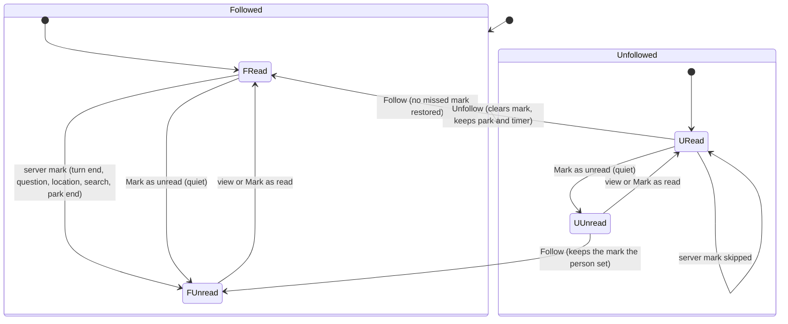
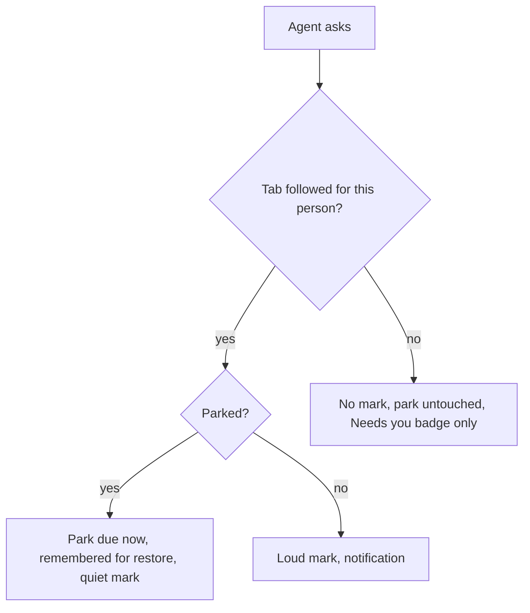

# Folded cards, in-card Shared groups and per-tab Follow - Plan

## Goal Capsule

- **Objective:** A person's tab strip shows only what they asked to watch. A folded card shows nothing but the tab in view, each space's Shared tabs sit inside that space's card, and a tab they unfollow never gets an unread mark from the server, so it does not turn unread, count or notify unless they mark it unread themselves.
- **Means:** Gate the server's two mark writers on a per-person `unfollowed` flag in `web_tab_attention` (KTD1, KTD2), after the tab-attention model is extended and passes TLC (KTD6). Reshape the Web strip in `internal/rocketclaw/web/src/ui.tsx` (KTD4, KTD5).
- **Authority:** User decisions in the Product Contract's Key Decisions win on behavior. KTDs win on mechanism. `AGENTS.md` and `docs/packs/formal-modeling/stateful-design.md` bind every unit.
- **Execution profile:** One pull request. Follow chain: U1 gates U2, then U3, then U4. Strip chain: U5, then U6. The strip chain needs nothing from the Follow chain and goes ahead even if the model gate blocks. U7 goes last.
- **Stop conditions:** If TLC cannot run, does not finish, or fails a required check (U1), stop U2 to U4 and report BLOCKED / NOT VERIFIED. U5 and U6 still land. Stop if a CLOC budget would be exceeded rather than trimming features. Stop if evidence shows a Key Decision below cannot work.
- **Who finishes:** `ce-work` implements and verifies locally. The calling `lfg` run reviews, commits, pushes and opens the PR.

---

## Product Contract

### Summary

Folding a space card hides all its tabs except the tab in view. The separate per-server Shared card goes away: each space card opens with a grey, collapsible "Shared" group. Every tab gets a Follow / Unfollow menu item, and the server writes no unread mark for a tab the person unfollowed.

### Problem Frame

Today a folded card still lists every tab that waits for the person or asks them something, so folding does not quiet a busy space. Shared tabs live in their own card per server, apart from the space they belong to. A person also has no way to say a tab does not matter to them: every turn end, question, finished search or park end on it turns it bold, counts it in the window title and the card heading, and can raise a desktop notification. The 2026-11-09 tab-attention design retired Mute and the old "followed" rule. Follow brings back a per-tab choice, deliberately, with a narrower meaning: whether the server marks the tab unread for this person.

### Requirements

**Folded cards**

- R1. A folded space card lists none of its tabs, its Shared group included, except the tab in view when that tab belongs to the card. The tab in view keeps its group header or Shared header above it.
- R2. A card heading counts the card's unread tabs: its own tabs and its Shared rows that carry an unread mark and are not parked. The count shows whether the card is folded or not.
- R3. Collapsed tab groups behave as today: bold name while a hidden tab is unread, Needs you while a hidden tab asks, and only the tab in view is listed.

**Shared inside space cards**

- R4. The per-server Shared card is removed. Each space card shows that space's Shared tabs as a grey "Shared" group at the top of the card, above the person's own tabs and groups, and hides the group while the space has no Shared tabs.
- R5. The Shared group collapses like a tab group: collapsed, it lists only the tab in view. Its name is bold while a hidden Shared row is unread, and it shows Needs you while a hidden Shared row asks.
- R6. Whether a space's Shared group is collapsed is the person's own choice. It is saved with their strip layout and is the same on every server's page and device.
- R7. Shared rows keep their current behavior: they open in their space, only their menu changes them for everyone, and dragging or Shift+Arrow reorders them for this person within their space.

**Follow**

- R8. Every tab's menu offers Unfollow on a followed tab and Follow on an unfollowed one. This covers sessions, Search pages, Cron, Pages and Shared rows, whether in a card or in Parked. With several tabs selected, it reads Unfollow while any of them is followed and acts on the followed ones. With only unfollowed tabs selected, it reads Follow and acts on each.
- R9. Follow is each person's own choice per tab, kept by the server, and the same on all their devices. Every tab starts followed.
- R10. The server writes no unread mark on a tab the person unfollowed. That covers turn ends, questions, messages to a paused agent, OpenCode turns and questions, cron and Pages marks, finished searches, and park ends. An unfollowed tab therefore never turns bold, counts or raises a notification because of a server mark. Only a mark the person sets (R13) does.
- R11. An unfollowed tab whose agent asks a question still shows Needs you on the tab, its group and its card, and on the Parked header and its space branch while the tab is parked, but it gains no mark, does not count, and does not notify.
- R12. Unfollowing a tab clears its current unread mark. Following it again does not bring back what was missed.
- R13. Mark as unread still works on an unfollowed tab. That mark is quiet, as today, and counts like any other mark, because the person set it.
- R14. A question does not end a park on an unfollowed tab. A park on an unfollowed tab that ends for any other reason ends without a mark.

### Key Decisions

- **A folded card hides everything but the tab in view and keeps its counter.** Governs R1, R2. (session-settled: user-directed — chosen over keeping waiting and asking tabs listed when folded: the person wants folding to quiet the card)
- **Collapsed tab groups keep their current behavior.** Governs R3. (session-settled: user-directed — chosen over applying the new fold rule to groups: groups already hide what they hold)
- **Follow controls unread marks.** Governs R10, R12. (session-settled: user-directed — chosen over Follow controlling only notifications or only folded-card visibility: one switch for "this tab does not matter to me")
- **Follow is each person's own, server-side.** Governs R9. (session-settled: user-directed — chosen over a choice shared by everyone who sees the tab: attention is per person)
- **A question on an unfollowed tab stays silent but shows Needs you.** Governs R11. (session-settled: user-directed — chosen over still marking and notifying, and over hiding the badge too: the agent is really blocked, so the badge stays)
- **Drop the per-server Shared card and put Shared inside each space card as a grey collapsible group at the top.** Governs R4, R5, R6. (session-settled: user-directed — chosen over keeping a Shared card with the new fold rule, and over an ungrouped Shared strip with only a grey rule: Shared belongs with its space)
- **Unfollowing clears a current mark, Mark as unread still works, and a question does not end a park on an unfollowed tab.** Governs R12, R13, R14. (session-settled: user-approved — chosen over keeping an existing mark and over letting a question unpark an unfollowed tab: matches "stay silent")
- **Shared rows get Follow and follow the fold rule.** Governs R1, R8. (session-settled: user-approved — chosen over leaving Shared rows out of Follow: one rule for every tab)

### Scope Boundaries

- Not built: a per-person "unfollow everything by default" setting. Every tab starts followed (R9).
- Not built: a change to auto-park on send. An unfollowed session that auto-parks still parks until it is done, and that park ends silently (R14, Assumption A3).
- Not built: cleanup of stale `#shared` keys in saved layouts. `place()` already carries unknown order keys and the fold map ignores unknown keys, and AGENTS.md forbids migration code for removed behavior.
- Not built: de-duplicating a path that is both the person's own tab and a Shared row of the same space. It shows in both lists of the card, as both rows already light up today (Assumption A5).
- Not built: changes to Parked beyond the Follow menu item and the Needs you badge on its header and space branches (R11). Parked keeps its fold, tree and rows.

---

## Planning Contract

### Key Technical Decisions

- KTD1. **One `unfollowed BOOLEAN NOT NULL DEFAULT FALSE` column on `web_tab_attention`.** It fits proto3's false default and needs no person-level setting or COALESCE. Migration `105_web_tab_unfollowed.sql` follows `090_web_auto_park.sql` with a Down step. The idle-row delete in `ChangeAttention` must also require `NOT unfollowed`, or the row, and the choice, vanish when Unfollow clears the mark. Governs R9.
- KTD2. **Gate the two mark writers, nothing else.** Every server mark except the park-end mark goes through `markTabsSQL` (`internal/rocketclaw/backend/attention.go`): turn end, question, paused message, OpenCode sync, `markLocation`, `MarkSearchFinished`. Its `ON CONFLICT DO UPDATE` gains a `WHERE NOT a.unfollowed`, which skips the mark, note, quiet flag and a question's park break together. An unfollowed tab always has a row (KTD1), so the insert branch never reaches it. `wakeDue` keeps `unread_at`, `quiet` and `note` unchanged for an unfollowed row while still ending the park and restoring a closed tab. Governs R10, R11, R14.
- KTD3. **New attention actions `follow` and `unfollow` in `ChangeAttention`.** They reach every tab kind except `group:` paths, which `changeAttention` already refuses. `unfollow` sets the flag and clears `unread_at` and `note`. `follow` clears the flag. Both join the `until` keep-list and the `resumes` keep-list beside `auto_park`, so a timed park, a park until it is done, or a park a question ended survives the toggle. Governs R8, R12.
- KTD4. **The card counter counts unread marks only.** `cardWork` returns waiting paths for the count and computes `asking` over all of the card's paths, not just counted ones. An unmarked asking tab therefore shows Needs you but never counts, without the browser needing the follow flag for counting. See Assumption A1. Governs R2, R11.
- KTD5. **The Shared group is its own component inside `SpaceCard`, with its own tablist.** It sits outside `CardTabs`' `data-card` tablist, so `selected()`'s one-stop-per-card query and refocus keep working. It drags under its own key (`${cardKey}#shared`), not the card's. It reuses the existing fold key `${server}#shared/${spaceId}`, so people keep their current per-space Shared folds. A separate component also keeps `SpaceCard` under react-doctor's complexity limit (`docs/solutions/best-practices/react-doctor-complexity-limit-shapes-web-components.md`). Governs R4, R5, R6, R7.
- KTD6. **Extend the existing tab-attention model, then build.** `docs/verification/tab-attention/TabAttention.tla` already models marks, parks, questions and park ends. Follow changes those transitions, so the model gains a follow flag and passes TLC before any server code changes (pack: formal-modeling, stateful-design.md). The fold and Shared-group changes are layout only and outside that gate: they change no persisted state transitions, only how the browser lists rows.
- KTD7. **The follow flag reaches the browser on the rows it already reads.** `Session.unfollowed` (proto field 41) for session tabs and `TabAttention.unfollowed` (field 7) for other tabs. `AttentionAction` gains `FOLLOW = 8` and `UNFOLLOW = 9`. Both listing branches in `store.go` (local and remote) carry the flag. `ListSessions` decides what to resend by hashing each encoded row (`changed` in `frontend/rpc/server.go`), so a toggled flag reaches every window without extra work. Follow and Unfollow are separate actions, not a toggle, so a window with a stale label cannot undo another window's choice. Governs R8.

### High-Level Technical Design

How Follow changes one tab's attention, for one person. Only the marked transitions are new. The rest is the existing design.

How a question treats a parked tab:

### Model changes (U1)

Directional, not a specification of the PlusCal text.

- **New constants:** `FollowGates` (TRUE is the built shape; FALSE means the server ignores Follow) and `MaxFollowMoves` (bound on Follow/Unfollow toggles).
- **New variables:** `followed` and `followMoves`. `followed` may start either way (`followed \in BOOLEAN`), since an unfollowed start equals an Unfollow at time 0, so both follow `_POSSIBLE` states stay reachable with one move. **New ghost variables:** `markedUnfollowed` (a server step wrote a mark while unfollowed), `poppedUnfollowed` (a window raised a pop-up while unfollowed) and `unfollowedParkBroken` (a question changed an unfollowed park).
- **New Person steps:**
  - Unfollow: `Clear()`, drop `hold`, keep park, timer and `resume`.
  - Follow: enabled only while unfollowed. No mark change.
  - Unfollow is enabled only while followed.
  - Both are bounded by `MaxFollowMoves`.
- **Gated steps:** the turn-end, news and question writes, and the `TimerJobs` wake write, skip `Write`/`ParkedWrite` when `FollowGates /\ ~followed`. The question step also leaves `timer`, `jobs` and `resume` alone in that case. With `FollowGates = FALSE` they write as today and set `markedUnfollowed`.
- **Manual Mark as unread** stays ungated (R13).
- **New invariants:**
  - `NoMarkWhileUnfollowed == ~markedUnfollowed`
  - `NoPopWhileUnfollowed == ~poppedUnfollowed`
  - `QuestionLeavesUnfollowedPark == ~unfollowedParkBroken`
- **Existing properties** must all still hold.
- **New `_POSSIBLE` states:**
  - `UnfollowedParkAsked`: parked, unfollowed, asking.
  - `PopsAfterRefollow`: a pop-up after a Follow move.
  
  These show both branches are reached.
- **Checks:**

| Check | World | Must |
|---|---|---|
| `one-window` | existing world plus `MaxFollowMoves = 2` | pass every invariant, property and `_POSSIBLE` |
| `two-windows` | existing world plus `MaxFollowMoves = 2` | pass every invariant, property and `_POSSIBLE` |
| `fail-old-turn-end` | unchanged, `MaxFollowMoves = 0` | find `DoneEndsOnlyWhenIdle` violated |
| `fail-follow-ignored` | `one-window` with `FollowGates = FALSE` | find `NoMarkWhileUnfollowed` violated |

If a world does not finish in reasonable time, lower `MaxFollowMoves` to 1 in that world and record the reduction in the README.

**Model to code map:**

| Model step | Code |
|---|---|
| Unfollow / Follow | `ChangeAttention` `unfollow` / `follow` (KTD3) |
| Gated turn-end, news and question writes | `markTabsSQL` `WHERE NOT a.unfollowed` (KTD2) |
| Gated `TimerJobs` write | `wakeDue` keeping the mark fields for unfollowed rows (KTD2) |
| `IdleEnds` and `Restores` | unchanged `tickParks` statements |

### Assumptions

These are agent bets, not confirmed with the user:

- A1. The card counter counts unread marks only, following the user's "show a counter of unread messages". A followed tab that asks and is then read no longer counts. It still shows Needs you.
- A2. A failed turn, an idle session or a timer still ends a park on an unfollowed tab. The park ends without a mark, and a closed tab still comes back.
- A3. Auto-park on send is unchanged for unfollowed sessions.
- A4. Follow and Unfollow keep a park's timer and a park a question ended, as the auto-park toggles do.
- A5. A path that is both the person's own tab and a Shared row of the same space appears in both the Shared group and the card's own list.
- A6. The Follow item sits in the attention section of the menu, after Park and Auto-park. With mixed targets it reads Unfollow and acts on the followed ones. With only unfollowed targets it reads Follow.
- A7. On a folded card whose tab in view is a Shared row of that space, the Shared header and that row show, and nothing else does.

### System-Wide Impact

- **Protocol:** changing `web.proto` changes the protocol hash, so a remote RocketClaw on the old protocol shows as `foreign` until it is upgraded, as with every proto change.
- **Database:** migration 105 adds a column. Older binaries refuse to start against a database that has applied it (`unknown migration in database`), as with every migration.
- **Listings:** `SidebarSession` and `Attention` gain one boolean. Watch `TestSidebarSessionsAllocationBudgets`, `TestSidebarFingerprintAllocationBudget` and `TestQuietSessionRefreshSize`.
- **Notifications, window title count and Cmd/Ctrl+Shift+A** read marks only, so R10 makes them right with no browser change.

### Risks

- **A lost Follow choice.** If any statement deletes an unfollowed row, the next mark lands. `ChangeAttention`'s idle delete is the only production delete (KTD1), and a test covers Unfollow on an idle tab.
- **Model run time.** Both worlds took 6 to 8 minutes before. A follow flag multiplies states. Fall back to `MaxFollowMoves = 1` per world and record it. Both follow `_POSSIBLE` states stay reachable with one move, because the model may start unfollowed.
- **react-doctor complexity.** `SpaceCard` and `attentionItems` grow. Keep the Shared group and the Follow item in their own component or function (KTD5).
- **Browser tests that find tablists by name.** The "Shared tabs" tablist name changes per space. Update the `shared(page)` helper once rather than each call.

---

## Implementation Units

### U1. Model Follow in the tab-attention spec and check it with TLC

- **Goal:** The tab-attention model covers Follow and passes TLC before server work starts. Status: pending until TLC passes.
- **Requirements:** R10, R11, R12, R13, R14. KTD6.
- **Dependencies:** none.
- **Files:**
  - `docs/verification/tab-attention/TabAttention.tla`
  - `docs/verification/tab-attention/one-window.cfg`
  - `docs/verification/tab-attention/two-windows.cfg`
  - `docs/verification/tab-attention/old-turn-end.cfg`
  - new `docs/verification/tab-attention/follow-ignored.cfg`
  - `docs/verification/tab-attention/Makefile`
  - `docs/verification/tab-attention/README.md`
- **Approach:**
  1. Edit the PlusCal algorithm, outside the translation markers, as "Model changes (U1)" describes.
  2. Add the new constants to every `.cfg`. Add the new invariants, `_POSSIBLE` states and `MaxFollowMoves` to the two built worlds.
  3. Add a `fail-follow-ignored` target that requires TLC exit 12 or 13 and `Invariant NoMarkWhileUnfollowed is violated`.
  4. Translate with `make translate`, then run every check.
  5. Fix any counterexample in the design, not by weakening a property.
  6. Record the run in the README: command, properties, bounds, TLC and Java versions, outcome, state counts and run time. Add the Follow lines to "What each check proves" and "Limits".
- **Patterns to follow:**
  - The `EndsAtIdle` switch and `fail-old-turn-end` target, as the precedent for a switch with a must-fail check.
  - The pack's "When the pinned jar no longer matches" procedure if the download fails its checksum.
- **Test scenarios:**
  - `one-window` and `two-windows` pass every invariant and property, and reach every `_POSSIBLE` state, including `UnfollowedParkAsked` and `PopsAfterRefollow`.
  - `fail-follow-ignored` finds `NoMarkWhileUnfollowed` violated.
  - `fail-old-turn-end` still finds `DoneEndsOnlyWhenIdle` violated.
- **Verification:** `make -C docs/verification/tab-attention` exits 0, and the README records the run. If TLC cannot run or fails, stop: BLOCKED / NOT VERIFIED.

### U2. Server: unfollowed column, gated marks and Follow actions

- **Goal:** The server keeps each person's Follow choice per tab and writes no mark on unfollowed tabs.
- **Requirements:** R9, R10, R11, R12, R13, R14. KTD1, KTD2, KTD3.
- **Dependencies:** U1.
- **Files:**
  - new `internal/rocketclaw/backend/migrations/105_web_tab_unfollowed.sql`
  - `internal/rocketclaw/backend/attention.go`
  - `internal/rocketclaw/backend/store.go`
  - `internal/rocketclaw/backend/attention_test.go`
  - `internal/rocketclaw/backend/store_schema_test.go`
  - `internal/rocketclaw/backend/store_summaries_test.go`
- **Approach:**
  1. Add the migration with Up and Down, and append it to both ledger lists in `TestInitializeSessionDBAdoptsReleasedStore`.
  2. Add `AttentionFollow` and `AttentionUnfollow`. In `ChangeAttention`: insert and update the flag, clear the mark on `unfollow`, add both actions to the `until` and `resumes` keep-lists, and add `NOT unfollowed` to the idle delete.
  3. Add the `WHERE NOT a.unfollowed` guard to `markTabsSQL`'s update.
  4. In `wakeDue`, leave `unread_at`, `quiet` and `note` unchanged for unfollowed rows.
  5. Add `Unfollowed` to `Attention`. Select it in `TabAttention` and in both branches of the sidebar listing.
- **Patterns to follow:** per-tab `auto_park` end to end (migration 090, `ChangeAttention`, `store.go` reads), and `TestAttentionMatrix`'s seeded rows. SQL stays CTE-only, with no subqueries.
- **Test scenarios:** extend `TestAttentionMatrix`, or add one table-driven test beside it, over a session tab and `/cron`:
  - An unfollowed tab gets no mark from a turn end, a cron or Pages location mark, or a finished search.
  - An unfollowed session gets no mark when its agent asks, and its park keeps its timer, with no `resumes`.
  - A timed park on an unfollowed tab that comes due ends without a mark and still restores a closed tab.
  - Unfollow on an unread, unparked tab clears the mark and keeps the row. A later turn end leaves it unmarked.
  - Follow again: the next turn end marks it.
  - Mark as unread on an unfollowed tab sets a quiet mark.
  - Unfollow on a timed park and on a park a question ended keeps `until` and `resumes`.
  - The sidebar listing and `TabAttention` report `Unfollowed` for both a session and a location row (`store_summaries_test.go`).
  - The migration ledger includes 105, and Down drops the column.
- **Verification:** the backend tests above pass. The gocyclo limit and the Go CLOC budget hold.

### U3. API: Follow actions and flag on the wire

- **Goal:** The browser can send Follow / Unfollow and reads each tab's flag.
- **Requirements:** R8, R9. KTD7.
- **Dependencies:** U2.
- **Files:**
  - `internal/rocketclaw/web/proto/web.proto`
  - generated `internal/rocketclaw/frontend/rpc/web.pb.go` and `protocol.gen.go`
  - `internal/rocketclaw/frontend/rpc/tabs.go`
  - `internal/rocketclaw/frontend/rpc/server.go`
  - `internal/rocketclaw/frontend/rpc/tabs_test.go`
  - `internal/rocketclaw/frontend/rpc/sidebar_test.go`
  - `internal/rocketclaw/web/src/types.ts`
- **Approach:**
  1. Add `FOLLOW = 8` and `UNFOLLOW = 9` to `AttentionAction`, with field comments. Add `Session.unfollowed = 41` and `TabAttention.unfollowed = 7`.
  2. Regenerate with `go generate` in `frontend/rpc`.
  3. Map the actions in the `tabs.go` action map, and the flag in `server.go`'s session and tab-attention mapping.
  4. Add `unfollowed?` and the two actions to the TS types.
- **Patterns to follow:** `AUTO_PARK` / `STOP_AUTO_PARK` and `Session.auto_park`.
- **Test scenarios:**
  - `TestTabs`: FOLLOW and UNFOLLOW on a session path and a `/cron` path change the listing's flag.
  - `TestTabs`: a `group:` path is refused.
  - `TestQuietSessionRefreshSize`: still under its size limit with the flag set.
- **Verification:** the rpc tests pass, and `go test ./...` passes.

### U4. Web: Follow menu item and Needs you on Parked

- **Goal:** Every tab menu offers Follow or Unfollow, and Parked shows Needs you for a hidden asking row.
- **Requirements:** R8, R11. Assumption A6.
- **Dependencies:** U3.
- **Files:**
  - `internal/rocketclaw/web/src/ui.tsx`
  - `internal/rocketclaw/web/src/session-list.ts`
  - `internal/rocketclaw/web/src/session-list.test.ts`
  - `internal/rocketclaw/web/src/tabs.browser.test.ts`
- **Approach:**
  1. `rowAttention` copies `unfollowed`. `listedTabs` in `session-list.ts` also keeps rows whose `unfollowed` is set. Otherwise an unmarked, unfollowed location row never reaches `view.marks`, and its menu could never offer Follow.
  2. `attentionItems` adds a `follow` or `unfollow` item for every tab kind.
  3. `menuSections` and the Shared-row filter in `menuItems` accept the new keys, so Shared and parked Shared rows keep the item.
  4. The Parked header and each Parked space branch show Needs you while a hidden parked row asks, as a collapsed group does.
  5. The `tabsCall` mock in the browser test learns FOLLOW and UNFOLLOW.
- **Test scenarios:**
  - A session tab's menu shows Unfollow. Choosing it sends UNFOLLOW, and the menu then shows Follow.
  - A `/cron` tab and a Shared row each offer Unfollow.
  - Unfollow on an unmarked `/cron` tab turns its menu label to Follow, and choosing Follow sends FOLLOW. `session-list.test.ts` covers `listedTabs` keeping the row.
  - Multi-select of a followed and an unfollowed tab shows Unfollow and sends it for the followed one only.
  - An unfollowed, auto-parked session whose agent asks shows Needs you on the folded Parked header.
  - A listing update that flips a tab's `unfollowed` flag changes its menu label from Unfollow to Follow without a reload.
- **Verification:** the browser tests pass, and `make lint` (react-doctor) passes.

### U5. Web: folded card lists only the tab in view

- **Goal:** Folding a card hides every tab except the tab in view, and card counters count unread tabs only.
- **Requirements:** R1, R2, R3, R11. KTD4. Assumption A1.
- **Dependencies:** none (pure Web).
- **Files:**
  - `internal/rocketclaw/web/src/ui.tsx`
  - `internal/rocketclaw/web/src/tabs.browser.test.ts`
- **Approach:**
  1. `SpaceCard`'s folded filter keeps only the tab in view.
  2. `cardWork`'s count uses waiting paths only, and its `asking` reads over all of the card's paths.
  3. A shown group header takes bold and Needs you from every row of its group that the strip does not list, whether the group's collapse or the card's fold hides it.
  4. Rewrite the existing folded-card browser test that asserts "only its waiting tabs and the one in view" instead of adding a parallel test.
- **Test scenarios:**
  - A folded card with an unread tab, an asking tab and other tabs lists nothing when the tab in view is in another card. Its counter still shows the unread tab.
  - Opening one of its tabs through the palette lists only that tab, with its group header when it is grouped.
  - Unfolding lists every tab again.
  - In a folded card whose tab in view is grouped, the group header is bold for another unread tab of that group and shows Needs you for another asking tab of it.
  - An asking tab with no mark shows Needs you on the card heading and does not count. An unread tab counts.
  - A collapsed group in an unfolded card is unchanged: it lists only the tab in view, has a bold name and shows Needs you.
- **Verification:** the rewritten browser test passes.

### U6. Web: Shared group inside each space card

- **Goal:** The per-server Shared card goes away, and each space card shows its Shared tabs as a grey collapsible group at the top.
- **Requirements:** R1, R4, R5, R6, R7. KTD5. Assumptions A5, A7.
- **Dependencies:** U5.
- **Files:**
  - `internal/rocketclaw/web/src/ui.tsx`
  - `internal/rocketclaw/web/src/tabs.browser.test.ts`
  - `internal/rocketclaw/web/src/notifications.browser.test.ts`
- **Approach:**
  1. Move `SharedCard`'s list into a per-space Shared group component, rendered by `SpaceCard` above `CardTabs`.
  2. Give the group a grey pill header that takes bold and Needs you from every Shared row the strip does not list, whether the group's collapse or the card's fold hides it, folding under `${server}#shared/${spaceId}`.
  3. Give it its own tablist and its own drag key. Keep the existing keyboard handling, reorder and menus.
  4. Drop the `#shared` card entry from `Cards`, and delete `SharedCard`.
  5. Count Shared rows in the card's counter and `asking`.
  6. When the card is folded, the group shows only when the tab in view is one of its rows. "In view" keeps the current space check (`active(space, path)`), so a path in view in space B never counts as in view in space A's card.
- **Test scenarios:**
  - A space with Shared tabs shows a grey "Shared" group at the top of its card, and a space without them shows none.
  - Two spaces each show only their own Shared tabs.
  - Collapsing the Shared group saves `#shared/<space>` in the layout and lists only the tab in view. Its name goes bold for a hidden unread row and shows Needs you for a hidden asking row.
  - Dragging and Shift+Arrow reorder Shared rows within the group only. Dragging a Shared row onto an own tab does nothing.
  - Remove from Shared drops the row, and the group hides when empty.
  - A remote server's space card shows that server's Shared group.
  - Use a space other than Main, per `docs/solutions/logic-errors/web-tab-state-holds-a-placeholder-main-space-before-its-first-load.md`.
  - Rewrite the Shared-card tests rather than adding new ones: "Shared card counts…", "lists every space's Shared tabs…", and the multi-server `work#shared` order test. Update the `shared(page)` helper.
- **Verification:** the browser tests pass, `make lint` (react-doctor) passes, and the TS CLOC budget holds.

### U7. Docs

- **Goal:** Project docs describe the new strip and Follow.
- **Requirements:** all.
- **Dependencies:** U4, U5, U6.
- **Files:**
  - `CONCEPTS.md`
  - `README.md`
  - `internal/rocketclaw/web/README.md`
  - `docs/specs/2026-11-09-tab-attention-design.md`
- **Approach:**
  1. `CONCEPTS.md`: rewrite Space (folded card, Shared inside cards), Shared Group (no Shared card), Unread (unfollowed tabs are never reached) and Parked (a question does not end an unfollowed tab's park).
  2. Add a Follow entry that says it differs from the retired "followed" rule.
  3. Update the root `README.md` strip line and the Web README card, Shared and attention sections.
  4. Add a dated addendum to the tab-attention spec.
- **Test expectation:** none — documentation only.
- **Verification:** no doc mentions a Shared card or a folded card listing waiting tabs.

---

## Verification Contract

| Gate | Command | Applies to |
|---|---|---|
| Model | `make -C docs/verification/tab-attention` | U1, and again if U2 changes a transition |
| Go format | `gofmt -l` on touched Go files is empty | U2, U3 |
| Go tests | `go test ./...` | U2, U3 |
| Repo lint | `make lint` | all |
| Repo tests and CLOC | `make test` (runs the Go and TS CLOC budget checks) | all |
| Web lint and react-doctor | `make -C internal/rocketclaw/web lint` | U4, U5, U6 |
| Web tests | `make -C internal/rocketclaw/web test` | U4, U5, U6 |

---

## Definition of Done

- Every requirement R1 to R14 is covered by a passing test or the model check.
- U1's README records a passing run of every check, including the must-fail checks.
- The migration ledger, proto, generated code and TS types agree.
- No `SharedCard`, `#shared` card entry or folded "waiting" filter remains in `ui.tsx`.
- No source comments added, per AGENTS.md. No `//nolint` and no budget edits.
- No dead or experimental code from abandoned attempts remains in the diff.
- README impact considered: `README.md` and `internal/rocketclaw/web/README.md` updated (U7).
