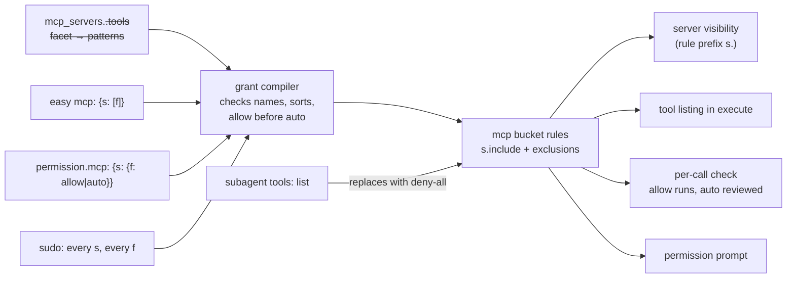

# MCP Server Facets - Plan

## Goal Capsule

- **Objective:** An operator can hand any agent a named, bounded slice of an outside MCP service (for example "read Stripe freely, review every Stripe write"), and no agent reaches an MCP tool the operator did not grant it by name.
- **Means:** Server facets compile into the existing `mcp` permission bucket through one grant compiler shared by every agent kind (KTD3, KTD5).
- **Product authority:** The decisions in this Product Contract were made with the user in a brainstorm on 2026-11-19. Outbound MCP client work outside facets and grants (connections, results, credentials, sandboxing) is not active scope.
- **Execution profile:** One pull request in this repository. Wallace overlay PRs are opened only if U8's check finds an agent file that needs one.
- **Stop conditions:** Stop and report if U8 finds Wallace's config fails the new validation or a Wallace agent cannot keep the MCP tools it has used under R1-R11, or if the Go or TypeScript source CLOC budget would be exceeded.
- **Who finishes:** The implementing agent opens the PR; the user merges it and deploys Hally and Wallace with the hand edits U8 lists.
- **Open blockers:** None.

---

## Product Contract

### Summary

Each configured MCP server declares any number of named facets, each a list of tool-name patterns. Easy and advanced agents get MCP tools only by naming a server and its facets; advanced agents also pick a review level per facet. Sudo agents get every facet. Everything else that grants MCP access by raw tool name goes away.

### Problem Frame

Operators want agents such as a `business-accountant` to use an outside service like Stripe with clear limits: some tools freely, some only after review, the dangerous ones never.

Today each `mcp_servers` entry has exactly two fixed groups, `tools.read` and `tools.write` (`internal/rocketclaw/config/config.go:145-160`), and only easy agents can refer to them (`internal/rocketclaw/harness/easy.go:246-279`). Advanced agents must write raw `server.tool` wildcard rules in their `mcp` permission bucket. An easy agent whose file never mentions MCP, or that writes `mcp: auto`, gets every tool of every server, and `{server: auto}` reaches tools in no group. A `sudo` group cannot exist, and a new server silently becomes available to every easy agent that left `mcp:` out.

In production, Wallace runs one server (`gog_gene`, Google Workspace) with `read` and `write` groups that three Ruzuku easy agents use as `gog_gene: [read, write]`; its `voice` easy agent leaves `mcp:` out and so holds every `gog_gene` tool without ever having called one. Hally runs a `memory` server that `main`, `main-slack`, `sudo`, and `sudo-slack` reach through raw `mcp` rules such as `"memory.*": allow`.

### Key Decisions

- **Facet names are free-form and unlimited.** Operators name facets for their service (`read`, `write`, `sudo`, `refunds`). Governs R1. (session-settled: user-directed — chosen over the two fixed groups read and write: operators need more than two slices, such as sudo.)
- **Facets may overlap.** `sudo: ["*"]` is valid next to `read` and `write`. Governs R3. (session-settled: user-directed — chosen over one facet per tool: "everything" facets must be expressible without enumerating tools.)
- **Facet patterns are a list with `-` removals.** Governs R2. (session-settled: user-directed — chosen over a single `+`-joined string and a `+`/`-` string: the list already works today and stays readable.)
- **Removals win wherever they sit in the list.** Order never changes a facet's meaning; the cost is that a removed pattern cannot be partly re-added. Governs R2. (session-settled: user-approved — chosen over later-entries-win as agent permission rules do: easier to read for people.)
- **Agents refer to MCP only by facet name.** Governs R5, R6, R10. (session-settled: user-directed — chosen over keeping raw tool-name rules for advanced agents: one vocabulary for every agent.)
- **Advanced agents set a level per facet.** `allow` runs without review; `auto` sends each call to the permission reviewer. Governs R6. (session-settled: user-directed — chosen over a plain list with one level: reading freely while reviewing writes is the core use.)
- **MCP is always opt-in.** An agent that names no server and facet gets no MCP tools, in easy and advanced mode alike. Governs R7. (session-settled: user-directed — chosen over keeping "omitted means everything" and over "omitted means every facet": MCP servers hold real credentials.)
- **Sudo agents are the one exception.** They get every facet of every server without listing anything. Governs R8. (session-settled: user-directed — chosen over no exceptions: sudo agents such as the generated `main` should not need edits for each new server.)
- **When granted facets overlap at different levels, the more careful level wins.** A tool in both an `allow` facet and an `auto` facet is reviewed. Governs R6. This was not discussed with the user; it is the conservative reading of the per-facet levels and is easy to reverse.
- **Facets stay under the server's existing `tools` key.** Wallace's `gog_gene` config, which lives in AWS Secrets Manager, keeps working without an edit. Governs R1. (session-settled: user-approved — chosen over a new key: no production config change is needed to deploy.)
- **Secret references stay as they are.** The existing `{"aws":{"arn":…,"key":…}}` reference already works anywhere in `rocketclaw.json`, including MCP `env` and `headers` (`internal/rocketclaw/config/merge.go:27-66`). (session-settled: user-approved — chosen over adding references to secrets that hold a single plain string: the user can work with JSON secrets.)
- **Old-style agent files get no special handling.** A file naming an unknown server or facet fails to load through the normal check; an easy file with no `mcp:` line loads with no MCP. Governs R7, R9. (session-settled: user-directed — chosen over fail-to-load with a dedicated migration error and over silent loss alone: production agent files are fixed by PRs before merge instead, per R13.)

### Requirements

**Server facets**

- R1. Each `mcp_servers` entry may declare any number of named facets under its `tools` key, each mapping a facet name to a list of tool-name patterns.
- R2. A pattern uses only `*` (any text) and `?` (one character); an entry starting with `-` removes the tools it matches, and a tool belongs to a facet when it matches at least one entry without `-` and no entry with `-`.
- R3. Facets on the same server may match the same tool, and startup no longer rejects overlapping groups.

**Granting facets to agents**

- R4. Facet grants apply to every agent kind that has MCP settings today: easy agents, advanced agents, easy agents' approvers, and the agents subagents run as.
- R5. An easy agent grants MCP by listing facets per server, as in `mcp: {stripe: [read, write]}`, and those tools run at easy mode's existing review behavior.
- R6. An advanced agent grants MCP by giving each listed facet a level, `allow` or `auto`, as in `mcp: {stripe: {read: allow, write: auto}}`; a tool reached through several granted facets takes the most careful of their levels.
- R7. An agent whose file names no server and facet has no MCP tools, whatever servers are configured.
- R8. A sudo agent has every facet of every configured server without listing them, at the level sudo agents get today for unlisted permissions.
- R9. An agent file that names an unknown server or an unknown facet of a known server fails to load, with an error naming the agent, server, and facet.
- R10. Tools that match no facet of their server are unavailable to every agent, sudo agents included.

**Removed forms**

- R11. Raw `server.tool` MCP rules in advanced agents, dotted MCP tool names in subagent `tools:` lists, and the easy forms `mcp: auto` and `{server: auto}` are removed with their code, docs, and dedicated tests.
- R16. A subagent started with a `tools:` list has no MCP tools; one started without a list keeps its own agent's facets.

**Surfaces and docs**

- R12. The agent editor's MCP setting lists each configured server with its facet names, and its help text describes facets instead of fixed read and write groups.
- R13. The README documents `mcp_servers` facets and both agent grant forms, with a release note marking the removed forms as breaking; `CONCEPTS.md` entries that describe MCP access (such as Easy Agent's "a section its file leaves out turns on everything in it") are corrected for MCP.

**Rollout**

- R14. Before the change merges, every agent file Wallace loads (its workspace and each overlay repo) is checked against the new rules, and any file that would fail to load or lose an MCP tool it has used gets a PR in its owning repo, merged first.
- R15. The change's PR lists the hand edits Hally needs at deploy time, because any agent file that fails to load stops RocketClaw from starting: facets on Hally's `memory` server, facet grants in place of the raw `mcp` rules in `main`, `main-slack`, `sudo`, and `sudo-slack`, and deletion of the `context7.*` rules in `cron`, `sudo-anthropic`, and `sudo-anthropic-slack`, whose server is not configured.

### Acceptance Examples

- AE1. **Covers R1, R2, R6, R10.** **Given** Stripe facets `read: ["list_*", "get_*", "retrieve_balance", "-get_secret_*"]`, `write: ["create_*", "update_*"]`, `sudo: ["*"]`, and an advanced `business-accountant` with `stripe: {read: allow, write: auto}`, **when** it calls `list_invoices`, `create_refund`, `delete_customer`, and `get_secret_key`, **then** `list_invoices` runs without review, `create_refund` is reviewed, and `delete_customer` and `get_secret_key` are unavailable.
- AE2. **Covers R2.** **Given** a facet `["-delete_*", "*"]` and another `["*", "-delete_*"]`, **then** both contain every tool except those starting with `delete_`.
- AE3. **Covers R6.** **Given** an advanced agent with `stripe: {read: allow, sudo: auto}` and a tool `list_invoices` in both facets, **when** it calls `list_invoices`, **then** the call is reviewed.
- AE4. **Covers R7.** **Given** configured `stripe` and `gog_gene` servers and an easy agent whose file has no `mcp:` line, **then** the agent sees no MCP tools.
- AE5. **Covers R8, R10.** **Given** a sudo agent and a `stripe` server whose facets match every tool except `archive_account`, **then** the agent can use every faceted tool and cannot use `archive_account`.
- AE6. **Covers R9.** **Given** an agent with `stripe: [admin]` and no `admin` facet on `stripe`, **then** loading fails with an error naming the agent, `stripe`, and `admin`.
- AE7. **Covers R1, R5, R14.** **Given** Wallace's current `gog_gene` config with `tools.read` and `tools.write`, **then** `ruzuku-general-manager`, `deals-ruzuku`, and `deals-ruzuku-slack` load unchanged with the same `gog_gene` tools as today, and `voice` loads with none.
- AE8. **Covers R16.** **Given** an easy agent with `stripe: [read]` that delegates a `task` with `tools: ["bash"]`, **then** the subagent sees no MCP tools; the same delegation with no `tools` list sees the `read` facet.

### Scope Boundaries

- Secrets that hold a single plain string; OAuth login; per-agent credentials for a shared server.
- Reconnecting and relisting every visible server on each `execute` call.
- MCP results beyond text (images, files, structured content when text exists).
- Running stdio MCP servers inside the Emulated Shell sandbox.
- Reloading `mcp_servers` without a restart, and editing servers in the Web.
- A `deny` level for facets; not granting a facet already denies it.
- Per-call review of easy agents' MCP calls inside one approved `execute` script.
- Considered and not built: special handling for a server whose only facet is named `aws`, which the config loader reads as a secret reference and rejects at startup; the failure is loud and renaming the facet fixes it.
- Considered and not built: rejecting empty or removal-only facets; they compile to no rules and grant nothing, which the operator sees at first use.
- Considered and not built: per-facet reviewer names (`auto(name)`); levels are `allow` and `auto` per R6, and a reviewer per facet would make the reviewer depend on facet order when facets overlap.
- Considered and not built: a dry-run command that validates agent files against a new binary; U8 does the one check this rollout needs.

### Dependencies / Assumptions

- Wallace's `gog_gene` server config lives in AWS Secrets Manager, not a repo. With R1 keeping the `tools` key, it needs no change.
- As of 2026-11-19, the only Wallace agents that call `gog_gene` are `deals-ruzuku` and `ruzuku-general-manager`; `voice` never has. No Wallace agent uses raw MCP rules or dotted `tools:` entries.
- The change touches permission compilation, not connection, retry, or crash-recovery state, so no formal state model is required (pack: formal-modeling, stateful-design.md).
- Any top-level agent file that fails to load stops RocketClaw from starting (`internal/rocketclaw/backend/app.go:434`). Old-form agent files fail on the new binary and new-form files fail on the old one, so Hally's agent edits land together with the deploy.
- All seven of Hally's MCP-using agents are advanced agents without `sudo:`, so none is covered by R8.

### Sources / Research

- Grounding notes from this brainstorm: `internal/rocketclaw/config/config.go:138-160,519-555` (server config and the overlap check), `internal/rocketclaw/harness/easy.go:235-280` (easy `mcp:` compilation), `internal/rocketclaw/harness/mcp_tools.go:32-70,213-276` (server visibility and per-tool filtering), `internal/rocketclaw/harness/tools.go:186-208` and `internal/rocketclaw/harness/tasks.go:270` (`tools:` narrowing), `internal/rocketclaw/harness/permission.go:347-539` (rule evaluation and `*`/`?` matching), `internal/rocketclaw/harness/permission_gate.go:79-88` (per-call review of nested `auto` calls), `internal/rocketclaw/harness/agent_settings.go:89-91`, `internal/rocketclaw/backend/bridge.go:2942`.
- Prior designs: `docs/plans/2026-08-08-001-mcp-code-mode-plan.md`, `docs/specs/2026-10-30-easy-mode-agents-design.md` (lines 105-110 define today's easy `mcp:` forms).
- Planning research for this plan: `internal/rocketclaw/harness/agents.go:262-268` (sudo skips `permission:`), `internal/rocketclaw/harness/permission.go:142-250,404-442` (parsing and last-match-wins), `internal/rocketclaw/harness/skills.go:327-364` (permission prompt), `internal/rocketclaw/harness/rocketcode.go:181` (permission set copy), `internal/rocketclaw/frontend/rpc/server.go:1242-1258` and `internal/rocketclaw/web/proto/web.proto:581-597` (config view), `internal/rocketclaw/web/src/agent-editor/model-picker.tsx:31` (editor control fed by the config query), `docs/solutions/` learnings on react-doctor limits and on keeping permission review requests stable.

**Product Contract preservation:** changed R11 and added R16 — the subagent `tools:` list now removes MCP instead of narrowing it, because research showed "no longer narrows" would hand subagents every parent facet; R15 corrected to cover all seven Hally agents after research showed none is sudo and a failed load stops startup. AE8 added for R16. Outstanding Questions resolved in KTD6, KTD2, and KTD12.

---

## Planning Contract

### Key Technical Decisions

- KTD1. **Facets are a name-to-patterns map under the server's `tools` key.** `encoding/json` v1 decodes Wallace's existing `{"read": [...], "write": [...]}` unchanged, and the fixed two-field groups type goes away. Agent loading receives server → facet → patterns. Covers R1 (inherits the user-approved Key Decision to keep the `tools` key).
- KTD2. **Config validation closes the silent cases.** Facet names use letters, digits, `_`, and `-`. Patterns, after an optional leading `-`, use MCP tool-name characters (letters, digits, `_`, `-`, `.`, `/`) plus `*` and `?`, which rejects `${...}` text that permission interpolation would rewrite in only some rules. Server names no longer allow `.`, so `server.` prefixes are unambiguous; no production server name has one. The read/write overlap check is deleted. Covers R1-R3.
- KTD3. **Removals compile into a per-rule exclusion list.** Each facet becomes one `mcp` rule per pattern without `-`, each carrying all of that facet's removals; evaluation skips a rule when an exclusion matches. Plain last-match-wins rules cannot express "removals win" when two facets overlap (`["*","-p*"]` with `["*","-q*"]`). Rejected: deciding membership at tool-listing time, which needs facet config inside the harness and a second per-call check path. Covers R2.
- KTD4. **Rules are emitted allow facets first, then auto facets, each in sorted server and facet order.** Under last-match-wins the more careful level wins on overlap, and sorted output keeps the system prompt stable across turns. Covers R6.
- KTD5. **One grant compiler serves every agent kind.** Easy agents, easy approvers, advanced agents, and sudo agents each build a server → facet → level grant and hand it to one function that checks names against the configured facets and appends rules. Unknown names fail with the caller's existing error prefix (`mcp: …` for easy, `parse permission: permission "mcp": …` for advanced). Covers R4-R9.
- KTD6. **Advanced grants live under `permission.mcp` as `{server: {facet: allow|auto}}`.** Permission parsing leaves the `mcp` key to the agent loader, which compiles it with config. Old raw rules such as `"memory.*": allow` then fail as an unknown server without special code, and sudo agents, which never read `permission:`, ignore the key. A scalar `mcp` value, `deny`, and `auto(name)` fail. Covers R6, R9, R11.
- KTD7. **Sudo agents get a leading `mcp` deny-all rule, then every facet of every server at `auto`.** The sudo shortcut in server visibility goes away. Covers R8, R10.
- KTD8. **A server is visible when an `allow` or `auto` rule in the `mcp` bucket starts with `server.`.** The bare-server, `*`, `*.x`, and blank pattern forms disappear with the raw rules. Covers R7, R10.
- KTD9. **A subagent `tools:` list replaces the `mcp` bucket with one deny-all rule.** Appending the deny after the parent's rules, as today, would leave every server visible. Task validation stops accepting dotted names, and the `task` description stops mentioning them. Covers R16, R11.
- KTD10. **Permission review requests keep `server.tool` subjects, and the reviewer prompt is unchanged.** Naming facets in review requests would need matching reviewer-prompt changes tested against the real reviewer model (learning: permission-review request wording). Covers R6.
- KTD11. **The permission prompt shows exclusions, and the sudo sentence says outside MCP tools follow the MCP rules above.** Without both, the prompt tells the model about access it lacks. Covers R2, R8.
- KTD12. **The config view carries each server's facet names.** A new `ConfigView` field replaces the server-name list (old field number reserved). The Config page shows facets as chips, and the agent editor's MCP setting shows configured servers and facets from the existing config query, as the model picker does. Covers R12.
- KTD13. **Rollout loads every Wallace agent with the new loader before merge.** One bad file stops a server, so reading frontmatter by eye is not enough. Covers R14.

### High-Level Technical Design

### Assumptions

- R16's "a `tools:` list means no MCP" was decided during planning, not with the user; it keeps today's behaviour for lists without dotted names and fails closed. The PR body states it for review.
- Facet levels exclude `auto(name)` (see Scope Boundaries).

---

## Implementation Units

### U1. Server facets in config

- **Goal:** `mcp_servers` entries carry named facets that load, validate, and deep-clone.
- **Requirements:** R1, R2, R3; KTD1, KTD2.
- **Dependencies:** None.
- **Files:** `internal/rocketclaw/config/config.go`, `internal/rocketclaw/config/locked.go`, `internal/rocketclaw/backend/bridge.go`, `internal/rocketclaw/config/config_test.go`, `internal/rocketclaw/config/locked_test.go`, `internal/rocketclaw/backend/mcp_tools_test.go`, `internal/rocketclaw/backend/definitions_test.go`.
- **Approach:**
  1. Replace the two-field groups type with a facet map on `MCPServerConfig.Tools`, and replace `Config.MCPToolGroups()` with an accessor returning server → facet → patterns for agent loading.
  2. In `validateMCPServers`, add the KTD2 checks, delete the overlap check, and drop `.` from allowed server-name characters.
  3. Clone each facet's pattern slice in `LockedConfig`.
- **Patterns to follow:** `validateMCPServers` error style `mcp_servers[%q]: …`; table cases in `TestValidateMCPServers`.
- **Test scenarios:**
  - Covers AE7. Wallace's shape `{"read": [...], "write": [...]}` decodes into two facets with the same patterns.
  - Three facets `read`, `write`, `sudo: ["*"]` that overlap pass validation.
  - A facet name with a space or `.` fails.
  - A pattern containing `$` or a space fails.
  - A server name containing `.` fails.
  - Mutating a cloned config's facet slice does not change the locked config.
  - Delete the old "tool in both groups" and "shared pattern" overlap cases.
- **Verification:** Config tests pass and Wallace's current config shape decodes without edits.

### U2. Rule exclusions and prompt rendering

- **Goal:** A permission rule can carry exclusions that evaluation and the system prompt honour.
- **Requirements:** R2; KTD3, KTD11.
- **Dependencies:** None.
- **Files:** `internal/rocketclaw/harness/permission.go`, `internal/rocketclaw/harness/skills.go`, `internal/rocketclaw/harness/permission_test.go`, `internal/rocketclaw/harness/skills_test.go`.
- **Approach:**
  1. Add an exclusion list to `PermissionRule`; `evaluateRules` skips a rule when any exclusion matches the subject with the same wildcard matcher.
  2. Confirm `effectivePermissions` in `rocketcode.go` carries rules by value so exclusions survive; no change expected there.
  3. Render exclusions in `permissionPrompt` as an "except" clause, and reword the sudo sentence per KTD11.
- **Test scenarios:**
  - Covers AE2. Rules for `["-delete_*", "*"]` and `["*", "-delete_*"]` evaluate identically: `s.delete_x` denied, `s.list_x` allowed.
  - Two allow rules from facets `["*","-p*"]` and `["*","-q*"]` allow both `s.p1` and `s.q1`.
  - A rule whose exclusion matches falls through to an earlier matching rule's action.
  - `TestPermissionPrompt` shows a rule's exclusions and the new sudo sentence.
- **Verification:** Permission and prompt tests pass; existing last-match-wins cases unchanged.

### U3. Grant compiler and easy agents

- **Goal:** Easy agents and easy approvers get MCP only from listed facets, through the shared compiler.
- **Requirements:** R4, R5, R7, R9, R10, R11; KTD4, KTD5.
- **Dependencies:** U1, U2.
- **Files:** `internal/rocketclaw/harness/mcp_tools.go`, `internal/rocketclaw/harness/easy.go`, `internal/rocketclaw/harness/easy_test.go`, `internal/rocketclaw/harness/agent_settings.go`, `internal/rocketclaw/backend/definitions_test.go`.
- **Approach:**
  1. Add the grant compiler beside the other MCP permission code: given configured facets and a server → facet → level grant, it rejects unknown servers and facets and appends rules per KTD3 and KTD4.
  2. In `compileEasySections`, a missing `mcp:` grants nothing, and each server's value decodes as a plain list of facet names compiled at the easy action; `mcp: auto` and `{server: auto}` then fail through the normal shape check with no dedicated code.
  3. Drop the approver's injected `mcp: {}` default, now redundant.
  4. Rename the `AgentLoadConfig` field to carry facets and update the help text for `mcp` and `approver.mcp`.
- **Patterns to follow:** existing `mcp: server %q is not configured` error wording; `on`/`off` subject pairs in `TestEasyAgentSections`.
- **Test scenarios:**
  - Covers AE4. An easy agent with no `mcp:` line has no visible servers and `s.anything` evaluates to deny.
  - `mcp: {s: [read, write]}` allows exactly the tools in either facet; compare the full allowed set with `Equal`.
  - Covers AE6. `mcp: {s: [admin]}` fails naming `s` and `admin`.
  - An approver with `mcp: {s: [read]}` gets `read` at allow; an approver with no `mcp` gets nothing.
  - Flip `TestEasyAgentPermissions` and the approver "agent's own sections" case so a missing `mcp:` means no MCP; delete the `server auto` and `mcp: auto` cases.
- **Verification:** Easy-agent and definitions tests pass with full-set assertions.

### U4. Advanced and sudo agents, visibility

- **Goal:** Advanced agents grant facets with per-facet levels, sudo agents get every facet, and visibility follows compiled grants.
- **Requirements:** R4, R6, R8, R9, R10, R11; KTD5-KTD8, KTD10.
- **Dependencies:** U3.
- **Files:** `internal/rocketclaw/harness/permission.go`, `internal/rocketclaw/harness/agents.go`, `internal/rocketclaw/harness/mcp_tools.go`, `internal/rocketclaw/harness/agent_settings.go`, `internal/rocketclaw/harness/agents_test.go`, `internal/rocketclaw/harness/mcp_tools_test.go`, `internal/rocketclaw/harness/permission_test.go`, `internal/rocketclaw/harness/agent_settings_test.go`, `internal/rocketclaw/backend/definitions_test.go`.
- **Approach:**
  1. `parsePermissionNode` skips the `mcp` key; `loadAgent` reads `permission.mcp`, parses `{server: {facet: allow|auto}}`, and calls the compiler.
  2. In the sudo branch, add the deny-all `mcp` rule and compile every configured facet at `auto`.
  3. `visibleMCPServers` uses the KTD8 prefix test and loses the sudo shortcut and wildcard forms.
  4. Add help for the advanced `permission.mcp` shape so `TestAgentSettingsCoverLoaderReads` passes, and update the advanced `permission` help that mentions MCP.
- **Patterns to follow:** the `rocketclaw` bucket's special handling in `parsePermissionRules`; `agents.go` error wrapping `parse permission: …`.
- **Test scenarios:**
  - Covers AE1. Facets `read`, `write`, `sudo` and `stripe: {read: allow, write: auto}`: `list_invoices` allow, `create_refund` auto, `delete_customer` and `get_secret_key` deny; per-call review fires only for `create_refund` (exercise through `execute` as `TestExecuteSearchAndRun` does).
  - Covers AE3. `stripe: {read: allow, sudo: auto}` makes `list_invoices` auto.
  - Covers AE5. A sudo agent sees every faceted tool at auto and an unfaceted tool is denied and absent from listing.
  - `permission: {mcp: allow}`, `permission.mcp: {"memory.*": allow}`, `stripe: {read: deny}`, and `stripe: {read: auto(x)}` each fail to load.
  - A server with a dotted name is rejected at config time, so no visibility test is needed for it.
  - Replace `TestMCPServerVisibility` raw-pattern cases with grant-based cases; update `TestSessionTagsExistingPermissions` and the sudo case in `TestPermissionSetEvaluate`.
- **Verification:** Harness and backend definition tests pass; no test still builds raw `server.*` rules from agent YAML.

### U5. Subagent tool lists

- **Goal:** A subagent started with a `tools:` list has no MCP; dotted names are gone from task delegation.
- **Requirements:** R11, R16; KTD9.
- **Dependencies:** U4.
- **Files:** `internal/rocketclaw/harness/tools.go`, `internal/rocketclaw/harness/tasks.go`, `internal/rocketclaw/harness/tasks_test.go`, `internal/rocketclaw/harness/tools_test.go`.
- **Approach:**
  1. In `newLooper`, a non-nil `agent.Tools` replaces the `mcp` bucket with a single deny-all rule.
  2. Task validation rejects names that are not the caller's tools, with no dotted exception; update the `task` description text.
- **Test scenarios:**
  - Covers AE8. An easy agent with `s: [read]` delegating with `tools: ["bash"]` yields a subagent with no visible servers; with no list it sees `s`.
  - A `task` call with `tools: ["s.list_reports"]` fails with "is not one of your tools".
  - Delete the dotted-name and "MCP wildcard" cases in `TestEasyTaskDelegatesByModel`.
- **Verification:** Task and tools tests pass.

### U6. Config view and agent editor

- **Goal:** People see each server's facets on the Config page and in the agent editor's MCP setting.
- **Requirements:** R12; KTD12.
- **Dependencies:** U1.
- **Files:** `internal/rocketclaw/web/proto/web.proto`, `internal/rocketclaw/frontend/rpc/web.pb.go` (generated), `internal/rocketclaw/frontend/rpc/protocol.gen.go` (generated), `internal/rocketclaw/frontend/rpc/server.go`, `internal/rocketclaw/frontend/rpc/server_test.go`, `internal/rocketclaw/web/src/types.ts`, `internal/rocketclaw/web/src/ui.tsx`, `internal/rocketclaw/web/src/agent-editor/form.tsx`, `internal/rocketclaw/web/src/entry-transport.test.ts`.
- **Approach:**
  1. Add a repeated server-with-facets message to `ConfigView`, reserve the old `mcp_servers` field, regenerate with `go generate ./internal/rocketclaw/frontend/rpc`.
  2. `listConfig` fills it in sorted order; space-limited views stay empty as today.
  3. The Config page renders facet chips like channel agents; the editor's `mcp` and `permission.mcp` rows show the configured servers and facets from `queries.config()`, in a small component so react-doctor's complexity limit holds.
- **Patterns to follow:** `ConfigChannel` chips in `ConfigList`; `ModelPicker` reading `queries.config()`; `docs/solutions/best-practices/react-doctor-complexity-limit-shapes-web-components.md`.
- **Test scenarios:**
  - `TestSessionEntries` (or its config-view assertion) returns servers `alpha` and `zeta` with their facet names in order.
  - `entry-transport.test.ts` expects the new `ConfigView` shape.
  - A space-limited user still gets an empty list.
  - With config servers `alpha` and `zeta`, the Config page and the agent editor's `mcp` row show each server with its facet names (extend `config-page.browser.test.ts` and add an editor test beside it).
- **Verification:** Go RPC tests, web unit tests, and `make lint` in `internal/rocketclaw/web` pass.

### U7. Docs and shipped skills

- **Goal:** Operators and the built-in agent skills describe facets, not the removed forms.
- **Requirements:** R13; R11.
- **Dependencies:** U3, U4, U5.
- **Files:** `README.md`, `CONCEPTS.md`, `internal/rocketclaw/skel/.rocketclaw/skills/main-create-or-update-agent/SKILL.md`, `internal/rocketclaw/skel/.rocketclaw/skills/main-update-rocketclaw-json/SKILL.md`, `internal/rocketclaw/skel/.rocketclaw/skills/main-convert-agent-to-easy/SKILL.md`.
- **Approach:**
  1. README: a new `mcp_servers` subsection (servers, facets, patterns, removals, overlap, secrets references), both grant forms, sudo behaviour, the subagent `tools:` rule, and a "Release note for MCP facets" with **Breaking:** bullets for each removed form and the startup-failure consequence.
  2. CONCEPTS: Easy Agent's "left out turns on everything" gains the MCP exception; check the MCP Facet entry against the built behaviour.
  3. Skel skills: replace `server.tool` rules, `mcp: auto`, `{server: auto}`, the read/write-only groups, and the overlap error with facet text; treat these as prompt edits and keep their examples loadable.
- **Test expectation:** none -- documentation and prompt text; skel tests that load shipped files still run in `make test`.
- **Verification:** `grep` finds no remaining `mcp: auto`, `server.tool`, or `tools.read` guidance in README or skel skills; skel tests pass.

### U8. Rollout check and hand edits

- **Goal:** Deploying the change starts Wallace and Hally with every agent loaded and every used MCP tool kept.
- **Requirements:** R14, R15; KTD13.
- **Dependencies:** U1-U5.
- **Files:** none in this repository; scratch work stays under `.tmp/`.
- **Approach:**
  1. Copy Wallace's merged agent folder and its effective `mcp_servers` entries with their facet patterns (no credential values) into `.tmp/`, run the new config validation on them, then load every agent with the new loader.
  2. For any file that fails or loses a used `gog_gene` tool, open a PR in its owning repo (`WallaceMaschine`, `overlay-*`, `wallace-zoelie`) whose content also loads on the current release; if no such content exists, stop per the Goal Capsule.
  3. Copy Hally's agent folder and `mcp_servers` entries into `.tmp/`, apply the R15 edits and suggested `memory` facets, and run the same validation and load.
  4. Write into the PR body: the Hally edits from R15, a note to keep the original seven files for a rollback to the previous release, and a deploy step to rerun the Wallace load against its then-current agents just before deploying and hold the deploy if any fails.
- **Test expectation:** none -- operational check; its evidence is the load result recorded in the PR body.
- **Verification:** The PR body records the config-validation and load results for Wallace and for Hally with its edits applied, plus the Hally edit, rollback, and pre-deploy steps.

---

## Verification Contract

| Gate | Command | Applies to |
|---|---|---|
| Format | `gofmt -l` on touched Go files prints nothing | U1-U6 |
| Go tests | `go test ./...` | U1-U6 |
| Lint | `make lint` (root; includes react-doctor in `internal/rocketclaw/web`) | all |
| Full tests | `make test` (root; includes CLOC budgets) | all |
| Generated code | `go generate ./internal/rocketclaw/frontend/rpc` leaves no diff after commit | U6 |
| Rollout | U8 load check of every Wallace agent | U8 |

---

## Definition of Done

- Every R and AE above is covered by a passing test or, for R13-R15, by the doc and PR-body evidence U7 and U8 name.
- No code path, test, doc, or skel text still grants MCP through raw `server.tool` rules, dotted `tools:` names, `mcp: auto`, or `{server: auto}`.
- Go and TypeScript source stay within their CLOC budgets without touching the budget values.
- No comments added to source; no `//nolint`; no abandoned-attempt code left in the diff.
- README impact recorded in the PR: new `mcp_servers` subsection and breaking release note.
