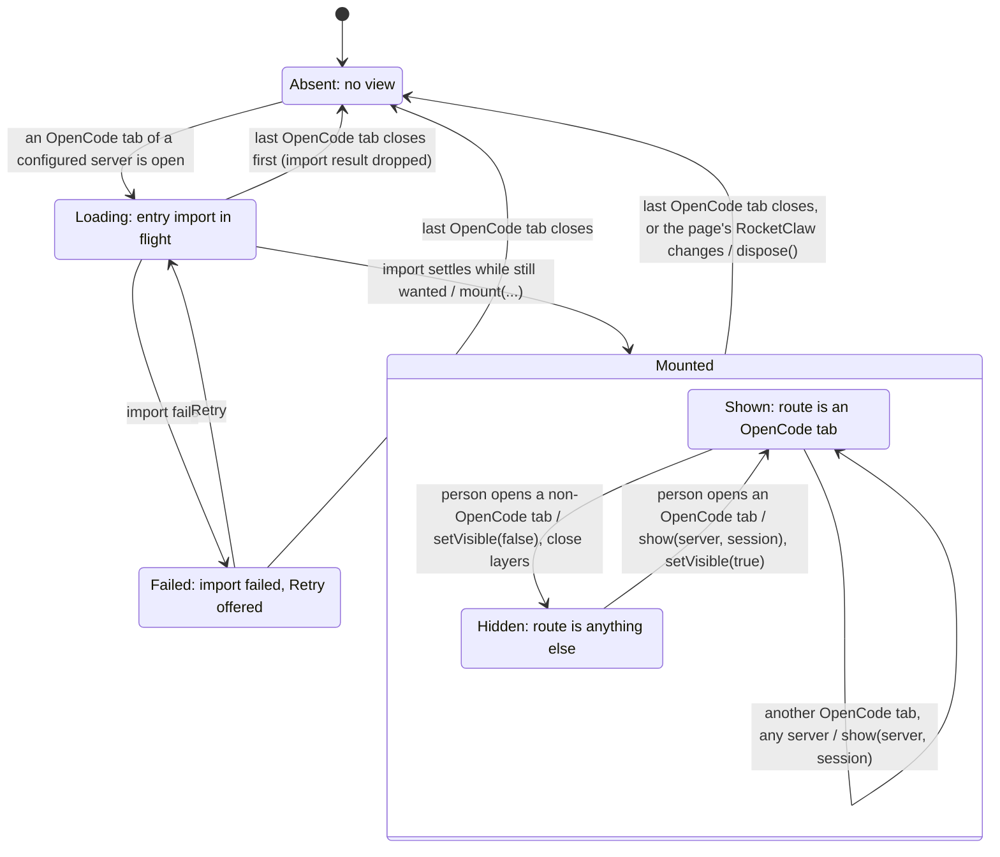

# Keep the OpenCode view loaded across every tab

## Problem

An OpenCode tab starts from scratch whenever the tab before it was not an OpenCode tab of the same server: a
RocketClaw chat, search, pages, settings, or another server's OpenCode tab. `RemoteSession` is keyed by server
(`internal/rocketclaw/web/src/ui.tsx`), so leaving disposes the view and everything OpenCode held in memory: every open
tab's transcript, each folder's lists, the event stream, the workers.

Measured with the browser harness (100 ms added to each OpenCode request):

| Switch | Today |
|---|---|
| First OpenCode tab after the page loads | 954 ms |
| First open of another tab of the same server | 241 ms |
| Back to a tab already seen, same server | 57 ms |
| Chat → OpenCode tab | 832 ms |
| One server's tab → another server's tab | ~840 ms every time |

On a deployment (2026-11-22): two OpenCode servers, acme-dev and example-dev; people keep 20–49 OpenCode tabs mixed with
chats, search and pages across several spaces, some spaces holding both servers' tabs. A session's last 20 messages are
up to 5.6 MB.

The 2026-11-02 design (`docs/specs/2026-11-02-opencode-tab-switch-design.md`) built step 1 (move the view between one
server's sessions) and declined step 2 (keep it behind RocketClaw tabs). Step 2 is now required, for every server.

## Goal

Once the page has loaded, every OpenCode tab opens without a cold start, from any tab, and a tab already seen shows
without waiting on the network. Nothing OpenCode does while hidden is visible to, or acts for, the person.

## Design

**One OpenCode view for the page, holding every configured server.** The copied app already runs several servers in one
app: `GlobalProvider` keeps one controller per listed server (`oc/packages/app/src/runtime/server/runtime.tsx`), and its
routes are `/server/<key>/session/<id>`. Moving to another server's session is the same `show()` move as moving between
one server's sessions. One view means none of the several-views hazards exist: settings and the global model store
overwriting each other, duplicated toasts, theme writers fighting, two views claiming one key press.

**Lifecycle.** The view mounts as soon as the page has any OpenCode tab of a configured server, on any space, even while
another tab shows; it opens on the shown OpenCode tab, otherwise the one shown last, otherwise the first. It stays
mounted, hidden, while a non-OpenCode tab shows, and is disposed only when no OpenCode tab is left (or the RocketClaw
the page shows changes). Mounting early makes the first OpenCode tab after load a warm one.

**Hidden is invisible, not collapsed.** The view's box keeps its size (`absolute inset-0` over the page, `opacity: 0`,
`inert`), never `display: none`, which would read width 0 and flip OpenCode to its mobile layout, unmount terminals and
side panels and lose the scroll position. `visibility: hidden` was tried first and dropped: OpenCode's own styles set
`visibility: visible` on some elements, which would show through. `inert` alone keeps the page clickable: the browser
test fails without it.

**Other servers warm up too.** The view starts on one server's session; for every other server with open tabs it reads
one session, its transcript and its folder's lists in the background, so the first tab of a second server is not a
cold start either.

**Fenced while hidden.** The host gets `setVisible(visible)`:

| Hazard while hidden | Fix | Where |
|---|---|---|
| Keys on the page body reach the view (⌘K, ⌘F, ⌘V, typing focuses its composer, drops) | `inView` counts `body` only while visible | `oc/host/fences.ts` |
| ⌘F/⌘G find picks a hidden file or diff | skip a host whose element is not visible | copied `session-ui/src/pierre/file-find.ts` |
| Its dialogs, menus, popovers, toasts stay on screen; a modal menu leaves RocketClaw unclickable; Escape is swallowed | on hide: close dialogs, send one Escape that the document stops before RocketClaw's handlers (Kobalte closes a whole menu tree on Escape; modal menus ignore focus leaving), hide the portal | `oc/host/mount.tsx` |
| The hidden session is marked read on the server | mark viewed only while visible | copied `app/src/session/route.tsx` `MarkSessionViewed` |
| RocketClaw's palette entry, quotes and server link reach the hidden view | only the shown view owns the `remoteView` slot | `web/src/ui.tsx` |
| The typing pill watches a hidden session | the pill shows only for the shown view | `web/src/ui.tsx` |

Kept as in OpenCode's own app: one event stream and health check per server, and its sounds for sessions open as tabs.
Today those play only while an OpenCode tab shows; now they play while any tab shows.

**API (host ↔ Web).** `mount(element, { servers, server, sessionID, messageID, navigation })` takes every configured
server; `show(server, sessionID, messageID?)`, `keep([{ server, sessionID }])`, `setVisible(boolean)`. The navigation the
copied code calls keeps its shape; the host binds it to the server the view shows, and the Web's side receives the
server with each call.

## Lifecycle model

Assumptions: one browser page, one view; React effects and the import's settlement interleave arbitrarily; the import
may fail; the person opens, closes and picks tabs at any time; the window may gain or lose focus at any time.

Safety:
- `MarkedOnlyShown`: OpenCode marks a session viewed only while the view is visible and the route shows that session.
- `SlotOnlyShown`: the `remoteView` slot names a view only while the route shows that view's session.
- `NoOrphanView`: a view never mounts after the effect that started its import was cleaned up.

Liveness:
- `EventuallyShown`: if the route stays on an OpenCode tab and the import eventually succeeds, the view eventually shows
  that session visibly.

## Implementation units

1. **Model** — `docs/verification/oc-view-keep/`: PlusCal model, passing and expected-failure checks, README with the
   recorded run. Gates units 2–4. Status: done 2026-11-22; every check matched (see its README). Which session the
   one view lands on across two servers, including two servers holding a session with the same ID, is
   `docs/verification/oc-view-session/` (TLC, plus a Lean proof of the tab prune); done 2026-11-22.
2. **Host** — `oc/host/{api.ts,mount.tsx,fences.ts,navigation.tsx,session-tab.tsx}` for many servers, `setVisible`, the
   fences; copied edits in `route.tsx` and `file-find.ts` marked `rocketclaw:`. Tests in `oc/host/mount.test.tsx`.
3. **Web** — `web/src/ui.tsx`: one always-rendered view component replacing `RemoteSession`'s server key, lifecycle,
   hiding, `remoteView` and typing gating. Browser tests in `web/src/opencode.browser.test.ts`.
4. **Measure** — rerun the harness; before/after table in the PR. Done:

   | Switch (100 ms added per OpenCode request) | Before | After |
   |---|---|---|
   | First OpenCode tab after the page loads | 954 ms | 42 ms |
   | First open of another tab of the same server | 241 ms | 250 ms |
   | Back to a tab already seen, same server | 57 ms | 55 ms |
   | Chat → OpenCode tab | 832 ms | 30 ms |
   | First tab of a second server | ~840 ms | ~260 ms |
   | One server's tab → another server's, seen before | ~840 ms | ~65 ms |

   The ~250 ms left on a tab not seen yet is its transcript: two round trips, as in OpenCode's own app.
5. **Rebuild** `oc-dist` with `go generate ./internal/rocketclaw/internal/web`; `make lint test` for web and oc; Go
   `go test ./...`, `make lint`, `make test` at the root.

## Out of scope (separate changes)

- The pull-request scan that downloads a session's whole tree on every tab switch (problem 1).
- Shortening OpenCode's own cold start: transcript reads waiting on the event stream, the 4-request queue, duplicate
  bootstrap reads, the proxy's default transport.
