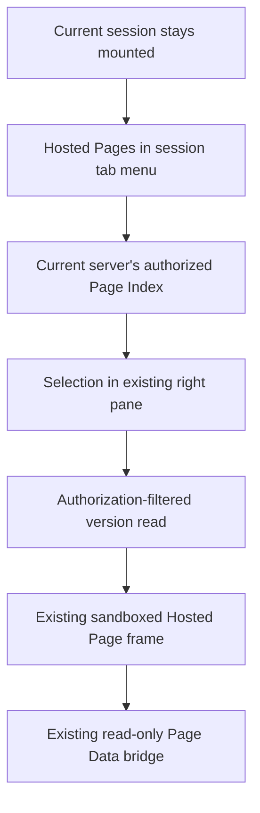
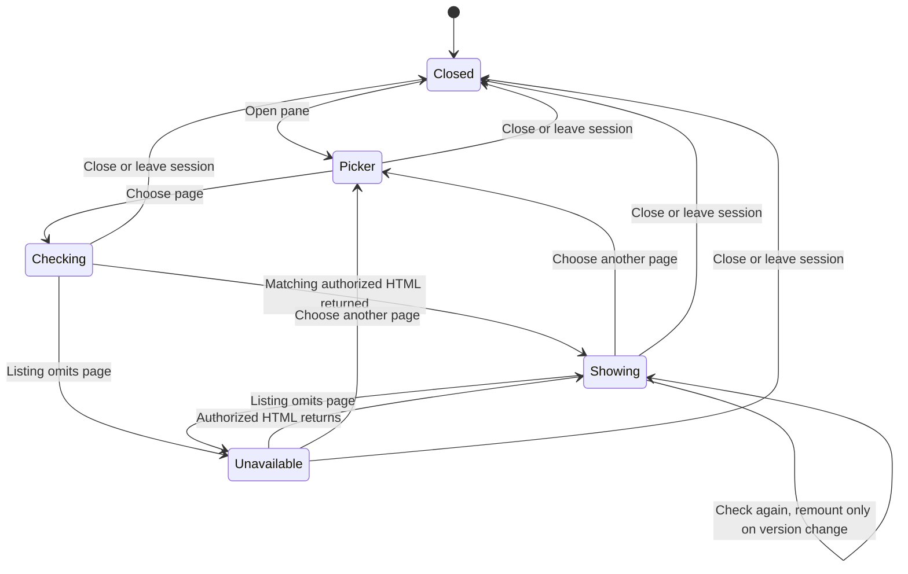

# Live Hosted Page Pane - Plan

## Goal Capsule

- Objective: Keep a conversation open while watching an agent update a page.
- Means: Use the existing right pane, with a sandboxed Hosted Page and a scoped live read (KTD1–KTD3).
- Authority: Preserve Hosted Page ownership and access, then satisfy R1–R4.
- Execution profile: One PR. Prove the refresh lifecycle before implementing it, then rebuild and verify the Web bundle.
- Stop condition: Do not build past the model gate if it fails. Do not ship without browser coverage for the same running chat and pane.

---

## Product Contract

### Summary

Open an agent-published HTML page beside a native or OpenCode session. The person keeps their place in chat, and saving a new version of the selected HTML updates the pane without a manual reload.

### Problem Frame

Hosted Pages already let agents publish and change HTML and Page Data. The Web renders a Hosted Page as its own tab, so a person must leave the chat to see it and reload manually to see new HTML.

### Requirements

- R1. A person can open the Hosted Pages picker from a session tab, select one HTML page, and keep the chat mounted.
- R2. The chosen page appears beside chat on wide screens and covers it in the existing right sheet on narrow screens. Closing it reveals the same session without changing its chat state.
- R3. The open pane picks up new saves of that HTML without user action, but does not reload on checks that find no new save. Page scripts may still read their owner's Page Data as before.
- R4. The preview uses the Page Index's existing visibility rules and the standalone page's sandbox. A page that leaves the authorized listing stops showing after the next successful check.

### Scope Boundaries

- One page at a time, chosen explicitly; later publishing to a different path does not switch the pane.
- The picker lists the current RocketClaw's Page Index, not unlisted pages accessible only by direct link. The acting agent can change only pages its existing tools let it write.
- No automatic pane opening, arbitrary external URL embeds, new page-writing tools, or raw browser control. An agent can rewrite HTML or publish Page Data; a page that updates without losing its local state can read Page Data at its own cadence.

---

## Planning Contract

### Key Technical Decisions

- KTD1. **Keep pane selection with the chat URL.** The session tab menu opens the pane. The active pane selects either GitHub, a skill, a delegation, or a page as it does for the existing choices. Encode the selected owner and full file path, not the space label; changing the space only changes access or the standalone public URL. Use the existing Page Index listing for the picker. Do not introduce another persisted tab or mount a second transcript.
- KTD2. **Read versions, not page bodies.** Extend `ListPages` with the stored update stamp and scope repeated reads to the selected owner and path. The same server-side filters apply to both listing shapes. Use one query observer that checks every two seconds in the foreground; key it separately from the Page Index by server, session, owner, and path. A different stamp changes the frame key; absence after a successful probe shows an unavailable state. An error keeps an already displayed frame and shows that refresh failed. Do not poll the unselected picker or a closed pane. Use the existing abort signal and discard old selection results rather than adding a new stream or relying on unread marks.
- KTD3. **Keep the Hosted Page trust boundary intact.** Resolve a URL selection against the authorized metadata response before mounting a frame. Derive the raw path by escaping the returned owner and file segments exactly once. Reuse the iframe implementation, with its own frame/token on each mount, pointed at the same RocketClaw as the session. Do not relax the sandbox, alter who may use Page Data, or proxy requests through a new endpoint.

### High-Level Technical Design

An in-flight completion belongs to its current query, not whichever session or selection happens to be visible on arrival. A transport error is not a successful authorization read.

---

## Implementation Units

### U1. Verify the refresh lifecycle

**Goal:** Prove that a delayed read cannot open or reload a different page.

**Requirements:** R2–R4. **Dependencies:** None.

**Files:** `docs/verification/live-hosted-page-pane/`.

**Approach:** Use PlusCal with a viewer, a publisher/access actor, and a reader. State tracks the selected context (server, session, page), selection generation, published versions and access, one pending read and its captured result, and the displayed context and version. Open, close, switch, publish, change access, request, sample, and apply/discard are atomic abstract steps. The reader may see a previous state if a publish or access change follows sampling; the invariant concerns what the latest accepted response says, not changes the browser cannot yet know. Browser restart starts with a new empty observer. No out-of-order application within a single active query. Model at least two pages, two chat or server contexts, two versions and enough selection changes to cover A–B–A. Record a conditional freshness property: once an open authorized selection and publication stop changing, a responding foreground reader eventually displays that version. Fairness is only for a stable foreground read that can complete, never for a server outage or a hidden tab.

**Test scenarios:**
- A late response cannot display a different server/session/page or survive closing.
- An unchanged revision cannot remount the iframe; a later revision can.
- A successful absence response clears the displayed frame; a failed read holds the last successful result without changing the frame.
- Turning off stale-selection rejection, absence clearing, revision comparison, or error preservation each causes its named check to fail. A reachability check witnesses a later publish loading without reopening the pane.

**Verification:** TLC passes the bounded model and the negative checks fail as intended. Record bounds, assumptions and results. No pane implementation before this gate (pack: formal-modeling, stateful-design.md).

### U2. Expose an authorized HTML revision

**Goal:** Return metadata for the picker and for a single live preview without sending HTML or Page Data in either metadata response.

**Requirements:** R3–R4. **Dependencies:** U1.

**Files:** `internal/rocketclaw/backend/pages.go`, `internal/rocketclaw/frontend/rpc/pages.go`, `internal/rocketclaw/frontend/rpc/pages_test.go`, `internal/rocketclaw/web/proto/web.proto`, generated protocol files.

**Approach:** Keep the default Page Index listing. Reuse its visibility and HTML checks when narrowing a read by owner and path. Expose the existing update stamp as an opaque string so the browser does not round it to milliseconds or infer ordering from it.

**Test scenarios:**
- Publish an HTML file, read its metadata twice, and overwrite the same path. The first two versions agree; the overwrite gives a new version.
- Request a restricted-space, missing, or non-HTML path. The result does not expose it, even when specifically named.
- An unfiltered response still includes the same page set as before.

**Verification:** Exercise the normal RPC plus Docker-backed storage, not a second implementation of admission.

### U3. Show the live page beside chat

**Goal:** Keep the original chat mounted while selecting, watching, switching, and closing a Hosted Page.

**Requirements:** R1–R4. **Dependencies:** U2.

**Files:** `internal/rocketclaw/web/src/ui.tsx`, `internal/rocketclaw/web/src/navigation.tsx`, `internal/rocketclaw/web/src/api.ts`, `internal/rocketclaw/web/src/types.ts`, `internal/rocketclaw/web/src/pages.browser.test.ts`, `README.md`, regenerated Web assets.

**Approach:** Reuse `SidePanel`, the tab menu, `HostedPage`, and `queries.pages`. Keep the polling observer in the selected panel, keyed to server and selected page, and consume cancellation in the request. When the published revision changes, remount only the iframe subtree. Keep standalone page behavior and GitHub preview behavior intact.

**Test scenarios:**
- Open the picker from a chat tab, select a nested HTML path with escaped characters, and verify the current transcript or composer remains mounted beside the frame.
- Publish a new revision while the chat is open. The frame updates by itself, retains the existing sandbox, and does not reload on an unchanged revision.
- Switch selections or close the pane during a delayed metadata read. The stale response cannot reopen or change the pane.
- Remove the displayed page from the successful authorized listing. The pane no longer displays it, and a person can choose another page.
- Fail one check while the page is open, then recover. The displayed frame survives the failed check.
- Check native and embedded OpenCode sessions, and the close path on a narrow viewport.

**Verification:** Use the real built bundle in Chromium. Document where to open the pane, HTML republishing, and using Page Data for in-place page updates.

---

## Verification Contract

- U1: `make -C docs/verification/live-hosted-page-pane` passes the positive and expected-failure checks.
- U2–U3: `go generate ./internal/rocketclaw/frontend/rpc` regenerates the protocol. `go test ./...`, `make lint`, and `make test` pass against isolated Docker PostgreSQL, including coverage and source budgets.
- U3: `go generate ./internal/rocketclaw/internal/web`, `make -C internal/rocketclaw/web lint`, and `make -C internal/rocketclaw/web test` pass. Verify the rendered pane and chat in Chromium.

## Definition of Done

The pane follows selected HTML updates while keeping chat usable, never widens Hosted Page access, and leaves existing page tabs unchanged. Check that no abandoned refresh implementation, temporary file, or extra generated change enters the PR.
