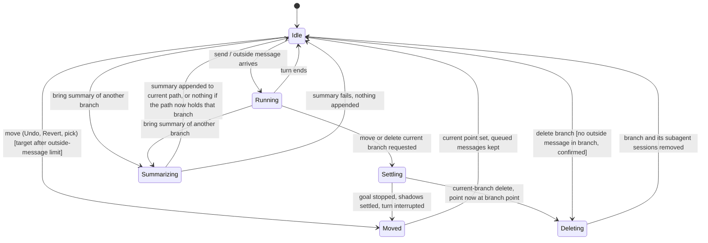
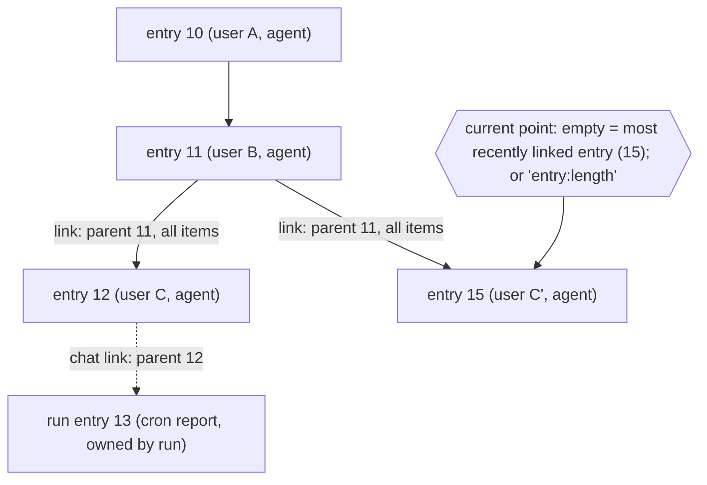
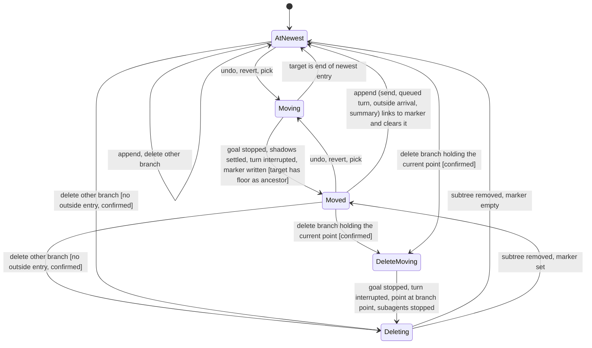

# Message Tree - Plan

## Goal Capsule

- **Objective:** People working in a native RocketClaw chat can try several directions from any earlier point, keep every attempt, and move between them in the same chat without losing work.
- **Means:** Per-chat history links plus the existing Undo marker reused as the current point (KTD1, KTD2), shown in a side panel next to the chat (KTD11).
- **Authority:** The Product Contract owns behavior; the Planning Contract owns mechanisms. Repository instructions (`AGENTS.md`) remain binding, including the formal-modeling gate (R25).
- **Execution profile:** One pull request. Implement U1 first and build U2 onward only after its TLC checks pass. Then U2–U9 in dependency order in the `20261122-tree-view` workspace.
- **Finish and shipping:** The caller (`lfg`) owns implementation, verification, review and the PR. No deployment is part of this plan.
- **Stop conditions:**
  - TLC cannot run or fails (BLOCKED / NOT VERIFIED).
  - Evidence that a settled decision cannot work.
  - The Go or TypeScript CLOC budget would be exceeded after the Redo and commit-path deletions (never edit the budget).
  - Any need to touch Remote OpenCode Sessions or `internal/rocketclaw/oc/`.
- **Open blockers:** None.

---

## Product Contract

### Summary

Native chats get a Message Tree, like pi's `/tree`.
A side panel shows the tree and lets you jump to any message; Undo and Revert move you back without deleting anything, and what you leave becomes a branch.
Redo is removed, deleting a branch is the only permanent action, and a summary of another branch can be brought into the current path on demand.

### Problem Frame

Today a native chat is a single line of messages.
Trying another direction from an earlier point has two costs.
Undo plus sending a new message permanently deletes everything after the cut, including the subagent sessions started there (`internal/rocketclaw/backend/revert.go`).
Fork keeps the old path but copies the history into a separate chat, so related attempts scatter across the sidebar and are linked only by an icon.
The motivation is the pi `/tree` workflow, which TJ DeVries and ThePrimeagen publicly endorse; no specific RocketClaw chat where work was lost has been recorded (see Dependencies / Assumptions).

### Key Decisions

- **Native sessions only.** OpenCode keeps a flat message list on its own server and runs in its own frame, so a message tree cannot be built there without OpenCode changes. (session-settled: user-directed — chosen over a fork-based tree covering native and OpenCode sessions, and over both at different depths: a real in-chat tree matters more than OpenCode coverage.) Governs R1, R26.
- **Every current gesture feeds the tree.** Undo, Revert and the tree are three ways to move the same current point. (session-settled: user-directed — chosen over also showing forks in the tree and over a tree separate from Undo: one meaning of "go back".) Governs R5, R6.
- **Redo is removed as if it never existed.** The tree is the way back, as in pi, which has no Redo. (session-settled: user-directed — chosen over keeping Redo until the next send and over Redo as "back to the branch I left": pi needs no Redo because nothing is deleted.) Governs R7.
- **Picking a node works like pi.** (session-settled: user-directed — chosen over switching only between branch ends and over always continuing after the picked node: matches pi and today's Revert.) Governs R11, R12.
- **No summary by default, on demand later.** Branches are kept, so the summary decision need not happen at jump time. (session-settled: user-directed — chosen over always/never/ask-each-time: default off, but changeable after the fact.) Governs R16, R17.
- **Today's outside-message limit stays.** (session-settled: user-directed — chosen over letting outside messages land where you are and over tracking a branch per outside sender: smallest change, and an outside sender never posts into a branch you left.) Governs R4, R21.
- **The tree is a side panel.** (session-settled: user-directed, from a visual sketch — chosen over a pop-up dialog, in-transcript branch switchers, and a margin graph rail.) Governs R8.
- **Panel lines like pi.** (session-settled: user-directed — chosen over user messages only and over every tool step: jumps happen only at message boundaries.) Governs R9, R10.
- **Branches can be deleted, including the current one.** (session-settled: user-directed — chosen over no deletion and over hiding: keeps the tree tidy, at the cost of one permanent action.) Governs R18, R19, R20.
- **A branch holding an outside message cannot be deleted.** (session-settled: user-approved — same reason as the outside-message limit.) Governs R21.
- **Sidebar search covers every branch; everything else sees the current path.** (session-settled: user-directed — chosen over current-path-only search: you can still find the chat where you tried something, and opening a result never jumps.) Governs R22, R23.
- **Queued messages survive a move.** Today Undo keeps queued messages but the next send drops queued Web messages; with no commit step they are kept and run from the new current point. Governs R14.
- **One current point per chat, shared by everyone viewing it.** The agent continues from a single place. Governs R2.

### Requirements

**Tree and current point**

- R1. Native chats eligible for Revert today (Web chats, Slack Thread Sessions, and Shadow Sessions through their parent) store their history as a tree in which every message has a predecessor.
- R2. Each chat has exactly one current point, shared by every viewer; the model, the transcript and every reader in R23 see the path from the first message to the current point.
- R3. No message is ever deleted by moving the current point; only branch deletion (R18) or deleting the chat removes messages.
- R4. The current point can never move to before the newest message from a cron run, External MCP, or Slack on the current path; the panel still shows earlier messages, disabled, with the Revert button's floor reason as their description.

**Undo, Revert and Redo**

- R5. Undo and the per-message Revert button move the current point to just before the chosen user message and put its text in the message box, exactly as picking that message in the panel does (R11).
- R6. Sending a message after Undo or Revert starts a new branch at the current point; the messages that were after it stay as a branch.
- R7. Redo is removed from native sessions as if it never existed: the Redo control, `/redo`, the backend operation, its RPC and proto fields, its tests, and its README text; no rejection path or compatibility shim replaces it.

**Side panel**

- R8. A side panel next to the chat shows the tree; it opens and closes the way the PR pane does, and `/tree` opens it.
- R9. Each line is one message of yours or one agent reply, as a single truncated line; tool calls and subagent steps are not shown.
- R10. The panel has a "your messages only" switch, branch points can be folded, the current point is marked, and at each branch point the current branch is listed first and the others oldest first.

**Moving in the tree**

- R11. Picking one of your messages moves the current point to just before it and puts its text in the message box for editing and resending.
- R12. Picking an agent reply, or the last message of another branch, makes it the current point; the message box is emptied unless it holds text the person typed.
- R13. Any move (R5, R11, R12) while the agent is working first stops the session goal, settles Shadow Sessions and interrupts the running turn, as Undo does today.
- R14. Queued messages are kept through a move and run from the new current point.
- R15. Subagent sessions belong to the branch that started them; they stay when you leave the branch and are shown again when you return.

**Branch summaries**

- R16. Moving never summarizes and never asks about summarizing.
- R17. From the panel, any branch other than the current path can be summarized into the current path at any time, with optional instructions; the summary is a visible message on the current path, and while it runs that branch's summary action shows a pending state.

**Deleting branches**

- R18. From the panel, a person can delete a branch: every message after its branch point on that branch, including any branches that continue from it, plus the subagent sessions they started; the branch point itself stays, and deletion is permanent.
- R19. Deletion asks for confirmation that names what will be removed (messages, nested branches, subagent sessions), whether it is the current branch, and any queued messages that will run from the branch point.
- R20. Deleting the current branch first moves the current point to the branch point, stopping work and keeping the queue as a move does (R13, R14), and leaves the message box unchanged; delete is offered only where a branch point exists.
- R21. A branch containing a message from a cron run, External MCP, or Slack cannot be deleted, and the panel says why, as the Revert button does today.

**Other readers of history**

- R22. Sidebar search matches text on any branch of a chat; opening a result opens the chat without moving its current point.
- R23. Fork, Handoff, the PR pane and subagent discovery see only the current path.

**Out of scope and constraints**

- R24. Moving the current point does not roll back files on disk or undo external effects; deleting a branch does not undo its file edits or close pull requests it created.
- R25. The current point, running turns, queued messages, arriving outside messages, Shadow Sessions and branch deletion form stateful concurrent behavior; it is modeled in PlusCal and passes TLC under `docs/verification/message-tree/` before it is built. (pack: formal-modeling, stateful-design.md)
- R26. Remote OpenCode Sessions, and the copied OpenCode interface under `internal/rocketclaw/oc/` including its own Redo, are unchanged.

### State Diagram

The diagram covers one chat's current point. It explains the design and proves nothing (pack: formal-modeling, stateful-design.md).

- **Actors:** the person (possibly several viewers), the agent's running turn, queued messages, outside senders (cron, External MCP, Slack), Shadow Sessions, subagent sessions.
- **Persists:** messages, the tree links, the current point, queued messages, subagent sessions. **In process only:** the running turn and its interruption.
- **Delivery:** an outside message can arrive at any moment, including during a move or delete; concurrent moves from two viewers can race.
- **Crash points:** between interrupting a turn and setting the current point; during a branch delete.
- **Safety:** no message reachable from a branch is ever lost except by a confirmed branch delete or chat delete; the current point is never before the newest outside message on its path; an outside message is never deleted.
- **Liveness:** a requested move eventually completes or fails visibly, and queued messages eventually run from the current point.

### Acceptance Examples

- AE1. **Covers R5, R6, R3.** Given messages A, B, C on the current path, when the person presses Undo, then the current point is just before C, C's text is in the message box, and after sending C' the panel shows two branches after B: C and C'.
- AE2. **Covers R12, R2.** Given branches C and C' after B with the current point at the end of C', when the person picks C's last agent reply, then the transcript shows A, B, C and the next message continues from there.
- AE3. **Covers R4, R21.** Given a cron report arrived after B on the current path, when the person opens the panel, then A and B are shown but cannot be picked, and the branch containing the report has no delete action.
- AE4. **Covers R13, R14.** Given the agent is running on C' with one queued message, when the person picks B's agent reply, then the turn is interrupted, the current point moves to B's reply, and the queued message runs from there.
- AE5. **Covers R18, R19, R20.** Given the current point is on branch C' with two queued messages, when the person deletes C' and confirms, then C' and its subagent sessions are gone, the current point is at B, the message box is unchanged, and the queued messages run from B.
- AE6. **Covers R16, R17.** Given the person moved from branch C to C', when they later choose "bring a summary of this branch here" on C, then a summary message of C's messages after B appears on the current path and the agent sees it from the next turn.
- AE7. **Covers R22, R23.** Given "migration" appears only on branch C and the current point is on C', when the person searches the sidebar for "migration", then the chat is listed, opening it shows C' unchanged, and the PR pane lists only pull requests from the C' path.
- AE8. **Covers R7.** Given a native chat, when the person types `/`, then no Redo command is offered, and no Redo control appears anywhere in the native transcript.

### Scope Boundaries

- Remote OpenCode Sessions and the copied OpenCode interface (R26).
- Showing forks as nodes in the tree; Fork stays a copy into a new chat.
- Naming or labelling branches (pi's Shift+L).
- A mobile layout beyond what the PR pane already does.
- Automatic or prompted branch summaries on every move (R16).
- Rolling back files, external writes, or pull requests (R24).
- Hiding branches without deleting them.
- Paging or windowing panel rows for very long trees: considered and not built, because a slow panel is visible at once and cheap to add later. Add it if a real chat shows the panel is slow.

### Dependencies / Assumptions

- No concrete RocketClaw chat where the tree would have saved work has been recorded; the motivation is the pi `/tree` experience.
- Shadow Sessions are read-only and already move with their parent on Undo; they keep following the parent's current point.
- Slack Thread Sessions get the panel in the Web; since every Slack message is an outside message (R4), branching there is possible only after the latest Slack message.
- This reverses the revert plan's exclusion of keeping abandoned branches (`docs/plans/2026-10-06-1425-feat-web-message-revert-plan.md`, scope note and KTD2–KTD4).

### Sources / Research

- Pi session tree: https://pi.dev/docs/latest/sessions and `packages/coding-agent/docs/tree.md` in `earendil-works/pi`.
- Current revert, floor and commit: `internal/rocketclaw/backend/revert.go`; fork: `internal/rocketclaw/backend/fork.go`; search: `internal/rocketclaw/backend/message_search.go`.
- Side-panel pattern: PR, delegation and skill panels in `internal/rocketclaw/web/src/ui.tsx` and `internal/rocketclaw/web/src/navigation.tsx`.
- Redo surface to remove: `internal/rocketclaw/web/proto/web.proto`, `internal/rocketclaw/frontend/rpc/session_commands.go`, and the Shadow agents paragraph at `README.md:590-592`.
- OpenCode V2 API: sessions keep flat messages; forks record `fork.sessionID` and `fork.boundary`.

---

## Planning Contract

**Product Contract preservation:** changed: R4, R12, R17, R18, R19, R20 and the state diagram and AE5 — clarified after document review, without changing the user's decisions: disabled rows explain the floor; picks never wipe typed text; summaries show progress and never land on the summarized branch; deleting a branch includes branches continuing from it and keeps the branch point; current-branch delete leaves the message box alone. The Outstanding Questions deferred to planning are resolved by KTD1, KTD2, KTD7, KTD10 and KTD13 and were removed. The Goal Capsule gained execution fields.

### Key Technical Decisions

- KTD1. **Per-chat history links, not a parent column on `entries`.** A new table holds one row per entry a chat shows, naming the entry it continues from and how many of that entry's replay items are on the path. A chat shows entries it does not own: reporting runs, the run it continues, and runs bound after the fact (`bindRun`) whose IDs can be older than the chat's newest entry. Those entries need a different predecessor in each conversation that shows them, so the link belongs to the viewing chat. Each link row also carries a per-chat link sequence, the order the links were written. A chat's path is the walk from its leaf back along these links. The parent column has no foreign key, and a link whose parent entry no longer exists (sticky prune, `store.go:1409`) makes that entry a root. Rejected: a parent column on `entries`, which cannot place a shown run entry. Also rejected: hidden conversations per branch, which would move bridges, turns and delegation identities between conversations. Governs R1, R2.
- KTD2. **The Undo marker becomes the current point.** `conversations.revert_message_id` keeps its `entryID:length` text and its meaning: the path ends after the first `length` replay items of that entry. An empty marker means the path ends at the end of the most recently linked entry, by link sequence, not by entry ID. That is the normal state, because every append happens at the current point. Every append links the new entry to the current point and clears the marker in the same transaction. A marker `entry:0` (Undo before an entry's first message) is normalized at append time to that entry's own parent link, so the new entry becomes a sibling of the old one, never its child. The column name is kept because the proto field, transcript revision and indexes already use it. Governs R2, R6.
- KTD3. **One move path; nothing commits.** `StageRevert`'s pipeline (stop goal, settle shadows, interrupt, drain requests, then write the marker in one transaction) becomes the only way the current point moves, for Undo, Revert and tree picks.
  - Its target is a message ID plus a boundary, `before` or `through`, the same vocabulary OpenCode uses for fork boundaries. `before` a user message restores its text; `through` an agent reply or branch end leaves the box empty.
  - The target can be on any branch of the chat. It must have the outside-message floor as an ancestor.
  - `commitRevertDB`, `settleRevertDB`, the suffix deletes and every "marker set means park the queue" gate are deleted. `clipRevertEntry`'s write-back moves to branch delete (KTD9). Governs R3, R5, R11, R12, R13, R14.
- KTD4. **Outside arrivals append at the current point.** The silent cancel in `settleRevertDB` goes away. An arriving cron, External MCP or Slack message links to the current point like any append, and the floor then sits on it. This keeps the settled outside-message limit: the floor still blocks moving before the arrival, so it is not the rejected alternative of outside messages landing where you are with no floor. Background job completion notes arrive the same way, at the current point. Governs R4.
- KTD5. **A turn continues from the path leaf.** `turns.history_anchor_id` is set at turn start to the current leaf entry, not to the chat's highest ID. A move interrupts any running turn first (R13), so every running turn belongs to the current path. An unsaved terminal turn (failed or stopped) shows only when its anchor is on the current path and no path entry after that anchor was created after the turn.
  - Readers keep ordering and paging by entry ID. Every child is created after its parent, so IDs rise along any path. The one exception is a run bound after the fact, whose older IDs today's ID order already places mid-history; that stays as it is.
  - Checks that scan every entry by ID switch to the current path, because a sibling branch can hold higher IDs: `saveRevertTurnDB`'s later-turn check, the floor and predecessor reads in `revertStateDB`, and the channel summary cut. Governs R2, R13.
- KTD6. **Shadow Sessions move with their parent and never delete.** A move sets each shadow child's current point to the end of the newest shadow entry whose `shadow_turns.parent_turn_id` is a turn on the parent's new path. This is found by link ancestry, not by today's `id >= target` cut (`shadowRevertSQL`, `shadows.go:249-261`), so `through` targets and sibling branches map correctly. `commitShadowRevertDB`'s deletes are removed, and shadow appends link at the child's own current point. Governs R1, R3.
- KTD7. **Which readers see what.**
  - **Current path:** model replay, transcript, history RPC, delegation discovery, Fork (including only delegations whose call is on the path), Handoff, the PR pane (through history), preview and summary rebuild, attachment restore, cron sources and voice.
  - **Every branch:** message search and the chat's participant list, which comes from the same searchable rows.
  - Readers that today ignore the cut are switched to the path one by one (`store_summaries.go:71`, `fork.go:179-197`). Governs R22, R23.
- KTD8. **Delegations stay with their branch.** Moves never prune subagent sessions. Discovery (the transcript's delegation list, Fork's copy, the PR pane) lists only children whose call is on the current path. A child stays readable by direct link from anywhere, so a background completion note that lands on another branch can still name it. This deletes today's `reverted_parents` unreadable rule. Branch delete removes the children whose call appears only in the deleted subtree, reusing the existing recursive child query. Governs R15, R18.
- KTD9. **Branch delete: move first, then one locked delete.** Branch delete takes the bridge's history-mutation flag.
  1. If the current point or a live turn's anchor is inside the subtree, it runs the KTD3 move to the branch point first (stop goal, settle shadows, interrupt, drain).
  2. It waits for any running subagent session whose call is in the subtree to stop.
  3. Under the chat history lock, in one transaction, it re-collects the subtree and re-checks that neither the current point nor a live turn's anchor is inside it. No separate outside-message check is needed: an outside entry always sits on the current path, so a branch holding one is the current branch, and the floor check in step 1's move refuses it (`docs/verification/message-tree/README.md`).
  4. It deletes the subtree's owned entries, links, turns, steps, delegations and mapped shadow entries, plus unsaved terminal turns anchored at the branch point after the branch began.
  5. When the branch point lies inside an entry, that entry is clipped to the branch-point length with `clipRevertEntry`'s write-back (JSON and `search_text`), not deleted. Governs R18, R19, R20, R21.
- KTD10. **Branch summaries reuse the handoff runtime.** `GenerateHandoff`'s one-shot runtime takes the prompt as a parameter. The summary runs on the chat agent's model, with a recognizable instruction prefix and no new config key. The summary is appended at the current point as a `[System]`-headed message, which does not move the floor. If the current path includes the summarized branch when the summary finishes, nothing is appended and the panel says so. Governs R16, R17.
- KTD11. **Tree RPC plus a self-contained panel.**
  - One new history RPC returns the chat's nodes. Each node is a user message or agent reply with its ID, parent node, role, truncated text, outside flag, deletable flag and current flag.
  - The panel lives in its own `tree-panel.tsx` with a `useMessageTree` hook, opened through a new `tree` key in `panelHref` and by `/tree`.
  - It opens with the current node scrolled into view and shows loading text only on `isPending` (`docs/solutions/best-practices/react-doctor-complexity-limit-shapes-web-components.md`, `docs/solutions/logic-errors/pr-pane-jumped-because-its-loading-line-followed-every-background-refetch.md`). Governs R8, R9, R10.
- KTD12. **Redo is deleted outright.** Redo stored nothing beyond the marker, which now means the current point, so no data is kept aside and no migration touches it. `CONCEPTS.md` gets a one-line Retired entry, following the existing convention. Governs R7.
- KTD13. **Migration 108 backfills links in ID order.** For every conversation it links each shown entry to the previous shown entry with the full length.
  - A staged marker stays as that chat's current point, so its hidden suffix becomes a branch.
  - From then on, every writer that makes an entry shown in a chat writes its link: the append path for the chat, `reports_to` and `continues`; `bindRun`/`bindProducer`; `ContinueRun`; fork and shadow seeding; and the delegation bulk copy. Governs R1, R3.

### High-Level Technical Design

How a chat's path is read. The arrows are history links (KTD1), and the current point (KTD2) picks the leaf.

The move, send and delete lifecycle for one chat refines the Product Contract's state diagram:

Who sees what (KTD7):

| Reader | Path | Every branch |
|---|---|---|
| Model replay, transcript, history RPC, delegations | yes | |
| Fork, Handoff, PR pane, preview/summary, attachments, cron sources, voice | yes | |
| Message search, participant list | | yes |
| Tree RPC | | yes |

### Formal Model

The model lives at `docs/verification/message-tree/` and follows `docs/verification/thread-pr/` (pack: formal-modeling, stateful-design.md).

- **Variables:**
  - `parent`: entry → (entry, length)
  - `outside`: the set of outside entries
  - `head`: the marker, or empty
  - `queue`: a sequence of queued inputs
  - `running`: whether a turn is running
  - `deleted`: the deleted entries
  - `interrupted`: interrupted turns
  - `shadowView`: the entries one shadow child shows
  - `summaries`: pending summary requests, each recording the branch it reads
- **Initial state:** one root entry with no parent; `head` empty and `shadowView` the root; `queue`, `outside`, `deleted`, `interrupted` and `summaries` empty; `running` FALSE.
- **Processes:**
  - `Viewer[v ∈ {1,2}]`: `Move(target)`, `Send`, `DeleteBranch(b)`, `Summarize(b)`.
  - `Agent`: `Start` takes the queue head and records its anchor as the leaf; `Finish` appends at the current point.
  - `Outside`: `Arrive` appends at the current point.
  - `Summary`: completes a pending request with a later, separate append step.
  - `Crash`: drops in-process state; a running turn is lost unsaved.
- **Atomic steps:**
  - Each `Move` writes `head` and `shadowView` in one step after `Interrupt`.
  - Each append (link plus clearing the marker) is one step.
  - `DeleteBranch` holding the current point is a `Move` to the branch point followed by a separate delete step, which can interleave with `Agent.Start`/`Finish`.
  - Deleting another branch is one step under the history lock.
- **Invariants:**
  - `NoLoss`: every created entry outside a deleted subtree has a link chain to the root.
  - `HeadAfterFloor`: the newest outside entry on the path is an ancestor of the leaf.
  - `OutsideNeverDeleted`.
  - `HeadIsNode`.
  - `QueueKept`: a move never removes a queued input.
  - `OnePath`: each live turn's anchor is on the current path.
  - `NoLiveTurnDeleted`: no live turn's anchor is in `deleted`.
  - `ShadowFollowsParent`: `shadowView` is a subset of the parent's path.
  - `SummaryLandsOffBranch`: a summary is appended only to a path that does not contain the branch it summarizes.
  - `NeverBranched` (witness only, checked by `witness-branch`): no entry has two children.
- **Temporal:** `QueuedEventuallyRun`, under weak fairness on `Agent` (the bridge loop always resumes).
- **Bounds:** 5 entries, up to 2 viewers, 3 moves, 3 queued inputs, 1 outside arrival, 1 delete, 1 summary, 1 crash; per-check worlds are in the model README.
- **PASS configs:** `move`, `delete`, `outside`, `crash`, `shadow`, `summary`.
- **Configs that must fail:**
  - `commit-deletes` restores today's commit and must violate `NoLoss`.
  - `no-floor-check` must violate `HeadAfterFloor`.
  - `delete-outside` (the delete's own move skips the floor) must violate `OutsideNeverDeleted`.
  - `park-drops-queue` must violate `QueueKept`.
  - `delete-without-interrupt` must violate `NoLiveTurnDeleted`.
  - `shadow-id-cut` (today's ID cut) must violate `ShadowFollowsParent`.
  - `witness-branch` must violate `NeverBranched`, proving a branch is reachable.
- **Mapping:**

| Model step | Code |
|---|---|
| `Move` | `StageRevert` / `stageRevertDB` (KTD3) |
| `Append` | `appendSessionEntryDB` link write (KTD1, KTD2) |
| `Start` anchor | `startTurnDB` (KTD5) |
| `DeleteBranch` | new branch delete (KTD9) |
| `shadowView` write | generalized `stageShadowRevertDB` (KTD6) |
| `Summary` append | U8 summary RPC (KTD10) |

### Assumptions

- Queued messages run from the new point right after a move, possibly before the person resends the text a `before` move restored (R14). The Product Contract chose to keep queued messages, and this ordering follows from it.
- Every send mints a fresh Web message ID, so duplicate detection by input ID (`reconcileWebDB`) never treats a resent message on a new branch as already accepted. U3 verifies this.
- A recursive link walk per history read performs acceptably on long chats. U2 adds a plan test at 4,096 entries.
- Background job completion notes land at the current point like other arrivals (KTD4), even when the job started on a branch the person has left. The subagent session they name stays readable by link (KTD8).
- The release is forward-only. Migration 108's Down drops the link table, and rolling back after people have branched would replay every branch interleaved by ID.

### Risks

- Chats with a staged marker and parked Web queue items at deploy time will run those items from the marker as soon as the new build starts, because the park gates are removed (R14). Today those items would be dropped on the next send.
- `lockRunHistories` locks a run and its `reports_to` chat, but not a chat that `continues` the run. If a continued run can still append, its link write in the continuing chat can race a move there. U2 settles this (see Open Questions).

### Open Questions

**Deferred to implementation**

- Can a run that a chat `continues` still append entries after continuation? If yes, U2 extends `lockRunHistories` to take the continuing chat's history lock before writing the link.

### Sequencing

U1 gates everything. U2 creates the links and the path projection. U3 makes moves non-destructive, and U4 removes Redo. U5 switches readers, and U6 adds branch delete. U7 and U8 add the panel and summaries, and U9 finishes the docs.

---

## Implementation Units

### U1. Message Tree model

- **Goal:** Write, translate and check the PlusCal model; fix the design for each counterexample; record the evidence.
- **Requirements:** R25; models R2, R3, R4, R13, R14, R18, R20, R21.
- **Status:** pending.
- **Dependencies:** none.
- **Files:** `docs/verification/message-tree/MessageTree.tla`, one `.cfg` per check listed under Formal Model, `docs/verification/message-tree/Makefile`, `docs/verification/message-tree/README.md`.
- **Approach:** Copy the `thread-pr` Makefile shape (pinned `tla2tools` 1.8.0 SHA, work under the repository `.tmp/`, PASS and NEGATIVE lists with `EXPECTED_<name>`). Use one combined self-loop label per state in Mermaid (`docs/solutions/best-practices/mermaid-state-diagram-self-loops-keep-only-the-last-label.md`).
- **Patterns to follow:** `docs/verification/thread-pr/`, `docs/verification/agent-pause/AgentPause.tla`.
- **Test scenarios:**
  - `make -C docs/verification/message-tree check` passes every PASS config with "No error has been found".
  - Each NEGATIVE config exits 12 or 13 with its named violation.
- **Verification:** The README records the command, bounds, assumptions, TLC and Java versions, state counts, run time and what the model leaves out. Any counterexample is fixed in KTDs before U2 starts.

### U2. History links and path projection

- **Goal:** Every chat's history is the path from its root to its current point (KTD1, KTD2, KTD5, KTD13).
- **Requirements:** R1, R2, R3.
- **Dependencies:** U1.
- **Files:**
  - `internal/rocketclaw/backend/migrations/108_history_links.sql`
  - `internal/rocketclaw/backend/revert.go` (`sessionHistorySQL`)
  - `internal/rocketclaw/backend/store.go` (`appendSessionEntryDB`)
  - `internal/rocketclaw/backend/store_dao.go` (`bindRun`, `bindProducer`, `startTurnDB`, `appendQueriedEntries`)
  - `internal/rocketclaw/backend/conversations.go` (`ContinueRun`)
  - `internal/rocketclaw/backend/fork.go`
  - `internal/rocketclaw/backend/shadows.go` (seeding)
  - `internal/rocketclaw/backend/transcript.go`
  - Tests: `internal/rocketclaw/backend/store_schema_test.go`, `internal/rocketclaw/backend/history_links_test.go`, `internal/rocketclaw/backend/transcript_test.go`
- **Approach:**
  1. The migration creates the link table keyed by (viewing conversation, entry) with an index on the parent, and backfills it in ID order per KTD13. Add it to both ledger lists in `TestInitializeSessionDBAdoptsReleasedStore`.
  2. `sessionHistorySQL` replaces `viewed_rows`/`effective_entries` ordering-by-ID with a recursive walk from the leaf. It keeps the existing CTE names readers depend on (`physical_entries`, `effective_entries`, `revert_index`) and uses no subqueries. Alias repeated constants (dupword).
  3. Every writer listed in KTD13 writes the link and clears the marker in its transaction.
  4. `startTurnDB` records the leaf as the anchor (KTD5).
- **Patterns to follow:** `ancestorsSQL` in `internal/rocketclaw/backend/history.go`; the data-migration test via `ExecVersionContext` in `store_schema_test.go`.
- **Test scenarios:**
  - A linear chat migrated by 108 reads the same entries and message IDs as before.
  - A chat with a staged marker before 108 reads its prefix afterwards, and the hidden suffix remains stored.
  - A reported cron entry appears on the chat's path at the point where it arrived, and the run's own history is unchanged.
  - `bindRun` of a run with older IDs places its entries after the current leaf.
  - An append while the marker is `11:1` links the new entry to entry 11's first item and clears the marker.
  - Undo before C's first message, then send: C' gets the same parent link as C, so the two are siblings.
  - A send right after `bindRun` links to the bound run's last entry.
  - Pruning the oldest sticky entries leaves the remaining path intact, with the oldest survivor as root.
  - A failed unsaved turn on branch C' is absent from the transcript after moving to sibling C.
  - With 4,096 entries, `EXPLAIN` of the history read uses the link index without a Sort on `entries`.
- **Verification:** Existing history, transcript, fork and shadow tests pass unchanged apart from deleted commit assertions.

### U3. Non-destructive moves

- **Goal:** Undo, Revert and tree picks move the current point and never delete (KTD3, KTD4, KTD6, KTD8).
- **Requirements:** R3, R4, R5, R6, R11, R12, R13, R14, R15; covers AE1, AE2, AE3, AE4.
- **Dependencies:** U2.
- **Files:**
  - `internal/rocketclaw/backend/revert.go`
  - `internal/rocketclaw/backend/shadows.go`
  - `internal/rocketclaw/backend/bridge.go`
  - `internal/rocketclaw/backend/store.go`
  - `internal/rocketclaw/backend/thread_bridges.go`
  - `internal/rocketclaw/backend/conversations.go`
  - `internal/rocketclaw/frontend/rpc/session_commands.go`
  - `internal/rocketclaw/web/proto/web.proto` (a boundary field on the revert request)
  - `internal/rocketclaw/web/src/ui.tsx` (queue no longer hidden while a marker is set)
  - Tests: `internal/rocketclaw/backend/revert_test.go`, `internal/rocketclaw/backend/shadows_test.go`, `internal/rocketclaw/web/src/revert.browser.test.ts`
- **Approach:**
  1. Generalize `stageRevertDB` to a target plus boundary on any branch, checking the floor by ancestry.
  2. Delete `commitRevertDB`, `settleRevertDB`, `pruneRevertDelegations`'s move-time call, `dropRevertedWaitingLocked` and the marker gates listed in the research: `bridge.go:770`, `:937`, `:1163`; `store.go:476`; `thread_bridges.go:975`; `conversations.go:338`; `revert.go:722`; `ui.tsx:5341`.
  3. `admitWeb` appends at the current point.
  4. Shadow children follow per KTD6.
- **Execution note:** Rewrite `TestRevertFloor` and the commit tests to the new contract before deleting the commit path.
- **Test scenarios:**
  - Covers AE1. Undo then send leaves entries C and C' as siblings after B, and both are stored.
  - Covers AE2. A `through` move to C's agent reply makes the transcript show A, B, C, and the next send links to C.
  - Covers AE3. A move whose target lacks the newest cron report as an ancestor is refused with the floor error.
  - Covers AE4. A move while a turn runs with one queued Web message interrupts the turn, keeps the queue item, and the item runs from the new point.
  - An outside message arriving while the marker is set links to the marker and clears it.
  - A move hides a subagent session whose call is off the path, and moving back makes it readable again without re-creating it.
  - A shadow child's marker follows the parent's move, and no shadow entries are deleted.
  - From C', picking C's last agent reply makes each shadow child show its comparison for C, and moving back to C' shows the C' comparison again.
  - Revert of an in-flight turn works on a branch whose entry IDs are lower than a sibling's.
  - Two concurrent moves: the second gets "conversation history is busy".
  - A resent restored message gets a new Web message ID and is admitted.
- **Verification:** No `DELETE FROM entries` remains on any move or send path.

### U4. Remove Redo

- **Goal:** Redo no longer exists in native sessions (KTD12).
- **Requirements:** R7; covers AE8.
- **Dependencies:** U3.
- **Files:**
  - `internal/rocketclaw/backend/revert.go` (`ClearRevert`)
  - `internal/rocketclaw/frontend/backend.go`, `internal/rocketclaw/frontend/rpc/transport.go`, `internal/rocketclaw/frontend/rpc/http.go`, `internal/rocketclaw/frontend/rpc/session_commands.go`
  - `internal/rocketclaw/web/proto/web.proto` and its generated code (`go generate ./internal/rocketclaw/frontend/rpc`)
  - Regenerated mockery mocks
  - `internal/rocketclaw/web/src/ui.tsx` (slash entry, `/redo` parse, palette gate), `internal/rocketclaw/web/src/api.ts`, `internal/rocketclaw/web/src/types.ts`
  - `README.md:590-592`, `CONCEPTS.md` (Retired entry)
  - Tests: Redo cases in `revert_test.go`, `shadows_test.go`, `shadow_history_test.go`, `message_search_test.go`, `rpc/live_test.go`, `revert.browser.test.ts`, `revert-transport.test.ts`, `transcript.test.ts`, `api.test.ts`, `composer.test.ts`
- **Approach:** Delete, do not replace. No rejection path, shim or retired-field reservation beyond what proto numbering needs.
- **Test scenarios:**
  - Covers AE8. The slash palette and typed `/redo` offer nothing in a native chat.
  - The composer slash list test no longer contains redo.
- **Verification:** `rg -i 'redo|clearRevert|ClearRevert'` in `internal/rocketclaw` returns only unrelated hits and the copied OpenCode tree under `internal/rocketclaw/oc/`.

### U5. Readers follow the path or every branch

- **Goal:** Each history reader sees what KTD7 assigns.
- **Requirements:** R22, R23; covers AE7.
- **Dependencies:** U2, U3.
- **Files:**
  - `internal/rocketclaw/backend/message_search.go` (`searchableSQL`, `searchMessagesSQL`)
  - `internal/rocketclaw/backend/store_summaries.go`
  - `internal/rocketclaw/backend/fork.go`
  - `internal/rocketclaw/backend/session_tools.go`
  - `internal/rocketclaw/backend/attachments.go`
  - `internal/rocketclaw/backend/store.go` (cron sources)
  - Tests: `message_search_test.go`, `fork_test.go`, `store_summaries_test.go`
- **Approach:**
  1. Search and participant refresh drop the cut and read every linked entry.
  2. Summary, preview and Fork's delegation copy read the path.
- **Test scenarios:**
  - Covers AE7. A word only on branch C finds the chat while the current point is on C', and opening it leaves the marker unchanged.
  - Fork from C' copies C' entries and only the subagent sessions called on C'.
  - The chat preview shows C's last message after moving to C, and C''s after moving back.
  - The participant list includes a person who wrote only on branch C.
- **Verification:** Every reader named in KTD7 is covered by a test or listed in the PR description with the projection it uses.

### U6. Branch delete

- **Goal:** People can permanently delete a branch (KTD9).
- **Requirements:** R18, R19, R20, R21; covers AE5.
- **Dependencies:** U3.
- **Files:**
  - `internal/rocketclaw/backend/revert.go` (or a new `internal/rocketclaw/backend/branches.go` if `revert.go` grows past readability)
  - `internal/rocketclaw/frontend/backend.go`, `internal/rocketclaw/frontend/rpc/session_commands.go`, `internal/rocketclaw/web/proto/web.proto`
  - Tests: `internal/rocketclaw/backend/branches_test.go`
- **Approach:**
  1. RPC `DeleteBranch(session, message ID of the branch's first node)` returns what the confirm dialog shows: message, nested-branch, subagent-session and queued-message counts, and whether the branch is current.
  2. A dry-run flag computes the counts without deleting.
  3. Reuse the existing recursive delegation query for child sessions.
- **Test scenarios:**
  - Covers AE5. Deleting the current branch C' with two queued messages moves to B, deletes C' and its subagent session, leaves the message box unchanged, and the queue runs from B.
  - Deleting the current branch while a turn runs on it interrupts the turn first, and nothing is appended under the deleted branch afterwards.
  - Deleting a branch that starts inside an entry clips that entry to the branch point, and the sibling path is unchanged.
  - Deleting a branch with a nested sub-branch removes both and reports one nested branch in the dry run.
  - Deleting a sibling branch leaves the marker unchanged.
  - A branch containing a cron report is refused, and nothing is deleted.
  - The dry run returns counts and deletes nothing.
  - Deleting at a node with no siblings is refused, because there is no branch point.
- **Verification:** Row counts in `entries`, links, `turns` and `conversations` drop by exactly the subtree.

### U7. Tree RPC and side panel

- **Goal:** The Message Tree panel shows and drives the tree (KTD11).
- **Requirements:** R8, R9, R10, R11, R12, R19, R21; covers AE2, AE3.
- **Dependencies:** U3, U6.
- **Files:**
  - `internal/rocketclaw/backend/history.go` (tree query)
  - `internal/rocketclaw/frontend/rpc/server.go`, `internal/rocketclaw/web/proto/web.proto`
  - `internal/rocketclaw/web/src/tree-panel.tsx` (new)
  - `internal/rocketclaw/web/src/navigation.tsx` (`tree` key)
  - `internal/rocketclaw/web/src/ui.tsx` (mount next to `ThreadPRPanel`, `/tree` slash entry, `PanelToggle` open set)
  - `internal/rocketclaw/web/src/api.ts`
  - Tests: `internal/rocketclaw/backend/history_test.go`, `internal/rocketclaw/web/src/tree-panel.browser.test.ts`
- **Approach:**
  1. Keep `SessionApp` untouched apart from the mount.
  2. Put state in `useMessageTree`.
  3. Picking calls the U3 move with `through` for agent replies and for the last node of a branch other than the current one, and `before` for every other user message.
  4. Branch actions (delete, summarize) sit on the first row after each branch point. Delete opens a confirm dialog fed by the U6 dry run; summarize covers that branch's newest leaf path.
  5. Below the 64rem side-panel breakpoint, a successful pick closes the panel with `navigate(panelHref())`.
  6. Rows are buttons. Fold toggles carry `aria-expanded`, the current node `aria-current`, and disabled rows `aria-disabled` with the floor reason. Opening with `/tree` moves focus to the current node.
- **Test scenarios:**
  - The panel lists one line per user message and agent reply, with tool calls hidden, at widths 1280, 390 and 320.
  - The "your messages only" switch hides agent lines.
  - Folding a branch point hides its non-current branches.
  - The current branch is listed first, then the others oldest first.
  - Covers AE3. Nodes before the floor render disabled with the floor reason, and an outside-holding branch has no delete action.
  - Picking a user message that ends another branch moves `through` it and leaves the message box empty.
  - Typing a draft, then picking an agent reply, keeps the draft.
  - At width 390, picking a user message closes the panel and shows the filled message box.
  - Keyboard only: open with `/tree`, fold a branch point, pick a node.
  - Covers AE2. Picking an agent reply updates the transcript and marks the node current.
  - Picking a user message fills the composer with its text.
  - `/tree` opens the panel with the current node in view, and closing it removes the `tree` query key.
- **Verification:** `make -C internal/rocketclaw/web lint` (react-doctor) passes without touching `SessionApp`'s complexity.

### U8. Branch summary

- **Goal:** A branch can be summarized into the current path on demand (KTD10).
- **Requirements:** R16, R17; covers AE6.
- **Dependencies:** U2, U7.
- **Files:**
  - `internal/rocketclaw/backend/handoff.go` (prompt parameter)
  - `internal/rocketclaw/frontend/rpc/session_commands.go`, `internal/rocketclaw/web/proto/web.proto`
  - `internal/rocketclaw/web/src/tree-panel.tsx`
  - Tests: `internal/rocketclaw/backend/handoff_test.go`, `internal/rocketclaw/frontend/rpc/session_commands_test.go`
- **Approach:**
  1. RPC `SummarizeBranch(session, branch leaf ID, instructions)` renders the branch's messages from its split point to its leaf as the transcript, runs the summary, and appends the result at the current point.
  2. Add a fake-provider recognizer for the summary prefix where tests invoke it (`docs/solutions/best-practices/new-model-calls-in-web-turns-reach-every-test-fake-provider.md`).
- **Test scenarios:**
  - Covers AE6. The summary of branch C appears as a message on C' and in the next turn's replay.
  - Optional instructions are passed through to the prompt.
  - A model failure appends nothing and returns an error to the panel.
  - While a summary runs, that branch's summary action is pending and disabled, and moves stay available.
  - Moving onto the summarized branch before the summary finishes appends nothing, and the panel says so.
  - Moving never triggers a summary.
- **Verification:** The full `backend` and `frontend/rpc` packages pass.

### U9. Docs

- **Goal:** Docs describe the Message Tree and no longer describe Redo.
- **Requirements:** R7, R24.
- **Dependencies:** U3–U8.
- **Files:** `README.md`, `CONCEPTS.md` (Message Tree, Current Point, Retired: Redo).
- **Approach:** Replace the Revert/Redo sentences at `README.md:590-592` and add a short Message Tree paragraph near them. State that files are not rolled back (R24).
- **Test expectation:** none -- documentation only.
- **Verification:** The docs match the shipped behavior.

---

## Verification Contract

| Check | Command | Applies to |
|---|---|---|
| Model | `make -C docs/verification/message-tree check` | U1, rerun after any KTD change |
| Format | `gofmt` on touched Go files | U2–U8 |
| Generated code | `go generate ./internal/rocketclaw/frontend/rpc` and mockery regeneration, then a clean `jj diff --git` re-run | U3, U4, U6–U8 |
| Go tests | `go test ./...` | all |
| Lint | `make lint` (then re-read `jj diff --git` for dupword rewrites) | all |
| Full tests | `make test` | all |
| Web | `make -C internal/rocketclaw/web lint` and `make -C internal/rocketclaw/web test` (check `Built SPA:` first) | U3, U4, U7, U8 |
| Budgets | `make check-cloc-budget` | all |

Real-backend browser tests (`TestRevertRealBackendBrowser`, `TestShadowsRealBackendBrowser`) need `ROCKETCLAW_PLAYWRIGHT_MODULE`, `ROCKETCLAW_CHROMIUM` and a short `TMPDIR`; missing setup blocks verification.

---

## Definition of Done

- U1's TLC run passes every PASS config and fails every NEGATIVE config as named, and its evidence is in `docs/verification/message-tree/README.md`.
- AE1–AE8 each have a passing test.
- No move, send or Undo path deletes entries, turns, delegations or shadow history; only branch delete and chat delete do.
- Redo is absent from native code, tests, proto, README and UI; `CONCEPTS.md` lists it as retired.
- All Verification Contract commands pass, and both CLOC budgets hold without edits.
- Abandoned-attempt code, debug output and unused helpers from the run are removed.
- The PR description lists the README and `CONCEPTS.md` updates.
