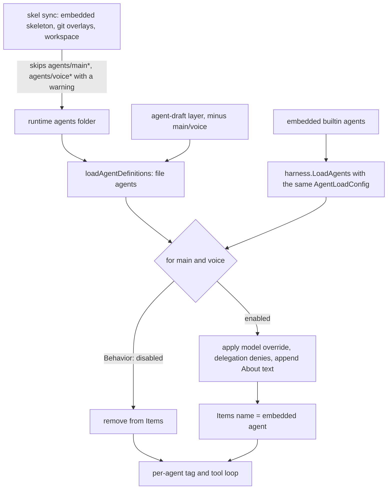

# Embedded main and voice agents - Plan

## Goal Capsule

- **Objective:** Every RocketClaw install runs the same `main` and `voice` agents its release ships. A repository can neither replace nor delegate to them. Admins turn each on or off and pick its model on the Config page. Both agents describe the running release and know where its source lives.
- **Means:** Ship both agents in a separate embed. The backend agent loader injects them after reading files, skel sync drops same-named files, and Behavior Settings carry per-agent settings (KTD1, KTD2, KTD3, KTD4).
- **Authority:** User decisions in the Product Contract outrank the KTDs, and the KTDs outrank the unit text. `AGENTS.md` governs code style, tests and verification.
- **Stop conditions:** Stop and report if the Go source CLOC budget (`make check-cloc-budget`) would be exceeded, or if a settled decision proves infeasible.
- **Execution profile:** One pull request containing every unit. `lfg` drives implementation, review and shipping, and the user merges.

---

## Product Contract

### Summary

`main` and `voice` become agents built into the binary. Repository files, overlays and the agent editor cannot override them, and no agent can delegate to them. Admins control each one's on/off state and model from Behavior Settings. The shipped `assistant` and `slack` agents are deleted. No path picks a default agent anymore: cron files and External MCP callers name their agent, and continuing a cron run uses that run's own agent. Both agents get a built-in "About RocketClaw" section that points at the GitHub source for the running revision, and `main` also gets a section on the RPC interface.

### Problem Frame

Today the shipped agent files are copied into each workspace's `agents/` folder once, without overwriting, and the workspace copy then wins over the shipped one (`internal/rocketclaw/skel/skel.go`). A repository can therefore silently replace `main` or `voice`, and prompt fixes in new releases never reach existing installs. Installs created before 2026-11-18 still run a private, non-sudo `main`. Agents also know almost nothing about RocketClaw: the binary carries no docs or revision for them, and `main.md` is one sentence. Separately, cron falls back to `main` when a file names no agent (`internal/rocketclaw/config/cron.go`), and continuing some cron runs picks the alphabetically first non-sticky agent. Both are hidden defaults the user wants gone.

### Requirements

**Embedded agents**
- R1. `main` and `voice` are loaded from files embedded in the binary on every load. Files named `main.md`, `voice.md`, `main/` or `voice/` in a git overlay, the workspace `agents/` folder or an agent-editor layer are never parsed. RocketClaw logs a warning naming each ignored overlay or workspace path when it syncs. Same-named agent-editor drafts are dropped without a warning, because R14 governs them.
- R2. `main` is an advanced agent with `sudo: yes` and `sticky: global`. It reaches every tool and every OpenCode server, and every facet of every MCP server, each call reviewed by the guardian. MCP tools no facet lists stay unreachable.
- R3. `voice` keeps today's easy-mode behavior (`sticky: user`, its own folder per conversation, spoken-reply rules, inclusion of the workspace `AGENTS.md`), except that it cannot delegate (R6).
- R4. The shipped `assistant` and `slack` agents are deleted. A default install has no agent for External MCP or Slack until a repository adds one.

**Delegation**
- R5. No agent can delegate to `main` or `voice`: not through Task, not by naming them as an `auto(agent)` reviewer, and not through `rocketclaw_sessions_write`. This holds for the agents themselves too.
- R6. `main` may still Task any repository agent that Task can reach today. `voice` has no Task tool.

**Settings**
- R7. Behavior Settings carry, for each of `main` and `voice`, an on/off state and an optional `provider/model#effort`. Missing settings mean on, with the model in the embedded file.
- R8. A turned-off agent is absent everywhere agents are listed or resolved, from the next load. Work routed to it fails with an error naming the agent.
- R9. A model setting replaces the agent's model from the next turn. Saving a model whose provider is not configured is refused.
- R10. The Config page shows a built-in agents section where admins switch each agent on or off and choose its model with the existing model picker.

**No default agents**
- R11. A cron file without `agent:` no longer runs `main`. It still loads, but RocketClaw never runs it: each trigger fails before any conversation is created, with an error naming the cron. Run Now refuses it the same way. A cron whose agent is missing or off is refused the same way.
- R12. Every way of continuing a cron run uses the agent the run recorded: the delivered report chat, Web **Open chat**, and a due scheduled follow-up. When that agent is missing or off, nothing is created and the error names the agent. The run's own turn still finishes, and a refused follow-up is not retried until the next start.
- R13. The runtime warning text shown after startup, Reload and Behavior saves lists each cron whose agent is blank, missing or off.
- R14. The agent editor refuses to create, rename to or save a draft named `main` or `voice`, with an error saying the name belongs to a built-in agent. A draft already stored under those names can only be renamed: its test chat and Propose changes are refused. Neither the Agents page nor the editor's "Copy an agent" list offers Edit or Copy for built-in agents. Instead, a built-in agent's row says it is changed in Config → Behavior settings.
- R15. Propose changes in the agent editor runs as `main`. While `main` is off it fails with an error saying `main` is turned off in Behavior Settings.

**Self-knowledge**
- R16. Both agents' prompts end with an "About RocketClaw" section. It covers what RocketClaw is, how its pieces relate, where admins change settings, that `main` and `voice` are built in, and where to read more. It links to `README.md`, `CONCEPTS.md`, `internal/rocketclaw/frontend/rpc/README.md` and `internal/rocketclaw/web/proto/web.proto` on `github.com/Rocketable/platform` at the running revision.
- R17. The revision comes from the binary's build info. It is `vcs.revision` when present, otherwise the module version: a release tag as-is, or the commit hash at the end of a pseudo-version, which `go run …@main` installs produce. When neither yields a revision, the links point at the `main` branch and say the revision is unknown. When the build has local changes, the section says the links may not match the running code.
- R18. `main`'s prompt also has an RPC section. It explains that the Web UI does everything through one gRPC service (`rpc.Web`, defined in `web.proto`), served only to people signed in through Tailscale at `/api/<Method>`. It says which `rocketclaw_*` tools cover the same ground, and that `main` must not call the RPC itself but should send people to the right Web page.

### Key Decisions

- **`assistant` and `slack` are deleted, not kept as fallbacks.** Governs R4. (session-settled: user-directed — chosen over letting a `sticky: global` main also answer External MCP and Slack: repositories add their own agents for those features.)
- **Both embedded agents can be turned off.** Governs R7, R8, R15. (session-settled: user-directed — chosen over keeping `main` always on: the user accepted that features depending on `main` fail clearly while it is off.)
- **No default agent for cron or External MCP, and cron continuation uses the cron's own agent.** Governs R11, R12. (session-settled: user-directed — chosen over continuing to pick the alphabetically first non-sticky agent: a hidden default nobody chose.)
- **Source pointers go to GitHub at the running revision.** Governs R16, R17. (session-settled: user-directed — chosen over a checkout on the server or both: one source of truth with no new setting.)
- **A short built-in orientation plus pointers, not shipped docs.** Governs R16. (session-settled: user-directed — chosen over copying README, CONCEPTS, RPC README and the proto into the binary, or putting full docs in the prompt: small, and never stale.)
- **RPC awareness only.** Governs R18. (session-settled: user-directed — chosen over a generated method list or a callable RPC tool: no new security surface.)
- **Keep the MCP facet boundary for `main`.** Governs R2. (session-settled: user-directed — chosen over letting `main` reach tools no facet lists: admins keep control through `rocketclaw.json`.)
- **`voice` stays an easy agent.** Governs R3. (session-settled: user-directed — chosen over making it full-access or adding delegation to other agents for easy agents.)
- **Nobody delegates to `main` or `voice`, including themselves.** Governs R5, R6. (session-settled: user-directed — chosen over allowing self-copies: "No one should be able to delegate to main or voice.")

### Scope Boundaries

- Agents cannot call the RPC. No tool, token or CLI is added for it.
- No docs are embedded in the binary. No generated RPC method list goes in the prompt.
- External MCP and Slack keep their agent-selection rules. External MCP already requires the caller to name an agent (`internal/rocketclaw/frontend/externalmcp/server.go`).
- Workspace copies of `assistant.md`, `slack.md`, `main.md` and `voice.md` left by earlier releases are not deleted. `assistant` and `slack` keep loading as repository agents, and `main`/`voice` copies are ignored per R1.
- Not built, considered: a harness-level "never delegable" flag. The fixed sticky values plus R5's per-agent rules close every path, and a flag would add a concept and break many harness fixtures that use `main` as a self-delegating test agent. A new delegation path that ignores sticky would change this.
- Not built, considered: narrowing `voice`'s RocketClaw tool groups. Today `voice` gets every group, `sessions` included, so it can start or message non-sudo, non-sticky agents' chats in any space. Before this change an admin could remove that by editing `voice.md`; R1 removes that remedy. R3 keeps `voice` unchanged, so the README instead states that `voice`'s space (`Main`) must not be in a person's Space Limit while `voice` is on. A need to give space-limited people `voice` would change this.
- Not built, considered: a migration that deletes stale workspace copies. AGENTS.md avoids migration code, and the R1 warning tells admins which files to delete.

#### Deferred to Follow-Up Work

- A clearer `rocketclaw_sessions_write` refusal message for built-in agents. Today it names a `permission.rocketclaw` setting the agent file cannot have.

### Success Criteria

- On an install whose workspace holds an old `agents/main.md`, the loaded `main` matches the embedded file plus Behavior Settings, and the log names the ignored file.
- A fresh `main` turn's system prompt contains the About section with links at the binary's revision, plus the RPC section.

---

## Planning Contract

### Key Technical Decisions

- KTD1. **Keep both agents as embedded Markdown and parse them with `harness.LoadAgents`.** `voice` is easy mode and needs `compileEasyAgent`, so building it in Go like `harness/guardian.go` would duplicate the easy compiler. Move `main.md` and `voice.md` from `skel/agents/` to their own embedded folder, such as `skel/builtin/agents/`, with the About text in a separate embedded file beside it so the loader never parses it as an agent. `skel/agents/` keeps only `examples/`.
- KTD2. **Inject in `readRocketCodeDefinitionsIn`, not in `loadAgentDefinitions`.** After the file agents load and before the per-agent tag and tool loop (`internal/rocketclaw/backend/bridge.go`), load the embedded agents with the same `AgentLoadConfig`. Then, for each one:
  - delete it when its setting is off;
  - otherwise apply the model override through `harness.ParseModelRef`, add the task self-deny for `main`, append the About text, and set it in `Items`, replacing any file agent of that name. `main`'s RPC section is part of its embedded `main.md` body, so About stays last.

  Every runtime path goes through this function (turns, raw runs, handoff, `LoadRuntimeAgents`), so all paths see one result. Draft validation and shadow reconciliation stay file-only.
- KTD3. **Filter reserved names during skel sync, and also in the draft layer.** Skip `agents/main.md`, `agents/voice.md`, `agents/main/` and `agents/voice/` when syncing git overlays and the workspace into the runtime folder, logging a warning per skipped path. Drop the same keys from the agent-draft layer map in `readRocketCodeDefinitionsIn`. Filtering at sync means stale copies are never parsed: they cannot fail startup or create shadows of `main`/`voice` through `reconcileShadows`. Shadows of embedded agents are therefore not supported.
- KTD4. **Settings shape: `embedded_agents: {main: {disabled, model}, voice: {disabled, model}}`, in both `config.Config` and `config.Behavior`.** Use a struct with two named fields, so `LockedConfig.clone()` needs no change. Use `disabled`, not `enabled`, so stored documents from earlier releases decode as on (R7). Add the field to `Behavior()`, `SetBehavior`, `setBehaviorFields` (`internal/rocketclaw/backend/app.go`) and `ValidateBehavior`. Validation normalizes the model like `auto_approver_model` and rejects a provider qualifier missing from `ProviderNames()`. Startup already prefixes stored-settings failures with `stored behavior settings:`, so the README's `psql` recovery applies when a provider is later removed. No proto change is needed, because `behavior_json` is already a JSON document.
- KTD5. **Close delegation with existing rules, not a new field.** Sticky already blocks other agents' Task and `auto(agent)` uses (`delegable` in `internal/rocketclaw/harness/tasks.go`, `validateAutoPermissionReviewers` in `harness/rocketcode.go`). Three paths remain, and each is closed with an existing rule:
  - `main` → `main` Task: an appended `task main deny` rule. Later rules win over sudo's `task: * allow`, following the existing append pattern in `bridge.go`.
  - `voice` → `voice` Task: `subagents: []` in the embedded `voice.md`.
  - Writes into `voice` chats: `delegatedFrom: false` in `voice.md`. `main` already refuses session writes because sudo agents default to no recipients (`agentRecipients` in `backend/session_tools.go`).

  This implements R5 (session-settled: user-directed — inherited from the delegation Key Decision; chosen over allowing self-copies).
- KTD6. **Pass the revision through a `json:"-"` field on `config.Config`.** `runServe` already reads build info (`cmd/rocketclaw/serve.go`), so it also sets the field per R17, following the `Config.WorkDir` precedent. The source order is `vcs.revision`, then `build.Main.Version` (a tag as-is, or a pseudo-version's trailing 12-character hash), plus `vcs.modified`. The README's install path is `go run github.com/Rocketable/platform/cmd/rocketclaw@main`, and those module-mode builds carry no `vcs.*` settings, only the version. Tests set the field directly. The About section's link line is built in Go from it, and the rest of the text stays in the embedded file.
- KTD7. **Cron agent checks happen when the cron runs, not at load.** Rejecting a blank `agent:` at load would stop startup and Reload on installs that copied the old heartbeat example, and would refuse a Behavior save that turns `main` off. Instead:
  - `config/cron.go` stops defaulting to `main`;
  - one shared check refuses a blank, missing or off agent, called in two places because the two paths create their conversation in different places:
    - in `runCronJob` (`frontend/rpc/server.go`) before `CreateStickyConversation`, beside the existing sticky check;
    - in the cron manager's `executeJob` before `m.run.Run`;
  - `validateRuntimeAssets` adds those crons to the existing runtime warning text (R13).
- KTD8. **Cron continuation reads the run's recorded agent.**
  - `handoffProducer` uses `inbound.Cronjob.Agent` instead of the first non-sticky agent. When that agent is missing or off, it logs one error naming the agent and returns nil. Its timer, armed with an empty id, re-arms every second on any error, so returning an error would spin. The stored follow-up stays and is tried again at the next bridge start.
  - `CreateSession` with a source conversation uses the run's recorded agent.
  - When the agent is missing or off, `openCronReport` records no chat, logs an error naming the agent and returns nil. `deliver` calls it before `closeTurn`, so an error would leave the finished cron turn open.

  Each failure names the agent (R12).
- KTD9. **Delete the agent editor's built-in layer.** Once no draftable name has a shipped file, the code serving it is dead:
  - `skel.BuiltinAgent`;
  - the built-in layer in `AgentDraftLayers` and its index arithmetic;
  - `Recreated` and the proto field `recreated`;
  - the web `save.tsx` handling of that field.

  `AgentOrigin` returns `built-in` for `main` and `voice` directly.
- KTD10. **Reword the harness missing-agent error.** `missing required default agent %q` (`harness/rocketcode.go`) becomes wording that says the agent is not loaded, such as `agent %q is not loaded`. A turned-off `main` then reads correctly in queued-work failures (R8). Tests asserting the old text are updated.
- KTD11. **The formal-modeling gate does not apply.** No new queue, lease, retry or worker state is added. A turned-off agent is handled three ways, none of which adds a state or transition:
  - queued work: the existing check at turn start consumes it with an error reply;
  - the scheduled-follow-up timer: KTD8 keeps the refusal out of its retry path;
  - cron report delivery: KTD8 lets the turn close as before.

  (pack: formal-modeling, stateful-design.md)

### High-Level Technical Design

How an agent load resolves `main` and `voice`:

### Assumptions

- `github.com/Rocketable/platform` may be private. The links still tell `main` where to look, and it can read them through `gh` when the server's credentials allow.
- Test binaries carry neither `vcs.revision` nor a module version, so tests set `Config.Revision` directly and cover the KTD6 derivation separately.

### Risks & Dependencies

| Risk | Mitigation |
|---|---|
| Installs whose copied `main.md` predates 2026-11-18 change on upgrade: per-person `main` chats give way to one shared chat, `main` gains sudo, and External MCP sessions bound to `main` stop working because shared agents are never offered to External MCP. | Accepted consequence of R2 and R4. The PR body carries a release note. |
| Custom `main.md` or `voice.md` content in workspaces is silently dropped. | The R1 warning names each ignored path. The release note tells admins to move customizations into a new agent. |
| About 120 test fixtures write their own `agents/main.md`, which would now be ignored, so tests could pass against the embedded `main` by accident. | U8 converts every fixture that writes `main.md` or `voice.md`, found by grep, and rechecks each test's intent. |
| `main` has a host shell. On an untagged Tailscale machine it could reach `/api/*` as the owner. | Out of scope per the RPC Key Decision. R18 tells `main` not to call the RPC, and the guardian reviews shell calls. |
| A local `make deploy` build stamps the jj parent commit. If that commit was never pushed, the About links return 404. | The About text tells the agent the links follow the build's commit, and that it should fall back to `main` when a link is missing. |
| The Go source CLOC budget has about 1,046 lines left. | KTD9's deletions offset part of the additions. `make check-cloc-budget` is a gate. |

### Sources & Research

- `docs/solutions/best-practices/agent-file-format-changes-need-a-deployment-load-check.md`: run the new loader against real deployment agent and cron folders before merging.
- `docs/solutions/best-practices/backend-run-tests-keep-fixture-agents-in-workspace-agents.md`: says a fixture `agents/main.md` replaces the built-in `main`. That becomes false, and U9 refreshes it.

---

## Implementation Units

### U1. Embedded agent settings in Behavior Settings

- **Goal:** Store and validate per-agent on/off and model settings.
- **Requirements:** R7, R9; KTD4.
- **Dependencies:** none.
- **Files:** `internal/rocketclaw/config/config.go`, `internal/rocketclaw/backend/app.go`, `internal/rocketclaw/config/config_test.go`, `internal/rocketclaw/frontend/rpc/server_test.go`.
- **Approach:**
  1. Add the `embedded_agents` field to `Config` and `Behavior`, and to `Behavior()` and `SetBehavior`.
  2. In `ValidateBehavior`, normalize each model and reject a provider qualifier missing from `ProviderNames()`.
  3. Add the field to `setBehaviorFields` so a config-file copy is reported as ignored once a stored document exists.
- **Patterns to follow:** `auto_approver_model` handling in `config.go`.
- **Test scenarios:**
  - A stored document without `embedded_agents` decodes to both agents on with empty models.
  - `SaveBehaviorSettings` with `main` off and `voice` set to `gpt-x#low` round-trips through `ListConfig.behavior_json`.
  - A model `nope/gpt-x` on a config without provider `nope` is refused.
  - An `openai/` prefix is normalized the same way as the auto-approver model.
- **Verification:** The config and RPC settings tests pass, and the existing `TestSaveBehaviorSettings` expectations include the new field.

### U2. Embedded main and voice loading

- **Goal:** Load `main` and `voice` from the embed on every agent load, ignoring same-named files.
- **Requirements:** R1, R2, R3, R4, R8, R9; KTD1, KTD2, KTD3, KTD10.
- **Dependencies:** U1.
- **Files:**
  - `internal/rocketclaw/skel/skel.go`
  - `internal/rocketclaw/skel/builtin/agents/main.md` (moved)
  - `internal/rocketclaw/skel/builtin/agents/voice.md` (moved)
  - `internal/rocketclaw/skel/agents/assistant.md` (deleted)
  - `internal/rocketclaw/skel/agents/slack.md` (deleted)
  - `internal/rocketclaw/backend/bridge.go`
  - `internal/rocketclaw/harness/rocketcode.go`
  - `internal/rocketclaw/skel/skel_test.go`
  - `internal/rocketclaw/backend/definitions_test.go`
- **Approach:**
  1. Add a second embed for the built-in folder, and expose it from skel as an `fs.FS`.
  2. Add a reserved-name skip to the overlay and workspace agent syncs with a Warn log (KTD3).
  3. In `readRocketCodeDefinitionsIn`, drop reserved keys from the draft layer, then load and inject the embedded agents (KTD2) using the U1 settings from the locked config.
  4. Reword the harness missing-agent error (KTD10).
- **Patterns to follow:** `workspaceOverlayFilter` in `skel.go`; the `Permission.Set` append in `bridge.go`; the model override in `backend/agent_draft_assistant.go`.
- **Test scenarios:**
  - A workspace with `agents/main.md` (sticky: slack, custom prompt) and `agents/main/alt.md` loads the embedded `main` (sudo, sticky: global) with no shadows.
  - The same setup with a git overlay instead of the workspace gives the same result.
  - `main` off in Behavior removes it from `LoadRuntimeAgents`, and `voice` is unaffected.
  - `voice` model set to `p/m#low` loads with model `p/m` and effort `low`.
  - A draft-layer map containing `main.md` does not change the loaded `main`.
  - A fresh workspace sync produces no `assistant.md`, `slack.md`, `main.md` or `voice.md` in `agents/`.
  - A queued turn for an off `main` fails with the reworded "not loaded" error naming `main`.
- **Verification:** The backend definitions and skel tests pass. A manual load against a copy of a real workspace `agents/` folder succeeds, per the deployment load-check learning.

### U3. Delegation closed for embedded agents

- **Goal:** No agent, including `main` and `voice`, can delegate to them.
- **Requirements:** R5, R6; KTD5.
- **Dependencies:** U2.
- **Files:** `internal/rocketclaw/skel/builtin/agents/voice.md`, `internal/rocketclaw/backend/bridge.go`, `internal/rocketclaw/backend/session_tools_test.go`, `internal/rocketclaw/backend/definitions_test.go`.
- **Approach:**
  1. Add `subagents: []` and `delegatedFrom: false` to `voice.md`.
  2. Append `task main deny` for `main` during injection.
- **Test scenarios:**
  - `main`'s Task description lists a sticky-off repository agent and not `main`.
  - A Task call from `main` with `subagent_type: main` is denied.
  - `voice` has no Task tool.
  - `rocketclaw_sessions_write` from a repository agent into a `voice` chat is refused.
  - The same write into a `main` chat is refused.
  - A repository agent with `auto(main)` fails to load.
- **Verification:** The delegation tests pass for both embedded agents.

### U4. Self-knowledge sections

- **Goal:** Both agents describe the running release, and `main` knows about the RPC interface.
- **Requirements:** R16, R17, R18; KTD6.
- **Dependencies:** U2.
- **Files:**
  - `internal/rocketclaw/skel/builtin/about.md` (new)
  - `internal/rocketclaw/skel/builtin/agents/main.md`
  - `internal/rocketclaw/config/config.go`
  - `cmd/rocketclaw/serve.go`
  - `internal/rocketclaw/backend/bridge.go`
  - `internal/rocketclaw/backend/definitions_test.go`
  - `internal/rocketclaw/skel/skel_test.go`
- **Approach:**
  1. Write `about.md` as a compact orientation: what RocketClaw is, the main features, where settings live, which pages need an admin, the built-in agents and their delegation rule, and how to use `rocketclaw_navigate_for_me`. It must contain no `` !` `` include, and must not list agents, MCP servers or skills, which the tools already show.
  2. Put the RPC section in `main.md`'s body.
  3. Derive `Config.Revision` in `runServe` per KTD6.
  4. Build the link line in Go from `Config.Revision`, with the R17 fallbacks.
  5. Append it after the agent's own prompt text, because test fake servers match on the start of the prompt.
- **Test scenarios:**
  - With `Revision` `abc123`, `main`'s prompt ends with About text containing `https://github.com/Rocketable/platform/blob/abc123/CONCEPTS.md`.
  - Build info with no `vcs.revision` and version `v0.0.0-20261123120000-0123456789ab` yields revision `0123456789ab`.
  - Version `v1.2.3` yields `v1.2.3`.
  - Version `(devel)` with no `vcs.revision` yields no revision.
  - With an empty revision, the links use `main` and the text says the revision is unknown.
  - With a modified build, the text says the links may not match the running code.
  - `voice`'s prompt contains the About text and not the RPC section.
  - Every repository path the About text and the RPC section name exists in the repository.
  - The `rocketclaw_*` tool names they mention exist.
- **Verification:** The definitions and skel tests pass, and a dev run's `main` session shows the sections.

### U5. Cron without default agents

- **Goal:** Cron never picks an agent its run did not name.
- **Requirements:** R11, R12, R13; KTD7, KTD8.
- **Dependencies:** U2.
- **Files:**
  - `internal/rocketclaw/config/cron.go`
  - `internal/rocketclaw/frontend/cron/manager.go`
  - `internal/rocketclaw/frontend/cron/manager_test.go`
  - `internal/rocketclaw/backend/bridge.go`
  - `internal/rocketclaw/backend/app.go`
  - `internal/rocketclaw/backend/active_turn_test.go`
  - `internal/rocketclaw/frontend/rpc/server.go`
  - `internal/rocketclaw/frontend/rpc/server_test.go`
  - `internal/rocketclaw/frontend/rpc/permissions_test.go`
- **Approach:**
  1. Remove the `main` default.
  2. Add the shared agent check and call it from `runCronJob` and `executeJob` (KTD7).
  3. Replace `choices[0]` in `handoffProducer` and in `CreateSession` with a source, with the KTD8 handling for a missing or off agent.
  4. Make `openCronReport` skip and log a missing or off agent (KTD8).
  5. Extend `validateRuntimeAssets` warnings with the crons that U5's check would refuse.
- **Execution note:** Start by inverting `TestParseCronDefinitionDefaultsBlankAgent` and the "continued run starts with the first loaded agent" test, then make them pass.
- **Test scenarios:**
  - A cron file with no `agent:` loads with an empty agent.
  - Its scheduled trigger creates no conversation and logs an error naming the cron.
  - Run Now on that cron returns an error naming the cron, and no chat is created.
  - **Open chat** on a run of cron `planner` creates `web:<run>` with agent `planner`, not the first loaded agent.
  - **Open chat** on a run whose agent was removed returns an error naming that agent.
  - A due follow-up from a run that reports nowhere creates its chat with the run's agent.
  - A due follow-up whose agent is off logs an error naming the agent once, creates no chat and is not re-armed within the same bridge run.
  - A cron whose agent is turned off before delivery still reaches `done`, and no report chat exists.
  - A `sticky: global` cron agent still reports into its shared chat.
  - The runtime warning text names a cron whose agent is blank, and one whose agent is off.
- **Verification:** The cron manager, RPC server, permissions and active-turn tests pass.

### U6. Agent editor and draft assistant

- **Goal:** The agent editor cannot target built-in agents, and its dead built-in layer is gone.
- **Requirements:** R14, R15; KTD9.
- **Dependencies:** U2.
- **Files:**
  - `internal/rocketclaw/backend/agent_drafts.go`
  - `internal/rocketclaw/backend/agent_draft_save.go`
  - `internal/rocketclaw/backend/agent_draft_assistant.go`
  - `internal/rocketclaw/backend/agent_drafts_test.go`
  - `internal/rocketclaw/backend/agent_draft_save_test.go`
  - `internal/rocketclaw/web/proto/web.proto`
  - `internal/rocketclaw/frontend/rpc/web.pb.go` (regenerated)
  - `internal/rocketclaw/frontend/rpc/protocol.gen.go` (regenerated)
  - the web generated proto client
  - `internal/rocketclaw/web/src/agent-editor/save.tsx`
  - `internal/rocketclaw/web/src/agent-editor/index.tsx`
  - `internal/rocketclaw/web/src/ui.tsx`
- **Approach:**
  1. Add a reserved-name check beside each `agentDraftNamePattern` check (create, rename, save). It returns an `AgentDraftOpError` saying the name belongs to a built-in agent, not `AgentDraftNameError`, whose fixed character-rules text would mislead.
  2. Refuse a stored draft named `main` or `voice` its test chat and Propose changes.
  3. Have `AgentOrigin` return `built-in` for reserved names.
  4. Return an `AgentDraftOpError` from the draft assistant when `main` is not loaded.
  5. Delete the KTD9 dead code and regenerate the proto outputs.
  6. On the Agents page and in the editor's `AgentList` ("Copy an agent"), replace Edit and Copy on `built-in` rows with a muted note: "Built in. Turn it on or off and choose its model in Config → Behavior settings."
- **Test scenarios:**
  - `CreateAgentDraft` named `main` fails with the built-in-name message, not the character-rules message.
  - Renaming a draft to `voice` fails.
  - A stored draft named `main` can be renamed to `helper`.
  - That stored draft's test chat is refused while it is still named `main`.
  - Propose changes with `main` off returns the "turned off in Behavior Settings" error.
  - `AgentOrigin("main")` is `built-in` even with a different workspace `main.md`.
  - `AgentDraftLayers` for a new name lists overlays and the workspace only.
  - The Agents page and the editor's "Copy an agent" list show no Edit or Copy button for a `built-in` agent, and they show the Behavior settings note instead (browser test).
- **Verification:** The backend draft tests and web tests pass, and `protocol.gen.go` matches the proto.

### U7. Config page and Voice page

- **Goal:** Admins control the embedded agents in the Web, and the Voice page copes with `voice` being off.
- **Requirements:** R10, R8.
- **Dependencies:** U1.
- **Files:** `internal/rocketclaw/web/src/behavior-settings.tsx`, `internal/rocketclaw/web/src/ui.tsx`, `internal/rocketclaw/web/src/config-page.browser.test.ts`, a Voice page browser test beside the existing ones.
- **Approach:**
  1. Add a "Built-in agents" group to `BehaviorFields`: a `Switch` and a `ModelPicker` per agent. The picker is empty for the shipped model, and its Test button must not submit the form.
  2. On the Voice page, drop the `main` fallback. When no `sticky: user` agent is listed, show: "No voice agent is available. The built-in voice agent may be turned off; an admin can turn it on in Config → Behavior settings."
- **Patterns to follow:** The `Group`/`Setting` helpers in `behavior-settings.tsx`; `agent-editor/form.tsx` for `ModelPicker` use; react-doctor limits per `docs/solutions/best-practices/react-doctor-complexity-limit-shapes-web-components.md`.
- **Test scenarios:**
  - Turning `main` off and saving posts `embedded_agents.main.disabled: true` with the other keys unchanged.
  - Choosing a model for `voice` posts it.
  - Clicking Test in the picker does not submit the form.
  - The Voice page with no `sticky: user` agents shows the empty-state text, not a loading spinner.
- **Verification:** The web lint and tests pass, and the TS CLOC budget holds.

### U8. Test fixture migration

- **Goal:** No test relies on overriding `main` or `voice` through files.
- **Requirements:** R1.
- **Dependencies:** U2, U3, U5, U6.
- **Files:** every test writing `agents/main.md`, `agents/voice.md` or `agents/main/` (found by grep under `internal/rocketclaw` and `cmd/rocketclaw`), including `backend/thread_bridges_test.go`, `backend/definitions_test.go`, `backend/runtime_reload_test.go`, `backend/app_test.go`, `frontend/rpc/server_test.go`, `frontend/rpc/live_test.go` and `cmd/rocketclaw/serve_test.go`.
- **Approach:**
  1. Where a test needs custom agent settings, rename its fixture agent and update the references.
  2. Where it only needs some agent, use the embedded `main`.
  3. Disable `voice` through `embedded_agents` in tests that avoid emulated-sandbox setup, such as `serve_test.go`.
  4. Update `ListAgents` expectations that now include `main` and `voice`.
- **Test expectation:** none beyond the existing suite. This unit keeps current tests meaningful.
- **Verification:** A grep finds no test writing a reserved agent file except the U2 tests that prove it is ignored, and `go test ./...` passes.

### U9. Documentation and shipped skills

- **Goal:** Docs and the shipped skills describe the new behavior.
- **Requirements:** R1-R18.
- **Dependencies:** U1-U7.
- **Files:**
  - `README.md`
  - `CONCEPTS.md`
  - `internal/rocketclaw/web/README.md`
  - `internal/rocketclaw/frontend/rpc/README.md`
  - `internal/rocketclaw/skel/.rocketclaw/skills/main-create-or-update-agent/SKILL.md`
  - `internal/rocketclaw/skel/.rocketclaw/skills/main-convert-agent-to-easy/SKILL.md`
  - `internal/rocketclaw/skel/.rocketclaw/skills/main-update-cron-or-heartbeat/SKILL.md`
  - `docs/solutions/best-practices/backend-run-tests-keep-fixture-agents-in-workspace-agents.md`
  - `internal/rocketclaw/rocketclaw.example.json` (if its Slack example names `slack`)
- **Approach:**
  1. Replace the "ships four agents" text.
  2. Document the Behavior Settings field and the cron agent rule.
  3. Rewrite CONCEPTS "Sticky Session" self-delegation wording for embedded agents, and add an "Embedded Agent" entry.
  4. Add the README note that `voice`'s space must not be in a person's Space Limit while `voice` is on (see Scope Boundaries).
  5. Fix the `rpc/README.md` Open chat paragraph.
  6. Update skill text that assumes a default `main` or `.rocketclaw/agents/main.md`.
- **Test expectation:** none -- documentation only.
- **Verification:** Every README statement about agents matches the code, and no doc says cron defaults to `main`.

---

## Verification Contract

| Gate | Command (from the workspace root unless noted) |
|---|---|
| Format | `gofmt -l` on touched Go files prints nothing |
| Go tests | `go test ./...` |
| Lint | `make lint` |
| Full tests | `make test` |
| Go size budget | `cd internal/rocketclaw && make check-cloc-budget` |
| Web | `cd internal/rocketclaw/web && make lint && make test && make check-cloc-budget` |
| Proto | `go generate ./internal/rocketclaw/frontend/rpc` leaves no diff after U6 |
| Deployment load check | Load agents and cron from a copy of a real workspace's `agents/` and `cron/` folders with the new loader, and confirm no load error |

## Definition of Done

- Every R1-R18 has a passing test or, for R10 and R16 text quality, a reviewed screen or prompt.
- Every gate in the Verification Contract passes.
- No test writes a reserved agent file except tests proving it is ignored.
- No source code comments were added, and no defensive guards or nil-as-disabled dependencies.
- Abandoned attempts and dead code made unused by this change are removed.
- The PR body carries the release note: changed `main` on older installs, ignored workspace copies, crons without `agent:`, and no shipped External MCP or Slack agents.
