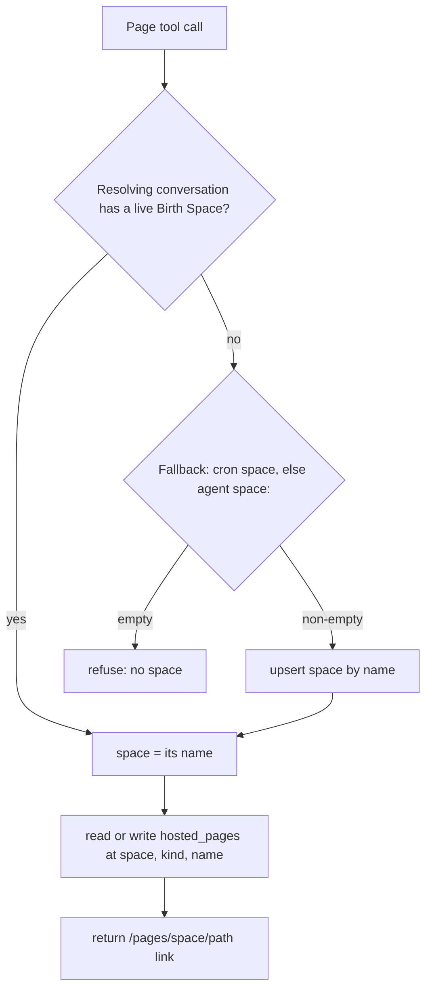
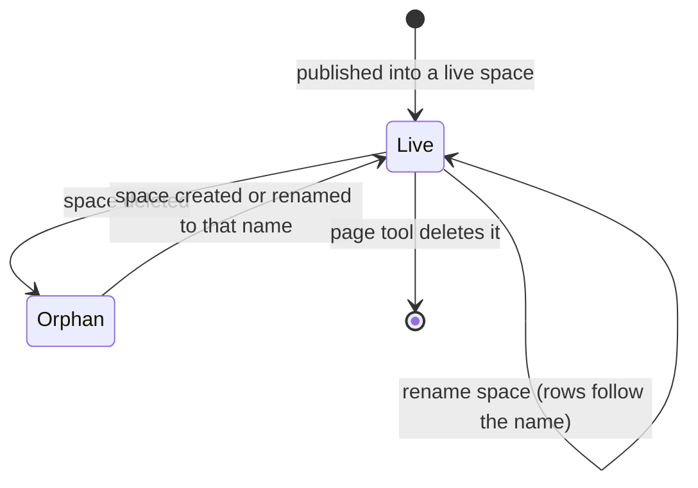

# Space-Owned Hosted Pages - Plan

## Goal Capsule

- **Objective:** A Hosted Page keeps one address that any later chat working in its space can update, and it survives the chat or agent that first published it.
- **Means:** Hosted Pages and Page Data are keyed by space name instead of by owner (KTD1), and each page tool call writes to the publishing chat's space (KTD3).
- **Authority:** Product Contract Requirements and Key Decisions win on behavior; Key Technical Decisions win on mechanism; units carry neither. `AGENTS.md` and `CONCEPTS.md` bind every unit.
- **Stop conditions:** stop and report if the Go source budget (`make check-cloc-budget`, 352 lines of headroom when planned) cannot hold the change without deleting unrelated code, or if migration number `109` is already taken on `main` when landing.
- **Execution profile:** one PR. Go backend, proto, React web and docs. Backend tests run against real PostgreSQL (`ROCKETCLAW_TEST_DATABASE_URL`); web tests run in Chromium through `make -C internal/rocketclaw/web test`.
- **Finishing:** the `lfg` pipeline implements, reviews and opens the pull request; merging stays with the user.

---

## Product Contract

### Summary

Pages and Page Data belong only to a Web space. A page tool writes into the space of the chat that calls it, and a chat with no space is refused. Pages outlive their publisher. Deleting a space leaves its pages as orphans, which rejoin a space later created with the same name. Existing pages move into their spaces with the old owner name as a folder, so links that name the owner's current space keep working.

### Problem Frame

Today a Hosted Page belongs to whoever published it: a RocketClaw agent, or the RocketClaw copy of a remote OpenCode session. Session pages are deleted with the session and can only be updated by that session, so a later coding session cannot update a release page an earlier one published. The OpenCode bridge plan chose this because no lasting owner existed for a session's page (`docs/plans/2026-10-24-0852-feat-coding-server-mcp-bridge-plan.md`, decisions "The session owns its pages" and "Bridge pages are always ephemeral"). The owner now wants pages owned by the place people work, the space, not by whoever wrote them.

This replaces two earlier decisions on purpose: per-owner pages from the Hosted Pages plan (`docs/plans/2026-10-18-1659-feat-rocketclaw-hosted-pages-plan.md`), and "moving a page tab moves its session's Birth Space" (`docs/solutions/logic-errors/moving-a-page-tab-must-move-its-sessions-birth-space.md`). That learning rejected a per-page space column as a second source of truth for a page's space. With no owner left, the page's own space is the only source, so that objection no longer applies.

### Requirements

**Ownership and publishing**

- R1. A Hosted Page file or Page Data entry is identified by its space and its path or key; it records no agent or session owner.
- R2. Every page tool call acts on the space of the chat that makes it: its Birth Space. For a chat with no recorded Birth Space, that is the cron's space for a cron run, else the agent's `space:`, as `CONCEPTS.md` defines Birth Space. A Subagent Session uses its top-level session, and a Shadow Session uses its shadow parent. An OpenCode bridge call uses only its session's recorded space.
- R3. A page tool call from a chat with no space is refused with a message that says how to get one: start the chat from a Web space, or give the agent a `space:`. For an OpenCode bridge session, the message names only the first way: create or fork the session from a RocketClaw Web space.
- R4. Store, read, delete and list cover the whole space, so any chat in a space can replace or delete any page or Page Data entry there.
- R5. Publishing into a space name that does not exist creates that space, as creating a session does.

**Lifetime**

- R6. A page lasts until a tool deletes it. Deleting the session, the OpenCode session's RocketClaw copy, or the agent that published it leaves the page in place.
- R7. Deleting a space leaves its pages as orphans under that space's name. People without a Space Limit can still open them and see them in the Page Index under that name. Nothing can change or delete them.
- R8. Creating a space, or renaming one, to an orphan set's name adopts those orphans into it. A rename that would put two pages on one path is refused.
- R9. Renaming a space moves its pages to the new name. Links and tabs under the old name stop resolving.
- R10. Changing an agent's `space:` leaves its existing pages where they are. Its chats without a recorded Birth Space publish into the new space, and chats with one keep publishing there (R2).
- R11. Moving a page tab to another space moves only that person's tab.

**Addresses and reading**

- R12. A page opens at `/pages/<space>/<path>`, and its sandboxed file at `/pages-raw/<space>/<path>`, which keeps the sandbox security header on every response.
- R13. A page's script reads the Page Data of its own space, never another space's.
- R14. The Page Index lists HTML pages grouped by space, showing the live space's spelling and each page's path.
- R15. People with a Space Limit open and list only pages whose space name is in their limit.

**Existing pages**

- R16. On upgrade, each existing page file moves into its owner's space under `<old owner>/<path>`, so links of the form `/pages/<owner's current space>/<owner>/<path>`, such as `/pages/Billing/reporter/q3.html` and `/pages/Atlas/opencode:box:ses_a/index.html`, keep their addresses, old escaping included.
- R17. On upgrade, existing Page Data keeps its key. When two old owners in one space used the same key, the most recently updated value keeps it and older values stay only in the kept-aside rows (R18).
- R18. On upgrade, a page whose owner has no resolvable space is removed from the live pages. This covers agents without `space:` such as `main`, agents no longer configured, and sessions without a Birth Space. Every pre-upgrade row is kept aside until a later release drops it.

### Key Decisions

- **Spaces are the only owners of pages.** Governs R1, R4, R6. (session-settled: user-directed — chosen over agent and session owners: pages must outlive their publisher and be updatable by later sessions.)
- **A page goes into the space of the chat that publishes it.** Governs R2. (session-settled: user-approved — chosen over a tool argument naming the space: one rule for native and OpenCode chats.)
- **A chat with no space is refused.** Governs R3. (session-settled: user-directed — chosen over a shared "No space" area.)
- **An agent's existing pages stay when its space changes.** Governs R10. (session-settled: user-approved — chosen over pages following the agent.)
- **Moving a page tab moves only the tab.** Governs R11. (session-settled: user-approved — chosen over moving the page or the session with it.)
- **Existing pages are kept, with the old owner as a folder.** Governs R16, R18. (session-settled: user-directed — chosen over deleting all pages and starting fresh.)
- **Deleting a space orphans its pages.** Governs R7. (session-settled: user-directed — chosen over deleting them with the space.)

### Scope Boundaries

- No per-call space choice, page history, Web delete button, or manual move of a page between spaces.
- Considered and not built: redirects from a renamed space's old name. They need a lasting name history with precedence rules when a name is recreated, and a config-named space is recreated under its old name anyway at the next session. Would change if people rename spaces holding linked pages.
- Considered and not built: following `reports_to` for sessions created by `rocketclaw_sessions_write`. R2 already gives them the agent's `space:`, and Birth Space does not follow `reports_to`. Would change if delegated work of spaceless agents must publish.
- Considered and not built: rewriting stored tab paths on rename, or deduplicating tabs whose old and new escaping differ. Both are cosmetic, and tabs already tolerate stale paths.
- Considered and not built: a guard stopping Shadow Sessions from overwriting their parent's pages. Shadows already run tools for real in the shared workspace (`CONCEPTS.md`, Shadow Session).
- Considered and not built: per-agent Page Data isolation inside a space. Spaces own the data, so a page reading every key of its space is the intended boundary.

### Resolved Questions

The owner settled these after review, checking them against a real deployment's pages, tabs and chat links.

- **Same names in one space overwrite each other, by design.** Two agents in one space that publish the same path or Page Data key replace each other's. Agents that must not collide publish under their own folder and key, which is a change to the agents, not to this plan.
- **Migrated copies stop updating.** After the upgrade, an agent that rewrites `q3.html` writes `/pages/<space>/q3.html`, and its migrated copy at `/pages/<space>/<agent>/q3.html` stops updating. Accepted: agents that should keep their address publish under `<agent>/<path>`, where the upgrade puts their existing pages.
- **Renaming a space breaks its page links and open page tabs (R9).** Accepted, with no redirect from old names.
- **Some existing links stop resolving after the upgrade.** These are links whose space segment is `-` or an owner's earlier space, links to pages of sessions moved by a page-tab move, and every old `/pages-raw/<owner>/<path>` link, including Open PDF tabs. Today `servePage` finds pages by owner and redirects any space segment; afterwards the space segment decides. Accepted.
- **Page Data clashes during the upgrade keep the newest value (R17).** A migrated page whose old owner used a key that a newer owner in the same space also used reads the newer owner's value. Accepted, along with keeping older values only in `retired_hosted_pages` instead of renaming them `<owner>/<key>`: neither rule gives the older owner's pages back their own value.
- **Owners with no resolvable space lose their pages at the upgrade (R18).** Accepted. Before upgrading, give every agent that publishes a `space:`. To keep a page of a spaceless owner, copy it from `retired_hosted_pages` into a space after the upgrade.
- **Page scope follows a moved chat.** A spaceless agent that moves its chat with `rocketclaw_sessions_move` then works on the new space's pages. Accepted.
- **Rollback stays manual and lossy.** Run migration 109's Down, then pin the older version. Pages published after the upgrade are lost. Accepted.

---

## Planning Contract

### Key Technical Decisions

- KTD1. **Pages are keyed by space name, matched case-insensitively, with no foreign key to `web_spaces`.** Uniqueness is a unique index on `(lower(space), kind, name)`, like `web_spaces_name`. Every lookup, upsert (`ON CONFLICT` on that index), rename and delete matches on `lower(space)`, so one space holds one row per path whatever spelling wrote it. Orphans (R7) then cost nothing: their rows keep the name. Adoption (R8) comes free in all three places a space is created (`CreateSpace`, `CreateLimitSpaces`, `createConversation`). `DeleteSpace` only has to stop deleting pages. Keying by space ID would need a nullable key column plus a remembered name for orphans, and re-adoption code in every create path.
- KTD2. **Renaming a space locks it, then moves its pages, and a path clash refuses the rename.** `RenameSpace` runs one transaction:
  1. It locks the `web_spaces` row `FOR UPDATE`.
  2. In a following statement, so its snapshot sees any publish that finished first, it updates `web_spaces.name` and `hosted_pages.space` together.

  When the new name holds orphans on the same path, the unique index's violation becomes `ErrSpaceRejected` through the existing `spaceNameError`, with no new check. Covers R8, R9.
- KTD3. **Each tool call resolves its space and writes in one SQL statement.** Built for each turn, `pageSpace` carries a resolving conversation and a fallback space name, and no longer a fixed agent and space.
  - The statement reads the conversation's live Birth Space row `FOR SHARE`, so it waits for a running rename and then sees the new name.
  - With no live Birth Space, it uses the fallback and upserts that space by name like `createConversation` (R5).
  - It writes or reads under the resulting name, and returns it for the link. An empty result is the R3 refusal.
  - With KTD2's lock order, a publish and a rename run one after the other. A publish that finishes before `DeleteSpace` leaves an orphan, which R7 allows. A fallback publish after a delete recreates the space by name, as a new session of that agent already does.
  - Resolving each call, not once per turn, sends a page to the new space after `rocketclaw_sessions_move`.
- KTD4. **Native turns resolve through the conversation the turn already identifies.** In `bridge.go`, `self` is already the top-level session after `subagentLineage`. The fallback is the cron's space when `origin.Cronjob` names one, else the agent's `space:`. A Shadow Session uses its shadow parent (`ShadowParent`) for both: the parent conversation resolves, and the fallback comes from the parent's cron and the parent's agent, not the shadow agent. The OpenCode bridge passes its counterpart row and an empty fallback.
- KTD5. **Moving existing pages is a SQL migration plus one Go placement step.**
  - Migration `109` copies every row to `retired_hosted_pages`, which keeps every pre-upgrade row aside.
  - It moves them to `hosted_pages_pending` and reshapes `hosted_pages`: it adds `space`, drops `agent` and `conversation_id` (and with them the cascade from `066`), and sets the new key.
  - The placement step runs inside `startWithBehavior`, after stored Behavior is applied and the runtime skeleton and overlays are synced, and before anything is served. Running earlier, in `newSessionService`, would load agent definitions that are not final yet and could drop pages of overlay agents.
  - In one transaction, the step:
    1. passes the configured agents' spaces as arrays;
    2. places session rows by their conversation's Birth Space and agent rows by the agent's `space:`;
    3. prefixes file names with the old owner;
    4. on any clash of space, kind and name, keeps the most recently updated row (R17);
    5. empties the pending table.
  - A database or agent-load error fails startup and leaves the pending rows for the next start. The step is idempotent because pending empties.
  - `Down` rebuilds the old table from `retired_hosted_pages`, losing pages published after the upgrade, as earlier lossy `Down` steps do.
- KTD6. **The page routes become `/pages/{space}/{path...}` and `/pages-raw/{space}/{path...}`.** Go's mux unescapes path values. So old links such as `/pages/Billing/main%2Freview/a%20b/index.html` and `/pages/Atlas/opencode%3Abox%3Ases_a/index.html` resolve to the migrated names `main/review/a b/index.html` and `opencode:box:ses_a/index.html`. `servePage` keeps its sandbox header on every raw response and its 308 when the stored spelling of the space differs from the request.
- KTD7. **Proto drops owners.**
  - `PageRequest` and `ListPagesRequest` replace `agent` with `space`, and `PageEntry` drops `agent`. Old field numbers are reserved, following the `reserved` convention already in `web.proto`.
  - `UpdateSessionRequest.space_id` and its `updateSession` branch are removed, with their Web caller `movePages`.
  - `MoveConversation` stays because `sessionsMoveTool` uses it.
- KTD8. **Attention marks match a page tab by its URL's space and decoded path.** `PutPage`'s matcher compares the tab URL's space segment with `EqualFold` and the unescaped remainder with the page name. The `/pages` index tab keeps matching on its own space. The note becomes `<path> updated`.
- KTD9. **The formal-modeling gate does not apply.**
  - Each publish, rename and delete is one transaction, and the only concurrent pair that touches the same rows, publish and rename, is ordered by the space row lock (KTD2, KTD3).
  - The placement step is one transaction that runs before serving.
  - No queue, lease, retry or multi-step lifecycle across transactions is introduced. This change removes the publish-versus-tab-move race that the rejected `106_hosted_page_space.sql` had (pack: formal-modeling, stateful-design.md).

### High-Level Technical Design

### Assumptions

- Orphans are listed in the Page Index under their remembered space name, not under "No space". The Web groups by name already, and the name tells people where the pages came from.
- Shadow agents' existing pages are placed by the shadow agent's own `space:`, which is usually empty, so they are kept aside rather than merged into the parent's space.
- Sticky sessions keep the space they were created in after their agent's `space:` changes; R2 follows the chat, not the agent.

### Sources

- `docs/plans/2026-10-18-1659-feat-rocketclaw-hosted-pages-plan.md`, `docs/plans/2026-10-24-0852-feat-coding-server-mcp-bridge-plan.md`: the decisions this plan replaces.
- `docs/solutions/logic-errors/moving-a-page-tab-must-move-its-sessions-birth-space.md`: the rejected per-page space column and the Space Limit rule for moves.
- `docs/solutions/logic-errors/history-links-must-not-cascade-from-entries-another-conversation-owns.md`: why the `066` cascade must go.
- `docs/solutions/logic-errors/migrating-staged-undo-markers-must-settle-what-the-old-code-settled-later.md`: one fixture per legacy row shape.
- `docs/solutions/integration-issues/chrome-blocks-pdfs-in-sandboxed-iframes-but-not-behind-a-csp-sandbox-header.md`: the raw route's header carries PDF safety.
- `docs/solutions/runtime-errors/deployment-binary-missing-live-migrations.md`: check the migration number on `main` before landing.

---

## Implementation Units

### U1. Space-keyed storage and migration

- **Goal:** `hosted_pages` is keyed by space, existing pages are placed at startup, and every pre-upgrade row is kept aside.
- **Requirements:** R1, R6, R16, R17, R18; KTD1, KTD5, KTD8.
- **Dependencies:** none.
- **Files:**
  - `internal/rocketclaw/backend/migrations/109_space_owned_pages.sql` (new)
  - `internal/rocketclaw/backend/pages.go`
  - `internal/rocketclaw/backend/app.go` (`startWithBehavior`)
  - `internal/rocketclaw/backend/pages_test.go`
  - `internal/rocketclaw/backend/store_schema_test.go` (ledger lists)
  - `internal/rocketclaw/backend/store_test.go` (head table list; drop the session-deletes-pages expectation)
  - `internal/rocketclaw/backend/opencode_test.go` (replace `TestOpenCodeSessionPagesGoWithTheirSession`)
- **Approach:**
  1. Write `109` with a real `Down`, using CTEs only. Name the kept-aside tables without the `legacy_` prefix, which the ledger test reserves.
  2. Rewrite `Page`, `PutPage`, `DeletePage` and `Pages` around `(space, kind, name)`. `Page` drops `Agent` and `Conversation`. `Pages` takes a space, or an empty one for all, and returns the live spelling through a `web_spaces` join on `lower(name)`.
  3. Add the placement step and call it from `startWithBehavior` after `validateRuntimeAssets`.
  4. Change the `PutPage` matcher per KTD8.
- **Patterns to follow:** `108_history_links.sql` for CTE data moves. `TestDropWebTabStateBlobMigration` and the `ExecVersionContext(... migrate.Down, N)` tests in `store_schema_test.go` for seeding legacy rows. `SpaceLimitFor` in `store_dao.go` for loading agents with `LoadRuntimeAgents`.
- **Test scenarios:** one fixture per legacy shape, seeded at migration `108`, then `109` and placement, asserting the live and kept-aside rows.
  - Agent `reporter` with `space: Billing` and file `q3.html` lands at `Billing`, `reporter/q3.html`.
  - Agent `main` with no `space:` and file `report.html` is not live, and it is in `retired_hosted_pages`.
  - Agent `gone`, no longer configured, is not live.
  - OpenCode session `opencode:box:ses_a` with Birth Space Atlas lands at `Atlas`, `opencode:box:ses_a/index.html`.
  - An OpenCode session whose Birth Space was cleared is not live.
  - Shadow agent `main/review` with no `space:` is not live; with `space: Billing`, its `a b/index.html` lands at `main/review/a b/index.html`.
  - Agents `reporter` and `auditor` in Billing both have Page Data key `data`. The newer is live as `data`, and the older is only in `retired_hosted_pages`.
  - Agent `reporter` has `space: billing` while an OpenCode session's pages migrate into live space `Billing`. Both land in one space, and a later store of an existing path replaces it rather than adding a second row.
  - Running placement twice leaves the same rows, and a page deleted between runs stays deleted.
  - `Down` from `109` restores the pre-upgrade rows.
  - Deleting an OpenCode session's RocketClaw copy through the sync removal path leaves its migrated pages.
  - Storing an HTML file in Billing marks a tab at `/pages/Billing/reporter/q3.html` and one at the old shape `/pages/billing/reporter%2Fq3.html`, but not `/pages/Ops/reporter/q3.html`.
- **Verification:** backend tests pass on a fresh database. The ledger and head-table tests list `109` and the new tables.

### U2. Space delete, rename and adoption

- **Goal:** Deleting a space orphans its pages, renaming moves them, and creating a space adopts orphans.
- **Requirements:** R7, R8, R9; KTD1, KTD2.
- **Dependencies:** U1.
- **Files:**
  - `internal/rocketclaw/backend/store_dao.go` (`DeleteSpace`, `RenameSpace`)
  - `internal/rocketclaw/backend/store_test.go` (`TestWebSpaces`)
- **Approach:**
  1. Remove the `pages` CTE from `DeleteSpace`.
  2. Make `RenameSpace` a transaction per KTD2, with the rename of the space and its pages in one statement, so `spaceNameError` covers both unique violations.
- **Patterns to follow:** the existing CTE shape of `DeleteSpace`.
- **Test scenarios:**
  - Deleting Billing leaves its pages readable under `Billing`; creating `billing` again lists them under the new space's spelling.
  - Renaming Billing to Finance makes its pages readable under Finance and not under Billing.
  - Renaming Ops to Billing while Billing orphans hold `index.html` and Ops holds `index.html` returns `ErrSpaceRejected` and changes nothing.
  - Renaming Ops to Billing with orphans on other paths adopts them.
  - After deleting Billing and creating `billing`, storing `index.html` from a chat in `billing` replaces the orphan `Billing/index.html`, leaving one row.
  - A publish that holds the Birth Space row while Billing is renamed to Finance lands its page in Finance once the rename completes.
- **Verification:** `TestWebSpaces` passes with the inverted delete expectation.

### U3. Page tools resolve the publishing chat's space

- **Goal:** Native and OpenCode page tools read and write the calling chat's space.
- **Requirements:** R2, R3, R4, R5, R10, R13; KTD3, KTD4.
- **Dependencies:** U1.
- **Files:**
  - `internal/rocketclaw/backend/page_tools.go`
  - `internal/rocketclaw/backend/bridge.go` (the `pageSpace` call site)
  - `internal/rocketclaw/backend/opencode_mcp.go` (call site, the no-space branch, the instructions text)
  - `internal/rocketclaw/backend/session_tools.go` (navigate tool's URL description)
  - `internal/rocketclaw/backend/page_tools_test.go`
  - `internal/rocketclaw/backend/opencode_mcp_test.go`
  - `internal/rocketclaw/backend/bridge_test.go` (tool list fixture)
- **Approach:**
  1. Replace `pageSpace`'s agent, space and conversation with the resolving conversation and fallback (KTD3).
  2. Make `url` build `/pages/<space>/<segments>` from the resolved name, dropping the `-` placeholder and the agent segment.
  3. Make every tool refuse with R3's message when no space resolves; the OpenCode branch that refused only stores goes away.
  4. Reword descriptions from "this agent's" to "this space's". Say that list and delete cover every chat's pages in the space, and that a page reads its space's Page Data.
- **Patterns to follow:** `createConversation`'s space upsert CTE. The `fork.go` source-space CTE.
- **Test scenarios:**
  - A Web session of spaceless `main` born in Atlas stores `index.html`, gets `https://rc.example/pages/Atlas/index.html`, and a second session in Atlas reads and replaces it.
  - A cron-run turn of agent `reporter` (`space: Billing`), with a cron `space: Ops`, publishes into Ops; with no cron space, into Billing.
  - A subagent publishes into its top-level session's space.
  - A Shadow Session publishes into its parent's space. A shadow of a Slack-thread `reporter` session (agent `space: Billing`, no Birth Space) publishes into Billing.
  - After `reporter`'s `space:` changes from Billing to Ops, its Billing pages stay, a Web session born in Billing still publishes into Billing, and a cron run with no cron space publishes into Ops.
  - A Slack-thread session of a spaceless agent is refused on store, read, list and delete, and the message names both ways to get a space.
  - A cron space `Reports` that does not exist is created by the first store.
  - `rocketclaw_list` in Billing reports pages published by two different chats.
  - After `rocketclaw_sessions_move` to Ops mid-turn, the next store lands in Ops.
  - OpenCode `ses_a` and `ses_c`, both in Billing, see and replace each other's pages. A session with no space is refused on every page tool, with a message that names creating or forking the session from a Web space and does not mention `space:`, and it still toggles tags.
- **Verification:** backend page and bridge tests pass. No test asserts per-agent isolation any more.

### U4. RPC, routes and proto

- **Goal:** People open, list and read pages by space, and the page-tab move path is gone.
- **Requirements:** R11, R12, R13, R14, R15; KTD6, KTD7.
- **Dependencies:** U1.
- **Files:**
  - `internal/rocketclaw/web/proto/web.proto` and its generated outputs (`go generate ./internal/rocketclaw/frontend/rpc`)
  - `internal/rocketclaw/frontend/rpc/pages.go`
  - `internal/rocketclaw/frontend/rpc/http.go`
  - `internal/rocketclaw/frontend/rpc/server.go` (remove the `SpaceId` branch of `updateSession`)
  - `internal/rocketclaw/frontend/rpc/pages_test.go`
  - `internal/rocketclaw/frontend/rpc/permissions_test.go`
  - `internal/rocketclaw/frontend/rpc/tabs_test.go` (remove the `SpaceId` case)
  - `internal/rocketclaw/frontend/rpc/http_test.go`
  - `internal/rocketclaw/frontend/rpc/remote_test.go`
- **Approach:**
  1. `getPage` and `listPages` stop loading agent definitions and check the Space Limit against the page's space.
  2. Re-register the two page routes with a space segment, keeping per-method registration and the `/pages-raw/` bypass prefix.
  3. Apply KTD7's proto changes and regenerate.
- **Patterns to follow:** existing `servePage` header and redirect handling. The `reserved` lines in `UpdateSessionRequest`.
- **Test scenarios:**
  - `GET /pages/Billing/reporter/q3.html` returns the migrated page, and `/pages/billing/...` returns a 308 to `Billing`.
  - The old-escaping links `/pages/Billing/main%2Freview/a%20b/index.html` and `/pages/Atlas/opencode%3Abox%3Ases_a/` serve their migrated pages.
  - `GET /pages-raw/Billing/q3.html` carries the sandbox CSP, CORP `cross-origin` and `no-store`; a missing page returns 404 with the same CSP.
  - `GetPage{space: Billing, path: data, data: true}` returns Billing's value; the same key in Ops returns Ops's.
  - A person limited to Ops gets NotFound for a Billing page and sees only Ops pages in `ListPages`.
  - An orphan under deleted Billing is listed and opens for an unlimited person.
  - `ListPagesResponse` reports the live spelling `Billing` for rows stored as `billing`.
  - `TestPagesRealBrowser`: a page's script still cannot call the API as the viewer.
- **Verification:** `frontend/rpc` tests pass and the regenerated proto builds.

### U5. Web page tabs, index and pane

- **Goal:** The Web builds page URLs, frames, Page Data reads, the Page Index and the live pane from space and path.
- **Requirements:** R11, R12, R13, R14; KTD6, KTD7.
- **Dependencies:** U4.
- **Files:**
  - `internal/rocketclaw/web/src/ui.tsx` (`route.page`, `pageTab`, `pageLabel`, `pageSpace`, `HostedPage`, `hostedPagePath`, `PageIndex`, `HostedPageLinks`, the live pane; remove `pageAgent` and `movePages` and their callers)
  - `internal/rocketclaw/web/src/types.ts` (`PageEntry`)
  - `internal/rocketclaw/web/src/api.ts` (remove `updateSession`'s `spaceId`)
  - `internal/rocketclaw/web/src/pages.browser.test.ts`
  - `internal/rocketclaw/web/src/opencode.browser.test.ts`
  - `internal/rocketclaw/web/src/pages-transport.test.ts`
  - `internal/rocketclaw/web/src/remote-transport.test.ts`
  - committed web dist (`go -C internal/rocketclaw generate ./internal/web`)
- **Approach:**
  1. A page's identity becomes `<space>/<path>`, decoded consistently with KTD6.
  2. The frame and the PDF link use `/pages-raw/<space>/<path>`, and Page Data reads send the frame's space.
  3. Index entries and pane labels show the path only, grouped by the returned space. Page tab titles and the frame's title read `<space> · <path>`, replacing `<agent> · <path>`.
  4. Move to space on a page tab uses the ordinary tab move.
- **Patterns to follow:** existing page-tab and pane components; the react-doctor split rules in `docs/solutions/best-practices/react-doctor-complexity-limit-shapes-web-components.md`.
- **Test scenarios:**
  - Opening `/pages/Billing/reporter/q3.html` shows a frame at `/pages-raw/Billing/reporter/q3.html#rc=...`.
  - A page's `readData("data")` returns the Billing value.
  - A PDF page shows an Open PDF link to `/pages-raw/Billing/q3/report.pdf` that opens in its own tab.
  - The Page Index lists Billing's `reporter/q3.html` under Billing, labeled by path.
  - Move to space on a page tab moves the tab and sends no `UpdateSession`.
  - A Billing `index.html` tab moved into Ops next to Ops's `index.html` shows `Billing · index.html` beside `Ops · index.html`.
  - The live pane next to an OpenCode session reloads `/pages-raw/Atlas/index.html` when `ListPages` reports a newer `updatedAt`.
- **Verification:** `make -C internal/rocketclaw/web test` passes, including the Chromium page tests, and the dist is rebuilt.

### U6. Docs

- **Goal:** The docs and vocabulary describe space-owned pages.
- **Requirements:** R1–R18.
- **Dependencies:** U1–U5.
- **Files:**
  - `CONCEPTS.md` (Hosted Page, Page Data, Page Index, Birth Space, MCP bridge, the State Store kept-aside rule)
  - `README.md` (Space Limit line, page tools paragraph, raw files)
  - `internal/rocketclaw/frontend/rpc/README.md` (page routes, `GetPage`/`ListPages`)
  - `internal/rocketclaw/web/README.md` (Hosted Pages pane)
  - `internal/rocketclaw/skel/.rocketclaw/skills/main-create-or-update-agent/SKILL.md` (where pages go; publish under a folder for a stable address)
  - `docs/solutions/logic-errors/moving-a-page-tab-must-move-its-sessions-birth-space.md` and the reference in `docs/solutions/logic-errors/shared-row-menus-show-only-allowlisted-tab-commands.md`
- **Approach:**
  1. Rewrite each passage to state current behavior.
  2. Mark the moving-a-page-tab learning as replaced by this design, keeping its Space Limit lesson.
- **Test expectation:** none -- documentation only.
- **Verification:** every changed term matches the shipped behavior; no doc still says pages belong to an agent or a session.

---

## Verification Contract

| Gate | Command | Applies to |
|---|---|---|
| Go formatting | `gofmt -l` on touched Go files prints nothing | U1–U4 |
| Proto | `go generate ./internal/rocketclaw/frontend/rpc` leaves no diff after regeneration | U4 |
| Go tests | `go test ./...` with `ROCKETCLAW_TEST_DATABASE_URL` set | U1–U4 |
| Web tests and dist | `make -C internal/rocketclaw/web test` | U5 |
| Lint | `make lint` | all |
| Full suite | `make test` | all |
| Line budgets | `make check-cloc-budget` | all |

## Definition of Done

- R1–R18 hold, each covered by the scenarios named in its units or, for docs, by U6.
- A later session in a space can replace a page an earlier session published there, and the page survives deleting either session.
- Existing pages keep their `/pages/<owner's current space>/<owner>/<path>` addresses after upgrade, and every pre-upgrade row is in `retired_hosted_pages`.
- `make test`, `make lint` and `make check-cloc-budget` pass without new `//nolint`, budget edits or code moved to excluded paths.
- No source comments, defensive guards, nil-as-disabled dependencies or SQL subqueries were added; dead-end code from abandoned approaches is removed.
- The PR body carries the Resolved Questions above and states README impact.
