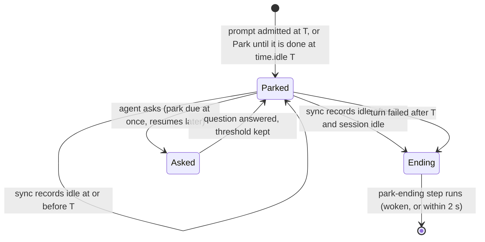

# Instant Session Done - Plan

## Goal Capsule

- **Objective:** A person's session tabs react to a session finishing as soon as it finishes, and a tab parked until done never comes back before the work it waits for is done.
- **Means:** Wake the existing checks early instead of replacing them (KTD2, KTD3, KTD4), and end an OpenCode park only on an idle marker newer than its prompt's admission (KTD1).
- **Product authority:** the Product Contract's Key Decisions, made by the person who asked for this work; the Planning Contract's KTDs decide mechanism within them.
- **Execution profile:** one pull request; units U1 to U7 in order, U1 first because the formal-modeling gate must pass before the stateful behavior is built.
- **Stop conditions:** stop and report if a TLC check in `docs/verification/session-done/` fails or cannot run, if OpenCode's prompt response turns out not to carry the admitted message's creation time, or if R5's 5-second bound cannot be met without changing a Key Decision.
- **Who finishes:** the implementing agent builds, verifies, and opens the PR; merging stays with the person.
- **Open blockers:** none.

---

## Product Contract

### Summary

When a session's turn ends, its parked tab comes back, its unread mark and notification appear, and its running indicator stops, on the person's screen within about a second.
Each fast signal only wakes a check RocketClaw already runs; those checks stay as the recovery path, so a missed signal costs at most 5 seconds.
A park until it is done ends only on a turn end that follows the prompt it waits for.

### Problem Frame

Auto-park on send is flaky for OpenCode sessions.
RocketClaw learns that an OpenCode session finished from a check that runs every 5 seconds and reads OpenCode in several requests before it writes what it saw.
When a person sends a message within seconds of the previous turn ending, that check can credit the earlier turn end to the new message's park, and the park ends within about 2 seconds while the new message is still running.
The person then parks the tab by hand.
The race is reproduced by a Go test against Postgres and by the TLA+ model in `docs/verification/remote-auto-park/`.

Even without the race, "done" is slow.
An OpenCode turn end reaches the screen after up to 5 seconds for RocketClaw to notice, up to 2 seconds for the unpark step, and up to 2 seconds for the browser's next check, about 9 seconds in the worst case.
A RocketClaw session's turn end takes up to about 4 seconds, from the unpark step and the browser check.

### Key Decisions

- **Doorbells over today's checks, with the race fix built in.** One place decides what is true; signals only make it run sooner. (session-settled: user-directed — chosen over applying OpenCode's events directly and over following OpenCode's ordered session log: applying events gives two deciders that must agree, and the ordered log neither replays nor streams on OpenCode v2.4.1's `opencode serve`.) Governs R1, R2, R6.
- **Instant is best effort; recovery is eventually consistent within 5 seconds.** (session-settled: user-directed — chosen over keeping the browser's 2-second check as the only delivery: the person wants the moment a session finishes, and accepts a bounded catch-up when a signal is lost.) Governs R3, R5.
- **Every "session finished" reaction, for OpenCode and RocketClaw sessions.** (session-settled: user-directed — chosen over unparking only and over OpenCode sessions only: a tab that comes back before its notification looks broken.) Governs R3.
- **Every server's tabs.** (session-settled: user-directed — chosen over this server's tabs only.) Governs R4.

### Requirements

**Parks end at the right time**

- R1. A park until it is done, whether set by auto-park on send or by Park until it is done, ends only on a turn end that comes after the prompt it waits for; set on an idle session, it waits for the next round of work.
- R2. R1 holds when any fast signal is lost, repeated, or arrives late.

**Done reaches the screen at once**

- R3. When a session's turn ends, its parked tab comes back, its unread mark and desktop notification appear, and its running indicator stops, on every open window of the people it reaches, within about a second, for both OpenCode sessions and RocketClaw sessions.
- R4. R3 also holds for session tabs a window shows from another RocketClaw server that runs this version; a server that does not keeps today's behavior.

**Recovery**

- R5. When any fast signal is missed, every reaction in R3 reaches the screen within 5 seconds of the turn end.
- R6. The checks RocketClaw runs today stay as the recovery path, including the browser's own periodic check; fast signals make them run sooner and never replace them.

### Acceptance Examples

- AE1. **Covers R1.** **Given** an OpenCode turn ended a second ago and RocketClaw has not recorded it, **when** the person sends another message with auto-park on, **then** the tab stays parked until the new message's turn ends.
- AE2. **Covers R1.** **Given** an idle OpenCode session whose turn ended a second ago, **when** the person picks Park until it is done, **then** the park waits for the next round of work.
- AE3. **Covers R3.** **Given** a parked OpenCode tab and a parked RocketClaw tab, **when** each session's turn ends, **then** each tab comes back bold with its notification and without a running indicator within about a second.
- AE4. **Covers R5, R2.** **Given** RocketClaw's connection to OpenCode's event feed is down, or the browser misses the server's push, **when** a turn ends, **then** the tab comes back within 5 seconds and never before the turn ends.
- AE5. **Covers R4.** **Given** a window on one server shows a parked tab from a second server running this version, **when** that session's turn ends, **then** the tab comes back within about a second.

### Success Criteria

- With every signal delivered, the time from a turn end to the tab's change on screen is under a second.
- The TLA+ checks in `docs/verification/session-done/` pass for the design as built: no early park end, the screen always catches up, and a check that starts after the session is done always resolves the park; the lossy-without-recovery world must still fail.

### Scope Boundaries

- Deferred: following OpenCode's ordered session log, until `opencode serve` keeps and streams it.
- Deferred: making an agent's question (Needs you) on OpenCode tabs fast; it may arrive faster when a signal fires, but it is not promised.
- Not included: Cron, Pages and Search tabs.
- Not included: removing the browser's periodic check.
- Not included: Slack.

### Dependencies / Assumptions

- OpenCode's live event feed reports each session's busy and idle status (`session.status` in `internal/rocketclaw/oc/packages/schema/src/session-status-event.ts`), and RocketClaw already holds that connection (`internal/rocketclaw/backend/opencode.go` `follow`).
- The feed is volatile: OpenCode drops events while disconnected or when a consumer falls behind.
- OpenCode's prompt endpoint answers once the prompt is durably admitted, returning the admitted message (`internal/rocketclaw/oc/packages/protocol/src/groups/session.ts`, `session.prompt`).
- RocketClaw already pushes database changes to open Web streams with Postgres notifications (`internal/rocketclaw/backend/transcript.go`).
- Stateful behavior follows the formal-modeling pack: PlusCal model and passing TLC checks before building. (pack: formal-modeling, stateful-design.md)

### Sources / Research

- `docs/verification/remote-auto-park/` — model of today's race and of the admission-threshold fix; TLC finds the early end on the design as built.
- `docs/verification/session-done/` — models comparing doorbells (with and without the race fix, with and without lost signals and recovery) and the ordered session log (with and without replay).
- `internal/rocketclaw/frontend/rpc/relay.go` — parks on send before forwarding the prompt.
- `internal/rocketclaw/backend/opencode.go` — the 5-second OpenCode check and the turn-end credit it writes.
- `internal/rocketclaw/backend/attention.go` — parks, `endTurnParksSQL`, and the 2-second loop that ends them.
- `internal/rocketclaw/web/src/ui.tsx` — the browser's 2-second session list check.
- `docs/verification/tab-attention/README.md` — the existing model leaves out how the server learns a session is idle.
- OpenCode v2.4.1 `packages/core/src/session/run-coordinator.ts` and `execution.ts` — one execution drains every prompt admitted while it runs, queued follow-ups included, and records one end per busy period; after an interrupt, queued prompts stay waiting and the session goes idle.
- OpenCode v2.4.1 `packages/core/src/bus.ts` and `packages/cli/src/server-process.ts` — the session log replays only with `events.persist`, which `opencode serve` never sets.
- `docs/solutions/` learnings on tab-attention columns, the Web's shared connection budget, and remote turn ends, as cited in the KTDs below.

Product Contract preservation: Product Contract unchanged; the resolved planning questions moved into KTD1 to KTD5.

---

## Planning Contract

### Key Technical Decisions

- KTD1. **An OpenCode park waits for an idle marker newer than its threshold, on OpenCode's clock.** The relay forwards the prompt first and records the auto-park only after OpenCode admits it, carrying the admitted message's creation time from OpenCode's response as the park's threshold. Park until it is done on an OpenCode tab takes the creation time of the session's newest idle marker at park time, or 0 when there is none, as the threshold; that is the same field the sync stores in `read_through`. The park-ending step ends an OpenCode park once `read_through` is past the threshold and the session is neither running nor running background work; `worked` no longer decides OpenCode parks. A failed turn ends an OpenCode park at once only when that failed idle marker is past the park's threshold and the session is idle, so the sync passes each ended session's idle marker time to the turn-end step. After reading any new idle marker, the sync reads OpenCode's active sessions again and stores that answer as `running`: a prompt admitted while a busy period settles gets that period's idle marker after its own time, and OpenCode keeps the session active straight into the successor that runs it, so only a read taken after the marker shows whether work remains. A park on a prompt still queued when the person interrupts the turn ends when the session goes idle, since nothing will run it. Both sides of the comparison come from the OpenCode server's clock, so skew between machines cannot reorder them. (session-settled: user-directed — chosen over applying OpenCode's events directly and over following OpenCode's ordered session log: one decider stays, and the log neither replays nor streams on `opencode serve` v2.4.1.) Governs R1, R2.
- KTD2. **OpenCode's live feed wakes the sync for its server.** `follow` already reads `/api/event`; a `session.status` event and the `server.connected` event after a reconnect ring a one-slot wake for that server's sync, which then runs at once. The sync, not the feed, records turn ends, so its `read_through` cursor and turn-end marks stay the only writer (`docs/solutions/` remote turn-end learning). Each server gets its own sync loop so one server's wake does not wait on another's requests. Governs R3, R6.
- KTD3. **A recorded turn end or park wakes the park-ending step.** `WakeParks` gains a one-slot wake rung after an OpenCode sync commit, after the relay records an OpenCode auto-park, and after a RocketClaw turn closes (`closeTurn`, where `running` turns off and the turn leaves `delivering`), not after `finishTurn`, which still counts as work. The 2-second ticker stays. Governs R3, R6.
- KTD4. **The server tells each window "your listing changed" over a small stream, and the window fetches.** A per-person registry of waiting channels on `SessionService`, created with it and shaped like `/typing`'s, feeds a new server-sent-event route the RPC server adds; commits ring it directly after they change what a listing or tab shows: an attention change, turn-end and question marks, a park's end, an OpenCode sync that flips a session's `running`, `background` or `asking`, and a RocketClaw turn starting or closing. Title, reply, `last_updated` and `synced_at` churn alone never rings. Keeping the registry on `SessionService` avoids writing a dependency into a service whose loops are already running. One RocketClaw process serves one database, so an in-memory registry reaches every window of that server; Postgres notifications are not needed. The message carries no data. Governs R3, R4.
- KTD5. **The window coalesces rings into the polls it already runs.** On a ring, a window runs its session listing check for that server now (one fetch in flight plus at most one pending, never cancelling the one in flight), and that run restarts the 2-second delay instead of adding a fetch beside it; for another server a ring also runs its tabs check, since a returning tab from another server arrives through the tabs poll. Both 2-second polls stay. The subscription lives in its own hook inside `ServerSessions` (`docs/solutions/` connection-budget and react-doctor learnings). Governs R3, R4, R6.
- KTD6. **Recovery budget: the sync interval is chosen from a measured sync pass.** With every ring lost, a turn end reaches the screen after at most one sync interval, one full sync pass (names, sync, bridges), the browser's 2-second post-fetch delay, and two listing fetches. The interval starts at 2.5 seconds and U3 lowers it if the measured pass and listing fetch do not fit R5's 5 seconds; if no interval fits, the Goal Capsule's R5 stop condition applies. The in-process park wake is not lossy, so the park ticker is not in the budget. Governs R5.

### High-Level Technical Design

```mermaid
sequenceDiagram
    participant W as Browser window
    participant R as RocketClaw
    participant O as OpenCode
    W->>R: send prompt (relay)
    R->>O: forward prompt
    O-->>R: admitted message (created time T)
    R->>R: park until done, threshold T (KTD1)
    R-->>W: ring "listing changed" (KTD4)
    O-->>R: session.status idle (feed)
    R->>O: sync now (KTD2)
    R->>R: commit idle position past T
    R->>R: end park now (KTD3)
    R-->>W: ring "listing changed"
    W->>R: fetch listing and tabs (KTD5)
    Note over R,W: the feed event and the browser ring may be lost; the periodic sync and browser polls still converge (KTD6)
```

An OpenCode park until done, per KTD1:



The model in `docs/verification/session-done/Doorbell.tla` checks this design (pack: formal-modeling, stateful-design.md). Each process maps to code:

| Model process and labels | Code | Fairness |
|---|---|---|
| `Relay`: Send, Proxy, Respond | `relay.go` forwarding the prompt and recording the park after admission | weak: a person's send completes |
| `OpenCode`: Serve | OpenCode admitting a prompt and settling a busy period with an idle marker, successful or failed | weak: turns end |
| `Lose`: Drop | a lost `session.status` event or a lost browser ring | none: loss is adversarial |
| `Sync`: Wait, Active, Stored, Idle, Again, Commit | the per-server loop in `opencode.go`, `syncOpenCode` reads, `storeOpenCodeSync` including the turn-end step | weak: the loop keeps running |
| `Unpark`: Ring, End | `WakeParks` and `tickParks` in `attention.go` | weak: the loop keeps running |
| `Browser`: Fetch, Read | the listing loop and ring hook in `ui.tsx` | weak: an open window keeps polling |

Invariants: `NoEarlyEnd` (an auto-park never ends before its own prompt's busy period has ended, and a manual park never ends before a busy period ends after it was set) and `FreshSyncReady` (a sync that started after the session was done leaves an owed park ready to end). Property: `ScreenCatchesUp` (once the session is done, the screen eventually shows an owed park's tab unparked). A park is owed an end when it is an auto-park or a busy period has ended since a manual park was set; a manual park set after the last busy period waits for the next round of work. Each check runs with `MaxSends = 2`, `MaxManual = 1`, and the `RaceFix`, `Recheck`, `Loss` and `Timers` switches its `.cfg` sets.

### Assumptions

- OpenCode's prompt response is `{data: SessionInbox.User}` with `time.created` in milliseconds on OpenCode's clock, the clock of idle markers and `read_through`.
- Only one RocketClaw process serves a database, so an in-memory registry reaches every window (`/typing` relies on the same).
- OpenCode's `/api/session/active` lists a session from the start of a busy period until it settles, and a successor that a prompt admitted during settling starts in the same step, so the session never leaves the list in between (OpenCode v2.4.1 `packages/core/src/session/run-coordinator.ts` `active` and `settle`, served by `packages/server/src/handlers/session.ts`). KTD1's second read of active sessions relies on this.
- OpenCode publishes `session.status` idle after the idle marker is stored and the session has left `/api/session/active`; U3 checks this against a real `opencode serve`, and if it fails the woken sync waits for the next tick, which breaks R3's one second.

### Risks

- A ring makes each reached window rebuild its listing. Ringing only on the flips KTD4 lists and restarting the poll delay (KTD5) bound it to about one extra fetch per turn start or end.
- Parks that exist at deploy time have no threshold. The migration in U2 backfills OpenCode parks until done with the session's current `read_through`, so they end at the session's next idle marker; a park that had already recorded its turn end and waits only on background work gets one less, so it ends when that work stops.

---

## Implementation Units

### U1. Model and evidence for the doorbell design

- **Goal:** the formal-modeling gate: a checked model of the design before the behavior is built.
- **Requirements:** R1, R2, R5, R6.
- **Dependencies:** none.
- **Files:** `docs/verification/session-done/Doorbell.tla`, `docs/verification/session-done/OrderedLog.tla`, `docs/verification/session-done/*.cfg`, `docs/verification/session-done/Makefile`, `docs/verification/session-done/README.md`; delete `docs/verification/remote-auto-park/` (its race and fix are covered by `Doorbell.tla`).
- **Approach:**
  1. Extend `Doorbell.tla` with a failed outcome for a busy period, compared against the threshold per KTD1; a Park until it is done step taking the newest idle position as its threshold, including one the sync has not recorded yet; and OpenCode's end of a busy period split into deciding to settle, writing the idle marker, and settling into idle or a successor, with admission allowed between them.
  2. Checks: `a-bells-only` and `a-recovery` must pass every property; `a-no-racefix` and `a-no-recheck` (the sync without its second read of active sessions) must find `NoEarlyEnd` violated; `a-lossy-no-timers` must find `ScreenCatchesUp` violated.
  3. Keep `OrderedLog.tla` as the record of the rejected design: `c-replay` passes, `c-no-replay` must find `ScreenCatchesUp` violated.
  4. Add a Makefile shaped like `docs/verification/tab-attention/Makefile` with the pinned jar and SHA-256, and a README evidence record with a Mermaid state diagram of a park, the model-to-code table above, and what the model leaves out: questions and their resumed parks, background work, and several people or tabs.
- **Patterns to follow:** `docs/verification/tab-attention/` (pack: formal-modeling, stateful-design.md).
- **Test scenarios:** Test expectation: none — the TLC checks are the proof.
- **Verification:** `make -C docs/verification/session-done` exits 0 with every check passing or failing as required, and the README records the TLC and Java versions, states, depth, and time.

### U2. OpenCode parks wait for their own prompt

- **Goal:** the race fix (KTD1).
- **Requirements:** R1, R2; AE1, AE2.
- **Dependencies:** U1.
- **Files:** `internal/rocketclaw/backend/migrations/111_web_park_after_idle.sql`, `internal/rocketclaw/backend/attention.go`, `internal/rocketclaw/backend/opencode.go`, `internal/rocketclaw/frontend/rpc/relay.go`, `internal/rocketclaw/frontend/rpc/tabs.go`, `internal/rocketclaw/web/proto/web.proto` with its generated Go and TypeScript, tests `internal/rocketclaw/backend/opencode_test.go`, `internal/rocketclaw/backend/attention_test.go`, `internal/rocketclaw/frontend/rpc/tabs_test.go`; delete `internal/rocketclaw/backend/zz_repro_auto_park_test.go` once its case lives in `opencode_test.go`.
- **Approach:**
  1. Add the threshold column to `web_tab_attention`, backfilling OpenCode parks until done with their session's `read_through`; walk the four-place column checklist from the tab-attention learning (idle-row delete, `listedTabs`, `until`/`resumes` rules, tests).
  2. `AttentionChange` carries the admitted time for `SENT`; `ChangeAttention` stores it as the threshold for OpenCode paths.
  3. The relay forwards the prompt, reads the admitted message from a successful response, then sends `SENT` with its creation time; a failed prompt parks nothing. The relay asks OpenCode for an uncompressed response on this request so it can read the body.
  4. Park until it is done on an OpenCode path reads the newest idle marker (the request `syncOpenCode` already makes) and stores its creation time as the threshold.
  5. `tickParks` ends an OpenCode park until done when `read_through` is past the threshold and the session is idle, with no `worked` condition; RocketClaw sessions keep today's rule.
  6. `storeOpenCodeSync` passes each ended session's idle marker time to the turn-end step, which ends an OpenCode park on a failure only when that time is past the threshold.
  7. When `syncOpenCode` reads any new idle marker, it reads `/api/session/active` once more and stores that answer as the session's `running`; a session active in that read records its turn end and marks but ends no park.
- **Patterns to follow:** `openCodeProxy` `Rewrite` for body handling; `AddOpenCodeSessionBridge` for an OpenCode session read.
- **Execution note:** start from the failing reproduction in `zz_repro_auto_park_test.go`, moved into `TestSyncOpenCodeMarksTurnSenders`, and see it fail under `-race -cpu=1,2` before the fix.
- **Test scenarios:**
  - Covers AE1. An idle marker exists at OpenCode but is unsynced; `SENT` with an admitted time after it parks; a sync records the old marker; `tickParks` keeps the park.
  - The same park ends after a sync records an idle marker newer than the admitted time with the session idle.
  - A turn that finishes before the park is recorded ends the park right after its sync records the idle marker.
  - Covers AE2. Park until it is done on an idle OpenCode tab whose last turn ended unsynced waits for the next idle marker.
  - A failed OpenCode turn after the admitted time ends the park at once, as today.
  - A failed idle marker from before the admitted time, synced after the park is recorded, keeps the park.
  - A prompt admitted while the previous turn settles: the sync reads that turn's newer idle marker, but the second read of active sessions shows the session running, so the park stays until the successor turn's idle marker.
  - A prompt response compressed by OpenCode still records the park.
  - A turn OpenCode starts by itself after background work ends a manual park.
  - The relay parks only after a successful prompt response and records its `time.created`; a 4xx or 5xx response parks nothing (`TestPromptAutoParks`, with a prompt endpoint added to the fake OpenCode).
  - The migration backfills an existing OpenCode park until done, which then ends at the next newer idle marker; one that had recorded its turn end and waits on background work ends when that work stops.
- **Verification:** the moved reproduction passes repeatedly under `-race -cpu=1,2`; RocketClaw-session park tests are unchanged.

### U3. OpenCode's feed wakes its server's sync

- **Goal:** KTD2 and KTD6 for OpenCode.
- **Requirements:** R3, R5, R6.
- **Dependencies:** U2.
- **Files:** `internal/rocketclaw/backend/opencode.go`, `internal/rocketclaw/backend/opencode_test.go`.
- **Approach:**
  1. Split `SyncOpenCode`'s one loop over every server into one loop per server, each selecting on its ticker and a one-slot wake.
  2. `follow` rings that server's wake on `session.status` and on `server.connected`.
  3. Set the sync interval to 2 seconds: a sync pass measured 0.5 to 0.6 seconds against a real `opencode serve`, and 2.5 seconds left too little of R5's 5 seconds for the listing fetches. The feed reconnects after the same interval; the 5-second limit on each OpenCode call keeps its value as `openCodeCallTimeout`.
- **Patterns to follow:** the one-slot wake channels in `internal/rocketclaw/backend/thread_bridges.go`.
- **Test scenarios:**
  - A `session.status` event on the fake feed makes the sync record a new idle marker well before the next tick (`testing/synctest`).
  - A lost event still leaves the turn end recorded at the next tick.
  - A wake for one server does not run another server's sync.
- **Verification:** sync tests pass; no sync runs more than once per wake burst. Against a real `opencode serve`, a sync woken by `session.status` idle records the turn end at once, and the measured sync pass plus a measured listing fetch fit KTD6's budget at the chosen interval; otherwise stop per the Goal Capsule.

### U4. A recorded turn end wakes the park-ending step

- **Goal:** KTD3.
- **Requirements:** R3, R6.
- **Dependencies:** U3.
- **Files:** `internal/rocketclaw/backend/attention.go`, `internal/rocketclaw/backend/opencode.go`, `internal/rocketclaw/backend/store_dao.go`, `internal/rocketclaw/backend/attention_test.go`.
- **Approach:** give `WakeParks` a one-slot wake rung after `storeOpenCodeSync` commits, after `ChangeAttention` records an OpenCode auto-park, and after `closeTurn` commits; keep the 2-second ticker.
- **Test scenarios:**
  - A RocketClaw session's park until it is done ends right after its turn closes, before the ticker would fire (`testing/synctest`).
  - An OpenCode park ends right after the sync commit that moves `read_through` past its threshold.
  - An OpenCode park recorded after its turn already ended and synced ends right after it is recorded.
  - With the wake never rung, the ticker still ends both parks.
- **Verification:** park tests pass with and without the wake.

### U5. The server rings each window when its listing changes

- **Goal:** KTD4.
- **Requirements:** R3, R4.
- **Dependencies:** U4.
- **Files:** `internal/rocketclaw/backend/store.go`, `internal/rocketclaw/backend/attention.go`, `internal/rocketclaw/backend/opencode.go`, `internal/rocketclaw/backend/store_dao.go`, `internal/rocketclaw/frontend/rpc/http.go`, a new `internal/rocketclaw/frontend/rpc/listing.go` for the route, tests `internal/rocketclaw/backend/attention_test.go`, `internal/rocketclaw/backend/opencode_test.go`, `internal/rocketclaw/frontend/rpc/listing_test.go`.
- **Approach:**
  1. A registry of per-person waiting channels on `SessionService`, created in `newSessionService`, sending without blocking and dropping a ring when the channel is already full, as `/typing` does.
  2. A server-sent-event route that subscribes the caller and writes one tiny event per ring, with the same identity, space-limit, and cross-origin rules as `/typing`.
  3. The commits KTD4 lists ring the registry; a commit that cannot name the people it reaches rings everyone.
- **Patterns to follow:** `internal/rocketclaw/frontend/rpc/typing.go`; injected interfaces per the root `AGENTS.md`.
- **Test scenarios:**
  - A window subscribed for alice gets one event after `ChangeAttention` for alice, and none for bob's change.
  - A RocketClaw turn closing and an OpenCode sync that changes a row each ring.
  - An OpenCode sync that only updates titles, replies, last-updated or sync times does not ring.
  - A slow subscriber never blocks the ringing commit path.
  - A cross-origin subscription from a trusted origin gets the CORS headers before any refusal.
- **Verification:** RPC and backend tests pass; `go vet` and `make lint` clean.

### U6. The window fetches on a ring

- **Goal:** KTD5.
- **Requirements:** R3, R4, R5, R6; AE3, AE4, AE5.
- **Dependencies:** U5.
- **Files:** `internal/rocketclaw/web/src/ui.tsx`, a new hook module beside it, `internal/rocketclaw/web/src/api.ts`, tests `internal/rocketclaw/web/src/session-list.test.ts` and the browser test that covers the Parked section.
- **Approach:**
  1. A per-server hook inside `ServerSessions` opens the event stream, reconnecting as `EventSource` does, and on each event asks the listing loop for one immediate run.
  2. The listing loop runs at once when idle, or once more after the run in flight, without cancelling it; a ring-started run restarts the 2-second delay.
  3. For another server, a ring also refetches its tabs query.
- **Patterns to follow:** the `/typing` `EventSource` in `internal/rocketclaw/web/src/typing.tsx`.
- **Test scenarios:**
  - Covers AE3. A ring while idle starts a listing fetch at once.
  - Three rings while a fetch is in flight cause exactly one more fetch.
  - Covers AE4. With the feed and the ring both down, the tab comes back within 5 seconds of the turn end, timed.
  - Covers AE5. A ring from another server refetches that server's listing and tabs.
- **Verification:** `make -C internal/rocketclaw/web lint test` passes, react-doctor included.

### U7. Documentation

- **Goal:** keep the project vocabulary and user docs true.
- **Requirements:** R1, R3.
- **Dependencies:** U6.
- **Files:** `CONCEPTS.md`, `internal/rocketclaw/web/README.md`, `docs/verification/tab-attention/README.md`.
- **Approach:** update Parked's "The server ends parks itself, every few seconds" to "as soon as it learns a session is done, and every few seconds otherwise"; state that an OpenCode park waits for an idle after its own prompt; point the tab-attention model's "what OpenCode reports" limit at `docs/verification/session-done/`.
- **Test scenarios:** Test expectation: none — documentation only.
- **Verification:** the text matches the built behavior.

---

## Verification Contract

| Gate | Command | Applies to |
|---|---|---|
| Formal model | `make -C docs/verification/session-done` | U1, rerun after any change to KTD1 to KTD5 |
| Go format | `gofmt -l` on touched Go files prints nothing | U2 to U5 |
| Generated code | `go generate ./internal/rocketclaw/frontend/rpc` leaves no diff after commit | U2 |
| Lint | `make lint` | all |
| Tests | `make test`, with a Postgres for `ROCKETCLAW_TEST_DATABASE_URL` | all |
| Flake proof | the moved reproduction under `-race -cpu=1,2 -count=50` | U2 |
| Web | `make -C internal/rocketclaw/web lint test` | U6 |

---

## Definition of Done

- Every unit's Verification holds and every gate in the Verification Contract passes; CLOC and coverage budgets pass without editing `SOURCE_CLOC_BUDGET`.
- `docs/verification/session-done/README.md` records a passing run of the model as built.
- No dead-end or experimental code remains: the reproduction file is gone, `docs/verification/remote-auto-park/` is gone, and no unused wake, field, or helper survives.
