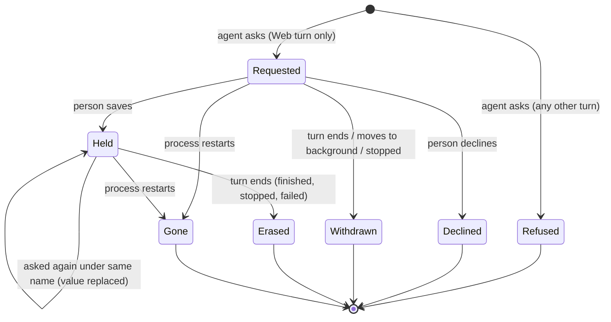
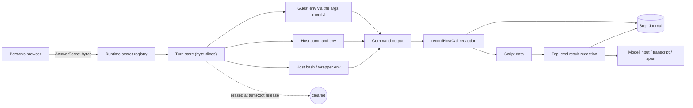
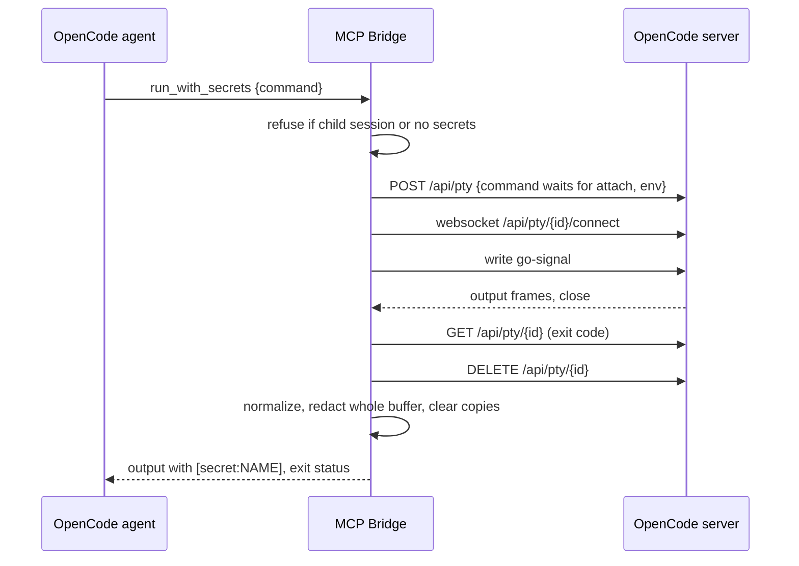

# Turn Secrets - Plan

## Goal Capsule

- **Objective:** A person can hand an agent a credential in the middle of a turn, the agent's commands can use it for the rest of that turn, and the value never reaches the model's context or anything RocketClaw stores.
- **Means:** a per-turn, in-memory secret store that feeds shell environments and a redactor at every point a tool result is journaled or handed to the model; OpenCode sessions reach it through two MCP Bridge tools (KTD1, KTD4, KTD8).
- **Product authority:** This Product Contract, then the Planning Contract. Native chats and Remote OpenCode Sessions are both in scope.
- **Execution profile:** one pull request. U1 (the TLC model) gates the stateful units U5–U8; nothing in U5–U8 is built before U1's checks pass.
- **Stop conditions:** TLC cannot run or a required check fails (report BLOCKED / NOT VERIFIED); `make cloc` exceeds `GO_SOURCE_CLOC_BUDGET` after honest simplification (stop and report the budget conflict; never edit the budget); OpenCode's terminal API cannot meet R7 or R14 (stop before U8 and report).
- **Who finishes:** the `lfg` pipeline implements, reviews, and opens the PR; merging stays with the person.
- **Open blockers:** None.

---

## Product Contract

### Summary

During a turn the agent can ask for a named secret, and the person pastes it into a password form: above the composer in a native chat, in a strip above the OpenCode View in a Remote OpenCode Session.
The value lives only in RocketClaw's memory for that turn and is erased when the turn ends.
Every shell command the agent runs gets it as an environment variable, and the value is replaced by a placeholder in everything that goes back to the model.
In OpenCode sessions the agent runs commands that need it through a tool on RocketClaw's MCP Bridge.

### Problem Frame

Agents regularly hit a step that needs a credential the person has but the agent does not, such as a GitHub token to open a pull request.
Today there are two ways to provide one.
An easy-mode agent can name AWS Secrets Manager secrets in its file ahead of time, which requires knowing the need in advance and only reaches declared server commands.
Otherwise the person pastes the value into the chat, which puts it into the model's context, the saved transcript, search text, and every later model call of that conversation.
The person's concern is not that the agent uses the credential; it is that the value gets printed, added, or injected into what the model reads.

### Key Decisions

- **The goal is keeping the value out of model context, not stopping the agent from using it.** Tools may use it freely; only what flows back to the model is guarded. Governs R11, R14, R17. (session-settled: user-directed — chosen over making RocketClaw perform every use itself behind a placeholder: the person wants commands to use the secret normally and only cares that the value never enters context)
- **A secret lasts only for the turn that asked for it.** Governs R8, R10. (session-settled: user-directed — chosen over keeping it for the chat, for the agent, or for all of the person's agents: the shortest lifetime limits exposure)
- **Memory only.** Nothing about the value touches PostgreSQL, disk, or any external store. Governs R7. (session-settled: user-directed — chosen over encrypted storage in RocketClaw's database or AWS Secrets Manager: the secret should never have to be stored anywhere)
- **Go's secret-erasing support is used, and RocketClaw is built with it on.** Governs R9. (session-settled: user-approved — the experimental `GOEXPERIMENT=runtimesecret` build setting was shown as changing the Makefile, CI and release builds and outside Go's compatibility promise; the person accepted)
- **Crash dumps are turned off for the whole RocketClaw process.** Governs R9. (session-settled: user-approved — shown that this also stops debuggers attaching without root; the person accepted)
- **Anything the agent writes can use the secret, including its own sandboxed shell scripts.** Governs R11, R12. (session-settled: user-directed — chosen over giving it only to server commands declared in the agent file: the agent asks for secrets on demand, so pre-declared commands would rarely exist)
- **OpenCode sessions use RocketClaw's existing MCP Bridge, with no OpenCode plugin.** Governs R14, R15. (session-settled: user-directed — chosen over a RocketClaw plugin installed on each OpenCode server that injects environment variables and rewrites OpenCode tool output: RocketClaw already registers its MCP server in every session, and plugins add per-server setup)
- **The OpenCode form is a strip above the OpenCode View.** Governs R2. (session-settled: user-directed — chosen over a pop-up over the view or a link to a separate RocketClaw page)
- **Copies the agent saves to disk are handled by instruction only.** Governs R18. (session-settled: user-directed — chosen over keeping a one-way fingerprint of the value after the turn, and over scanning the agent's folder for copies at turn end: either would keep something derived from the secret or still miss copies, and the turn-only rule stays exact)
- **Only exact copies of the value are hidden.** Encoded, split, or transformed copies are not detected in this version. Governs R17.
- **Only turns a person started in the RocketClaw Web can ask, and only the asking agent gets the secret.** This mirrors who may use the existing question card. Governs R3, R13.

### Actors

- A1. The person in the RocketClaw Web who started the turn; only this person sees the form and can answer it.
- A2. The agent running the turn: a native Harness agent, or an agent on a Remote OpenCode server.
- A3. RocketClaw: holds the value, gives it to commands, hides it in results, erases it.
- A4. The OpenCode server: runs the session's agent and the commands RocketClaw starts for it.

### Requirements

**Asking for a secret**

- R1. During a turn the agent can ask for a secret by giving a name and a reason; RocketClaw shows the person a form with the name, the reason, a password field, and Save and Decline buttons.
- R2. In a native chat the form appears above the composer, where the question card appears today; in a Remote OpenCode Session it appears as a strip above the OpenCode View on RocketClaw's page.
- R3. Only a turn that a person started in the RocketClaw Web can ask: other native turns (subagent, Routine, Slack, External MCP, Shadow) are not offered the ask tool, and an OpenCode run not prompted from the RocketClaw Web gets a refusal it can read.
- R4. The pending form survives a page reload for as long as the turn is running and waiting on it.
- R5. When the person saves, the agent gets back the secret's name, which is also the environment variable that holds it, never the value; when the person declines, the agent gets back that it was declined.
- R6. A turn can hold several secrets under different names; asking again for a name the turn already holds replaces its value.

**Keeping the secret**

- R7. The value exists only in RocketClaw's process memory: it is never written to PostgreSQL, the Step Journal, the transcript, search text, logs, traces, files, or any message RocketClaw sends anywhere other than the commands that use it.
- R8. When the turn ends for any reason (finished, stopped, failed, or the process restarted) the value is gone from RocketClaw, and RocketClaw erases its own copies with Go's erase support rather than leaving them to the garbage collector.
- R9. RocketClaw is built with `GOEXPERIMENT=runtimesecret` in every build (Makefile, CI, release), and the running process disables crash dumps.
- R10. A form still waiting when its turn ends or moves to the background is withdrawn, and the agent gets back that it was withdrawn; a secret already saved stays usable until the turn ends, including after a move to the background, and a native turn ends only when its run and every background job it started have finished.

**Using the secret in native chats**

- R11. Every shell command the agent runs during the turn sees each held secret as an environment variable: sandboxed Emulated Shell scripts, declared server commands, a wrapper shell program, and host bash for agents not in easy mode.
- R12. No command line that RocketClaw builds (the sandbox launcher, declared host commands, wrapper programs, OpenCode terminals) contains a secret value.
- R13. Subagents started during the turn, the Permission Review guardian, and OpenCode child sessions do not receive the turn's secrets and cannot ask for one.

**Using the secret in OpenCode sessions**

- R14. RocketClaw's MCP Bridge offers OpenCode agents a tool that asks for a secret (R1) and a tool that runs a command with the turn's secrets as environment variables on the OpenCode server, in the session's folder, returning the command's output and exit status.
- R15. OpenCode's own shell tool does not receive the secrets; the agent's instructions from the asking tool say to use RocketClaw's command tool for anything that needs one.
- R16. For an OpenCode session, the turn is the run started by one prompt, and it ends when the session goes idle or is stopped.

**Hiding the value from the model**

- R17. Every exact occurrence of a held value is replaced with `[secret:<name>]` in anything that would reach the model or be stored during the turn, before it is used or saved: every native tool result and error, and every result of RocketClaw's OpenCode command tool.
- R18. The agent is told which secret names it holds, which variables carry them, and not to print them, save them to disk, or put them in a command's arguments (use tools that read the variable, stdin, or a header file instead).

### Key Flows

- F1. Native agent asks for and uses a secret
  - **Trigger:** The agent decides it needs a GitHub token.
  - **Actors:** A1, A2, A3
  - **Steps:** The agent asks for `GITHUB_TOKEN` with a reason; the form appears above the composer; the person pastes and saves; the agent is told `$GITHUB_TOKEN` is set; it runs `gh pr create --fill`, which reads `$GITHUB_TOKEN` itself; any output containing the token comes back with `[secret:GITHUB_TOKEN]` in its place; the turn ends and the value is erased.
  - **Covered by:** R1, R2, R5, R8, R11, R17, R18
- F2. OpenCode agent asks for and uses a secret
  - **Trigger:** An agent in a Remote OpenCode Session needs a token.
  - **Actors:** A1, A2, A3, A4
  - **Steps:** The agent calls RocketClaw's ask tool; the strip appears above the OpenCode View; the person saves; the agent calls RocketClaw's command tool with `git push` or `gh pr create`; RocketClaw runs it on the OpenCode server with the variable set and returns the output with the value hidden; the session goes idle and the value is erased.
  - **Covered by:** R1, R2, R5, R14, R15, R16, R17
- F3. The turn ends before the person answers
  - **Trigger:** The person stops the turn, or it moves to the background, while the form is waiting.
  - **Actors:** A1, A2, A3
  - **Steps:** The form disappears; the agent gets "withdrawn" if it is still running; nothing was stored.
  - **Covered by:** R10

### Secret lifecycle within a turn

Assumptions for the model required before building (pack: formal-modeling, stateful-design.md):

- Actors: the turn (agent loop), the person's browser, RocketClaw's process, the OpenCode server, and process restart as a crash event at any step.
- Nothing about the value persists; the only durable effect of a crash is that the value is gone. Whatever planning chooses to persist for the pending form (R4) holds the name and reason only.
- The person's Save can race the turn ending; a Save that arrives after the turn ended is rejected and stores nothing.
- Safety: no value is ever written to persistent storage or included in model input; once a turn has ended, RocketClaw holds no copy of that turn's values; a value is never given to a command of a different turn.
- Liveness: every request ends in Held, Declined, Withdrawn, Refused, or Gone; every Held value is erased once its turn ends.

### Acceptance Examples

- AE1. **Covers R11, R17.** Given a native agent holding `GITHUB_TOKEN`, when it runs `echo "$GITHUB_TOKEN"` in the Emulated Shell, then the command prints the value and the model sees `[secret:GITHUB_TOKEN]`.
- AE2. **Covers R12.** Given a native agent holding a secret, when another process on the server lists command lines (`ps`) while the agent's command runs, then no command line contains the value.
- AE3. **Covers R5.** Given the form is showing, when the person clicks Decline, then the agent's tool result says declined and no variable is set.
- AE4. **Covers R10.** Given the form is showing, when the person stops the turn, then the form disappears and nothing was stored; given a secret is held, when the turn moves to the background, then later commands of that turn still see the variable.
- AE5. **Covers R8.** Given a secret is held, when RocketClaw restarts and the turn resumes, then the variable is unset and the agent must ask again.
- AE6. **Covers R3.** Given a Routine turn, its agent is not offered the ask tool and no form appears; given an OpenCode run not prompted from the RocketClaw Web, the ask tool returns a refusal.
- AE7. **Covers R13.** Given a turn holding `GITHUB_TOKEN` starts a subagent, when the subagent runs `echo "$GITHUB_TOKEN"`, then it prints nothing.
- AE8. **Covers R14, R15, R17.** Given an OpenCode session holding `GITHUB_TOKEN`, when the agent calls RocketClaw's command tool with `echo "$GITHUB_TOKEN"`, then the tool result shows `[secret:GITHUB_TOKEN]`; when it uses OpenCode's own `bash` tool for the same command, then it prints nothing.
- AE9. **Covers R7.** Given a turn that asked for, used, and erased a secret, when the database and the Step Journal are searched for the value, then it is not found.

### Scope Boundaries

- Detecting encoded, split, or otherwise transformed copies of a value is deferred.
- Keeping any fingerprint of a value after its turn is out of scope.
- Copies the agent saves to disk, and their later appearance in model context, are handled by instruction only (R18).
- Secrets the person types or pastes into the chat composer are not protected.
- Secrets that outlive a turn, shared between agents, or reused across chats are out of scope.
- An OpenCode plugin is out of scope; OpenCode's own shell tool never gets the secrets.
- Asking for secrets from Slack, Routines, subagents, External MCP, or Shadow sessions is out of scope.
- Existing `secretsARN` secrets keep working as they do today; this work does not change how they are fetched or given to commands.

### Dependencies / Assumptions

- `runtime/secret` is experimental in Go 1.27.4 and exists only with `GOEXPERIMENT=runtimesecret`; it erases registers, stack and heap temporaries on linux/amd64 and linux/arm64, which matches the platforms RocketClaw supports.
- Erasure shortens how long copies live but cannot cover every copy: the HTTP server's read buffers for the form post, the strings `os/exec` needs for a child's environment, the child process's own memory, and on OpenCode the JavaScript runtime that relays the value to the command.
- OpenCode's server API accepts environment variables when it creates a terminal (`Pty.CreateInput.env` in `internal/rocketclaw/oc/packages/schema/src/pty.ts`); its one-shot shell command API (`Shell.CreateInput`) does not.

### Outstanding Questions

**Resolved during planning** (see the Planning Contract): OpenCode terminals keep output in memory only and are not listed in OpenCode's UI (KTD8); the sandbox already receives its environment off the command line (KTD3); OpenCode waits up to 12 hours on a tool call (KTD7); session events report the end of an OpenCode run (KTD9); there are two hiding points, not one (KTD4).

**Deferred to Implementation**

- The exact wrapper that keeps an OpenCode terminal's command from starting until RocketClaw is attached (U8).
- Whether the MCP library cancels a waiting ask call when OpenCode aborts the turn on the `legacy` protocol; U8 tests it.

**For the person, after this PR (not blocking)**

- Multi-line secrets (PEM keys, service-account JSON) are rejected in this version; supporting them needs a masked multi-line field.
- OpenCode's `bash` permission rules do not apply to `run_with_secrets`; a person can add a rule for `rocketclaw_run_with_secrets`, or RocketClaw could require approval for it by default.
- The name allowlist (KTD5) rejects names like `DATABASE_URL`; widen it if needed.

### Sources / Research

- Existing question card, the pattern for R1–R4 and R10: `internal/rocketclaw/backend/bridge.go` (`askUserQuestionTool`), `internal/rocketclaw/backend/web_question.go`, `QuestionCard` in `internal/rocketclaw/web/src/ui.tsx`.
- Native tool results pass through `toolCallOutput` in `internal/rocketclaw/harness/looper.go` before `saveStep` and before becoming model input.
- Emulated Shell gives `CustomShell.Secrets` only to host commands (`internal/rocketclaw/harness/emulated.go`); the sandbox gets its environment as `--setenv` entries inside a memfd passed with `--args 3`, never on bwrap's command line (`internal/rocketclaw/sandbox/launcher_linux.go`).
- Agents not in easy mode run host bash with the process environment (`internal/rocketclaw/harness/rocketcode.go`, `internal/rocketclaw/harness/shell.go`).
- MCP Bridge for OpenCode: `internal/rocketclaw/backend/opencode_mcp.go` (stateless handler; page, navigation and tag tools only).
- OpenCode View is mounted by `RemoteSession` in `internal/rocketclaw/web/src/ui.tsx`, which already draws `RemoteStatus` above it.
- RocketClaw keeps no copy of OpenCode messages; it reads them live through the `/oc/<server>/api` proxy.
- Go `runtime/secret`: https://pkg.go.dev/runtime/secret
- Code Mode tool calls are journaled inside `recordHostCall` in `internal/rocketclaw/harness/mcp_tools.go`, before the outer execute result exists.
- OpenCode terminal API: `internal/rocketclaw/oc/packages/protocol/src/groups/pty.ts`, `internal/rocketclaw/oc/packages/schema/src/pty.ts`; upstream retention and attach behavior at `github.com/anomalyco/opencode` tag v2.4.1, `packages/core/src/pty.ts`.
- OpenCode MCP timeouts: https://opencode.ai/docs/mcp-servers/#timeouts

Product Contract preservation: changed: R10 — defines when a native turn ends (its run plus the background jobs it started); R13 — names the Permission Review guardian and OpenCode child sessions; R3/AE6 — native non-Web turns are not offered the tool instead of getting a refusal; R12 — narrowed to command lines RocketClaw builds, since an agent-written command can expand a variable into its own arguments; R18 — adds the no-arguments instruction; A1 — only the turn's starter answers; examples use the variable-style name `GITHUB_TOKEN` (KTD5). None adds behavior the person did not choose. Outstanding Questions resolved in place.

---

## Planning Contract

### Key Technical Decisions

- KTD1. **One in-memory store per turn, owned by the turn, injected as a small interface.** Native: created in `Bridge.runTurn` and erased when the turn's `turnRoot` is released, so it lives exactly as long as the turn and its background jobs (R8, R10). OpenCode: one store per Web-prompted run of a root session in `Runtime` memory; relaying a new prompt replaces any store the previous run left, and the end-of-run event or the sync erases it (R16). Saving a name again changes what later commands get, but the replaced value stays known for redaction until the turn or run ends, so a background job still holding it cannot leak it. The TLC model found both rules necessary. The harness receives it through a `harness.Config` field typed as a small interface with an explicit inert implementation for turns without secrets, per AGENTS.md injected-dependency rules. The store holds `[]byte` values and is the only owner of them.
- KTD2. **`runtime/secret.Do` wraps only short copy-and-erase blocks.** Each place that copies a value (save, env build, redaction) does its work on caller-owned buffers inside a short `Do` with no goroutines or I/O, then `clear`s. Running commands, HTTP and waiting stay outside `Do`, because goroutines started inside stay in secret mode and every allocation inside takes a runtime lock. Governs R8, R9.
- KTD3. **The sandbox needs no new environment channel.** `--setenv` entries already reach bwrap through the `--args 3` memfd, never argv, so turn secrets are appended to the guest environment list in `sandboxedShellSystem.Bash` like the host-command, host-bash and wrapper lists. Secrets never enter `harness.Config.ShellEnv`, because that map is persisted, copied to Shadows, and sent to MCP servers. Covers R11, R12.
- KTD4. **Redaction happens at two points, not one.** `recordHostCall` replaces values in a Code Mode call's output, typed data, summary and error before journaling or returning them to the script; `dispatchToolCalls` replaces values in every top-level result and error before `toolCallOutput`, the journal, and the trace span. Both use the turn's store. Covers R17.
- KTD5. **The secret's name is the environment variable name, from an allowlist.** Names match `^[A-Z][A-Z0-9_]*_(TOKEN|KEY|SECRET|PASSWORD)$` and are at most 64 bytes; an allowlist is required because declared host commands run outside the sandbox, where names like `SHELLOPTS` with `PS4`, `GIT_SSH_COMMAND` or `NODE_OPTIONS` would run code on the server. Values are single-line, 8 bytes to 64 KiB, with no NUL or newline; the 8-byte minimum keeps redaction from matching ordinary text. A turn secret overrides an agent `secretsARN` value of the same name, because the person supplied it for this turn. The placeholder is `[secret:<NAME>]`.
- KTD6. **The answer never touches the Step Journal.** The secret request lives in an in-memory registry in `Runtime` keyed by conversation and call; the Web reads it through one `PendingSecrets` RPC for native chats and the OpenCode strip, and answers through a new `AnswerSecret` RPC whose value is a proto `bytes` field; only the turn's starter may answer. Only a value-free notify and tab mark are sent, so the page refetches and "Needs you" fires. The ask is recorded as a typed host step whose replay checks the turn's store: a finished or interrupted ask replays as `saved` only while the name is still held, and as `gone` ("ask again") otherwise, because `recordHostCall` returns a finished step's recorded output without calling the tool.
- KTD7. **The OpenCode ask call waits inside the MCP request.** OpenCode's default MCP execution timeout is 12 hours and RocketClaw's HTTPS server sets no write timeout, so the stateless handler can hold the call until the person answers or the turn ends; no registration change is needed.
- KTD8. **OpenCode commands run through OpenCode's terminal API (`/api/pty`).** It takes `env` without exposing it in its info, events or argv, keeps output only in memory, and is not listed in OpenCode's terminal panel; `/api/shell` has no env field and writes output to disk, and `PUT /api/session/{id}/environment` would hand the value to OpenCode's own bash tool. RocketClaw creates the terminal with a command that waits for RocketClaw's attach, then runs the agent's command without a terminal (stdin from `/dev/null`, output through a pipe, exit status from the command) with `TERM=dumb PAGER=cat GIT_PAGER=cat GIT_TERMINAL_PROMPT=0 GH_PROMPT_DISABLED=1`, so prompts and pagers never block; it reads the whole output over the websocket, reads the exit code from `GET /api/pty/{id}`, deletes the terminal on every path, normalizes `\r\n`, and redacts the full buffer once against the values it gave that command as well as the store, so an end event that erases the store mid-command cannot expose them.
- KTD9. **OpenCode turn end comes from OpenCode's event stream.** `openCodeShells.follow` already reads `/api/event`; `session.idle`, `session.execution.succeeded`, `session.execution.failed` and `session.execution.interrupted` events for a root session erase that root's store and withdraw its pending request, with the 5-second sync as a fallback. Pending requests are OR'd into `syncOpenCode`'s `asking` so the sidebar shows "Needs your answer"; native rows get the same OR from the registry.
- KTD10. **`GOEXPERIMENT=runtimesecret` is set where builds run, since it cannot be pinned in `go.mod`.** `internal/rocketclaw/Makefile` exports it, `.github/workflows/test.yml` sets it in the top-level `env`, and `Procfile` and README commands carry it.
- KTD11. **Crash dumps are disabled at the start of `runServe`, not in `main`.** The sandbox guest helper runs from the same binary and stays unaffected. `make deploy` reads the running binary's path from the first field of `/proc/<pid>/cmdline` instead of `lsof`, which can no longer read `/proc/<pid>/exe`, and fails when that path is not absolute.
- KTD12. **The secret form is excluded from PostHog session replay.** The password input carries PostHog's no-capture class, and `AnswerSecret` is added to the masked request bodies in `web/src/posthog.ts`. Covers R7.
- KTD13. **A turn's stateful behavior is model-checked before it is built.** `docs/verification/turn-secrets/` holds a PlusCal model of ask, save, decline, withdraw, use, redact, background jobs, turn end and restart, shaped like `docs/verification/thread-pr/` (pack: formal-modeling, stateful-design.md).

### High-Level Technical Design

Native turn, where the value goes and where it is stopped:

OpenCode run tool, sequence:

The lifecycle state diagram in the Product Contract governs the store's states; U1 models it.

### Assumptions

- Detached background jobs keep a turn's secrets alive until they finish (R10). The alternative, stopping those jobs when the foreground run ends, was rejected because it kills unrelated work and needs per-job bookkeeping, while tying erasure to the existing `turnRoot` reference count keeps redaction correct for every job that received the value.
- In OpenCode, background work that outlives the root session's run (long Code Mode scripts, background subagents) finds no secrets after the run ends and gets a refusal it can read.
- Skill `` !`…` `` prompt expansion is not a command the agent writes, so it does not receive turn secrets.
- Turn secrets apply to agents not in easy mode exactly as to easy agents (R11).

### Implementation Constraints

- `GO_SOURCE_CLOC_BUDGET` leaves 273 lines today (45,477 of 45,750); production Go added here must fit, by honest simplification if needed. The TypeScript budget has about 1,700 lines of room. Coverage stays at or above 91.8%.
- No source comments; generated mocks come from `go generate ./cmd/rocketclaw`.
- `docs/explainers/2026-11-01-emulated-shell-sandbox.md` and `CONCEPTS.md` say secrets never enter the guest; U4 updates them.

### Risks

| Risk | Mitigation |
|---|---|
| Go budget overrun | Reuse `webQuestions` waiting, `openCodeCall`, `follow`, and one shared Web card; measure with `make cloc` after each unit; stop and report if honest reductions do not fit. |
| A fast OpenCode command exits before attach and its output is lost | The terminal command waits for RocketClaw's go-signal; a test runs `true` and `echo` and checks the output and exit code. |
| A value split across terminal frames escapes redaction | Redact only the fully assembled buffer. |
| Erasure is best-effort (decoded strings, `os/exec` env strings, child memory) | Documented in Dependencies; the guarantee tested is "never stored or sent to the model", not "zero copies in RAM". |
| Out-of-repo deploy scripts that read `/proc/<pid>/exe` break | Called out in the PR description. |
| Deployments that build with `go run …@main` or `go build` without `GOEXPERIMENT` fail to start after upgrade | README upgrade note naming the variable (U9) and a PR description callout. |
| One OpenCode server is one trust domain: its sessions share a password and an OS user, so another session's agent could read a running command's environment | Stated in the README (U9); not built around. |
| A terminal started by `run_with_secrets` outlives a RocketClaw restart with its environment and output in OpenCode's memory | Stated in the README (U9); OpenCode keeps at most 25 exited terminals. Considered and not built: cleanup on restart, since it needs a marker and a startup sweep the budget cannot carry; revisit if terminals are seen to accumulate. |

---

## Implementation Units

### U1. Model the turn-secret lifecycle and check it with TLC

- **Goal:** prove the store's safety and liveness properties before building U5–U8.
- **Requirements:** R7, R8, R10, R16, R17; KTD13.
- **Dependencies:** none.
- **Files:** `docs/verification/turn-secrets/TurnSecrets.tla`, `docs/verification/turn-secrets/*.cfg`, `docs/verification/turn-secrets/Makefile`, `docs/verification/turn-secrets/README.md`.
- **Approach:**
  1. Processes: the native turn (ask, use, finish), the person (save or decline, possibly after the turn ended), one background job holding the turn, an OpenCode root session running two consecutive runs (prompt, ask, run command, end-of-run delivered by an event that may be missed or by the periodic sync), and a crash that can strike at any label and replays a finished ask.
  2. Variables: the store per turn or run, the pending request, the job's and the in-flight command's copy of the value, the journal and model-input contents (abstracted to "contains a raw value"), `turnRoot` holders, and the last replayed ask result.
  3. Initial state: no stores, no requests, empty journal.
  4. Safety: the journal and model input never contain a raw value; once a turn ended and no holder remains its store is empty; a save after the turn ended stores nothing; after a crash every store is empty and a replayed ask never says `saved`; no command receives a value saved in a different turn or run.
  5. Liveness: every request ends saved, declined, withdrawn or gone, under weak fairness of the person (a person who sees the form eventually answers or the turn ends) and of the turn (a running turn eventually finishes).
  6. Bounds per `.cfg`: one native turn, one background job, one OpenCode root with two runs, two secret names, two values, at most one crash.
  7. Checks that must pass: `safe-native.cfg` and `safe-opencode.cfg`. Checks that must fail with a named violation: `erase-at-run-end.cfg` (erase when the foreground run ends while a job still prints), `no-inner-redaction.cfg` (journal a Code Mode result before redaction), and `erase-without-run-reset.cfg` (no fresh store per relayed prompt, so a missed end event hands the first run's value to the second). The native and OpenCode cases are checked as separate passing configurations because they share no state.
  8. The README maps each label to code: ask → `ask_secret`; save and decline → `AnswerSecret`; inner and outer redaction → `recordHostCall` and `dispatchToolCalls`; release and erase → `turnRoot` release; run end → `follow` and `syncOpenCode`; run command → `run_with_secrets`; replay → the ask's typed host step.
  9. Copy the Makefile from `docs/verification/thread-pr/`; reuse a jar that passes the pinned SHA-256. Status: pending until TLC passes.
- **Execution note:** this unit gates U5–U8; record BLOCKED / NOT VERIFIED and stop if TLC cannot run or a safe configuration fails.
- **Patterns to follow:** `docs/verification/thread-pr/`.
- **Test scenarios:** `Test expectation: none -- the TLC checks are the verification.`
- **Verification:** `make -C docs/verification/turn-secrets` passes the safe configurations and finds every named violation; the README records versions, bounds, state counts and run time.

### U2. Build with `runtime/secret` and disable crash dumps

- **Goal:** every build, test, lint and release uses `GOEXPERIMENT=runtimesecret`; the serving process is not dumpable.
- **Requirements:** R9; KTD10, KTD11.
- **Dependencies:** none.
- **Files:** `internal/rocketclaw/Makefile`, `.github/workflows/test.yml`, `internal/rocketclaw/Procfile`, `README.md`, `cmd/rocketclaw/serve.go`, `cmd/rocketclaw/serve_test.go`.
- **Approach:**
  1. Export `GOEXPERIMENT := runtimesecret` in `internal/rocketclaw/Makefile`; set it in `test.yml`'s top-level `env`; prefix the `Procfile` and README commands.
  2. Call `unix.Prctl(unix.PR_SET_DUMPABLE, 0, …)` at the start of `runServe`; failure returns an error.
  3. Change the `deploy` target to take the binary path from the first NUL-separated field of `/proc/<pid>/cmdline`, failing with "deploy failed" when it is not absolute.
- **Test scenarios:**
  - `runServe`'s dumpable setup leaves `PR_GET_DUMPABLE` returning 0 in the test process.
  - A package importing `runtime/secret` builds and tests under `make test`.
- **Verification:** `make lint` and `make test` pass with the experiment exported; `make deploy` logic reads a non-dumpable process's path.

### U3. Turn secret store and redactor

- **Goal:** one type that holds a turn's values, builds env entries, redacts text, and erases itself.
- **Requirements:** R5, R6, R7, R8, R17; KTD1, KTD2, KTD5.
- **Dependencies:** U2.
- **Files:** `internal/rocketclaw/harness/turn_secrets.go`, `internal/rocketclaw/harness/turn_secrets_test.go`, `internal/rocketclaw/harness/rocketcode.go` (Config field and inert type).
- **Approach:** the store validates names and values (KTD5), replaces a value saved under an existing name, returns env entries in name order, replaces every exact occurrence of every value with `[secret:<NAME>]` (longest value first, so one value containing another is fully replaced), and erases with `clear` inside `secret.Do`. The inert implementation returns no env and leaves text unchanged.
- **Test scenarios:**
  - Saving `GITHUB_TOKEN` then building env yields one `GITHUB_TOKEN=<value>` entry.
  - Saving the same name twice keeps only the second value.
  - Names `GITHUB_TOKEN`, `AWS_SECRET_ACCESS_KEY` and `DB_PASSWORD` are accepted; `github_token`, `PATH`, `PS4`, `SHELLOPTS`, `NODE_OPTIONS`, `GIT_SSH_COMMAND`, `PYTHONPATH`, `DATABASE_URL` and a 65-byte name are rejected.
  - Values that are empty, 7 bytes, contain NUL or a newline, or exceed 64 KiB are rejected; an 8-byte value is accepted.
  - Redacting text containing a value twice, and a value that contains another value, yields only placeholders.
  - After erase, env is empty, redaction leaves text unchanged, and the stored buffers are zeroed.
  - After saving a name twice, env carries only the second value while redaction still replaces both until erase.
- **Verification:** unit tests pass under the experiment.

### U4. Give turn secrets to every native shell, and nothing else

- **Goal:** all shell kinds see the variables; the guardian, subagents, MCP servers and Shadows do not.
- **Requirements:** R11, R12, R13; KTD3, KTD5.
- **Dependencies:** U3.
- **Files:** `internal/rocketclaw/harness/shell.go`, `internal/rocketclaw/harness/emulated.go`, `internal/rocketclaw/harness/permission_review.go`, `internal/rocketclaw/harness/emulated_linux_test.go`, `internal/rocketclaw/harness/shell_test.go`, `docs/explainers/2026-11-01-emulated-shell-sandbox.md`, `CONCEPTS.md`.
- **Approach:**
  1. In `sandboxedShellSystem.Bash`, read the store's env once per call and append it to the guest list, the host-command list (after `CustomShell.Secrets`, per KTD5), and the host bash or wrapper list.
  2. Give the reviewer's child factory the inert store.
  3. Update the explainer and the Emulated Shell entry in `CONCEPTS.md`.
- **Patterns to follow:** `TestEmulatedShellEnvironment`, `TestEmulatedShellSecrets`, `newEmulated` helpers.
- **Test scenarios:**
  - Covers AE1. A sandboxed `echo "$GITHUB_TOKEN"` prints the value.
  - A declared host command and a wrapper program see the variable; host bash for a non-easy agent sees it.
  - A turn secret overrides an agent `secretsARN` value of the same name in a host command.
  - Covers AE2. While a sandboxed command runs, no `/proc/*/cmdline` and no file under `run/` contains the value.
  - A Permission Review child shell does not see the variable.
  - The persisted turn environment snapshot does not contain the value.
- **Verification:** harness and sandbox tests pass, including `make sandbox-test`.

### U5. Redact at both journaling points

- **Goal:** no tool result, error, summary or span carries a raw value.
- **Requirements:** R7, R17; KTD4.
- **Dependencies:** U1, U3.
- **Files:** `internal/rocketclaw/harness/mcp_tools.go`, `internal/rocketclaw/harness/looper.go`, `internal/rocketclaw/harness/emulated_curl.go`, `internal/rocketclaw/harness/mcp_tools_test.go`, `internal/rocketclaw/harness/looper_test.go`.
- **Approach:**
  1. In `recordHostCall`, after the call runs, redact the output, the typed data the script receives, and the error, before the journal step, the Script Call Record summary, and the return.
  2. In `dispatchToolCalls`, redact the result text and error before `toolCallOutput`, `recordCall`, and `recordSpanError`.
  3. Redact the URL that `emulated_curl.go` logs.
- **Test scenarios:**
  - Covers AE1. A Code Mode `bash` printing the value journals `[secret:GITHUB_TOKEN]`, the script receives the placeholder, and the Script Call Record summary shows it.
  - A top-level tool returning the value, and one failing with an error containing it, reach the model input and journal redacted.
  - Covers AE9. After a turn that saved and printed a secret, no `steps` row, transcript entry or spill file contains the value.
  - A curl to a URL containing the value logs the placeholder.
- **Verification:** harness tests pass; the TLC model's `no-inner-redaction` violation maps to the first scenario.

### U6. Native ask tool, registry, and Web answer path

- **Goal:** the agent can ask; the person can save or decline; the value never persists; restarts and turn end behave per the state diagram.
- **Requirements:** R1, R3, R4, R5, R6, R8, R10, R13, R18; KTD1, KTD6.
- **Dependencies:** U1, U3, U4, U5.
- **Files:** `internal/rocketclaw/backend/web_secret.go`, `internal/rocketclaw/backend/web_secret_test.go`, `internal/rocketclaw/backend/bridge.go`, `internal/rocketclaw/backend/background.go`, `internal/rocketclaw/backend/bridge_test.go`, `internal/rocketclaw/web/proto/web.proto`, `internal/rocketclaw/frontend/rpc/server.go`, `internal/rocketclaw/frontend/rpc/transport.go`, `internal/rocketclaw/frontend/rpc/server_test.go`, `.mockery.yml`.
- **Approach:**
  1. `ask_secret {name, reason}` is a custom tool offered next to `ask_user_question` on human Web turns, `TurnBound`, not `Resumable`. It registers the request in the registry, waits on an in-memory channel or turn cancellation, saves the answer into the turn's store, and returns `saved` (with the variable name and the instruction from R18), `declined`, `withdrawn`, or `refused`.
  2. Record the ask as a typed host step (like `typedHostFile`) whose replay returns `saved` only while the store holds the name and `gone` with "ask again" otherwise; an ask interrupted by a restart also replays as `gone`.
  3. Create the store in `runTurn`, pass it to the harness config, and erase it when `turnRoot` is released.
  4. `PendingSecrets {conversation_id}` lists the registry's requests (id, name, reason) for the caller only when the caller started the turn; `AnswerSecret {conversation_id, ask_id, value bytes, decline}` accepts only that person, rejects answers for ended turns, and clears its copy of the value after handing it over.
  5. Notify the conversation's stream and mark its tabs without storing anything, and OR pending requests into the sidebar row's `asking`, so "Needs you", the title count and the desktop notification fire as for a question.
  6. Shadow and subagent bridges never get the tool.
- **Patterns to follow:** `askUserQuestionTool`, `webQuestions` waiting map (without its SQL), `TestAskUserQuestionTool*`, `web_question_test.go`.
- **Test scenarios:**
  - Covers F1. Ask, then `AnswerSecret` with a value: the tool returns `saved` naming `$GITHUB_TOKEN`, and a later command in the same turn sees it.
  - Covers AE3. Decline returns `declined` and sets nothing.
  - Covers AE4. Stopping the turn while pending returns `withdrawn` and clears the pending entry; moving to the background withdraws a pending request while a saved secret stays usable.
  - Covers AE5. After a simulated restart the replayed ask returns `gone`.
  - Covers AE6. A Routine turn, a subagent and a Shadow are not offered the tool.
  - Covers AE7. A subagent started by a turn holding `GITHUB_TOKEN` runs `echo "$GITHUB_TOKEN"` and prints nothing.
  - A viewer who did not start the turn gets no pending secrets and `AnswerSecret` from them is rejected.
  - A pending secret makes the sidebar row `asking`; Save or Decline clears it.
  - `AnswerSecret` after the turn ended returns NotFound and stores nothing.
  - `PendingSecrets` lists the request after a page reload while the turn waits, and stops listing it after answer.
  - The store is erased when the last background job holding the turn finishes, not before.
  - No `steps` row is written for the request or the answer.
- **Verification:** backend and rpc tests pass.

### U7. Secret card in the Web, native and OpenCode strip

- **Goal:** one password form used above the composer and as the strip above the OpenCode View.
- **Requirements:** R1, R2, R4, R5; KTD6, KTD12.
- **Dependencies:** U6, U8.
- **Files:** `internal/rocketclaw/web/src/ui.tsx`, `internal/rocketclaw/web/src/api.ts`, `internal/rocketclaw/web/src/types.ts`, `internal/rocketclaw/web/src/posthog.ts`, `internal/rocketclaw/web/src/secret.browser.test.ts`.
- **Approach:** a `SecretCard` with name, reason, an uncontrolled password input with PostHog's no-capture class, Save and Decline; the value is read on submit, sent base64 as `bytes`, and the input is reset. Both surfaces read `PendingSecrets`: native refetches it on the conversation's notify and places the card in `jobsSlot`; `RemoteSession` renders it between `RemoteStatus` and the view, only while visible, polling every 2 seconds while the session row is `asking`. While a card is pending, the composer placeholder reads "Paste the secret in the form above, not here", Send never answers the request, and the card says the value must be one line. Voice and draft persistence never see it.
- **Test scenarios:**
  - Native: a pending secret shows the card above the composer; Save posts `AnswerSecret` with the base64 value and the card disappears; Decline posts a decline.
  - The password input has `type=password` and the no-capture class, and the composer draft never contains the value.
  - While a secret is pending, the composer placeholder changes and Send queues a message instead of answering the request.
  - Remote: with a pending secret, the strip appears above the OpenCode View; hidden tabs render no strip.
  - The PostHog request-body mask covers `AnswerSecret`.
- **Verification:** `bun test` and the browser tests pass after `go generate ./internal/rocketclaw/internal/web`.

### U8. OpenCode bridge tools, turn end, and sidebar attention

- **Goal:** OpenCode agents can ask and run commands with secrets; the store ends with the root session's run.
- **Requirements:** R1, R2, R3, R5, R13, R14, R15, R16, R17; KTD7, KTD8, KTD9.
- **Dependencies:** U1, U3, U6.
- **Files:** `internal/rocketclaw/backend/opencode_mcp.go`, `internal/rocketclaw/backend/opencode_secrets.go`, `internal/rocketclaw/backend/opencode.go`, `internal/rocketclaw/backend/opencode_mcp_test.go`, `internal/rocketclaw/backend/opencode_test.go`, `internal/rocketclaw/frontend/rpc/server.go`, `internal/rocketclaw/web/proto/web.proto`.
- **Approach:**
  1. Keep the caller's own session ID before the parent walk; `ask_secret` and `run_with_secrets` refuse when the caller is a child session or the root's current run was not prompted from the RocketClaw Web.
  2. `ask_secret` reuses U6's registry and tool, keyed by the root conversation.
  3. `run_with_secrets {command, timeout_seconds?}` follows KTD8 and returns the redacted output, the exit code, and a first line naming the secrets set.
  4. Relaying a Web prompt to a root session replaces its store with a fresh one. Add `session.idle`, `session.execution.succeeded`, `session.execution.failed` and `session.execution.interrupted` cases to `follow`, map to the root, erase its store and withdraw its request; `syncOpenCode` ends them too and ORs pending requests into `asking`.
- **Patterns to follow:** `TestOpenCodeMCP`, `fakeOpenCode`, `openCodeCall`, `openCodeShells.follow`.
- **Test scenarios:**
  - Covers F2 / AE8. With a saved secret, `run_with_secrets` with `echo "$GITHUB_TOKEN"` returns `[secret:GITHUB_TOKEN]` and exit 0; the fake server received `env` on create and never saw the value in args, and the terminal was deleted.
  - `run_with_secrets` with `true` returns empty output and exit 0; a command exiting 3 returns 3.
  - `[ -t 0 ] || [ -t 1 ] || echo notty` prints `notty`, and a command that would page or prompt (`git log` in a repository) returns without hanging.
  - A value split across two websocket frames is still redacted.
  - A child session's call to either tool is refused (R13).
  - No request to the fake OpenCode server sets a session environment, so OpenCode's own bash never receives a value (R15).
  - Without secrets, `run_with_secrets` refuses and tells the agent to ask first.
  - A `session.idle` event for the root erases the store and withdraws a pending ask; a later run is refused.
  - A pending ask makes the synced row `asking`, and the next sync keeps it.
  - Closing the MCP request cancels a waiting ask.
- **Verification:** backend tests pass; the tool-name list assertion includes the two new tools.

### U9. Documentation

- **Goal:** readers and operators learn the feature, its limits, and the build change.
- **Requirements:** R9, R15, R18.
- **Dependencies:** U2–U8.
- **Files:** `README.md`, `CONCEPTS.md`.
- **Approach:** a README section on asking for secrets (who can ask, allowed names, single-line values, lifetime, what is hidden, the disk-copy, arguments and encoding limits, OpenCode's run tool, which OpenCode's `bash` permission rules do not cover, and the one-trust-domain note) plus an upgrade note that builds need `GOEXPERIMENT=runtimesecret`; a `CONCEPTS.md` entry for Turn Secret; refine Script Call Record and Background Job where they now interact with secrets.
- **Test scenarios:** `Test expectation: none -- documentation only.`
- **Verification:** README commands match `internal/rocketclaw/Makefile`.

---

## Verification Contract

| Gate | Command | Applies to |
|---|---|---|
| Model | `make -C docs/verification/turn-secrets` | U1, before U5–U8 |
| Format | `gofmt -l` on touched Go files is empty | all Go units |
| Lint | `make lint` | all |
| Tests and coverage | `make test` (coverage ≥ 91.8%) | all |
| Sandbox | `make -C internal/rocketclaw sandbox-test` | U4, U5 |
| Web | `go generate ./internal/rocketclaw/internal/web`, then `bun test` in `internal/rocketclaw/web` | U7 |
| Size | `make check-cloc-budget` | all |

All Go commands run with `GOEXPERIMENT=runtimesecret`, which the Makefile exports after U2.

## Definition of Done

- Every R1–R18 is covered by a passing test or the TLC model, as mapped in the units.
- `make -C docs/verification/turn-secrets` passes the safe configurations and reports every named violation; the README evidence record is filled in.
- `make lint`, `make test`, `make check-cloc-budget` and the Web tests pass with no edit to any budget and no `//nolint`.
- A search of a test database and spill directory after the end-to-end tests finds no secret value.
- README and `CONCEPTS.md` describe the feature and the `GOEXPERIMENT` requirement.
- No experimental or abandoned code remains in the diff.
