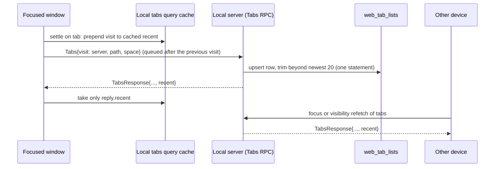

# Recent Tabs Sidebar - Plan

## Goal Capsule

- **Objective:** A person working across many tabs can see, at the top of the Web's left sidebar, the tab they are on and the tabs they just came from, in any space or server and on any of their devices, and get back to one in a click; the sidebar is calmer because it shows one view at a time.
- **Means:** Three sidebar views (Recent, Spaces, Parked) with a per-person Recent list the local server keeps, recorded one visit at a time (KTD1, KTD2).
- **Authority:** Product Contract Requirements win on behavior; KTDs win on mechanism; `AGENTS.md` wins on code conventions.
- **Stop conditions:** Stop and report if a settled decision proves infeasible, if the Go source CLOC budget cannot fit the server change, or if a Go-run browser test cannot run in this workspace.
- **Execution profile:** One PR. The working copy already holds the client prototype (three views, sessionStorage trail, Parked view); this plan moves the trail to the server and finishes the change.
- **Finishing:** `ce-work` implements and verifies; the calling pipeline reviews, commits and opens the PR.

---

## Product Contract

### Summary

The sidebar shows one view at a time: Recent (default), Spaces (the space cards) and Parked (every parked tab, full height). Recent lists up to 20 tabs the person opened, across spaces and Remote RocketClaws, in an order they keep: a tab joins at the top the first time they open it, and they reorder the list by dragging. The local server keeps that list per person, so it and its order follow them to every device.

### Problem Frame

People drive many agent sessions at once and move between them all day. The sidebar today stacks every space's card, Shared groups, tab groups and a resizable Parked box, and nothing in it says which tabs make up the current line of work. Finding the tab you were just on means scanning cards. A design bake-off compared three approaches; the owner chose a Recent view with cards kept for arranging, and asked that Recent follow them across devices.

### Requirements

**Views**

- R1. The sidebar shows exactly one of three views, Recent, Spaces or Parked, chosen by a labeled switcher at its top or with Cmd/Ctrl+1, +2 and +3; each view's button counts its unread tabs, Parked's the parked tabs with something new; Recent is the default and the choice is remembered per browser.
- R2. Spaces shows today's space cards, unchanged, except that the tab in view stays in its card, dimmed, while it is parked.
- R3. Parked shows every parked tab of every space and server as one list built and kept the same way as Recent's, each row naming its space: a tab joins at the top when it is parked and leaves when it is unparked, the person reorders it by dragging or Shift+Arrow, the order follows them across devices, and a row's X unparks the tab. It uses the sidebar's full height, with no resize handle or folds.

**Recent list**

- R4. Recent is one list with no headings, in the person's order: up to 20 tabs, a tab joining at the top the first time the person settles on it and the bottom one dropping off when the list is full; settling on a listed tab again never moves it, and the tab in view is highlighted where it sits. Every row names its space, and its server when it is another's.
- R5. A Recent row shows only while its tab is still open for the person; a tab parked until a time or until unparked leaves Recent, and a tab parked until it is done stays, dimmed.
- R6. Agent activity (turn ends, questions, unread marks, parks ending) never moves a row; only a tab joining the list and the person's own reordering do.
- R7. Clicking or pressing Enter on a row opens that tab in its space and server; rows take the same menu and Arrow/Home/End/Shift+F10 keys as tabs elsewhere; dragging a row onto another or Shift+Arrow reorders Recent, a row's X removes it from Recent and leaves the tab open, and Close in its menu closes the tab; Recent offers no multi-select.

**Visits across devices**

- R8. A visit is the focused window settling on an open tab, including a tab an agent opened for the person; palette browsing, New session, a group's placeholder, and loads in an unfocused window are not visits.
- R9. A window regaining focus records the tab it shows when the person's list, as the server returns it on that focus, lacks it.
- R10. The person's visits are kept by the local server and appear in Recent on every device once that device's window is focused or becomes visible.
- R11. A person with a Space Limit never sees, and cannot record, a visit to a space or session outside it.

### Key Decisions

- **Recent follows the person across devices.** (session-settled: user-directed — chosen over a per-browser-window list in sessionStorage: the owner wants their line of work on every device) Governs R10.
- **Spaces keeps the card stack.** (session-settled: user-directed — chosen over one space at a time with a picker: the owner likes the cards and wants them kept for now) Governs R2.
- **Tabs parked until done stay in Recent, dimmed.** (session-settled: user-directed — chosen over listing them only in Parked: auto-park parks every session the person messages, so hiding them would empty Recent of the work in flight) Governs R5.

### Scope Boundaries

- Not built: a dwell time before keyboard stepping (Cmd+[ / ]) counts as a visit. Every settled tab counts; evidence that fast stepping floods Recent would change this.
- Not built: removing a stored visit when its tab closes. Hidden rows use up places among the stored 20, so Recent can show fewer; evidence of short Recent lists in real use would change this.
- Not built: showing rows of a Remote RocketClaw that is offline at load. They stay hidden until it answers; the Spaces view already reports the outage.
- Not built: live updates of Recent on a visible but unfocused window of another device.
- Unchanged: Cmd+[ / ] still step through the current space's tabs, Cmd+Alt+T reopens the last closed tab, Cmd+Shift+A goes to the next tab needing the person, and closing the tab in view still opens its neighbour in the same space.

#### Deferred to Follow-Up Work

- Deriving the "enter a space at its last tab" rule (`state.last`) from the server-kept visits, which would stop tab switches from saving the whole tab state.

---

## Planning Contract

### Key Technical Decisions

- KTD1. **A per-person table on the local server keeps the lists.** A new `web_tab_lists` table keyed by person, list (`recent` or `parked`), server and path holds the space and position; the local server (the page's origin, `""`) keeps every server's visits, as it keeps the card layout. (session-settled: user-directed — chosen over keeping the list in `StripLayout` and over deriving it from the `viewing` poll in `PollAttention`: the layout save overwrites the whole list from whichever window saves last, and the 2-second poll misses short visits and cannot tell a Shared row's space) Governs R10.
- KTD2. **One addition is one statement.** The Tabs call gains `list_add`, `list_forget` and `list_order` request fields; for `list_add` the server inserts a tab the list lacks above its top row, keeps a listed tab's position while updating its space, and in the same statement deletes the person's other rows beyond the first 19 by position (ranking only rows other than the visited one, because a data-modifying CTE cannot see the row it writes), so 20 rows remain. `list_forget` deletes one row and `list_order` rewrites the positions of the rows it names; only Recent is trimmed to 20, leaving rows another device added meanwhile in place. None of these touches `web_tab_states.revision`, so they never turn another window's tab save stale.
- KTD3. **Only local visits are tied to local sessions.** A visit with `server = ""` gets `tabPathSQL` normalization, a `conversation_id` that cascades on session delete, `visibleConversation` and Space Limit checks; a remote visit keeps its path verbatim with no conversation link, after the escaped-path check only. Joining a remote path against local conversations could attach it to an unrelated session.
- KTD4. **Every Tabs reply carries `recent`, in the person's order, at most 20, Space-Limit filtered for local rows.** The client reads `recent` only from the local server's tabs query, as `useLayout` reads the layout.
- KTD5. **The client writes list changes like `saveLayout`.** Additions, forgets and reorders of either list go to the local server one at a time in order; the sidebar shows the client's own list until the reply to the newest change lands, so a tabs refetch that read the server before the change cannot flip the list back; that reply then replaces the cached `recent` and the tabs query refetches, cancelling any older read still in flight. A failed change resets the queue and invalidates the tabs query. A window only records a visit for a tab its list lacks, so these writes are rare.
- KTD6. **A new `ListTab` proto message.** `Tab` has no server field and is part of the saved tab state; a small `ListTab { list, server, path, space }` keeps `server` out of tab state. Parked's membership is the parked tabs of every server, so the focused browser, which sees every server's, adds a newly parked tab and forgets an unparked one; the server cannot, as other servers' parks happen there.
- KTD7. **The view choice is a browser preference.** Stored with the existing `usePreference`/`setPreference` (`localStorage` key `sidebar-view`), not on the server; switching view on one device does not switch others.

### High-Level Technical Design

### Assumptions

- Agent-driven navigation to a tab in the focused window (`navigate_for_me`) counts as a visit, because the person sees it as if they clicked a link.
- Visits to shadow sessions are refused by `visibleConversation` and simply not recorded.
- A Shared Recent row opens in the space it was visited in while that space still shares it, else in any space that does; it shows while any space the person can see shares the path.
- The Parked count in the switcher is `aria-hidden`, so the button's accessible name stays "Parked".
- The formal-modeling pack does not apply: each visit is a single atomic statement with no multi-step lifecycle, retry or lease, which the pack's scope excludes as single-request CRUD; each window's visit queue is the existing `saveLayout` pattern, keeping only the newest reply, and order across windows and devices is defined as the server's `now()` order, so no ordering between actors has to be proven; two simultaneous visits can leave 21 rows briefly, so reads always limit to 20 (pack: formal-modeling, stateful-design.md).

---

## Implementation Units

### U1. Server-kept recent visits

**Goal:** The local server records one visit per request and returns the person's newest 20 visits on every Tabs reply.

**Requirements:** R10, R11; KTD1, KTD2, KTD3, KTD4, KTD6.

**Dependencies:** none.

**Files:**
- `internal/rocketclaw/backend/migrations/114_web_tab_lists.sql` (new)
- `internal/rocketclaw/backend/store_dao.go`
- `internal/rocketclaw/web/proto/web.proto`
- `internal/rocketclaw/frontend/rpc/tabs.go`
- regenerated `internal/rocketclaw/frontend/rpc/web.pb.go` and `internal/rocketclaw/frontend/rpc/protocol.gen.go`
- `internal/rocketclaw/backend/store_schema_test.go`, `internal/rocketclaw/backend/store_test.go`
- `internal/rocketclaw/frontend/rpc/tabs_test.go`

**Approach:**
1. Migration 114 creates `web_tab_lists (username, list, server, path, conversation_id REFERENCES conversations ON DELETE CASCADE, space, position, PRIMARY KEY (username, list, server, path))` with a `_conversation` index, mirroring `082_web_closed_tabs.sql`; append it to both lists in `store_schema_test.go` and the table list in `store_test.go`.
2. `SessionService.AddToList` is one CTE statement in the shape of `PollAttention` (`attention.go`) and the closed-tab trim (`store_dao.go`), per KTD2 and KTD3; `SessionService.TabLists` reads both lists by position, and `ForgetFromList` and `OrderList` forget and reorder.
3. `TabsRequest.list_add` (tag 17), `list_forget` (18), `list_order` (19) and `TabsResponse.lists` (tag 12) use a new `ListTab` message; regenerate with the `go:generate` lines in `frontend/rpc/server.go`.
4. `changeTabs` gets one `case request.Visit != nil` that refuses `/` and `group:` paths and badly escaped paths with `InvalidArgument`, and for local visits applies `visibleConversation` and `limit.AllowsSpaceID` (`PermissionDenied`), as the Share case does.
5. `tabs` fills `response.Recent`, dropping local rows whose space the person's Space Limit leaves out.

**Patterns to follow:** `TestWebClosedTabs` and `ClosedTabs`/trim in `store_dao.go`; `SaveStripLayout`'s revision-free write; the Share case in `tabs.go`; the precedent change `tptrokvzypvk` ("list and reopen recently closed tabs").

**Test scenarios:**
- An addition followed by another returns both, the newer on top, through `TabLists`; adding a listed tab again keeps its place; `OrderList` and `ForgetFromList` reorder and remove rows of one list and leave the other alone; Recent keeps 20 and Parked every row.
- Visiting the same path again moves it to the front without a duplicate.
- After 25 distinct visits only the newest 20 remain.
- Two people's visits stay separate.
- Deleting a session deletes its local visit row; a remote row with the same encoded path survives.
- A local `/s/` path spelled two ways is stored once.
- A visit does not change `web_tab_states.revision` (a tab save at the old revision still succeeds).
- Through `server.tabs`: `/`, `group:x`, a badly escaped path, and an unknown local session are refused; a remote visit with an unknown path is accepted.
- In `TestTabsSpaceLimit`: a local visit to a space outside the limit is refused, and a stored local row in such a space is left out of `recent`.

**Verification:** Go tests above pass; `make lint` and the Go CLOC budget pass.

### U2. Client records and reads visits from the server

**Goal:** Recent reads the server-kept list, and the focused window records visits as R8 and R9 define.

**Requirements:** R4, R5, R6, R7, R8, R9, R10; KTD4, KTD5, KTD7.

**Dependencies:** U1.

**Files:**
- `internal/rocketclaw/web/src/ui.tsx`
- `internal/rocketclaw/web/src/types.ts`, `internal/rocketclaw/web/src/api.ts`
- `internal/rocketclaw/web/src/tabs-browser_test.ts`, `internal/rocketclaw/web/src/tabs.browser.test.ts`

**Approach:**
1. Remove the sessionStorage trail (`trailKey`, `readTrail`) outright.
2. `useRecordVisit` sends a visit per KTD5 when the page settles on a tab while `document.hasFocus()`, skipping `/`, group placeholders, Preview Tabs, any tab while the palette is browsing (the same condition under which `openTab` leaves `last` alone), and the placeholder space before the first tabs load; it records the path after any page-link rewrite. On window `focus`, once the local tabs query's focus refetch answers, record the page in view when it is not first in that reply's `recent` (R9).
3. `RecentTabs` reads its list from the local tabs query, shows nothing until it is known, and shows "Tabs you open show up here." only for an empty stored list.
4. A Shared row opens through the space it was visited in when that space still shares it (Assumptions), and passes its `search` to `RemoteRow` on another server.
5. The Parked count is `aria-hidden`.

**Patterns to follow:** `useLayout`/`saveLayout` in `ui.tsx`; `usePreference`/`setPreference` in `transcript-text.tsx`.

**Execution note:** Extend the harness's fake Tabs server (`tabs-browser_test.ts`) with `list_add`, `list_forget`, `list_order` and `lists` first, so the browser tests drive the real client against it.

**Test scenarios:**
- Visiting three tabs in two spaces (not only Main) lists them, the newest on top, each with its space name.
- Opening a listed tab again moves no row; dragging a row and Shift+Arrow reorder the list, and the order survives a reload; a row's X removes it from Recent and leaves its tab open.
- Two pages (two browser contexts) sharing one fake server: a visit in the first appears in the second after it is focused.
- Two pages sharing one fake server: page B removes tab X from Recent while page A shows X; once A is focused it records X again on top, and once B is focused X is the first row in B's Recent.
- Every row names its space, the tab in view included, and the list has no headings.
- Arrowing through the palette over an already-open tab sends no `visit`; pressing Enter sends one; Escape sends none.
- A tab parked until done stays in Recent, dimmed; a tab parked until a time leaves it.
- An unread mark arriving on a Recent row makes it bold without moving it.
- Closing a tab hides its row; reopening it with Cmd+Alt+T puts it back in its place.
- Enter, Arrow keys and Shift+F10 work on Recent rows.

**Verification:** The new browser tests pass against a freshly built bundle; react-doctor reports no issues.

### U3. Views settle with the existing sidebar behavior

**Goal:** Spaces and Parked behave as R2 and R3 say, and every existing sidebar test passes against the three views.

**Requirements:** R1, R2, R3.

**Dependencies:** U2.

**Files:**
- `internal/rocketclaw/web/src/ui.tsx`
- `internal/rocketclaw/web/src/tabs-browser_test.ts`, `internal/rocketclaw/web/src/tabs.browser.test.ts`, `internal/rocketclaw/web/src/spaces.browser.test.ts`
- other browser tests that query cards or the Parked button: `notifications`, `opencode`, `search-page`, `voice-page`, `web-update`, `pages`, `session-list-app_test.ts`
- Go-run browser tests: `internal/rocketclaw/web/src/remote-transport.test.ts`, `internal/rocketclaw/web/src/permissions-transport.test.ts`

**Approach:**
1. The card for the tab in view keeps that tab, dimmed, while it is parked (R2).
2. Card tests preset `sidebar-view=spaces` with `page.addInitScript`, once in `withPage` and once per harness that does not use it.
3. Delete tests of removed behavior: the Parked box's fold, its resize handle and `parked-height`, the "Parked stays put while the strip scrolls" layout, and Needs you on the folded Parked header; tests that opened the Parked fold switch to the Parked view instead.
4. Mocks that answer every `/api/Tabs` with a fixed body must still pass; the client takes only `recent` from a visit reply.

**Test scenarios:**
- Sending a message in the tab in view (auto-park on) keeps that tab, dimmed, in its card in the Spaces view.
- The Parked view lists parked tabs from two spaces in one list, soonest back first, each row naming its space when it is not the space in view, and shows "No parked tabs." when there are none.
- The switcher's Parked button keeps the accessible name "Parked" while a count shows.
- The chosen view survives a reload.

**Verification:** `make test` in `internal/rocketclaw` passes, including `TestRemoteRocketClawRealBrowser` and `TestSpacePermissionsRealBrowser`.

### U4. Bundle and documentation

**Goal:** The committed web bundle and the docs describe the shipped sidebar.

**Requirements:** R1–R11.

**Dependencies:** U1, U2, U3.

**Files:**
- `internal/rocketclaw/internal/web/dist/` (regenerated)
- `README.md`, `internal/rocketclaw/web/README.md`, `CONCEPTS.md`

**Approach:**
1. Regenerate the bundle with `go -C internal/rocketclaw generate ./internal/web`; never hand-merge `index.html.gz`.
2. `README.md` and the web README's Tabs section describe the three views, Recent (per person, server-kept, newest 20, follows devices on focus), Parked as a view, and drop the Parked box, its resize handle and its collapse entry.
3. `CONCEPTS.md` gains a Recent Tab entry beside Closed Tab, and its Space and Parked entries stop describing the card stack as the whole strip and Parked as a bottom section.

**Test expectation:** none -- documentation and generated output; U2 and U3 tests run against this bundle.

**Verification:** No doc still mentions the Parked box, its resize, or Parked "at the bottom of the tab strip".

---

## Verification Contract

| Check | Command | Proves |
|---|---|---|
| Go format | `gofmt -l` on touched Go files | Formatting |
| Lint | `make lint` (repo root; includes `internal/rocketclaw/web` lint, tsc, react-doctor) | Style, types, React limits |
| Tests | `make test` (repo root) | Go unit tests, web unit and browser tests, Go-run real-browser tests, CLOC budgets |
| Focused web | `bun test src/tabs.browser.test.ts src/spaces.browser.test.ts` in `internal/rocketclaw/web` after `go -C internal/rocketclaw generate ./internal/web` | Recent and views against the built bundle |

Browser tests run the last built bundle (`docs/solutions/best-practices/web-browser-tests-run-the-last-bundle-that-built.md`); rebuild before each browser run. A fresh workspace needs the setup in `docs/solutions/best-practices/frontend-rpc-tests-need-setup-in-fresh-jj-workspaces.md`.

---

## Definition of Done

- R1–R11 hold, each covered by a test scenario in U1–U3.
- `make lint` and `make test` pass, with the Go and TS CLOC budgets unchanged.
- No sessionStorage trail, `parked-height`, `ParkedBox`, or `"parked"` group code remains, and no abandoned-attempt code is left in the diff.
- New Go and TypeScript code carries no comments, per `AGENTS.md`.
- The regenerated bundle, `README.md`, `internal/rocketclaw/web/README.md` and `CONCEPTS.md` match the shipped behavior.

---

## Sources

- `internal/rocketclaw/backend/migrations/082_web_closed_tabs.sql` and `ClosedTabs` in `internal/rocketclaw/backend/store_dao.go`: the closest stored-list pattern.
- `PollAttention` in `internal/rocketclaw/backend/attention.go`: single-statement upsert with `tabPathSQL`.
- `saveLayout`/`useLayout` in `internal/rocketclaw/web/src/ui.tsx`: serialized local-server writes that take one field from the reply.
- `docs/solutions/logic-errors/web-tab-state-holds-a-placeholder-main-space-before-its-first-load.md`: why visits wait for the first tabs load.
- `docs/solutions/architecture-patterns/palette-preview-tab-stays-in-its-window-at-every-saved-state-boundary.md`: why palette browsing records nothing.
- `docs/solutions/logic-errors/history-links-must-not-cascade-from-entries-another-conversation-owns.md`: why only local rows cascade.
