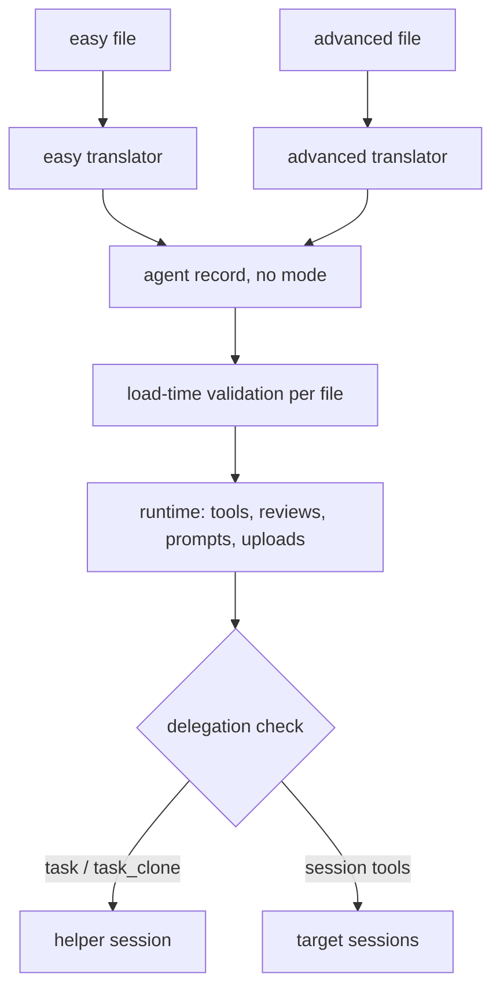

# One agent record for easy and advanced agents - Plan

## Goal Capsule

- **Objective:** An easy agent and an advanced agent that ask for the same thing behave the same way. Delegation between agents follows one explicit rule. No user-visible or stored name says `cron` any more, apart from existing run IDs and the cron-expression schedule syntax.
- **Means:** `mode:` only picks the translator that turns a file into one shared agent record with no `mode`; the runtime reads only that record (KTD1).
- **Authority:** Key Decisions K1-K24 below were settled with the user and govern product behavior; KTDs govern mechanism; units never override either.
- **Stop conditions:** stop and report if a settled decision proves infeasible or destructive, if the Go source line budget cannot be met after U1 and U9's dead-code removal, or if a stored-data migration cannot preserve existing runs.
- **Execution profile:** one PR, two commits: U1 alone first (frees line budget, a fix to `main`), then U2-U9 as one commit.
- **Finish and ship:** the implementing agent runs the Verification Contract, then commits, pushes and opens the PR.

---

## Product Contract

### Summary

Easy and advanced agent files become two formats for one agent record. Behavior that differed by kind either becomes the same for everyone or becomes a plain field each translator fills in. Delegation gets one sender-side target rule with hermetic sudo agents and two explicit tools, `task` and `task_clone`. The remaining internal `cron` names, stored, sent and logged, become `routine`.

### Problem Frame

The two formats load into one Go type, but about 70 places outside the loader still ask which kind an agent is or re-read its raw frontmatter. The two kinds drifted apart in those places: an advanced emulated agent's shell is fenced while its file tools are not, typed `/skill` arguments run as commands for advanced agents only, uploads land where some agents cannot open them, a bad schedule fails every agent's routines, and two receiver lists with different rules guard delegation that `task` ignores.

### Key Decisions

- K1. **File tools follow the working folder.** (session-settled: user-directed — chosen over keeping workspace-wide file tools for advanced emulated agents: the fence must cover file tools as well as the shell) Governs R1.
- K2. **Web fetch obeys `allowedNetworkTargets` whenever an agent has the list.** (session-settled: user-directed — chosen over rules-only web fetch for advanced emulated agents: one network fence for shell and tool) Governs R2.
- K3. **Skill `!` commands run before arguments go in, for every agent.** (session-settled: user-directed — chosen over the OpenCode order: typed arguments must never run; no checked deployment uses arguments inside commands) Governs R3.
- K4. **Body and skill `!` lines run in host bash with the agent's secrets, for every agent.** (session-settled: user-directed — chosen over the agent's own shell: lines come from the trusted file author; no checked deployment changes) Governs R4.
- K5. **Scripts use the two existing toggles only; easy compiles to block `auto`, turned-on tools `allow`, others `deny`.** (session-settled: user-directed — chosen over a named "script approval covers calls" setting: the toggles already express it) Governs R5, R6.
- K6. **No decision-model first look in permission reviews; the `decision` tool stays.** (session-settled: user-directed — chosen over splitting the setting into two fields: the reviewer subsession with structured output is enough) Governs R7.
- K7. **Any error in an agent file fails only that agent's load.** (session-settled: user-approved — chosen over today's mix of turn-time failures and whole-reload failures) Governs R8.
- K8. **Advanced files fail on unknown top-level keys.** (session-settled: user-approved — chosen over lenient advanced files: typos must surface) Governs R9.
- K9. **One uploads folder, `.rocketclaw/uploads/<chat>/`.** (session-settled: user-approved — chosen over two folders chosen by setup: one code path, fixes emulated advanced agents) Governs R10.
- K10. **The Slack plain-text reply default goes.** (session-settled: user-directed — chosen over keeping it: Web renders Markdown) Governs R11.
- K11. **Shadows of either kind follow parents of either kind.** (session-settled: user-approved — chosen over the kind-match rule: the shared record removes its reason) Governs R12.
- K12. **One sender-side target rule for `task` and every session tool; receiver lists go.** (session-settled: user-directed — chosen over receiver lists and over both sides agreeing) Governs R13, R14.
- K13. **Advanced targets live in `task:` rules; `rocketclaw_sessions` only grants the tools.** (session-settled: user-directed — chosen over a new `delegate:` key: existing rules already carry per-target actions) Governs R13, R15.
- K14. **Easy targets are `- agent: name` entries in `subagents:`; no agent wildcards; reviewers borrow them unless `approver.subagents` replaces them.** (session-settled: user-directed — chosen over a separate `delegatesTo` key and over reviewers without session tools) Governs R16, R17.
- K15. **Self is a target like any other.** (session-settled: user-directed — chosen over implicit self: explicit everywhere) Governs R18.
- K16. **Sudo agents are hermetic: nothing starts, writes or reads them, except sudo agents may read them.** (session-settled: user-directed — chosen over permission-controlled access; confirmed after usage showed only one-off reads; a later user decision adds that a sudo agent's explicit `task` deny on another agent also blocks its session tools on that agent) Governs R19.
- K17. **Built-in agents get no special rule.** (session-settled: user-directed — chosen over hermetic built-ins; protecting chats like `voice` is deferred to a later broader design; `voice` was later removed from RocketClaw, leaving `main` the only built-in agent) Governs R20.
- K18. **Two tools, `task` and `task_clone`, all fields required, values enumerated.** (session-settled: user-directed — chosen over one tool with optional fields; name chosen by a three-model council over `task_copy`) Governs R21, R22.
- K19. **Model wildcards in `subagents:` stay.** (session-settled: user-directed — chosen over full model names only) Governs R22.
- K20. **`maxRecursion` defaults to 1 for both kinds and `-1` is gone.** (session-settled: user-directed — chosen over 3 and over keeping unlimited) Governs R23.
- K21. **Database names change by migration; existing run IDs stay.** (session-settled: user-approved — chosen over rewriting run IDs and over code-only renames) Governs R24.
- K22. **Wire names change; mixed-version remote servers briefly show routine runs as plain chats.** (session-settled: user-approved — chosen over keeping wire names) Governs R25.
- K23. **Log events and the model-facing source take routine names.** (session-settled: user-approved — chosen over keeping `cron_*` events and `Cron` headers) Governs R26, R27.
- K24. **One PR, line budget freed in its own first commit.** (session-settled: user-directed — chosen over three PRs) Governs nothing in product scope; see Goal Capsule.

### Requirements

**Record and runtime**

- R1. An agent with a working folder has `read`, `glob`, `grep` and `apply_patch` limited to that folder plus its read-only folders.
- R2. When an agent has `allowedNetworkTargets`, `webfetch` reaches only those targets; permission rules still decide review inside them.
- R3. Skill `!` commands run on the skill text before `/skill` arguments are substituted, for every agent.
- R4. `!` lines in an agent's body and its skills run in host bash, from the workspace, with the agent's secrets when it has any.
- R5. Calls inside an `execute` script follow the per-tool rules; an easy file's turned-on tools are `allow`, the rest `deny`, and its script block `auto`.
- R6. A `bash` call with text stdin inside a script that a review approved is reviewed again, for every agent.
- R7. Permission reviews have no decision-model first look; `approver.decision`, advanced `decision:` and `auto_approver_decision` are gone.
- R8. Any error in an agent file, including bad tag groups, a bad or duplicate routine schedule, or an unknown model provider, makes only that agent fail to load, shown in the warning strip.
- R9. An advanced file with an unknown top-level key fails to load.
- R10. Web uploads go to `.rocketclaw/uploads/<chat>/` for every agent; older files in `artifacts/uploads` keep their cleanup.
- R11. Advanced agents get a reply hint only from their own `additionalInstructions`; easy agents get none.
- R12. A shadow of either kind may follow a parent of either kind.

**Delegation**

- R13. A non-sudo agent may act on another agent, by `task` or any session tool, only when its own file names that agent as a target.
- R14. `delegatedFrom` and `rocketclaw_sessions_recipient` are gone; a leftover easy `delegatedFrom` fails loading.
- R15. To use session tools on another agent's sessions, an advanced agent needs both the session tools and a `task:` rule for that agent.
- R16. An easy agent names targets as `- agent: name` entries in `subagents:`; its approver reviews each send, through the `task` gate or the script review.
- R17. An easy agent's reviewer may use session tools on the agent's targets, or only on its own `approver.subagents` list when one is set.
- R18. A non-sudo agent uses session tools on its own sessions only when it names itself, a Slack Channel Session writing into its own Thread Sessions included.
- R19. No agent starts, writes into or reads a sudo agent's sessions, except that a sudo agent may read another sudo agent's sessions; a sudo agent may act on anything else, its own sessions included, except an agent other than itself that one of its `task` rules denies, which neither `task` nor any session tool reaches (a later user decision; with no matching rule it is not refused, and `"*": deny` blocks every other agent).
- R20. Built-in agents are ordinary targets; `task` still refuses sticky targets.
- R21. `task(agent, description, prompt)` starts a named agent, appears only when the agent has targets, and lists as allowed values the loaded agents its `task` rules allow or send to review.
- R22. `task_clone(model, tools, description, prompt)`, gated only by the caller's copy models, starts a copy of the caller with its instructions and a helper note, on one of its copy models (exact entries listed, wildcard patterns stated), with its tools or a subset.
- R23. `maxRecursion` defaults to 1, counted from the top-level agent, and must be 0 or more.

**Routine names**

- R24. Stored column and value names say `routine`; existing runs keep their IDs and still list and open; new runs get `routine:` IDs.
- R25. The server and Web exchange routine-named methods, fields and kinds.
- R26. Routine runs log `routine_started` and `routine_completed`.
- R27. Models see `Routine` as the source of routine runs in message and review headers.

### Acceptance Examples

- AE1. **Covers R13, R18.** **Given** an advanced agent with session tools and `task: {writer: allow}`, **when** it calls `rocketclaw_sessions_get` on a `writer` session, its own session, and a `lead` session, **then** the first succeeds and the other two are refused.
- AE2. **Covers R19.** **Given** a non-sudo agent with `task: {"*": allow}`, **when** it lists sessions or gets a `main` session, **then** `main`'s sessions are absent from the list and the get is refused; a sudo agent lists and reads them but cannot write.
- AE3. **Covers R8.** **Given** two agents with routines, one with `routines: ["every 30min"]`, **when** RocketClaw reloads, **then** only that agent fails to load and the other's routine still runs.
- AE4. **Covers R3.** **Given** an advanced agent's skill with ``!`echo hi` ``, **when** a person sends `/skill-name !`date``, **then** the model sees `hi` and the literal text ``!`date` ``.
- AE5. **Covers R24.** **Given** a stored run `cron:agents/a.md#1h:…`, **when** the migration runs, **then** the run still lists on the Routines page and opens, and the next run of that routine has a `routine:` ID.

### Scope Boundaries

- Protecting chats such as `voice` from wildcard targets is deferred to a later design (K17). `voice` was later removed from RocketClaw, so no built-in agent remains that wildcard targets reach.
- Spaces play no part in delegation.
- The editor gains the new `subagents:` entries but no new editing modes.

### Outstanding Questions

None block implementation; see Assumptions.

---

## Planning Contract

### Key Technical Decisions

- KTD1. **The record replaces `Mode`, `Frontmatter` and `PermissionSet.Easy` with behavior fields.** The record gains a working-folder flag through `CustomShell`, `ReplyHint string`, `Targets` (the caller's `task` rule patterns with their actions), `CloneModels []string`, `TagGroups`, `ApproverTargets` and drops `ApproverDecision`. Each runtime `mode` check reads one of these instead. Implements K1-K5, K10-K15.
- KTD2. **One `delegation` check in `harness`, used by `task` and the backend session tools.** It answers whether an agent is a target: a non-sudo caller's `task` rule other than `deny` makes it one, the self rule applies, and the hermetic sudo rule refuses any session whose top-level session belongs to a sudo agent (sudo callers may read). The `task` gate keeps its allow/deny/review result from the rule; session tools use the check only for membership and keep their own `rocketclaw` review action. `task_clone` does not use it. Implements K12, K13, K15, K16.
- KTD3. **Easy translator emits `task` rules from `- agent:` entries as `auto`.** The advanced and easy formats then feed one rule set. Implements K14.
- KTD4. **Load-time validation lives in `harness.LoadAgents`, and a failing file drops only its agent.** `parseAgentRoutines` checks schedules with the existing `config.ParseCronSchedule`; provider checks apply to both kinds through `AgentLoadConfig.Providers`; unknown advanced keys are checked against the advanced key set `agent_settings.go` lists; tag groups are checked there too. `loadAgentDefinitions` stops joining primary-agent errors into one fatal error: `readRocketCodeDefinitionsIn` turns each into an "Agent X was not loaded" warning and drops that agent. The agent-draft check still reports the draft file's own error. Implements K7, K8.
- KTD5. **Migration 116 renames in place.** `ALTER TABLE ... RENAME COLUMN` for the `cron_*` columns (the generated `search_words` column and indexes follow by attribute), `ALTER INDEX ... RENAME` for `conversations_cron_runs`, updates of the kind values and `created_by`, and a rename of the top-level `Cronjob` JSON key in `turns.inbound_json`, `turns.outbound_json`, `shadow_turns.inbound_json` and `conversations.producer_inbound_json`, with the reverse in Down. Existing IDs are untouched. Implements K21.
- KTD7. **The delegation rule is checked by a TLA+ model and a differential run before its code is accepted.** `docs/verification/one-agent-record/` holds a TLA+ model of the old and new "may A act on B" rules over a finite world of callers, targets, rules and operations; TLC checks the settled properties (sudo agents unreachable except sudo reads, nothing reached unless named, self only when named, `task_clone` never widens tools) and that every old/new difference is one the settled decisions name. A differential run sends the same scenarios through the real code at `main` and at the change, and its differences must equal the model's. The PlusCal/TLC stateful-design pack does not otherwise apply: no part of this change depends on event order between actors, crashes or retries. (session-settled: user-directed — chosen over tests alone and over Lean proofs: a checked spec of the settled decisions, tied to the real code)
- KTD6. **`web.proto` renames are regenerated with `go generate ./internal/rocketclaw/frontend/rpc`; the Web follows by hand.** Implements K22.

### Assumptions

- Sessions whose agent is not a loaded agent (retired agents, remote OpenCode sessions, Slack threads of removed agents) are not targets of session tools for non-sudo agents; sudo agents still reach them. The same holds for every session whose top-level session's agent is not loaded, so a sudo chat stays closed when its agent is disabled or fails to load.
- Pending queue items stored with origin metadata `Cron` fall back to their source-based origin after the upgrade.
- A Web session switched from a sudo agent to a non-sudo agent is judged by its current agent, so its earlier sudo turns become readable by the new agent's targeters.
- The cleanup of old `artifacts/uploads` files stays until those files age out of the 90-day retention window; removing it is later work.

### High-Level Technical Design

### Sequencing

U1 lands as its own commit. U2 defines the record fields every later unit reads, so it comes first in the second commit. U3, U4 and U5 build on U2. U6 is independent of U3-U5 but shares files with U5 (`session_tools.go`), so it follows U5. U7 and U8 follow the behavior they describe. U9 runs last.

---

## Implementation Units

| U-ID | Title | Key files | Depends on |
|---|---|---|---|
| U1 | Remove the decision-model first look | `harness/permission_review.go`, `config/config.go` | none |
| U2 | Mode-free record and translators | `harness/agents.go`, `harness/easy.go`, `harness/permission.go` | U1 |
| U3 | Runtime reads the record | `harness/tools.go`, `harness/webfetch.go`, `harness/permission_gate.go`, `backend/bridge.go` | U2 |
| U4 | Load-time validation | `harness/agents.go`, `frontend/cron/manager.go` | U2 |
| U5 | Delegation | `harness/tasks.go`, `backend/session_tools.go` | U2, U3 |
| U6 | Routine names | `backend/migrations/116_*.sql`, `web/proto/web.proto`, `frontend/cron/` | U5 |
| U7 | Agent editor | `backend/agent_drafts.go`, `harness/agent_settings.go`, `web/src/agent-editor/` | U2, U5 |
| U8 | Docs and bundled content | `README.md`, `CONCEPTS.md`, `skel/` | U2-U7 |
| U9 | Budgets and full verification | `Makefile` targets | U1-U8 |

### U1. Remove the decision-model first look

- **Goal:** permission reviews go straight to the reviewer subsession (K6).
- **Requirements:** R7.
- **Files:** `internal/rocketclaw/harness/permission_review.go` (`decideReview`, gate selection), `harness/agents.go` and `harness/easy.go` (`decision` keys, `ApproverDecision`), `harness/rocketcode.go` (`AutoApproverDecisionModel`, `AutoApproverMinConfidence`), `config/config.go` (`AutoApproverDecision`), `backend/bridge.go` (config wiring), `harness/agent_settings.go`, tests in `harness/permission_review_test.go`, `harness/easy_test.go`, `harness/agents_test.go`, `config/config_test.go`.
- **Approach:** delete the gate path and its prompts; keep `decision.go`'s `decisionTool` and `Deciders`. Docs for the removed keys go in this commit too.
- **Test scenarios:** a review with decision providers configured still runs the reviewer subsession and returns its verdict; an easy file with `approver.decision` fails to load as an unknown key; a `rocketclaw.json` with `auto_approver_decision` follows the config's existing unknown-key behavior.
- **Verification:** `make check-cloc-budget` reports more lines left than before.

### U2. Mode-free record and translators

- **Goal:** both translators produce the same record shape; nothing outside them reads `Mode`, `Frontmatter` or `PermissionSet.Easy` (KTD1).
- **Requirements:** R5, R11, R14, R16, R17, R22, R23.
- **Files:** `harness/agents.go`, `harness/easy.go`, `harness/permission.go` (`Easy`, `Enabled`), `harness/rocketcode.go`, `backend/session_tools.go` (`agentTagGroups`, `agentRecipients`, `setSessionTagTools`), `backend/bridge.go` (`buildPrompt`, shadow mode check), `skel/builtin/agents/voice.md` (drop `delegatedFrom`; the file went away when `voice` was later removed), tests in `harness/agents_test.go`, `harness/easy_test.go`, `backend/definitions_test.go`.
- **Approach:** easy compiles turned-on tools to `allow` and the script block to `auto` (K5); `- agent:` entries become `auto` task rules (KTD3); `subagents:` model strings become `CloneModels`, and the translator's implicit `task: <self>: allow` goes; advanced reads `rocketclaw_set_tag` and `additionalInstructions` into fields; `maxRecursion` defaults to 1 and rejects negatives; receiver-list parsing goes.
- **Test scenarios:** an easy file and an advanced file with the same targets, tags and reply hint produce equal fields; `subagents: [m, {agent: w}]` yields one clone model and one `auto` target; `{agent: "*"}` fails; an easy agent with only model entries has no targets; an easy `delegatedFrom` fails as unknown; `maxRecursion: -1` fails; no `maxRecursion` gives 1.
- **Verification:** the compiler rejects every remaining use of the removed `Mode` field; `rg -n 'AgentModeEasy|AgentModeAdvanced|\.Frontmatter\b|Permission\.Easy' internal/rocketclaw --glob '!**/*_test.go' --glob '!**/oc/**'` matches only the translators and the agent editor.

### U3. Runtime reads the record

- **Goal:** file tools, web fetch, skill and prompt expansion, script reviews, uploads and shadows behave by record fields (K1-K5, K9-K11).
- **Requirements:** R1-R6, R10-R12.
- **Files:** `harness/tools.go` (file tools and webfetch selection, skill expansion order), `harness/prompts.go` (`forAgent`), `harness/webfetch.go`, `harness/permission_gate.go`, `harness/permission_review.go` (script rule text), `frontend/rpc/attachments.go`, `backend/attachments.go`, `backend/easy_turn.go`, `backend/bridge.go` (shadow load check), tests in `harness/tools_test.go`, `harness/webfetch_test.go`, `harness/permission_gate_test.go`, `harness/prompts_test.go`, `backend/easy_turn_test.go`, `frontend/rpc/server_test.go`.
- **Approach:** folder-limited tools and the shell's own web fetch client (`easyWebFetchClient(NetworkTargets)`, public addresses only when the list is unset) whenever the agent's shell has a folder; expansion before argument substitution for all; host-bash expansion with secrets for all; the stdin re-review keyed on "script approved by review"; the review prompt describes inner calls accurately whether or not rules review them; uploads always to the per-chat folder.
- **Test scenarios:** an advanced `shell: emulated` agent's `read ../x` is refused; its `webfetch` to an unlisted host is refused; an easy agent without a network list is refused a private address; AE4; an advanced agent's body `!` line runs on the host; an easy script calling an allowed tool runs without a second review while a `bash` call with text stdin is reviewed; a sudo agent's inner `auto` call is still reviewed; an advanced upload lands in `.rocketclaw/uploads/<chat>/`; an easy shadow under an advanced parent loads.
- **Verification:** the listed test files pass, including the Linux emulated-shell tests.

### U4. Load-time validation

- **Goal:** every file error fails only its own agent (K7, K8).
- **Requirements:** R8, R9.
- **Files:** `harness/agents.go` (`parseAgentRoutines`, provider check, unknown keys), `config.ParseCronSchedule` (called, unchanged), `frontend/cron/manager.go` (`loadDefinitionsIn` stops validating), `backend/definitions.go` and `backend/bridge.go` (`loadAgentDefinitions`, `readRocketCodeDefinitionsIn`, built-in provider checks), `backend/session_tools.go` (`checkedAgentTagGroups`), `backend/agent_drafts.go` (draft check), tests in `harness/agents_test.go`, `frontend/cron/manager_test.go`, `cmd/rocketclaw/assemble_test.go`.
- **Approach:** per KTD4.
- **Test scenarios:** AE3; a duplicate schedule fails only its agent; the agent editor still shows a draft's own load error; an advanced file naming an unknown provider fails at load; `sudu: yes` fails; bad tag groups fail at load with the file named.
- **Verification:** reload of a workspace with one bad file keeps every other agent's routines scheduled.

### U5. Delegation

- **Goal:** one sender-side target rule with hermetic sudo, served by `task`, `task_clone` and the session tools (K12-K20).
- **Requirements:** R13-R23.
- **Files:** `harness/tasks.go` (two tools, enum schemas, sticky refusal kept), `harness/delegation.go` (new, KTD2), `backend/session_tools.go` (per-tool checks, list filtering, recipient code removed), `backend/bridge.go` (`maxRecursion` budget), `harness/rocketcode.go`, tests in `harness/tasks_test.go`, `backend/session_tools_test.go`, `backend/active_turn_test.go`.
- **Approach:** per KTD2; `task` appears only when targets exist and `task_clone` only when copy models exist; `task_clone.model` accepts listed entries or a name matching a listed wildcard; the reviewer of an easy agent uses `ApproverTargets` falling back to the agent's targets; the Slack channel-to-own-thread write exception goes (R18).
- **Test scenarios:** AE1; AE2; a `task` call naming a sticky target is refused with the session-write hint; `task_clone` with a tool the parent lacks is refused; `task_clone` with a model outside entries and patterns is refused; an agent without targets has no `task`, and one without targets or copy models has neither tool; a non-sudo agent naming `writer` cannot list or get the Delegation History `main` started on `writer`; `task: {"*": allow}` lists every loaded non-sudo, non-sticky agent as an allowed `agent` value; `voice` is writable by an agent with `task: {"*": allow}` (dropped when `voice` was later removed); a second-level helper under a default top-level agent cannot delegate.
- **Verification:** `make -C docs/verification/one-agent-record` passes and the differential run's differences equal the model's agreed list (KTD7); `rg -n 'delegatedFrom|rocketclaw_sessions_recipient|subagent_type' internal/rocketclaw --glob '!**/*_test.go' --glob '!**/oc/**'` finds nothing.

### U6. Routine names

- **Goal:** stored, wire, log, header and code names say `routine` (K21-K23).
- **Requirements:** R24-R27.
- **Files:** `backend/migrations/116_routine_names.sql` (new), `backend/store.go`, `backend/store_dao.go`, `backend/conversations.go`, `backend/origin.go`, `backend/session_search.go`, `backend/session_tools.go` (created-by and origin names, search help text), `backend/bridge.go` (origin `Routine`), `protocol/cron.go` and `protocol/types.go`, `frontend/cron/` renamed to `frontend/routine/`, `config/cron.go`, `cmd/rocketclaw/cron.go`, `web/proto/web.proto` and generated `frontend/rpc/web.pb.go`, `frontend/rpc/server.go`, `frontend/rpc/transport.go`, `frontend/rpc/http.go`, `web/src/api.ts`, `web/src/types.ts`, `web/src/ui.tsx`, `.mockery.yml`, tests across `backend/`, `frontend/rpc/`, `web/src/`.
- **Approach:** per KTD5 and KTD6; new run IDs use `routine:` and `one-off-routine:` prefixes; the migration has a Down section.
- **Test scenarios:** AE5; a migration test seeds old column values and a waiting routine turn whose JSON has a `Cronjob` key, and checks the renamed columns, kinds, `created_by` and that the turn still runs as a routine; the Web lists a `ROUTINE_RUN` session with its routine badge; a routine run's prompt header says `Routine`; `routine_completed` is logged with an outcome.
- **Verification:** `rg -n -i '\bcron' internal/rocketclaw --glob '!**/migrations/0*' --glob '!**/*_test.go' --glob '!vendor' --glob '!**/oc/**'` finds only the cron-expression parser, its library import, retired-name migration text, and old-ID handling.

### U7. Agent editor

- **Goal:** the editor writes and explains the new keys (K14, K18).
- **Requirements:** R14, R16, R22, R23.
- **Files:** `harness/agent_settings.go`, `backend/agent_drafts.go`, `backend/agent_draft_assistant.go`, `frontend/rpc/drafts.go`, `web/src/agent-editor/`, `web/src/drafts.ts`, tests in `backend/agent_drafts_test.go` and `web/src/agent-editor*.test.ts`.
- **Approach:** `subagents` accepts and shows `- agent:` entries; removed keys leave the settings list; help text matches the new rules.
- **Test scenarios:** adding an agent entry in the editor saves `- agent: writer`; a draft with `delegatedFrom` shows a load error before save.
- **Verification:** the editor browser tests pass.

### U8. Docs and bundled content

- **Goal:** docs and skills describe one record, the delegation rule and routine names.
- **Requirements:** all, as documentation.
- **Files:** `README.md`, `CONCEPTS.md`, `internal/rocketclaw/skel/builtin/about.md`, `internal/rocketclaw/web/README.md`, `internal/rocketclaw/frontend/rpc/README.md`, bundled skills under `internal/rocketclaw/skel/.rocketclaw/skills/`.
- **Approach:** one release note listing every change people upgrading will notice, including refused sudo reads, the `maxRecursion` default, renamed log events, the Markdown reply default, the Slack channel-to-own-thread write needing the agent to name itself, and that an agent file which fails to load loses its routine runs' due follow-ups, so files must be fixed before upgrading.
- **Test expectation:** none -- documentation; `harness/skills_test.go` must still load the bundled skills.
- **Verification:** no remaining doc mention of removed keys or `cron` names outside history notes.

### U9. Budgets and full verification

- **Goal:** the change fits the source line and coverage budgets and passes every gate.
- **Requirements:** none directly.
- **Files:** none new.
- **Approach:** remove dead code left by U2-U6; if still over budget, stop and report per the Goal Capsule stop conditions.
- **Test expectation:** none -- gate run.
- **Verification:** the Verification Contract table passes.

---

## Verification Contract

| Gate | Command | Proves |
|---|---|---|
| Format | `gofmt -l` on touched Go files prints nothing | Go formatting |
| Generate | `go generate ./internal/rocketclaw/frontend/rpc ./internal/rocketclaw/internal/web` leaves no diff after commit | proto and bundle current |
| Lint | `make lint` and `make -C internal/rocketclaw/web lint` | linters, react-doctor |
| Tests | `ROCKETCLAW_TEST_DATABASE_URL=… make test` and `make -C internal/rocketclaw/web test` | behavior, browser tests |
| Budgets | `make check-cloc-budget`; coverage check in `make test` | line budget, 91.8% coverage |
| Delegation model | `make -C docs/verification/one-agent-record` | settled delegation properties; old/new differences are only the agreed ones |

---

## Definition of Done

- Every requirement R1-R27 is covered by a passing test or, for R24-R27, by the migration and wire tests in U6.
- No runtime code outside the translators and the agent editor reads `Mode`, `Frontmatter` or `PermissionSet.Easy`.
- The PR has exactly two commits: U1, then U2-U9.
- Abandoned or experimental code from approaches that did not pan out is removed.
- The PR description names every change people upgrading will notice and contains no internal deployment names.
