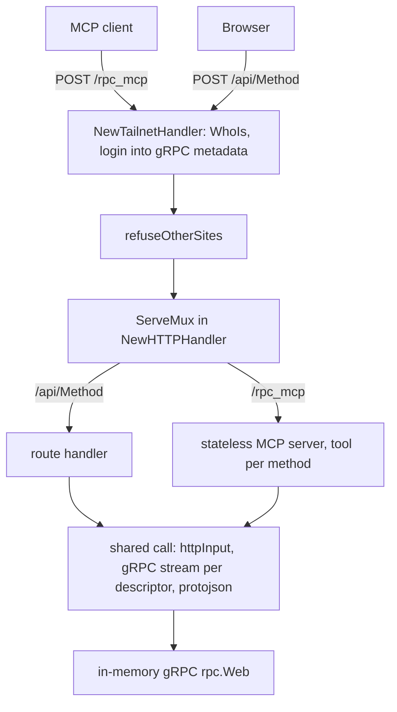

# Web RPC over MCP at /rpc_mcp - Plan

## Goal Capsule

- **Objective:** A tailnet user's MCP client (an agent) can do what the Web UI's request/response calls do, as that same user, by connecting to `/rpc_mcp` on the RocketClaw Web node.
- **Means:** One stateless go-sdk MCP server inside `NewHTTPHandler` whose tools are every Web RPC method with an `/api/<Method>` route, built from protobuf descriptors and sharing one call path with the unary `/api` routes (KTD1, KTD2, KTD8).
- **Authority:** This plan's requirements, then project `AGENTS.md`, then the KTDs. The `/api` behavior stays unchanged.
- **Execution profile:** One PR. Standard depth. Go only, in `internal/rocketclaw/frontend/rpc`, plus README docs.
- **Stop conditions:** Stop and report when the change cannot fit the Go source CLOC budget without an approved budget change, or when `make lint` requires a `//nolint`.

---

## Product Contract

### Summary

Add `POST /rpc_mcp` (and `GET /rpc_mcp`) to the Web HTTP handler. It serves a stateless streamable-HTTP MCP server with one tool per Web RPC method that has an `/api/<Method>` route, unary or streaming, named after the method. A tool takes the method's protobuf-JSON request as its arguments, runs the same validation and gRPC call as `/api`, and returns the protobuf-JSON response as text. Nothing is written per method, so the MCP surface follows the Web RPC automatically. Callers authenticate exactly as `/api` callers do, through the tailnet node.

### Problem Frame

The Web UI is RocketClaw's primary interface, and everything it does goes through `rpc.Web`. An agent that wants to drive RocketClaw for a person today has to speak the Web's private HTTP shape (`/api/<Method>` with hand-built protojson). MCP is the protocol agents already speak, so exposing the same RPC surface over MCP on the same node lets an agent act for a tailnet user without a separate API or credential.

### Requirements

**Endpoint and identity**

- R1. `/rpc_mcp` is served by `NewHTTPHandler`, so it inherits the tailnet WhoIs authentication and the cross-site refusal that `/api` routes have; it must not join the `/opencode/*/mcp` WhoIs bypass in `NewTailnetHandler`.
- R2. Every tool call runs as the caller of that HTTP request: two different users calling `Identity` through one handler each get their own username.
- R3. `GET /rpc_mcp` reaches the MCP handler (which answers 405 in stateless mode), not the Web app's HTML.

**Tools**

- R4. The tool list is exactly the Web RPC methods that have an `/api/<Method>` route, unary or streaming, each tool named exactly like its method, derived at runtime so a change to the Web RPC needs no MCP-specific edit.
- R5. A tool's arguments go through the same validation as `/api` (`httpInput`), so a bad call fails with the same message, such as `stem is required` for `RunCronJob` with `{}`. Absent arguments count as `{}`.
- R6. A successful tool returns the response as protojson text with default values emitted, the same bytes shape `/api` returns.
- R7. A failed call returns an MCP tool error (`isError: true`) whose text carries the gRPC code and message, such as a `PermissionDenied` for a person limited to spaces calling an editor method.
- R8. Each tool advertises its request's top-level field names (protojson names) in its input schema, so an agent can discover optional fields like `messageId` or `limit`.
- R9. The server's instructions describe only the translation, never a single method.
- R10. A method that streams responses returns a JSON array of every response; a method that streams requests takes them in order as `{"messages": [...]}`.
- R11. The access log names each tool a `/rpc_mcp` request called, one line per tool, so operators can audit agent calls as they audit `/api` calls.

### Scope Boundaries

- Methods served only on `/stream`, `/typing` and `/listing` (`Join`, `WatchTyping`, `WatchListing`) have no `/api` route and are not tools; agents poll `History` with `revision` instead.
- No new credential, header, or `_meta` identity source: identity comes only from the tailnet metadata already on the request.
- No change to `cmd/rocketclaw`: the route is reached through the existing `/` mount.

Non-goals considered and not built:

- Full nested JSON Schemas generated from protobuf descriptors. `httpInput` already validates at the boundary. Revisit if agents keep sending wrong nested shapes.
- A per-tool subset. Hiding human-checkpoint or destructive methods (`DecideProposal`, `AnswerQuestion`, `DeleteSession`, `DeleteSessionEntries`, `SaveBehaviorSettings`) would narrow the requested "expose RPC" and add a second list that can drift from `/api`; the server already authorizes each call as the person. Revisit if agents act on proposals or deletions people did not intend.
- MCP tool annotations (`readOnlyHint`, `destructiveHint`). Without them clients treat every tool as possibly destructive and keep asking the person; a wrong read-only hint would remove that prompt.
- Marking prompts as agent-sent. Nothing in the request asks for it, and the caller is the person; revisit if teammates need to tell agent and human prompts apart.

---

## Planning Contract

### Key Technical Decisions

- KTD1. **One shared, descriptor-driven call function used by the unary `/api/<Method>` routes and every MCP tool.** A package-level function takes the context, connection, method descriptor and a body `io.Reader`, validates each request with `httpInput`, opens the gRPC stream the descriptor declares with `grpc.MaxCallRecvMsgSize(math.MaxInt32)`, and marshals with `protojson.MarshalOptions{EmitDefaultValues: true}`; the `/api` upload route reuses its receive step. It returns failures as a gRPC `*status.Status`, never a `%w`-wrapped error: `codes.InvalidArgument` with the `httpInput` message, otherwise the status converted from the `Invoke` or marshal error. A wrapped status would make gRPC report the whole wrapped string as the message, changing `/api` error bodies that `TestHTTPReload` pins, and returning a status leaves `wrapcheck` nothing to flag. Reason for sharing: `NewHTTPHandler` is at gocyclo 30 (lint fails above 30), so the logic must leave it; sharing it also avoids a `dupl` finding and keeps `/api` and MCP from drifting.
- KTD2. **Stateless streamable HTTP, `PropagateRequestCancellation: true`.** In stateless mode the tool handler's context is the HTTP request's context, so the tailnet metadata reaches `connection.Invoke` (go-sdk `streamable.go`); stateful mode would run later calls with the first request's context and identity. Identity values always carry over; cancellation reaches the tool only for protocol `2026-07-28` clients (see Risks). Matches `backend/opencode_mcp.go` and `frontend/externalmcp/server.go`.
- KTD3. **`httpInput` takes an `io.Reader` instead of `w, r`.** Its two existing callers pass `http.MaxBytesReader(w, r.Body, 4<<20)`, keeping the `/api` 4 MiB limit. MCP passes the raw arguments, defaulting absent ones to `{}`. The go-sdk's own default 4 MiB body limit bounds MCP requests.
- KTD4. **Register `POST /rpc_mcp` and `GET /rpc_mcp`.** A method-less `/rpc_mcp` pattern panics against the existing `GET /` (verified on Go 1.26); POST alone sends GET to the Web app's HTML.
- KTD5. **Input schema is `type: object` with one property per top-level request field, named by its protojson JSON name.** Each property's description is its field comment (KTD10); a wrong kind or enum name fails at once in `httpInput` with a clear error. A method that streams requests wraps that schema as the items of a `messages` array. No `required` list and no nested schemas (`httpInput` enforces required fields).
- KTD6. **Tool errors are `isError` results whose text is the gRPC status error**, never a Go error return, following the `opencode_mcp.go` result shape.
- KTD7. **The formal-modeling pack does not apply.** The endpoint is a stateless adapter over existing RPCs: no queue, lease, retry, or worker state is added. (pack: formal-modeling, stateful-design.md)
- KTD8. **The tool set comes from the `/api` route table.** After every route is registered, each Web RPC method whose `/api/<Method>` pattern the mux holds for GET or POST becomes a tool; no separate method list exists.
- KTD9. **The Go source budget stays at 46250.** The change fits within it.
- KTD10. **Descriptions come from `web.proto` comments.** `go generate` writes the schema with its comments to `web.binpb`, which the server embeds and reads at startup; a tool's description is its `rpc` comment and a field's is its field comment. Every `rpc` carries a comment that names fields by their JSON names.

### High-Level Technical Design

### System-Wide Impact

- **Auth boundary unchanged.** `/rpc_mcp` sits behind `NewTailnetHandler` (WhoIs, tagged nodes refused) and `refuseOtherSites`, and every RPC still authorizes the caller server-side, so it grants nothing `/api` does not (R1, R2). Trusted `trusted_rocketclaws` pages can reach it as they reach `/api`. The go-sdk's localhost check never fires on the tsnet listener; leave it at its default.
- **Who calls changes.** Agents now hold the person's full authority, including methods whose only friction is a browser confirmation (`DeleteSession`, `DeleteSessionEntries`) or that are human checkpoints (`DecideProposal`, recorded as "accepted by <person>"; `AnswerQuestion`). Read tools (`History`, `SearchMessages`, `GetPage`) return text other people wrote into the agent's context. Kept for parity; see Scope Boundaries, and U3 documents it.
- **Any untagged tailnet device can already act as its owner through `/api`;** `/rpc_mcp` makes that easier, not new.
- **Resource limits match `/api`:** 4 MiB request bodies (go-sdk default; do not copy the 16 MiB of `opencode_mcp.go`) and the same unbounded gRPC receive size.

### Assumptions

- The MCP endpoint should expose the same methods as `/api`, not a curated subset (R4).
- Plain-text protojson results are enough; no `structuredContent` or output schema.
- MCP clients send no browser `Origin`/`Sec-Fetch-Site` headers, so `refuseOtherSites` admits them as it admits other non-browser clients.

### Risks

- **`Prompt` blocks for the whole turn.** MCP clients on protocols older than `2026-07-28` get no cancellation and often time out near 60 s while the prompt was delivered. The existing `messageId` dedup limits duplicates when a client sets one; no server change is planned. That dedup covers Web chats, Slack threads and shadow sessions only, and a deduplicated retry returns at once while the first turn may still run, so agents poll `History` to see when it ends.

---

## Implementation Units

### U1. Shared unary call path and reader-based `httpInput`

- **Goal:** `/api/<Method>` runs through one package-level call function that the MCP tools can reuse, with behavior unchanged.
- **Requirements:** R5, R6 (groundwork); KTD1, KTD3.
- **Dependencies:** none.
- **Files:** `internal/rocketclaw/frontend/rpc/http.go`; tests in `internal/rocketclaw/frontend/rpc/http_test.go` (existing).
- **Approach:**
  1. Change `httpInput` to read its body from an `io.Reader`; update the unary route to pass `http.MaxBytesReader(w, r.Body, 4<<20)`.
  2. Add the shared call function (KTD1) and make the `POST /api/<Method>` closure call it, then `httpRPCError` or `httpJSON`.
- **Patterns to follow:** existing error wrapping in `http.go` (`fmt.Errorf("...: %w", err)`); `docs/solutions/best-practices/wrapcheck-cross-package-helper-error.md`.
- **Test scenarios:**
  - Existing `TestHTTPBoundary` rows still pass unchanged, including `stem is required`, unknown-field and enum-name rejections.
  - Existing oversized-body behavior for `/api` still returns the same error.
- **Verification:** `/api` tests pass with no edits; `NewHTTPHandler` gocyclo drops below 30.

### U2. `/rpc_mcp` MCP server

- **Goal:** Tailnet users' MCP clients can list and call one tool per unary Web method at `/rpc_mcp`.
- **Requirements:** R1 to R9; KTD2, KTD4, KTD5, KTD6.
- **Dependencies:** U1.
- **Files:** `internal/rocketclaw/frontend/rpc/http.go`; test in `internal/rocketclaw/frontend/rpc/http_test.go`.
- **Approach:**
  1. After every route is registered, build one `mcp.Server` with instructions per R9 and add a tool per method per KTD8, calling the U1 function with the tool context and arguments.
  2. Build the input schema per KTD5.
  3. Wrap it in `mcp.NewStreamableHTTPHandler` per KTD2 and register both routes per KTD4.
- **Patterns to follow:** `internal/rocketclaw/backend/opencode_mcp.go` (raw `AddTool`, text results); `internal/rocketclaw/backend/opencode_mcp_test.go` (MCP client against `httptest`).
- **Test scenarios:** one test next to `TestHTTPReload`, using its mock-backend harness, `startHTTPTestServer`, and an `mcp.Client` over `StreamableClientTransport` at `server.URL + "/rpc_mcp"`.
  - `ListTools` returns exactly the methods with an `/api` route, and every tool's schema lists its request's protobuf JSON field names (`messages` for a method that streams requests).
  - A database-backed test uploads a file in two chunks, downloads an image byte for byte and lists sessions over MCP (R10).
  - Calling `Reload` with `{"reason":"updated assets"}` returns the protojson message text, and the mock records one call with that reason.
  - Calling `Identity` with no arguments as `alice`, then through a `bob`-signed-in server sharing the same `NewHTTPHandler`, returns each caller's own username (R2).
  - Calling `RunCronJob` with `{}` returns `isError` with text containing `stem is required` (R5).
  - A gRPC error from the backend (for example `Reload` failing) returns `isError` with the code and message (R7).
  - `GET /rpc_mcp` answers 405, not the Web app (R3).
- **Seam:** this test catches the tool wiring, identity per request and error mapping; R1's wrappers are already pinned by `TestHTTPRefusesOtherSites` and `TestHTTPReload`, which cover every route on this mux.
- **Verification:** the new test passes; `make lint` passes without suppressions; CLOC stays under budget.

### U3. Documentation

- **Goal:** Operators and agent authors can find the endpoint and its rules.
- **Requirements:** R1, R4, R9.
- **Dependencies:** U2.
- **Files:** `internal/rocketclaw/frontend/rpc/README.md` (Identity boundary section, next to the OpenCode MCP bridge paragraph); `README.md` (one line in "MCP and scheduled jobs").
- **Approach:** State the route, that it is tailnet-authenticated like `/api` and every tool acts with the caller's full authority, the tool set and naming, protojson arguments and results, the stream shapes, and the methods without an `/api` route.
- **Test expectation:** none -- documentation only.
- **Verification:** the docs describe what U2's test pins, with no internal names.

---

## Verification Contract

| Gate | Command | Applies to |
|---|---|---|
| Format | `gofmt -l internal/rocketclaw/frontend/rpc` prints nothing | U1, U2 |
| Lint and tests | `make lint`, then `make -C internal/rocketclaw coverage-profile GOTESTPKGS=./frontend/rpc`; CI runs the full suite | all |
| Focused | `go test ./internal/rocketclaw/frontend/rpc/ -run 'TestHTTP'` with `TMPDIR` under `.tmp/` | U1, U2 |
| Budget | `make -s cloc` in `internal/rocketclaw` stays below 46250 | U2 |

---

## Definition of Done

- U1: `/api` behavior unchanged and existing tests green; `NewHTTPHandler` under the gocyclo limit.
- U2: the new MCP test covers every scenario listed and passes.
- U3: both READMEs describe `/rpc_mcp`.
- Lint and package tests pass with no `//nolint` and no source comments added; the Go source budget is unchanged (KTD9).
- No abandoned-attempt code remains in the diff.

---

## Sources

- `internal/rocketclaw/frontend/rpc/http.go` (`NewHTTPHandler`, `httpInput`, `NewTailnetHandler`), `transport.go` (`webUnaryMethods`, `editorMethods`).
- `internal/rocketclaw/backend/opencode_mcp.go` and `internal/rocketclaw/frontend/externalmcp/server.go`: existing stateless MCP servers and their tests.
- `vendor/github.com/modelcontextprotocol/go-sdk/mcp/streamable.go`: stateless context, 405 for GET, body limit; `server.go`: `AddTool` requires `type: object`.
- `internal/rocketclaw/Makefile`: `GO_SOURCE_CLOC_BUDGET`, unchanged at 46250 (KTD9).
